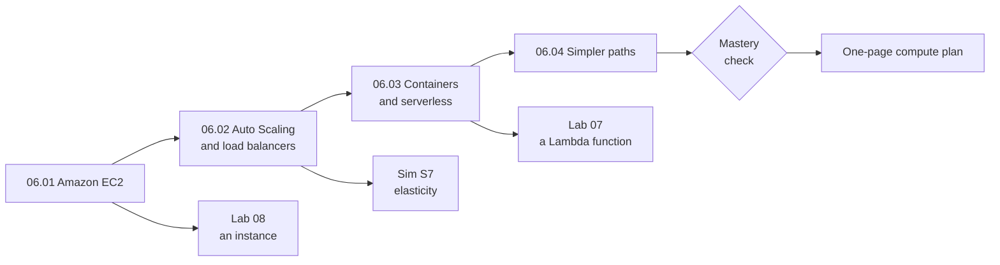

# Module 06: Choose where each of the bakery's programs runs, how it grows, and who patches it

This module teaches the ways AWS runs your code: virtual servers, containers and functions. By the end, you choose compute for three of the bakery's programs and explain how each one scales and who keeps it patched.

**For:** an adult studying alone, possibly new to IT, who wants to understand AWS and use it safely. You have finished Modules [02](../02-why-the-cloud/00-brief.md) to [05](../05-storing-data/00-brief.md) and the [guardrails primer](https://github.com/AutomateTheCloud/atc-study-aws_account_guardrails/blob/main/primer/00-read-this-first.md). **Time:** about 3.5 hours, over several sessions.

## The scenario: three programs, three kinds of load

The bakery's site runs on AWS, and its data has a home (Module 05). Now the owner asks where its programs should run.

| Program | What its load looks like | Lessons |
|---|---|---|
| **The order site** | Quiet at night, a lunch rush every day, six times busier in December | 06.01, 06.02 |
| **The photo resize** | Makes smaller copies of new cake photos: seconds of work per photo, run as photos arrive or in one nightly batch | 06.01, 06.03 |
| **The inventory app** | Tracks flour, butter and cake boxes; it came from its supplier as a container image | 06.03, 06.04 |

These details are made up. At the end you hand the owner a one-page compute plan: for each program, the service, how it grows and shrinks, what it costs, and which security updates stay with the bakery.

## You'll be able to

Tags: the kind of knowledge (C concept, J judgment) and what you do with it (Un understand, Ap apply).

| Objective | Lesson |
|---|---|
| **06.01a** Choose an EC2 instance family from a workload's bottleneck [C·Ap] | 06.01 |
| **06.02a** Explain how Auto Scaling and load balancers together give elasticity and high availability [C·Un] | 06.02 |
| **06.03a** Pick EC2, Fargate or Lambda for a workload, and say what you manage on each [J·Ap] | 06.03 |
| **06.04a** Match Elastic Beanstalk, Lightsail, Batch and Outposts to their uses [C·Ap] | 06.04 |

## What this covers on the exam

This module covers task [3.3](https://docs.aws.amazon.com/aws-certification/latest/cloud-practitioner-02/cloud-practitioner-02-domain3.html#cloud-practitioner-02-task3.3), compute services, in Domain 3 of the AWS Certified Cloud Practitioner (CLF-C02) exam. Lesson 06.02 adds the elasticity and high availability of task [1.1](https://docs.aws.amazon.com/aws-certification/latest/cloud-practitioner-02/cloud-practitioner-02-domain1.html#cloud-practitioner-02-task1.1), and each lesson applies task [2.1](https://docs.aws.amazon.com/aws-certification/latest/cloud-practitioner-02/cloud-practitioner-02-domain2.html#cloud-practitioner-02-task2.1), shared responsibility, in a "your side of the line" section. We checked the exam guide on 2026-10-24. Its "AWS Auto Scaling" is a separate service from Amazon EC2 Auto Scaling; lesson 06.02 explains.

## How the module is laid out

**Lessons** (about 25 minutes each):

1. [Amazon EC2](01-ec2.md)
2. [Auto Scaling and load balancers](02-auto-scaling-and-load-balancers.md)
3. [Containers and serverless](03-containers-and-serverless.md)
4. [Simpler paths](04-simpler-paths.md)

**Hands-on:**

- [Lab 07: a Lambda function](05-lab-07-a-lambda-function.md), with its logs set to expire.
- [Lab 08: launch and terminate an instance](06-lab-08-launch-and-terminate-an-instance.md), time-boxed to 30 minutes, because a server bills by the hour.
- [Simulation S7: elasticity with Auto Scaling](07-sim-elasticity-with-auto-scaling.md), on paper, because a load balancer bills by the hour.

Both labs run in your own AWS account and state their cost on the Free plan and the worst case on a Paid plan.

**Before the labs:** check that you still have [root MFA](https://github.com/AutomateTheCloud/atc-study-aws_account_guardrails/blob/main/primer/02-secure-the-root-user.md), [your IAM admin user with MFA](https://github.com/AutomateTheCloud/atc-study-aws_account_guardrails/blob/main/primer/03-your-everyday-admin-identity.md), [money alarms](https://github.com/AutomateTheCloud/atc-study-aws_account_guardrails/blob/main/primer/05-money-alarms.md) and the [EC2 safe defaults](https://github.com/AutomateTheCloud/atc-study-aws_account_guardrails/blob/main/primer/06-safe-defaults.md) in `us-east-1`. The lessons need no AWS account.

**Mastery check:** the module ends with a [mastery check](08-check.md); you pass at 80%. Each miss points you to the section to reread, then to a parallel retest.

**Numbers that change:** every price in this module is for US East (N. Virginia), dated 2026-10-24, with a link to the pricing page to check.

*Notice that each lesson takes away more of what you manage: from a whole server, to a group of servers, to containers and functions, to services that build the servers for you.*

**Long description.** Lessons 06.01 (Amazon EC2), 06.02 (Auto Scaling and load balancers), 06.03 (containers and serverless) and 06.04 (simpler paths), in order. Lesson 06.01 leads to Lab 08 (an instance), 06.02 to Simulation S7 (elasticity), and 06.03 to Lab 07 (a Lambda function). Lesson 06.04 leads to the mastery check, which leads to the one-page compute plan.

## Coming back

Warm-ups bring back Module 05 (EBS vs instance store; Multi-AZ), Module 04 (who patches what on EC2 and Lambda) and Modules 02 and 03 (the demand curve, elasticity, high availability).

---

"Module 06: Running applications: compute" by Automate the Cloud Inc., licensed under CC BY-NC 4.0 with the Additional Permission for Internal Training from Automate the Cloud Inc.
License: https://creativecommons.org/licenses/by-nc/4.0/
Permission: https://automatethe.cloud/licenses/atc-internal-training-permission.txt
