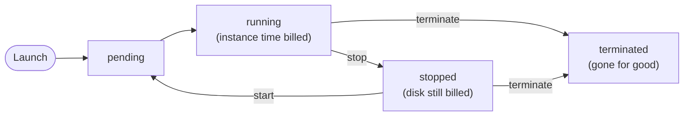

# Amazon EC2 rents you virtual servers: you pick the image, and you pick the instance type by what your work runs out of first

Amazon EC2 gives you a virtual server in minutes. You choose what runs on it (an image) and how much hardware it gets (an instance type). This lesson teaches you to choose the family from a workload's bottleneck, and what a stopped server still costs.

**For:** an adult studying alone, possibly new to IT, who wants to understand AWS and use it safely. **Time:** about 25 minutes. Reading works on a phone.

**Before you start:** this lesson builds on [Block, file and object storage](../05-storing-data/01-block-file-object.md) (EBS and instance store), [Security of vs in the cloud](../04-shared-responsibility-and-access/01-security-of-vs-in-the-cloud.md) and [Before and after: the demand curve](../02-why-the-cloud/02-before-and-after-the-demand-curve.md). If you skipped them, the key terms below are enough to follow. The scenario is in the [module brief](00-brief.md).

## Warm-up: what you remember

Answer from memory first.

1. An EC2 server keeps a cache on instance store and its files on an EBS volume. It is stopped overnight and started in the morning. What is still there?
2. Who installs security patches for the operating system on the bakery's EC2 web server: AWS or the bakery?
3. In one sentence: why does owning enough servers for December waste money in January?

Feedback

1. **The EBS data only.** A stop erases instance store (lesson 05.01).
2. **The bakery.** The guest operating system is on the customer's side of the line on EC2 (lesson 04.01).
3. Owned servers are a **fixed expense**: December's capacity is paid for all year and sits idle in January (lesson 02.02).

## What you'll learn

By the end, you can choose an EC2 instance family from a workload's bottleneck (objective 06.01a), read a type's name, tell types from purchasing options, and say what a stopped instance still costs.

Guess before you read on; the answers are in the lesson.

1. An analytics program loads a large data set into memory and keeps running out of it. Which kind of instance helps?
2. Is "Spot" an EC2 instance type?

## The big picture: five choices make an instance

**Amazon Elastic Compute Cloud (Amazon EC2)** rents you virtual servers, called **instances**, and you pay while they run ([What is Amazon EC2?](https://docs.aws.amazon.com/AWSEC2/latest/UserGuide/concepts.html)). When you launch one, you make five choices.

*Notice that only the second card decides how powerful the server is. The others decide what runs on it, where its disk is, and who can reach it.*

**Long description.** Five cards joined to one EC2 instance. 1, Amazon Machine Image (AMI): the operating system and software. 2, Instance type, highlighted: vCPUs, memory, storage and network speed. 3, Storage: an EBS root volume that lives apart from the instance. 4, Network and security group: its Availability Zone, and who may connect on which ports. 5, Access: a key pair, or EC2 Instance Connect with your IAM identity. The instance, billed while it runs, sits in one AZ of US East (N. Virginia).

## Key terms (skip if you know them)

- **Instance:** one virtual server in EC2. In everyday English an instance is "an example"; here it is a running server you pay for.
- **Amazon Machine Image (AMI):** a template for an instance: an operating system plus any preinstalled software.
- **Instance type:** a named size of hardware, such as `t3.micro`. **Instance family:** in AWS's naming, the part of a type's name before the dot, such as `m7g`; all its sizes share one balance of hardware. AWS sorts families into categories by the kind of work, such as "memory optimized", and this lesson's first section loosely calls those categories families too.
- **Bottleneck:** the resource a program runs out of first: processor, memory, disk speed or special chips.
- **vCPU:** a virtual processor. **GiB:** a unit of memory, slightly more than a gigabyte.
- **Purchasing option:** how you pay for an instance, such as On-Demand or Reserved. It doesn't change the instance type. (A few options, such as Dedicated Hosts, also decide whether the server is shared; Module 11 covers them.)

## An instance is a virtual server started from an image

You start every instance from an **AMI**: a preconfigured template holding the operating system and other software ([What is Amazon EC2?](https://docs.aws.amazon.com/AWSEC2/latest/UserGuide/concepts.html)). AWS publishes AMIs for common operating systems, and you can make your own from a server you set up.

Ten instances started from one AMI are identical, which is how Auto Scaling adds servers in the next lesson.

An instance moves through **states**. You pay for instance time only while it is running ([Amazon EC2 FAQs](https://aws.amazon.com/ec2/faqs/)).

*Notice that "stopped" can go back to "running", and "terminated" can't go anywhere.*

**Long description.** A flowchart of instance states. Launch leads to pending, then running, where instance time is billed. From running, stop leads to stopped, where the disk is still billed; start leads from stopped back to pending. Terminate leads from running or from stopped to terminated, gone for good.

> **Your turn:** The bakery's nephew sets up each new web server by hand, installing the same software every time. Give one reason to build an AMI instead.

Model answer

Every server started from it is identical and ready in minutes, with no steps to forget, and AWS can start new copies automatically when demand rises.

## Choose the family from the bottleneck

Find what the workload runs out of first, and the family follows. Every instance type has a balance of processor, memory, storage and network, and AWS groups the types into families by that balance ([Amazon EC2 instance types](https://docs.aws.amazon.com/ec2/latest/instancetypes/instance-types.html)).

*Notice that "general purpose" is the answer when nothing in particular runs out.*

This table is the long description of the graphic (examples from the [EC2 instance types page](https://aws.amazon.com/ec2/instance-types/), checked 2026-10-23):

| Family | Runs out first | Letters | AWS's example workloads |
|---|---|---|---|
| General purpose | Nothing in particular: a balance | M, T | Web servers, code repositories, small and medium databases |
| Compute optimized | Processor (CPU) | C | Batch processing, media transcoding, dedicated game servers |
| Memory optimized | Memory | R, X, U, z1d | In-memory databases, analytics on large data sets in memory |
| Storage optimized | Fast reads and writes to local disks | I, D, H | High-throughput databases, data processing and streaming |
| Accelerated computing | Work for GPUs or other special chips | P, G, Inf, Trn | Machine learning, graphics, floating-point calculations |
| HPC optimized | Very large, tightly linked computations | Hpc | Complex simulations, deep learning, visual effects |

Two families need a closer look:

- **Burstable (T) instances** run at a baseline level of processor use and burst above it using credits earned when quiet. They suit web servers and test systems that sit idle most of the time.
- **Storage optimized means heavy, fast use of the instance's own local disks, not just more space.** AWS builds these types for reading and writing very large data sets on local storage, and the D (dense storage) and H types do come with a lot of it ([Storage optimized instances](https://docs.aws.amazon.com/ec2/latest/instancetypes/so.html); [naming conventions](https://docs.aws.amazon.com/ec2/latest/instancetypes/instance-type-names.html)). If you only need more space, attach a bigger EBS volume or use S3 (Module 05).

The difference between families is easy to see in numbers. These three types have the same size name and the same 2 vCPUs:

*Notice that the memory doubles from family to family, while the price rises much less.*

| Type | Family | vCPUs | Memory | On-Demand, Linux, US East (N. Virginia), as of 2026-10-24 |
|---|---|---|---|---|
| `c7g.large` | Compute optimized | 2 | 4 GiB | $0.0725 an hour |
| `m7g.large` | General purpose | 2 | 8 GiB | $0.0816 an hour |
| `r7g.large` | Memory optimized | 2 | 16 GiB | $0.1071 an hour |

Source: AWS Price List for Amazon EC2, retrieved 2026-10-24; see [EC2 On-Demand pricing](https://aws.amazon.com/ec2/pricing/on-demand/) for today's prices.

### Worked example: a family for each of the bakery's jobs

An expert asks one question of each job: *what will it run out of first?*

1. **The web server.** Quiet at night, busy at lunch, never heavy for long. Nothing runs out, and the load comes in bursts: **general purpose, burstable**, such as a `t3.small`.
2. **The photo-resize job, run as one nightly batch.** Shrinking the day's photos keeps the processor busy for the whole run: **compute optimized** (C). Lesson 06.03 shows a way to run it without a server at all.
3. **The accountant's year-end analysis.** It loads every sale of the year into memory to compare them: **memory optimized** (R).
4. **Training a model that tags cake photos by flavor.** Machine learning on special chips: **accelerated computing** (P, G or Trn).

Bottleneck first, family second, size last.

> **Check:** A video company converts uploaded films into formats for phones and TVs. Its servers' processors run at full speed for hours. Which family fits?
>
> A. Memory optimized\
> B. Storage optimized\
> C. Compute optimized\
> D. General purpose

Feedback

**C is right.** Media transcoding keeps the processors busy; AWS lists it as a compute-optimized workload.

- **A is wrong.** Nothing says the data must fit in memory.
- **B is wrong.** Storage optimized is for fast reads and writes to local disks, not processor work.
- **D is wrong.** General purpose suits balanced loads; this one has a clear processor bottleneck.

## Read an instance type's name from left to right

A type's name gives its family and size: before the dot, the family, such as `m7g`; after it, the size. AWS's [naming conventions page](https://docs.aws.amazon.com/ec2/latest/instancetypes/instance-type-names.html) splits the family further: its first letter or letters are the **series**, which tells you the kind of work; then the generation; then any option letters. AWS's Savings Plans guide likewise treats `m5` as a family and `m5.xlarge` as one size in it ([Savings Plans types](https://docs.aws.amazon.com/savingsplans/latest/userguide/plan-types.html)).

*Notice that the first letter, the series, already tells you the kind of work: `m` is general purpose.*

**Long description.** `m7g.large` split into parts: `m`, the series (general purpose); `7`, the generation (higher is newer); `g`, an option letter, here an AWS Graviton processor, AWS's own Arm-based chip; `large`, after the dot, the size. Everything before the dot, `m7g`, is the family.

The naming conventions page lists every series and option letter; you don't need to learn them. Sizes step up inside a family. In the T3 family, as of 2026-10-24 in US East (N. Virginia):

| Type | vCPUs | Memory | On-Demand, Linux |
|---|---|---|---|
| `t3.micro` | 2 | 1 GiB | $0.0104 an hour |
| `t3.small` | 2 | 2 GiB | $0.0208 an hour |
| `t3.medium` | 2 | 4 GiB | $0.0416 an hour |

> **Your turn:** Decode `r7g.large`. Which family is it, and would it suit the accountant's analysis or the photo-resize job?

Model answer

`r` is the memory optimized series, `7` the generation and `g` a Graviton processor, so the family is `r7g`, a memory optimized one; `large` is the size. It suits the accountant's analysis, which holds a year of sales in memory; the resize job needs processor power, so a C type.

## Instance types are not purchasing options

Some study material calls On-Demand, Reserved and Spot EC2 instance types. They aren't. An **instance type** is hardware, such as `m7g.large`. A **purchasing option** is how you pay for that hardware ([Billing and purchasing options](https://docs.aws.amazon.com/AWSEC2/latest/UserGuide/instance-purchasing-options.html)). The same `m7g.large` can be paid for in any of these ways:

| Purchasing option | What you commit to | Suits |
|---|---|---|
| **On-Demand** | Nothing; for Linux, billed by the second with a 60-second minimum | Short or unpredictable work |
| **Savings Plans** | A dollar amount per hour for 1 or 3 years | Steady spending that may change shape |
| **Reserved Instances** | One instance configuration for 1 or 3 years | Steady use of the same type |
| **Spot Instances** | Nothing, but AWS can reclaim the instance with a two-minute warning | Flexible work that can be interrupted |

The mix-up has an official source: a list in the CLF-C02 exam guide calls these "instance types", so questions may use either meaning; read such a question as being about how you pay (task [4.1](https://docs.aws.amazon.com/aws-certification/latest/cloud-practitioner-02/cloud-practitioner-02-domain4.html#cloud-practitioner-02-task4.1)). Module 11 teaches the options, but here's a preview of what the choice is worth.

*Notice that the hardware in each pair is identical. Only the way of paying changes, and it cuts about a third.*

| Type | A year On-Demand | A year with a 1-year Standard Reserved Instance, no upfront |
|---|---|---|
| `t3.micro` | $91.10 | $56.94 |
| `t3.small` | $182.21 | $113.88 |
| `m7g.large` | $714.82 | $473.04 |
| `r7g.large` | $938.20 | $620.21 |

8,760 hours of Linux in US East (N. Virginia), from the AWS Price List, retrieved 2026-10-24.

> **Check:** Which of these is an EC2 instance type?
>
> A. Spot\
> B. `c7g.large`\
> C. Reserved\
> D. On-Demand

Feedback

**B is right.** `c7g.large` names hardware: compute optimized, 7th generation, Graviton, size large.

- **A, C and D are wrong.** Spot, Reserved and On-Demand are purchasing options: ways to pay for an instance type.

## Stopping pauses the instance bill; terminating ends it

**Stopping** an instance shuts it down so you can start it again later. **Terminating** deletes it for good. They cost very different amounts.

It's easy to assume that a stopped instance costs nothing. Not quite: AWS stops charging for instance time but keeps charging for its EBS volumes ([Amazon EC2 FAQs](https://aws.amazon.com/ec2/faqs/)). The assumption makes sense at first: the server is off and the largest charge stops. But the disk is still stored for you.

Public addresses matter too. AWS charges $0.005 an hour for each public IPv4 address, in use or idle (as of 2026-10-24, [Amazon VPC pricing](https://aws.amazon.com/vpc/pricing/)). The address an instance gets automatically is released when you stop it, so you get a new one on start. An **Elastic IP address**, a fixed public address you keep, is charged until you release it.

*Notice the second bar: small, but not zero, and it stays for as long as the stopped instance exists.*

| One `t3.micro`, 8 GiB gp3 volume, 730 hours | Instance | Public IPv4 | EBS volume | Month |
|---|---|---|---|---|
| Running all month | $7.59 | $3.65 | $0.64 | **$11.88** |
| Stopped all month | — | — (released) | $0.64 | **$0.64** |
| Stopped, Elastic IP kept | — | $3.65 | $0.64 | **$4.29** |
| Terminated, volume set to delete | — | — | — | **$0.00** |

US East (N. Virginia), from the AWS Price List, retrieved 2026-10-24. The 8 GiB volume is our example; check [EBS pricing](https://aws.amazon.com/ebs/pricing/) for today's rates.

Termination is permanent: it deletes the volumes set to delete on termination and any instance store data ([Terminate Amazon EC2 instances](https://docs.aws.amazon.com/AWSEC2/latest/UserGuide/terminating-instances.html)). In [Lab 08](06-lab-08-launch-and-terminate-an-instance.md), you launch one instance, see its public address, stop it, terminate it, and check that its volume is gone.

> **Your turn:** A developer stops a test instance on Friday and says, "It's off, so it's free until Monday." Correct her in two sentences, and say what to do if she won't need it again.

Model answer

Stopping ends the instance-time charge, but the EBS volume and any Elastic IP are still billed. If she won't need it again, she should terminate it, check that its volume is gone, and release any Elastic IP.

## Your side of the line on EC2

EC2 puts more on your side than any other compute service, because you run the operating system. Here's lesson 04.01's line for one instance ([Shared Responsibility Model](https://aws.amazon.com/compliance/shared-responsibility-model/)).

| Task | AWS | You |
|---|---|---|
| The building, the hardware, the host and its virtualization | ✔ | |
| The guest operating system and its security patches; the software you install | | ✔ |
| Security group rules: who may connect, on which ports | | ✔ |
| How people sign in, and never leaving SSH or RDP open to the world | | ✔ |
| EBS encryption, backups, and running in more than one AZ | | ✔ |

On [primer page 06](https://github.com/AutomateTheCloud/atc-study-aws_account_guardrails/blob/main/primer/06-safe-defaults.md) you turned on EBS encryption by default and made IMDSv2 the default in `us-east-1`. Those are settings, so they're yours. To sign in to a Linux instance without opening SSH to everyone, **EC2 Instance Connect** uses your IAM identity and a key that lasts 60 seconds, logs each connection in CloudTrail, and costs nothing extra ([EC2 Instance Connect](https://docs.aws.amazon.com/AWSEC2/latest/UserGuide/connect-linux-inst-eic.html)).

## What you pay for

You pay for instance time while running, EBS volumes while they exist, and each public IPv4 address; the dated figures are in the tables above. On the Free plan, these come out of your credits. For accounts created on or after 2025-07-15, AWS marks `t3.micro`, `t3.small`, `t4g.micro`, `t4g.small`, `c7i-flex.large` and `m7i-flex.large` as Free Tier eligible ([Track your Free Tier usage for Amazon EC2](https://docs.aws.amazon.com/AWSEC2/latest/UserGuide/ec2-free-tier-usage.html), checked 2026-10-24).

## In real work: data first, then the type

Engineers choose types the way you did, then check against measurements. The **performance efficiency** pillar calls this [PERF02-BP01 Select the best compute options for your workload](https://docs.aws.amazon.com/wellarchitected/latest/performance-efficiency-pillar/perf_compute_hardware_select_best_compute_options.html). The **cost optimization** pillar adds [COST06-BP02 Select resource type, size, and number based on data](https://docs.aws.amazon.com/wellarchitected/latest/cost-optimization-pillar/cost_type_size_number_resources_data.html). Building servers from a known, patched AMI is the **security** pillar's [SEC06-BP02 Provision compute from hardened images](https://docs.aws.amazon.com/wellarchitected/latest/security-pillar/sec_protect_compute_hardened_images.html).

## Summary

- **Five choices make an instance:** the AMI, the instance type, storage, the network and security group, and how you sign in.
- **An AMI is a template,** so every instance started from it is the same. You pay for instance time only while it runs.
- **Choose the family from the bottleneck:** general purpose for balance, compute optimized for processor, memory optimized for memory, storage optimized for fast local disks, accelerated computing for GPUs and other chips, HPC for huge linked computations.
- **A type's name** gives the family before the dot (series, generation and options, as in `m7g`) and the size after it, as in `m7g.large`.
- **Instance types aren't purchasing options.** On-Demand, Savings Plans, Reserved and Spot are ways to pay for a type.
- **A stopped instance still costs money** for its EBS volumes and any Elastic IP. Terminating ends the charges.

## Practice

1. **A company runs an in-memory database that must hold 500 GiB of data in RAM. Which instance family fits best?**

   A. Compute optimized\
   B. Memory optimized\
   C. Storage optimized\
   D. Accelerated computing

   

Feedback

   **B is right.** The bottleneck is memory, and AWS names in-memory databases as a memory-optimized workload.

   - **A is wrong.** Compute optimized adds processor power, not memory.
   - **C is wrong.** Storage optimized gives fast local disks; the data must be in RAM.
   - **D is wrong.** Accelerated computing adds GPUs and other chips for work such as machine learning.

   

2. **A manager says, "Let's change our web servers' instance type to Spot." What is wrong with the sentence, and what might the manager mean?**

   

Feedback

   **Spot isn't an instance type;** it's a purchasing option. The manager probably means paying for the same types as Spot Instances, which cost less but AWS can reclaim with a two-minute warning: fine for interruptible work, risky for the only web server.

   

3. **An instance is stopped for 30 days. Which charges continue?**

   A. Instance time only\
   B. EBS volume storage, and any Elastic IP address kept\
   C. Nothing, because the instance is off\
   D. Instance time and EBS storage

   

Feedback

   **B is right.** Stopping ends instance-time charges, but EBS volumes are billed while they exist, and an Elastic IP is billed until released.

   - **A and D are wrong.** No instance time is billed while stopped.
   - **C is wrong.** That's the misconception: the disk is still stored for you.

   

4. **(From lesson 02.02.) Is an On-Demand instance a fixed or a variable expense? Is a 1-year Reserved Instance?**

   

Feedback

   **On-Demand is variable:** you pay only for the time it runs. **A Reserved Instance behaves like a fixed expense:** you commit to a year whether you use the instance or not, in return for a lower rate.

   

5. **(From lesson 04.01.) For the bakery's EC2 web server, who does each task: (a) patching the guest operating system; (b) replacing a failed disk in the physical server; (c) writing the security group rules?**

   

Feedback

   (a) **The bakery:** the guest operating system is the customer's on EC2. (b) **AWS:** physical hardware is always AWS's. (c) **The bakery:** security group rules are settings, and settings are the customer's.

   

**Next:** [Auto Scaling and load balancers](02-auto-scaling-and-load-balancers.md), where one web server becomes a group that grows and shrinks.

## Where to check the current details

Checked 2026-10-23 or 2026-10-24:

- [What is Amazon EC2?](https://docs.aws.amazon.com/AWSEC2/latest/UserGuide/concepts.html) and [Amazon EC2 FAQs](https://aws.amazon.com/ec2/faqs/)
- [Amazon EC2 instance types](https://aws.amazon.com/ec2/instance-types/) and the [Instance Types Guide](https://docs.aws.amazon.com/ec2/latest/instancetypes/instance-types.html)
- [Billing and purchasing options](https://docs.aws.amazon.com/AWSEC2/latest/UserGuide/instance-purchasing-options.html) and [Terminate Amazon EC2 instances](https://docs.aws.amazon.com/AWSEC2/latest/UserGuide/terminating-instances.html)
- Prices: [EC2 On-Demand](https://aws.amazon.com/ec2/pricing/on-demand/), [Amazon VPC](https://aws.amazon.com/vpc/pricing/) (public IPv4) and [Amazon EBS](https://aws.amazon.com/ebs/pricing/) pricing pages; our figures come from the AWS Price List, retrieved 2026-10-24
- [AWS Certified Cloud Practitioner (CLF-C02) exam guide](https://docs.aws.amazon.com/aws-certification/latest/cloud-practitioner-02/cloud-practitioner-02.html), task [3.3](https://docs.aws.amazon.com/aws-certification/latest/cloud-practitioner-02/cloud-practitioner-02-domain3.html#cloud-practitioner-02-task3.3) (checked 2026-10-24)

---

"Amazon EC2: instances, images and instance types" by Automate the Cloud Inc., licensed under CC BY-NC 4.0 with the Additional Permission for Internal Training from Automate the Cloud Inc.
License: https://creativecommons.org/licenses/by-nc/4.0/
Permission: https://automatethe.cloud/licenses/atc-internal-training-permission.txt
