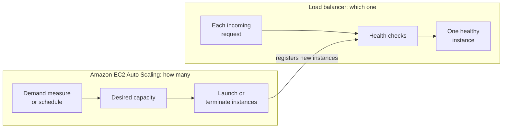
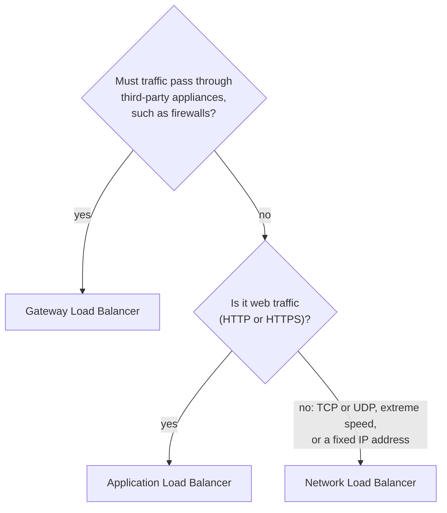

# Auto Scaling decides how many servers run; a load balancer decides which one gets each request

Two services turn one web server into a site that grows, shrinks and survives failures. Amazon EC2 Auto Scaling changes the number of instances to follow demand: elasticity. A load balancer gives customers one address and sends each request to a healthy instance in any Availability Zone; with instances in several zones, that gives high availability.

**For:** an adult studying alone, possibly new to IT, who wants to understand AWS and use it safely. **Time:** about 25 minutes. Reading works on a phone.

**Before you start:** read [Amazon EC2](01-ec2.md) first. This lesson also builds on [Telling the benefits apart](../02-why-the-cloud/03-telling-the-benefits-apart.md) (elasticity), [Regions, Availability Zones and data centers](../03-aws-around-the-world/01-regions-availability-zones-data-centers.md) (high availability) and [Managed or self-managed databases](../05-storing-data/05-managed-or-self-managed-databases.md). The key terms below cover what you need if you skipped them.

## Warm-up: what you remember

1. The bakery's RDS database has a Multi-AZ standby. Does the standby serve orders on a normal day? When does it matter?
2. What is the smallest number of Availability Zones a highly available web tier needs, and why?
3. True or false: "scalability means adding servers by hand; elasticity means adding them automatically."

Feedback

1. **No.** The standby receives every write but serves nothing; it takes over if the primary or its AZ fails (lesson 05.05).
2. **Two.** With every server in one AZ, losing that AZ stops the site (lesson 03.01).
3. **False.** That split is a myth. Elasticity means capacity follows demand up *and* down; on AWS it is usually automatic (lesson 02.03).

## What you'll learn

By the end, you can explain how Auto Scaling and a load balancer together give a site elasticity and high availability (objective 06.02a), tell the two services apart, and pick a load balancer type.

Guess before you read on:

1. Which service adds servers when orders rise: the load balancer or Auto Scaling?
2. Why might the bakery keep at least two servers running at 3 a.m., when one could handle the orders?

## The big picture: two jobs, two services

*Notice that the load balancer sits in front and the Auto Scaling group sits around the instances. One handles requests; the other handles the count.*

**Long description.** Customers' browsers send orders over HTTPS to an Application Load Balancer in both Availability Zones of US East (N. Virginia), which sends requests to four instances. An Auto Scaling group, minimum 2 and maximum 8, spans both AZs: one solid instance per AZ is the minimum; one dashed instance per AZ is added when orders rise and removed when they fall. A launch template (AMI, instance type, security group) is the recipe for new instances.

## Key terms (skip if you know them)

- **Auto Scaling group:** a set of identical EC2 instances that Amazon EC2 Auto Scaling manages as one unit.
- **Minimum, maximum and desired capacity:** the fewest instances the group may run, the most, and how many it should run right now.
- **Launch template:** the recipe for new instances: the AMI, instance type, security group and other settings from lesson 06.01.
- **Scaling policy:** the rule that changes the desired capacity, for example "keep average processor use near 50%".
- **Load balancer:** one front door that spreads incoming requests across several servers, called **targets**.
- **Health check:** a regular test of whether an instance is working. "Healthy" here means "answering correctly", not "free of viruses".

## An Auto Scaling group keeps the right number of instances running

**Amazon EC2 Auto Scaling** keeps the number of instances in a group between a minimum and a maximum you set, and at the desired capacity in between ([What is Amazon EC2 Auto Scaling?](https://docs.aws.amazon.com/autoscaling/ec2/userguide/what-is-amazon-ec2-auto-scaling.html)). It does three jobs:

- **Follows demand.** A scaling policy raises the desired capacity when load rises and lowers it when load falls. The group launches new instances from the launch template, or terminates spare ones. This is elasticity, the skill task [3.3](https://docs.aws.amazon.com/aws-certification/latest/cloud-practitioner-02/cloud-practitioner-02-domain3.html#cloud-practitioner-02-task3.3) asks you to recognize.
- **Heals itself.** It checks each instance's health and replaces any that is terminated or impaired, to keep the desired capacity. By default it uses only EC2's own status checks; to have it also replace instances that fail the load balancer's health checks, you turn on Elastic Load Balancing health checks for the group ([About the health checks for your Auto Scaling group](https://docs.aws.amazon.com/autoscaling/ec2/userguide/health-checks-overview.html)).
- **Balances across AZs.** It spreads instances evenly across the Availability Zones you choose, so one AZ's failure leaves the others running.

How does the group decide? You choose one or more ways ([Amazon EC2 Auto Scaling FAQs](https://aws.amazon.com/ec2/autoscaling/faqs/), checked 2026-10-23):

| Way to scale | What it does | Suits |
|---|---|---|
| **Target tracking** | Adds or removes instances to keep a measure, such as average processor use, near a value you set | Most websites |
| **Scheduled** | Changes capacity at times you set | Known events, such as opening hours |
| **Predictive** | Forecasts traffic from past patterns and adds capacity before it arrives | Busy periods that repeat daily or weekly |
| **Manual** | You change the desired capacity yourself | One-off changes |

Here is Module 02's demand curve again, now with Auto Scaling and a minimum of 2.

*Notice January: the orders need one server, but the group runs two, one per AZ. That extra server is the price of high availability.*

| | Jan | Feb | Mar–Jun | Jul | Aug | Sep–Oct | Nov | Dec | Server-months |
|---|---|---|---|---|---|---|---|---|---|
| Servers the orders need | 1 | 1 | 2 each | 1 | 1 | 2 each | 3 | 6 | 25 |
| Instances with a minimum of 2 | 2 | 2 | 2 each | 2 | 2 | 2 each | 3 | 6 | 29 |
| Fixed fleet sized for December | 6 | 6 | 6 each | 6 | 6 | 6 each | 6 | 6 | 72 |

Made-up figures from [lesson 02.02](../02-why-the-cloud/02-before-and-after-the-demand-curve.md), for each month's busiest hour. Inside each day the group also shrinks at night; [Simulation S7](07-sim-elasticity-with-auto-scaling.md) works through one December day hour by hour.

> **Note:** watch the names on the exam. The CLF-C02 exam guide lists **AWS Auto Scaling**, a separate service that sets up scaling for several resource types at once, such as EC2 groups and DynamoDB tables, through **scaling plans** ([What is a scaling plan?](https://docs.aws.amazon.com/autoscaling/plans/userguide/what-is-a-scaling-plan.html)). Scaling plans work through two other services: **Amazon EC2 Auto Scaling**, which runs groups of EC2 instances, and **Application Auto Scaling**, which scales other services' resources one at a time, such as DynamoDB tables and ECS services ([What is Application Auto Scaling?](https://docs.aws.amazon.com/autoscaling/application/userguide/what-is-application-auto-scaling.html)). The names blur: on 2026-10-24 the [AWS Auto Scaling product page](https://aws.amazon.com/autoscaling/)'s browser title read "AWS Application Auto Scaling". For "auto scaling provides elasticity", any of these names points to the same idea.

> **Your turn:** The bakery sets its group to minimum 2, maximum 8. Explain in one sentence each why the minimum isn't 1, and why there is a maximum at all.

Model answer

**Minimum 2:** with one instance per AZ, losing an AZ (or one server) still leaves a server taking orders. **Maximum 8:** it caps the cost if something unexpected, such as a fault or a flood of bots, drives the measure up; the group can never run more than you are willing to pay for.

## A load balancer sends each request to a healthy instance

**Elastic Load Balancing** spreads incoming traffic across targets, such as EC2 instances, containers and IP addresses, in one or more Availability Zones ([What is Elastic Load Balancing?](https://docs.aws.amazon.com/elasticloadbalancing/latest/userguide/what-is-load-balancing.html)). What it gives you:

- **One front door.** Customers use one address, however many servers sit behind it.
- **Only healthy targets.** It runs health checks and sends requests only to targets that pass.
- **It scales itself.** AWS grows the load balancer's own capacity as traffic changes.
- **It can handle encryption.** It can decrypt HTTPS using a certificate from AWS Certificate Manager, so the servers don't have to.

The two services work as a team: when Auto Scaling launches an instance, it registers it with the load balancer; when it terminates one, it deregisters it.

*Notice who acts in each frame. In frame 2 the load balancer stops the damage; in frame 3 Auto Scaling repairs it, because the group has Elastic Load Balancing health checks turned on. Without them, Auto Scaling would ignore the load balancer's verdict and replace instance 1 only if it also failed EC2's status checks.*

**Long description.** Three frames, each with a load balancer above two Availability Zones. Frame 1: requests go to instance 1 in AZ a and instance 2 in AZ b. Frame 2: instance 1 fails its health check, marked with a cross, and gets no requests; instance 2 carries the site. Frame 3: Auto Scaling has launched instance 3 in AZ a, highlighted; it registers with the load balancer and takes requests again alongside instance 2.

> **Your turn:** In frame 2, the site keeps working with one instance. Why does the bakery still need frame 3?

Model answer

With one instance left there is no spare: one more failure stops orders, and one may be too few at a busy hour. Frame 3 restores the desired capacity in both AZs, with nobody called in.

## Auto Scaling changes how many; the load balancer chooses which

You may have read that Auto Scaling spreads traffic across instances. That's not right. Auto Scaling changes the number of instances and replaces failed ones; the load balancer spreads the requests. It's tempting because the two are almost always used together.

*Notice what goes into each panel: Auto Scaling takes in a measure of demand; the load balancer takes in requests.*

**Long description.** Two panels. Auto Scaling, "how many": a demand measure or schedule sets the desired capacity, which leads to launching or terminating instances. Load balancer, "which one": each request passes health checks to one healthy instance. An arrow between them reads "registers new instances".

| | Amazon EC2 Auto Scaling | Elastic Load Balancing |
|---|---|---|
| Question it answers | How many instances should run, and where? | Which healthy instance gets this request? |
| Reacts to | A measure of demand, a schedule or a forecast; failed health checks | Each request; failed health checks |
| Benefit it gives | **Elasticity**, plus self-healing and balance across AZs | One front door; traffic only to healthy targets across AZs |

Both use health checks and help survive an AZ failure; one changes the number of servers, the other routes requests to them. **The principle:** elasticity comes from Auto Scaling; high availability comes from running in several AZs, which Auto Scaling keeps balanced and the load balancer makes reachable through one address.

> **Check:** A company wants its website's capacity to grow during sales and shrink afterwards, without anyone acting. Which service does that?
>
> A. Elastic Load Balancing
> B. Amazon EC2 Auto Scaling
> C. Amazon CloudFront
> D. AWS Global Accelerator

Feedback

**B is right.** Changing the number of instances with demand is elasticity, and Auto Scaling does it.

- **A is wrong.** A load balancer spreads requests across the instances that exist; it doesn't add any.
- **C is wrong.** CloudFront caches content at edge locations (lesson 03.04); it doesn't add servers.
- **D is wrong.** Global Accelerator gives fixed addresses at the edge in front of Regional endpoints; it doesn't add servers.

## Choose ALB, NLB or GWLB; Classic is the previous generation

Elastic Load Balancing has three current types, chosen by what traffic they handle ([Elastic Load Balancing features](https://aws.amazon.com/elasticloadbalancing/features/), checked 2026-10-23):

| Type | Handles | Choose it when |
|---|---|---|
| **Application Load Balancer (ALB)** | Web requests: HTTP, HTTPS, gRPC | A website or web API, where you may route by the page address; it can also send requests to Lambda functions |
| **Network Load Balancer (NLB)** | Connections: TCP, UDP, TLS | Very high volume with very low delay, or you need a fixed IP address |
| **Gateway Load Balancer (GWLB)** | Network traffic passed through appliances | You run third-party virtual appliances, such as firewalls or intrusion detection, and want them to scale |

*Notice that "Classic" appears nowhere in the flowchart: for new work, it isn't a choice.*

**Long description.** A decision flowchart. First question: must traffic pass through third-party appliances, such as firewalls? If yes, Gateway Load Balancer. If no, second question: is it web traffic, HTTP or HTTPS? If yes, Application Load Balancer. If no, meaning TCP or UDP, extreme speed, or a fixed IP address, Network Load Balancer.

You may have read that the **Classic Load Balancer** is a current option alongside ALB and NLB. That's out of date: AWS calls it the previous generation and recommends moving to a current type ([What is Elastic Load Balancing?](https://docs.aws.amazon.com/elasticloadbalancing/latest/userguide/what-is-load-balancing.html)). It's tempting because older courses list four equal types. Recognize the name; don't pick it for new work.

> **Check:** A company runs a multiplayer game that uses UDP and needs a fixed IP address for players' devices. Which load balancer fits?
>
> A. Application Load Balancer
> B. Network Load Balancer
> C. Gateway Load Balancer
> D. Classic Load Balancer

Feedback

**B is right.** UDP traffic and a fixed IP address point to the Network Load Balancer.

- **A is wrong.** ALB handles web requests (HTTP, HTTPS, gRPC), not UDP.
- **C is wrong.** GWLB is for passing traffic through appliances such as firewalls.
- **D is wrong.** Classic is the previous generation, and it doesn't handle UDP.

## Worked example: the bakery's December

The owner's two wishes: "Don't crash in December" and "Don't pay for six servers in January." An expert works through five questions.

1. **What must it survive?** Losing a server or an AZ (lesson 03.01): one instance in each of two AZs, always. **Minimum 2.**
2. **How big is the peak?** About 120 orders an hour at about 20 per server (Module 02): 6 servers. **Maximum 8** leaves room and caps the bill.
3. **What drives the count?** Target tracking on average processor use follows the orders; predictive scaling could add servers before the daily lunch rush.
4. **Which load balancer?** A website over HTTPS: **an Application Load Balancer** in both AZs.
5. **What is each new server?** A launch template with a patched AMI and a `t3.small` (lesson 06.01).

The cost: 29 server-months instead of 72, plus the load balancer all year. The result is elastic (the count follows orders) and highly available (two AZs, health checks, self-healing).

> **Your turn:** A colleague proposes the same design with all instances in one AZ "to keep it simple". Which of the owner's two wishes does it still meet, and which risk does it bring back?

Model answer

It still meets "don't pay for six servers in January", because Auto Scaling still follows demand. But it brings back a single point of failure: if that AZ fails, every instance fails with it, and the load balancer has nowhere healthy to send orders. Elasticity without high availability.

## What you pay for

As of 2026-10-24, in US East (N. Virginia):

- **Auto Scaling:** no extra charge; you pay for the instances, such as $0.0208 an hour for each `t3.small`.
- **Application Load Balancer:** $0.0225 for each hour or partial hour, plus $0.008 per capacity unit-hour for its traffic ([Elastic Load Balancing pricing](https://aws.amazon.com/elasticloadbalancing/pricing/)). The hourly part alone is about $16.43 for a 730-hour month, with or without customers.
- **Free Tier:** AWS's pricing page lists a monthly allowance of load balancer hours; we haven't confirmed how it applies on the credit-based Free plan.

So [Simulation S7](07-sim-elasticity-with-auto-scaling.md) runs on paper. It also names optional AWS Skill Builder sandbox exercises, at no cost to you, if you want to click through a real group.

## Your side of the line

AWS runs the Auto Scaling and load balancing services, including the load balancer's own capacity and availability. The design and its settings are yours.

| Task | AWS | You |
|---|---|---|
| Run the Auto Scaling service and the load balancer's servers; scale the load balancer itself | ✔ | |
| Choose the AZs, the minimum and maximum, and the scaling policy | | ✔ |
| Keep the AMI in the launch template patched, and roll new instances out | | ✔ |
| Set health checks, security groups and HTTPS certificates | | ✔ |
| Patch the guest operating system on every instance the group launches | | ✔ |

A group with a minimum of 2 but both AZs set to the same zone isn't highly available; AWS will do exactly what you configured.

## In real work: design for failure and for demand

Engineers start from these two services for almost every EC2 web tier. The **reliability** pillar's [REL10-BP01 Deploy the workload to multiple locations](https://docs.aws.amazon.com/wellarchitected/latest/reliability-pillar/rel_fault_isolation_multiaz_region_system.html) is why the group spans AZs, and [REL11-BP03 Automate healing on all layers](https://docs.aws.amazon.com/wellarchitected/latest/reliability-pillar/rel_withstand_component_failures_auto_healing_system.html) is frame 3. The **performance efficiency** pillar's [PERF02-BP05 Scale your compute resources dynamically](https://docs.aws.amazon.com/wellarchitected/latest/performance-efficiency-pillar/perf_compute_hardware_scale_compute_resources_dynamically.html) and the **cost optimization** pillar's [COST09-BP03 Supply resources dynamically](https://docs.aws.amazon.com/wellarchitected/latest/cost-optimization-pillar/cost_manage_demand_resources_dynamic.html) are the January column.

## Summary

- **Two jobs:** Auto Scaling decides how many instances run; a load balancer decides which healthy instance gets each request.
- **An Auto Scaling group** stays between a minimum and a maximum, launches from a launch template, replaces unhealthy instances and balances them across AZs. It scales by target tracking, schedule, forecast or hand.
- **A load balancer** is one front door that sends requests only to healthy targets in one or more AZs and scales itself.
- **Auto Scaling doesn't spread traffic.** Elasticity comes from Auto Scaling; high availability from several AZs, kept balanced by Auto Scaling and reached through the load balancer.
- **ALB** for web traffic, **NLB** for TCP and UDP at high speed or a fixed IP, **GWLB** for appliances. **Classic** is the previous generation.
- **A load balancer bills by the hour,** so this module simulates it.

## Practice

1. **Which statement about Amazon EC2 Auto Scaling is true?**

   A. It distributes incoming requests across instances.
   B. It keeps the number of instances between a minimum and a maximum, and replaces unhealthy ones.
   C. It recommends better instance sizes but doesn't change anything.
   D. It charges a fee per scaling action.

   

Feedback

   **B is right.** That is its job: the right number of healthy instances.

   - **A is wrong.** Spreading requests is the load balancer's job.
   - **C is wrong.** That describes AWS Compute Optimizer, which recommends; Auto Scaling acts.
   - **D is wrong.** Auto Scaling has no extra charge; you pay for the resources.

   

2. **A company routes requests to different servers depending on the web address, such as `/orders` or `/photos`. Which load balancer fits?**

   

Feedback

   **An Application Load Balancer.** It handles HTTP and HTTPS and can route by the page address. An NLB works with connections, not web addresses; a GWLB is for appliances.

   

3. **The bakery's group has a minimum of 2 in two AZs, behind a load balancer. AZ a fails at noon in December. Describe what each service does in the next few minutes.**

   

Feedback

   **The load balancer** stops sending requests to AZ a's instances when they fail their health checks, so AZ b's take every order. **Auto Scaling** launches replacements in the AZ that still works until the group is back at its desired capacity. Pages may slow for a moment; orders keep flowing.

   

4. **(From lesson 06.01.) An Auto Scaling group launches instances from a launch template. Which choice in that template decides whether they are compute optimized or memory optimized?**

   

Feedback

   **The instance type,** such as `c7g.large` or `r7g.large`. The AMI decides what software runs, not the hardware.

   

5. **(From lesson 05.05.) A colleague says, "We have a Multi-AZ database and an Auto Scaling group across two AZs, so we have disaster recovery." What is missing?**

   

Feedback

   **That is high availability, not disaster recovery.** It survives losing an AZ, but not losing the Region, or a mistake that damages data (copied to the standby at once). DR needs separate copies, such as backups in another Region (lesson 03.03).

   

**Next:** [Containers and serverless](03-containers-and-serverless.md), where you run code without managing servers at all. To practice this lesson, work through [Simulation S7](07-sim-elasticity-with-auto-scaling.md).

## Where to check the current details

Checked 2026-10-23 or 2026-10-24:

- [What is Amazon EC2 Auto Scaling?](https://docs.aws.amazon.com/autoscaling/ec2/userguide/what-is-amazon-ec2-auto-scaling.html) and the [Amazon EC2 Auto Scaling FAQs](https://aws.amazon.com/ec2/autoscaling/faqs/)
- [What is a scaling plan?](https://docs.aws.amazon.com/autoscaling/plans/userguide/what-is-a-scaling-plan.html) (AWS Auto Scaling)
- [What is Elastic Load Balancing?](https://docs.aws.amazon.com/elasticloadbalancing/latest/userguide/what-is-load-balancing.html), [Elastic Load Balancing features](https://aws.amazon.com/elasticloadbalancing/features/) and the [ELB FAQs](https://aws.amazon.com/elasticloadbalancing/faqs/)
- Prices: [Elastic Load Balancing pricing](https://aws.amazon.com/elasticloadbalancing/pricing/) and [EC2 On-Demand pricing](https://aws.amazon.com/ec2/pricing/on-demand/); our figures come from the AWS Price List, retrieved 2026-10-24
- [AWS Certified Cloud Practitioner (CLF-C02) exam guide](https://docs.aws.amazon.com/aws-certification/latest/cloud-practitioner-02/cloud-practitioner-02.html), tasks [3.3](https://docs.aws.amazon.com/aws-certification/latest/cloud-practitioner-02/cloud-practitioner-02-domain3.html#cloud-practitioner-02-task3.3) and [1.1](https://docs.aws.amazon.com/aws-certification/latest/cloud-practitioner-02/cloud-practitioner-02-domain1.html#cloud-practitioner-02-task1.1)

---

"Auto Scaling and load balancers" by Automate the Cloud Inc., licensed under CC BY-NC 4.0 with the Additional Permission for Internal Training from Automate the Cloud Inc.
License: https://creativecommons.org/licenses/by-nc/4.0/
Permission: https://automatethe.cloud/licenses/atc-internal-training-permission.txt
