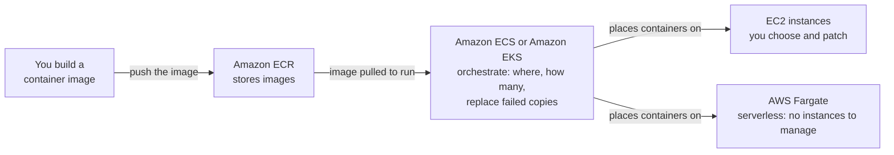
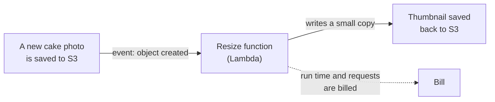
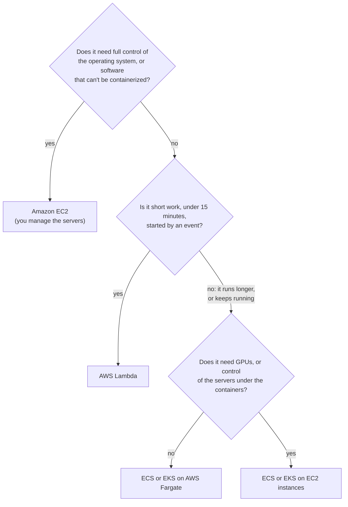

# Containers package your app; ECS or EKS runs them; Fargate and Lambda take the servers off your list

Between renting a server on EC2 and running no server at all lies a ladder of choices. Containers package an app to run the same anywhere; Amazon ECS or Amazon EKS keeps them running; AWS Fargate and AWS Lambda take servers off your list. You learn to pick EC2, Fargate or Lambda and say what you still manage.

**For:** an adult studying alone, possibly new to IT, who wants to understand AWS and use it safely. **Time:** about 25 minutes. Reading works on a phone.

**Before you start:** this lesson builds on [EC2](01-ec2.md) and [Auto Scaling and load balancers](02-auto-scaling-and-load-balancers.md), on [Security of vs in the cloud](../04-shared-responsibility-and-access/01-security-of-vs-in-the-cloud.md) (who patches what on EC2 and Lambda) and on [Block, file and object storage](../05-storing-data/01-block-file-object.md). If you skipped them, the key terms below are enough to follow. The bakery scenario is in the [module brief](00-brief.md).

## Warm-up: what you remember

Answer from memory before you look anything up.

1. From lesson 05.01: a server's instance store disk holds some files. The server is stopped and started again. Are the files still there?
2. From lesson 04.01: the bakery's order functions run on AWS Lambda. A security flaw is found in a library their code uses. Who updates the library?
3. From lesson 02.03: the bakery's site runs six servers in December and one in January, with no one changing the count by hand. Which benefit of the cloud is that?

Feedback

1. **No.** A stop erases instance store. Containers on Fargate get temporary storage that works the same way.
2. **The bakery.** AWS patches the servers and managed runtime under Lambda; the code and its libraries are the customer's.
3. **Elasticity:** capacity follows demand up and down. Fargate and Lambda give you it without managing servers.

## What you'll learn

By the end of this lesson, you can:

- say what Amazon ECR, Amazon ECS, Amazon EKS and AWS Fargate each do, and which one doesn't orchestrate;
- explain when AWS Lambda fits a job and when it doesn't;
- pick EC2, Fargate or Lambda for a job, and say what you still manage on each (objective 06.03a).

Try these before you read on. Guess if you're unsure; the answers are in the lesson.

1. A teammate says, "We'll use Fargate to decide where our containers run and how many copies we need." What's wrong?
2. The bakery wants code that shrinks each new cake photo, a few seconds of work each. EC2, Fargate or Lambda?

## The big picture: the further right, the less you manage

All four options run your code. What changes is how much of the work around it stays yours.

![A grid of six rows by four compute options: Amazon EC2; ECS or EKS on EC2 instances; ECS or EKS on AWS Fargate; AWS Lambda. Your code and its libraries, data and permissions are yours on all four. The language runtime is yours on the first three and AWS's on Lambda. Starting and spreading copies is yours on EC2 and done by ECS, EKS or Lambda on the others. Choosing servers and patching their operating system are yours on the first two and AWS's on Fargate and Lambda. Hardware is AWS's on all four. Rows that are yours: 5, 4, 2 and 1 of 6.](../../images/06-03-what-you-manage.svg)

*Notice how the cells marked AWS spread from the bottom right. On Fargate you stop choosing and patching servers; on Lambda you also stop packaging the language runtime. The top row is yours everywhere.*

**Long description.** A grid of six rows by four columns, each cell saying who does the work. Columns: Amazon EC2; ECS or EKS on EC2 instances; ECS or EKS on AWS Fargate; AWS Lambda. Row 1, your code and its libraries, data and permissions: you on all four. Row 2, the language runtime, such as a Python version: you on EC2 (installed on the server) and on both container options (inside your container image); AWS on Lambda, which updates managed runtimes while you move off retired ones. Row 3, starting, stopping and spreading copies of the app: you on EC2, with Auto Scaling; AWS on the container options (ECS or EKS does it, to your settings) and on Lambda (a copy per event). Row 4, choosing servers, type and how many: you on EC2 and ECS or EKS on EC2; AWS on Fargate (you set CPU and memory per task) and on Lambda (you set memory). Row 5, the server operating system and its patches: you on the first two; AWS on Fargate and Lambda. Row 6, hardware, buildings and power: AWS on all four. Rows that are yours: 5 of 6, 4 of 6, 2 of 6, 1 of 6. Notes: the top row never moves, on any option; ECS Managed Instances and EKS Auto Mode are middle options where AWS also patches and scales the EC2 instances.

## Key terms (skip if you know them)

- **Container:** a standard package of software that holds an application's code and everything it depends on ([AWS glossary](https://docs.aws.amazon.com/glossary/latest/reference/glos-chap.html)).
- **Container image:** the template a container starts from. **Container registry:** a store of images.
- **Orchestration:** deciding where containers run and how many, and replacing failed ones. The **control plane** is the part that decides.
- **Kubernetes:** a widely used open-source orchestration system.
- **Task:** in ECS, running containers that do a piece of work. A **service** keeps a set number of tasks running.
- **Serverless:** AWS runs, scales and patches the servers out of your sight, and you pay for what you use.
- **Function:** in Lambda, code that runs when an **event**, such as a file upload, **triggers** it. Each run is an **invocation**.

"Container" is an everyday word for a box. A software container is a package of code, not a storage place like an S3 bucket.

## A container packages an app with everything it needs

A **container** holds your application's code together with the libraries and settings it depends on. You build a **container image** once, and every container started from it is identical. So an app that works on a developer's laptop works the same on AWS: it carries its dependencies with it.

The bakery's inventory app, which tracks flour, butter and cake boxes, arrived from its supplier as a container image. Containers still need computers to run on, and something must decide which computer runs each one.

## Four names, four jobs: ECR stores, ECS and EKS orchestrate, Fargate supplies the computers

The exam's container names are easy to blur: three of them are "Elastic" something, and all four appear together on AWS's pages. Each has one job.

*Notice that Fargate sits at the end of the arrows, not in the middle. ECS or EKS makes the decisions; Fargate is one place the containers can run.*

**Long description.** A left-to-right flow. You build a container image and push it to Amazon ECR, which stores images. The image is pulled from ECR to run. Amazon ECS or Amazon EKS orchestrates: it decides where containers run and how many, and replaces failed copies. ECS or EKS places containers on one of two kinds of capacity: EC2 instances you choose and patch, or AWS Fargate, which is serverless, with no instances to manage.

- **Amazon Elastic Container Registry (Amazon ECR)** stores container images, in private repositories controlled with IAM or in public ones, and can scan them for known flaws ([What is Amazon ECR?](https://docs.aws.amazon.com/AmazonECR/latest/userguide/what-is-ecr.html), checked 2026-10-23). It runs nothing.
- **Amazon Elastic Container Service (Amazon ECS)** is AWS's own orchestrator, with AWS's operational practices built in. You describe your app in a **task definition**; ECS starts tasks and keeps services running ([What is Amazon ECS?](https://docs.aws.amazon.com/AmazonECS/latest/developerguide/Welcome.html)).
- **Amazon Elastic Kubernetes Service (Amazon EKS)** runs **Kubernetes** with an AWS-managed control plane, so existing Kubernetes tools work ([What is Amazon EKS?](https://docs.aws.amazon.com/eks/latest/userguide/what-is-eks.html)). Choose it when your team already uses Kubernetes.
- **AWS Fargate** is serverless compute for containers, for both ECS and EKS. You don't pick, scale or patch servers ([AWS Fargate FAQs](https://aws.amazon.com/fargate/faqs/)).

Two middle options exist: **ECS Managed Instances**, EC2 instances that AWS provisions, patches and scales for ECS, and **EKS Auto Mode**, where AWS also manages the Kubernetes nodes ([What is Amazon EKS?](https://docs.aws.amazon.com/eks/latest/userguide/what-is-eks.html), checked 2026-10-23).

### "Fargate orchestrates containers" is wrong

A common belief is that Fargate is an orchestrator, an alternative to ECS or EKS. It isn't. ECS or EKS decides where containers run and how many, and schedules them onto Fargate ([AWS Fargate FAQs](https://aws.amazon.com/fargate/faqs/)). ECS lists Fargate as a **capacity** option, beside EC2 instances.

It's tempting because you rarely see Fargate alone ("ECS on Fargate"), and with no servers to look at, Fargate seems to do everything. Remember: ECS or EKS decides; Fargate runs.

| | Amazon ECR | Amazon ECS | Amazon EKS | AWS Fargate |
|---|---|---|---|---|
| **Job** | Stores container images | Orchestrates containers, AWS's own way | Orchestrates containers with Kubernetes | Supplies serverless compute for containers |
| **Runs containers?** | No | Places them on capacity | Places them on capacity | Yes, as the capacity |
| **Pick it when** | You need somewhere to keep images | You want the simplest AWS-native choice | You already use Kubernetes | You don't want to manage servers under ECS or EKS |
| **Charge** | Storage and data transfer | None for ECS itself | Per cluster, per hour | vCPU, memory and storage per second |

**What's the same:** all four serve containerized apps. **What differs:** only Fargate is compute, only ECR stores, and ECS and EKS are two ways to orchestrate. **The principle:** a setup often uses three at once, such as ECR, ECS and Fargate.

> **Check:** Answer the first prequestion. A teammate says, "We'll use Fargate to decide where our containers run and how many copies we need." Which correction is right?
>
> A. Use Amazon ECR for that; Fargate only stores images\
> B. Use Amazon ECS or Amazon EKS for that; Fargate is the compute they run the containers on\
> C. Nothing is wrong; Fargate is AWS's orchestrator\
> D. Use EC2 Auto Scaling instead; containers can't scale

Feedback

**B is right.** ECS or EKS orchestrates; Fargate is capacity underneath.

- **A is wrong.** ECR stores images; it places nothing, and Fargate stores no images.
- **C is wrong.** That's the misconception: Fargate doesn't orchestrate.
- **D is wrong.** ECS and EKS scale containers themselves; EC2 Auto Scaling adjusts instances (lesson 06.02).

## Fargate runs containers without servers to manage

With Fargate, you give ECS or EKS a container image, say how much CPU and memory each task needs, and launch it. You don't choose instance types, add servers, or pack containers onto them ([AWS Fargate FAQs](https://aws.amazon.com/fargate/faqs/)). Facts that shape when it fits, checked 2026-10-23:

- **Isolation.** Each task gets its own single-use compute environment.
- **Patching.** AWS patches the platform and retires tasks still running on a flawed version ([Fargate developer guide](https://docs.aws.amazon.com/AmazonECS/latest/developerguide/AWS_Fargate.html)).
- **Temporary storage.** Each task gets 20 GiB that is erased when it stops, like instance store. For lasting files, use Amazon EFS (lesson 05.01).
- **No GPUs.** AWS says to use EC2 for GPU work, or for more control of the instances.
- **Cheaper capacity.** Fargate Spot runs interruptible tasks at up to 70% off, with a two-minute warning ([Fargate pricing](https://aws.amazon.com/fargate/pricing/)).

Fargate suits apps that keep running, such as a web API, and jobs that run for a while and stop.

> **Your turn:** The inventory app must run all day for the kitchen staff, and nobody wants to patch servers. Name the three services you would combine, with one reason for each.

Model answer

**Amazon ECR** to store the image; **Amazon ECS**, the simplest AWS-native orchestrator, to keep the app running and replace failed copies; **AWS Fargate** as capacity, so no one picks or patches servers. EKS would work but adds Kubernetes, which the bakery doesn't use.

## Lambda runs your code only when an event triggers it

**AWS Lambda** runs your code with no servers to provision or manage. You upload a **function**, connect a **trigger**, and Lambda runs it each time an event arrives; AWS handles server maintenance, capacity, scaling and patching ([What is AWS Lambda?](https://docs.aws.amazon.com/lambda/latest/dg/welcome.html), checked 2026-10-23). Triggers include a file landing in Amazon S3, a web request through Amazon API Gateway, a message in a queue, or a schedule in Amazon EventBridge.

Here is the bakery's photo job as a Lambda function.

*Notice that nothing runs between photos. Lambda starts the function when the event arrives and bills only for that run.*

**Long description.** A left-to-right flow. A new cake photo is saved to Amazon S3. That event, "object created", triggers the resize function in Lambda. The function writes a small copy, a thumbnail, back to S3. A dotted arrow from the function to the bill shows that each run's time and each request are billed; nothing is billed between photos.

Four facts decide whether a job fits, from the [Lambda quotas](https://docs.aws.amazon.com/lambda/latest/dg/gettingstarted-limits.html) page (checked 2026-10-23):

- **At most 15 minutes per invocation.** Longer jobs don't fit a standard function.
- **Memory from 128 MB to 10,240 MB.** CPU power grows with memory.
- **Automatic scaling.** If 300 photos arrive at once, Lambda runs many copies side by side; by default up to 1,000 at once per Region, a quota you can ask to raise.
- **No state you can count on between runs.** Lambda may reuse a warm environment, and data from an earlier run may still be there, but nothing guarantees it ([What is AWS Lambda?](https://docs.aws.amazon.com/lambda/latest/dg/welcome.html)). Anything to keep goes to S3 or a database.

Availability is built in, with no maintenance windows ([AWS Lambda FAQs](https://aws.amazon.com/lambda/faqs/)); you don't spread it across Availability Zones yourself as you do with EC2.

> **Dated (checked 2026-10-24):** AWS now calls classic functions **Lambda Event Functions** and has added longer-running forms, such as MicroVMs that last up to 8 hours and durable functions that pause and resume ([What is AWS Lambda?](https://docs.aws.amazon.com/lambda/latest/dg/welcome.html)). We couldn't confirm that exam questions reflect them. For CLF-C02, use the classic rule: event-driven functions, at most 15 minutes per invocation.

> **Check:** Answer the second prequestion. Photos arrive at random times, and each takes a few seconds to shrink. Which fits best?
>
> A. An EC2 instance that runs all day and checks for new photos\
> B. ECS on Fargate with a service that always runs\
> C. A Lambda function triggered when each photo is saved to S3\
> D. Amazon ECR

Feedback

**C is right.** The work is short, event-driven and irregular: Lambda runs and bills only when a photo arrives.

- **A is wrong.** It works, but the bakery pays for idle hours and patches the server.
- **B is wrong.** It works, but an always-on service pays for idle time.
- **D is wrong.** ECR stores container images; it runs nothing.

## Lambda or Fargate: short event-driven work, or containers that keep running

Lambda and Fargate are the two serverless compute options the exam names, so questions often put them side by side.

![Two panels. AWS Lambda runs a function when an event arrives: you hand over function code; an event starts it; up to 15 minutes per invocation; you size memory from 128 MB to 10,240 MB; billed per request plus GB-seconds; not for long or always-on work or full OS control. AWS Fargate runs containers for ECS or EKS: you hand over a container image; ECS or EKS starts a task or keeps a service running; runs as long as the task runs; you size vCPU and memory; billed per second for vCPU, memory and storage with a 1-minute minimum; not for GPU work.](../../images/06-03-lambda-vs-fargate.svg)

*Notice the "What starts it" and "How long it runs" rows. They decide most questions: short, event-driven code points to Lambda; a process that stays up, or a job longer than Lambda allows, points to Fargate. Packaging as a container image doesn't decide it, because Lambda can run a container image too.*

**Long description.** Two panels side by side, headed by what is the same: no servers to manage, AWS scales them, and you pay for what runs. AWS Lambda runs a function when an event arrives. You hand over function code, as a .zip file or a container image. An event starts it, such as a file upload, a web request, a message or a schedule. It runs up to 15 minutes per invocation. You size its memory, from 128 MB to 10,240 MB, and CPU grows with it. It bills per request plus memory times run time, in GB-seconds. It is not for long or always-on work, or when you need full control of the operating system. AWS Fargate runs containers for ECS or EKS. You hand over a container image through ECS or EKS, which starts a task or keeps a service running. It runs as long as the task runs, minutes or months. You size vCPU and memory per task. It bills per second for vCPU, memory and storage, with a 1-minute minimum. It is not for GPU work, which needs EC2. Sources: Lambda quotas and pricing pages, Fargate FAQ and pricing page, checked 2026-10-23.

**The principle:** start from the shape of the work. An event and a short job: Lambda. An app already in a container, or one that keeps running: Fargate. Full control of the operating system, GPUs, or software that can't be containerized: EC2.

> **Your turn:** For each job, choose Lambda, Fargate or EC2, and give the deciding fact.
>
> a) A web API packaged as a container that must answer requests around the clock
> b) Sending a confirmation email each time an order is saved
> c) Training a machine learning model on GPUs for six hours
> d) A nightly report that takes 40 minutes and is already packaged as a container

Model answer

a) **Fargate:** a container that keeps running. b) **Lambda:** a short, event-triggered job. c) **EC2:** Fargate has no GPUs, and six hours is far past Lambda's 15 minutes. d) **Fargate:** 40 minutes is too long for Lambda, and the container can run as a task and stop.

## Your side of the line

Lesson [04.01](../04-shared-responsibility-and-access/01-security-of-vs-in-the-cloud.md) drew the line for EC2 and Lambda; the big-picture grid adds containers.

- **Every option:** your code and its libraries, your data, and the permissions your app gets through its IAM role.
- **ECS or EKS on EC2:** also the instances' operating system, patches and count, unless you use ECS Managed Instances or EKS Auto Mode.
- **Fargate:** also everything inside your image. A flawed library stays until you rebuild; ECR's scanning helps find it.
- **Lambda:** also moving off a runtime before AWS retires it ([Lambda runtimes](https://docs.aws.amazon.com/lambda/latest/dg/lambda-runtimes.html)).

"With serverless, AWS handles the security" is still wrong (lesson 04.01): serverless removes servers from your list, not your code, images or permissions.

## What you pay for

- **ECS:** no charge for ECS itself; you pay for the EC2 or Fargate capacity it uses ([Amazon ECS FAQs](https://aws.amazon.com/ecs/faqs/)).
- **EKS:** $0.10 per cluster per hour, plus the capacity underneath ([Amazon EKS FAQs](https://aws.amazon.com/eks/faqs/), checked 2026-10-23).
- **Fargate:** each task's vCPU, memory and storage, per second from the start of the image download until the task stops, with a 1-minute minimum. AWS's example for US East (N. Virginia), Linux on x86, uses $0.000011244 per vCPU-second and $0.000001235 per GB-second of memory ([Fargate pricing](https://aws.amazon.com/fargate/pricing/), checked 2026-10-23).
- **Lambda:** $0.20 per million requests, plus $0.0000166667 per **GB-second** (memory in GB times seconds of run time) on x86, in US East (N. Virginia) as of 2026-10-24 ([Lambda pricing](https://aws.amazon.com/lambda/pricing/); AWS Price List). A monthly free allowance covers 1 million requests and 400,000 GB-seconds (Lambda pricing page, checked 2026-10-23).
- **ECR:** image storage and data transfer.

Pay per use is cheap for small or irregular work, but not always cheapest, as the photo job shows.

*Notice the flat line: the server costs the same for three photos or 400,000. Lambda's cost follows the work, so the bakery's job costs cents; only steady, heavy use makes the server cheaper.*

| Photos a month | Lambda, before the free allowance | Lambda, after it | One t3.micro all month |
|---|---|---|---|
| 3,000 (the bakery) | $0.05 | $0 | $7.59 |
| 200,000 | $3.37 | $0 | $7.59 |
| 450,000 | $7.59 | $0.83 | $7.59 |
| 1,000,000 | $16.87 | $10.00 | $7.59 |

Assumes 512 MB for 2 seconds per resize and that one small server keeps up (made up for teaching). Compute only, prices as of 2026-10-24. Savings Plans lower Fargate and Lambda prices for steady use (Module 11).

## Worked example: compute for the bakery's photo job and inventory app

The owner writes: "My nephew's script shrinks the day's new cake photos every night on the web server, and the site slows down while it runs. The inventory app arrived as a container, and the kitchen needs it all day. I don't want anyone patching more servers."

Here is how an expert works through it. The flowchart is the method.

*Notice that each question asks for a reason to manage more. With no reason, the answer lands further right, where you manage less.*

**Long description.** A decision flowchart. First question: does the work need full control of the operating system, or software that can't be containerized? If yes: Amazon EC2, where you manage the servers. If no, the second question: is it short work, under 15 minutes, started by an event? If yes: AWS Lambda. If no, because it runs longer or keeps running, the third question: does it need GPUs, or control of the servers under the containers? If no: ECS or EKS on AWS Fargate. If yes: ECS or EKS on EC2 instances.

1. **The photo job.** *OS control?* No. *Short and event-driven?* Each photo takes seconds, and saving it to S3 is an event. *So:* **Lambda**, triggered by each upload. Each photo is resized as it arrives, and the web server stops slowing down. If the owner prefers one run a night, a schedule can trigger the same function.
2. **The inventory app.** *OS control?* No. *Short and event-driven?* No: it runs all day. *GPUs or server control?* No, and the owner wants no servers. *So:* **ECS on Fargate**, with the image in **ECR**; ECS rather than EKS, because the bakery doesn't use Kubernetes.
3. **What stays the bakery's.** The function's code, libraries and runtime upgrades; the inventory image, which the supplier must rebuild when a library has a flaw; and both IAM roles, kept to least privilege (lesson 04.04).

The expert asked "what shape is the work, and which servers does the owner want to manage?" The spiky order site stays on EC2 with Auto Scaling and a load balancer (lesson 06.02).

> **Your turn:** A year later the inventory app's supplier offers a version that needs a GPU to recognize products from photos. Which option from the flowchart does the bakery move to, and what new work does that bring?

Model answer

**ECS on EC2 instances** (the third question's "yes"), because Fargate doesn't support GPUs. The bakery now picks a GPU instance type and count and patches the instances, unless it uses ECS Managed Instances, where AWS does both.

## In real work: choose the most managed option that fits

Teams pick the option that leaves them least to run. The Well-Architected Framework names the habits:

- In **performance efficiency**, [PERF02-BP01 Select the best compute options for your workload](https://docs.aws.amazon.com/wellarchitected/latest/performance-efficiency-pillar/perf_compute_hardware_select_best_compute_options.html), and the design principle "[Use serverless architectures](https://docs.aws.amazon.com/wellarchitected/latest/framework/perf-dp.html)".
- In **cost optimization**, the design principle "[Adopt a consumption model](https://docs.aws.amazon.com/wellarchitected/latest/framework/cost-dp.html)": pay for the photos you resize, not for an idle server.
- In **security**, [SEC06-BP01 Perform vulnerability management](https://docs.aws.amazon.com/wellarchitected/latest/security-pillar/sec_protect_compute_vulnerability_management.html): scan images, update libraries and rebuild, on every option.
- In **sustainability**, [SUS05-BP03 Use managed services](https://docs.aws.amazon.com/wellarchitected/latest/sustainability-pillar/sus_sus_hardware_a4.html).

## Summary

- **A container packages an app with everything it needs**, so it runs the same anywhere.
- **ECR stores images, ECS and EKS orchestrate, Fargate supplies serverless compute.** Fargate is not an orchestrator. EKS is for teams that use Kubernetes.
- **Fargate runs containers without servers to manage,** for as long as a task runs; not for GPU work.
- **Lambda runs code when an event triggers it,** at most 15 minutes per invocation, billed per request and GB-second.
- **Lambda for short event-driven work, Fargate for containers that keep running, EC2 for GPUs or full control.** Your code, images, libraries and permissions stay yours on all of them.

**For the module scenario:** the photo job moves to Lambda and the inventory app to ECS on Fargate. Lesson 06.04 covers four simpler paths.

## Practice

1. **Which AWS service stores container images?**

   A. Amazon ECS\
   B. Amazon ECR\
   C. AWS Fargate\
   D. Amazon EKS

   

Feedback

   **B is right.** Amazon Elastic Container Registry is the registry.

   - **A is wrong.** ECS orchestrates containers; it pulls images from a registry.
   - **C is wrong.** Fargate runs containers as serverless capacity.
   - **D is wrong.** EKS runs Kubernetes to orchestrate containers.

   

2. **A job processes a file each time one is uploaded, and each run takes about 30 seconds. The company wants no servers to manage and to pay nothing when no files arrive. Which service fits best?**

   A. Amazon EC2 with Auto Scaling\
   B. AWS Lambda\
   C. Amazon ECS on EC2 instances\
   D. Amazon EKS

   

Feedback

   **B is right.** An upload is an event, 30 seconds is well under 15 minutes, and Lambda bills only for runs.

   - **A is wrong.** The company would manage instances, and at least one usually runs, and bills, while idle.
   - **C is wrong.** The company would manage the EC2 instances.
   - **D is wrong.** EKS orchestrates containers and charges per cluster-hour even when idle; it also needs capacity underneath.

   

3. **Explain in two sentences why "we moved to Fargate, so patching is AWS's problem now" is only half true.**

   

Feedback

   **Model answer:** AWS now patches the servers and operating system under the containers. But the libraries inside the company's images are still the company's, and stay flawed until it rebuilds and redeploys them.

   

4. **(From lesson 03.03.) The bakery's web servers on EC2 run in two Availability Zones. Why doesn't the bakery need to do the same for its Lambda functions?**

   

Feedback

   **Lambda has availability built in:** AWS runs it with replication and redundancy and no maintenance windows. With EC2, placing servers in more than one AZ is the customer's job.

   

5. **(From lesson 02.02.) The photo job on Lambda costs a few cents a month instead of a server's fixed monthly price. Which change in cost does that show?**

   

Feedback

   **A fixed cost became a variable one.** The bakery no longer pays for capacity whether it's used or not; it pays for each photo resized.

   

**Next:** [Simpler paths](04-simpler-paths.md). To run a function yourself, do [Lab 07: a Lambda function](05-lab-07-a-lambda-function.md).

## Where to check the current details

- [What is Amazon ECR?](https://docs.aws.amazon.com/AmazonECR/latest/userguide/what-is-ecr.html) (checked 2026-10-23)
- [What is Amazon ECS?](https://docs.aws.amazon.com/AmazonECS/latest/developerguide/Welcome.html) and [Amazon ECS FAQs](https://aws.amazon.com/ecs/faqs/): capacity options and pricing (checked 2026-10-23)
- [What is Amazon EKS?](https://docs.aws.amazon.com/eks/latest/userguide/what-is-eks.html) and [Amazon EKS FAQs](https://aws.amazon.com/eks/faqs/): cluster pricing (checked 2026-10-23)
- [AWS Fargate FAQs](https://aws.amazon.com/fargate/faqs/), [Architect for AWS Fargate for Amazon ECS](https://docs.aws.amazon.com/AmazonECS/latest/developerguide/AWS_Fargate.html) and [AWS Fargate pricing](https://aws.amazon.com/fargate/pricing/) (checked 2026-10-23)
- [What is AWS Lambda?](https://docs.aws.amazon.com/lambda/latest/dg/welcome.html), [Lambda quotas](https://docs.aws.amazon.com/lambda/latest/dg/gettingstarted-limits.html), [Lambda runtimes](https://docs.aws.amazon.com/lambda/latest/dg/lambda-runtimes.html), [AWS Lambda FAQs](https://aws.amazon.com/lambda/faqs/) and [AWS Lambda pricing](https://aws.amazon.com/lambda/pricing/) (checked 2026-10-23; prices from the AWS Price List, 2026-10-24)
- [AWS Certified Cloud Practitioner (CLF-C02) exam guide](https://docs.aws.amazon.com/aws-certification/latest/cloud-practitioner-02/cloud-practitioner-02.html), tasks [3.3](https://docs.aws.amazon.com/aws-certification/latest/cloud-practitioner-02/cloud-practitioner-02-domain3.html#cloud-practitioner-02-task3.3) and [2.1](https://docs.aws.amazon.com/aws-certification/latest/cloud-practitioner-02/cloud-practitioner-02-domain2.html#cloud-practitioner-02-task2.1) (checked 2026-10-24)

---

"Containers and serverless" by Automate the Cloud Inc., licensed under CC BY-NC 4.0 with the Additional Permission for Internal Training from Automate the Cloud Inc.
License: https://creativecommons.org/licenses/by-nc/4.0/
Permission: https://automatethe.cloud/licenses/atc-internal-training-permission.txt
