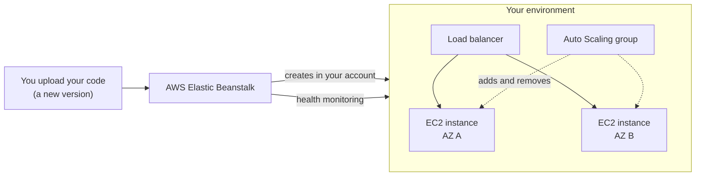
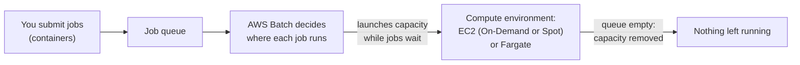
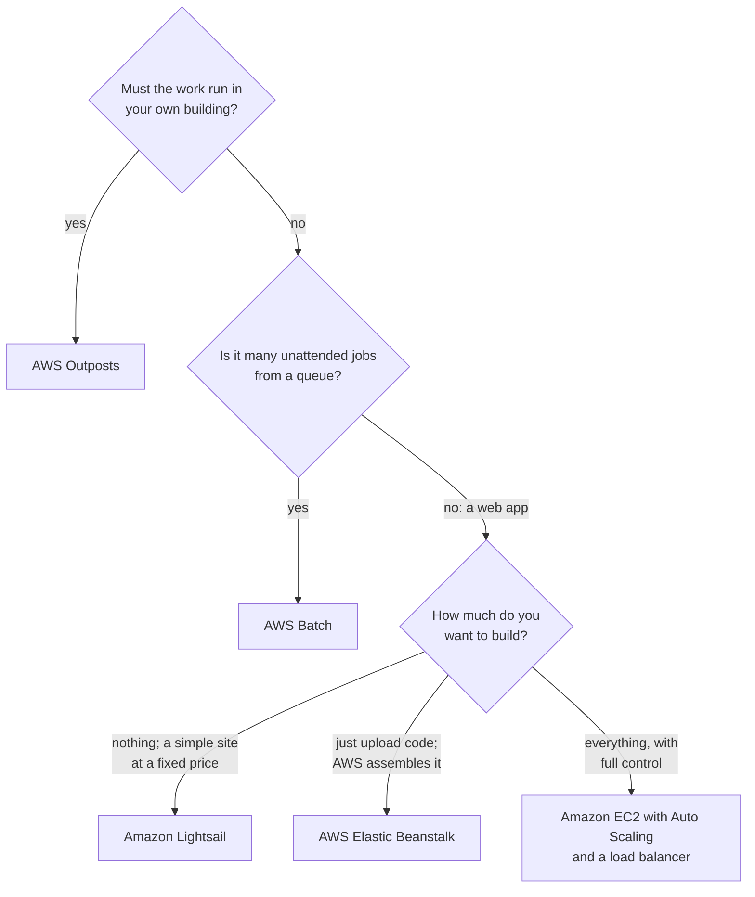

# Beanstalk assembles the setup for your code, Lightsail bundles a server, Batch runs job queues, and Outposts brings AWS on site

Lessons 06.01 to 06.03 had you assemble compute from parts. Four more services do the assembling, or the housing, for you. Each fits one kind of need, and you learn to match a need to the right one.

**For:** an adult studying alone, possibly new to IT, who wants to understand AWS and use it safely. **Time:** about 25 minutes. Reading works on a phone.

**Before you start:** this lesson builds on lessons [06.01](01-ec2.md) to [06.03](03-containers-and-serverless.md), on [The edge](../03-aws-around-the-world/04-the-edge.md) (where Outposts sit) and on [Managed or self-managed databases](../05-storing-data/05-managed-or-self-managed-databases.md). If you skipped them, the key terms below give you enough to follow. The bakery scenario is in the [module brief](00-brief.md).

## Warm-up: what you remember

Answer from memory before you look anything up.

1. From lesson 05.05: when the bakery moves its database from an EC2 server to Amazon RDS, name two chores that disappear and one that stays.
2. From lesson 03.04: where, physically, does an AWS Outpost sit?
3. From lesson 02.01 (going deeper): in platform as a service (PaaS), what does the customer still look after?

Feedback

1. **Disappear:** operating system and database patches, and running backups. **Stays:** tuning queries and deciding who can connect. This lesson applies the same idea to whole applications.
2. **In your own building:** a data center or other site you run. AWS delivers racks or servers and manages them as part of a Region.
3. **Your application and its data.** The provider handles the hardware and operating system. Elastic Beanstalk, below, is AWS's PaaS-style service.

## What you'll learn

By the end of this lesson, you can:

- say what Elastic Beanstalk, Lightsail, Batch and Outposts each do, and what each costs;
- tell EC2, Elastic Beanstalk and Lightsail apart for a web application;
- match a stated need to the right one of the four (objective 06.04a).

Try these before you read on. Guess if you're unsure; the answers are in the lesson.

1. Does Elastic Beanstalk charge extra on top of the servers and load balancer it creates?
2. The owner's sister wants a WordPress site for her flower shop with a bill she can predict. Which service fits?

## The big picture: four services that assemble or house compute for you

![Four cards. AWS Elastic Beanstalk: you bring your web app's code; AWS sets up EC2 instances or an EKS cluster, load balancing, scaling and health monitoring in your account; you pay nothing extra; pick it to deploy code without building the setup. Amazon Lightsail: you bring a website or small app; AWS sets up a virtual server, storage, a static IP and data transfer as one bundle; you pay a fixed monthly plan price; pick it for something simple with a predictable bill. AWS Batch: you bring many jobs as containers; AWS sets up a queue and compute that grows and is removed; you pay nothing extra; pick it for lots of jobs. AWS Outposts: you bring a site with space, power and a network connection; AWS sets up and maintains racks or servers of AWS hardware; you pay for a term of years; pick it when work or data must stay in your building.](../../images/06-04-four-paths.svg)

*Notice the "You pay" rows. Beanstalk and Batch cost nothing themselves; you pay for the resources they create. Lightsail is the only one sold as a fixed monthly price.*

**Long description.** Four cards in two rows, each with four lines: what you bring, what AWS sets up, what you pay, and when to pick it. AWS Elastic Beanstalk: your web application's code; EC2 instances or an EKS cluster, load balancing, scaling and health monitoring, in your account; nothing extra, only the resources it creates; when you want to deploy code without building the setup by hand. Amazon Lightsail: a website or small app, often from a ready-made image such as WordPress; a virtual server with storage, a static IP address and data transfer, as one bundle; a fixed monthly plan price, charged by the hour up to that maximum; when you want something simple with a predictable bill. AWS Batch: many jobs, each packaged as a container; a queue, and compute that grows for the jobs and is removed when they finish; nothing extra, only the EC2 or Fargate capacity the jobs use; when you have lots of jobs to run, often too long for Lambda. AWS Outposts: a site with space, power and a network connection to an AWS Region; racks or servers of AWS hardware that AWS monitors, patches and maintains; a term of years, priced by configuration; when work or data must stay in your own building. A note says that Beanstalk, Batch and Lightsail run on AWS servers that still exist; you just don't assemble them yourself.

## Key terms (skip if you know them)

- **Environment:** in Elastic Beanstalk, the set of AWS resources that runs one version of your application.
- **Platform:** the operating system, language and web server software Beanstalk runs your code on, such as a version of Python.
- **Virtual private server (VPS):** a virtual server rented on its own, usually at a monthly price. Lightsail calls its servers instances.
- **Bundle:** Lightsail's name for a plan that packs a server, storage and data transfer into one price.
- **Batch job:** a program that runs to completion with no one interacting with it. A **job queue** holds jobs waiting to run; a **compute environment** is the set of servers they run on.
- **Service link:** the network connection between an Outpost and its AWS Region.

## Elastic Beanstalk builds and runs the setup for your code

With **AWS Elastic Beanstalk**, you upload your application's code and Beanstalk creates what it needs to run: EC2 instances (or an EKS cluster), load balancing, Auto Scaling and health monitoring ([What is AWS Elastic Beanstalk?](https://docs.aws.amazon.com/elasticbeanstalk/latest/dg/Welcome.html), checked 2026-10-23). It supports code in Go, Java, .NET, Node.js, PHP, Python and Ruby, and Docker containers. AWS's product page calls it "Platform as a Service": the PaaS idea from lesson 02.01.

*Notice that the load balancer, Auto Scaling group and instances sit inside your account. They are the same parts as in lessons 06.01 and 06.02; Beanstalk assembles them for you.*

**Long description.** You upload your code, a new version of the application, to AWS Elastic Beanstalk. Beanstalk creates an environment in your account and monitors its health. Inside the environment, a load balancer sends traffic to two EC2 instances, one in Availability Zone A and one in Availability Zone B, and an Auto Scaling group adds and removes instances.

Three facts matter most:

- **No extra charge.** You pay only for the resources Beanstalk creates, such as the instances and the load balancer.
- **You keep control.** AWS says developers keep full control of the resources behind their application ([Elastic Beanstalk FAQs](https://aws.amazon.com/elasticbeanstalk/faqs/)). You can choose the instance type and purchasing option and run in more than one Availability Zone; the resources are ordinary ones in your account.
- **Platform updates are a choice.** With **managed platform updates** turned on, Beanstalk applies new patch and minor platform versions, with operating system and language updates, during a weekly maintenance window. Major version upgrades, which can break your code, are yours to start (FAQs, checked 2026-10-23).

AWS now offers two modes: **Standard**, on EC2, and **Cluster**, on Amazon EKS. Because Beanstalk accepts Docker containers, the bakery's inventory app could run here too. In Standard mode, though, it would sit on EC2 instances in the bakery's account, updated only as the settings allow; ECS on Fargate (lesson 06.03) stays the better fit for an owner who wants no servers.

### "Elastic Beanstalk is serverless" is wrong

You may have read that Beanstalk runs your code "without servers", like Lambda. That's not right. Beanstalk creates real EC2 instances, or an EKS cluster, in your account, and you pay for them while they run. It's tempting because you only upload code and never launch an instance yourself. But the servers exist, appear on your bill, and get updates according to settings you choose.

> **Your turn:** The owner's nephew wants a test copy of the bakery's website (lesson 02.05) that he can update by uploading new code, with a load balancer and two servers like the live site. He doesn't want to build those by hand. Which service fits, what does he pay for, and what must he still decide?

Model answer

**Elastic Beanstalk.** He pays for the EC2 instances and the load balancer it creates, not for Beanstalk itself. He still decides the instance type and how many, whether to turn on managed platform updates, and when to start major platform upgrades. He should also delete the environment when testing ends, because its resources keep billing.

## Lightsail sells a simple server as a bundle with a predictable price

**Amazon Lightsail** is AWS's simplest way to get a website or small application online. Its plans bundle a virtual server with memory, vCPUs, SSD storage, a static IP address and a data transfer allowance into one monthly price ([Amazon Lightsail FAQs](https://aws.amazon.com/lightsail/faq/); [What is Amazon Lightsail?](https://docs.aws.amazon.com/lightsail/latest/userguide/what-is-amazon-lightsail.html)). You can start from ready-made images, such as WordPress. AWS lists websites, web applications, blogs, e-commerce sites and simple software as common uses.

A few facts shape when it fits (all checked 2026-10-23):

- **Burstable servers.** Lightsail instances run at a baseline CPU level and can burst above it. For steady high CPU, such as video encoding, AWS recommends EC2.
- **Billing.** Plans are charged by the hour, up to the plan's monthly price. An instance is charged while it is running **or stopped**; only deleting it ends the charge.
- **A way up.** Upgrade to EC2 copies a Lightsail instance into EC2, where you get every instance type and pricing option and more control over the network.

That billing rule differs from EC2. On EC2, a stopped instance doesn't bill instance hours ([Amazon EC2 FAQs](https://aws.amazon.com/ec2/faqs/)), though its disk and any public IPv4 address still do (lesson 06.01). On Lightsail, the plan price keeps running.

The chart compares a $12 Lightsail plan with similar parts priced separately on EC2.

*Notice that EC2's bar is made of parts, each a separate line on the bill. Lightsail packs them into one price. For a small, steady site, the bundle is simpler and here cheaper; EC2 earns its place when you need its choices.*

| Item, per month | Lightsail $12 plan | EC2, priced by part |
|---|---|---|
| Server (2 vCPUs, 2 GB) | Included | t3.small, $15.18 |
| 60 GB SSD storage | Included | gp3, $4.80 |
| Public IPv4 address | Included | $3.65 |
| Data transfer out | 3 TB included | $0.09 per GB beyond the free allowance |
| **Total before transfer** | **$12.00** | **$23.63** |

Lightsail price from its pricing page, retrieved 2026-10-23; EC2 prices for US East (N. Virginia) from the AWS Price List, as of 2026-10-24, for 730 hours ([Amazon EC2 pricing](https://aws.amazon.com/ec2/pricing/)); transfer price from the price list of 2026-09-16. The two servers are similar, not identical.

> **Check:** Answer the second prequestion. The owner's sister wants a WordPress site for her flower shop, with a bill she can predict and as little setup as possible. Which service fits best?
>
> A. Amazon EC2 with Auto Scaling and a load balancer\
> B. Amazon Lightsail\
> C. AWS Batch\
> D. AWS Lambda

Feedback

**B is right.** Lightsail offers WordPress as a ready-made image and bundles the server, storage and transfer into a fixed monthly price.

- **A is wrong.** It works, but she would assemble and pay for each part separately, with no fixed price.
- **C is wrong.** Batch runs queues of unattended jobs, not websites.
- **D is wrong.** Lambda runs event-driven functions; WordPress needs a server that keeps running.

## EC2, Elastic Beanstalk or Lightsail: three ways to run a web app

All three can run the same website, so the exam likes to set them side by side.

| | Amazon EC2 | AWS Elastic Beanstalk | Amazon Lightsail |
|---|---|---|---|
| **You bring** | Everything: instances, scaling, load balancing | Your code | A website, often from a ready-made image |
| **Who builds the setup** | You | Beanstalk, in your account | Lightsail, as a bundle |
| **Price** | Each part, by use | No extra charge; the parts it creates | Fixed monthly plan |
| **Control** | The most | Full control of the resources it creates | Less; Upgrade to EC2 for more |
| **Pick it when** | You need full control or special hardware | You want to deploy code and skip the assembly | You want simple and predictable |

**What's the same:** all three run your app on AWS virtual servers. **What differs:** who assembles the setup and how you pay. **The principle:** choose by how much you want to build and how you want to be billed; the servers underneath are similar.

## Batch runs large numbers of jobs from a queue

**AWS Batch** runs batch computing work at any scale. You package each job as a container and submit it to a **job queue**. Batch decides where to run each job, launches compute when it's needed, watches the jobs, and removes the compute when it's no longer needed ([What is AWS Batch?](https://docs.aws.amazon.com/batch/latest/userguide/what-is-batch.html); [AWS Batch FAQs](https://aws.amazon.com/batch/faqs/), checked 2026-10-23). There's nothing to install and no additional charge; you pay for the EC2 instances or Fargate capacity the jobs use.

*Notice the last arrow. The compute exists only while there are jobs, so a nightly run doesn't leave servers billing all day.*

**Long description.** You submit jobs, each packaged as a container, to a job queue. AWS Batch decides where each job runs and launches capacity while jobs wait, in a compute environment of EC2 instances (On-Demand or Spot) or Fargate. When the queue is empty, the capacity is removed and nothing is left running.

AWS lists deep learning, genomics, financial risk models, simulations, animation rendering, media transcoding and image processing among its uses. Batch can run jobs on **Spot Instances**, spare EC2 capacity at a discount that AWS can take back with a two-minute warning (Module 11), which suits jobs that can be retried.

How it differs from its neighbors:

- **From Lambda (06.03):** Lambda runs short, event-triggered functions of up to 15 minutes. Batch runs queued jobs of any length on containers.
- **From EC2 alone:** on EC2, you would write the scheduling yourself: which job runs where, and when to add or remove servers.

> **Check:** An engineering firm runs 5,000 simulations every night. Each takes about two hours and is packaged as a container. The firm wants AWS to provision the compute and remove it when the work is done. Which service fits?
>
> A. AWS Lambda\
> B. AWS Batch\
> C. Amazon Lightsail\
> D. AWS Elastic Beanstalk

Feedback

**B is right.** Batch queues the jobs, launches compute for them, and removes it when the queue is empty.

- **A is wrong.** Each simulation takes two hours; a Lambda invocation stops at 15 minutes.
- **C is wrong.** Lightsail sells a few simple servers at fixed prices, not compute that grows and shrinks with a queue.
- **D is wrong.** Beanstalk deploys web applications, not queues of unattended jobs.

## Outposts brings AWS hardware into your own building

Lesson [03.04](../03-aws-around-the-world/04-the-edge.md) placed **AWS Outposts** on the map: AWS racks or servers in your own data center or site. This lesson adds the compute view.

- **What runs on it:** services such as EC2, EBS, ECS, RDS and S3 on Outposts, with the same APIs, console and tools as in the Region ([What is AWS Outposts?](https://docs.aws.amazon.com/outposts/latest/userguide/what-is-outposts.html), checked 2026-10-23).
- **What it is:** racks (an industry-standard 42U rack) or smaller servers. Each Outpost extends an Availability Zone of its Region and connects to it through a **service link**.
- **Why:** low latency to systems on site, local data processing, data that must stay on premises, and moving applications that depend on on-site systems.
- **How it's sold:** for a term. Outposts racks came in one-, three- and five-year terms when we checked ([Outposts racks FAQs](https://aws.amazon.com/outposts/rack/faqs/), 2026-10-23).

Outposts is AWS's way to build a **hybrid deployment** (task [3.1](https://docs.aws.amazon.com/aws-certification/latest/cloud-practitioner-02/cloud-practitioner-02-domain3.html#cloud-practitioner-02-task3.1)): part of the workload runs in your building, part in the Region, managed with the same tools.

> **Check:** A hospital's imaging systems need answers within milliseconds, and its patient data must stay in its own building. It wants to run EC2 instances with the same tools it uses in the AWS Region. Which service fits?
>
> A. AWS Outposts\
> B. Amazon Lightsail\
> C. A Local Zone in the nearest city\
> D. AWS Batch

Feedback

**A is right.** Outposts puts AWS-managed hardware inside the hospital, running EC2 with the same APIs and tools.

- **B is wrong.** Lightsail servers run in AWS Regions, not in the hospital.
- **C is wrong.** A Local Zone is close, but it's AWS's site in a city, not the hospital's building (lesson 03.04).
- **D is wrong.** Batch runs job queues in a Region; it doesn't change where the hardware is.

## Your side of the line

Each path moves the line in its own way:

- **Elastic Beanstalk:** your code, and your choices about the resources it creates: turning on managed platform updates and starting major upgrades. The instances are still in your account.
- **Lightsail:** treat the instance as a server of your own. The software on it, such as WordPress and its plugins, is yours to keep updated, as are its firewall settings.
- **Batch:** your job containers and the permissions they get. With managed compute environments, AWS provisions the servers; with unmanaged ones, you run them.
- **Outposts:** a clear case of the line moving. AWS monitors the Outpost, applies its software patches and maintains its hardware. You provide the space, power and network, and you are responsible for physical security and access control around it ([Outposts racks FAQs](https://aws.amazon.com/outposts/rack/faqs/)). In a Region, that physical work is all AWS's.

## What you pay for

- **Elastic Beanstalk and Batch:** no extra charge; you pay for the resources they create or use.
- **Lightsail:** a plan price by the hour, up to its monthly price, while the instance exists. Linux plans with a public IPv4 address started at $5 a month on 2026-10-23 ([Lightsail pricing](https://aws.amazon.com/lightsail/pricing/)), and outbound transfer beyond the plan's allowance is charged extra.
- **Outposts:** a term price for the configuration you order.

## Worked example: matching five requests

The owner forwards five requests from people around the bakery. Here is how someone who knows the services sorts them. The flowchart is the method.

*Notice that the first two questions are about where and what kind of work. Only web apps reach the third question, which is about how much you want to build.*

**Long description.** A decision flowchart. First question: must the work run in your own building? If yes: AWS Outposts. If no, the second question: is it many unattended jobs from a queue? If yes: AWS Batch. If no, because it's a web app, the third question: how much do you want to build? Nothing, a simple site at a fixed price: Amazon Lightsail. Just upload code and let AWS assemble it: AWS Elastic Beanstalk. Everything, with full control: Amazon EC2 with Auto Scaling and a load balancer.

1. **The nephew's test copy of the site, updated by uploading code.** Not on site; not a job queue; upload code. *So:* **Elastic Beanstalk.**
2. **The sister's WordPress site with a predictable bill.** A simple site at a fixed price. *So:* **Lightsail.**
3. **The flour supplier's nightly price models: 2,000 jobs of about an hour each.** A queue of unattended jobs, each far past Lambda's 15 minutes. *So:* **Batch**, on Spot capacity if the jobs can be retried.
4. **The supplier's mill, whose control systems need millisecond responses on site.** Must run in its own building. *So:* **Outposts.**
5. **The bakery's spiky order site,** which needs exact control of instance types, scaling rules and the load balancer. *So:* **EC2 with Auto Scaling and a load balancer**, as in lessons 06.01 and 06.02.

The expert asked "where must it run, what kind of work is it, and how much do they want to build?", in that order.

> **Your turn:** A small web app could go to Lightsail or to Elastic Beanstalk. What in the request would send it to Beanstalk instead?

Model answer

Wanting to upload code and have AWS build a load-balanced, auto-scaling setup in the account, paying for those parts by use. Lightsail fits a simple site where a fixed monthly price matters more than scaling.

## In real work: let AWS assemble what isn't your business

Teams reach for these services when assembling compute is work that doesn't set them apart. The Well-Architected Framework names the reasons:

- In **cost optimization**, the design principle "[Stop spending money on undifferentiated heavy lifting](https://docs.aws.amazon.com/wellarchitected/latest/framework/cost-dp.html)": Beanstalk and Batch do the assembling and scheduling for no extra charge.
- In **operational excellence**, [OPS05-BP10 Fully automate integration and deployment](https://docs.aws.amazon.com/wellarchitected/latest/operational-excellence-pillar/ops_dev_integ_auto_integ_deploy.html): Beanstalk deploys each new version the same way, every time.
- In **performance efficiency**, [PERF02-BP01 Select the best compute options for your workload](https://docs.aws.amazon.com/wellarchitected/latest/performance-efficiency-pillar/perf_compute_hardware_select_best_compute_options.html): a bundle, a queue or a rack on site each fits one shape of need.

## Summary

- **Elastic Beanstalk builds and runs the setup for your code:** EC2 or EKS, load balancing, scaling and health monitoring, in your account, at no extra charge. It isn't serverless.
- **Lightsail sells a simple server as a bundle with a predictable price,** billed while the instance exists, even when stopped; Upgrade to EC2 when you outgrow it.
- **EC2, Beanstalk and Lightsail differ in who assembles the setup and how you pay,** not in the servers underneath.
- **Batch runs large numbers of jobs from a queue,** launching compute for them and removing it afterwards, at no extra charge.
- **Outposts brings AWS hardware into your own building** for low latency and data that must stay on site; AWS maintains it, and you secure the site.

**For the module scenario:** you can now place every piece of the bakery's compute, and its neighbors' too. The module's mastery check puts them together.

## Practice

1. **Which AWS service lets a developer upload application code and have AWS provision the EC2 instances, load balancing, scaling and health monitoring?**

   A. Amazon Lightsail\
   B. AWS Elastic Beanstalk\
   C. AWS Batch\
   D. AWS Outposts

   

Feedback

   **B is right.** That is Elastic Beanstalk's job, at no extra charge beyond the resources.

   - **A is wrong.** Lightsail sells bundled servers at a fixed price; you don't upload code for it to assemble a setup.
   - **C is wrong.** Batch runs queued jobs, not web applications.
   - **D is wrong.** Outposts puts AWS hardware on your premises; it doesn't deploy code.

   

2. **A team stops its Lightsail instance to save money over a holiday. Explain in two sentences whether that works, and what would.**

   

Feedback

   **Model answer:** It doesn't: Lightsail charges an instance's plan price while it is running or stopped. Only deleting the instance ends the charge, so they should keep a snapshot first if they need its contents.

   

3. **Which statement about AWS Batch is correct?**

   A. Batch charges a fee per job on top of the compute used\
   B. Batch runs each job for at most 15 minutes\
   C. Batch launches compute for queued jobs and removes it when it's no longer needed\
   D. Batch requires you to install scheduling software on EC2

   

Feedback

   **C is right.** Batch provisions compute in response to jobs and removes it afterwards.

   - **A is wrong.** Batch has no additional charge; you pay for the EC2 or Fargate capacity.
   - **B is wrong.** That's Lambda's limit per invocation, not Batch's.
   - **D is wrong.** Batch is fully managed; there's no scheduling software to install.

   

4. **(From lesson 05.05.) AWS recommends RDS over a database you run yourself on EC2. Which Elastic Beanstalk benefit follows the same reasoning?**

   

Feedback

   **It takes routine work off your list.** RDS takes over database patching and backups; Beanstalk takes over building and wiring the instances, load balancer and scaling. Both are "undifferentiated heavy lifting" AWS can do for you.

   

5. **(From lesson 02.03.) The nephew has a working test copy of the site on Elastic Beanstalk the same afternoon he asks for it. Which benefit of the cloud is that?**

   

Feedback

   **Agility:** getting something new quickly and cheaply. Not elasticity, which is capacity following demand.

   

**Next:** put compute into practice with [Lab 07: a Lambda function](05-lab-07-a-lambda-function.md) and [Lab 08: launch and terminate an instance](06-lab-08-launch-and-terminate-an-instance.md).

## Where to check the current details

- [What is AWS Elastic Beanstalk?](https://docs.aws.amazon.com/elasticbeanstalk/latest/dg/Welcome.html) and [Elastic Beanstalk FAQs](https://aws.amazon.com/elasticbeanstalk/faqs/): modes, pricing and managed platform updates (checked 2026-10-23)
- [What is Amazon Lightsail?](https://docs.aws.amazon.com/lightsail/latest/userguide/what-is-amazon-lightsail.html), [Amazon Lightsail FAQs](https://aws.amazon.com/lightsail/faq/) and [Amazon Lightsail pricing](https://aws.amazon.com/lightsail/pricing/) (checked 2026-10-23)
- [What is AWS Batch?](https://docs.aws.amazon.com/batch/latest/userguide/what-is-batch.html) and [AWS Batch FAQs](https://aws.amazon.com/batch/faqs/) (checked 2026-10-23)
- [What is AWS Outposts?](https://docs.aws.amazon.com/outposts/latest/userguide/what-is-outposts.html) and [AWS Outposts racks FAQs](https://aws.amazon.com/outposts/rack/faqs/) (checked 2026-10-23)
- [Amazon EC2 FAQs](https://aws.amazon.com/ec2/faqs/) and [Amazon EC2 pricing](https://aws.amazon.com/ec2/pricing/) (prices from the AWS Price List, 2026-10-24)
- [AWS Certified Cloud Practitioner (CLF-C02) exam guide](https://docs.aws.amazon.com/aws-certification/latest/cloud-practitioner-02/cloud-practitioner-02.html), tasks [3.3](https://docs.aws.amazon.com/aws-certification/latest/cloud-practitioner-02/cloud-practitioner-02-domain3.html#cloud-practitioner-02-task3.3) and [3.1](https://docs.aws.amazon.com/aws-certification/latest/cloud-practitioner-02/cloud-practitioner-02-domain3.html#cloud-practitioner-02-task3.1) (checked 2026-10-24)

---

"Simpler paths: Elastic Beanstalk, Lightsail, Batch and Outposts" by Automate the Cloud Inc., licensed under CC BY-NC 4.0 with the Additional Permission for Internal Training from Automate the Cloud Inc.
License: https://creativecommons.org/licenses/by-nc/4.0/
Permission: https://automatethe.cloud/licenses/atc-internal-training-permission.txt
