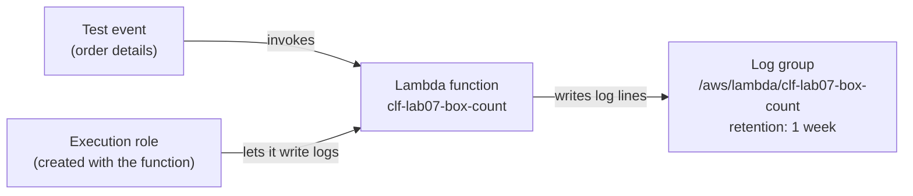

# Lab 07: Run a Lambda function, read its logs, and stop them piling up

## Before you start: your account, your responsibility

This guide is provided as is, without warranty. We work hard to keep it correct and current, but AWS changes often, and its services, prices, and free offers may differ from what is written here. The labs run in your own AWS account. You are responsible for that account, for its security, and for any charges it incurs, including charges from resources you forget to delete. Automate the Cloud Inc. is not liable for any costs, losses, or security incidents that result from following, or failing to follow, this material. Technical guidance here is general information, not advice about your specific systems.

**Who this is for:** you have done [Lab 01](../02-why-the-cloud/06-lab-01-first-resource.md) and read [06.03 Containers and serverless](03-containers-and-serverless.md). You don't need to program: you paste the code given. **Time:** about 30 minutes, plus 5 minutes the next day.

**Goal:** the bakery's order functions run in AWS Lambda. You build a small one that works out how many boxes a cupcake order needs, run it with two test events, read its logs, and set them to expire after a week. **End state:** your lab log holds the results; your account holds nothing from this lab.



*Notice that there is no server in the picture. You own the code, the role that limits it, and its logs.*

**Long description.** Left to right. A test event, holding the order details, invokes the Lambda function `clf-lab07-box-count`. An execution role, created with the function, lets the function write logs. The function writes log lines to the log group `/aws/lambda/clf-lab07-box-count`, whose retention you set to one week.

**What it creates**, in US East (N. Virginia), `us-east-1`:

- one Lambda function, `clf-lab07-box-count`, tagged `guide` = `clf` and `lab` = `07`;
- its **execution role**: an IAM role Lambda assumes while your code runs, deciding what the code may touch ([What is AWS Lambda?](https://docs.aws.amazon.com/lambda/latest/dg/welcome.html));
- its **log group** in Amazon CloudWatch Logs, created when the function first logs a line.

You delete all three at the end.

**What it costs:** $0. Lambda charges per request and per **GB-second** (memory in GB times seconds run). Its free tier covers 1 million requests and 400,000 GB-seconds a month; beyond that, requests cost $0.20 per million in US East (N. Virginia) ([AWS Lambda pricing](https://aws.amazon.com/lambda/pricing/), as of 2026-10-24). CloudWatch's free tier includes 5 GB of log data ([Amazon CloudWatch pricing](https://aws.amazon.com/cloudwatch/pricing/), checked 2026-10-23). This lab makes a handful of requests. **Free plan:** nothing is billed or upgraded; never choose **Upgrade plan**. **Worst case on a Paid plan** if you forget to clean up: $0 a month, because a function nobody invokes makes no requests.

**Before you start, you need these guardrails in place:** [root MFA](https://github.com/AutomateTheCloud/atc-study-aws_account_guardrails/blob/main/primer/02-secure-the-root-user.md) (primer page 02), [an IAM admin user with MFA](https://github.com/AutomateTheCloud/atc-study-aws_account_guardrails/blob/main/primer/03-your-everyday-admin-identity.md), which you use for this lab (page 03), [budgets and billing alerts](https://github.com/AutomateTheCloud/atc-study-aws_account_guardrails/blob/main/primer/05-money-alarms.md) (page 05), and [the habits for every lab](https://github.com/AutomateTheCloud/atc-study-aws_account_guardrails/blob/main/primer/07-habits-for-every-lab.md), including your lab log (page 07).

**Why this matters:** with Lambda, AWS runs and patches the servers; you own the code, its runtime version, its permissions and its data ([Security in AWS Lambda](https://docs.aws.amazon.com/lambda/latest/dg/lambda-security.html)). Here you touch each. Reading the function's logs is [SEC04-BP01 Configure service and application logging](https://docs.aws.amazon.com/wellarchitected/latest/security-pillar/sec_detect_investigate_events_app_service_logging.html); deciding how long to keep them is [COST04-BP05 Enforce data retention policies](https://docs.aws.amazon.com/wellarchitected/latest/cost-optimization-pillar/cost_decomissioning_resources_data_retention.html).

> **New sign-up path:** Lambda is on that experience's list of supported services, but IAM users can't sign in to the console and your Region is fixed (as of 2026-10-23). Use your assigned Region wherever this lab says `us-east-1`, and sign in the way that path gives you. We haven't run this lab on that path.

**About the screens:** labels in **bold** are what we saw when we ran this lab end to end in our test account on 2026-10-25. AWS changes its console often. If a label differs, look for the option with the same meaning.

## Steps

### Get ready

1. In your lab log, write today's date, the Region `us-east-1`, the tags `guide` = `clf` and `lab` = `07`, and the function name `clf-lab07-box-count`.
2. Sign in to the console as your **IAM admin user** and check that the Region selector shows N. Virginia.

### Create the function

3. In the console search bar, type `Lambda` and open it. Choose **Create an Event Function** (Lambda calls classic functions **Event Functions**; on 2026-10-25 its start page also offered Web Functions and microVMs, which this lab doesn't use).
4. Select **Author from scratch** and fill in:
   - **Function name:** `clf-lab07-box-count`
   - **Runtime:** Python 3.14. Don't pick a version marked preview; Python 3.15 was in preview on 2026-10-23.
   - **Architecture:** leave it at the default, x86_64.
5. Look for the permissions setting. Keep the default: a new role with basic Lambda permissions, which only lets the function write its logs ([Create your first Lambda function](https://docs.aws.amazon.com/lambda/latest/dg/getting-started.html)).
6. Open **Additional settings** and turn on **Tags**. A **Configure tags** panel opens: add `guide` = `clf` and `lab` = `07`, and choose **Save** in that panel; the create button stays unavailable until you do. (In the same section, **ARM64 architecture** stays off, which keeps x86_64.) If your page has no tags option, you add them in step 9.
7. Choose **Create Event Function** at the bottom of the page.
   **You should see:** a **Getting started** window, which you can close with **Dismiss**, then your function's page, with a code editor holding a short "Hello from Lambda" example.
   > **If something went wrong:** an error about the role usually means you aren't signed in as the admin user from primer page 03.

### Add the code

8. Choose the **Code** tab. In the editor, open `lambda_function.py`, delete everything in it, and paste this:

   ```python
   import math

   CUPCAKES_PER_BOX = 6

   def lambda_handler(event, context):
       order = event["order_id"]
       cupcakes = event["cupcakes"]
       boxes = math.ceil(cupcakes / CUPCAKES_PER_BOX)
       print(f"Order {order}: {cupcakes} cupcakes need {boxes} boxes")
       return {"order_id": order, "boxes": boxes}
   ```

   Lambda runs the **handler**, `lambda_handler`, on each invocation; don't rename it. `event` holds the data sent in; each `print` line goes to the log. Choose **Deploy**.
   **You should see:** a message that the function was updated or deployed.
9. If you couldn't add tags in step 6, open the **Configuration** tab, look for **Tags**, and add `guide` = `clf` and `lab` = `07` there.

### Run it with two test events

A **test event** is sample input you save and send to the function, standing in for what the website would send.

10. In the editor's test area (AWS's guide calls it **TEST EVENTS**), choose **Create test event**. Name it `order-1042` and replace the sample JSON with:

    ```json
    {
      "order_id": "1042",
      "cupcakes": 14
    }
    ```

    Choose **Save**, then **Test**. (A second **Create new test event** starts with the previous event's JSON; replace it each time.)
    **You should see:** a response of `{"order_id": "1042", "boxes": 3}`, and log lines that include `Order 1042: 14 cupcakes need 3 boxes`. Scroll the output to the `REPORT` line with the duration, billed duration and memory size, and write them in your lab log. The first run of a new function also shows an **Init Duration**: the time Lambda took to set up a new environment (a cold start). Since 1 August 2025 that time is billed ([AWS Lambda standardizes billing for INIT Phase](https://aws.amazon.com/blogs/compute/aws-lambda-standardizes-billing-for-init-phase/), checked 2026-10-25), so the billed duration of a first run is much longer than its duration: in our run, 1.80 ms ran and 110 ms were billed.
    > **If something went wrong:** an error naming `lambda_handler` means the handler was renamed, or the code wasn't deployed. Check step 8, choose **Deploy** again, and rerun.
11. Create a second test event named `bad-order` with this JSON, save it and run it:

    ```json
    {
      "order_id": "1043",
      "muffins": 4
    }
    ```

    **You should see:** an error such as `KeyError` naming `cupcakes`. Lambda ran the code exactly as written; handling bad input is your code's job.
12. Work out the first run's GB-seconds: memory in MB ÷ 1,024, times billed milliseconds ÷ 1,000. Use the billed duration, not the duration. For example, our first run: 128 MB for 110 billed ms is 0.125 × 0.110 = 0.01375 GB-seconds, against 400,000 free a month. Our second run, on the same warm environment, was billed 17 ms.

### Read the logs and set retention

13. In the console search bar, type `CloudWatch` and open it. In the left menu, open the log groups list (**Logs**, then **Log groups**; AWS's guide also calls the entry **Log Management**).
14. Find `/aws/lambda/clf-lab07-box-count`. Choose it, then choose the most recent **log stream**. A stream is a run of log lines from one source; a log group holds streams that share settings, such as how long they're kept.
    **You should see:** the same lines you saw in steps 10 and 11, including the error.
    > **If something went wrong:** no log group means the function hasn't written a line yet. Run `order-1042` again and refresh after a minute.
15. Go back to the log groups list and find the **Retention** column for your log group.
    **You should see:** **Never expire**. By default, CloudWatch Logs keeps log data forever ([Working with log groups and log streams](https://docs.aws.amazon.com/AmazonCloudWatch/latest/logs/Working-with-log-groups-and-streams.html)).
16. Choose **Never expire** (or select the log group and choose **Actions**, then **Edit retention setting(s)**). In **Expire events after**, choose **1 week (7 days)**, or the closest short period the list offers, and choose **Save**.
    **You should see:** the new period in the **Retention** column. Events older than that are deleted, typically within 72 hours of expiring.


*Notice that the default line never stops rising; one setting makes it flat.*

**Long description.** A line chart over 12 months, made-up figures, for functions that write 0.5 GB of logs a month. With retention at never expire, stored logs reach 0.5 GB after month 1 and 6 GB after month 12, still growing. With retention at one week, stored logs stay flat at about 0.1 GB.

17. Open the log group, choose its **Tags** tab, then **Manage tags**. Add `guide` = `clf` and `lab` = `07` and choose **Save changes**.

### Look at the role

18. Back in Lambda, open the **Configuration** tab, then **Permissions**. Choose the role name: IAM opens on the role, whose name starts with `clf-lab07-box-count-role-`. Write that name in your lab log.
    **You should see:** one customer managed permissions policy, named like `AWSLambdaBasicExecutionRole-…`, whose summary reads **CloudWatch Logs**, **Limited: Write**, and nothing else: the function can log, but can't, say, read your buckets.
19. On the role's **Tags** tab, add `guide` = `clf` and `lab` = `07`.

## Check your work

- [ ] Your lab log shows `"boxes": 3`, the run's duration and memory, and your GB-second sum.
- [ ] `bad-order` failed with an error about `cupcakes`, which also appears in the log stream.
- [ ] The log group's retention is one week, not **Never expire**.
- [ ] The role allows writing logs and nothing else.

## Clean up

Delete the function first, so nothing writes a new log group after you delete the old one.

20. In Lambda, select `clf-lab07-box-count` in the functions list, choose **Actions**, then **Delete**. Type `confirm` if asked, and delete.
    **You should see:** the function gone from the list.
21. In CloudWatch's log groups list, select `/aws/lambda/clf-lab07-box-count`, choose **Actions**, then **Delete log group(s)**, and confirm.
22. In IAM, choose **Roles**, select the role from step 18, and choose **Delete**. Type the role name to confirm.
    **You should see:** the role gone from the list.
    > **If something went wrong:** if IAM won't delete the role, open it and remove its permissions policy first, then delete it again.
23. In IAM, choose **Policies** and filter to customer managed policies. If the console made a policy for the role (named like `AWSLambdaBasicExecutionRole-…`, now attached to nothing), delete it too.
24. **Confirm:** Lambda's functions list, CloudWatch's log groups list and IAM's roles list show nothing with `clf-lab07` in its name. In Tag Editor, search all Regions for the tag `lab` = `07` ([Lab 01, steps 13 to 16](../02-why-the-cloud/06-lab-01-first-resource.md#find-it-by-its-tags)); expect no results. Tick everything off in your lab log.
25. **The next day:** check that your **Credits** balance hasn't fallen because of Lambda or CloudWatch ([primer page 07](https://github.com/AutomateTheCloud/atc-study-aws_account_guardrails/blob/main/primer/07-habits-for-every-lab.md), habit 4).

## Recap

You ran code without choosing, starting or patching a server, and paid by the millisecond. What stayed yours: the code (the bad order failed because of it), the runtime version, which you must move off before deprecation (scheduled for 2029-06-30 for Python 3.14 when we checked, per [Lambda runtimes](https://docs.aws.amazon.com/lambda/latest/dg/lambda-runtimes.html)), the role's permissions, and how long logs live.

> **Reflect:** the bakery keeps its real order functions running all year. Write two sentences on what retention period you would choose for their logs, and what you would weigh.
>
> <details><summary>Model answer</summary>
>
> Long enough to investigate a problem a customer reports late, say a month or two, but not forever: stored logs cost money and can hold customer details nobody should keep longer than needed. If a law or the accountant requires longer records, that sets the minimum, and the choice is written down rather than left at the default.
>
> </details>

**Next:** [Lab 08](06-lab-08-launch-and-terminate-an-instance.md) runs the other kind of compute, a virtual server, whose meter runs whether or not anyone uses it.

## Where to check the current details

- [Create your first Lambda function](https://docs.aws.amazon.com/lambda/latest/dg/getting-started.html), AWS Lambda Developer Guide (checked 2026-10-23)
- [Lambda runtimes](https://docs.aws.amazon.com/lambda/latest/dg/lambda-runtimes.html), AWS Lambda Developer Guide (checked 2026-10-23)
- [AWS Lambda pricing](https://aws.amazon.com/lambda/pricing/) (checked 2026-10-23)
- [Working with log groups and log streams](https://docs.aws.amazon.com/AmazonCloudWatch/latest/logs/Working-with-log-groups-and-streams.html), Amazon CloudWatch Logs User Guide (checked 2026-10-23)
- [Amazon CloudWatch pricing](https://aws.amazon.com/cloudwatch/pricing/) (checked 2026-10-23)

---

"Lab 07: Run a Lambda function, read its logs, and stop them piling up" by Automate the Cloud Inc., licensed under CC BY-NC 4.0 with the Additional Permission for Internal Training from Automate the Cloud Inc.
License: https://creativecommons.org/licenses/by-nc/4.0/
Permission: https://automatethe.cloud/licenses/atc-internal-training-permission.txt
