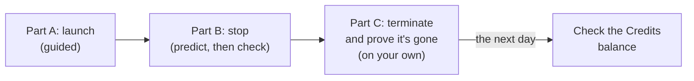

# Lab 08: Launch a virtual server, stop it, terminate it, and prove nothing is left

## Before you start: your account, your responsibility

This guide is provided as is, without warranty. We work hard to keep it correct and current, but AWS changes often, and its services, prices, and free offers may differ from what is written here. The labs run in your own AWS account. You are responsible for that account, for its security, and for any charges it incurs, including charges from resources you forget to delete. Automate the Cloud Inc. is not liable for any costs, losses, or security incidents that result from following, or failing to follow, this material. Technical guidance here is general information, not advice about your specific systems.

**Who this is for:** you have done [Lab 01](../02-why-the-cloud/06-lab-01-first-resource.md) and read [06.01 EC2](01-ec2.md). **Time:** 30 minutes at most, in one sitting, plus 5 minutes the next day.

**Goal:** the bakery's website runs on an Amazon EC2 instance. You launch a small one, see the public address AWS gives it, stop it and see what changes, then terminate it and prove that the instance, its disk and its address are gone. **End state:** nothing left, and your lab log shows what each state still bills for.

*Notice that the help fades: every click in Part A, a prediction to test in Part B, only the goal in Part C.*

**Long description.** Four stages left to right. Part A, launch, guided. Part B, stop, where you predict and then check. Part C, terminate and prove it's gone, on your own. Then, the next day, check the Credits balance.

**What it creates**, in US East (N. Virginia), `us-east-1`, tagged `guide` = `clf` and `lab` = `08` where the console lets you:

- one EC2 instance of type `t3.micro`, with no key pair;
- its **root volume**, the EBS disk that holds its operating system;
- a **security group**, the firewall around the instance, with no inbound rules;
- a **public IPv4 address**, which AWS attaches while the instance runs.

**What it costs**, at US East (N. Virginia) on-demand prices from AWS's price list as of 2026-10-24 ([Amazon EC2 On-Demand pricing](https://aws.amazon.com/ec2/pricing/on-demand/), [Amazon VPC pricing](https://aws.amazon.com/vpc/pricing/), [Amazon EBS pricing](https://aws.amazon.com/ebs/pricing/)):

| Item | Price | 30 minutes |
|---|---|---|
| `t3.micro` instance (Linux) | $0.0104 an hour, billed per second | about $0.005 |
| Public IPv4 address | $0.005 an hour | about $0.003 |
| Root volume, assumed 8 GiB gp3 (step 9 shows yours) | $0.08 per GB-month ($0.10 for gp2) | well under $0.001 |

Under 2 cents in all, even if every partial hour were billed as a full one. **Free plan:** AWS lists `t3.micro` as Free Tier eligible for accounts created on or after 2025-07-15; usage comes out of your credits ([Track your Free Tier usage for Amazon EC2](https://docs.aws.amazon.com/AWSEC2/latest/UserGuide/ec2-free-tier-usage.html), checked 2026-10-23), including the public IPv4 address, for which we found no free allowance. Nothing here upgrades your plan; never choose **Upgrade plan**. **Worst case on a Paid plan**, if you walk away:

*Notice that stopping removes most of the cost, not all of it. Only terminating takes it to zero.*

**Long description.** Three horizontal bars, US East (N. Virginia) prices as of 2026-10-24, assuming an 8 GiB gp3 volume and a 730-hour month, as in lesson 06.01. Left running: $11.88, made of $7.59 of instance hours, $3.65 for the public IPv4 address and $0.64 for the volume. Stopped but not terminated: $0.64, the volume alone. Terminated: $0.00.

**Before you start, you need these guardrails in place:** [root MFA](https://github.com/AutomateTheCloud/atc-study-aws_account_guardrails/blob/main/primer/02-secure-the-root-user.md) (primer page 02), [an IAM admin user with MFA](https://github.com/AutomateTheCloud/atc-study-aws_account_guardrails/blob/main/primer/03-your-everyday-admin-identity.md), which you use for this lab (page 03), [budgets and billing alerts](https://github.com/AutomateTheCloud/atc-study-aws_account_guardrails/blob/main/primer/05-money-alarms.md) (page 05), [the safe EC2 defaults](https://github.com/AutomateTheCloud/atc-study-aws_account_guardrails/blob/main/primer/06-safe-defaults.md) in N. Virginia: EBS encryption by default and IMDSv2 required (page 06), and [the habits for every lab](https://github.com/AutomateTheCloud/atc-study-aws_account_guardrails/blob/main/primer/07-habits-for-every-lab.md) (page 07).

**Why this matters:** an instance bills from launch until you terminate it, used or not ([Tutorial 1: Launch my very first Amazon EC2 instance](https://docs.aws.amazon.com/AWSEC2/latest/UserGuide/tutorial-launch-my-first-ec2-instance.html)). Knowing what each state still costs serves [COST04-BP03 Decommission resources](https://docs.aws.amazon.com/wellarchitected/latest/cost-optimization-pillar/cost_decomissioning_resources_decommission.html). A security group that lets nothing in follows [SEC05-BP02 Control traffic flow within your network layers](https://docs.aws.amazon.com/wellarchitected/latest/security-pillar/sec_network_protection_layered.html) and the primer's rule: never open SSH or RDP to the world.

> **New sign-up path:** your Region is fixed and IAM users can't sign in to the console (as of 2026-10-23). Use your assigned Region wherever this lab says `us-east-1`, check primer page 06's EC2 settings there first, and sign in the way that path gives you. We haven't run this lab on that path.

**About the screens:** the launch steps follow AWS's beginner tutorial (checked 2026-10-23). We haven't run this lab yet, so many steps say what to look for. If a label differs, look for the option with the same meaning.

## Steps

### Get ready

1. In your lab log, write today's date, the Region `us-east-1`, the tags `guide` = `clf` and `lab` = `08`, and the instance name `clf-lab08-web`.
2. Sign in to the console as your **IAM admin user** and check that the Region selector shows N. Virginia.

### Part A: launch (guided)

3. In the console search bar, type `EC2` and open it. Choose **Launch instance**.
   **You should see:** a form titled **Launch an instance**, with a **Summary** panel on the right.
4. Under **Name and tags**, type `clf-lab08-web` for **Name**. With the option to add more tags (such as **Add additional tags**), add `guide` = `clf` and `lab` = `08` for instances and volumes.
5. Under the image settings (**Application and OS Images**), keep the default Amazon Linux **AMI** (Amazon Machine Image, the template the instance starts from) if it is marked **Free tier eligible**.
6. Under **Instance type**, choose `t3.micro` and check that it is marked **Free tier eligible**.
7. Under **Key pair (login)**, choose **Proceed without a key pair (Not recommended)**. You won't log in, so there is no key to leak.
8. Under **Network settings**, choose the option to create a new security group. Clear every box that would let traffic in: SSH (it may be ticked, with a source of **Anywhere**), HTTP and HTTPS. Write down the security group name shown (often `launch-wizard-` and a number).
   **You should see:** no inbound rules, and public IP auto-assignment enabled.
   > **If something went wrong:** if you can't clear the SSH box, choose the option to edit the network settings and delete the inbound rule there. Never leave port 22 or 3389 open to `0.0.0.0/0`.
9. Under **Configure storage**, write down the root volume's size and type. Open its details if you can.
   **You should see:** the volume marked as encrypted (primer page 06). If it isn't, cancel and turn on EBS encryption by default first.
10. Open **Advanced details** and find the metadata version setting.
    **You should see:** V2 only (token required), from primer page 06.
11. Start a 30-minute timer, then choose **Launch instance** in the **Summary** panel. Write the time in your lab log.
    **You should see:** a success banner with the instance ID, starting `i-`. Write it down.
    > **If something went wrong:** a message that the type isn't eligible usually means another type or image got selected; recheck steps 5 and 6. If a message offers a plan upgrade, don't accept it.
12. Choose **Instances** in the left menu, select `clf-lab08-web`, and look at its details.
    **You should see:** **Instance state** changing from **Pending** to **Running**, and a **Public IPv4 address**: four numbers separated by dots. Write it down; it bills by the hour while attached.
13. Open the **Storage** tab. Write down the volume ID (it starts with `vol-`) and check the setting for deleting it on termination.
    **You should see:** delete on termination set to **Yes**.

### Part B: stop (predict, then check)

First write your predictions: after you **stop** the instance, will it keep its public IPv4 address, will its volume still exist, and which charges continue?

14. Stop the instance: from the **Instance state** menu, choose the stop option and confirm. Wait until the state shows **Stopped**, refreshing if needed.
15. Check your three predictions against the instance's details, its **Storage** tab, and **Elastic Block Store**, **Volumes** in the left menu.

What you should have found

- **Public IPv4 address:** gone. A public address stays with an instance only until it is stopped or terminated ([Amazon EC2 FAQs](https://aws.amazon.com/ec2/faqs/)); a restart would get a new one.
- **Volume:** still there, with the same `vol-` ID. A stopped instance keeps its EBS data.
- **Charges:** no instance hours and no IPv4 charge, but the volume's storage is still billed ([Amazon EC2 FAQs](https://aws.amazon.com/ec2/faqs/)). That's the $0.64 bar: **a stopped instance doesn't cost nothing.** "Off" sounds free, but your disk is still kept.

### Part C: terminate, and prove it's gone (on your own)

**Your task:** terminate `clf-lab08-web`, then prove, with evidence in your lab log, that the instance is terminated, its volume is gone, and no public IPv4 address from this lab remains. Then delete the security group. If your timer rings first, terminate at once.

Hints, if you need them

- Terminating is in the same **Instance state** menu; AWS's tutorial calls it **Terminate (delete) instance** (checked 2026-10-23). Terminating is permanent.
- The state goes to **Shutting-down**, then **Terminated**, and the instance later drops off the list. Charges for it stop as soon as it reaches shutting-down or terminated ([Terminate Amazon EC2 instances](https://docs.aws.amazon.com/AWSEC2/latest/UserGuide/terminating-instances.html)).
- Search **Volumes** for the `vol-` ID you wrote down.
- Look at the terminated instance's **Public IPv4 address** field, and at **Network & Security**, **Elastic IPs** in the left menu.
- The security group is under **Network & Security**, **Security groups**. AWS won't delete it while an instance still uses it.

Model answer

1. Instance: **Instances** shows `clf-lab08-web` as **Terminated** (or no longer listed).
2. Volume: **Volumes** finds nothing for its `vol-` ID, because delete on termination was **Yes**. Set to **No**, it would still be there, billing, until you deleted it.
3. Public IPv4: the instance shows none, and **Elastic IPs** is empty. An address AWS assigned goes back when the instance stops or terminates; an Elastic IP you allocate bills until you release it.
4. Security group: deleted after the instance terminated (if it was still in use, you waited a minute and retried).

> **If something went wrong:** if the instance stays in **Shutting-down** for a long time, refresh after a few minutes; AWS says such instances are cleaned up by its own processes ([Terminate Amazon EC2 instances](https://docs.aws.amazon.com/AWSEC2/latest/UserGuide/terminating-instances.html)). If a new instance appears after you terminate, something such as an Auto Scaling group launched it; this lab creates none, so check that the name and tags are yours.

## Check your work

- [ ] Your lab log shows the instance ID and its public IPv4 address while running, gone after stopping.
- [ ] Your Part B predictions are marked right or wrong, with reasons.
- [ ] Your Part C evidence covers the instance, volume, address and security group, all within 30 minutes of launch.

## Clean up

Part C was the cleanup. Two last checks:

16. **Confirm:** in Tag Editor, search all Regions for the tag `lab` = `08` ([Lab 01, steps 13 to 16](../02-why-the-cloud/06-lab-01-first-resource.md#find-it-by-its-tags)). Expect nothing, or only the terminated instance for a short while. Tick everything off in your lab log.
17. **The next day:** check the **Credits** balance and look for an EC2 or VPC charge of a few cents at most. If credits keep falling the day after, something is still running: search all Regions again ([primer page 07](https://github.com/AutomateTheCloud/atc-study-aws_account_guardrails/blob/main/primer/07-habits-for-every-lab.md), habits 2 and 4).

## Recap

You rented a server in about a minute and gave it back. You saw the three things that bill for it (running hours, public address, disk) and which each state stops. You also saw your side of the line on EC2: AWS ran the hardware; you chose the image, firewall rules, login method and disk settings.

> **Reflect:** the bakery's owner wants to "switch the web server off at night to save money" by stopping it. Write two sentences on what that saves, what it doesn't, and what else to check.
>
> 

Model answer

>
> It saves the instance hours and the public IPv4 charge, but the volume still bills, and the site is down for night orders. The public address also changes at each restart, breaking anything that points at it; lesson 06.02's Auto Scaling and load balancer are the better way to run fewer servers when demand is low.
>
> 

**Next:** [Simulation S7](07-sim-elasticity-with-auto-scaling.md) scales the bakery's web servers with demand, using a load balancer that would bill by the hour if you built it for real.

## Where to check the current details

- [Tutorial 1: Launch my very first Amazon EC2 instance](https://docs.aws.amazon.com/AWSEC2/latest/UserGuide/tutorial-launch-my-first-ec2-instance.html), Amazon EC2 User Guide (checked 2026-10-23)
- [Track your Free Tier usage for Amazon EC2](https://docs.aws.amazon.com/AWSEC2/latest/UserGuide/ec2-free-tier-usage.html), Amazon EC2 User Guide (checked 2026-10-23)
- [Terminate Amazon EC2 instances](https://docs.aws.amazon.com/AWSEC2/latest/UserGuide/terminating-instances.html), Amazon EC2 User Guide (checked 2026-10-23)
- [Amazon EC2 FAQs](https://aws.amazon.com/ec2/faqs/) (checked 2026-10-23)
- [Amazon EC2 On-Demand pricing](https://aws.amazon.com/ec2/pricing/on-demand/), [Amazon VPC pricing](https://aws.amazon.com/vpc/pricing/) and [Amazon EBS pricing](https://aws.amazon.com/ebs/pricing/) (prices from AWS's price list, 2026-10-24)

---

"Lab 08: Launch a virtual server, stop it, terminate it, and prove nothing is left" by Automate the Cloud Inc., licensed under CC BY-NC 4.0 with the Additional Permission for Internal Training from Automate the Cloud Inc.
License: https://creativecommons.org/licenses/by-nc/4.0/
Permission: https://automatethe.cloud/licenses/atc-internal-training-permission.txt
