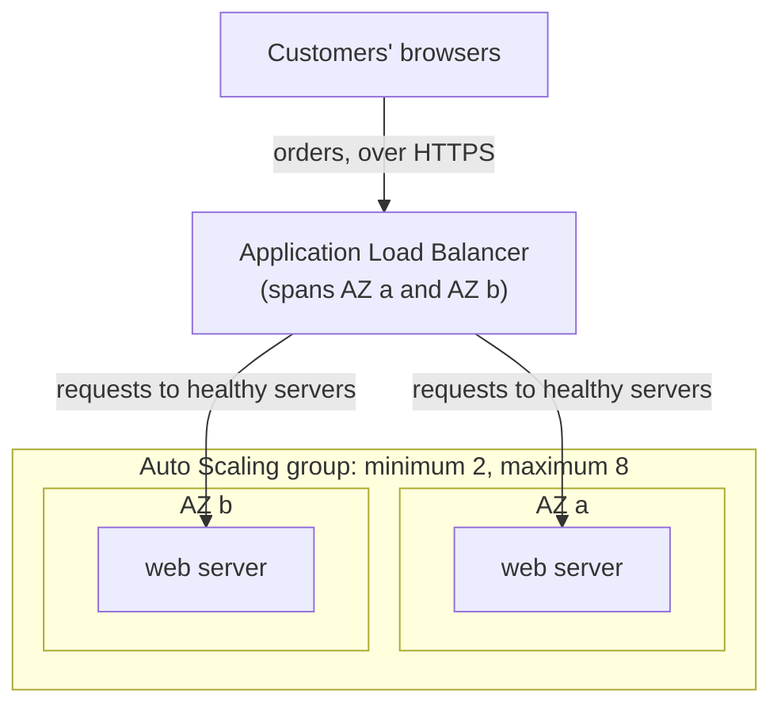

# Simulation S7: Scale the bakery's web servers through a December Saturday

## Before you start: your account, your responsibility

This guide is provided as is, without warranty. We work hard to keep it correct and current, but AWS changes often, and its services, prices, and free offers may differ from what is written here. The labs run in your own AWS account. You are responsible for that account, for its security, and for any charges it incurs, including charges from resources you forget to delete. Automate the Cloud Inc. is not liable for any costs, losses, or security incidents that result from following, or failing to follow, this material. Technical guidance here is general information, not advice about your specific systems.

**Who this is for:** you have read [02.02](../02-why-the-cloud/02-before-and-after-the-demand-curve.md) and [06.02 Auto Scaling and load balancers](02-auto-scaling-and-load-balancers.md). **Time:** about 20 minutes. **Cost:** $0; no AWS account is used.

**Why a simulation:** an Application Load Balancer bills for every hour or partial hour, and an Auto Scaling group runs several instances at once ([Elastic Load Balancing pricing](https://aws.amazon.com/elasticloadbalancing/pricing/), checked 2026-10-24). To click through the real thing, the free Cloud Quest: Cloud Practitioner on [AWS Skill Builder](https://skillbuilder.aws/category/exam-prep/cloud-practitioner-foundational-CLF-C02) has the assignments "Auto-Healing and Scaling Applications" and "Highly Available Web Applications" in a sandbox AWS provides (as of 2026-10-23). It's optional.

**Goal:** work out how many web servers the bakery runs each hour of its busiest day, say which service does each job, and say what happens when an Availability Zone fails at the peak. **End state:** a completed table and three answers about elasticity and high availability (task [3.3](https://docs.aws.amazon.com/aws-certification/latest/cloud-practitioner-02/cloud-practitioner-02-domain3.html#cloud-practitioner-02-task3.3)).

## The setup

*Notice the two jobs: the load balancer decides which server gets each request; the Auto Scaling group decides how many servers exist.*

**Long description.** Customers' browsers send orders over HTTPS to an Application Load Balancer that spans AZ a and AZ b. The load balancer sends requests to healthy web servers. The servers sit inside an Auto Scaling group with a minimum of 2 and a maximum of 8 instances, one in AZ a and one in AZ b at the minimum.

**The rules of this simulation.** The orders are **made-up numbers for teaching**; how the services behave is AWS's ([What is Amazon EC2 Auto Scaling?](https://docs.aws.amazon.com/autoscaling/ec2/userguide/what-is-amazon-ec2-auto-scaling.html), [Amazon EC2 Auto Scaling FAQs](https://aws.amazon.com/ec2/autoscaling/faqs/), checked 2026-10-23).

- One web server handles about 20 orders an hour, as in Module 02. Round up: 30 orders need 2 servers.
- The group never runs fewer than 2 instances (one per AZ) or more than 8, and spreads them evenly across the two AZs.
- Each hour, the group runs enough instances for that hour's orders, as a target tracking policy would.
- An **instance-hour** is one instance running for one hour.

## The data: orders on the Saturday before Christmas

The noon peak, 120 orders, is December's busiest hour from Module 02.

| Hour | Orders | Instances | Hour | Orders | Instances |
|---|---|---|---|---|---|
| 00:00–07:59 | 10 or fewer each hour | 2 | 14:00 | 90 | 5 |
| 08:00 | 25 | 2 | 15:00 | 80 | 4 |
| 09:00 | 45 | **?** | 16:00 | 85 | **?** |
| 10:00 | 70 | 4 | 17:00 | 100 | 5 |
| 11:00 | 95 | 5 | 18:00 | 75 | 4 |
| 12:00 | 120 | **?** | 19:00 | 50 | 3 |
| 13:00 | 110 | 6 | 20:00–23:59 | 30 or fewer each hour | **?** |

## Decisions

### Decision 1: fill in the table, and compare it with a fixed fleet

Work out the four missing instance counts and the day's total instance-hours. Then compare a fixed fleet of 6 instances, enough for noon, running all 24 hours.

Model answer

09:00: 45 ÷ 20 = 2.25, so **3**. 12:00: **6**. 16:00: 4.25, so **5**. 20:00–23:59: **2** each hour, the minimum. Total: **76 instance-hours** (16 overnight, 2 at 08:00, 50 from 09:00 to 19:59, 8 in the evening). The fixed fleet runs 6 × 24 = **144**, so the group runs about half the instance-hours. That is elasticity: capacity follows demand down as well as up.

*Notice that the columns touch the fixed line for only two hours. The gap above them is capacity a fixed fleet pays for and doesn't use.*

**Long description.** A column chart over 24 hours, made-up orders. Instances running: 2 each hour from midnight to 08:00, then 3, 4, 5, 6 at noon, 6 at 13:00, then 5, 4, 5, 5, 4, 3, and 2 each hour from 20:00 to midnight, 76 instance-hours in all. A flat line at 6 shows a fixed fleet sized for the noon peak, 144 instance-hours. A dashed line at 2 marks the minimum, one instance per AZ.

### Decision 2: whose job is it?

For each job, answer **load balancer** or **Auto Scaling group**: (a) give customers one address for the site; (b) add a server at 09:00; (c) stop sending orders to a server that fails its health check; (d) replace that failed server; (e) keep the servers balanced across AZ a and AZ b.

Model answer

(a) and (c): **load balancer**, the single front door, which sends requests only to healthy targets ([What is Elastic Load Balancing?](https://docs.aws.amazon.com/elasticloadbalancing/latest/userguide/what-is-load-balancing.html)). (b), (d) and (e): **Auto Scaling group**, which changes how many instances exist, replaces unhealthy ones and balances them across AZs. You may have read that Auto Scaling spreads traffic. **It doesn't**: it registers new instances with the load balancer, which does the spreading. The claim is tempting because the two almost always work together.

### Decision 3: AZ b fails at 12:00

Six instances are running, three in each AZ, when AZ b loses power. What happens in the next few minutes, and which part of the design gives the site its high availability?

Model answer

The load balancer's health checks fail for the three servers in AZ b, so it sends every order to the three in AZ a, which can handle about 60 of the 120 an hour. The Auto Scaling group replaces the failed instances to get back to six; with AZ b down, they can only start in AZ a. AWS says most replacements take under 5 minutes, so the site is slow or drops orders for a few minutes, then recovers with nobody acting.

High availability comes from running in more than one AZ: with every server in AZ b, the site would have stopped. Spreading the group over three AZs would soften the blow, because losing one removes a third of the servers, not half (every Region has at least three, lesson 03.01).

## Recap

The bakery ran about half the instance-hours of a fixed fleet and survived a zone failure at the peak with a few slow minutes instead of an outage: **elasticity** plus **high availability**, with the load balancer and the Auto Scaling group each doing one job. Compare the demand curve in [lesson 02.02](../02-why-the-cloud/02-before-and-after-the-demand-curve.md), which this simulation follows through one day.

**Next:** [Containers and serverless](03-containers-and-serverless.md), or the [Module 06 mastery check](08-check.md) if you've finished the lessons.

---

"Simulation S7: Scale the bakery's web servers through a December Saturday" by Automate the Cloud Inc., licensed under CC BY-NC 4.0 with the Additional Permission for Internal Training from Automate the Cloud Inc.
License: https://creativecommons.org/licenses/by-nc/4.0/
Permission: https://automatethe.cloud/licenses/atc-internal-training-permission.txt
