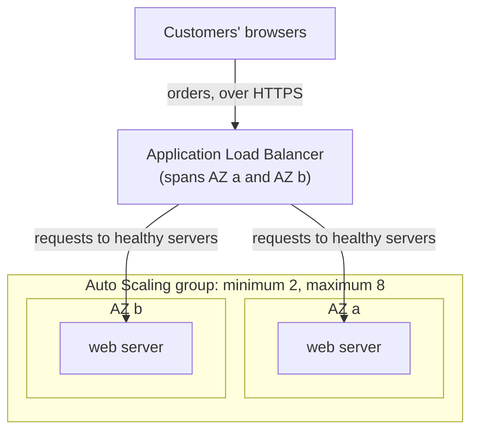

# Simulation S7: Scale the bakery's web servers through a December Saturday

## Before you start: your account, your responsibility

This guide is provided as is, without warranty. We work hard to keep it correct and current, but AWS changes often, and its services, prices, and free offers may differ from what is written here. The labs run in your own AWS account. You are responsible for that account, for its security, and for any charges it incurs, including charges from resources you forget to delete. Automate the Cloud Inc. is not liable for any costs, losses, or security incidents that result from following, or failing to follow, this material. Technical guidance here is general information, not advice about your specific systems.

**Who this is for:** you have read [02.02](../02-why-the-cloud/02-before-and-after-the-demand-curve.md) and [06.02 Auto Scaling and load balancers](02-auto-scaling-and-load-balancers.md). **Time:** about 30 minutes. **Cost:** $0; no AWS account is used.

**Why a simulation:** an Application Load Balancer bills for every hour or partial hour, $0.0225 an hour in US East (N. Virginia) plus capacity units, and an Auto Scaling group runs several instances at once (AWS price list, as of 2026-10-24). To click through the real thing, the free Cloud Quest: Cloud Practitioner on [AWS Skill Builder](https://skillbuilder.aws/category/exam-prep/cloud-practitioner-foundational-CLF-C02) has the assignments "Auto-Healing and Scaling Applications" and "Highly Available Web Applications" in a sandbox AWS provides (as of 2026-10-23). It needs a Skill Builder account and is optional.

**Goal:** work out how many web servers the bakery runs each hour of its busiest day, what that costs against a fixed fleet, and what happens when an Availability Zone fails at the peak. **End state:** a completed table and five answers.

**Why this matters:** capacity that follows demand is [COST09-BP03 Supply resources dynamically](https://docs.aws.amazon.com/wellarchitected/latest/cost-optimization-pillar/cost_manage_demand_resources_dynamic.html) and [SUS02-BP01 Scale workload infrastructure dynamically](https://docs.aws.amazon.com/wellarchitected/latest/sustainability-pillar/sus_sus_user_a2.html); doing it automatically is [REL07-BP01 Use automation when obtaining or scaling resources](https://docs.aws.amazon.com/wellarchitected/latest/reliability-pillar/rel_adapt_to_changes_autoscale_adapt.html); spreading it over two zones is [REL10-BP01 Deploy the workload to multiple locations](https://docs.aws.amazon.com/wellarchitected/latest/reliability-pillar/rel_fault_isolation_multiaz_region_system.html).

## The setup

Lesson 03.01 left the bakery with two web servers in two AZs behind a load balancer. Now the servers belong to an Auto Scaling group.

*Notice the two jobs: the load balancer decides which server gets each request; the Auto Scaling group decides how many servers exist.*

**Long description.** Customers' browsers send orders over HTTPS to an Application Load Balancer that spans AZ a and AZ b. The load balancer sends requests to healthy web servers. The servers sit inside an Auto Scaling group with a minimum of 2 and a maximum of 8 instances, one in AZ a and one in AZ b at the minimum.

**The rules of this simulation.** The orders are **made-up numbers for teaching**; how the services behave is AWS's ([What is Amazon EC2 Auto Scaling?](https://docs.aws.amazon.com/autoscaling/ec2/userguide/what-is-amazon-ec2-auto-scaling.html), [Amazon EC2 Auto Scaling FAQs](https://aws.amazon.com/ec2/autoscaling/faqs/), checked 2026-10-23).

- One web server handles about 20 orders an hour, as in Module 02. Round up: 30 orders need 2 servers.
- The group never runs fewer than 2 instances (one per AZ) or more than 8, and spreads them evenly across the two AZs.
- Each hour, the group runs enough instances for that hour's orders. A real group follows a **scaling policy**; **target tracking**, for example, adds or removes instances to keep a metric such as average CPU or requests per instance near a value you set.
- An **instance-hour** is one instance running for one hour. Prices, US East (N. Virginia), as of 2026-10-24: `t3.small` $0.0208 an hour; load balancer $0.0225 an hour ([Amazon EC2 On-Demand pricing](https://aws.amazon.com/ec2/pricing/on-demand/), [Elastic Load Balancing pricing](https://aws.amazon.com/elasticloadbalancing/pricing/)). Capacity units, data transfer and storage are left out.

## The data: orders on the Saturday before Christmas

The noon peak, 120 orders, is December's busiest hour from Module 02.

| Hour | Orders | Instances | Hour | Orders | Instances |
|---|---|---|---|---|---|
| 00:00–07:59 | 10 or fewer each hour | 2 | 14:00 | 90 | 5 |
| 08:00 | 25 | 2 | 15:00 | 80 | 4 |
| 09:00 | 45 | **?** | 16:00 | 85 | **?** |
| 10:00 | 70 | 4 | 17:00 | 100 | 5 |
| 11:00 | 95 | 5 | 18:00 | 75 | 4 |
| 12:00 | 120 | **?** | 19:00 | 50 | 3 |
| 13:00 | 110 | 6 | 20:00–23:59 | 30 or fewer each hour | **?** |

## Decisions

### Decision 1: fill in the table

Work out the four missing instance counts, then the day's total instance-hours.

Model answer

09:00: 45 ÷ 20 = 2.25, so **3**. 12:00: **6**. 16:00: 4.25, so **5**. 20:00–23:59: **2** each hour, the minimum. Total: **76 instance-hours** (16 overnight, 2 at 08:00, 50 from 09:00 to 19:59, 8 in the evening).

*Notice that the columns touch the fixed line for only two hours. The gap above them is capacity a fixed fleet pays for and doesn't use.*

**Long description.** A column chart over 24 hours, made-up orders. Instances running: 2 each hour from midnight to 08:00, then 3, 4, 5, 6 at noon, 6 at 13:00, then 5, 4, 5, 5, 4, 3, and 2 each hour from 20:00 to midnight, 76 instance-hours in all. A flat line at 6 shows a fixed fleet sized for the noon peak, 144 instance-hours. A dashed line at 2 marks the minimum, one instance per AZ.

### Decision 2: price the day against a fixed fleet

A fixed fleet of 6 instances, enough for noon, runs all 24 hours. Work out both instance costs, then add the load balancer.

Model answer

Fixed: 6 × 24 = 144 instance-hours × $0.0208 = **$3.00**. Auto Scaling: 76 × $0.0208 = **$1.58**. The load balancer is the same in both, 24 × $0.0225 = **$0.54**, so the totals are $3.54 and $2.12.

*Notice that Auto Scaling roughly halves the instance cost; the load balancer runs all day either way.*

**Long description.** Two horizontal bars, prices as of 2026-10-24. Fixed fleet of 6 instances, 144 instance-hours: $3.00 of instances plus $0.54 of load balancer hours, $3.54. Auto Scaling, 76 instance-hours: $1.58 plus $0.54, $2.12. Capacity units and data transfer are left out.

The cents are small because the bakery is small; the share is what matters.

### Decision 3: whose job is it?

For each job, answer **load balancer** or **Auto Scaling group**: (a) give customers one address for the site; (b) add a server at 09:00; (c) stop sending orders to a server that fails its health check; (d) replace that failed server; (e) keep the servers balanced across AZ a and AZ b.

Model answer

(a) and (c): **load balancer**, the single front door, which sends requests only to healthy targets ([What is Elastic Load Balancing?](https://docs.aws.amazon.com/elasticloadbalancing/latest/userguide/what-is-load-balancing.html)). (b), (d) and (e): **Auto Scaling group**, which changes how many instances exist, replaces unhealthy ones and balances them across AZs. You may have read that Auto Scaling spreads traffic. **It doesn't**: it registers new instances with the load balancer, which does the spreading. The claim is tempting because the two almost always work together.

### Decision 4: AZ b fails at 12:00

Six instances are running, three in each AZ, when AZ b loses power. What happens in the next few minutes, and what could the bakery change so a lost zone hurts less at the peak?

Model answer

The load balancer's health checks fail for the three servers in AZ b, so it sends every order to the three in AZ a, which can handle about 60 of the 120 an hour. The Auto Scaling group replaces the failed instances to get back to six; with AZ b down, they can only start in AZ a. AWS says most replacements take under 5 minutes, so the site is slow or drops orders for a few minutes, then recovers with nobody acting.

To soften it: spread the group over three AZs, so losing one removes a third of the servers, not half (every Region has at least three, lesson 03.01); or set a lower scaling target, so each server has spare room. Both cost a little more every hour: the reliability trade-off.

### Decision 5: the lunch rush arrives on time, every day

Orders jump from 95 to 120 at noon. New instances take minutes to start, so a policy that reacts after load rises is always a little late. What can the bakery use, given that the rush comes at the same time each day?

Model answer

Scale ahead of the rush. **Predictive scaling** learns from past traffic, forecasts 48 hours ahead, and can start instances early to allow for warm-up ([AWS Auto Scaling FAQs](https://aws.amazon.com/autoscaling/faqs/)). A **scheduled action**, such as "at 10:45, run at least 6", does it by hand. Keep target tracking too, for surprises the forecast misses.

## Recap

The bakery ran about half the instance-hours of a fixed fleet, kept a server in each AZ through the night, and survived a zone failure at the peak with a few slow minutes instead of an outage. That is **elasticity** plus **high availability**, with the load balancer and the Auto Scaling group each doing one job. Compare [Simulation S1](../02-why-the-cloud/07-sim-demand-curve.md), where scaling was by the month and by hand.

**Next:** [the Module 06 mastery check](08-check.md). Before you take it, retry the practice questions at the end of [06.02](02-auto-scaling-and-load-balancers.md) and [06.03](03-containers-and-serverless.md) without looking back.

---

"Simulation S7: Scale the bakery's web servers through a December Saturday" by Automate the Cloud Inc., licensed under CC BY-NC 4.0 with the Additional Permission for Internal Training from Automate the Cloud Inc.
License: https://creativecommons.org/licenses/by-nc/4.0/
Permission: https://automatethe.cloud/licenses/atc-internal-training-permission.txt
