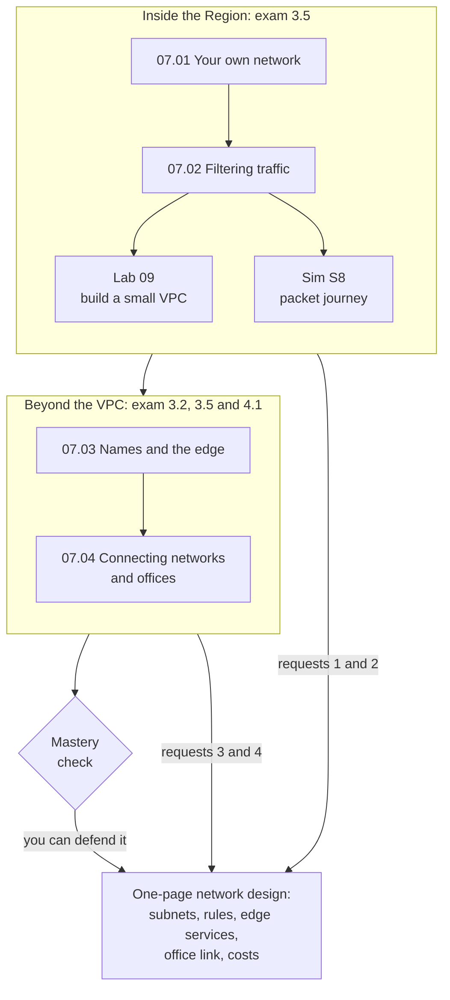

# Module 07: Design the bakery's network, from the database's private subnet to the edge location nearest each customer

This module teaches how things connect on AWS: your own network, the filters on it, the edge services near customers, and links to your own offices. By the end, you hand the bakery's owner a network design and defend every choice.

**For:** an adult studying alone, possibly new to IT, who wants to understand AWS and use it safely. You have finished Modules 02 to 06 and the [guardrails primer](https://github.com/AutomateTheCloud/atc-study-aws_account_guardrails/blob/main/primer/00-read-this-first.md). **Time:** about 3.5 hours, over several sessions.

## The scenario: the bakery's site needs a proper network

The site runs in US East (N. Virginia): web servers on EC2, the order database on Amazon RDS, functions in AWS Lambda, cake photos in S3. So far it has lived in the default network AWS creates in every account, where every subnet is public. The owner has four requests:

1. **"Customers reach the website; nobody on the internet reaches the order database."**
2. **"Someone keeps hammering our order page from one block of addresses. Block them."**
3. **"Our head office needs a secure link to the systems on AWS."**
4. **"Customers far away say the cake photos load slowly. Serve them from closer."**

The bakery is made up for teaching. At the end you hand the owner a one-page network design: the subnets and routes, the filter rules, the edge services, the office link, and what each part costs.

## You'll be able to

Tags: the kind of knowledge (P procedure, C concept, J judgment) and what you do with it (Ap apply, An analyze).

| Objective | Lesson |
|---|---|
| **07.01a** Explain what makes a subnet public [C·An] | 07.01 |
| **07.02a** Predict whether traffic passes [P·An] | 07.02 |
| **07.03a** Choose Route 53, CloudFront, Global Accelerator or API Gateway for a need [C·Ap] | 07.03 |
| **07.04a** Choose a link by whether it's private, encrypted and quick to set up [J·Ap] | 07.04 |

## What this covers on the exam

This module covers task [3.5](https://docs.aws.amazon.com/aws-certification/latest/cloud-practitioner-02/cloud-practitioner-02-domain3.html#cloud-practitioner-02-task3.5), network services, in Domain 3 of the AWS Certified Cloud Practitioner (CLF-C02) exam, and the edge services of task [3.2](https://docs.aws.amazon.com/aws-certification/latest/cloud-practitioner-02/cloud-practitioner-02-domain3.html#cloud-practitioner-02-task3.2), global infrastructure, in more depth than Module 03. It covers the data transfer part of task [4.1](https://docs.aws.amazon.com/aws-certification/latest/cloud-practitioner-02/cloud-practitioner-02-domain4.html#cloud-practitioner-02-task4.1), pricing (lesson 07.04), and applies task [2.1](https://docs.aws.amazon.com/aws-certification/latest/cloud-practitioner-02/cloud-practitioner-02-domain2.html#cloud-practitioner-02-task2.1), shared responsibility, in each lesson's "your side of the line" section. We checked the exam guide on 2026-10-24.

## How the module is laid out

**Lessons** (about 25 minutes each):

1. [Your own network](01-your-own-network.md)
2. [Filtering traffic](02-filtering-traffic.md)
3. [Names and the edge](03-names-and-the-edge.md)
4. [Connecting networks and offices](04-connecting-networks-and-offices.md)

**Hands-on:**

- [Lab 09: build a small VPC](05-lab-09-build-a-small-vpc.md), with two subnets in two Availability Zones, an internet gateway route, and security group and network ACL rules, then delete it all. It creates no NAT gateway and no Elastic IP address, so it costs $0.
- [Simulation S8: the packet journey](06-sim-packet-journey.md), where you follow packets through a VPC and find the rule that blocks them. It runs on this site, not in AWS.

**Before the lab:** check that you still have [root MFA](https://github.com/AutomateTheCloud/atc-study-aws_account_guardrails/blob/main/primer/02-secure-the-root-user.md), [your IAM admin user with MFA](https://github.com/AutomateTheCloud/atc-study-aws_account_guardrails/blob/main/primer/03-your-everyday-admin-identity.md) and [money alarms](https://github.com/AutomateTheCloud/atc-study-aws_account_guardrails/blob/main/primer/05-money-alarms.md). The lessons need no AWS account.

**Mastery check:** the module ends with a check; you pass at 80%. Each miss points you to the section to reread, then to a parallel retest.

**Numbers that change:** NAT gateway, public IPv4 address and data transfer prices appear with the date they were checked, and every lesson says where to check the current ones.

*Notice that the first half answers the owner's first two requests, inside the bakery's network, and the second half answers the last two, outside it.*

**Long description.** A top-to-bottom map. Box one, "Inside the Region: exam 3.5": lessons 07.01 then 07.02; 07.02 leads to Lab 09 and Simulation S8. Box one leads to box two, "Beyond the VPC: exam 3.2, 3.5 and 4.1": lessons 07.03 then 07.04, which lead to the mastery check. Box one feeds the one-page network design with requests 1 and 2, box two with requests 3 and 4, and the check leads to the design, labeled "you can defend it".

## Coming back

Warm-ups bring back Module 06 (load balancers, Auto Scaling, public IPv4 addresses), Module 05 (the Multi-AZ standby, the photo bucket), Module 03 (Availability Zones and edge locations) and Module 04 (security groups are yours to configure).

---

"Module 07: Connecting it: networks and the edge" by Automate the Cloud Inc., licensed under CC BY-NC 4.0 with the Additional Permission for Internal Training from Automate the Cloud Inc.
License: https://creativecommons.org/licenses/by-nc/4.0/
Permission: https://automatethe.cloud/licenses/atc-internal-training-permission.txt
