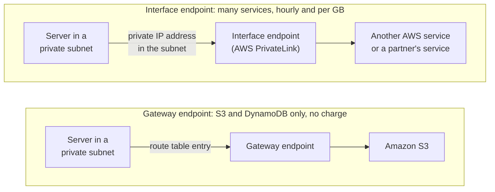
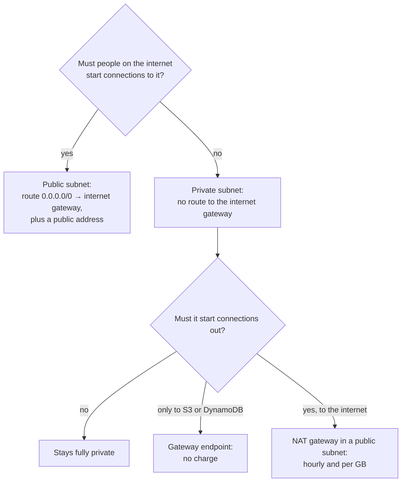

# A VPC is your own network inside a Region, and a subnet is public only when its route table sends traffic to an internet gateway

Every server and database you run on AWS sits in a network. With Amazon Virtual Private Cloud (Amazon VPC) you lay that network out yourself: which parts the internet can reach, which it can't, and how the private parts get out when they must. In this lesson you design the bakery's network and learn the one rule that decides what is public.

**For:** an adult studying alone, possibly new to IT, who wants to understand AWS and use it safely. **Time:** about 25 minutes. Reading works on a phone.

**Before you start:** this lesson builds on [Regions, Availability Zones and data centers](../03-aws-around-the-world/01-regions-availability-zones-data-centers.md), [Surviving failure](../03-aws-around-the-world/03-surviving-failure.md) and [Managed or self-managed databases](../05-storing-data/05-managed-or-self-managed-databases.md). If you skipped them, the key terms below give you enough to follow. The bakery scenario is in the [module brief](00-brief.md).

## Warm-up: what you remember

Answer from memory before you look anything up.

1. From Module 06, "Running applications: compute": the bakery runs web servers in two Availability Zones. What does a load balancer do for them, and what does Auto Scaling do?
2. From lesson 05.05: where does Amazon RDS put a Multi-AZ standby, and why there?
3. From lesson 03.01: can one Availability Zone fail while the others in its Region keep running?

Feedback

1. **The load balancer spreads incoming requests** across healthy servers. **Auto Scaling changes how many servers** there are. They work together; neither does the other's job.
2. **In a different AZ of the same Region,** so losing the primary's AZ doesn't lose the standby too.
3. **Yes.** Each AZ has its own power, cooling and networking, and AZs are built to fail independently.

## What you'll learn

By the end of this lesson, you can:

- describe a VPC and its parts: subnets, route tables, an internet gateway, a NAT gateway and VPC endpoints;
- explain what makes a subnet public, and analyze a setup to say whether a server can reach the internet (objective 07.01a);
- say what a NAT gateway and each kind of endpoint cost.

Try these before you read on. Guess if you're unsure; the answers are in the lesson.

1. The bakery gives its database server a public IP address. Does that put the database on the internet?
2. The internet gateway costs nothing. Does the NAT gateway cost nothing too?

## The big picture: one network, two kinds of subnet

The bakery's site runs in US East (N. Virginia). Its own VPC there spans two Availability Zones, and each zone holds a public subnet for a web server and a private subnet for the order database.

*Notice the highlighted line in the public route table. It is the only difference between the top row of subnets and the bottom row.*

**Long description.** An AWS Region, US East (N. Virginia), holds the bakery's VPC, with the address range 10.0.0.0/16. Arrows run both ways between the internet and an internet gateway attached to the top edge of the VPC. Inside are two Availability Zones, A and B. Each holds a public subnet (10.0.1.0/24 in A, 10.0.2.0/24 in B) with a web server that has a public IPv4 address, and a private subnet (10.0.3.0/24 and 10.0.4.0/24) with the order database: the primary in AZ A, the Multi-AZ standby in AZ B. Arrows labeled internet traffic run from the internet gateway to the public subnets only. Two route tables sit at the bottom. The public route table, used by both public subnets, has 10.0.0.0/16 to local (stays inside the VPC) and, highlighted, 0.0.0.0/0 to the internet gateway. The private route table, used by both private subnets, has only the local route. The addresses are examples; the bakery is made up for teaching.

## Key terms (skip if you know them)

- **IP address:** the number that identifies a device on a network, such as `10.0.1.25`. A **private IP address** works only inside a private network; a **public IP address** can be reached across the internet.
- **CIDR block:** a way to write a range of addresses. `10.0.0.0/16` means every address starting `10.0.`. A smaller number after the slash means a bigger range: `/16` holds 65,536 addresses, `/24` holds 256, and `0.0.0.0/0` means every address.
- **Subnet:** a slice of a VPC's address range, in one Availability Zone. You launch servers and databases into subnets.
- **Route table:** a list of **routes**, each saying "traffic to this destination goes to this target".
- **Internet gateway:** the VPC's door to the internet, in both directions.
- **NAT gateway:** lets servers in a private subnet start connections out to the internet, while nobody outside can start one in.
- **VPC endpoint:** a private path from your VPC to an AWS service, such as Amazon S3, without the internet.

Two everyday words mean something narrower here. A **gateway** is a specific AWS component, not any way in or out. And **public** describes a subnet's route, not who may come in; lesson 07.02 covers that.

## A VPC is a private network that you lay out inside one Region

A **VPC** is a virtual network that belongs to your account and is isolated from everyone else's. It works like the network a company would build in its own data center, built with settings instead of cables ([How Amazon VPC works](https://docs.aws.amazon.com/vpc/latest/userguide/how-it-works.html), checked 2026-10-23). You choose its address range, its subnets, its route tables and its gateways. A VPC belongs to one Region: the bakery's German copy of the site, from lesson 03.02, needs its own VPC in Europe (Frankfurt).

**You already have one.** AWS gives every account a **default VPC** in each Region. It has a public subnet in every AZ, an internet gateway and a route to it, and every server launched there gets a public IPv4 address automatically, so it reaches the internet with no setup ([Default VPCs](https://docs.aws.amazon.com/vpc/latest/userguide/default-vpc.html), checked 2026-10-23). That's handy for a first test, but every subnet in it is public, so it isn't where an order database belongs. In our new test account on 2026-10-23 its parts showed up in every Region, as [primer page 07](https://github.com/AutomateTheCloud/atc-study-aws_account_guardrails/blob/main/primer/07-habits-for-every-lab.md) warned. Leave them alone.

The VPC itself costs nothing; some parts you add to it bill, and so does data transfer ([Amazon VPC FAQ](https://aws.amazon.com/vpc/faqs/), checked 2026-10-23).

## Each subnet sits in one Availability Zone, so you build them in pairs

A **subnet** lives entirely inside one Availability Zone and can't stretch across two ([Subnets for your VPC](https://docs.aws.amazon.com/vpc/latest/userguide/configure-subnets.html), checked 2026-10-23). To survive losing an AZ, you need resources in two AZs, so you need subnets in two AZs. The bakery gets four:

| Subnet | AZ | Holds |
|---|---|---|
| Public `10.0.1.0/24` | A | A web server |
| Public `10.0.2.0/24` | B | A web server |
| Private `10.0.3.0/24` | A | The order database's primary |
| Private `10.0.4.0/24` | B | The Multi-AZ standby from lesson 05.05 |

With only one private subnet, the standby would have nowhere to live. And a `/16` VPC split into `/24` subnets leaves room for many more later, such as a third AZ.

> **Check:** The bakery's builder puts one public and one private subnet, both in AZ A, and calls the site "highly available". What's wrong?
>
> A. Nothing: two subnets are enough
> B. Each subnet is in one AZ, so losing AZ A takes out both
> C. Subnets must be in different Regions

Feedback

**B is right.** High availability needs copies in at least two AZs.

- **A is wrong.** The count doesn't matter if both share one AZ.
- **C is wrong.** A VPC's subnets are all in one Region. Another Region is disaster recovery (lesson 03.03), not this step.

## A route table decides where traffic leaving a subnet goes

Every subnet uses exactly one **route table**; if you don't pick one, it uses the VPC's main route table. Each **route** has a **destination**, a range of addresses, and a **target**: an internet gateway, a NAT gateway, an endpoint or a link to another network ([Configure route tables](https://docs.aws.amazon.com/vpc/latest/userguide/VPC_Route_Tables.html), checked 2026-10-23). Two routes matter here:

| Destination | Target | Meaning |
|---|---|---|
| `10.0.0.0/16` | `local` | Traffic for an address inside the VPC stays inside. Every route table has this route, so a VPC's subnets can reach each other. |
| `0.0.0.0/0` | An internet gateway or a NAT gateway | Traffic for any other address goes to this target. |

When two routes match, the more specific one wins. Traffic to `10.0.3.17` matches both lines, but `/16` is narrower than `/0`, so it stays local.

> **Your turn:** A web server in the bakery's public subnet sends one request to `10.0.4.20` and another to a payment company at `192.0.2.80`. Using the public route table in the big picture, where does each go?

Model answer

`10.0.4.20` is inside `10.0.0.0/16`, so it stays local and reaches the private subnet in AZ B. `192.0.2.80` matches only `0.0.0.0/0`, so it goes to the internet gateway.

## A subnet is public because of its route, not because of its addresses

An **internet gateway** connects a VPC to the internet in both directions: your servers can reach out, and people on the internet can start connections in. AWS runs it as a redundant, highly available component with no bandwidth limit of its own, and the gateway itself has no charge ([Internet gateways](https://docs.aws.amazon.com/vpc/latest/userguide/VPC_Internet_Gateway.html), checked 2026-10-23).

Here is the rule this lesson turns on:

- A **public subnet** is one whose route table has a route to an internet gateway.
- A **private subnet** is one whose route table doesn't.

A route alone doesn't put a server on the internet, though. For IPv4, the server also needs a **public IPv4 address**, or an **Elastic IP address** (a public address you reserve and keep). The internet gateway translates between that public address and the server's private one.

*Notice that the route decides the row and the address decides the column. Only the top-left cell is on the internet.*

**Long description.** A grid with two rows and two columns. Rows are the subnet's route: the route table sends 0.0.0.0/0 to the internet gateway (a public subnet), or it has no route to the internet gateway (a private subnet). Columns are the server's address: a public IPv4 address, or none. Public subnet and public address: the server reaches the internet and the internet can reach it, like the bakery's web server, whose security group still decides what gets in. Public subnet, no public address: the server can't use the internet gateway, because there's no public address to translate. Private subnet and public address, marked as the common mistake: the server still can't reach the internet, because there's no route out; the address does nothing but still costs $0.005 an hour as of 2026-10-24. Private subnet, no address: private and unreachable, like the order database, which would need a route to a NAT gateway to reach out.

### "A public IP address makes a subnet public" is wrong

You may have read that a subnet is public if its servers have public addresses. That's not right. The VPC User Guide defines a public subnet by its route to an internet gateway, and gives the opposite case as an example: a server with a public address in a subnet without that route can't talk to the internet at all ([Internet gateways](https://docs.aws.amazon.com/vpc/latest/userguide/VPC_Internet_Gateway.html)). It's tempting because in the default VPC the two always come together, and even AWS's general glossary describes public subnets loosely. Follow the route.

The address still costs money. As of 2026-10-24, every public IPv4 address, in use or idle, costs **$0.005 an hour** in US East (N. Virginia), about $3.65 for a month of 730 hours ([Amazon VPC pricing](https://aws.amazon.com/vpc/pricing/); AWS Price List, AmazonVPC offer).

> **Check:** Answer the first prequestion. The bakery's database server sits in a subnet whose route table has only the local route, and someone gives it a public IPv4 address. What changes?
>
> A. The database is now on the internet
> B. Nothing reaches the internet, because there's no route to an internet gateway; the address only adds cost
> C. The subnet becomes public

Feedback

**B is right.** Without a route to an internet gateway, traffic can't leave for the internet or arrive from it.

- **A is wrong.** An address alone gives no path.
- **C is wrong.** Only a route to an internet gateway makes a subnet public.

## A NAT gateway lets private servers reach out, never the internet reach in, and it bills by the hour

Sometimes a server in a private subnet must start a conversation with the internet, for example to download software updates. A **NAT gateway** (network address translation) lets it, without making it public. Private servers send their traffic to the NAT gateway, which sends it out and passes the replies back. Nobody on the internet can start a connection in through it ([NAT gateways](https://docs.aws.amazon.com/vpc/latest/userguide/vpc-nat-gateway.html), checked 2026-10-23). It sits in a **public** subnet with an Elastic IP address, and the **private** subnet's route table gets the route `0.0.0.0/0` → NAT gateway.

*Notice the crossed-out arrow on the right. Replies still come back through the NAT gateway; only new connections from outside are refused.*

**Long description.** Two panels. Left, internet gateway: the internet, then the internet gateway, then a public subnet holding a web server with a public IPv4 address; arrows run both ways between each pair, labeled either side can start. Notes: who can start, the internet or your server; attached to the VPC; no charge for the gateway itself. Right, NAT gateway: the internet, an internet gateway, a public subnet holding a NAT gateway with an Elastic IP address, and a private subnet holding a server with no public address. Arrows run upward only, from the server to the internet, labeled only the server starts. A dashed arrow from the internet is crossed out before the NAT gateway, labeled can't start a connection in. Notes: only your private server can start; it lives in a public subnet, often one per AZ; $0.045 an hour plus $0.045 per GB processed in US East (N. Virginia) as of 2026-10-24, with the Elastic IP address and data transfer charged on top.

| | Internet gateway | NAT gateway |
|---|---|---|
| **Who can start a connection** | Either side | Only your servers, from inside |
| **Used by** | Servers in public subnets with public addresses | Servers in private subnets |
| **Lives** | Attached to the VPC | In a public subnet |
| **Cost** | No charge | Hourly and per GB |

**What's the same:** both are route targets that connect the VPC to the internet. **What differs:** direction and cost. **The principle:** if the internet must reach it, use a public subnet and the internet gateway; if it only needs to reach out, keep it private and route it to a NAT gateway.

### "A NAT gateway is free" is wrong

You may have read that NAT gateways are free, like internet gateways. That's not right. AWS charges for every hour a NAT gateway exists, and for every GB it processes; a partial hour bills as a full hour ([Pricing for NAT gateways](https://docs.aws.amazon.com/vpc/latest/userguide/nat-gateway-pricing.html); [Amazon VPC pricing](https://aws.amazon.com/vpc/pricing/)). As of 2026-10-24 in US East (N. Virginia), that's **$0.045 an hour and $0.045 per GB**, plus its Elastic IP address at the public IPv4 rate (AWS Price List). Data transfer to the internet comes on top (lesson 07.04). It's tempting because both are called gateways and sit in the same route tables, and the internet gateway really is free.

*Notice how little the data adds at low traffic. Most of the bill is the hourly charge, and a second gateway doubles it.*

| A month of 730 hours | NAT gateway hours | Elastic IP address | Data processed | Total |
|---|---|---|---|---|
| One NAT gateway, 10 GB | $32.85 | $3.65 | $0.45 | $36.95 |
| One NAT gateway, 200 GB | $32.85 | $3.65 | $9.00 | $45.50 |
| Two NAT gateways (one per AZ), 200 GB in total | $65.70 | $7.30 | $9.00 | $82.00 |
| A gateway endpoint instead, 200 GB to S3 | — | — | — | $0 |

Why run two? A NAT gateway lives in one AZ: if AZ A fails, servers in AZ B lose their way out through it. AWS's pricing page also suggests keeping traffic in the NAT gateway's own AZ, or giving each AZ its own, to cut cross-AZ charges. AWS's NAT gateway guide also describes a newer Regional option that spreads across AZs by itself; check its current wording before you design one (checked 2026-10-23).

> **Your turn:** Answer the second prequestion in two sentences: what would one NAT gateway cost the bakery for a month (730 hours) in which it carried only 10 GB, and which part of the bill is largest?

Model answer

About $36.95 at the 2026-10-24 prices, before data transfer. The hourly charge, $32.85, is nearly all of it, so a NAT gateway left running "just in case" costs almost as much as a busy one.

## VPC endpoints reach AWS services without the internet, and one kind is free

A private server often needs an AWS service, not the wider internet: the bakery's servers save cake photos to its S3 bucket. Through a NAT gateway, every photo pays the per-GB charge. A **VPC endpoint** gives the VPC a private path to the service instead, and the traffic stays on AWS's network ([Amazon VPC FAQ](https://aws.amazon.com/vpc/faqs/), checked 2026-10-23).

| | Gateway endpoint | Interface endpoint |
|---|---|---|
| **Services** | Amazon S3 and Amazon DynamoDB only | Many AWS services, partners' services, and services other accounts publish |
| **How it attaches** | A route in your route table points at it | A network interface with a private IP address appears in your subnet |
| **Built on AWS PrivateLink?** | No | Yes |
| **Cost** | No charge | Hourly in each AZ where you place it, plus per GB |

From [AWS PrivateLink concepts](https://docs.aws.amazon.com/vpc/latest/privatelink/concepts.html) and [Gateway endpoints](https://docs.aws.amazon.com/vpc/latest/privatelink/gateway-endpoints.html), checked 2026-10-23. Current interface endpoint rates are on the [AWS PrivateLink pricing page](https://aws.amazon.com/privatelink/pricing/).

*Notice where each one plugs in: the gateway endpoint is a route, the interface endpoint is an address inside your subnet.*

**Long description.** Two rows. Top, gateway endpoint, for S3 and DynamoDB only, no charge: a server in a private subnet sends traffic through a route-table entry to a gateway endpoint, which reaches Amazon S3. Bottom, interface endpoint, for many services, billed hourly and per GB: a server in a private subnet sends traffic to a private IP address in its own subnet, an interface endpoint powered by AWS PrivateLink, which reaches another AWS service or a partner's service.

**What's the same:** both reach a service with no internet gateway and no NAT gateway. **What differs:** which services, how they attach, and the bill. **The principle:** for S3 or DynamoDB, use the free gateway endpoint; for other services, check that an interface endpoint's hourly charge is worth it. Lesson 07.04 returns to PrivateLink, which can also share one service privately with other VPCs.

> **Check:** The bakery's private servers send 200 GB of photos a month to its S3 bucket in the same Region, through a NAT gateway. Which change removes the network charge on that traffic?
>
> A. Add an interface endpoint for S3
> B. Add a gateway endpoint for S3, with a route to it in the private route table
> C. Move the NAT gateway to the other AZ

Feedback

**B is right.** The gateway endpoint has no charge, and the photos no longer pass through the NAT gateway, so its per-GB charge disappears. Transfer between EC2 and S3 in the same Region is free.

- **A is wrong.** It avoids the NAT gateway too, but bills hourly and per GB; for S3 the gateway endpoint is the free choice.
- **C is wrong.** Moving it doesn't change what it charges.

## Your side of the line

On the shared responsibility line from lesson [04.01](../04-shared-responsibility-and-access/01-security-of-vs-in-the-cloud.md):

- **AWS** runs the physical network, keeps each VPC isolated from other customers, and runs internet gateways, NAT gateways and endpoints as highly available services.
- **You** design the network: address ranges, which subnets are public, routes, gateways and endpoints, and which servers get public addresses. A database in a public subnet with a public address is the customer's mistake, not AWS's.

Lesson 07.02 adds the other half of your side: the rules that decide which traffic may pass.

## What you pay for

US East (N. Virginia), AWS Price List as of 2026-10-24 ([Amazon VPC pricing](https://aws.amazon.com/vpc/pricing/)):

| Part | Charge |
|---|---|
| The VPC, subnets, route tables, the internet gateway, a gateway endpoint | No charge |
| NAT gateway | $0.045 an hour and $0.045 per GB processed |
| Public IPv4 address, including an Elastic IP address | $0.005 an hour, in use or idle |
| Interface endpoint | Hourly per AZ plus per GB ([PrivateLink pricing](https://aws.amazon.com/privatelink/pricing/)) |
| Data transfer | Lesson 07.04 |

That's why [Lab 09](05-lab-09-build-a-small-vpc.md) builds a VPC with an internet gateway but no NAT gateway and no Elastic IP address: everything it creates is free.

## Worked example: laying out the bakery's network

The owner writes: "Customers must reach the website. Nobody on the internet should ever reach the order database. The web servers save photos to our S3 bucket. Keep the bill small."

Someone who knows VPCs asks the same questions for each part of the site:

*Notice that the expensive answer, the NAT gateway, is the last branch. Ask the cheaper questions first.*

**Long description.** A decision flowchart. First question: must people on the internet start connections to it? If yes: a public subnet, with a route from 0.0.0.0/0 to the internet gateway, plus a public address. If no: a private subnet with no route to the internet gateway, and a second question: must it start connections out? If no: it stays fully private. If only to S3 or DynamoDB: a gateway endpoint, no charge. If yes, to the internet: a NAT gateway in a public subnet, billed hourly and per GB.

1. **Web servers.** Customers start connections to them. *So:* public subnets in AZs A and B, the public route table, a public address on each.
2. **Order database.** Nobody outside starts connections to it, and as a managed RDS database it gets its patches from AWS (lesson 05.05). *So:* private subnets in AZs A and B for the primary and standby, local route only.
3. **Photos to S3.** The web servers are public, so they reach S3 already. If they ever move into private subnets, a free gateway endpoint carries the photos, not a NAT gateway.
4. **The bill.** No NAT gateway for now. If a private server later needs the internet, the bakery adds one, knowing it starts at about $37 a month.

The expert didn't ask "which component is best?" but "who starts the conversation, and with whom?"

> **Your turn:** A year later the bakery moves its web servers into the private subnets, behind a load balancer in the public subnets. The servers must download operating system updates. What does the bakery add, where, and what's the minimum monthly cost of one, at the 2026-10-24 prices?

Model answer

A NAT gateway in a public subnet, with an Elastic IP address, and a route `0.0.0.0/0` → NAT gateway in the private route table. One costs $32.85 in hours plus $3.65 for its Elastic IP address for a month of 730 hours, about $36.50 before any data. Two, one per AZ, keep updates working if an AZ fails, at about twice the cost. Photo uploads keep using the free S3 gateway endpoint.

## In real work: layers, two AZs, and a careful eye on gateways

Network design at work starts from what must be reachable. The Well-Architected Framework names the habits:

- **Security:** [SEC05-BP01 Create network layers](https://docs.aws.amazon.com/wellarchitected/latest/security-pillar/sec_network_protection_create_layers.html). Keep what the internet must reach, such as web endpoints, apart from what needs only internal access, such as databases.
- **Reliability:** [REL10-BP01 Deploy the workload to multiple locations](https://docs.aws.amazon.com/wellarchitected/latest/reliability-pillar/rel_fault_isolation_multiaz_region_system.html), which means subnets in two or more AZs.
- **Cost optimization:** [COST08-BP03 Implement services to reduce data transfer costs](https://docs.aws.amazon.com/wellarchitected/latest/cost-optimization-pillar/cost_data_transfer_implement_services.html), such as a gateway endpoint in place of a NAT gateway path.

## Summary

- **A VPC is your own isolated network in one Region.** You choose its addresses, subnets, routes and gateways. It costs nothing; every account has a default VPC in each Region, with only public subnets.
- **Each subnet sits in one Availability Zone,** so high availability needs subnets in at least two.
- **A route table sends traffic leaving a subnet to a target.** The local route keeps traffic inside the VPC; `0.0.0.0/0` covers everything else.
- **A subnet is public only because its route table points to an internet gateway.** A server also needs a public address to use it. A public address in a private subnet does nothing, yet costs $0.005 an hour (2026-10-24).
- **A NAT gateway lets private servers start connections out, never in,** at $0.045 an hour and $0.045 per GB in US East (N. Virginia) as of 2026-10-24. The internet gateway is free.
- **VPC endpoints reach AWS services privately.** Gateway endpoints (S3, DynamoDB) are free; interface endpoints (PrivateLink) bill hourly and per GB.

**For the bakery's network design:** public subnets for the web servers and private subnets for the database, in two AZs, and no NAT gateway yet. Lesson 07.02 adds the rules that decide what may pass, including how to block a bad IP range.

## Practice

1. **Which target, for the route `0.0.0.0/0` in a subnet's route table, makes that subnet a public subnet?**

   A. A NAT gateway
   B. An internet gateway
   C. A gateway endpoint
   D. A public IPv4 address

   

Feedback

   **B is right.** A route to an internet gateway is what defines a public subnet.

   - **A is wrong.** A route to a NAT gateway is how a *private* subnet reaches out; it stays private.
   - **C is wrong.** A gateway endpoint reaches S3 or DynamoDB, not the internet, and is reached by a route for those services, not `0.0.0.0/0`.
   - **D is wrong.** An address isn't a route target.

   

2. **A company needs servers in a private subnet to download patches from the internet, and nobody on the internet may start a connection to them. What should it use?**

   

Feedback

   **Model answer:** A **NAT gateway** in a public subnet, with a route `0.0.0.0/0` → NAT gateway in the private subnet's route table. A route to the internet gateway instead would make the subnet public.

   

3. **A colleague says, "Our subnet is private because none of our servers have public IP addresses." In two sentences, say what you'd check before agreeing.**

   

Feedback

   **Model answer:** Check the subnet's route table: if it has a route to an internet gateway, the subnet is public, whatever its servers have today. Anyone who launches a server there with a public address puts that server on the internet.

   

4. **(From Module 06, Running applications: compute.) The team terminated a test EC2 instance but kept the Elastic IP address it used. Does the address cost anything while nothing uses it?**

   

Feedback

   **Yes.** As of 2026-10-24, every public IPv4 address, including an Elastic IP address, costs $0.005 an hour in US East (N. Virginia), in use or idle. Release addresses you don't need.

   

5. **(From lesson 03.03.) The bakery's VPC has subnets in two AZs of US East (N. Virginia). Is it protected against losing the whole Region?**

   

Feedback

   **No.** Two AZs give high availability inside the Region. Surviving the loss of the Region is disaster recovery: copies in another Region, such as the bakery's backups in US East (Ohio).

   

**Next:** [Filtering traffic](02-filtering-traffic.md). To build a small VPC yourself at no cost, try [Lab 09: build a small VPC](05-lab-09-build-a-small-vpc.md).

## Where to check the current details

- [How Amazon VPC works](https://docs.aws.amazon.com/vpc/latest/userguide/how-it-works.html), [Default VPCs](https://docs.aws.amazon.com/vpc/latest/userguide/default-vpc.html), [Subnets for your VPC](https://docs.aws.amazon.com/vpc/latest/userguide/configure-subnets.html) and [Configure route tables](https://docs.aws.amazon.com/vpc/latest/userguide/VPC_Route_Tables.html), Amazon VPC User Guide (checked 2026-10-23)
- [Internet gateways](https://docs.aws.amazon.com/vpc/latest/userguide/VPC_Internet_Gateway.html), [NAT gateways](https://docs.aws.amazon.com/vpc/latest/userguide/vpc-nat-gateway.html) and [Pricing for NAT gateways](https://docs.aws.amazon.com/vpc/latest/userguide/nat-gateway-pricing.html) (checked 2026-10-23)
- [AWS PrivateLink concepts](https://docs.aws.amazon.com/vpc/latest/privatelink/concepts.html) and [Gateway endpoints](https://docs.aws.amazon.com/vpc/latest/privatelink/gateway-endpoints.html) (checked 2026-10-23)
- [Amazon VPC pricing](https://aws.amazon.com/vpc/pricing/) and [AWS PrivateLink pricing](https://aws.amazon.com/privatelink/pricing/); this lesson's prices are from the AWS Price List, US East (N. Virginia), retrieved 2026-10-24
- [Amazon VPC FAQ](https://aws.amazon.com/vpc/faqs/) (checked 2026-10-23)
- [AWS Certified Cloud Practitioner (CLF-C02) exam guide](https://docs.aws.amazon.com/aws-certification/latest/cloud-practitioner-02/cloud-practitioner-02.html), task [3.5](https://docs.aws.amazon.com/aws-certification/latest/cloud-practitioner-02/cloud-practitioner-02-domain3.html#cloud-practitioner-02-task3.5) (checked 2026-10-24)

---

"Your own network" by Automate the Cloud Inc., licensed under CC BY-NC 4.0 with the Additional Permission for Internal Training from Automate the Cloud Inc.
License: https://creativecommons.org/licenses/by-nc/4.0/
Permission: https://automatethe.cloud/licenses/atc-internal-training-permission.txt
