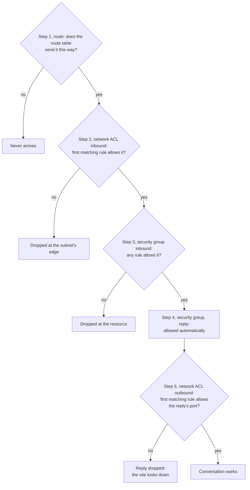

# Security groups guard each resource and remember each conversation; network ACLs guard each subnet and check every packet both ways

Lesson 07.01 decided where traffic can go. This lesson decides which traffic may pass. A VPC gives you two filters: a **security group** around each resource and a **network ACL** at the edge of each subnet. They look alike and behave differently, and by the end you can follow a request and its reply through both and predict whether it gets through.

**For:** an adult studying alone, possibly new to IT, who wants to understand AWS and use it safely. **Time:** about 25 minutes. Reading works on a phone.

**Before you start:** this lesson builds on [Your own network](01-your-own-network.md) (subnets, route tables, the internet gateway) and [Security of vs in the cloud](../04-shared-responsibility-and-access/01-security-of-vs-in-the-cloud.md) (security groups are the customer's). If you skipped them, the key terms below give you enough to follow. The bakery scenario is in the [module brief](00-brief.md).

## Warm-up: what you remember

Answer from memory before you look anything up.

1. From Module 06, "Running applications: compute": the bakery runs some code on EC2 and some in AWS Lambda. For which of the two does the bakery patch an operating system?
2. From lesson 05.02: what does S3 Block Public Access protect against, and why is it useful even when your bucket policy is correct?
3. From lesson 04.01: on EC2, who writes the security group rules for the bakery's web server, AWS or the bakery?

Feedback

1. **EC2.** The bakery patches the guest operating system on its EC2 instances; with Lambda, AWS runs and patches the operating system and the bakery manages its code.
2. **It protects against making data public by mistake.** Even if a later policy change would open a bucket, Block Public Access keeps it closed: a second layer that catches the first layer's mistakes. This lesson's two filters work the same way.
3. **The bakery.** AWS provides the security group; configuring its rules is on the customer's side of the line.

## What you'll learn

By the end of this lesson, you can:

- explain how security groups and network ACLs differ: where they sit, what rules they hold, how they check them and what happens to replies;
- block a range of addresses from a subnet;
- follow a request and its reply through a VPC and predict whether each passes (objective 07.02a);
- say what Amazon Inspector does for network security, and what it doesn't.

Try these before you read on. Guess if you're unsure; the answers are in the lesson.

1. A security group lets HTTPS in. Do you need a second rule to let the server's replies out?
2. Can a security group block one bad IP address while letting everyone else in?

## The big picture: two checkpoints in, two checkpoints out

When a customer opens the bakery's website, the request crosses the subnet's network ACL, then the web server's security group. The reply crosses them again in the other direction, and the two filters treat it differently.

*Notice check 4. The security group lets the reply out because it remembers the request; the network ACL doesn't remember, so it checks the reply like any other packet.*

**Long description.** Left to right: a customer on the internet, then the bakery's VPC, holding an internet gateway and a public subnet. The subnet's left edge is a band labeled network ACL. Inside, a dashed ring labeled security group surrounds the web server, which listens on port 443 for HTTPS. A request arrow runs from the customer through the internet gateway, across the network ACL (check 1) and the security group (check 2) to the server. A reply arrow runs back across the security group (check 3) and the network ACL (check 4, highlighted) to the gateway and the customer's high-numbered port. The checks: 1, network ACL inbound rules, checked in number order, one must allow HTTPS (TCP port 443) from the customer; 2, security group inbound rules, one must allow HTTPS; 3, security group, the reply is allowed automatically because it remembers the request (stateful); 4, network ACL outbound rules, checked again as if new, one must allow traffic to the customer's high-numbered port (stateless). The route table delivers traffic between the gateway and the subnet.

## Key terms (skip if you know them)

- **Packet:** one small piece of data travelling across a network, labeled with where it's from and where it's going.
- **Port:** a number that says which program on a computer the traffic is for. A web server listens on **443** for HTTPS; a PostgreSQL database on **5432**; SSH remote logins use **22**. The other end of a conversation uses a temporary **high-numbered port** for the replies.
- **Firewall:** something that lets traffic through or stops it according to **rules**. **Inbound** rules cover traffic arriving; **outbound** rules cover traffic leaving.
- **Security group:** a firewall around a resource, such as an EC2 instance or an RDS database.
- **Network ACL** (network access control list): a firewall at the edge of a subnet. Not the same thing as the S3 access control lists from lesson 05.02, which control who may use a bucket or object.
- **Stateful:** remembers each conversation, so a reply to an allowed request is let through without a rule. **Stateless:** remembers nothing, so it judges every packet, replies included, by its rules alone.

"Stateless" has a second meaning you'll meet in the Well-Architected Framework: an application that keeps no session data on its servers. That's a design idea for applications. Here it describes a filter that doesn't track conversations.

## A security group allows traffic to a resource and remembers each conversation

A **security group** acts as a virtual firewall for the resources you attach it to: the only traffic that reaches them is traffic its rules allow ([Security groups](https://docs.aws.amazon.com/vpc/latest/userguide/vpc-security-groups.html), checked 2026-10-23). Its rules work like this ([Security group rules](https://docs.aws.amazon.com/vpc/latest/userguide/security-group-rules.html)):

- **Allow rules only.** You can't write a deny rule. Anything no rule allows is refused.
- **A new security group** has no inbound rules, so nothing gets in, and one outbound rule that lets everything out.
- **All rules count together.** If any rule allows the traffic, it passes. Order doesn't matter.
- **It's stateful.** If a request was allowed in, its reply goes out whatever the outbound rules say, and the other way round.
- **A rule's source can be another security group,** meaning "anything attached to that group".
- One resource can have several security groups, and a rule change applies at once to everything using the group. There's no charge.

The bakery needs two:

| Security group | Inbound rule | Why |
|---|---|---|
| `web-sg`, on the web servers | HTTPS, TCP 443, from `0.0.0.0/0` | Any customer may open the site |
| `db-sg`, on the RDS database | PostgreSQL, TCP 5432, from `web-sg` | Only the web servers may talk to the database |

Both keep the default outbound rule. Neither allows SSH. AWS's best practices say never to open SSH (22) or RDP (3389) to `0.0.0.0/0`, and not to open wide port ranges ([Security groups](https://docs.aws.amazon.com/vpc/latest/userguide/vpc-security-groups.html)); [primer page 10](https://github.com/AutomateTheCloud/atc-study-aws_account_guardrails/blob/main/primer/10-bad-practices-and-checklist.md) lists it as a bad practice.

> **Your turn:** Why does `db-sg` name `web-sg` as its source instead of the web servers' IP addresses? Think about Module 06, where Auto Scaling adds and removes web servers.

Model answer

Auto Scaling launches and terminates web servers, and each new one has a new address. A rule naming `web-sg` covers every server that carries that group, today's and tomorrow's, with no edits. A list of addresses would go out of date, and someone would "fix" it by opening the database wider than needed.

## A network ACL checks every packet entering or leaving a subnet, in number order

A **network ACL** filters traffic at the edge of a subnet: what may enter it and what may leave it. Every subnet has exactly one; one network ACL can serve several subnets ([Network ACLs](https://docs.aws.amazon.com/vpc/latest/userguide/vpc-network-acls.html), checked 2026-10-23). Its rules differ from a security group's in three ways:

- **Allow and deny.** Each rule either allows or denies.
- **Numbered, first match wins.** Each rule has a number from 1 to 32766. AWS checks them from the lowest number up and applies the first one that matches; later rules aren't checked. Every network ACL ends with a catch-all rule, shown as `*`, that denies whatever no numbered rule matched. AWS suggests numbering in steps of 10 or 100, to leave gaps for rules you add later.
- **It's stateless.** It doesn't remember requests, so replies are checked against the rules for their direction, like any other packet.

It checks traffic as it crosses the subnet's edge, not traffic between resources inside the same subnet. There's no charge.

What a new VPC starts with matters. Its **default network ACL allows all traffic** in and out, and every subnet uses it until you choose another, so the network ACL layer does nothing until you change it. A **custom network ACL** you create starts the other way: it denies everything until you add rules.

**This is where the bakery blocks a bad address range.** The owner sees thousands of failed login attempts on the order page, all from addresses in `203.0.113.0/24`. A security group can't help, because it has no deny rule. A network ACL can:

*Notice that each packet stops at the first rule that matches. Packet A never reaches rule 100, so the allow rule can't let it in.*

**Long description.** Three inbound rules for the network ACL of the bakery's public subnets, in order: rule 90 denies all traffic from 203.0.113.0/24; rule 100 allows HTTPS (TCP 443) from 0.0.0.0/0; rule * denies all traffic. Three packets are tested. Packet A, HTTPS from 203.0.113.7: rule 90 matches and denies it; the other rules aren't checked; result, denied by rule 90. Packet B, HTTPS from 192.0.2.44: rule 90 doesn't match; rule 100 matches and allows it; result, allowed by rule 100. Packet C, SSH (TCP 22) from 192.0.2.44: rules 90 and 100 don't match; the * rule denies it. Notes: rules are checked from the lowest number up; every network ACL ends with the * rule; rule 90 sits below 100 on purpose. The addresses come from ranges reserved for examples.

AWS's own advice matches this use: security groups are the main control, and network ACLs a second, coarse layer, for example to deny a specific set of traffic, or as a guard rail for the whole subnet in case a server is launched with the wrong security group ([Infrastructure security in Amazon VPC](https://docs.aws.amazon.com/vpc/latest/userguide/infrastructure-security.html), checked 2026-10-23).

> **Your turn:** A teammate adds the deny rule as number 110 instead of 90. In two sentences, predict what happens to HTTPS requests from `203.0.113.7`, and why.

Model answer

They still get in. Rule 100 allows HTTPS from anywhere and is checked first, so it matches and decides; rule 110 is never reached. A deny rule must have a lower number than the allow rule it carves an exception from.

## A security group lets replies through on its own; a network ACL checks them again

Every conversation has two halves: the request and the reply. A customer's browser sends its request to port 443 on the web server, and the server answers to a temporary high-numbered port on the customer's computer. The VPC FAQ's example uses the range 49152 to 65535 ([Amazon VPC FAQ](https://aws.amazon.com/vpc/faqs/), checked 2026-10-23).

- The **security group** saw the request come in, remembers it, and lets the reply out. No outbound rule is needed.
- The **network ACL** doesn't remember. To it, the reply is a new packet leaving the subnet for a high-numbered port, and an outbound rule must allow it.

### "Return traffic always gets through" is wrong

You may have read that replies are always allowed back, because security groups are stateful. That's not right. The security group lets the reply through, but the reply still has to cross the subnet's network ACL, which is stateless. With the default network ACL, which allows everything, you never notice. With a custom network ACL whose outbound rules allow only port 443, the customer's request gets in, the server answers, and the reply is dropped at the subnet's edge: to the customer the site looks down.

It's tempting because most people meet security groups first, the default network ACL hides the problem, and "stateful" sounds like a property of the whole VPC. It's a property of the security group only.

> **Check:** Answer the first prequestion. The bakery's web server has a security group with one inbound rule allowing HTTPS from anywhere, and its outbound rules were all removed. The subnet uses the default network ACL. Does a customer's page load?
>
> A. No: with no outbound rules, the security group blocks the reply
> B. Yes: the security group remembers the request and lets the reply out, and the default network ACL allows everything
> C. No: network ACLs block all replies

Feedback

**B is right.** Replies to allowed requests leave a security group regardless of its outbound rules, and the default network ACL allows all traffic.

- **A is wrong.** Outbound rules control conversations the server *starts*, not replies.
- **C is wrong.** A network ACL checks replies like any packet; the default one allows them. A custom one could block them if its outbound rules don't allow the high-numbered ports.

## Security group or network ACL: use both, for different jobs

![Two columns compared on seven rows. Security group: guards each resource; allow rules only; all rules together; replies allowed automatically (stateful, highlighted); a new one allows nothing in and everything out; the main control; no charge. Network ACL: guards a whole subnet; allow and deny; in number order, first match decides; replies checked again (stateless, highlighted); the default allows everything, a new custom one denies everything; a second layer, such as denying an address range; no charge.](../../images/07-02-sg-vs-nacl.svg)

*Notice the highlighted row. Most wrong answers about these two come from mixing up who remembers the conversation.*

**Long description.** Two columns, security group and network ACL, on seven rows. Guards: each resource it's attached to (instance level); a whole subnet (subnet level). Rules: allow only; allow and deny. How rules are checked: all together, any matching allow lets traffic through; in number order, the first match decides. Replies, highlighted: allowed automatically (stateful); checked again, an outbound rule must allow them (stateless). When you create one: a new security group allows nothing in and everything out; the default network ACL allows everything and a new custom one denies everything. Usual job: the main control, who may reach this resource on which port; a second layer, such as denying an address range for a whole subnet. Cost: no charge for either. Neither filters traffic to Amazon DNS, DHCP, instance metadata or the Amazon Time Sync Service.

| | Security group | Network ACL |
|---|---|---|
| **Guards** | A resource (instance level) | A subnet (subnet level) |
| **Rules** | Allow only | Allow and deny |
| **Checking** | All rules together | Number order, first match wins |
| **Replies** | Allowed automatically (stateful) | Must be allowed (stateless) |
| **Use it for** | The main control on every resource | A second layer, such as blocking a range |

From [Infrastructure security in Amazon VPC](https://docs.aws.amazon.com/vpc/latest/userguide/infrastructure-security.html), checked 2026-10-23.

**What's the same:** both filter traffic in your VPC, both cost nothing, and both are yours to configure. **What differs:** where they sit, deny rules, rule order and replies. **The principle:** write tight security groups on every resource first; add network ACL rules when you need a deny, or a subnet-wide guard rail.

> **Check:** Answer the second prequestion. The bakery must stop all traffic from one address, `203.0.113.7`, while everyone else still reaches the site. What should it change?
>
> A. Add a deny rule to `web-sg`
> B. Remove the HTTPS rule from `web-sg`
> C. Add a deny rule for `203.0.113.7/32` to the public subnets' network ACL, numbered below the rule that allows HTTPS
> D. Run Amazon Inspector

Feedback

**C is right.** Only a network ACL has deny rules, and the lower number makes it match first. (`/32` means exactly one address.)

- **A is wrong.** Security groups have no deny rules.
- **B is wrong.** That blocks every customer.
- **D is wrong.** Inspector reports exposure; it doesn't block anything (below).

## Predict whether traffic passes by walking the path

To predict an outcome, follow the packet the way the VPC does. Ask each question in order and stop at the first "no":

*Notice that the security group's step 4 has no question: the only check on a reply that can fail is the network ACL's.*

**Long description.** A flowchart of five steps; any "no" ends the path. Step 1, route: does the route table send it this way? No: it never arrives. Yes: step 2, network ACL inbound: does the first matching rule allow it? No: dropped at the subnet's edge. Yes: step 3, security group inbound: does any rule allow it? No: dropped at the resource. Yes: step 4, security group, reply: allowed automatically. Then step 5, network ACL outbound: does the first matching rule allow the reply's port? No: the reply is dropped and the site looks down. Yes: the conversation works.

## Worked example: four requests to the bakery

The bakery's public subnets use a custom network ACL. Inbound: rule 90 denies `203.0.113.0/24`; rule 100 allows HTTPS from anywhere. Outbound: rule 100 allows TCP 1024 to 65535 to anywhere, for replies. The web servers have `web-sg`; the database, in a private subnet whose route table has only the local route, has `db-sg`. Here is how an expert walks each case.

| Request | Route | Network ACL in | Security group in | Reply | Result |
|---|---|---|---|---|---|
| A customer at `192.0.2.44` opens the site (HTTPS) | Public subnet, via the internet gateway | Rule 100 allows | `web-sg` allows 443 | Allowed by `web-sg`; outbound rule 100 allows the high port | **Works** |
| The same customer tries SSH (port 22) to a web server | Same | No numbered rule matches; `*` denies | — | — | **Dropped at the subnet's edge** |
| A bot at `203.0.113.7` opens the site | Same | Rule 90 denies first | — | — | **Dropped at the subnet's edge** |
| Someone on the internet tries the database's port 5432 | No route: the private subnet has no internet gateway route | — | — | — | **Never arrives** |

The expert's thinking, step by step:

1. **Route first.** The database case ends at step 1. Even a perfect security group is a second line there; the missing route is the first.
2. **Network ACL in, by number.** For the bot, rule 90 matches before rule 100, so the allow never applies.
3. **Then the security group.** For the SSH attempt, the network ACL already dropped it; had the network ACL allowed it, `web-sg` would have dropped it, because it has no rule for port 22. Two layers, each able to stop it: that's defense in depth.
4. **The reply, last.** Only for the customer does a reply exist, and outbound rule 100 lets it out. Delete that rule and the first case changes to "reply dropped".

To practice on harder setups, try [Simulation S8: the packet journey](06-sim-packet-journey.md), and build these rules yourself in [Lab 09](05-lab-09-build-a-small-vpc.md).

> **Your turn:** The web server needs to download updates over HTTPS from the internet. Walk the path for the server's request out and for the reply coming back, using the rules above. Where does it fail, and which network ACL rules fix it?

Model answer

**Going out:** `web-sg` allows all outbound traffic, but the network ACL's outbound rule 100 allows only TCP 1024 to 65535, which doesn't include port 443, so the request is dropped as it leaves the subnet. Fix: an outbound rule allowing TCP 443 to `0.0.0.0/0`. **Coming back:** the reply goes to a high-numbered port on the web server. The security group lets it in because it remembers the request, but the stateless network ACL allows inbound only HTTPS, so it drops the reply. Fix: an inbound rule allowing TCP 1024 to 65535. Two rules, one each way: a stateless filter needs rules for both halves of every conversation.

## Amazon Inspector finds open paths; it doesn't block anything

The exam lists **Amazon Inspector** under security in a VPC (task [3.5](https://docs.aws.amazon.com/aws-certification/latest/cloud-practitioner-02/cloud-practitioner-02-domain3.html#cloud-practitioner-02-task3.5)), next to security groups and network ACLs. Don't read that as "a third filter". Inspector is a vulnerability management service: it scans EC2 instances, container images in Amazon ECR and Lambda functions for software vulnerabilities and **unintended network exposure**, such as a server reachable from the internet on a port nobody meant to open, and reports each one as a finding ([What is Amazon Inspector?](https://docs.aws.amazon.com/inspector/latest/user/what-is-inspector.html), checked 2026-10-23). It even lowers a finding's risk score when no open network path reaches the instance. But it changes nothing: you fix the rule.

Three neighbors to keep apart:

- **VPC Flow Logs** record information about the traffic to and from your network interfaces, for troubleshooting and security analysis ([Amazon VPC FAQ](https://aws.amazon.com/vpc/faqs/)). They record; they don't block either.
- **AWS WAF** filters web requests to sites and APIs. Module 09, "Protecting, governing and proving compliance", covers it.
- **AWS Network Firewall** appears in AWS's VPC guide, but the exam guide lists it as out of scope. If it shows up as an answer, it's most likely a distractor.

Old material may describe "assessment templates" and an agent you install; that was Amazon Inspector Classic, which AWS shut down on 2026-05-20. Today's Inspector discovers resources and scans them on its own.

## Your side of the line

Lesson [04.01](../04-shared-responsibility-and-access/01-security-of-vs-in-the-cloud.md) put security group rules on the customer's side. Network ACL rules are yours too. AWS provides both filters, runs them, and keeps the VPC isolated; you decide what they allow. An open SSH port is a customer mistake. Lesson [04.02](../04-shared-responsibility-and-access/02-shared-inherited-customer-specific.md) called this kind of task shared: AWS configures its own infrastructure, and you configure your resources.

## What you pay for

- **Security groups and network ACLs:** no charge.
- **Amazon Inspector:** billed for what it scans. As of 2026-10-23 AWS offered a 15-day free trial, and trials need the Paid plan, so this guide doesn't have Free plan learners turn it on. Check the [Amazon Inspector pricing page](https://aws.amazon.com/inspector/pricing/).

## In real work: tight groups first, coarse rules second

Teams treat security groups as the main control and keep their rules as narrow as the job allows: the right port, from the right source, often another security group. Network ACLs carry a few broad rules for whole subnets. The Well-Architected Framework names these habits:

- The security design principle "[Apply security at all layers](https://docs.aws.amazon.com/wellarchitected/latest/framework/sec-design.html)": a route, a network ACL and a security group are three layers, and a mistake in one is caught by another.
- [SEC05-BP02 Control traffic flow within your network layers](https://docs.aws.amazon.com/wellarchitected/latest/security-pillar/sec_network_protection_layered.html): allow only the flows each part needs, such as web servers to the database on one port.
- [SEC06-BP01 Perform vulnerability management](https://docs.aws.amazon.com/wellarchitected/latest/security-pillar/sec_protect_compute_vulnerability_management.html): scanning with a tool such as Inspector, then fixing what it finds.

## Summary

- **A security group guards a resource.** Allow rules only, all checked together; it's stateful, so replies to allowed requests pass on their own. Rules can name another security group as the source.
- **A network ACL guards a subnet.** Allow and deny rules, checked in number order until the first match, ending in a catch-all deny. It's stateless, so replies need their own rule. The default one allows everything; a new custom one denies everything.
- **To block an address range, use a network ACL deny rule** numbered below the allow rule it must beat. Security groups can't deny.
- **Return traffic doesn't always get through.** The security group passes it; a custom network ACL can still drop it.
- **Predict by walking the path:** route, network ACL in, security group in, then the reply through the network ACL out.
- **Amazon Inspector reports unintended network exposure;** it filters nothing.

**For the bakery's network design:** `web-sg` allows HTTPS from anywhere; `db-sg` allows PostgreSQL only from `web-sg`; the public subnets' network ACL denies `203.0.113.0/24`. Lessons 07.03 and 07.04 add the photos' CDN and the link to head office.

## Practice

1. **Which statement about security groups is correct?**

   A. They support allow and deny rules
   B. They are stateful: replies to allowed traffic are allowed automatically
   C. They apply to a whole subnet
   D. Their rules are checked in number order

   

Feedback

   **B is right.**

   - **A is wrong.** Security groups have allow rules only; network ACLs have both.
   - **C is wrong.** That's a network ACL. A security group applies to the resources attached to it.
   - **D is wrong.** All security group rules are considered together; numbered order is a network ACL feature.

   

2. **A network ACL has inbound rule 100 allowing all traffic and rule 200 denying `198.51.100.0/24`. Does traffic from `198.51.100.5` get in? Explain in one sentence.**

   

Feedback

   **Yes.** Rule 100 is checked first and matches everything, so it decides; rule 200 is never reached. To block the range, give the deny rule a number below 100.

   

3. **What does Amazon Inspector do for network security in a VPC?**

   A. It blocks traffic that matches known attacks
   B. It replaces security groups for EC2 instances
   C. It scans workloads and reports unintended network exposure as findings
   D. It records every packet in the VPC

   

Feedback

   **C is right.** Inspector finds and reports; you change the rules.

   - **A is wrong.** Inspector doesn't filter traffic; for web requests, AWS WAF does (Module 09).
   - **B is wrong.** Security groups still filter the traffic.
   - **D is wrong.** VPC Flow Logs record information about traffic; Inspector doesn't.

   

4. **A team's site stopped loading after someone replaced the subnet's default network ACL with a custom one that allows inbound HTTPS and outbound HTTPS only. The security group is unchanged. In two sentences, explain the likely cause.**

   

Feedback

   **Model answer:** Requests get in, but the server's replies go to the customers' high-numbered ports, which the custom network ACL's outbound rules don't allow, and network ACLs are stateless. Adding an outbound rule for the high-numbered ports fixes it; the security group was never the problem.

   

5. **(From lesson 07.01.) A server in a private subnet has a security group allowing HTTPS from anywhere. Can customers on the internet reach it?**

   

Feedback

   **No.** The private subnet has no route to an internet gateway, so internet traffic never arrives; the security group never gets to decide. The route is checked first.

   

6. **(From lesson 05.05.) The bakery's order database runs on RDS. Which task stays with the bakery: patching the database software, or deciding which resources may connect to the database?**

   

Feedback

   **Deciding who may connect,** with IAM and with security groups such as `db-sg`. AWS patches the database software on RDS.

   

**Next:** [Names and the edge](03-names-and-the-edge.md). To practice predictions, try [Simulation S8: the packet journey](06-sim-packet-journey.md); to write the rules yourself, [Lab 09: build a small VPC](05-lab-09-build-a-small-vpc.md).

## Where to check the current details

- [Security groups](https://docs.aws.amazon.com/vpc/latest/userguide/vpc-security-groups.html) and [Security group rules](https://docs.aws.amazon.com/vpc/latest/userguide/security-group-rules.html), Amazon VPC User Guide (checked 2026-10-23)
- [Security group rules for different use cases](https://docs.aws.amazon.com/AWSEC2/latest/UserGuide/security-group-rules-reference.html), Amazon EC2 User Guide: common ports (checked 2026-10-23)
- [Network ACLs](https://docs.aws.amazon.com/vpc/latest/userguide/vpc-network-acls.html) and [Infrastructure security in Amazon VPC](https://docs.aws.amazon.com/vpc/latest/userguide/infrastructure-security.html) (checked 2026-10-23)
- [Amazon VPC FAQ](https://aws.amazon.com/vpc/faqs/): stateful and stateless filtering, Flow Logs (checked 2026-10-23)
- [What is Amazon Inspector?](https://docs.aws.amazon.com/inspector/latest/user/what-is-inspector.html) and [Amazon Inspector pricing](https://aws.amazon.com/inspector/pricing/) (checked 2026-10-23)
- [AWS Certified Cloud Practitioner (CLF-C02) exam guide](https://docs.aws.amazon.com/aws-certification/latest/cloud-practitioner-02/cloud-practitioner-02.html), task [3.5](https://docs.aws.amazon.com/aws-certification/latest/cloud-practitioner-02/cloud-practitioner-02-domain3.html#cloud-practitioner-02-task3.5) (checked 2026-10-24)

---

"Filtering traffic" by Automate the Cloud Inc., licensed under CC BY-NC 4.0 with the Additional Permission for Internal Training from Automate the Cloud Inc.
License: https://creativecommons.org/licenses/by-nc/4.0/
Permission: https://automatethe.cloud/licenses/atc-internal-training-permission.txt
