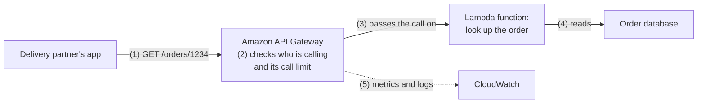
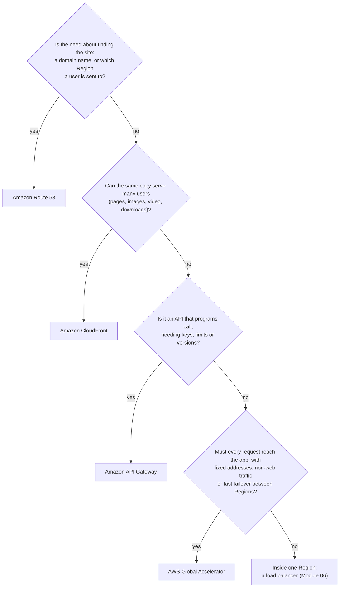

# Route 53 tells users where to go; CloudFront, Global Accelerator and API Gateway shape the trip and guard the door

Four services sit between your customers and your servers. **Amazon Route 53** answers "where is it?", **Amazon CloudFront** delivers content from near the user, **AWS Global Accelerator** carries traffic over AWS's network to the best Region, and **Amazon API Gateway** is the managed entrance to your code. In this lesson you learn what each one does, and you choose among them for a stated need.

**For:** an adult studying alone, possibly new to IT, who wants to understand AWS and use it safely. **Time:** about 25 minutes. Reading works on a phone.

**Before you start:** this lesson builds on [The edge](../03-aws-around-the-world/04-the-edge.md) (edge locations, and a first look at CloudFront, Route 53 and Global Accelerator), [Your own network](01-your-own-network.md) and [S3 in practice](../05-storing-data/02-s3-in-practice.md) (private buckets). It also refers to load balancers from Module 06's lesson "Auto Scaling and load balancers". If you skipped them, the key terms below give you enough to follow. The bakery scenario is in the [module brief](00-brief.md).

## Warm-up: what you remember

Answer from memory before you look anything up.

1. From Module 06: Auto Scaling and an Elastic Load Balancing load balancer are often used together. What does each one do?
2. From lesson 05.02: the bakery's photo bucket has Block Public Access turned on. Who on the internet can read the photos directly from the bucket?
3. From lesson 03.04: a colleague says "Route 53 is AWS's CDN." What is wrong with that?

Feedback

1. **Auto Scaling sets how many** servers run, adding and removing them as demand changes. **The load balancer spreads** incoming traffic across the healthy ones. Keep the second idea in mind: this lesson adds a service that spreads traffic *between Regions*, not inside one.
2. **No one.** With Block Public Access on, the bucket can't be opened to the public. This lesson shows how customers can still see the photos: through CloudFront, without making the bucket public.
3. **Route 53 is DNS.** It answers "where is this site?" with an address. The content delivery network (CDN) is CloudFront, which keeps copies of content at edge locations.

## What you'll learn

By the end of this lesson, you can:

- explain what Route 53 does and choose a routing policy for a need;
- explain what CloudFront adds in front of a bucket or web server, including protection for the origin;
- tell CloudFront and Global Accelerator apart, and say when each fits;
- say what API Gateway does for an application, and how it differs from a load balancer;
- choose among the four for a stated need (objective 07.03a).

Try these before you read on. Guess if you're unsure; the answers are in the lesson.

1. The bakery's main site fails. Can a DNS service send customers to a standby site without anyone changing settings by hand?
2. An online game sends small, fast messages that aren't web pages, and players want lower lag. Would a CDN that keeps copies of files help?

## The big picture: from a name to an answer

When a customer types `bakery.example`, two things happen. First the browser asks DNS where the site is. Then it sends its request there. The four services in this lesson work at those two moments.

![Three areas: people and outside systems, edge locations, and the US East (N. Virginia) Region. Step 1: the customer asks Route 53, at the edge, where bakery.example is. Step 2: Route 53 answers with an address at CloudFront. Step 3: the request goes to CloudFront at a nearby edge location, which keeps copies of content. Step 4, dashed: only when it has no fresh copy, CloudFront fetches from an origin in the Region, the S3 photo bucket or the web server on EC2. Step 5: a delivery partner's app calls API Gateway in the Region, which runs the Lambda order functions.](../../images/07-03-request-path.svg)

*Notice that steps 1 and 2 only find the way; no page or photo moves yet. Notice too that step 4 is dashed: most photo requests end at the edge.*

**Long description.** Three areas from left to right: people and outside systems, edge locations, and the US East (N. Virginia) Region. Step 1: the customer's browser asks Amazon Route 53, which runs at edge locations, where `bakery.example` is. Step 2: Route 53 answers with an address at CloudFront. Step 3: the browser sends its page or photo request to Amazon CloudFront at an edge location near the customer; CloudFront keeps copies of content. Step 4, dashed: only when it has no fresh copy, CloudFront fetches from an origin in the Region, either the S3 photo bucket or the web server on EC2. Step 5: a delivery partner's own app calls Amazon API Gateway in the Region, which runs the Lambda order functions to look up an order. Orange boxes run at edge locations; blue boxes run in a Region. The bakery's setup is made up for teaching.

## Key terms (skip if you know them)

- **Hosted zone:** in Route 53, the set of DNS records for one domain, such as `bakery.example`. A **DNS record** maps a name to an answer, such as an address.
- **Health check:** a regular test that a site is working, so Route 53 can stop sending people to it if it isn't.
- **Time to live (TTL):** how long other DNS servers may keep a copy of an answer before asking again.
- **Distribution:** your CloudFront setup: which origins it serves and how it caches. An **origin** is where the original content lives.
- **Static IP address:** an internet address that doesn't change. **Anycast:** the same address is announced from many places, and each user reaches the nearest one.
- **API (application programming interface):** a defined way for one program to ask another for something, such as "what is the status of order 1234?"

"Cache" doesn't mean a hidden store, its everyday sense. In computing it is a nearby copy kept so that the next request is fast.

## Route 53 answers "where is it?", and it can choose the answer

**Amazon Route 53** is AWS's Domain Name System (DNS) service, the internet's address book from lesson 03.04. It does three jobs, alone or together: it **registers domain names**, it **answers DNS questions** for your domains, and it **checks the health** of your sites so it can send people away from one that fails ([What is Amazon Route 53?](https://docs.aws.amazon.com/Route53/latest/DeveloperGuide/Welcome.html)). It runs at edge locations, close to the people asking.

A **public** hosted zone answers anyone on the internet; a **private** one answers only inside the VPCs you choose ([Amazon Route 53 FAQs](https://aws.amazon.com/route53/faqs/)). An **alias record**, a Route 53 speciality, can point the bare domain `bakery.example` at a CloudFront distribution, a load balancer or an S3 website bucket, even though their addresses change.

### A routing policy picks the answer

When there is more than one place a user could go, a **routing policy** tells Route 53 how to choose ([Choosing a routing policy](https://docs.aws.amazon.com/Route53/latest/DeveloperGuide/routing-policy.html)). Each policy answers a different question.

*Notice the italic question in each panel. To pick a policy, find the question the need is really asking.*

**Long description.** Four panels, each with customers on the left and two destinations on the right. Latency asks which Region answers this user fastest: a customer in Munich goes to Frankfurt, not far-away N. Virginia. Geolocation asks where the user is: users in the US go to N. Virginia and users in Germany to Frankfurt. Failover asks whether the main site is healthy: the primary fails its health check, so the customer goes to the standby, with no person acting. Weighted asks what share goes where: 90 in 100 customers go to the current site and 10 in 100 to a new version. The table below lists all eight policies.

| Policy | The question it answers | Example |
|---|---|---|
| **Simple** | There's one place to go. Which is it? | One web server for a small site |
| **Failover** | Is the main site healthy? If not, use the standby | Send customers to the DR site from lesson 03.03 |
| **Latency** | Which Region answers this user fastest? | Users spread across the US and Europe |
| **Geolocation** | Where is the user, by country or continent? | Content or rules that differ by country |
| **Geoproximity** | Where are my resources, and should one location take more traffic than its distance suggests? | Shifting load toward a larger site |
| **IP-based** | Which known address range does the user come from? | Customers of a particular internet provider |
| **Weighted** | What share of users goes to each place? | Sending 10% of users to a new version first |
| **Multivalue answer** | Which several healthy addresses can I return? | Up to eight healthy servers, at random |

**Health checks make the answers safe.** A health check can test a web address, combine other health checks, or follow a CloudWatch alarm. Route 53 then leaves unhealthy places out of its answers for most routing policies, such as failover, latency, weighted, geolocation and multivalue ([Route 53 health checks](https://docs.aws.amazon.com/Route53/latest/DeveloperGuide/dns-failover.html)). So the first prequestion's answer is yes: failover routing moves customers to a standby with no one acting.

**DNS answers are copied, so a switch isn't instant.** Other DNS servers keep Route 53's answer for the record's **TTL**, which you set. Until their copy expires, some users still go to the old place ([Amazon Route 53 FAQs](https://aws.amazon.com/route53/faqs/)). A short TTL switches faster but means more queries.

**Route 53 is not a CDN, and not a load balancer either.** It never carries your pages or photos; it controls only which address a user is given. It's tempting to think otherwise because it runs at the edge and its policies sound like traffic control. A load balancer, by contrast, sits in the path of every request and spreads them across healthy servers inside one Region. The two work together: Route 53 picks the Region and points `bakery.example` at the load balancer there with an alias record.

**A name you may meet.** Inside a VPC, DNS lookups are answered by a Route 53 feature the current docs call **Route 53 VPC Resolver**; older material says Route 53 Resolver (checked 2026-10-23).

> **Your turn:** Pick a routing policy for each need, and name the question it answers. (a) The bakery tests a new checkout page on a small share of customers. (b) German customers must always be served from Frankfurt because of a contract. (c) If the N. Virginia site stops working, customers should reach a copy in Ohio.

Model answer

(a) **Weighted**: what share goes where? For example 95 to the old page and 5 to the new one. (b) **Geolocation**: where is the user? It's a rule about the user's country, so latency isn't enough; latency picks the fastest Region, which is usually but not always Frankfurt. (c) **Failover**, with a health check on the N. Virginia site: is the main site healthy?

## CloudFront delivers from near the user, and keeps the origin out of reach

**Amazon CloudFront** is AWS's content delivery network. Lesson 03.04 showed the core idea: the nearby edge location answers from its copy if it has one, or fetches from the **origin** over AWS's network if it doesn't. Four more things matter in practice ([What is Amazon CloudFront?](https://docs.aws.amazon.com/AmazonCloudFront/latest/DeveloperGuide/Introduction.html); [Amazon CloudFront FAQs](https://aws.amazon.com/cloudfront/faqs/)).

**A distribution is your setup.** It names the origins: an S3 bucket, a web server on EC2, a load balancer, or a server outside AWS. With an alias record in Route 53, customers reach it by your own domain.

**Copies expire, and you can withdraw them.** By default an object stays cached for 24 hours. You can change that, and **invalidate** a file to remove it from the edge early, say after fixing a wrong price list. CloudFront also speeds up **dynamic** content that can't be cached, such as a page built for one customer, because the edge-to-origin trip runs on AWS's network.

**The origin can stay private.** Here CloudFront meets lesson 05.02. With **origin access control (OAC)**, the bucket stays private, Block Public Access on, and only your distribution may read it. For a web server, an AWS-managed list of CloudFront's addresses lets its security group accept CloudFront only ([CloudFront edge server locations](https://docs.aws.amazon.com/AmazonCloudFront/latest/DeveloperGuide/LocationsOfEdgeServers.html)).

**Protection comes with it.** Every distribution gets AWS Shield Standard at no extra cost. You can add AWS WAF rules, **geo restriction** to allow or block countries, and **signed URLs or cookies** for paid content. Module 09 teaches Shield and WAF.

> **Check:** The bakery puts CloudFront in front of its photo bucket. Which change keeps customers seeing the photos while nobody can download them straight from the bucket?
>
> A. Turn off Block Public Access so CloudFront can read the bucket\
> B. Keep the bucket private and allow only the CloudFront distribution to read it, with origin access control\
> C. Make the bucket public and set a short cache time\
> D. Move the photos to a second bucket in Frankfurt

Feedback

**B is right.** Origin access control lets the distribution, and only the distribution, read a private bucket, so Block Public Access stays on.

- **A is wrong.** CloudFront doesn't need a public bucket; opening it would let anyone bypass CloudFront.
- **C is wrong.** A public bucket is exactly what the bakery wants to avoid; the cache time doesn't change who can reach the bucket.
- **D is wrong.** Moving the photos doesn't change who can read them.

## Global Accelerator gives fixed addresses and a fast path, but keeps no copies

**AWS Global Accelerator** gives your application **two static IPv4 addresses** (four if you also use IPv6), announced by anycast from AWS's edge locations. A user's traffic enters AWS's network at the nearest edge and travels on AWS's network to the best healthy **endpoint** in a Region: an Application Load Balancer, a Network Load Balancer, an EC2 instance or an Elastic IP address. The addresses stay the same for as long as the accelerator exists, even while you move the endpoints behind them ([What is AWS Global Accelerator?](https://docs.aws.amazon.com/global-accelerator/latest/dg/what-is-global-accelerator.html)).

Global Accelerator and CloudFront both start at the edge, so they are the module's most confused pair. The difference is where the answer comes from.

![Two panels. Amazon CloudFront: a user connects to the nearest edge location, which keeps a copy of popular content and answers from it when it can; a dashed arrow goes to the origin in a Region only when there is no fresh copy. Bullets: web content over HTTP and HTTPS; many requests never reach the origin; a CDN. AWS Global Accelerator: a user connects to the nearest edge location through two fixed IP addresses, with no copies kept; traffic travels over the AWS network to a healthy endpoint in Region A, or to Region B if A fails. Bullets: any TCP or UDP traffic such as games, voice and IoT; every request reaches your application; switches Regions without waiting on DNS.](../../images/07-03-cloudfront-vs-ga.svg)

*Notice the dashed arrow on the left: with CloudFront, many requests end at the edge. On the right, every request goes on to a Region.*

**Long description.** Two panels. Amazon CloudFront: a user connects to the nearest edge location, which keeps a copy of popular content and answers from it when it can; a dashed arrow goes to the origin in a Region, an S3 bucket, web server or API, only when there is no fresh copy. Bullets: web content over HTTP and HTTPS; many requests never reach the origin; a content delivery network. AWS Global Accelerator: a user connects to the nearest edge location through two fixed IP addresses announced from AWS's edge, with no copies kept; traffic travels over the AWS network to a healthy endpoint in Region A, with a dashed arrow to Region B, used if A fails. Bullets: any TCP or UDP traffic, such as games, voice and IoT; every request reaches your application; switches Regions without waiting on DNS.

| | Amazon CloudFront | AWS Global Accelerator |
|---|---|---|
| **The same** | Both use AWS's edge locations, carry traffic over AWS's network, and work with AWS Shield | |
| Keeps copies? | **Yes**, it's a CDN | **No** |
| Traffic it suits | Web content over HTTP and HTTPS, static and dynamic | Any TCP or UDP traffic: games, voice calls, IoT devices, or web apps that need fixed addresses |
| What users connect to | A name, such as `bakery.example` | Two fixed IP addresses |
| Switching Regions | Not its main job; DNS routing such as Route 53 usually chooses between sites | Reroutes at the edge as health changes, without waiting for DNS copies to expire |
| Choose it when | The same content goes to many people | Every request needs your application, and you need fixed addresses, non-web traffic or fast failover between Regions |

**The principle:** if a copy can answer, use CloudFront. If every request must reach your application and the path is the problem, consider Global Accelerator. That answers the second prequestion: the game's moves are fresh every time, so copies don't help; Global Accelerator, or servers closer to players (lesson 03.04's Local Zones), might.

> **Your turn:** A company's customers must add its service's addresses to their own firewalls, so the addresses must never change, even when the company moves the service to another Region. Which service fits, and why not CloudFront?

Model answer

**Global Accelerator.** It gives two static IP addresses that stay the same for the life of the accelerator, while the endpoints behind them can move between Regions. CloudFront is normally reached by a name whose addresses change. It can give a distribution a fixed list of anycast addresses, but only on request, after AWS approves it, and as a list of 21 (or 3 for a bare domain) rather than two ([Request Anycast static IPs](https://docs.aws.amazon.com/AmazonCloudFront/latest/DeveloperGuide/request-static-ips.html), checked 2026-10-24). It also keeps copies, which this need doesn't call for.

## API Gateway is the managed entrance to your code

Some requests aren't for a page or a photo. A program wants data or an action: the delivery partner's app asks, "is order 1234 ready?" **Amazon API Gateway** lets you publish such an **API** and run it at any scale with no servers of your own. It receives each call, checks it, and hands it to the code behind it: a Lambda function, an application on EC2 or containers, another AWS service, or any web address ([What is Amazon API Gateway?](https://docs.aws.amazon.com/apigateway/latest/developerguide/welcome.html)).

*Notice step 2: API Gateway turns away callers before your code runs, so the function only ever sees calls that passed.*

**Long description.** A flow from left to right. (1) The delivery partner's app sends a request for order 1234 to Amazon API Gateway. (2) API Gateway checks who is calling and whether the caller is within its call limit. (3) It passes the call to a Lambda function that looks up the order. (4) The function reads the order database. (5) Dashed: API Gateway sends metrics and logs to CloudWatch.

What it gives you ([Amazon API Gateway FAQs](https://aws.amazon.com/api-gateway/faqs/)):

- **Three kinds of API:** REST and HTTP APIs for request-and-answer calls; WebSocket APIs for two-way, real-time messages such as chat.
- **Who may call:** IAM permissions, Amazon Cognito sign-in, or your own check in a Lambda function, plus AWS WAF rules.
- **Limits:** **throttling** caps how fast calls arrive, so a spike doesn't overwhelm your code; **usage plans** and **API keys** give each outside developer their own allowance.
- **Caching** of answers, **stages** such as test and production, and **monitoring** in CloudWatch.

**API Gateway vs a load balancer.** An Application Load Balancer also passes web requests on, even to Lambda functions. The difference is purpose: a load balancer **spreads** traffic across healthy targets; API Gateway **manages an API**: who may call, how often, which version. Usage plans, API keys, per-caller throttling and stages are API Gateway features.

> **Check:** A weather company sells access to its data to other developers. Each customer gets a key and a monthly limit on calls, and the data comes from Lambda functions. Which service fits as the entrance?
>
> A. Amazon CloudFront\
> B. Amazon API Gateway\
> C. Application Load Balancer\
> D. Amazon Route 53

Feedback

**B is right.** Usage plans and API keys give each customer a key and a limit, and API Gateway passes calls to Lambda.

- **A is wrong.** CloudFront delivers and caches content; it doesn't give each caller a key and a call allowance.
- **C is wrong.** A load balancer spreads requests across targets, but has no usage plans or API keys.
- **D is wrong.** Route 53 only answers where the API is; the calls never pass through it.

## Choose by what the need is really about

Each service answers one kind of need. Ask the questions in order:

*Notice that the chart picks a service for one need at a time. A real site often uses several together, each for its own job.*

**Long description.** A decision flowchart. First question: is the need about finding the site, a domain name or which Region a user is sent to? If yes, Amazon Route 53. If no: can the same copy serve many users, such as pages, images, video or downloads? If yes, Amazon CloudFront. If no: is it an API that programs call, needing keys, limits or versions? If yes, Amazon API Gateway. If no: must every request reach the app, with fixed addresses, non-web traffic or fast failover between Regions? If yes, AWS Global Accelerator. If no, the need is inside one Region, and a load balancer from Module 06 fits.

## Your side of the line

The model from lesson 04.01 holds here too ([Shared Responsibility Model](https://aws.amazon.com/compliance/shared-responsibility-model/)). **AWS** runs the edge locations, DNS servers, CDN and API service: hardware, software, scaling and availability. **You** decide how they treat your traffic and data:

- **Records and routing:** a wrong DNS record or health check sends customers to the wrong place, and AWS won't notice.
- **What CloudFront may cache:** anything cached is copied to edge locations worldwide, so keep personal data out of shared caches and remember lesson 03.02's data rules.
- **Keeping the origin private:** origin access control on the bucket, and security groups on a web server (lesson [07.02](02-filtering-traffic.md)) that accept only CloudFront.
- **Who may call your API:** authorization, throttling and WAF rules are your settings. An API open to anyone is your gap, not AWS's.
- **Encryption in transit:** turning on HTTPS to users and to the origin.

## What you pay for

All four bill for use, with no upfront cost (checked on the pricing pages on 2026-10-23; prices change).

- **Route 53:** $0.50 per hosted zone per month for the first 25, plus $0.40 per million standard queries. Queries for alias records that point at CloudFront, load balancers, API Gateway and some other AWS resources are free, and so are queries to private hosted zones ([Route 53 pricing](https://aws.amazon.com/route53/pricing/)).
- **CloudFront:** pay as you go, per GB delivered from the edge plus per request; moving content from an AWS origin such as S3 to CloudFront is free. Or a **flat-rate monthly plan** bundling the CDN with WAF, DNS and more, with no overage charges, from a $0 Free plan (1 million requests and 100 GB a month) upward ([CloudFront pricing](https://aws.amazon.com/cloudfront/pricing/)). Flat-rate plans are new; expect the tiers to change.
- **Global Accelerator:** a fixed fee for every hour an accelerator exists, even disabled, plus a per-GB fee on top of normal data transfer, plus public IPv4 address charges ([Global Accelerator pricing](https://docs.aws.amazon.com/global-accelerator/latest/dg/introduction-pricing.html)). Delete accelerators you don't use.
- **API Gateway:** per API call received plus data transferred out, with no minimum fee; WebSocket APIs bill per message and per connection minute.

Lesson [07.04](04-connecting-networks-and-offices.md) charts data transfer prices by direction.

## Worked example: the bakery's names and edge

The owner's requirements, from Module 03 and this lesson: one address, `bakery.example`, for everyone; German customers served from Europe (Frankfurt), because the partner's contract keeps their data in the EU; fast photos; a private bucket; and order-status checks for the delivery partner's app. Here is how an experienced engineer reasons:

1. **The name first.** Put `bakery.example` in a Route 53 public hosted zone, with alias records pointing at the site.
2. **Which policy?** The German rule is about *where the user is*, not speed. So **geolocation**: Germany to Frankfurt, a default record for everyone else to N. Virginia. Latency routing would usually agree, but "usually" doesn't satisfy a contract.
3. **What if a Region fails?** Health checks, so Route 53 stops giving out a failed address. A German standby must also be in the EU.
4. **Photos.** The same image goes to thousands of customers: **CloudFront**, with the bucket kept private behind origin access control. S3 to CloudFront is free.
5. **Partner status checks.** A program with its own key and a call limit: **API Gateway** in front of a Lambda function. Not CloudFront (every answer differs), not a load balancer (no keys or usage plans).
6. **Global Accelerator?** Rejected: ordinary web traffic, no need for fixed addresses, and an hourly fee.

**Answer:** Route 53 with geolocation routing and health checks, CloudFront in front of a private bucket, and API Gateway for the partner.

> **Your turn:** A year later the bakery launches a live video "cake decorating hour" streamed to viewers worldwide, and a mobile game in which players race to decorate cakes in real time over UDP. For each, which service from this lesson would you look at first?

Model answer

**Video stream: CloudFront.** The same video goes to many viewers, so edge copies cut delay and load on the origin. **The game: Global Accelerator.** Every move is fresh and travels over UDP, which a cache can't help with; Global Accelerator puts players onto AWS's network at the nearest edge and on to the best healthy Region.

## In real work: the front door is part of the design

If customers can't find or reach the site, it is down for them, however healthy the servers. So the Well-Architected Framework treats these services as design choices. [REL02-BP01 Use highly available network connectivity for your workload public endpoints](https://docs.aws.amazon.com/wellarchitected/latest/reliability-pillar/rel_planning_network_topology_ha_conn_users.html) (**reliability**) names highly available DNS, CDNs, API gateways and load balancing as the tools, and lists serving content to a wide area without a CDN as an anti-pattern: the bakery's photo problem from lesson 03.04. [PERF04-BP06 Choose your workload's location based on network requirements](https://docs.aws.amazon.com/wellarchitected/latest/performance-efficiency-pillar/perf_networking_choose_workload_location_network_requirements.html) (**performance efficiency**) covers routing users for speed. For **security**, the edge is the first layer of defense, which Module 09 builds on.

Small settings do the damage here: a bucket made public "because CloudFront needs it", a TTL so long that a failover takes hours to reach users, or an API with no throttling.

## Summary

- **Route 53 answers "where is it?"** It registers domains, answers DNS questions and checks health. Routing policies (simple, failover, latency, geolocation, geoproximity, IP-based, weighted, multivalue answer) each answer one question. DNS copies expire by TTL, so switches aren't instant. It picks a place; a load balancer spreads the load there. It is not a CDN.
- **CloudFront delivers from near the user and keeps the origin private.** It caches content at the edge, speeds dynamic content, keeps buckets private with origin access control, and brings Shield Standard, with WAF, geo restriction and signed URLs as options.
- **Global Accelerator gives two fixed addresses and AWS's network to the best Region, with no copies.** Choose it for non-web traffic, fixed addresses or fast failover between Regions; choose CloudFront when a copy can answer.
- **API Gateway is the managed entrance to your code:** who may call, how often, which version, with caching and monitoring. A load balancer spreads traffic; API Gateway manages an API.
- **Choose by what the need is really about,** and expect real sites to use several together.

## Practice

1. **A company runs the same application in two Regions and wants each user sent to whichever Region responds fastest for them. What should it use?**

   A. Route 53 weighted routing\
   B. Route 53 latency routing\
   C. Route 53 geolocation routing\
   D. An Application Load Balancer

   

Feedback

   **B is right.** Latency routing sends each user to the Region with the lowest delay for them.

   - **A is wrong.** Weighted routing splits users by shares you set, regardless of speed.
   - **C is wrong.** Geolocation follows a rule about the user's location, which is often but not always the fastest Region.
   - **D is wrong.** A load balancer works inside one Region; it doesn't choose between Regions.

   

2. **Which statement about AWS Global Accelerator is correct?**

   A. It caches content at edge locations to reduce load on the origin.\
   B. It gives an application fixed IP addresses and carries traffic over AWS's network to healthy endpoints in Regions.\
   C. It registers domain names and answers DNS questions.\
   D. It runs your application's code at edge locations.

   

Feedback

   **B is right.** Two static anycast addresses, entry at the nearest edge, and AWS's network to the best healthy endpoint.

   - **A is wrong.** That is CloudFront; Global Accelerator keeps no copies.
   - **C is wrong.** That is Route 53.
   - **D is wrong.** Global Accelerator delivers traffic to endpoints in Regions; it doesn't run your code at the edge.

   

3. **A startup's mobile app calls a backend made of Lambda functions. The founders want to limit how many calls each app version can make per second and keep test and production separate. Which service fits, and which two features meet these needs?**

   

Feedback

   **Model answer:** **Amazon API Gateway.** **Throttling** (with usage plans if limits differ by caller) caps calls per second, and **stages** keep test and production apart. A load balancer could reach Lambda too, but it has neither feature.

   

4. **The bakery switches its failover record to the standby site, but some customers still reach the failed site for a while. In two sentences, explain why, and what setting the bakery could change.**

   

Feedback

   **Model answer:** Other DNS servers keep Route 53's earlier answer until its time to live (TTL) runs out, so their users are still sent to the old address. A shorter TTL on the record makes switches reach users sooner, at the cost of more DNS queries; if the switch must be immediate, Global Accelerator reroutes at the edge without relying on DNS copies.

   

5. **(From lesson 03.03.) Route 53 failover routing sends customers to a standby site that is always running at reduced size and scales up when it takes over. Which DR strategy is that site?**

   

Feedback

   **Warm standby.** A smaller but complete copy runs all the time. A pilot light keeps only the data and core parts running and needs more time to start the rest.

   

**Next:** [Connecting networks and offices](04-connecting-networks-and-offices.md) links the bakery's head office and other networks to its VPC.

## Where to check the current details

- [What is Amazon Route 53?](https://docs.aws.amazon.com/Route53/latest/DeveloperGuide/Welcome.html), [Choosing a routing policy](https://docs.aws.amazon.com/Route53/latest/DeveloperGuide/routing-policy.html), [Route 53 health checks](https://docs.aws.amazon.com/Route53/latest/DeveloperGuide/dns-failover.html) and the [Amazon Route 53 FAQs](https://aws.amazon.com/route53/faqs/) (checked 2026-10-23)
- [Amazon Route 53 pricing](https://aws.amazon.com/route53/pricing/) (checked 2026-10-23)
- [What is Amazon CloudFront?](https://docs.aws.amazon.com/AmazonCloudFront/latest/DeveloperGuide/Introduction.html), [CloudFront edge server locations](https://docs.aws.amazon.com/AmazonCloudFront/latest/DeveloperGuide/LocationsOfEdgeServers.html) and the [Amazon CloudFront FAQs](https://aws.amazon.com/cloudfront/faqs/) (checked 2026-10-23)
- [Amazon CloudFront pricing](https://aws.amazon.com/cloudfront/pricing/), including the flat-rate plans (checked 2026-10-23)
- [What is AWS Global Accelerator?](https://docs.aws.amazon.com/global-accelerator/latest/dg/what-is-global-accelerator.html) and [Global Accelerator pricing](https://docs.aws.amazon.com/global-accelerator/latest/dg/introduction-pricing.html) (checked 2026-10-23)
- [What is Amazon API Gateway?](https://docs.aws.amazon.com/apigateway/latest/developerguide/welcome.html) and the [Amazon API Gateway FAQs](https://aws.amazon.com/api-gateway/faqs/) (checked 2026-10-23)
- [Shared Responsibility Model](https://aws.amazon.com/compliance/shared-responsibility-model/), AWS (checked 2026-10-23)
- [AWS Certified Cloud Practitioner (CLF-C02) exam guide](https://docs.aws.amazon.com/aws-certification/latest/cloud-practitioner-02/cloud-practitioner-02.html), task [3.5](https://docs.aws.amazon.com/aws-certification/latest/cloud-practitioner-02/cloud-practitioner-02-domain3.html#cloud-practitioner-02-task3.5) and task [3.2](https://docs.aws.amazon.com/aws-certification/latest/cloud-practitioner-02/cloud-practitioner-02-domain3.html#cloud-practitioner-02-task3.2) (checked 2026-10-24)

---

"Names and the edge" by Automate the Cloud Inc., licensed under CC BY-NC 4.0 with the Additional Permission for Internal Training from Automate the Cloud Inc.
License: https://creativecommons.org/licenses/by-nc/4.0/
Permission: https://automatethe.cloud/licenses/atc-internal-training-permission.txt
