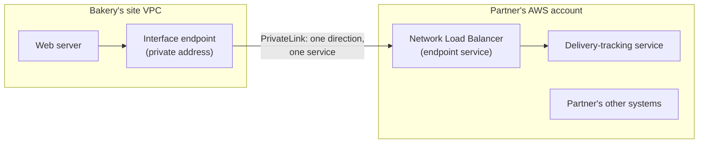
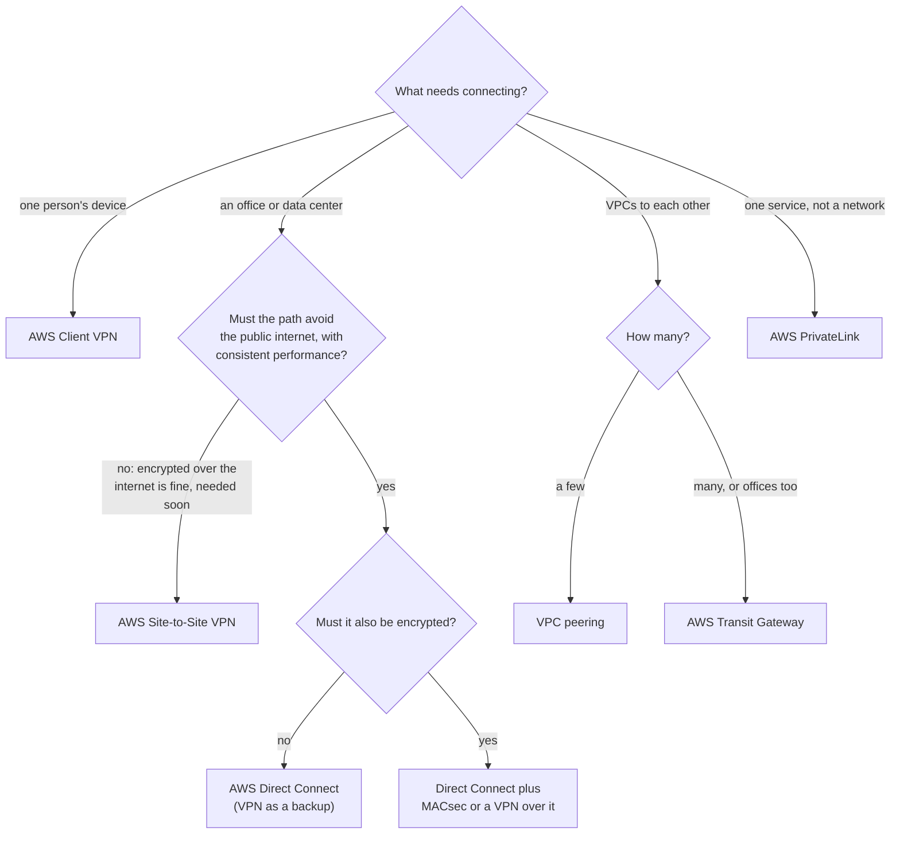

# Choose a link by three questions: is the path private, is the traffic encrypted, and how soon do you need it?

The bakery's VPC doesn't stand alone. The head office, the owner's laptop at home, a second VPC in Europe and a partner's service all need to reach it. AWS offers a link for each case, and they differ on three questions: does the traffic avoid the public internet, is it encrypted, and how fast can you set it up? In this lesson you learn the links, choose one for each case, and see what moving data costs in each direction.

**For:** an adult studying alone, possibly new to IT, who wants to understand AWS and use it safely. **Time:** about 25 minutes. Reading works on a phone.

**Before you start:** this lesson builds on [Your own network](01-your-own-network.md) (VPCs, route tables and endpoints), [Names and the edge](03-names-and-the-edge.md) (Global Accelerator), [Hybrid storage and backup](../05-storing-data/04-hybrid-storage-and-backup.md) (the shop's systems that send data to AWS) and [Surviving failure](../03-aws-around-the-world/03-surviving-failure.md). If you skipped them, the key terms below give you enough to follow. The bakery scenario is in the [module brief](00-brief.md).

## Warm-up: what you remember

Answer from memory before you look anything up.

1. From Module 06: which service puts AWS-managed racks or servers in a customer's own building? What links it to its Region?
2. From lesson 05.04: AWS Elastic Disaster Recovery copies the till server in the shop to AWS, change by change. Is that a backup or disaster recovery, and why?
3. From lesson 04.01: on Amazon EC2, who writes the security group rules, AWS or the customer?

Feedback

1. **AWS Outposts.** It connects to its Region through its **service link**, a network connection. Getting a building's network to AWS reliably is what this lesson is about.
2. **Disaster recovery.** It keeps whole servers ready to launch within minutes. A backup brings back data, not running servers. Either way, the data travels from the shop to AWS over a network link, the subject of this lesson.
3. **The customer.** The same pattern returns here: AWS runs the links, and you decide who and what may use them.

## What you'll learn

By the end of this lesson, you can:

- tell AWS Site-to-Site VPN, AWS Client VPN and AWS Direct Connect apart by who connects, the path, encryption and setup time;
- explain why "encrypted" and "private" are different, and why a VPN is the first but not the second;
- tell VPC peering, AWS Transit Gateway and AWS PrivateLink apart;
- choose a link by private, encrypted and setup speed (objective 07.04a);
- say which directions of data transfer are free and which are charged, with dated example prices.

Try these before you read on. Guess if you're unsure; the answers are in the lesson.

1. A VPN connection from an office to AWS encrypts everything it carries, over the internet. Is it a private connection?
2. VPC A is peered with VPC B, and VPC B is peered with VPC C. Can A reach C?

## The big picture: five ways to connect

The links fall into two families. Three connect **people or places outside AWS** to a VPC: Site-to-Site VPN, Client VPN and Direct Connect. Three connect **networks inside AWS** to each other: VPC peering, Transit Gateway and PrivateLink. The map shows five of them on the bakery's networks; Transit Gateway, the hub, gets its own diagram later.

![Map of the bakery's networks. Outside AWS: the head office and the owner at home. In the middle: the public internet. Inside AWS: a German VPC in Frankfurt, the site VPC in N. Virginia, and a partner's service in the partner's own account. Dashed lines: Site-to-Site VPN from the head office and Client VPN from the owner's laptop cross the internet to the site VPC. A thick blue line: Direct Connect runs from the head office around the internet, through a Direct Connect location, to the site VPC. Solid lines: VPC peering joins the two VPCs; PrivateLink runs from the site VPC to the partner's one service.](../../images/07-04-connection-map.svg)

*Notice which lines cross the internet band and which go around it. That single detail decides whether a link is private.*

**Long description.** Left, outside AWS: the head office, with office computers and the till server, and the owner at home with one laptop. Middle: a band for the public internet. Right, inside AWS: the German VPC in Europe (Frankfurt), the site VPC in US East (N. Virginia) with the web server and order database, and a partner's service in the partner's own AWS account. A dashed line labeled Site-to-Site VPN, network to network, runs from the head office across the internet band to the site VPC. A dashed line labeled Client VPN, one person's device, runs from the owner's laptop across the internet band to the site VPC. A thick blue line labeled Direct Connect, private line, runs from the head office down and around the internet band, through a Direct Connect location, into the site VPC. A solid line labeled VPC peering joins the site VPC and the German VPC. A solid arrow labeled PrivateLink, one service only, runs from the site VPC to the partner's service. The bakery's networks are made up for teaching.

## Key terms (skip if you know them)

- **On-premises network:** the network in a building you run, such as an office or data center.
- **Encryption in transit:** scrambling data while it travels, so that anyone who intercepts it can't read it.
- **Tunnel:** an encrypted connection carried across another network, such as the internet. **IPsec** is the standard Site-to-Site VPN uses to build one.
- **Customer gateway device:** your router or firewall at the office end of a VPN. **Virtual private gateway:** the AWS end, attached to one VPC.
- **Direct Connect location:** a data center where AWS's network and customers' networks meet, so a cable can join them.
- **Transitive:** passing along: traffic can travel through one network to reach a third.
- **Address range:** the block of private IP addresses a network uses, written as a CIDR block such as `10.0.0.0/16` (lesson 07.01).

"Private" has a narrow meaning in this lesson. In daily speech, private means "nobody else can see it", which encryption also gives you. Here a **private** connection is one whose **path** doesn't use the public internet at all.

## A Site-to-Site VPN links an office network over the internet, encrypted

**AWS Site-to-Site VPN** connects a whole network, such as the bakery's head office, to a VPC. It builds encrypted **IPsec tunnels** across the public internet between your **customer gateway device** and the AWS end: a **virtual private gateway** for one VPC, or a **transit gateway** to reach many ([What is AWS Site-to-Site VPN?](https://docs.aws.amazon.com/vpn/latest/s2svpn/VPC_VPN.html)).

- **Two tunnels per connection,** for high availability. Each tunnel carries up to 1.25 Gbps ([AWS VPN FAQs](https://aws.amazon.com/vpn/faqs/), checked 2026-10-23).
- **Quick to set up.** AWS says VPN connections can be configured in minutes, and suit an immediate need, low to modest bandwidth, and work that can live with the internet's ups and downs ([AWS Direct Connect FAQs](https://aws.amazon.com/directconnect/faqs/)).
- **Accelerated Site-to-Site VPN** sends the traffic onto AWS's network at the nearest edge location, using Global Accelerator from lesson 07.03. It needs a transit gateway.

### "A VPN is a private connection" is wrong

You may read that a VPN gives you private connectivity to AWS, and some practice material counts it as one. **That's not right.** A Site-to-Site VPN is **encrypted**, but its traffic travels over the **public internet**. Nobody can read it on the way, yet it shares the internet's path, so its speed and delay vary with the internet's. The mix-up is tempting because "VPN" stands for virtual *private* network, and because in daily speech "private" and "secret" mean much the same. In networking questions they don't: **private is about the path; encrypted is about the protection.** That answers the first prequestion.

*Notice that both kinds of AWS VPN sit in the left column: encrypted, yet on the internet's path. Only Direct Connect is in the private column.*

**Long description.** A two-by-two grid. Columns: over the public internet, and private, off the internet. Rows: encrypted, and not encrypted unless you add it. Top left, highlighted: AWS VPN, both kinds, Site-to-Site for network to network and Client VPN for one person's device; encrypted, but not private. Top right: Direct Connect plus MACsec on supported connections, or a VPN run over it; private and encrypted. Bottom left: plain internet traffic, not a connection option, what a link is meant to avoid. Bottom right: Direct Connect on its own, a dedicated line off the internet where encryption is something you add; private. A note says the highlighted cell is the one people get wrong.

> **Your turn:** A colleague writes in a design: "We'll use a Site-to-Site VPN so our traffic stays off the internet." Rewrite the sentence so it is correct, in one or two sentences.

Model answer

"We'll use a Site-to-Site VPN so our traffic is encrypted while it crosses the internet." If the traffic must stay off the internet, the design needs Direct Connect instead, with encryption added if the data must also be encrypted.

## Client VPN connects people, not networks

**AWS Client VPN** is for individual people: the owner at home, staff on the road. Each person runs a VPN client app and connects over the internet, encrypted, to a Client VPN endpoint in AWS, and from there to the VPC and, if routes allow, the head office ([What is AWS Client VPN?](https://docs.aws.amazon.com/vpn/latest/clientvpn-admin/what-is.html)). People sign in with Active Directory, a federated identity provider or certificates, and **authorization rules** decide which groups reach which networks. It's fully managed and grows with the number of people connected.

The pair to keep straight: **Site-to-Site VPN joins two networks** through routers, and everyone in the office uses it without doing anything. **Client VPN joins one device**, and each person connects for themselves.

> **Check:** Thirty sales staff work from home and hotels and need to reach an internal application in a VPC. Which service fits best?
>
> A. AWS Site-to-Site VPN\
> B. AWS Client VPN\
> C. AWS Direct Connect\
> D. VPC peering

Feedback

**B is right.** Client VPN gives each person an encrypted connection from their own device, wherever they are.

- **A is wrong.** Site-to-Site VPN joins a whole network, through a router, to AWS; people in hotels don't have one.
- **C is wrong.** Direct Connect is a dedicated line from a fixed site, not something a traveling laptop can use.
- **D is wrong.** Peering joins two VPCs; it doesn't connect people.

## Direct Connect is a dedicated line that bypasses the internet

**AWS Direct Connect** joins your network to AWS over a standard fiber-optic Ethernet cable at a **Direct Connect location**. The traffic never passes through internet providers: it's a **private** connection ([What is Direct Connect?](https://docs.aws.amazon.com/directconnect/latest/UserGuide/Welcome.html)). AWS says this can cut costs, raise bandwidth and give a more consistent experience than internet links ([AWS Direct Connect FAQs](https://aws.amazon.com/directconnect/faqs/)).

- **Dedicated or hosted.** A **dedicated connection** is a physical port for you alone: 1, 10, 100 or 400 Gbps. A **hosted connection** comes through an AWS Direct Connect Partner.
- **Setup is physical, so it takes longer** than a VPN's minutes: your network must reach a Direct Connect location, yourself or through a partner, and a cable must be connected.
- **Encryption is something you add:** **MACsec** between your device and the location, on connections that support it, or a Site-to-Site VPN run over the connection.
- **A VPN as backup.** A Direct Connect connection and a VPN can serve the same VPC, for failover only; AWS prefers the Direct Connect path while it is up.

**One connection is one point of failure.** Planned maintenance, announced at least 14 days ahead, can take a connection down for minutes to hours ([AWS Direct Connect FAQs](https://aws.amazon.com/directconnect/faqs/), checked 2026-10-23). So businesses that depend on it add a second connection, ideally at a second location, or keep a VPN as a cheaper backup.

| | Site-to-Site VPN | Client VPN | Direct Connect | Direct Connect + VPN or MACsec |
|---|---|---|---|---|
| Who connects | A whole network, through a router | One person's device | A whole network, at a Direct Connect location | A whole network |
| Path | Public internet | Public internet | Private line, no internet | Private line, no internet |
| Private? | **No** | **No** | **Yes** | **Yes** |
| Encrypted? | **Yes** (IPsec) | **Yes** | Only if you add it | **Yes** |
| Setup | Minutes | A managed endpoint; each person installs a client app | Longer: physical work at a location or through a partner | As Direct Connect |
| Bandwidth and consistency | Up to 1.25 Gbps per tunnel; varies with the internet | Grows with users; varies with the internet | Dedicated ports of 1 to 400 Gbps, or hosted through a partner; consistent | As Direct Connect |
| Typical clue in a question | "quickly", "low cost", "encrypted", "backup for Direct Connect" | "remote employees", "from home" | "consistent performance", "high bandwidth", "doesn't use the internet" | "private **and** encrypted" |

> **Your turn:** A hospital sends large medical images to AWS all day and needs steady performance. Its rules require the data to be encrypted in transit. It also needs a backup link if the main one fails. Propose a design in two or three sentences.

Model answer

Use **Direct Connect** for steady, high-bandwidth transfer off the internet, and add encryption: **MACsec** if the connection supports it, or a **Site-to-Site VPN running over the Direct Connect connection**. For the backup, a **Site-to-Site VPN over the internet** is quick and cheap, and AWS uses it only if Direct Connect goes down; a second Direct Connect connection at another location is the stronger but more expensive choice.

## Peering, Transit Gateway and PrivateLink connect networks inside AWS

These three links stay on AWS's network and differ in how much they connect: two whole networks, many, or one service.

**VPC peering** joins two VPCs so they talk over private addresses, as if they were one network, across accounts and Regions. Traffic between Regions is encrypted and stays on AWS's network, and there's no gateway device in the way ([What is VPC peering?](https://docs.aws.amazon.com/vpc/latest/peering/what-is-vpc-peering.html)). Three rules ([How VPC peering connections work](https://docs.aws.amazon.com/vpc/latest/peering/vpc-peering-basics.html)):

- **It's one to one, and not transitive.** If A is peered with B and B with C, A **can't** reach C through B. A needs its own peering with C. That answers the second prequestion.
- **The address ranges must not overlap.** Two VPCs that both use `10.0.0.0/16` can't be peered.
- **No borrowing.** A peered VPC can't use the other VPC's internet gateway or VPN to reach the outside world.

**AWS Transit Gateway** is a **hub**. Each VPC, VPN connection or Direct Connect link (through a Direct Connect gateway) attaches to it once, and its route tables decide which networks reach which. AWS describes it as a way to run applications across thousands of VPCs without managing peering connections, and transit gateways in different Regions can be peered with each other ([What is AWS Transit Gateway?](https://docs.aws.amazon.com/vpc/latest/tgw/what-is-transit-gateway.html); [AWS Transit Gateway](https://aws.amazon.com/transit-gateway/)).

*Notice how fast the left column of the table grows. Peering is simple for two or three VPCs, and a tangle for twenty.*

**Long description.** Two panels, each with five VPCs labeled A to E in a ring. Left, VPC peering: every pair is joined by its own line, 10 connections in all; every pair needs its own connection, because traffic can't hop through a middle VPC. Right, Transit Gateway: each VPC has one line to a transit gateway in the middle, 5 attachments in all; the hub's route tables decide who reaches whom. A table below compares the number of links: for 3 networks, 3 peering connections or 3 attachments; for 5, 10 or 5; for 10, 45 or 10; for 20, 190 or 20. A full mesh of n networks needs n times n minus 1, divided by 2, peering connections; that formula is our arithmetic.

**AWS PrivateLink** connects a VPC to **one service**, not a whole network. You create an **interface endpoint** (lesson 07.01) in your subnet, with a private address that leads to the service: an AWS service, a partner's product, or another team's application that its owner publishes as an **endpoint service** behind a Network Load Balancer. No internet gateway, NAT gateway or public address is needed ([What is AWS PrivateLink?](https://docs.aws.amazon.com/vpc/latest/privatelink/what-is-privatelink.html)).

*Notice what the bakery can't reach: the partner's other systems. Unlike peering, PrivateLink exposes only the one service, and the partner can't start connections into the bakery's VPC through it.*

**Long description.** Two boxes. In the bakery's site VPC, the web server connects to an interface endpoint with a private address. An arrow labeled "PrivateLink: one direction, one service" leads to the partner's AWS account, where a Network Load Balancer, published as an endpoint service, passes requests to the delivery-tracking service. The partner's other systems sit in the same account with no connection to the bakery.

| | VPC peering | AWS Transit Gateway | AWS PrivateLink |
|---|---|---|---|
| Connects | Two whole VPCs | Many VPCs and on-premises links, through a hub | One VPC to one service |
| Who can reach whom | Everything in each VPC, both ways, as routes allow | Whatever the hub's route tables allow | The consumer reaches the one service; not the reverse |
| Transitive? | **No** | Yes, through the hub | Not applicable: no network is joined |
| Choose it when | A few VPCs need full access to each other | Many networks, or offices too, need connecting | You want to use, or offer, one service without opening a network |

> **Check:** A company has 40 VPCs across several accounts and two offices on Site-to-Site VPN. Every VPC must reach the shared-services VPC and both offices. Which is the simplest design to run?
>
> A. VPC peering between every pair of VPCs\
> B. AWS Transit Gateway as a hub, with each VPC and each VPN attached\
> C. AWS PrivateLink from every VPC to every other VPC\
> D. One VPC peering connection from each VPC to the shared-services VPC, with the offices reaching the others through it

Feedback

**B is right.** A hub with one attachment per VPC and per VPN scales to many networks and includes the offices.

- **A is wrong.** 40 VPCs in a full mesh means 780 peering connections, and peering can't carry the VPN traffic between networks anyway.
- **C is wrong.** PrivateLink exposes single services, not whole networks.
- **D is wrong.** Peering isn't transitive, and a VPC can't lend its VPN to a peer, so traffic can't pass through the shared-services VPC to the offices or other VPCs.

## Choosing a link: ask who connects, then the three questions

*Notice that setup speed only decides between the office options, and only when the path doesn't have to be private.*

**Long description.** A decision flowchart starting from "What needs connecting?" One person's device: AWS Client VPN. An office or data center: must the path avoid the public internet, with consistent performance? If no, because encryption over the internet is fine and it's needed soon: AWS Site-to-Site VPN. If yes: must it also be encrypted? If no: AWS Direct Connect, with a VPN as a backup. If yes: Direct Connect plus MACsec or a VPN over it. VPCs to each other: how many? A few: VPC peering. Many, or offices too: AWS Transit Gateway. One service, not a network: AWS PrivateLink.

## Data in is free; across, between and out usually costs

Every link carries data, and AWS bills **data transfer** by direction (task [4.1](https://docs.aws.amazon.com/aws-certification/latest/cloud-practitioner-02/cloud-practitioner-02-domain4.html#cloud-practitioner-02-task4.1)). Learn the pattern, not the prices: data **in** from the internet is free, and so is data inside one Availability Zone over private addresses; data **out** to the internet, **between Regions** and **across Availability Zones** is charged per GB.

*Notice the cheapest move is no move: keep data where it's used. The expensive move is out to the internet, which is why CloudFront's free pull from S3 matters.*

| Direction, from US East (N. Virginia) | US dollars per GB |
|---|---|
| In from the internet | 0.00 |
| Between resources in the same Availability Zone, private addresses | 0.00 |
| From S3 to CloudFront | 0.00 |
| Across Availability Zones in the Region | 0.01 charged on each side (0.02 per GB in all) |
| To another Region | 0.02 to most Regions; 0.01 to US East (Ohio) |
| Out to the internet, first 10 TB a month | 0.09, after 100 GB a month free across all Regions |
| Processed by a NAT gateway (adds to the above) | 0.045 |

Sources: AWS's price list for data transfer ([AWSDataTransfer offer file](https://pricing.us-east-1.amazonaws.com/offers/v1.0/aws/AWSDataTransfer/current/index.json), published 2026-09-16, checked 2026-10-23), the [EC2 On-Demand pricing](https://aws.amazon.com/ec2/pricing/on-demand/) and [S3 pricing](https://aws.amazon.com/s3/pricing/) pages for the free cases and the 100 GB allowance (checked 2026-10-23), and the EC2 price list for the NAT gateway (as of 2026-10-24). Rates differ by Region, and outbound rates fall as volume grows.

**"Only data out to the internet costs money" is wrong.** Some study notes say "in is free, out is charged" and stop. But data **between Regions** and **across Availability Zones** is charged too, so a multi-AZ or multi-Region design pays a little for every copy it keeps in step. The mistake is tempting because data out to the internet is usually the biggest transfer item.

The links have prices of their own, too. Some charge for every hour they exist, whether or not data moves:

![Bar chart of US dollars for a 730-hour month in US East (N. Virginia), before any data moves. VPC peering connection: $0; you pay for data moved. Interface endpoint in one Availability Zone: $7.30, plus $0.01 per GB. Site-to-Site VPN connection: $36.50, plus data transfer out and public IPv4 addresses on its tunnels. Transit Gateway attachment: $36.50, plus $0.02 per GB. Client VPN with one subnet: $73.00, plus $0.05 an hour per connected user. Direct Connect not shown: it charges per port-hour by speed and type, plus data out.](../../images/07-04-monthly-link-cost.svg)

*Notice that peering is free to keep; the hub costs per attachment. For two VPCs, peering wins on cost; for many, Transit Gateway's simplicity is what you pay for.*

| Link, US East (N. Virginia) | Hourly | About a month (730 hours) | Plus |
|---|---|---|---|
| VPC peering connection | $0 | $0 | Data transfer across AZs ($0.01 per GB each way) or Regions |
| Interface endpoint (PrivateLink), per AZ | $0.01 | $7.30 | $0.01 per GB processed |
| Site-to-Site VPN connection | $0.05 | $36.50 | Data transfer out; public IPv4 addresses on its tunnel endpoints |
| Transit Gateway attachment | $0.05 | $36.50 | $0.02 per GB processed |
| Client VPN, per subnet associated | $0.10 | $73.00 | $0.05 an hour per connected user |
| Direct Connect | per port-hour, by speed and type | — | Data transfer out at Direct Connect rates |

Source: AWS's VPC price list ([AmazonVPC offer file](https://pricing.us-east-1.amazonaws.com/offers/v1.0/aws/AmazonVPC/current/us-east-1/index.json), published 2026-10-16), as of 2026-10-24; monthly figures are our arithmetic. The public IPv4 charge on VPN tunnel endpoints and the peering rate across AZs are from the [Amazon VPC pricing](https://aws.amazon.com/vpc/pricing/) page (checked 2026-10-23). Direct Connect's two charges, port hours and data transfer out, are from its [FAQ](https://aws.amazon.com/directconnect/faqs/); its rates depend on port speed and location.

> **Your turn:** Estimate one month of the bakery's data transfer, using the table above. Customers download 600 GB of pages and photos straight from the bakery's servers to the internet. The web server in one AZ and the order database in another exchange 200 GB. Backups of 300 GB are copied to US East (Ohio). Customers upload 50 GB of photos of their cake designs. Ignore every other charge.

Model answer

- **Out to the internet:** 600 GB minus the 100 GB free = 500 GB × $0.09 = **$45.00**.
- **Across AZs:** 200 GB × $0.02 ($0.01 on each side) = **$4.00**.
- **To Ohio:** 300 GB × $0.01 = **$3.00**.
- **Uploads in:** free, **$0.00**.

**About $52.00 a month** (prices as of the dates above). The biggest item is data out to the internet, and the uploads cost nothing. Putting the photos behind CloudFront moves that traffic onto CloudFront's own delivery prices; the copy from S3 to CloudFront is free.

## Your side of the line

Task [2.1](https://docs.aws.amazon.com/aws-certification/latest/cloud-practitioner-02/cloud-practitioner-02-domain2.html#cloud-practitioner-02-task2.1)'s line runs through every link. **AWS** runs its end of each VPN (with two tunnels per connection), the Direct Connect locations, its network, and the machinery behind Transit Gateway and PrivateLink. **You** own:

- **Your end:** the office's customer gateway device, its setup, and using both tunnels.
- **Who may connect:** Client VPN sign-in and authorization rules; who may use your PrivateLink endpoint service.
- **Encryption on Direct Connect,** when your data needs it.
- **Routes and filters:** a link joins networks, but route tables, security groups and network ACLs (lesson [07.02](02-filtering-traffic.md)) still decide what passes.
- **Redundancy and the address plan:** a single VPN, connection or router is a single point of failure, and address ranges must be planned not to overlap before you connect anything.

## Worked example: connecting the bakery

The owner's list, building on the module brief: link the head office to the site VPC securely; let her reach the order system from home; connect the site VPC to the German VPC in Frankfurt; and let the web server use the delivery partner's tracking service without joining the two networks. An experienced engineer reasons like this:

1. **Head office.** A whole network. Must it avoid the internet? Not today: traffic is modest, "securely" means encrypted, and it's needed soon. So **Site-to-Site VPN**: minutes to set up, about $36.50 a month plus data and address charges (as of 2026-10-24). Trigger for later: large volumes or a need for steady performance mean **Direct Connect**, keeping the VPN as backup.
2. **The owner at home.** One device: **Client VPN**, with an authorization rule that reaches only the order system's subnet.
3. **The German VPC.** Two VPCs: **VPC peering**, encrypted across Regions, free to keep, once the address ranges are checked for overlap. Peering doesn't change lesson 03.02's rule: German customer data still stays in the EU.
4. **The partner's service.** One service, no joined networks: **PrivateLink**, through an interface endpoint in the site VPC.
5. **Rejected.** Transit Gateway: no hub needed for two VPCs and one office, at $36.50 a month per attachment. Direct Connect now: no need for a private path yet. Peering with the partner: it opens whole networks both ways.

**Answer:** Site-to-Site VPN, Client VPN, VPC peering and PrivateLink, with written triggers for Direct Connect and, once there are many VPCs, Transit Gateway.

## In real work: connections are part of reliability and cost

The Well-Architected Framework has a best practice for nearly every choice in this lesson:

- **Performance efficiency:** [PERF04-BP03 Choose appropriate dedicated connectivity or VPN for your workload](https://docs.aws.amazon.com/wellarchitected/latest/performance-efficiency-pillar/perf_networking_choose_appropriate_dedicated_connectivity_or_vpn.html) is the VPN-or-Direct-Connect choice itself.
- **Reliability:** [REL02-BP02 Provision redundant connectivity between private networks in the cloud and on-premises environments](https://docs.aws.amazon.com/wellarchitected/latest/reliability-pillar/rel_planning_network_topology_ha_conn_private_networks.html) warns against a single connection, a single tunnel or a single internet provider, and suggests a Site-to-Site VPN on a transit gateway as a cost-effective backup for Direct Connect. [REL02-BP04 Prefer hub-and-spoke topologies over many-to-many mesh](https://docs.aws.amazon.com/wellarchitected/latest/reliability-pillar/rel_planning_network_topology_prefer_hub_and_spoke.html) names Transit Gateway as the hub, and [REL02-BP05 Enforce non-overlapping private IP address ranges in all private address spaces where they are connected](https://docs.aws.amazon.com/wellarchitected/latest/reliability-pillar/rel_planning_network_topology_non_overlap_ip.html) is the peering rule as a habit.
- **Security:** [SEC09-BP02 Enforce encryption in transit](https://docs.aws.amazon.com/wellarchitected/latest/security-pillar/sec_protect_data_transit_encrypt.html) is why a private Direct Connect path may still need MACsec or a VPN.
- **Cost optimization:** [COST08-BP01 Perform data transfer modeling](https://docs.aws.amazon.com/wellarchitected/latest/cost-optimization-pillar/cost_data_transfer_modeling.html) is the estimate you just did: know where your data moves before the bill tells you.

## Summary

- **A Site-to-Site VPN links an office network over the internet, encrypted:** two IPsec tunnels, set up in minutes. It is encrypted, **not private**.
- **Client VPN connects people, not networks:** each device connects for itself, with sign-in and authorization rules.
- **Direct Connect is a dedicated line that bypasses the internet:** private and consistent, slower to set up, with encryption (MACsec or a VPN) added when needed, and a VPN or second connection as backup.
- **Peering, Transit Gateway and PrivateLink connect networks inside AWS:** peering joins two VPCs and isn't transitive; Transit Gateway is a hub for many; PrivateLink exposes one service.
- **Choose a link by who connects, then: is the path private, is it encrypted, how soon?**
- **Data in is free; across AZs, between Regions and out usually costs** (example rates dated above). Some links also charge by the hour.

## Practice

1. **A company needs a connection from its data center to AWS this week. Its traffic is modest and must be encrypted. Which option fits best?**

   A. AWS Direct Connect\
   B. AWS Site-to-Site VPN\
   C. VPC peering\
   D. AWS Client VPN

   

Feedback

   **B is right.** Site-to-Site VPN connects a network, encrypted, and can be configured in minutes.

   - **A is wrong.** Direct Connect needs physical work at a Direct Connect location or through a partner, and isn't encrypted unless you add it.
   - **C is wrong.** Peering joins two VPCs, not a data center.
   - **D is wrong.** Client VPN connects individual devices, not a whole data center network.

   

2. **VPC A is peered with VPC B, and VPC B with VPC C. An engineer says A can now reach C. In two sentences, correct them and give two ways to fix it.**

   

Feedback

   **Model answer:** VPC peering isn't transitive, so traffic from A can't pass through B to reach C. Either add a peering connection between A and C, or attach all three VPCs to a transit gateway, which routes between its attachments.

   

3. **Which of these data transfers is free, at the US East (N. Virginia) prices in this lesson?**

   A. A web server sends 1 GB to a database in another Availability Zone\
   B. A customer uploads 1 GB from the internet to the bakery's S3 bucket\
   C. A backup job copies 1 GB to another Region\
   D. A web server sends 1 GB to customers on the internet, after the free allowance is used

   

Feedback

   **B is right.** Data in from the internet has no transfer charge.

   - **A is wrong.** Across AZs is charged on each side.
   - **C is wrong.** Data between Regions is charged per GB.
   - **D is wrong.** Data out to the internet beyond the free 100 GB a month is charged per GB.

   

4. **A software company wants its customers, in their own AWS accounts, to use its API privately, without either side opening its whole network to the other. Which service fits, and what does the customer create?**

   

Feedback

   **Model answer:** **AWS PrivateLink.** The company publishes its API as an endpoint service behind a Network Load Balancer, and each customer creates an **interface endpoint** in their own VPC. Only that one service is reachable, and traffic stays on AWS's network.

   

5. **(From lesson 03.03.) The bakery keeps backups in a second Region. Using this lesson, name one cost that this DR choice adds every month, even if no disaster happens.**

   

Feedback

   **Data transfer between Regions** for every backup copied there (plus the storage for the copies). At the example rate, copying to most Regions from N. Virginia was $0.02 per GB, and to Ohio $0.01 (published 2026-09-16).

   

**Next:** build a small VPC of your own in [Lab 09](05-lab-09-build-a-small-vpc.md), then follow a packet through it in the [packet journey simulation](06-sim-packet-journey.md).

## Where to check the current details

- [What is AWS Site-to-Site VPN?](https://docs.aws.amazon.com/vpn/latest/s2svpn/VPC_VPN.html), [What is AWS Client VPN?](https://docs.aws.amazon.com/vpn/latest/clientvpn-admin/what-is.html) and the [AWS VPN FAQs](https://aws.amazon.com/vpn/faqs/) (checked 2026-10-23)
- [What is Direct Connect?](https://docs.aws.amazon.com/directconnect/latest/UserGuide/Welcome.html) and the [AWS Direct Connect FAQs](https://aws.amazon.com/directconnect/faqs/) (checked 2026-10-23)
- [What is VPC peering?](https://docs.aws.amazon.com/vpc/latest/peering/what-is-vpc-peering.html) and [How VPC peering connections work](https://docs.aws.amazon.com/vpc/latest/peering/vpc-peering-basics.html) (checked 2026-10-23)
- [What is AWS Transit Gateway?](https://docs.aws.amazon.com/vpc/latest/tgw/what-is-transit-gateway.html) and [AWS Transit Gateway](https://aws.amazon.com/transit-gateway/) (checked 2026-10-23)
- [What is AWS PrivateLink?](https://docs.aws.amazon.com/vpc/latest/privatelink/what-is-privatelink.html) and the [AWS PrivateLink FAQs](https://aws.amazon.com/privatelink/faqs/) (checked 2026-10-23)
- Prices: [AWSDataTransfer offer file](https://pricing.us-east-1.amazonaws.com/offers/v1.0/aws/AWSDataTransfer/current/index.json) (published 2026-09-16, checked 2026-10-23); [AmazonVPC offer file](https://pricing.us-east-1.amazonaws.com/offers/v1.0/aws/AmazonVPC/current/us-east-1/index.json) (published 2026-10-16, as of 2026-10-24); the [Amazon VPC pricing](https://aws.amazon.com/vpc/pricing/) page (checked 2026-10-23); AWS Pricing Calculator for estimates
- Well-Architected best practices [PERF04-BP03](https://docs.aws.amazon.com/wellarchitected/latest/performance-efficiency-pillar/perf_networking_choose_appropriate_dedicated_connectivity_or_vpn.html), [REL02-BP02](https://docs.aws.amazon.com/wellarchitected/latest/reliability-pillar/rel_planning_network_topology_ha_conn_private_networks.html), [REL02-BP04](https://docs.aws.amazon.com/wellarchitected/latest/reliability-pillar/rel_planning_network_topology_prefer_hub_and_spoke.html), [REL02-BP05](https://docs.aws.amazon.com/wellarchitected/latest/reliability-pillar/rel_planning_network_topology_non_overlap_ip.html), [SEC09-BP02](https://docs.aws.amazon.com/wellarchitected/latest/security-pillar/sec_protect_data_transit_encrypt.html) and [COST08-BP01](https://docs.aws.amazon.com/wellarchitected/latest/cost-optimization-pillar/cost_data_transfer_modeling.html), linked in "In real work" above (checked 2026-10-24)
- [AWS Certified Cloud Practitioner (CLF-C02) exam guide](https://docs.aws.amazon.com/aws-certification/latest/cloud-practitioner-02/cloud-practitioner-02.html), task [3.5](https://docs.aws.amazon.com/aws-certification/latest/cloud-practitioner-02/cloud-practitioner-02-domain3.html#cloud-practitioner-02-task3.5), task [4.1](https://docs.aws.amazon.com/aws-certification/latest/cloud-practitioner-02/cloud-practitioner-02-domain4.html#cloud-practitioner-02-task4.1) and task [2.1](https://docs.aws.amazon.com/aws-certification/latest/cloud-practitioner-02/cloud-practitioner-02-domain2.html#cloud-practitioner-02-task2.1) (checked 2026-10-24)

---

"Connecting networks and offices" by Automate the Cloud Inc., licensed under CC BY-NC 4.0 with the Additional Permission for Internal Training from Automate the Cloud Inc.
License: https://creativecommons.org/licenses/by-nc/4.0/
Permission: https://automatethe.cloud/licenses/atc-internal-training-permission.txt
