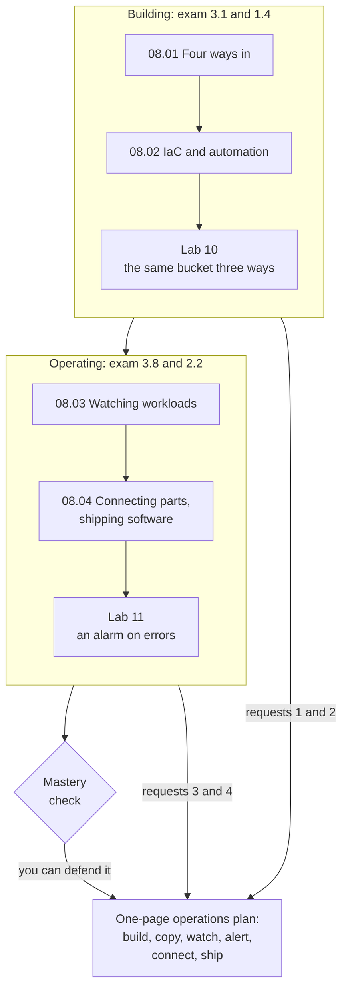

# Module 08: Rebuild the bakery's setup identically in a second Region, and email the owner when orders fail

Modules 05 to 07 built the bakery's site piece by piece. This module is about building and running it: how you give AWS instructions, how a file rebuilds the whole setup, how you watch it, and how its parts pass work to each other. By the end, you hand the owner an operations plan and defend every choice.

**For:** an adult studying alone, possibly new to IT, who wants to understand AWS and use it safely. You have finished Modules 02 to 07 and the [guardrails primer](https://github.com/AutomateTheCloud/atc-study-aws_account_guardrails/blob/main/primer/00-read-this-first.md). **Time:** about 3.5 hours, over several sessions.

## The scenario: the bakery must survive a bad day

The site runs in US East (N. Virginia): web servers on EC2, the order database on Amazon RDS, functions in AWS Lambda, the photo bucket in S3, all in the VPC from Module 07, all set up by hand in the console. The owner has four requests:

1. **"If N. Virginia ever goes down, I want the same setup ready to build in US East (Ohio). Exactly the same."**
2. **"Our new developer needs a test copy of the site every week, without being able to touch the real one."**
3. **"When orders start failing, email me."**
4. **"One slow part shouldn't stall the whole order. And test code changes before they go live."**

The bakery is made up for teaching. At the end you hand the owner a one-page operations plan: how the setup is built and copied, how it's watched and who is told, how its parts talk, and how new code reaches customers.

## You'll be able to

Tags: the kind of knowledge (C concept, J judgment) and what you do with it (Un understand, Ap apply).

| Objective | Lesson |
|---|---|
| **08.01a** Choose the console, the CLI, an SDK or infrastructure as code for a task [J·Ap] | 08.01 |
| **08.02a** Explain how infrastructure as code makes work repeatable and cheaper [C·Un] | 08.02 |
| **08.03a** Pick the tool for an operations question: CloudWatch, X-Ray or CloudTrail [C·Ap] | 08.03 |
| **08.04a** Choose a messaging service by the shape of the message, and name the build or release tool [C·Ap] | 08.04 |

## What this covers on the exam

This module covers tasks [3.1](https://docs.aws.amazon.com/aws-certification/latest/cloud-practitioner-02/cloud-practitioner-02-domain3.html#cloud-practitioner-02-task3.1), deploying and operating, and [3.8](https://docs.aws.amazon.com/aws-certification/latest/cloud-practitioner-02/cloud-practitioner-02-domain3.html#cloud-practitioner-02-task3.8), other service categories, of the AWS Certified Cloud Practitioner (CLF-C02) exam. It also covers monitoring and auditing from task [2.2](https://docs.aws.amazon.com/aws-certification/latest/cloud-practitioner-02/cloud-practitioner-02-domain2.html#cloud-practitioner-02-task2.2) (lesson 08.03) and the benefits of automation from task [1.4](https://docs.aws.amazon.com/aws-certification/latest/cloud-practitioner-02/cloud-practitioner-02-domain1.html#cloud-practitioner-02-task1.4) (lesson 08.02). We checked the exam guide on 2026-10-24.

AWS CloudShell, which the labs use, and AWS CodeDeploy are on the exam guide's out-of-scope list; lessons 08.01 and 08.04 say how to treat them.

## How the module is laid out

**Lessons** (about 25 to 30 minutes each):

1. [Four ways in](01-four-ways-in.md)
2. [IaC and automation](02-iac-and-automation.md): CloudFormation and Service Catalog
3. [Watching workloads](03-watching-workloads.md): CloudWatch, X-Ray and CloudTrail
4. [Connecting parts, shipping software](04-connecting-parts-shipping-software.md): messaging, email, build and release

**Hands-on:**

- [Lab 10: the same bucket three ways](05-lab-10-same-bucket-three-ways.md): in the console, with the CLI, and from a CloudFormation template you finish; then delete the stack.
- [Lab 11: an alarm on errors](06-lab-11-alarm-on-errors.md): a CloudWatch alarm that emails you when a function fails, triggered on purpose.

Both labs run in US East (N. Virginia) and state their cost and worst case.

**Before the labs:** check that you still have [root MFA](https://github.com/AutomateTheCloud/atc-study-aws_account_guardrails/blob/main/primer/02-secure-the-root-user.md), [your IAM admin user with MFA](https://github.com/AutomateTheCloud/atc-study-aws_account_guardrails/blob/main/primer/03-your-everyday-admin-identity.md), [CloudShell without access keys](https://github.com/AutomateTheCloud/atc-study-aws_account_guardrails/blob/main/primer/04-command-line-without-access-keys.md) and [money alarms](https://github.com/AutomateTheCloud/atc-study-aws_account_guardrails/blob/main/primer/05-money-alarms.md). The lessons need no AWS account.

**Mastery check:** the module ends with [a mastery check](07-check.md); you pass at 80%. Each miss points you to the section to reread, then to a parallel retest.

**Numbers that change:** limits and prices appear with the date they were checked, and every lesson says where to check the current ones.

*Notice that request 3 needs both lessons of the second half: one to notice the failure, one to send the email.*

**Long description.** A top-to-bottom map. Box one, "Building: exam 3.1 and 1.4": lessons 08.01 then 08.02, which leads to Lab 10. Box one leads to box two, "Operating: exam 3.8 and 2.2": lessons 08.03 then 08.04, which leads to Lab 11; box two leads to the mastery check. Box one feeds the one-page operations plan with requests 1 and 2, box two with requests 3 and 4, and the check leads to the plan, labeled "you can defend it".

## Coming back

Warm-ups bring back Module 07 (the bakery's VPC), Module 06 (AMIs, launch templates, the Lambda function), Module 04 (temporary credentials, least privilege) and Module 03 (backup and restore).

---

"Module 08: Building and operating" by Automate the Cloud Inc., licensed under CC BY-NC 4.0 with the Additional Permission for Internal Training from Automate the Cloud Inc.
License: https://creativecommons.org/licenses/by-nc/4.0/
Permission: https://automatethe.cloud/licenses/atc-internal-training-permission.txt
