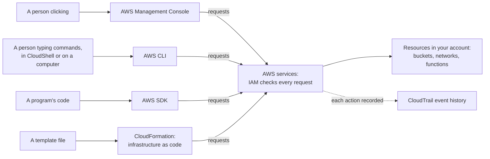
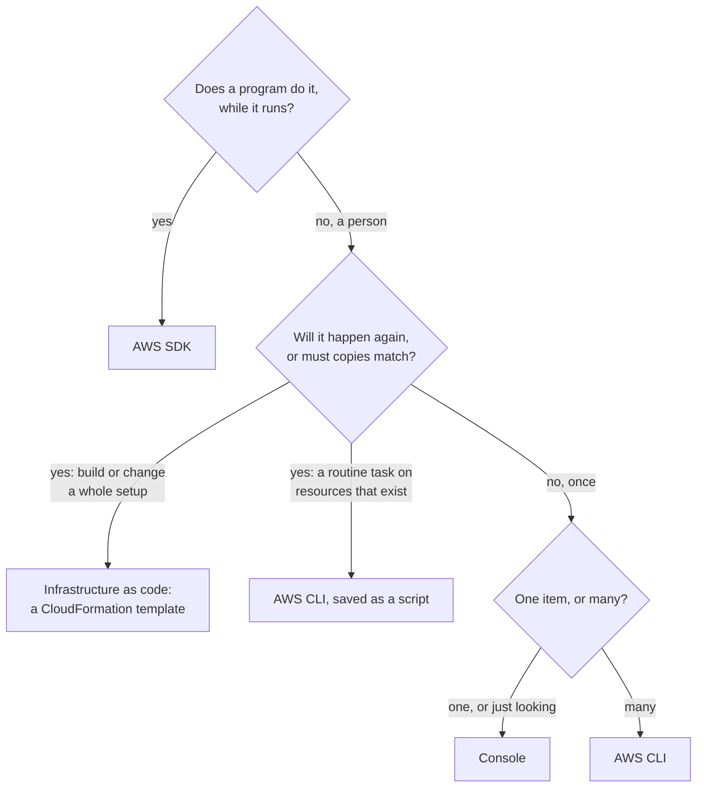

# Every way into AWS sends requests to the same services; choose the one that fits how often the work repeats and who does it

You can reach AWS in four ways: click in the console, type commands in the AWS CLI, call AWS from your own program with an SDK, or describe a whole setup in a file and let infrastructure as code build it. All four reach the same services, under the same permissions. By the end of this lesson you can choose the right one for a task, which is what the exam asks and what the bakery's owner needs next.

**For:** an adult studying alone, possibly new to IT, who wants to understand AWS and use it safely. **Time:** about 25 minutes. Reading works on a phone.

**Before you start:** this lesson builds on [Lab 01](../02-why-the-cloud/06-lab-01-first-resource.md), where you made a bucket in the console and found it in CloudTrail; [primer page 04](https://github.com/AutomateTheCloud/atc-study-aws_account_guardrails/blob/main/primer/04-command-line-without-access-keys.md), where you ran a command in CloudShell; and [Credentials and federation](../04-shared-responsibility-and-access/05-credentials-and-federation.md). If you skipped them, the key terms below give you enough to follow. The bakery scenario is in the [module brief](00-brief.md).

## Warm-up: what you remember

Answer from memory before you look anything up.

1. From lesson 07.01: what one setting makes a subnet public?
2. From lesson 06.01: you start ten EC2 instances from the same AMI. What do they have in common when they start?
3. From lesson 04.05: the guide runs every command in CloudShell instead of creating an access key for your IAM user. Why?

<details><summary>Feedback</summary>

1. **A route to an internet gateway** in the subnet's route table. A public IP address on a server doesn't make the subnet public. Keep this lesson's question in mind: if you rebuilt the bakery's network by hand, how many settings like this one could you miss?
2. **The same operating system and software,** because an AMI is a template. Hold on to that idea: a template that builds identical copies is where this lesson ends.
3. **CloudShell uses temporary credentials** from your console sign-in, which stop working on their own. An access key is long-term: anyone who copies it can use it until someone deletes it.

</details>

## What you'll learn

By the end of this lesson, you can:

- name the four ways in and say what each is for;
- explain why all four are governed by the same permissions and recorded in the same place;
- tell a one-time operation from a repeatable process, and choose the console, the CLI, an SDK or infrastructure as code for a task (objective 08.01a);
- say what AWS CloudShell is, and why the exam doesn't ask about it.

Try these before you read on. Guess if you're unsure; the answers are in the lesson.

1. A new helper at the bakery wants to look around the AWS account to see what's there. Which way in suits her?
2. The owner wants the whole setup built again, exactly the same, in a second Region. Which way in suits that?

## The big picture: four doors, one set of services

Whichever way you choose, the request reaches the same AWS service. IAM checks the same permissions, and CloudTrail records the change as a management event, whichever way in you used: console, CLI or SDK. Reading and writing the data inside a resource, such as the files in an S3 bucket, are data events, which CloudTrail records only if you turn them on ([What is AWS CloudTrail?](https://docs.aws.amazon.com/awscloudtrail/latest/userguide/cloudtrail-user-guide.html), checked 2026-10-24).



*Notice that the four doors differ only on the left. On the right, the permissions, the services and the record are the same.*

**Long description.** Four sources on the left, each with its own way in. A person clicking uses the AWS Management Console. A person typing commands, in CloudShell or on their own computer, uses the AWS CLI. A program's code uses an AWS SDK. A template file goes to CloudFormation, the infrastructure as code service. Each way in sends requests to the AWS services, where IAM checks every request. The services create and change resources in your account, such as buckets, networks and functions. A dotted arrow shows CloudTrail recording each action as an event.

## Key terms (skip if you know them)

- **API** (application programming interface): a defined way for one program to ask another for something. You met it in lesson 07.03. Every AWS service has one.
- **AWS Management Console:** the web pages where you sign in and work with every AWS service by pointing and clicking.
- **AWS CLI** (AWS Command Line Interface): a free, open-source program that sends instructions to AWS as typed commands.
- **Script:** a text file that holds a list of commands, so a computer can run them in order without you typing each one.
- **AWS SDK** (software development kit): a set of code libraries for one programming language that lets a program call AWS services.
- **Programmatic access:** using AWS from code or commands rather than clicks. The exam's examples are APIs, SDKs and the CLI.
- **Infrastructure as code (IaC):** describing the resources you want in a text file, a template, and letting a service build them from it.
- **AWS CloudShell:** a command line that opens inside the console, already signed in as you, with the AWS CLI installed.
- **One-time operation:** a task done once, or rarely, where nobody needs to repeat it exactly.
- **Repeatable process:** a task that will be done again, where each run must give the same result.

"Console" in everyday speech can mean a games machine or a control desk. Here it means AWS's website for managing your account.

## The console is for seeing, learning and doing something once

The **AWS Management Console** is a web application that gives you one place to reach every AWS service's pages ([What is the AWS Management Console?](https://docs.aws.amazon.com/awsconsolehelpdocs/latest/gsg/what-is.html), checked 2026-10-24). It shows you what exists, guides you through choices with forms and defaults, and draws charts and bills. You used it in Lab 01 to create a bucket, and in Lab 09 to build a VPC.

Its strengths are its weaknesses turned around:

- **It's visual.** You see the settings and their defaults, which makes it the best way to learn a service and to look around an account.
- **Nothing is saved but the result.** Your clicks build the resource, but the steps live in your memory. To build the same thing again, you click through again, and each pass is another chance to miss one setting.
- **It's slow at scale.** Forty resources mean forty passes through the same pages.

### "Console clicks are fine for production" is wrong

You may have read, or seen at work, that building production systems by clicking in the console is fine as long as it works. That's not right for anything that must be rebuilt, copied or reviewed. A hand-built setup can't be rebuilt the same way after a disaster, can't be copied exactly to a second Region, and leaves no file that a colleague can check before a change goes live. The Well-Architected Framework lists "You perform manual changes" as an anti-pattern under [REL08-BP05 Deploy changes with automation](https://docs.aws.amazon.com/wellarchitected/latest/reliability-pillar/rel_tracking_change_management_automated_changemgmt.html).

It's tempting because the console is how everyone learns, and the first build works. The cost shows up later, on the second copy or the first disaster. The console is still the right tool for looking at production: reading dashboards, checking a bill, finding a resource.

> **Your turn:** In Lab 01 you created one bucket in the console and timed it. The bakery now needs the network from Module 07 rebuilt in a second Region: a VPC, four subnets, two route tables, an internet gateway and two security groups. Give two reasons, other than time, why clicking through it again is risky.

<details><summary>Model answer</summary>

Any of these: a missed or mistyped setting (a route, a rule, a subnet range) makes the copy differ from the original without anyone noticing; there's no record of the steps, so nobody can check the second build against the first; the person who built the first one may not be the one rebuilding, or may have forgotten details; and in a disaster, the rebuild happens under pressure, when mistakes are most likely.

</details>

## The CLI turns each action into a command you can save and run again

The **AWS CLI** gives you, in a terminal, the same functions the console gives you in a browser. AWS states that every infrastructure administration function in the console is also in the AWS API and the CLI, and that new infrastructure features reach them at launch or within 180 days ([What is the AWS CLI?](https://docs.aws.amazon.com/cli/latest/userguide/cli-chap-welcome.html), checked 2026-10-24). The CLI calls each service's public API directly.

A command is a line of text, so you can keep it, share it and run it again. Here is how listing your buckets and creating one look (illustrative names; you run commands like these in Lab 10):

```bash
aws s3 ls
aws s3 mb s3://example-bakery-test-bucket --region us-east-1
```

Save commands in a **script** and the computer runs them in order: forty buckets cost the same effort as one. That's why the CLI suits bulk work and routine tasks, such as a weekly clean-up of test resources.

A script has a limit. It lists **steps**: "create this, then create that". Run it twice and it tries to do everything again. The second run may fail, because the bucket already exists, or quietly make a duplicate. A script doesn't know what the end result should look like; that's what infrastructure as code adds, below.

### AWS CloudShell: the CLI with nothing to install

**AWS CloudShell** opens a command line in your browser from the console. The AWS CLI version 2 is already installed, and the shell is already signed in with the credentials you used for the console, so you configure nothing ([What is AWS CloudShell?](https://docs.aws.amazon.com/cloudshell/latest/userguide/welcome.html), checked 2026-10-24). You used it on primer page 04 to run `aws sts get-caller-identity`.

> **Dated (checked 2026-10-24):** CloudShell has no extra charge; you pay for what your commands create and for data you send out of AWS. Each Region gives you 1 GB of home-folder storage that persists between sessions, and a session ends after 20 to 30 minutes of inactivity ([AWS CloudShell pricing](https://aws.amazon.com/cloudshell/pricing/); [What is AWS CloudShell?](https://docs.aws.amazon.com/cloudshell/latest/userguide/welcome.html); [CloudShell quotas and restrictions](https://docs.aws.amazon.com/cloudshell/latest/userguide/limits.html)). Primer page 04 lists the other limits.

**On the exam:** the CLF-C02 exam guide lists AWS CloudShell among its **out-of-scope** services (checked 2026-10-24), so the exam doesn't test it; at most it might appear as a wrong option. It's still the easiest place to run the CLI, so this guide's labs use it as a tool. If an answer says "use the AWS CLI", CloudShell is one place to do that.

To run the CLI on your own computer instead, use `aws login`, as on [primer page 04](https://github.com/AutomateTheCloud/atc-study-aws_account_guardrails/blob/main/primer/04-command-line-without-access-keys.md), not an access key. Lesson 04.05 explained why: the old advice to create a key for the CLI leaves a long-term secret on your machine.

> **Check:** A teammate's script creates a bucket and a security group. She runs it on Monday, then again on Tuesday "to make sure everything's there". What most likely happens on Tuesday?
>
> A. Nothing: the CLI sees that both already exist and skips them
> B. The script repeats its steps: the bucket command fails because the name is taken, and the security group command may fail on its name or create a second group
> C. The CLI deletes Monday's resources and builds them again

<details><summary>Feedback</summary>

**B is right.** A script lists steps and runs them again; it doesn't describe the end result for a tool to work toward.

- **A is wrong.** Describing the end result, and letting the tool work out what to create or change, is what infrastructure as code gives you, not a plain script.
- **C is wrong.** The CLI never deletes anything you didn't ask it to.

</details>

## An SDK puts AWS calls inside your own program

An **AWS SDK** is a set of code libraries that lets a program, written in a language such as Python, JavaScript, Java or .NET, call AWS services ([What is an SDK?](https://aws.amazon.com/what-is/sdk/), checked 2026-10-24). AWS publishes SDKs for many languages ([AWS SDKs and Tools Reference Guide](https://docs.aws.amazon.com/sdkref/latest/guide/overview.html)). The SDK handles the fiddly parts of each call:

- **It signs each request** with the program's credentials, so AWS knows who is asking.
- **It finds temporary credentials on its own.** Code on an EC2 instance, in a container or in Lambda picks up the credentials of the IAM role it runs with, and the SDK renews them as they expire ([Standardized credential providers](https://docs.aws.amazon.com/sdkref/latest/guide/standardized-credentials.html)). This is how lesson 04.03's advice, "give the website's code a role, not an access key", works in practice.
- **It retries brief failures,** such as a timeout or a request turned away because too many arrived at once ([Retry behavior](https://docs.aws.amazon.com/sdkref/latest/guide/feature-retry-behavior.html)).

The SDK is the way in when **AWS is part of what your program does while it runs**, not a way to build infrastructure by hand. At the bakery, the website's code stores each new cake photo in the S3 bucket, and the Lambda function from Module 06 reads it to make a smaller copy. Both make those calls through an SDK, thousands of times a day, without a person involved.

> **Your turn:** For each, say whether the SDK or the CLI fits better, and why in one sentence. (a) The order page saves every order's receipt to S3 as the customer pays. (b) You need to list every bucket in the account once, to check names before a lab.

<details><summary>Model answer</summary>

(a) **The SDK:** the website's own code makes the call each time a customer pays; no person is there to type a command. (b) **The CLI:** one person, one quick question, answered by one command such as `aws s3 ls`. The console would also work.

</details>

## Infrastructure as code describes the end result in a file

**Infrastructure as code (IaC)** means you write down the resources you want, with their settings, in a text file called a **template**, and a service builds them for you. AWS's DevOps guidance describes it as treating infrastructure the way developers treat code: written down, kept in version control, reviewed and reused ([Infrastructure as code](https://docs.aws.amazon.com/whitepapers/latest/introduction-devops-aws/infrastructure-as-code.html), checked 2026-10-24). On AWS, the service that does this, and the one the exam names, is **AWS CloudFormation**.

The difference from a script is the one that matters:

- **A script says how:** do this step, then that step.
- **A template says what:** this is the bakery's network, with these subnets and these rules. CloudFormation works out the order, builds it, and can later compare the result with the file.

So the same template builds the same setup every time, in any Region you choose. AWS describes exactly that use: describe the resources once, then build the same ones again and again in several Regions ([What is CloudFormation?](https://docs.aws.amazon.com/AWSCloudFormation/latest/UserGuide/Welcome.html)). That's the answer to the second prequestion, and lesson 08.02 shows how it works.

## One-time or repeatable: the question that picks the way in

The exam's task [3.1](https://docs.aws.amazon.com/aws-certification/latest/cloud-practitioner-02/cloud-practitioner-02-domain3.html#cloud-practitioner-02-task3.1) asks you to decide between programmatic access, the console and infrastructure as code, and to judge from the requirements whether a job is a **one-time operation** or a **repeatable process** (checked 2026-10-24). Three questions settle almost every case:

1. **Who does it: a person, or a program while it runs?** A program means an SDK.
2. **Will it happen again, or must copies match exactly?** If so, write it down: a template for whole setups, a script for routine tasks on existing resources.
3. **Is it one thing, or many?** One thing, done once, suits the console. Many things, even once, suit the CLI.

![Four columns compared on four rows. Console: clicking through pages; best for seeing, learning and one-time tasks; not repeatable, the steps live in memory; clue words visual, browser, one-time. AWS CLI: typing commands, saved as scripts; best for quick or bulk tasks from a terminal such as CloudShell; repeatable if saved as a script, which repeats steps, not the end state; clue words command line, terminal, script. AWS SDKs: calls inside program code; best for applications that use AWS while they run; repeatable, the program makes the same calls each time; clue words application code, programming language. Infrastructure as code: a template that describes the end state; best for building, changing and copying whole setups; repeatable, the same file builds the same setup anywhere; clue words template, repeatable, identical environments. The repeatable row is highlighted.](../../images/08-01-four-ways.svg)

*Notice the highlighted row. Only infrastructure as code repeats the end result rather than the steps, which is why it wins whenever copies must match.*

**Long description.** A table of four columns: Console, AWS CLI, AWS SDKs and Infrastructure as code, on four rows. How you work: clicking through pages in a web browser; typing commands and saving them as a script; calls written inside your program's code; a template file that describes the end state. Best for: seeing what exists, learning, and tasks done once; quick or bulk tasks from a terminal, such as CloudShell; applications that use AWS while they run; building, changing and copying whole setups. Repeatable, highlighted: no, the steps live in someone's memory; yes if saved as a script, which repeats steps, not the end state; yes, the program makes the same calls every time it runs; yes, the same file builds the same setup anywhere. Exam clue words: visual, browser, one-time; command line, terminal, script; application code, programming language; template, repeatable, identical environments. Notes under the table say that on AWS the infrastructure as code service is AWS CloudFormation, and that CloudShell is a place to run the CLI.

The same three questions as a flowchart:



*Notice that "once" doesn't always mean the console: deleting forty old test resources once is still a job for the CLI.*

**Long description.** A decision flowchart. Question 1: does a program do it, while it runs? Yes: use an AWS SDK. No, a person: question 2, will it happen again, or must copies match? Yes, building or changing a whole setup: infrastructure as code, a CloudFormation template. Yes, a routine task on resources that exist: the AWS CLI, saved as a script. No, once: question 3, one item or many? One item, or just looking: the console. Many: the AWS CLI.

| | Console | AWS CLI | AWS SDK | Infrastructure as code |
|---|---|---|---|---|
| **Who drives it** | A person, clicking | A person, or a script | A program | A template, run by CloudFormation |
| **Repeatable** | No | Steps, if scripted | Yes, inside the program | Yes: the same end result |
| **Choose it for** | Looking, learning, a one-off change | Quick and bulk tasks, routine scripts | Applications that call AWS | Whole setups, copies, rebuilds |

**What's the same:** all four reach the same services under the same IAM permissions, and CloudTrail records them all. **What differs:** who drives the work, and whether the result can be repeated exactly. **The principle:** the more often a job repeats, and the more exactly copies must match, the further right in the table you go.

> **Check:** Answer the first prequestion. The bakery's new helper wants to look around the account to see what resources exist and how they're set up. Which way in fits best?
>
> A. The console
> B. An SDK
> C. A CloudFormation template
> D. A CLI script

<details><summary>Feedback</summary>

**A is right.** Looking around is a one-time, visual task: the console shows settings and defaults on the page.

- **B is wrong.** An SDK is for a program's code, not a person exploring.
- **C is wrong.** A template builds resources; it doesn't show what's already there.
- **D is wrong.** A script would work, but writing one to look around once is more effort than it saves.

</details>

## Worked example: six jobs at the bakery

The owner sends a list. Here is how someone who does this every day sorts it, using the three questions.

| Job | Who does it? | Again, or must match? | One or many? | Way in |
|---|---|---|---|---|
| 1. Check last month's bill | Person | No | One | **Console** |
| 2. Save each customer's receipt to S3 as they pay | Program | (Every order) | — | **SDK** |
| 3. Build the whole setup again in US East (Ohio), identical to N. Virginia | Person | Must match | — | **IaC** |
| 4. Delete 40 old test snapshots, all tagged `env=test` | Person | No | Many | **CLI** |
| 5. Start a test copy of the site each Monday and remove it each Friday | Person, weekly | Again, must match | — | **IaC**, started on a schedule |
| 6. Check which identity you're signed in as before a lab | Person | No | One | **CLI in CloudShell** (or the console) |

The expert's thinking, step by step:

1. **Program first.** Job 2 happens inside the website's code at every payment, so no person-facing tool fits. The SDK is the only answer.
2. **"Must match" points to a template.** Job 3 is the module's scenario. A second Region built by hand would drift from the first within a week. Job 5 repeats every week, and a template also guarantees that Friday's clean-up removes everything Monday made.
3. **"Once" splits on size.** Jobs 1 and 6 are single, quick looks: the console or one command. Job 4 is once, but 40 times over, so a CLI command that filters by tag beats 40 rounds of clicking.
4. **Check the edge.** Job 6 shows two answers can both be fine. The exam rewards the best fit for the stated requirement, so read for the words "repeat", "identical", "application" and "one-time".

> **Your turn:** The owner adds a seventh job: "Give our accountant a way to see monthly costs whenever she likes." Which way in, and why? Then name one thing you'd set up first, from Module 04.

<details><summary>Model answer</summary>

**The console:** she's a person looking at a bill when she chooses, with no need to repeat anything exactly. First, give her her own identity with read-only access to billing and cost information, least privilege from lesson 04.04, never a shared login or an access key.

</details>

## Your side of the line

AWS runs the console, the services behind it and CloudShell's computers, and maintains the CLI and the SDKs. Everything about **who may do what** is yours, whichever door they use:

- the identities and their MFA (Module 04);
- the permissions, which apply the same in the console, the CLI and the SDKs;
- the credentials your programs and commands use: temporary ones through roles, CloudShell or `aws login`, not access keys left in code or on laptops.

A permission you forgot to remove is as open through the CLI as through the console.

## What you pay for

- **The console, the CLI and the SDKs:** AWS lists no charge for the tools themselves. You pay for what they create, and the CLI's own guide says you pay only for the services you use ([What is the AWS CLI?](https://docs.aws.amazon.com/cli/latest/userguide/cli-chap-welcome.html), checked 2026-10-24).
- **Some API requests are billed by the request,** whichever door they come through. For example, each request to the Cost Explorer API cost $0.01 as of 2026-10-23 ([primer page 04](https://github.com/AutomateTheCloud/atc-study-aws_account_guardrails/blob/main/primer/04-command-line-without-access-keys.md)).
- **AWS CloudShell:** no extra charge (dated box above).
- **CloudFormation:** no extra charge for AWS's own resource types; lesson 08.02 has the details.

## In real work: click to learn, write it down to run

Teams learn a service in the console, then write down anything they'll need again: a script for routine chores, a template for every setup that must be rebuilt or copied. Production changes go through templates that a colleague reviews, and the console is kept for looking. The Well-Architected Framework names these habits:

- The operational excellence design principle "[Safely automate where possible](https://docs.aws.amazon.com/wellarchitected/latest/framework/oe-design-principles.html)": define the workload and its operations as code, so responses are consistent and human error drops.
- [REL08-BP05 Deploy changes with automation](https://docs.aws.amazon.com/wellarchitected/latest/reliability-pillar/rel_tracking_change_management_automated_changemgmt.html), which names manual changes as an anti-pattern.
- [SEC02-BP02 Use temporary credentials](https://docs.aws.amazon.com/wellarchitected/latest/security-pillar/sec_identities_unique.html): roles for programs using the SDKs, CloudShell or `aws login` for people using the CLI.

## Summary

- **Four ways in, one set of services.** The console, the CLI, the SDKs and infrastructure as code all reach the same services; IAM checks the same permissions, and CloudTrail records every action.
- **The console is for seeing, learning and one-off changes.** It keeps the result, not the steps, so "console clicks are fine for production" is wrong for anything you must rebuild or copy.
- **The CLI turns actions into commands you can save as scripts,** for quick and bulk work. A script repeats steps; it doesn't know the end result. CloudShell runs the CLI in your browser, signed in as you, but it's out of the exam's scope.
- **An SDK puts AWS calls inside your program,** signing requests, finding role credentials and retrying brief failures.
- **Infrastructure as code describes the end result in a template,** so the same file builds the same setup anywhere. On AWS that's CloudFormation.
- **Choose by who does it, whether it repeats or must match, and how many things it touches.**

**For the bakery's operations plan:** the Ohio rebuild and the weekly test copy are jobs for infrastructure as code; the website's photo and receipt code uses an SDK; people use the console to look and CloudShell for one-off commands. Lesson 08.02 builds the template.

## Practice

1. **Which way in fits best: a company must create the same set of resources for each new customer, identically, several times a month?**

   A. The console, following a written checklist
   B. Infrastructure as code, with AWS CloudFormation
   C. AWS CloudShell
   D. AWS Support

   <details><summary>Feedback</summary>

   **B is right.** The job repeats and copies must match: a template builds the same resources each time.

   - **A is wrong.** A checklist helps, but every pass by hand can miss or mistype a step.
   - **C is wrong.** CloudShell is a place to run commands, not a way to describe an identical setup; it's also outside the exam's scope.
   - **D is wrong.** AWS Support helps with problems; it doesn't provision resources.

   </details>

2. **A developer's mobile app must upload photos to Amazon S3. Which option lets her code call S3 in the app's programming language?**

   A. The AWS Management Console
   B. The AWS CLI
   C. An AWS SDK
   D. AWS CloudFormation

   <details><summary>Feedback</summary>

   **C is right.** SDKs give programs libraries for calling AWS services in their own language.

   - **A is wrong.** The console is for people clicking, not for code inside an app.
   - **B is wrong.** The CLI is for commands typed or scripted in a terminal.
   - **D is wrong.** CloudFormation builds infrastructure from templates; it doesn't upload an app's photos.

   </details>

3. **True or false, with one sentence of reasoning: "If a user is denied permission to delete a bucket in the console, she can still delete it with the AWS CLI."**

   <details><summary>Feedback</summary>

   **False.** IAM checks every request against the same permissions, whichever way it arrives, so the CLI request is denied too.

   </details>

4. **In two sentences, explain the difference between a script of CLI commands and a CloudFormation template.**

   <details><summary>Feedback</summary>

   **Model answer:** A script lists steps to run in order, so running it again repeats the steps, which can fail or create duplicates. A template describes the end result, so CloudFormation can build it, work out what to change when the template changes, and build the same setup again anywhere.

   </details>

5. **(From lesson 02.01.) Task [3.1](https://docs.aws.amazon.com/aws-certification/latest/cloud-practitioner-02/cloud-practitioner-02-domain3.html#cloud-practitioner-02-task3.1) also covers deployment models. The bakery keeps its order records on a server in the shop and runs its website on AWS, with the two connected. Which deployment model is that?**

   <details><summary>Feedback</summary>

   **Hybrid:** some parts run in the cloud and some on the bakery's own premises, joined by a connection.

   </details>

6. **(From lesson 04.05.) A tutorial says, "Create an access key for your IAM user so the CLI can sign in." What should you do instead, and why?**

   <details><summary>Feedback</summary>

   **Use CloudShell, or `aws login` on your own computer.** Both give the CLI temporary credentials from your normal sign-in with MFA, so no long-term secret exists to leak.

   </details>

**Next:** [IaC and automation](02-iac-and-automation.md), where the bakery's template takes shape. You'll create the same bucket three ways in [Lab 10](05-lab-10-same-bucket-three-ways.md).

## Where to check the current details

- [What is the AWS Management Console?](https://docs.aws.amazon.com/awsconsolehelpdocs/latest/gsg/what-is.html) (checked 2026-10-24)
- [What is the AWS CLI?](https://docs.aws.amazon.com/cli/latest/userguide/cli-chap-welcome.html), AWS CLI User Guide (checked 2026-10-24)
- [AWS SDKs and Tools Reference Guide](https://docs.aws.amazon.com/sdkref/latest/guide/overview.html), with [credential providers](https://docs.aws.amazon.com/sdkref/latest/guide/standardized-credentials.html) and [retry behavior](https://docs.aws.amazon.com/sdkref/latest/guide/feature-retry-behavior.html) (checked 2026-10-24)
- [What is AWS CloudShell?](https://docs.aws.amazon.com/cloudshell/latest/userguide/welcome.html) and [AWS CloudShell pricing](https://aws.amazon.com/cloudshell/pricing/) (checked 2026-10-24)
- [Infrastructure as code](https://docs.aws.amazon.com/whitepapers/latest/introduction-devops-aws/infrastructure-as-code.html), Introduction to DevOps on AWS (checked 2026-10-24)
- [AWS Certified Cloud Practitioner (CLF-C02) exam guide](https://docs.aws.amazon.com/aws-certification/latest/cloud-practitioner-02/cloud-practitioner-02.html): task [3.1](https://docs.aws.amazon.com/aws-certification/latest/cloud-practitioner-02/cloud-practitioner-02-domain3.html#cloud-practitioner-02-task3.1) and the out-of-scope services list (checked 2026-10-24)

---

"Four ways in" by Automate the Cloud Inc., licensed under CC BY-NC 4.0 with the Additional Permission for Internal Training from Automate the Cloud Inc.
License: https://creativecommons.org/licenses/by-nc/4.0/
Permission: https://automatethe.cloud/licenses/atc-internal-training-permission.txt
