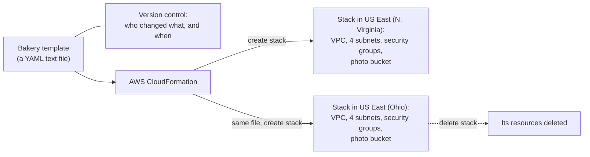
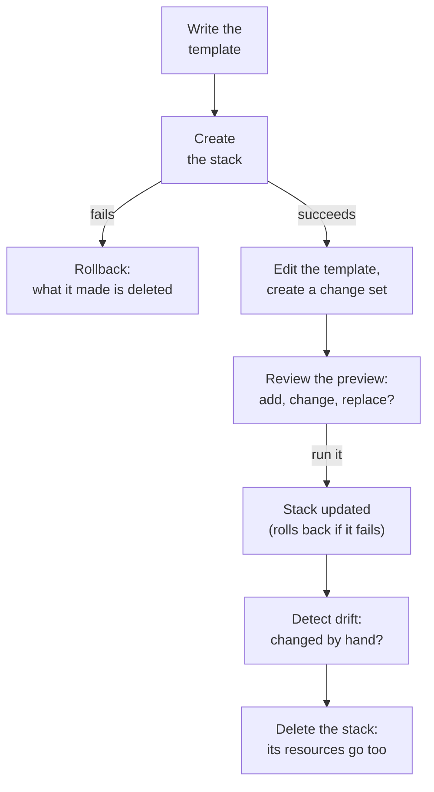
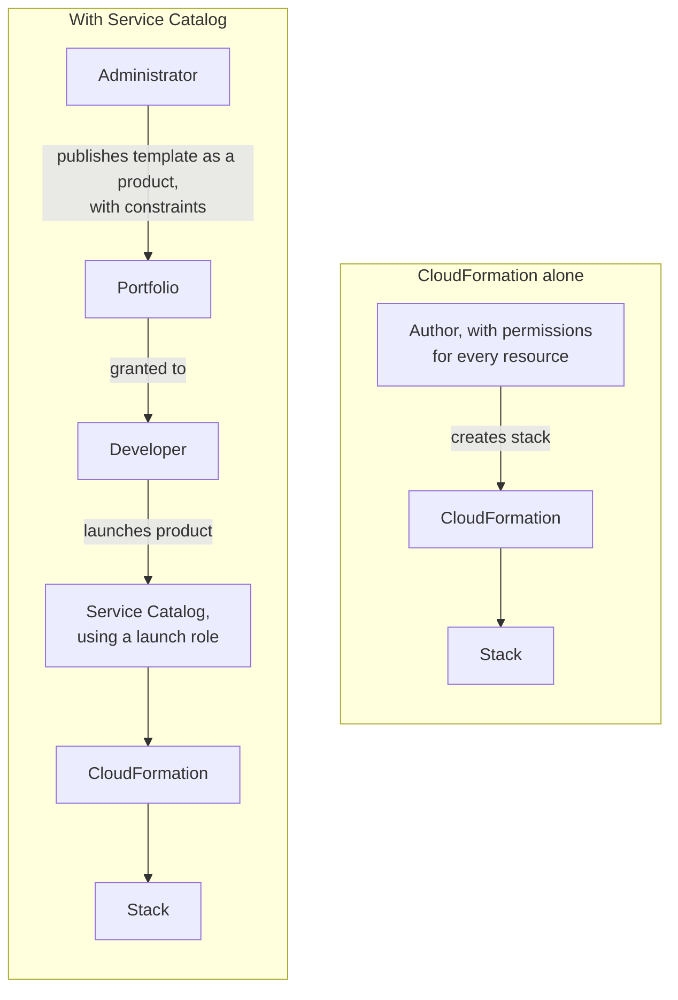

# A template turns the bakery's setup into a file that builds it the same way, in any Region, as often as you need

Infrastructure as code moves a setup out of someone's memory and into a file. You write a CloudFormation template, and CloudFormation builds everything in it as one unit, a stack, which you can change with a preview and delete in one step. By the end of this lesson you can explain how that makes work repeatable and cheaper, and what AWS Service Catalog adds when other people need to launch your templates.

**For:** an adult studying alone, possibly new to IT, who wants to understand AWS and use it safely. **Time:** about 30 minutes. Reading works on a phone.

**Before you start:** read [Four ways in](01-four-ways-in.md) first. This lesson also builds on [Your own network](../07-connecting-it/01-your-own-network.md) (the bakery's VPC), [Surviving failure](../03-aws-around-the-world/03-surviving-failure.md) (backup and restore) and [What a data center really costs](../02-why-the-cloud/04-what-a-data-center-really-costs.md) (automation). If you skipped them, the key terms below give you enough to follow. The bakery scenario is in the [module brief](00-brief.md).

## Warm-up: what you remember

Answer from memory before you look anything up.

1. From lesson 07.01: the bakery's VPC has how many subnets, and why that number?
2. From lesson 06.02: what does an Auto Scaling group use a launch template for?
3. From lesson 03.03: the bakery chose backup and restore for a Region-wide disaster. Why does that strategy need infrastructure as code?

<details><summary>Feedback</summary>

1. **Four:** a public and a private subnet in each of two Availability Zones, because a subnet lives in one AZ and high availability needs two.
2. **As the recipe for each new instance:** the AMI, instance type and other settings, so every instance it launches is the same. This lesson's template is a bigger recipe, for a whole setup.
3. **Because only data is waiting in the second Region.** Everything else, the network, servers and rules, must be built there during the disaster. Rebuilding by hand is slow and error-prone; a template rebuilds it in one step.

</details>

## What you'll learn

By the end of this lesson, you can:

- describe a CloudFormation template, a stack, a change set and drift detection;
- explain how infrastructure as code makes work repeatable and cheaper, and list the benefits of automation (objective 08.02a);
- say what a template rebuilds in a second Region, and what it doesn't;
- tell CloudFormation from AWS Service Catalog.

Try these before you read on. Guess if you're unsure; the answers are in the lesson.

1. You delete a CloudFormation stack. What happens to the resources it created?
2. Does CloudFormation itself cost money?

## The big picture: one file, many identical stacks

The bakery's template lives in version control. CloudFormation reads it and builds a stack in US East (N. Virginia); the same file, unchanged, builds an identical stack in US East (Ohio).



*Notice that nothing about the Ohio stack is typed by hand. The only input is the file that already built N. Virginia.*

**Long description.** On the left, the bakery's template, a YAML text file, linked to version control, which records who changed what and when. The template goes to AWS CloudFormation. CloudFormation creates a stack in US East (N. Virginia) holding a VPC, four subnets, security groups and the photo bucket, and, from the same file, a second stack in US East (Ohio) holding the same resources. A dotted arrow from the Ohio stack shows that deleting a stack deletes its resources.

## Key terms (skip if you know them)

- **AWS CloudFormation:** AWS's infrastructure as code service. It builds and manages AWS resources from templates.
- **Template:** a YAML or JSON text file that describes the resources you want and their settings.
- **Stack:** the set of resources CloudFormation creates from one template, managed as one unit.
- **Parameter:** a value the template asks for when you create a stack, such as an environment name, so one template fits several uses.
- **Rollback:** undoing a failed stack operation, returning to the state before it started.
- **Change set:** a preview of what an update to a stack would add, change, replace or remove.
- **Drift:** a difference between a stack's resources as they are now and as the template describes them, usually from a change made by hand.
- **StackSet:** a way to create and manage stacks from one template across several accounts and Regions together.
- **Version control:** a system, such as Git, that keeps every version of a file with who changed it and when.
- **AWS Service Catalog:** a service that lets administrators publish approved templates for other people to launch themselves.

"Stack" in everyday English means a pile of things. In CloudFormation it means a group of resources that are created, changed and deleted together.

## A template describes what should exist, not the steps to build it

A **template** is a text file in YAML or JSON that lists resources and their settings; CloudFormation uses it as a blueprint ([How CloudFormation works](https://docs.aws.amazon.com/AWSCloudFormation/latest/UserGuide/cloudformation-overview.html), checked 2026-10-24). Here is the start of the bakery's network as a template, written for this guide:

```yaml
AWSTemplateFormatVersion: "2010-09-09"
Description: The bakery's network, first part (illustrative)
Parameters:
  EnvName:
    Type: String
    Default: prod
Resources:
  BakeryVpc:
    Type: AWS::EC2::VPC
    Properties:
      CidrBlock: 10.0.0.0/16
      Tags:
        - Key: env
          Value: !Ref EnvName
  PublicSubnetA:
    Type: AWS::EC2::Subnet
    Properties:
      VpcId: !Ref BakeryVpc
      CidrBlock: 10.0.1.0/24
      AvailabilityZone: !Select [0, !GetAZs ""]
```

Read it from the top:

- **`Parameters`** asks for one value, `EnvName`, with `prod` as the default. A test copy can say `test` instead, from the same file.
- **`Resources`** lists what should exist. Each resource has a name you choose (`BakeryVpc`), a type (`AWS::EC2::VPC`) and its properties.
- **`!Ref BakeryVpc`** says "the VPC above". CloudFormation sees that the subnet needs the VPC, so it builds the VPC first. You never write the order.
- **`!GetAZs ""`** asks for the Availability Zones of whatever Region the stack is built in, and `!Select [0, ...]` takes the first. Nothing names `us-east-1a`, so the same line works in Ohio ([Fn::GetAZs](https://docs.aws.amazon.com/AWSCloudFormation/latest/TemplateReference/intrinsic-function-reference-getavailabilityzones.html)).

The full template adds the other subnets, the gateway, the route tables and the security groups from Module 07. As a text file, it goes into **version control**, which keeps every change with who made it and when, so an earlier version can be brought back ([What is CloudFormation?](https://docs.aws.amazon.com/AWSCloudFormation/latest/UserGuide/Welcome.html), checked 2026-10-24).

Don't confuse this template with the **launch template** from lesson 06.02. A launch template describes one EC2 instance, so Auto Scaling can launch identical copies of it. A CloudFormation template describes a whole set of resources, and can itself contain a launch template.

> **Your turn:** The bakery's first draft named the subnet's zone `us-east-1a` directly. What would go wrong when the owner builds the Ohio copy from it, and which line in the template above avoids the problem?

<details><summary>Model answer</summary>

`us-east-1a` exists only in N. Virginia, so the Ohio stack would ask for a zone that isn't in its Region, and creating the subnet would fail. The line `AvailabilityZone: !Select [0, !GetAZs ""]` avoids it: it asks for the zones of whichever Region the stack is built in.

</details>

## A stack is the unit you create, change and delete

You give CloudFormation the template, and it creates a **stack**: every resource in the file, built and tracked together ([How CloudFormation works](https://docs.aws.amazon.com/AWSCloudFormation/latest/UserGuide/cloudformation-overview.html)). The life of a stack has five moves:



*Notice that every move goes through the template or the stack. A change made by hand, outside the flow, is what drift detection exists to catch.*

**Long description.** A top-to-bottom flow. Write the template, then create the stack. If creation fails, a rollback deletes what it made. If it succeeds, the next change starts by editing the template and creating a change set; you review the preview, which shows what would be added, changed or replaced, then run it, and the stack is updated, rolling back if the update fails. Drift detection checks for changes made by hand. Finally, deleting the stack deletes its resources.

Three behaviors make stacks safer:

- **All or nothing on create.** If creation fails partway, CloudFormation rolls back by deleting the resources it created. You aren't left with half a network.
- **Updates touch only what changed,** and a failed update rolls back to the last working state.
- **Delete is one step.** Deleting the stack deletes everything in it, so nothing is forgotten and left running.

Delete has three qualifiers, each of which can leave something behind or stop the delete ([DeletionPolicy attribute](https://docs.aws.amazon.com/AWSCloudFormation/latest/TemplateReference/aws-attribute-deletionpolicy.html), checked 2026-10-24):

- **An S3 bucket must be empty** before CloudFormation can delete it. If it still holds objects, the delete fails until you empty it. You'll meet this in Lab 10.
- **A resource can be set to be kept** (a `Retain` deletion policy). It survives the delete and keeps costing money until you remove it yourself.
- **An RDS database's default is to keep a final snapshot** when its stack is deleted. The snapshot keeps costing until you delete it.

> **Check:** Answer the first prequestion. The bakery's test stack holds a VPC, two subnets, a security group and an empty bucket, none with a special deletion policy. The owner deletes the stack. What happens?
>
> A. Only the stack's record is deleted; the resources keep running\
> B. CloudFormation deletes all five resources\
> C. CloudFormation deletes everything except the bucket, which is always kept

<details><summary>Feedback</summary>

**B is right.** With no deletion policy, deleting a stack deletes its resources. The empty bucket goes too.

- **A is wrong.** That only happens to resources set to `Retain`.
- **C is wrong.** Buckets aren't kept by default. A bucket that still holds objects makes the delete fail until you empty it, which is different from being kept.

</details>

## Change sets preview a change; drift detection finds changes made by hand

Some changes replace a resource. AWS's own example: changing an RDS database's name makes CloudFormation build a new database and delete the old one, losing its data unless you backed it up. A **change set** shows that "replace" before anything happens, so you can stop and plan ([How CloudFormation works](https://docs.aws.amazon.com/AWSCloudFormation/latest/UserGuide/cloudformation-overview.html)). It doesn't promise the update will succeed: it doesn't check, for example, your permissions or your quotas.

**Drift** is the other risk. Suppose a helper opens SSH on the bakery's web security group in the console, "just for a minute", and forgets. The template still says "HTTPS only", but the real security group now differs. **Drift detection** compares each supported resource with the template and reports it as in sync, modified or deleted ([Detect unmanaged configuration changes with drift detection](https://docs.aws.amazon.com/AWSCloudFormation/latest/UserGuide/using-cfn-stack-drift.html), checked 2026-10-24). It reports; it doesn't fix. You either change the resource back or put the change into the template.

This completes lesson 08.01's misconception: console clicks on a resource that a template manages make the setup and its file disagree, and the Ohio rebuild won't include them.

> **Your turn:** After the SSH change above, the owner builds the Ohio stack from the template. Does Ohio's web security group allow SSH? What does this tell you about where changes should be made?

<details><summary>Model answer</summary>

**No.** Ohio is built from the template, which still allows only HTTPS, so the two Regions now differ, here in Ohio's favor. Changes belong in the template, reviewed and kept in version control; anything done by hand is missing from every copy built later and shows up only as drift.

</details>

## One template, many Regions and accounts, but not the data

Copying the bakery's setup to US East (Ohio) is now one action: create a stack from the same template in the other Region, with different parameter values where needed. AWS describes this use directly: describe your resources once, then build the same ones again in several Regions ([What is CloudFormation?](https://docs.aws.amazon.com/AWSCloudFormation/latest/UserGuide/Welcome.html)). For many accounts and Regions at once, a **StackSet** creates and updates the stacks from one template together, which organizations with many accounts use for their standard setup ([StackSets concepts](https://docs.aws.amazon.com/AWSCloudFormation/latest/UserGuide/what-is-cfnstacksets.html)).

A template rebuilds **resources**, not what's **in** them. Keep these limits in mind:

| The template rebuilds in Ohio | It doesn't bring |
|---|---|
| The VPC, subnets, route tables and gateway | The orders in the database: those come from backups or replication (lessons 03.03 and 05.04) |
| Security groups and their rules | The cake photos in the bucket: those need S3 Replication or a backup copy (lesson 05.02) |
| An empty bucket and an empty database, set up the same way | Anything changed by hand and never put in the template (drift) |
| The Lambda function's settings and code location | Values that differ by Region, unless the template allows for them: an AMI belongs to one Region, so Ohio needs its own copy, with its own ID ([Copy an AMI](https://docs.aws.amazon.com/AWSEC2/latest/UserGuide/CopyingAMIs.html)) |

Bucket names need care too. A name in the global namespace must be unique across AWS, so a template shouldn't hard-code one name for both Regions; let CloudFormation make one up, or build it from the Region's name.

> **Your turn:** The owner says, "With the template, a disaster in N. Virginia means we lose nothing." In two sentences, correct her.

<details><summary>Model answer</summary>

The template rebuilds the setup in Ohio quickly and exactly, but it builds an empty database and an empty bucket. The orders and photos survive only if backups or replicas of them are already in Ohio, so the plan from lesson 03.03 needs both: the template for the setup, and copies of the data.

</details>

## Automation makes work repeatable and cheaper

Exam task [1.4](https://docs.aws.amazon.com/aws-certification/latest/cloud-practitioner-02/cloud-practitioner-02-domain1.html#cloud-practitioner-02-task1.4) asks you to identify the **benefits of automation**. Lesson 02.04 met one: switching test servers off outside working hours cuts their running time from 168 to 40 hours a week. A template adds more:

| Benefit | What it means for the bakery | Why it saves money |
|---|---|---|
| **Fewer mistakes** | The same file builds the same setup; no missed route or rule | Outages and security incidents from slips cost far more than the time saved by skipping automation |
| **Speed** | A copy takes minutes of a person's time, not hours | Staff time is a real cost (lesson 02.04) |
| **Consistency** | Test, production and the Ohio copy match | Problems found in testing are the problems production would have had |
| **Clean deletion** | Delete the stack and its resources go | Nothing forgotten keeps billing |
| **Run only when needed** | The test copy exists Monday to Friday, built and removed on a schedule | You pay for hours used, not hours idle |
| **Faster recovery** | Backup and restore rebuilds in one step | Less downtime, so less lost business (lesson 03.03) |
| **A record of every change** | Version control shows who changed what, and when | Reviews catch errors before they reach production |

The chart shows the effect on effort, with made-up figures you can change in your head: 3 person-hours to build one copy of the setup by hand, 8 hours to write and test the template once, then 15 minutes of a person's time for each copy built from it.


*Notice where the lines cross. For one copy, clicking is cheaper; from the third, the template is, and every copy after that widens the gap.*

**Long description.** A line chart of total person-hours, from 0 to 25, against copies built, from 1 to 8, using made-up figures. The orange line, by hand in the console, rises 3 hours per copy: 3, 6, 9, 12, 15, 18, 21 and 24 hours. The blue line, from a template, starts at 8.25 hours, because writing and testing the template takes 8 hours and the first copy 15 minutes, and rises 15 minutes per copy to 10 hours at 8 copies. An annotation at copy 1 says the template costs more there, 8.25 hours against 3. An annotation at copy 3 says the template is cheaper from there, 8.75 hours against 9. A note says time spent fixing mistakes in hand-built copies isn't counted.

| Copies built | 1 | 2 | 3 | 4 | 8 |
|---|---|---|---|---|---|
| By hand (hours) | 3 | 6 | 9 | 12 | 24 |
| From a template (hours) | 8.25 | 8.5 | 8.75 | 9 | 10 |

The catch: writing a good template takes skill and time. For a resource you'll make once and throw away, the console is cheaper. The template pays back when work repeats, and most businesses repeat their setup more than they expect: a test copy, a second Region, a rebuild after a mistake.

> **Check:** Which statement about automation and cost is correct?
>
> A. Automation lowers costs because AWS gives a discount for resources created by CloudFormation\
> B. Automation lowers costs by cutting staff time per copy, mistakes, and resources left running when nobody needs them\
> C. Automation always costs more, because templates take longer to write than clicking\
> D. Automation only matters for very large companies

<details><summary>Feedback</summary>

**B is right.** The savings come from less work per copy, fewer costly mistakes, and paying only for what runs.

- **A is wrong.** There's no discount: you pay the same for a resource whether CloudFormation or a person created it.
- **C is wrong.** The first template costs more than one manual build, but it is cheaper from a few copies on.
- **D is wrong.** The bakery is small and still repeats its setup: a test copy, a second Region, a rebuild.

</details>

## Service Catalog lets others launch only what you've approved

The bakery's new web developer needs her own test copy of the site each week. Giving her permission to create VPCs, databases and security groups directly would break least privilege (lesson 04.04).

**AWS Service Catalog** solves this. Administrators build a catalog of approved products, and users launch only those, within the limits set ([What is Service Catalog?](https://docs.aws.amazon.com/servicecatalog/latest/adminguide/introduction.html), checked 2026-10-24; [Overview of Service Catalog](https://docs.aws.amazon.com/servicecatalog/latest/adminguide/what-is_concepts.html)):

- **A product** is an approved setup, defined by a CloudFormation template (Terraform configurations are supported too). When a user launches it, the result is a stack.
- **A portfolio** is a collection of products. Administrators grant it to IAM users, groups or roles.
- **Constraints** set the limits: a template constraint narrows a user's choices, such as instance types; a launch constraint names an IAM role that builds the product, so the user needs no permissions on the underlying services ([Launch constraints](https://docs.aws.amazon.com/servicecatalog/latest/adminguide/constraints-launch.html)).
- **Versions:** a new version of a product becomes available to everyone who can use it.

So the owner publishes "Bakery test site", with small sizes and tags already set, and the developer launches it herself, as often as she needs, without being able to touch production. AWS's security pillar recommends exactly this kind of self-service of approved templates in [SEC01-BP06 Automate deployment of standard security controls](https://docs.aws.amazon.com/wellarchitected/latest/security-pillar/sec_securely_operate_automate_security_controls.html).



*Notice that both paths end in a CloudFormation stack. Service Catalog adds who may launch it, and within which limits.*

**Long description.** Two panels. "CloudFormation alone": an author who, by default, has permissions for every resource creates a stack through CloudFormation (a CloudFormation service role can do the building instead, but nothing limits which templates the author uses). "With Service Catalog": an administrator publishes a template as a product, with constraints, into a portfolio; the portfolio is granted to a developer; the developer launches the product; Service Catalog, using a launch role, has CloudFormation build the stack.

| | AWS CloudFormation | AWS Service Catalog |
|---|---|---|
| **Job** | Builds and manages resources from a template | Decides who may launch which approved templates, within which limits |
| **Who uses it** | The people who write and run templates | Administrators publish; other users launch |
| **Exam clue words** | "Infrastructure as code", "repeatable", "replicate across Regions" | "Approved", "self-service", "governance", "only launch what's allowed" |

**What's the same:** both use templates and both end in stacks. **What differs:** CloudFormation is the engine; Service Catalog is the shop front with rules. **The principle:** choose CloudFormation to build things the same way every time; add Service Catalog when other people must launch them without wider permissions.

Three more neighbors: **Elastic Beanstalk** (lesson 06.04) builds the setup for your application code without a template of your own; **AWS Marketplace** sells third-party software, not your own approved products; and **AWS Config** (Module 09, "Protecting, governing and proving compliance") records how resources are configured, while CloudFormation creates them.

> **Check:** A company wants its developers to start only pre-approved, compliant environments, without giving them broad permissions to create resources. Which service fits best?
>
> A. AWS CloudFormation alone\
> B. AWS Service Catalog\
> C. AWS Marketplace\
> D. AWS Elastic Beanstalk

<details><summary>Feedback</summary>

**B is right.** Service Catalog publishes approved products and launches them through a role, within constraints.

- **A is wrong.** CloudFormation builds from templates, but whoever creates the stack needs permissions for its resources, unless a CloudFormation service role does the building, and nothing limits which templates they use.
- **C is wrong.** Marketplace sells third-party software; it doesn't hold your own approved setups.
- **D is wrong.** Beanstalk runs application code for you; it doesn't control which environments developers may launch.

</details>

## Worked example: is the template worth it?

The owner asks, "Should we pay someone to write the template, or just click the Ohio copy together?" Here is the reasoning of someone who has done it before, with the chart's made-up figures.

1. **Count the copies, honestly.** Ohio is one. The weekly test copy is about fifty a year. Each rehearsal of the disaster plan is another, and a rebuild of N. Virginia after a mistake would be one more.
2. **Price the effort.** By hand: 3 hours a copy, 150 hours a year for the test copies alone. Template: 8 hours once, then 15 minutes a copy, about 21 hours a year. The template wins long before the year ends.
3. **Price the risk.** A missed rule in a hand-built Ohio copy might stay hidden until the disaster, the one moment the copy must work. A template can be tested by building it and deleting it again.
4. **Check the catch.** The template rebuilds no data, so the backups of orders and photos must already be in Ohio, as lesson 03.03 planned. And changes must go through the template from now on, or drift creeps back in.
5. **Decide.** Write the template; put it in version control; publish the test copy through Service Catalog for the developer.

> **Your turn:** A florist runs one small website that she set up once in the console two years ago, never copies, and has no plans to change. A friend says she must rewrite it as a CloudFormation template. Using the three ideas above (copies, effort, risk), give her a reasoned answer in three sentences.

<details><summary>Model answer</summary>

With no copies planned, a template saves her no effort today, so the friend's "must" is too strong. The risk argument still counts: if the site were lost, a template would rebuild it quickly and exactly, while rebuilding from memory after two years would be slow and error-prone. A sensible middle path is to write the template the next time she changes the setup, or when she plans her disaster recovery.

</details>

## Your side of the line

AWS runs CloudFormation and Service Catalog and builds exactly what the template says. What the template says is yours: a template that opens SSH to the internet builds that mistake perfectly, in every Region. So templates get the care of any security setting: least-privilege rules, reviews before changes, and secrets kept out of the file, in Secrets Manager or Parameter Store (lesson 04.05).

## What you pay for

- **CloudFormation:** no extra charge for AWS's own resource types (`AWS::*`). You pay for the resources it creates, as if you had made them by hand. AWS lists a small charge per operation for third-party and custom extensions after a free allowance ([AWS CloudFormation pricing](https://aws.amazon.com/cloudformation/pricing/), checked 2026-10-24).
- **Leftovers after a delete:** a retained resource, or an RDS snapshot kept by default, keeps costing until you remove it.

> **Dated (checked 2026-10-24):** AWS Service Catalog's free tier is 1,000 API calls per account, per Region, per month; AWS's pricing examples then use $0.0007 per call ([AWS Service Catalog pricing](https://aws.amazon.com/servicecatalog/pricing/)). You also pay for the resources each product creates.

## In real work: the template is the source of truth

Teams keep templates in version control, review and preview each change, and check for drift. An emergency change made by hand goes back into the template afterwards. The Well-Architected Framework names these habits:

- The operational excellence design principles "[Safely automate where possible](https://docs.aws.amazon.com/wellarchitected/latest/framework/oe-design-principles.html)", which describes defining the whole workload as code, and "[Make frequent, small, reversible changes](https://docs.aws.amazon.com/wellarchitected/latest/framework/oe-design-principles.html)".
- The reliability design principle "[Manage change through automation](https://docs.aws.amazon.com/wellarchitected/latest/framework/rel-dp.html)", and [REL08-BP05 Deploy changes with automation](https://docs.aws.amazon.com/wellarchitected/latest/reliability-pillar/rel_tracking_change_management_automated_changemgmt.html).
- [OPS05-BP01 Use version control](https://docs.aws.amazon.com/wellarchitected/latest/operational-excellence-pillar/ops_dev_integ_version_control.html), for templates as for code.
- [COST11-BP01 Perform automation for operations](https://docs.aws.amazon.com/wellarchitected/latest/cost-optimization-pillar/cost_evaluate_cost_effort_automations_operations.html), which weighs the cost of automating against the effort it saves, as in the worked example.
- [SEC01-BP06 Automate deployment of standard security controls](https://docs.aws.amazon.com/wellarchitected/latest/security-pillar/sec_securely_operate_automate_security_controls.html), with self-service of approved templates.

## Going deeper (optional)

The **AWS Cloud Development Kit (AWS CDK)** lets you describe infrastructure in a programming language such as Python, and turns it into a CloudFormation template ([What is the AWS CDK?](https://docs.aws.amazon.com/cdk/v2/guide/home.html)). Some teams use third-party tools such as Terraform. Neither is on the exam.

## Summary

- **A template describes what should exist,** in YAML or JSON. CloudFormation works out the order; parameters and lines like `!GetAZs` let one file fit several uses and Regions.
- **A stack is the unit:** create it all or nothing, update only what changed, delete it in one step. An S3 bucket must be empty to delete, `Retain` keeps a resource, and RDS keeps a final snapshot by default.
- **A change set previews a change; drift detection reports hand-made changes,** without fixing them. Changes belong in the template.
- **One template builds identical stacks in any Region,** and StackSets do it across accounts. It rebuilds resources, not their data.
- **Automation makes work repeatable and cheaper:** fewer mistakes, less staff time, consistent copies, clean deletion, paying only while needed, faster recovery and a record of changes. A template costs more for one copy and less from a few on.
- **Service Catalog lets others launch only approved templates,** within constraints and through a launch role. CloudFormation is the engine; Service Catalog is the shop front with rules.

**For the bakery's operations plan:** one template in version control; Ohio is a second stack from it; the test copy is a Service Catalog product; the data reaches Ohio through backups. Lesson 08.03 adds how the bakery watches it all.

## Practice

1. **Which AWS service lets a company model its infrastructure in templates and create the same environment in several Regions?**

   A. AWS Service Catalog\
   B. AWS CloudFormation\
   C. AWS Config\
   D. Amazon CloudWatch

   <details><summary>Feedback</summary>

   **B is right.** CloudFormation builds stacks from templates, and the same template works in any Region.

   - **A is wrong.** Service Catalog controls who may launch approved templates; CloudFormation does the building.
   - **C is wrong.** Config records and evaluates how resources are configured; it doesn't create them.
   - **D is wrong.** CloudWatch monitors resources (lesson 08.03); it doesn't create them.

   </details>

2. **Which TWO are benefits of automating infrastructure with templates? (Choose two.)**

   A. Environments are built the same way every time, with fewer human errors\
   B. AWS charges less for resources that CloudFormation creates\
   C. Resources can be removed together, so nothing is left running by mistake\
   D. Templates copy a database's data to the new Region\
   E. Templates make IAM permissions unnecessary

   <details><summary>Feedback</summary>

   **A and C are right.**

   - **B is wrong.** Resources cost the same however they're created.
   - **D is wrong.** A template builds an empty database; data needs backups or replication.
   - **E is wrong.** Whoever creates a stack still needs permissions, unless a CloudFormation service role or a Service Catalog launch role does the building for them.

   </details>

3. **Someone changed a security group by hand that belongs to a CloudFormation stack. Which CloudFormation feature reports it?**

   <details><summary>Feedback</summary>

   **Drift detection.** It compares the resources with the template and reports differences. It doesn't undo them.

   </details>

4. **In two sentences, explain to the bakery's owner why a template makes copying the setup cheaper, even though writing it takes longer than one manual build.**

   <details><summary>Feedback</summary>

   **Model answer:** Writing the template is a one-time cost, but every copy after that takes minutes instead of hours, so after a few copies, such as Ohio and the weekly test copy, it costs less in total. It also removes the cost of mistakes, because every copy is built from the same tested file.

   </details>

5. **(From lesson 08.01.) A program running in AWS Lambda must write each order to a database. Which way in does that code use: the console, the CLI, an SDK or CloudFormation?**

   <details><summary>Feedback</summary>

   **An SDK.** The program calls AWS from its own code each time an order arrives, using the function's role for temporary credentials.

   </details>

6. **(From lesson 02.04.) Stopping a test environment outside a 40-hour working week saves about how much of its running time, and which kind of cost saving is that?**

   <details><summary>Feedback</summary>

   **About 75%:** it runs 40 of the week's 168 hours. That's automation keeping a variable bill small, the same benefit as building and removing the test copy on a schedule.

   </details>

**Next:** Lesson 08.03, [Watching workloads](03-watching-workloads.md). To build a bucket with a template you finish yourself, do [Lab 10](05-lab-10-same-bucket-three-ways.md).

## Where to check the current details

- [What is CloudFormation?](https://docs.aws.amazon.com/AWSCloudFormation/latest/UserGuide/Welcome.html) and [How CloudFormation works](https://docs.aws.amazon.com/AWSCloudFormation/latest/UserGuide/cloudformation-overview.html) (checked 2026-10-24)
- [Drift detection](https://docs.aws.amazon.com/AWSCloudFormation/latest/UserGuide/using-cfn-stack-drift.html), [StackSets](https://docs.aws.amazon.com/AWSCloudFormation/latest/UserGuide/what-is-cfnstacksets.html) and the [DeletionPolicy attribute](https://docs.aws.amazon.com/AWSCloudFormation/latest/TemplateReference/aws-attribute-deletionpolicy.html) (checked 2026-10-24)
- [AWS CloudFormation pricing](https://aws.amazon.com/cloudformation/pricing/) (checked 2026-10-24)
- [What is Service Catalog?](https://docs.aws.amazon.com/servicecatalog/latest/adminguide/introduction.html), [Overview of Service Catalog](https://docs.aws.amazon.com/servicecatalog/latest/adminguide/what-is_concepts.html) and [AWS Service Catalog pricing](https://aws.amazon.com/servicecatalog/pricing/) (checked 2026-10-24)
- [Infrastructure as code](https://docs.aws.amazon.com/whitepapers/latest/introduction-devops-aws/infrastructure-as-code.html), Introduction to DevOps on AWS (checked 2026-10-24)
- [AWS Certified Cloud Practitioner (CLF-C02) exam guide](https://docs.aws.amazon.com/aws-certification/latest/cloud-practitioner-02/cloud-practitioner-02.html): tasks [1.4](https://docs.aws.amazon.com/aws-certification/latest/cloud-practitioner-02/cloud-practitioner-02-domain1.html#cloud-practitioner-02-task1.4) and [3.1](https://docs.aws.amazon.com/aws-certification/latest/cloud-practitioner-02/cloud-practitioner-02-domain3.html#cloud-practitioner-02-task3.1) (checked 2026-10-24)

---

"IaC and automation" by Automate the Cloud Inc., licensed under CC BY-NC 4.0 with the Additional Permission for Internal Training from Automate the Cloud Inc.
License: https://creativecommons.org/licenses/by-nc/4.0/
Permission: https://automatethe.cloud/licenses/atc-internal-training-permission.txt
