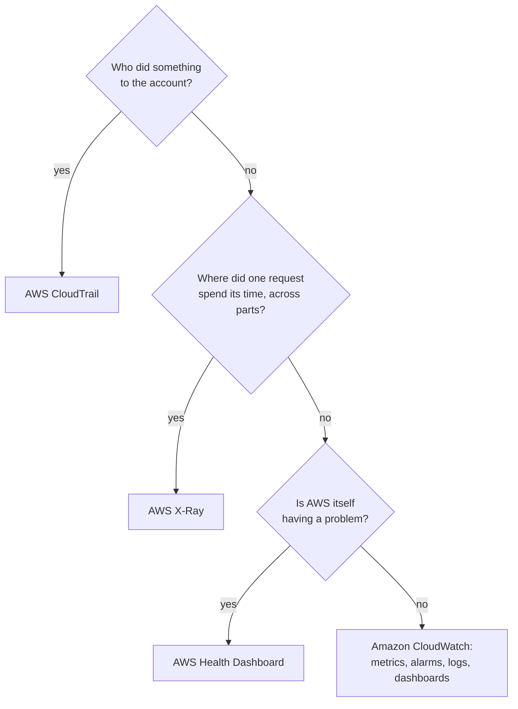

# CloudWatch tells you how the workload is doing, X-Ray shows where one request went, and CloudTrail records who changed what

The bakery's owner wants an email when orders fail. To build that, you need to know which AWS service watches what. Three services sound alike and answer different questions: **Amazon CloudWatch** measures how your resources and code are running, **AWS X-Ray** follows single requests through them, and **AWS CloudTrail** records actions taken on your account. By the end you can take any operations question and name the service that answers it.

**For:** an adult studying alone, possibly new to IT, who wants to understand AWS and use it safely. **Time:** about 25 minutes. Reading works on a phone.

**Before you start:** this lesson builds on [Lab 07](../06-running-applications/05-lab-07-a-lambda-function.md), where a Lambda function wrote logs to CloudWatch, and on the billing alarm you made on [primer page 05](https://github.com/AutomateTheCloud/atc-study-aws_account_guardrails/blob/main/primer/05-money-alarms.md). If you skipped them, the key terms below are enough to follow. The bakery's scenario for this module is in the [module brief](00-brief.md).

## Warm-up: what you remember

Answer from memory before you look anything up.

1. From lesson 07.02: VPC Flow Logs record information about traffic in your VPC. Do they block any of it?
2. From Lab 07: your function printed a line. Where did that line end up, and how long would AWS have kept it if you had changed nothing?
3. From Lab 01: after you created your first bucket, where did you find a record of who created it?

Feedback

1. **No.** Flow Logs record; security groups and network ACLs filter. This lesson's three services also record and report. Only an alarm's action changes anything.
2. **In a CloudWatch Logs log group** named after the function, `/aws/lambda/clf-lab07-box-count`. By default, log data never expires, which is why you set a retention period.
3. **In AWS CloudTrail's Event history**, which showed a `CreateBucket` event made by your IAM admin user. That record is one of the three services in this lesson.

## What you'll learn

By the end of this lesson, you can:

- explain what CloudWatch metrics, alarms and logs each do, and design an alarm for a stated need;
- say what X-Ray adds that metrics and logs don't, and what has changed in how AWS names and supports it;
- tell CloudWatch and X-Ray apart from CloudTrail;
- pick the service for an operations question (objective 08.03a).

Try these before you read on. Guess if you're unsure; the answers are in the lesson.

1. The owner asks two things: "Why was checkout slow at six last night?" and "Who changed the order function's settings?" Does one service answer both?
2. Your billing alarm from the primer shows **OK**. Does that prove you'll get an email when it fires?

## The big picture: three questions, three services

Each service watches the bakery from a different side. Start from the question.

![Three panels. Amazon CloudWatch answers "How is the workload doing right now, and is anything wrong?" with metrics, logs and alarms; example: the order function had 9 errors between 13:20 and 13:25 and the alarm emailed the owner. AWS X-Ray answers "Where did this one request spend its time, and where did it fail?" with traces and a trace map; example: order 1043 took 2.45 seconds, 1.94 of them waiting for the payment provider. AWS CloudTrail answers "Who changed what in the account, and when?" with one event per action; example: at 12:58 the nephew's IAM user changed the order function's settings.](../../images/08-03-three-questions.svg)

*Notice that the first two watch your workload from the inside: its numbers, its log lines, its requests. CloudTrail watches the account from the outside: who did what to it.*

**Long description.** Three stacked panels, one per service, each with its question, what it records and a bakery example. Amazon CloudWatch: "How is the workload doing right now, and is anything wrong?" It records metrics (numbers over time, such as errors per 5 minutes), logs (the lines your code and servers write) and alarms (which act when a metric crosses a line). Example: the order function had 9 errors between 13:20 and 13:25, and the alarm emailed the owner. AWS X-Ray: "Where did this one request spend its time, and where did it fail?" It records traces (one request's path through every part it touched, with timings) and a trace map (the parts that called each other). Example: order 1043 took 2.45 seconds, and 1.94 of them were spent waiting for the payment provider. AWS CloudTrail: "Who changed what in the account, and when?" It records events, one per action on the account by a person, a role or an AWS service, through the console, the CLI, an SDK or the API. Example: at 12:58 the nephew's IAM user changed the order function's settings.

## Key terms (skip if you know them)

- **Amazon CloudWatch:** AWS's monitoring service for your resources and applications: metrics, logs, alarms and dashboards.
- **Metric:** one measurement tracked over time, such as a function's errors or a server's CPU use. Each value is a **data point**.
- **Alarm:** a rule that watches one metric and acts when it crosses a **threshold**, a line you set.
- **Period** and **statistic:** an alarm judges a metric one **period** at a time, a stretch such as 1 or 5 minutes, and combines that period's data points with a **statistic**, such as `Sum` (add them up) or `Average`.
- **AWS X-Ray:** a service that records each traced request as a **trace**: every part the request touched, and how long each took.
- **AWS CloudTrail:** the service that records actions on your account. You met its Event history in Lab 01.

"Event" is a trap word in this module. In Module 06, an event *started* a Lambda function. In CloudTrail, an event is a *record* of one action taken on your account. In the next lesson, Amazon EventBridge routes events between parts of an application. Read which service is speaking.

## CloudWatch metrics show how each part is doing, as numbers over time

**Many AWS services send metrics to CloudWatch on their own, at no charge** ([Metrics concepts](https://docs.aws.amazon.com/AmazonCloudWatch/latest/monitoring/cloudwatch_concepts.html), checked 2026-10-24). You don't install or switch on anything for them. For the bakery:

- **The order function (Lambda)** reports `Invocations` (how many times it ran), `Errors` (runs that ended in an error), `Duration` (how long each run took) and `Throttles` (requests refused because no capacity was free) ([Types of metrics for Lambda](https://docs.aws.amazon.com/lambda/latest/dg/monitoring-metrics-types.html)).
- **The web server (EC2)** reports CPU use, network traffic and disk activity every 5 minutes. That free default is **basic monitoring**. **Detailed monitoring** sends the same metrics every minute, for a charge.
- **Your own code** can send **custom metrics**, such as `OrdersFailed` or `CakesSold`. These are charged.
- **The CloudWatch agent** is software you install on EC2 instances or on your own servers on premises. It collects measurements from inside the operating system, such as memory used, and log files ([CloudWatch agent](https://docs.aws.amazon.com/AmazonCloudWatch/latest/monitoring/Install-CloudWatch-Agent.html)). Its metrics are billed as custom metrics.

Two facts shape everything you build on metrics. **A metric lives in the Region where it was created.** And CloudWatch **keeps metric data for 15 months**, in less detail as it ages: one-minute data points for 15 days, five-minute ones for 63 days, then one-hour ones.

> **Your turn:** The owner's request is "email me when orders fail". Which existing metric would you watch, and from which service? Then name one thing it would miss.

Model answer

The `Errors` metric of the order function, which Lambda sends to CloudWatch with no setup. It misses failures that never raise an error, such as a payment the provider declined politely or an order the function never received. Code that spots those can send a custom metric, such as `OrdersFailed`.

## An alarm watches one metric and acts when its state changes

**A CloudWatch alarm compares a metric with a threshold, period by period, and acts when its state changes** ([Using Amazon CloudWatch alarms](https://docs.aws.amazon.com/AmazonCloudWatch/latest/monitoring/CloudWatch_Alarms.html), checked 2026-10-24). You choose:

- **the metric and statistic**, such as the `Sum` of `Errors`;
- **the period**, such as 5 minutes;
- **the threshold**, such as 3 or more errors, and how many periods must breach it before the alarm changes state;
- **the actions**, for example: send a message to an Amazon SNS topic (which emails its subscribers), stop, terminate, reboot or recover an EC2 instance, scale an Auto Scaling group, or open an item in AWS Systems Manager.

An alarm is always in one of three **alarm states**: **OK** (below the threshold), **ALARM** (beyond it) and **INSUFFICIENT_DATA** (not enough data to decide, for example just after you create it).

*Notice that four bad periods send one email. An alarm acts when its state changes, not on every period that breaches.*

**Long description.** A bar chart of made-up figures: errors in the bakery's order function per 5-minute period from 12:00 to 15:00, with a dashed threshold line at 3 errors. Most periods have 0 errors; single errors appear at 12:10, 12:35, 13:45 and 14:20, and 2 errors at 13:30. Four periods are at or above the threshold and highlighted: 13:10 (4), 13:15 (7), 13:20 (9, the peak) and 13:25 (6). Under the bars, the alarm's state: OK until 13:10, ALARM from 13:10 to 13:30, OK after. At 13:10, the change from OK to ALARM sends one email to the owner. At 13:30, the change from ALARM to OK can send an all-clear email, if one was set up.

Two details catch people out.

- **Actions run on a change of state.** Four breaching periods in a row produce one email, not four. The exception is an Auto Scaling action, which repeats every minute the alarm stays in its new state.
- **No data is not the same as no problem.** If nobody orders overnight, the function doesn't run, and a metric with no data points can leave the alarm in INSUFFICIENT_DATA. You choose the alarm's **missing data treatment**, which says how a period with no data counts; for an errors alarm, "missing means not breaching" is a common choice.

### "OK" means below the threshold, not "working"

You may think an alarm in the OK state proves you'll be told when something goes wrong. That's not right. OK means only that the metric is below the threshold. The email depends on the action: the SNS topic must exist, and the owner must have confirmed the subscription email. CloudWatch doesn't test or validate the actions you set. It's tempting because a green OK looks like a health check; it's a reading, not a test. You saw this on [primer page 05](https://github.com/AutomateTheCloud/atc-study-aws_account_guardrails/blob/main/primer/05-money-alarms.md), where only the confirmed subscription proved the email path.

> **Your turn:** Design the owner's alarm. Give the metric, statistic, period, threshold, what to do with missing data, and the action. Then say what changes when the bakery's setup is rebuilt in a second Region.

Model answer

`Errors` for the order function; statistic `Sum`; period 5 minutes; ALARM when one period has 3 or more errors (or 1, if any failure matters); missing data treated as not breaching, so quiet nights don't look like trouble; action: notify an SNS topic with the owner's email subscribed and confirmed. **In US East (Ohio)**, the second Region, metrics and alarms are Regional, so the copy needs its own alarm and topic there. That's a reason to put alarms in the same template as the rest of the setup. [Lab 11](06-lab-11-alarm-on-errors.md) builds a stricter version: a 1-minute period and a threshold of 1, because its owner wants to hear about every failure at once and the test function runs only when you run it. Three errors in 5 minutes suits a busy shop, where an odd failed order is normal and an email for each one would soon be ignored.

## CloudWatch Logs keeps what your code writes, and lets you search it

**CloudWatch Logs stores the lines your code, servers and AWS services write, in log groups**, as you saw in Lab 07. By default it keeps them forever; you set a retention period ([Working with log groups and log streams](https://docs.aws.amazon.com/AmazonCloudWatch/latest/logs/Working-with-log-groups-and-streams.html)). Logs tell you *what happened* in words; metrics tell you *how much* in numbers. Three features connect the two:

- **CloudWatch Logs Insights** lets you search and summarize log data with queries, such as "every line containing `KeyError` in the last hour".
- **A metric filter** turns matching log lines into a metric. If the order code writes `PAYMENT_DECLINED` when a card is refused, a metric filter can count those lines, and an alarm can watch the count.
- **The CloudWatch agent** sends log files from EC2 instances and servers on premises into CloudWatch Logs.

A **dashboard** puts chosen graphs, numbers and alarms on one CloudWatch screen, so the owner can see the shop's health at a glance.

> **Check:** The order code logs `PAYMENT_DECLINED` each time a card is refused, but no metric counts declines. The owner wants an email after 10 declines in an hour. What do you add?
>
> A. A CloudTrail trail\
> B. A metric filter on the log group, then an alarm on the new metric\
> C. Detailed monitoring on the web server\
> D. A dashboard

Feedback

**B is right.** The metric filter turns the log lines into a count; the alarm watches the count and sends the email.

- **A is wrong.** CloudTrail records actions on the account, not lines your code writes.
- **C is wrong.** Detailed monitoring sends EC2's own metrics more often; it knows nothing about card declines.
- **D is wrong.** A dashboard shows data to someone looking at it; it sends nothing.

## X-Ray follows one request through every part it touches

**Metrics say the order function got slow; a trace shows which part of one request was slow.** AWS X-Ray collects data about the requests your application serves, including the calls it makes to databases, other services and outside web APIs ([What is AWS X-Ray?](https://docs.aws.amazon.com/xray/latest/devguide/aws-xray.html), checked 2026-10-24). The pieces ([AWS X-Ray concepts](https://docs.aws.amazon.com/xray/latest/devguide/xray-concepts.html)):

- **A trace** collects everything one request did, as segments with start and end times. It's kept for 30 days.
- **A trace map** draws the parts that call each other, from the client to the front end to the services behind it, so slow or failing links stand out.
- **Sampling** means X-Ray traces some requests, not all, to keep costs down. X-Ray's default sampling rule records the first request each second and 5% of the rest.

Your code or an integrated AWS service, such as Lambda, must send the trace data; this is called **instrumenting** the application.

*Notice where the time goes. The database calls are quick; the order spends almost two seconds waiting for the payment provider.*

**Long description.** A timeline of one traced request, order 1043, on an axis from 0 to 2.5 seconds, with made-up timings. Five bars, one per part: the web server on EC2 handling POST /order, 0 to 2,450 ms; the order function in Lambda, 90 to 2,400 ms; inside it, reading the cake's price from RDS, 140 to 200 ms (60 ms); charging the card at the payment provider, 230 to 2,170 ms (1,940 ms, highlighted); saving the order to RDS, 2,200 to 2,250 ms (50 ms).

> **Dated (checked 2026-10-24):** AWS now presents X-Ray as part of CloudWatch. The [X-Ray product page](https://aws.amazon.com/xray/) now opens CloudWatch's Application Observability (APM) page, and traces are viewed on the **Traces** and **Trace Map** pages of the CloudWatch console. The X-Ray SDKs and daemon (the programs that sent trace data) entered maintenance mode on 2026-02-25: security fixes only. AWS now recommends OpenTelemetry, an industry-standard way to collect traces, metrics and logs, with the CloudWatch agent or an OpenTelemetry collector ([Migrating to OpenTelemetry](https://docs.aws.amazon.com/xray/latest/devguide/xray-sdk-migration.html)). The X-Ray service is still documented, and the exam guide still lists it under task [3.8](https://docs.aws.amazon.com/aws-certification/latest/cloud-practitioner-02/cloud-practitioner-02-domain3.html#cloud-practitioner-02-task3.8): **"request tracing" means X-Ray.**

> **Your turn:** Customers say checkout is slow. CloudWatch shows the order function's average `Duration` doubled since Tuesday. What can a trace tell you that the metric can't? Answer in two sentences.

Model answer

The metric says the function as a whole got slower; a trace splits one slow request into its calls, showing whether the time went on the database, the payment provider or the code itself. That turns "it's slow" into "the payment call takes two seconds", which tells you whom to call or what to fix.

## CloudTrail records actions on your account, not how your application runs

**CloudTrail records each action taken on your account by a person, a role or an AWS service, through the console, the CLI, the SDKs or the API, as an event** ([What is AWS CloudTrail?](https://docs.aws.amazon.com/awscloudtrail/latest/userguide/cloudtrail-user-guide.html), checked 2026-10-24). Each event says who acted, what they did, to which resource, when and from where.

- **Event history** is on in every account from the start. It keeps 90 days of **management events**, actions that create, change or delete resources and settings, for each Region, and costs nothing to view.
- **A trail** delivers events to an S3 bucket you choose, so you can keep them longer, and optionally to CloudWatch Logs and EventBridge. One trail's copy of management events is free; you pay for the S3 storage. Actions on data, such as reading objects in a bucket, are **data events**: you turn them on and pay for them.
- **CloudTrail Lake**, a place to store and query events, closed to new customers on 2026-05-31; AWS points to CloudWatch instead ([CloudTrail Lake availability change](https://docs.aws.amazon.com/awscloudtrail/latest/userguide/cloudtrail-lake-service-availability-change.html)). CloudTrail itself is fully supported.

### "CloudTrail monitors my application" is wrong

You may read that CloudTrail and CloudWatch both "monitor", so either will do. That's not right. CloudTrail records actions *on your account*, such as someone changing the order function's memory setting. It doesn't see a customer's order fail inside the function, or the server's CPU at 6 p.m.; CloudWatch does. The pair is tempting because both names start with "Cloud", both keep records, and they work together: a trail can send events to CloudWatch Logs, where an alarm can watch for, say, a sign-in by the root user. The question decides the service: *who did it* is CloudTrail; *how is it running* is CloudWatch.

Module 09, "Protecting, governing and proving compliance", uses CloudTrail as evidence for an auditor and adds AWS Config, which records how each resource was set up over time.

> **Check:** Answer the first prequestion. "Why was checkout slow at six last night?" and "Who changed the order function's settings?" Which pair is right?
>
> A. CloudTrail, then CloudWatch\
> B. CloudWatch metrics and X-Ray traces, then CloudTrail\
> C. CloudWatch for both\
> D. X-Ray for both

Feedback

**B is right.** Slowness is about how the workload ran: metrics show when, and traces show where. A settings change is an action on the account, so CloudTrail has it.

- **A is wrong.** It swaps them.
- **C is wrong.** CloudWatch doesn't record who changed a setting; CloudTrail does.
- **D is wrong.** X-Ray traces requests; it doesn't record account changes.

## Pick the service by the question it must answer

| | Amazon CloudWatch | AWS X-Ray | AWS CloudTrail |
|---|---|---|---|
| **Question** | How is it running? Is anything wrong? | Where did this request spend its time? | Who did what to the account, and when? |
| **Records** | Metrics, logs; alarms act on them | Traces of sampled requests | Events, one per action |
| **Comes from** | AWS services automatically; your code; the agent | Instrumented code and integrated services | Every account, from the start |
| **Bakery example** | Errors per 5 minutes; an email at 3 | Order 1043's slow payment call | The nephew's change at 12:58 |

From the CloudWatch, X-Ray and CloudTrail user guides, checked 2026-10-24.

**What's the same:** all three record what happened and change nothing themselves, and AWS runs all three for you. **What differs:** the question, the kind of record and how long it lasts. **The principle:** start from the question's verb. *Measure, alert, search logs:* CloudWatch. *Trace a request:* X-Ray. *Find who did it:* CloudTrail.

*Notice that CloudWatch is the answer left when the question isn't about who, one request, or AWS itself.*

**Long description.** A decision flowchart with three questions in order. First: did someone do something to the account? If yes, AWS CloudTrail. If no, second: where did one request spend its time across several parts? If yes, AWS X-Ray. If no, third: is AWS itself having a problem? If yes, the AWS Health Dashboard, which you saw in Lab 02. If no, Amazon CloudWatch: metrics, alarms, logs and dashboards.

Each record also lasts a different time unless you act:

*Notice the two extremes. Account activity disappears from Event history after 90 days unless a trail keeps it; logs never disappear unless you set retention.*

**Long description.** Horizontal bars on an axis from 0 to 500 days. AWS X-Ray traces: 30 days. CloudWatch alarm history: 30 days. CloudTrail Event history: 90 days of management events, per Region. CloudWatch metrics: 455 days (about 15 months), with detail coarsening after 15 and 63 days. CloudWatch Logs, highlighted, an arrow running off the chart: kept until you set retention, because the default never expires. To keep account activity longer than 90 days, you create a CloudTrail trail that delivers events to an S3 bucket you keep.

## Worked example: five questions from the bakery's week

Here is how an expert sorts the owner's questions. The habit: underline the verb, then ask whether it's about the account, one request, AWS itself, or how things run.

| Question | The expert's thinking | Service |
|---|---|---|
| "Tell me the moment orders start failing." | Alert on a number crossing a line | CloudWatch alarm on `Errors`, action to an SNS topic |
| "Who deleted last month's photo bucket?" | Who did something to the account; under 90 days ago | CloudTrail Event history |
| "Order 1043 took ages. Which part was slow?" | One request, several parts | X-Ray trace |
| "Show me every error line from Sunday's function runs." | Search what the code wrote | CloudWatch Logs Insights on the function's log group |
| "Is it us, or is AWS having trouble in N. Virginia?" | AWS's side, not ours | AWS Health Dashboard |

Two traps the expert avoids. The bucket question sounds like "logs", but CloudWatch Logs only holds what something wrote to it; deletions are account actions, so CloudTrail has them. And a year from now, Event history couldn't answer it at all: only a trail, set up beforehand, keeps events past 90 days.

## Your side of the line

AWS runs CloudWatch, X-Ray and CloudTrail. The choices are yours: what to measure and alarm on, who gets the messages, how long logs live, whether a trail keeps account history, and who may read all of it. Logs can hold customer details, so limit access to them with IAM, as with any data. An alarm nobody confirmed, or a trail nobody created, is a customer gap, not an AWS one.

## What you pay for

> **What you pay for (as of 2026-10-24):** CloudWatch's free tier each month includes basic monitoring metrics from AWS services, 10 custom or detailed-monitoring metrics, 10 alarm metrics, 5 GB of log data and 3 custom dashboards. Beyond that, in US East (N. Virginia): $0.10 per alarm metric a month, $0.30 per custom metric a month (first 10,000), and $0.50 per GB of log data ingested. X-Ray: the first 100,000 traces recorded each month are free, then $5.00 per million. CloudTrail: viewing Event history is free; one trail's copy of management events is free, plus the S3 storage. On the Free plan, charges come out of your credits. Check [Amazon CloudWatch pricing](https://aws.amazon.com/cloudwatch/pricing/) and [AWS CloudTrail pricing](https://aws.amazon.com/cloudtrail/pricing/).

## In real work: measure, alert on what matters, trace, keep the record

Teams agree on a few numbers that show whether the business works (orders placed, orders failed, checkout time), alarm on those, and send each alarm to someone who knows what to do. They trace requests in systems with many parts, and keep a trail of account activity for as long as their rules require. The Well-Architected Framework's operational excellence pillar names these habits:

- The design principle "[Implement observability for actionable insights](https://docs.aws.amazon.com/wellarchitected/latest/framework/oe-design-principles.html)": measure what tells you whether the workload meets its goals, and act on it.
- [OPS08-BP01 Analyze workload metrics](https://docs.aws.amazon.com/wellarchitected/latest/operational-excellence-pillar/ops_workload_observability_analyze_workload_metrics.html), [OPS08-BP02 Analyze workload logs](https://docs.aws.amazon.com/wellarchitected/latest/operational-excellence-pillar/ops_workload_observability_analyze_workload_logs.html) and [OPS08-BP03 Analyze workload traces](https://docs.aws.amazon.com/wellarchitected/latest/operational-excellence-pillar/ops_workload_observability_analyze_workload_traces.html): this lesson's three kinds of record.
- [OPS08-BP04 Create actionable alerts](https://docs.aws.amazon.com/wellarchitected/latest/operational-excellence-pillar/ops_workload_observability_create_alerts.html): an alarm someone can act on, like the owner's.
- In the security pillar, the design principle "[Maintain traceability](https://docs.aws.amazon.com/wellarchitected/latest/framework/sec-design.html)": CloudTrail is how you know who did what.

## Summary

- **CloudWatch metrics** are numbers over time. AWS services send many for free; your code and the CloudWatch agent can add more. Metrics are Regional and kept 15 months.
- **A CloudWatch alarm** watches one metric against a threshold and acts when its state changes (OK, ALARM, INSUFFICIENT_DATA), for example by notifying an SNS topic. OK means below the threshold, not "the email works".
- **CloudWatch Logs** keeps what your code writes, forever by default; Logs Insights searches it, and a metric filter turns lines into a metric you can alarm on.
- **X-Ray** traces single requests across every part they touch, to find the slow or failing part. AWS now presents it as part of CloudWatch (dated above), and "request tracing" still means X-Ray on the exam.
- **CloudTrail** records actions on the account: who, what, when. Event history keeps 90 days of management events; a trail keeps more.
- **Pick by the question:** how it runs, CloudWatch; one request's path, X-Ray; who did it, CloudTrail.

**For the bakery:** an alarm on the order function's `Errors` notifies an SNS topic that emails the owner, and the copy in US East (Ohio) gets its own. The next lesson, [Connecting parts, shipping software](04-connecting-parts-shipping-software.md), looks at SNS itself and its neighbors.

## Practice

1. **Which service records that the nephew's IAM user deleted a security group rule yesterday?**

   A. Amazon CloudWatch metrics\
   B. AWS X-Ray\
   C. AWS CloudTrail\
   D. CloudWatch Logs Insights

   

Feedback

   **C is right.** Deleting a rule is an action on the account, a management event in CloudTrail.

   - **A is wrong.** Metrics are numbers about how resources run, not who changed them.
   - **B is wrong.** X-Ray traces application requests.
   - **D is wrong.** Logs Insights searches log groups; it finds the deletion only if a trail delivers CloudTrail events into CloudWatch Logs, and CloudTrail is still the source.

   

2. **An alarm on `Errors` crossed its threshold at 09:00 and stayed in ALARM until 09:40. The action notifies an SNS topic. How many "in alarm" emails does the subscriber get?**

   

Feedback

   **One.** Alarm actions run when the state changes, not on every breaching period. Only Auto Scaling actions repeat while the alarm stays in ALARM.

   

3. **A team's web application calls four internal services, and a few requests take ten seconds. Which service shows, for one slow request, how long each call took?**

   A. AWS X-Ray\
   B. AWS CloudTrail\
   C. Amazon CloudWatch detailed monitoring\
   D. AWS Health Dashboard

   

Feedback

   **A is right.** A trace breaks one request into its calls with their timings.

   - **B is wrong.** CloudTrail records actions on the account, not request timings.
   - **C is wrong.** Detailed monitoring sends EC2 metrics every minute; it can't follow a single request.
   - **D is wrong.** The Health Dashboard reports problems on AWS's side.

   

4. **Answer the second prequestion. Your billing alarm shows OK. In one or two sentences: does that prove you'll be emailed when it fires, and what does?**

   

Feedback

   **No.** OK only means the metric is below the threshold. The email depends on the alarm's action notifying an SNS topic whose subscription you confirmed; CloudWatch doesn't test actions for you.

   

5. **True or false: to find who deleted a bucket eight months ago, open CloudTrail Event history. Explain.**

   

Feedback

   **False, unless a trail was already running.** Event history keeps only 90 days. A trail, created before the deletion, delivers events to an S3 bucket where they stay as long as you keep them.

   

6. **(From lesson 06.03.) Lambda bills for each request and for GB-seconds. Which CloudWatch metrics for the function would you watch to see why last month's bill rose?**

   

Feedback

   **`Invocations` and `Duration`.** Invocations equals the number of requests billed, and Duration, with the memory size, drives GB-seconds. A rise in either explains a rise in the bill.

   

7. **(From lesson 04.04.) Lab 07's function had an execution role allowing it to write logs and nothing else. Which principle is that?**

   

Feedback

   **Least privilege:** each identity gets only the permissions its job needs. The function needs to write logs, so that's all it may do.

   

**Next:** [Connecting parts, shipping software](04-connecting-parts-shipping-software.md). To build the owner's alarm yourself, do [Lab 11](06-lab-11-alarm-on-errors.md).

## Where to check the current details

- [What is Amazon CloudWatch?](https://docs.aws.amazon.com/AmazonCloudWatch/latest/monitoring/WhatIsCloudWatch.html), [Metrics concepts](https://docs.aws.amazon.com/AmazonCloudWatch/latest/monitoring/cloudwatch_concepts.html) and [Using Amazon CloudWatch alarms](https://docs.aws.amazon.com/AmazonCloudWatch/latest/monitoring/CloudWatch_Alarms.html) (checked 2026-10-24)
- [The CloudWatch agent](https://docs.aws.amazon.com/AmazonCloudWatch/latest/monitoring/Install-CloudWatch-Agent.html) and [Working with log groups and log streams](https://docs.aws.amazon.com/AmazonCloudWatch/latest/logs/Working-with-log-groups-and-streams.html) (checked 2026-10-24)
- [Types of metrics for Lambda](https://docs.aws.amazon.com/lambda/latest/dg/monitoring-metrics-types.html) (checked 2026-10-24)
- [What is AWS X-Ray?](https://docs.aws.amazon.com/xray/latest/devguide/aws-xray.html), [AWS X-Ray concepts](https://docs.aws.amazon.com/xray/latest/devguide/xray-concepts.html) and [Migrating from X-Ray instrumentation to OpenTelemetry](https://docs.aws.amazon.com/xray/latest/devguide/xray-sdk-migration.html) (checked 2026-10-24)
- [What is AWS CloudTrail?](https://docs.aws.amazon.com/awscloudtrail/latest/userguide/cloudtrail-user-guide.html) and [CloudTrail Lake availability change](https://docs.aws.amazon.com/awscloudtrail/latest/userguide/cloudtrail-lake-service-availability-change.html) (checked 2026-10-24)
- [Amazon CloudWatch pricing](https://aws.amazon.com/cloudwatch/pricing/) and [AWS CloudTrail pricing](https://aws.amazon.com/cloudtrail/pricing/) (checked 2026-10-24)
- [AWS Certified Cloud Practitioner (CLF-C02) exam guide](https://docs.aws.amazon.com/aws-certification/latest/cloud-practitioner-02/cloud-practitioner-02.html), task [2.2](https://docs.aws.amazon.com/aws-certification/latest/cloud-practitioner-02/cloud-practitioner-02-domain2.html#cloud-practitioner-02-task2.2) and task [3.8](https://docs.aws.amazon.com/aws-certification/latest/cloud-practitioner-02/cloud-practitioner-02-domain3.html#cloud-practitioner-02-task3.8) (checked 2026-10-24)

---

"Watching workloads" by Automate the Cloud Inc., licensed under CC BY-NC 4.0 with the Additional Permission for Internal Training from Automate the Cloud Inc.
License: https://creativecommons.org/licenses/by-nc/4.0/
Permission: https://automatethe.cloud/licenses/atc-internal-training-permission.txt
