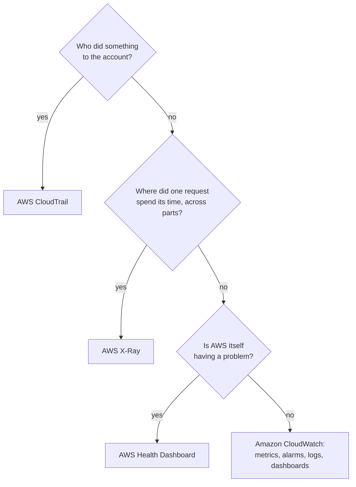

# CloudWatch tells you how the workload is doing, X-Ray shows where one request went, and CloudTrail records who changed what

Three services sound alike and answer different questions. **Amazon CloudWatch** measures how your resources and code are running and alerts you; **AWS X-Ray** follows single requests through them; **AWS CloudTrail** records actions taken on your account.

**For:** an adult studying alone, possibly new to IT, who wants to understand AWS and use it safely. **Time:** about 15 minutes. Reading works on a phone.

**Before you start:** [Lab 01](../02-why-the-cloud/06-lab-01-first-resource.md), where you found your bucket's creation in CloudTrail, and the billing alarm on [primer page 05](https://github.com/AutomateTheCloud/atc-study-aws_account_guardrails/blob/main/primer/05-money-alarms.md).

## Warm-up: what you remember

1. From Lab 01: after you created your first bucket, where did you find a record of who created it?
2. From Module 07: VPC Flow Logs record traffic in your VPC. Do they block any of it?

Feedback

1. **In AWS CloudTrail's Event history,** which showed a `CreateBucket` event made by your IAM admin user.
2. **No.** Flow Logs record; security groups and network ACLs filter. This lesson's three services also record and report; only an alarm's action changes anything.

## What you'll learn

By the end of this lesson, you can pick the service for an operations question: CloudWatch, X-Ray or CloudTrail (objective 08.03a).

Try this before you read on, and guess if you're unsure: the bakery's owner asks, "Why was checkout slow at six last night?" and "Who changed the order function's settings?" Does one service answer both?

## The big picture: three questions, three services

*Notice that the first two watch your workload from the inside: its numbers, its log lines, its requests. CloudTrail watches the account from the outside: who did what to it.*

**Long description.** Three panels. Amazon CloudWatch: "How is the workload doing right now, and is anything wrong?" It records metrics, logs and alarms; example: the order function had 9 errors between 13:20 and 13:25, and the alarm emailed the owner. AWS X-Ray: "Where did this one request spend its time, and where did it fail?" It records traces and a trace map; example: order 1043 took 2.45 seconds, 1.94 of them waiting for the payment provider. AWS CloudTrail: "Who changed what in the account, and when?" It records one event per action on the account; example: at 12:58 the nephew's IAM user changed the order function's settings.

## CloudWatch measures, alerts and keeps your logs

A **metric** is one measurement tracked over time, such as a function's errors or a server's CPU use. **Many AWS services send metrics to CloudWatch on their own, at no charge** ([Metrics concepts](https://docs.aws.amazon.com/AmazonCloudWatch/latest/monitoring/cloudwatch_concepts.html), checked 2026-10-24): the bakery's order function reports how often it ran, how many runs ended in an error and how long they took. The **CloudWatch agent**, software you install on EC2 instances or your own servers, adds measurements from inside the operating system, such as memory use.

An **alarm** watches one metric and acts when it crosses a **threshold** you set, such as "3 or more errors in 5 minutes" ([Using Amazon CloudWatch alarms](https://docs.aws.amazon.com/AmazonCloudWatch/latest/monitoring/CloudWatch_Alarms.html), checked 2026-10-24). It's always in one of three **alarm states**: OK, ALARM or INSUFFICIENT_DATA. When its state changes, it can notify an Amazon SNS topic, which emails the people subscribed to it (lesson 08.04), act on an EC2 instance, or scale an Auto Scaling group. That's the owner's "email me when orders fail": an alarm on the order function's errors, notifying a topic she subscribed to.

A **dashboard** puts chosen graphs and alarms on one screen.

### CloudWatch Logs keeps what your code writes, and lets you search it

CloudWatch Logs stores the lines your code, servers and AWS services write, in log groups. By default it keeps them forever, until you set a retention period ([Working with log groups and log streams](https://docs.aws.amazon.com/AmazonCloudWatch/latest/logs/Working-with-log-groups-and-streams.html)). **CloudWatch Logs Insights** searches and summarizes them, such as "every line containing `KeyError` in the last hour".

## X-Ray follows one request through every part it touches

**Metrics say the order function got slow; a trace shows which part of one request was slow.** AWS X-Ray collects data about the requests your application serves, including its calls to databases, other services and outside web APIs ([What is AWS X-Ray?](https://docs.aws.amazon.com/xray/latest/devguide/aws-xray.html), checked 2026-10-24). A **trace** records everything one request did, part by part, with timings, and a trace map draws the parts that call each other, so slow or failing links stand out. Your code or an integrated service such as Lambda must send the trace data.

*Notice where the time goes. The database calls are quick; the order spends almost two seconds waiting for the payment provider.*

**Long description.** One traced request, order 1043, with made-up timings: the web server on EC2, 0 to 2,450 ms; the order function in Lambda, 90 to 2,400 ms; inside it, reading the price from RDS, 60 ms; charging the card at the payment provider, 1,940 ms, highlighted; saving the order to RDS, 50 ms.

> **Dated (checked 2026-10-24):** AWS now presents X-Ray as part of CloudWatch: traces appear in the CloudWatch console ([X-Ray product page](https://aws.amazon.com/xray/)). The X-Ray SDKs entered maintenance mode on 2026-02-25, and AWS now recommends OpenTelemetry ([Migrating to OpenTelemetry](https://docs.aws.amazon.com/xray/latest/devguide/xray-sdk-migration.html)). The exam guide still lists X-Ray under task [3.8](https://docs.aws.amazon.com/aws-certification/latest/cloud-practitioner-02/cloud-practitioner-02-domain3.html#cloud-practitioner-02-task3.8): **"request tracing" means X-Ray.**

## CloudTrail records actions on your account, not how your application runs

**CloudTrail records each action taken on your account, by a person, a role or an AWS service, through the console, the CLI, the SDKs or the API, as an event** with who acted, what they did, to which resource, when and from where ([What is AWS CloudTrail?](https://docs.aws.amazon.com/awscloudtrail/latest/userguide/cloudtrail-user-guide.html), checked 2026-10-24).

- **Event history** is on in every account from the start and free to view. It keeps 90 days of **management events** in each Region: actions that create, change or delete resources and settings.
- **A trail** delivers events to an S3 bucket you choose, so you can keep them longer. Reads and writes of the data inside a resource, such as objects in a bucket, are **data events**, which a trail records only if you turn them on, for a charge.

CloudTrail and CloudWatch both "monitor", which is why they're confused. CloudTrail sees someone change the order function's memory setting; it doesn't see a customer's order fail inside the function, or the server's CPU at 6 p.m. CloudWatch does. Module 09 uses CloudTrail as evidence for an auditor.

## Pick the service by the question it must answer

Start from the question's verb. *Measure, alert, search logs:* CloudWatch. *Trace a request:* X-Ray. *Find who did it:* CloudTrail.

*Notice that CloudWatch is the answer left when the question isn't about who, one request, or AWS itself.*

**Long description.** Three questions in order. Did someone do something to the account? CloudTrail. Where did one request spend its time across several parts? X-Ray. Is AWS itself having a problem? The AWS Health Dashboard, which you saw in Lab 02. Otherwise, CloudWatch: metrics, alarms, logs and dashboards.

> **Your turn:** Name the service for each of the owner's questions. (a) "Tell me the moment orders start failing." (b) "Who deleted last month's photo bucket?" (c) "Order 1043 took ages. Which part was slow?" (d) "Show me every error line from Sunday's function runs."

Model answer

(a) **A CloudWatch alarm** on the function's errors, notifying an SNS topic. (b) **CloudTrail Event history:** a deletion is an action on the account, and it was under 90 days ago. (c) **X-Ray:** one request, several parts. (d) **CloudWatch Logs Insights** on the function's log group. That also answers the prequestion: slowness is CloudWatch and X-Ray; "who changed" is CloudTrail.

## Summary

- **CloudWatch metrics** are numbers over time; AWS services send many for free, and your code and the CloudWatch agent can add more.
- **A CloudWatch alarm** acts when a metric crosses a threshold, for example by notifying an SNS topic that emails the owner. **CloudWatch Logs** keeps what your code writes, forever by default, and Logs Insights searches it.
- **X-Ray** traces single requests across every part they touch, to find the slow or failing part. AWS now presents it inside CloudWatch, but "request tracing" still means X-Ray on the exam.
- **CloudTrail** records actions on the account: who, what, when. Event history keeps 90 days of management events; a trail keeps more.
- **Pick by the question:** how it runs, CloudWatch; one request's path, X-Ray; who did it, CloudTrail.

## Practice

1. **Which service records that an IAM user deleted a security group rule yesterday?**

   A. Amazon CloudWatch metrics\
   B. AWS X-Ray\
   C. AWS CloudTrail\
   D. CloudWatch dashboards

   

Feedback

   **C is right.** Deleting a rule is an action on the account, recorded as a management event.

   - **A is wrong.** Metrics are numbers about how resources run, not who changed them.
   - **B is wrong.** X-Ray traces application requests.
   - **D is wrong.** A dashboard shows metrics and alarms; it doesn't record account actions.

   

2. **A team's web application calls four internal services, and a few requests take ten seconds. Which service shows, for one slow request, how long each call took?**

   A. AWS X-Ray\
   B. AWS CloudTrail\
   C. Amazon CloudWatch alarms\
   D. AWS Health Dashboard

   

Feedback

   **A is right.** A trace breaks one request into its calls, with their timings.

   - **B is wrong.** CloudTrail records actions on the account, not request timings.
   - **C is wrong.** An alarm can say responses got slow, not which part of one request took the time.
   - **D is wrong.** The Health Dashboard reports problems on AWS's side.

   

3. **A company wants an email when its EC2 instances' CPU use stays above 80%. Which combination fits?**

   A. A CloudTrail trail and Amazon SES\
   B. A CloudWatch alarm that notifies an Amazon SNS topic\
   C. AWS X-Ray and Amazon SQS\
   D. A CloudWatch dashboard

   

Feedback

   **B is right.** The alarm watches the CPU metric against the threshold, and the SNS topic emails its subscribers.

   - **A is wrong.** CloudTrail records account actions, not CPU use.
   - **C is wrong.** X-Ray traces requests, and a queue doesn't email anyone.
   - **D is wrong.** A dashboard shows the data to someone looking; it sends nothing.

   

**Next:** [Connecting parts, shipping software](04-connecting-parts-shipping-software.md). To build the owner's alarm yourself, do the [optional Lab 11](06-lab-11-alarm-on-errors.md).

## Where to check the current details

- [What is Amazon CloudWatch?](https://docs.aws.amazon.com/AmazonCloudWatch/latest/monitoring/WhatIsCloudWatch.html) (checked 2026-10-24)
- [What is AWS X-Ray?](https://docs.aws.amazon.com/xray/latest/devguide/aws-xray.html) (checked 2026-10-24)
- [What is AWS CloudTrail?](https://docs.aws.amazon.com/awscloudtrail/latest/userguide/cloudtrail-user-guide.html) (checked 2026-10-24)

---

"Watching workloads" by Automate the Cloud Inc., licensed under CC BY-NC 4.0 with the Additional Permission for Internal Training from Automate the Cloud Inc.
License: https://creativecommons.org/licenses/by-nc/4.0/
Permission: https://automatethe.cloud/licenses/atc-internal-training-permission.txt
