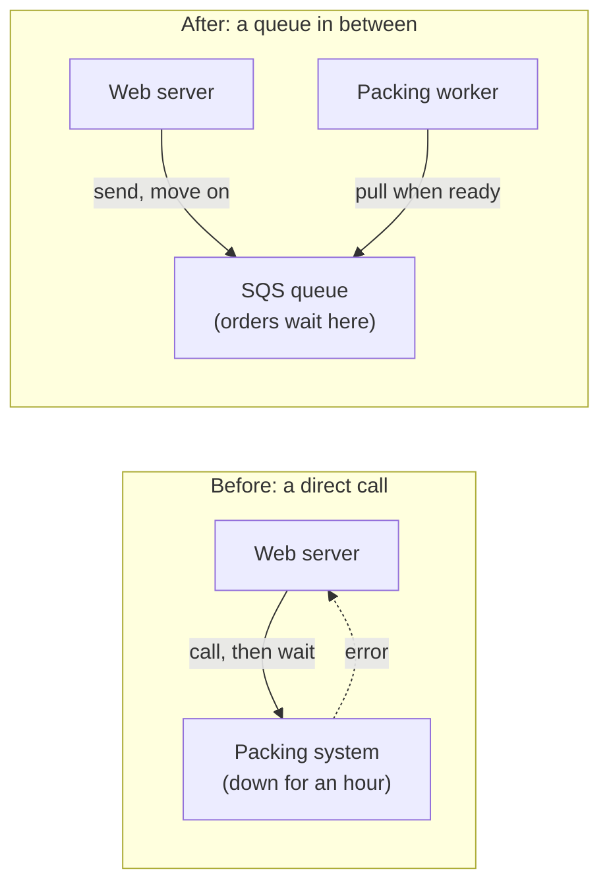
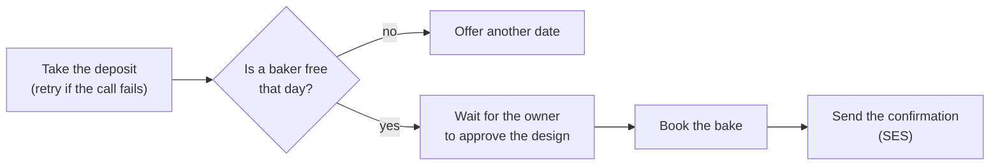
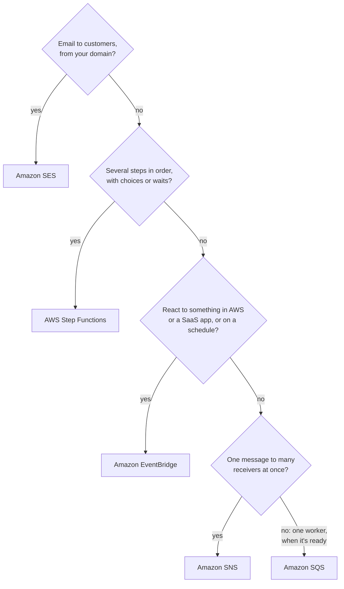

# Pick the messenger by the shape of the message, and let a pipeline build and release your code

The bakery's parts need to talk: the website to the packing worker, an alarm to the owner, the shop to its customers. AWS offers a different service for each shape of conversation, and choosing by shape is a skill the exam tests directly. This lesson also covers how code gets from a developer's laptop to the live site: a build service and a release pipeline. By the end you can match a need to SQS, SNS, EventBridge, Step Functions or SES, and name the tool that builds code and the one that releases it.

**For:** an adult studying alone, possibly new to IT, who wants to understand AWS and use it safely. **Time:** about 25 minutes. Reading works on a phone.

**Before you start:** this lesson builds on [Watching workloads](03-watching-workloads.md) (an alarm notifies an SNS topic) and [Containers and serverless](../06-running-applications/03-containers-and-serverless.md) (events trigger Lambda functions). If you skipped them, the key terms below are enough to follow. The bakery's scenario is in the [module brief](00-brief.md).

## Warm-up: what you remember

Answer from memory before you look anything up.

1. From lesson 07.03: the delivery partner's app asks Amazon API Gateway for order 1234 and waits for the answer. If the order function behind it has crashed, what does the app get?
2. From lesson 06.03: what starts a Lambda function?
3. From lesson 04.04: a bucket policy is attached to the bucket, not to a user. What kind of policy is that?

Feedback

1. **An error, at once.** The app waited for an answer that couldn't come. This lesson shows how to let work wait instead of fail.
2. **An event, through a trigger,** such as a new photo saved to S3. Today's services carry events and messages between parts.
3. **A resource-based policy.** SQS queues and SNS topics have them too: they say who may send to the queue or publish to the topic.

## What you'll learn

By the end of this lesson, you can:

- explain why parts that talk through a queue, a topic or an event bus keep working when one part fails;
- choose SQS, SNS, EventBridge, Step Functions or SES by the shape of the message (objective 08.04a);
- tell an email sent by SNS from an email sent by SES;
- name the service that builds and tests code and the one that runs the release, and spot developer tools that are closed or out of the exam's scope (objective 08.04a).

Try these before you read on. Guess if you're unsure; the answers are in the lesson.

1. The owner wants an email when orders fail; each customer wants an email confirming the order. Is that one service or two?
2. Which one compiles code and runs its tests: AWS CodeBuild or AWS CodePipeline?

## The big picture: five shapes of message

Before picking a service, ask three things about the message: who sends it, who receives it, and who waits.

![Five panels. Amazon SQS, a queue: work waits until a worker pulls it; the web server sends, a packing worker pulls. Amazon SNS, a topic: one message pushed to every subscriber; the order function publishes and the owner's email, a kitchen queue and an invoice function all receive it. Amazon EventBridge, an event bus: events from AWS services, your apps and SaaS partners routed by rules to targets. AWS Step Functions, a workflow: take deposit, check baker, owner approves, book the bake, in order. Amazon SES: the order website sends email from the bakery's domain to customers' inboxes.](../../images/08-04-message-shapes.svg)

*Notice who waits in each panel. In a queue, the message waits for the worker. In a topic, nobody waits: the message is pushed at once. In a workflow, Step Functions waits and remembers which step comes next.*

**Long description.** Five panels, one per service. Amazon SQS, a queue: work waits until a worker pulls it. The web server sends orders into an SQS queue, and a packing worker pulls them; orders wait even if the worker is down for an hour. Amazon SNS, a topic: one message pushed to every subscriber. The order function publishes to a topic, which pushes the message to the owner's email, a kitchen queue and an invoice function at once. Amazon EventBridge, an event bus: AWS services, your apps and SaaS partners send events to a bus whose rules send each matching event to targets; for example, "when an EC2 instance stops, tell the owner", or a sales report at 23:00. AWS Step Functions, a workflow: four steps in order (take the deposit, check a baker is free, the owner approves, book the bake), with retries and waits. Amazon SES: the order website sends email from the bakery's own domain to customers' inboxes, such as each order confirmation.

## Key terms (skip if you know them)

- **Synchronous:** the caller waits for the answer, as a browser waits for a page. **Asynchronous:** the caller hands the work over and moves on; the answer, if any, comes later.
- **Message:** a small piece of data one part sends another, such as "order 1043: 14 cupcakes". The sender is the **producer**; the receiver is the **consumer**.
- **Decoupling:** putting something between two parts, such as a queue, so each can fail, slow down or grow without breaking the other. Parts joined this way are **loosely coupled**.
- **Continuous integration (CI):** every code change is built and tested automatically, soon after it's made. **Continuous delivery (CD):** every change that passes is also prepared for release automatically, and a person, a test or a rule decides when it goes live ([Continuous delivery and continuous integration](https://docs.aws.amazon.com/codepipeline/latest/userguide/concepts-continuous-delivery-integration.html)).

## A direct call fails when the other side fails; a message in between waits

**When one part calls another directly and waits, the two fail together.** Today the bakery's web server sends each order straight to the packing system. If packing is down for an hour, every order in that hour fails.

*Notice that in "after", nothing points from the queue back to the web server. The website doesn't know or care whether packing is up.*

**Long description.** Two flows side by side. Before, a direct call: the web server calls the packing system and waits; the packing system is down for an hour, so an error comes back and the order fails. After, a queue in between: the web server sends the order to an SQS queue and moves on; the packing worker pulls orders from the queue when it is ready, so orders wait in the queue while the worker is down.

This is the reliability habit [REL04-BP02 Implement loosely coupled dependencies](https://docs.aws.amazon.com/wellarchitected/latest/reliability-pillar/rel_prevent_interaction_failure_loosely_coupled_system.html). It also absorbs bursts: on a December Saturday, orders queue up and the workers catch up, instead of the packing system falling over.

> **Your turn:** Lesson 07.03's delivery partner asks for order 1234 and must show the answer on screen now. Would a queue between API Gateway and the order function help? Why or why not?

Model answer

No. The partner needs the answer now, so the call has to be synchronous: it waits for the reply. A queue suits work whose result nobody is waiting on, such as packing an order or sending an invoice.

## SQS holds work in a queue until a worker pulls it

**Amazon Simple Queue Service (Amazon SQS) is a queue: producers send messages to it, and consumers ask for messages when they're ready, process them, then delete them** ([What is Amazon SQS?](https://docs.aws.amazon.com/AWSSimpleQueueService/latest/SQSDeveloperGuide/welcome.html), checked 2026-10-24). Asking is called **polling**: SQS never pushes a message to anyone. What you need to know:

- **Messages wait.** SQS keeps a message for 4 days by default; you can set anything from 1 minute to 14 days ([Amazon SQS FAQ](https://aws.amazon.com/sqs/faqs/)).
- **One worker handles each message.** While a worker processes a message, SQS hides it from the others. If the worker crashes before deleting it, the message reappears for another worker.
- **Two queue types.** A **standard queue** has nearly unlimited throughput, delivers each message at least once (occasionally twice) and keeps order only on a best-effort basis. A **FIFO queue** (first in, first out) keeps messages in order and processes each exactly once, with lower throughput ([Amazon SQS queue types](https://docs.aws.amazon.com/AWSSimpleQueueService/latest/SQSDeveloperGuide/sqs-queue-types.html)).
- **A dead-letter queue** collects messages that keep failing, so one bad order doesn't block the rest and someone can look at it later.

> **Your turn:** A price change and a sale arrive one second apart for the same cake, and they must be applied in the order sent. Which queue type, and why?

Model answer

A FIFO queue. A standard queue may deliver the two out of order, and the cake would end up at the wrong price. FIFO keeps the order and processes each message once.

## SNS pushes one message to every subscriber of a topic

**Amazon Simple Notification Service (Amazon SNS) delivers each message published to a topic to every subscriber of that topic, at once** ([What is Amazon SNS?](https://docs.aws.amazon.com/sns/latest/dg/welcome.html), checked 2026-10-24). A **topic** is a named channel. A **subscription** connects one endpoint to it: an email address, a phone number for SMS, a mobile app, a web address (HTTP or HTTPS), an SQS queue, a Lambda function or Amazon Data Firehose. Where SQS waits to be asked, SNS pushes.

- **Fan-out:** publish once, and SNS copies the message to every subscriber. The bakery's "order failed" goes to the owner's email, a kitchen queue and an invoice function together.
- **SNS and SQS together** are a common pair: SNS fans the message out to several queues, and each queue holds it until its own worker is ready.
- **Alarms use it.** In lesson 08.03 and on primer page 05, a CloudWatch alarm notified an SNS topic, which emailed you.
- **Email subscriptions must be confirmed.** SNS sends nothing to an address until its owner clicks the confirmation link, and it deletes unconfirmed subscriptions after 48 hours ([Email subscriptions](https://docs.aws.amazon.com/sns/latest/dg/sns-email-notifications.html)).

> **Check:** The owner, the kitchen's tablet app and the accounting system must all hear about each large order at the same moment. Which service fits?
>
> A. One SQS standard queue\
> B. An SNS topic with three subscriptions\
> C. A Step Functions workflow\
> D. CloudWatch Logs

Feedback

**B is right.** One message, many receivers, pushed at once: that's a topic.

- **A is wrong.** Each message in a queue goes to one worker, so only one of the three would get it.
- **C is wrong.** Step Functions runs steps in order; nothing here is a sequence.
- **D is wrong.** Logs store lines; they don't deliver anything.

## An email from SNS is an alert; an email from SES is your mail

You may read that SNS "sends email", so it's AWS's email service. It isn't. **Amazon Simple Email Service (Amazon SES)** is the email platform: it sends and receives email using **your own addresses and domains**, for order confirmations, newsletters and other mail to customers ([What is Amazon SES?](https://docs.aws.amazon.com/ses/latest/dg/Welcome.html), checked 2026-10-24). An SNS email subscription is one way for a topic to reach a person who asked for alerts. AWS's own SNS guide says you can't customize the email body and that the feature is meant for internal system alerts, not marketing ([Email subscriptions](https://docs.aws.amazon.com/sns/latest/dg/sns-email-notifications.html)). They're easy to mix up because both put a message in an inbox, and SNS email is the one you've already used.

![Two columns on six rows. SNS email subscription: subscribed addresses that confirmed; from an SNS no-reply address with a display name; plain text, body can't be customized; create topic, subscribe, confirm; meant for internal alerts, not marketing; "Orders are failing" to the owner. Amazon SES: any recipient once out of the sandbox, before that only verified addresses; from your own verified address or domain; whatever you design, such as an HTML receipt with the logo; verify your domain and request production access; transactional and marketing email to customers; "Your order 1043 is confirmed" to each customer.](../../images/08-04-sns-vs-ses.svg)

*Notice the "Who it's from" row. A customer's receipt must come from the bakery, so it's SES.*

**Long description.** Two columns, an SNS email subscription and Amazon SES, compared on six rows. Who receives it: SNS, addresses subscribed to a topic, each of whose owners clicked a confirmation link; SES, any recipient once the account leaves the sandbox, and before that only verified addresses. Who it's from: SNS, an SNS no-reply address, with only a display name set per topic; SES, your own verified address or domain. What it looks like: SNS, the plain text of the message, with no way to customize the email body; SES, whatever you design, such as an HTML receipt with the bakery's logo. Before the first send: SNS, create a topic, subscribe the address and wait for confirmation; SES, verify your domain and request production access, because new accounts start in the sandbox, per Region. Meant for: SNS, internal alerts to people who asked for them, not marketing; SES, transactional and marketing email to customers. At the bakery: SNS sends "Orders are failing" to the owner; SES sends "Your order 1043 is confirmed" to each customer.

> **Dated (checked 2026-10-24):** every new SES account starts in the **SES sandbox**, separately in each Region: it can send only to verified addresses, at most 200 messages in 24 hours and 1 a second. You leave it by requesting production access; AWS says it first responds within 96 hours ([Request production access](https://docs.aws.amazon.com/ses/latest/dg/request-production-access.html)).

> **Check:** Answer the first prequestion. Which services send the owner's "orders are failing" email and each customer's confirmation?
>
> A. SES for both\
> B. SNS for the owner's alert, SES for the customers' confirmations\
> C. SNS for both\
> D. SES for the owner's alert, SNS for the customers' confirmations

Feedback

**B is right.** The owner subscribed to alerts, so an SNS topic fits, and a CloudWatch alarm can notify it directly. Customers need mail from the bakery's own address, so SES.

- **A is wrong.** SES could send the alert, but a CloudWatch alarm notifies an SNS topic, not SES, so you'd be writing code for nothing.
- **C is wrong.** Customers would have to confirm a subscription first, and the receipt would come from an AWS address in plain text.
- **D is wrong.** It swaps them.

## EventBridge routes events by rules on what they say

**Amazon EventBridge receives events from AWS services, your own applications and software-as-a-service (SaaS) partners, and sends each one to targets according to rules** ([What is Amazon EventBridge?](https://docs.aws.amazon.com/eventbridge/latest/userguide/eb-what-is.html), checked 2026-10-24). Here an event is a record that something happened, such as "instance i-0abc stopped".

- **Every account has a default event bus** that receives events from AWS services automatically ([Event buses](https://docs.aws.amazon.com/eventbridge/latest/userguide/eb-event-bus.html)). You don't write code to send them.
- **A rule** holds a pattern, such as "EC2 instance state changed to stopped". Each matching event goes to the rule's **targets** (up to five), such as a Lambda function or an SNS topic.
- **EventBridge Scheduler** runs a task on a timetable (every night at 23:00, every 15 minutes) or once at a set time.

**SNS or EventBridge?** Both can send one thing to several places. With SNS, your code publishes to a topic it chose, and every subscriber hears it. With EventBridge, AWS services feed the bus on their own, and rules decide by the event's content where it goes. "React to something that happened in AWS" points to EventBridge.

> **Dated (checked 2026-10-24):** AWS's guide now describes a newer **Custom Event Bus**, where consumers create their own subscriptions and events can be kept and replayed, next to the original rules-and-targets bus, now called **Custom Event Bus - Classic**. The default bus and its rules work as described above.

> **Your turn:** The owner wants an email whenever anyone stops the web server, and a sales summary every morning at 6:00. Which service handles both, and with what?

Model answer

EventBridge. A rule on the default event bus matches "EC2 instance changed to stopped" and sends it to an SNS topic the owner subscribed to. EventBridge Scheduler runs the summary function at 6:00 each morning.

## Step Functions runs several steps in order and remembers where it is

**AWS Step Functions runs workflows, also called state machines: a series of steps, each called a state, that it carries out in order and tracks to the end** ([What is Step Functions?](https://docs.aws.amazon.com/step-functions/latest/dg/welcome.html), checked 2026-10-24). A step can call a Lambda function or another AWS service, choose a path based on data, retry a failed call, run steps in parallel, or wait for a person to approve. The console shows each run step by step.

The bakery's custom-cake order is a workflow:

*Notice the wait. The owner may take a day to approve; Step Functions holds the order's place in the meantime, which one invocation of a classic Lambda function, limited to 15 minutes, can't.*

**Long description.** A workflow from left to right. Take the deposit, retrying if the call to the card provider fails. Then a choice: is a baker free that day? If no, offer another date and stop. If yes, wait for the owner to approve the design, then book the bake, then send the confirmation by SES.

Two workflow types: **Standard** runs for up to a year and carries out each step exactly once; **Express** runs for up to five minutes, for high volumes. Keep the neighbors apart: **Lambda** runs one step's code; **Step Functions** coordinates the steps; **SQS** holds messages and doesn't know about steps. Amazon Simple Workflow Service (SWF) is an older service the exam guide lists as out of scope; if it appears next to Step Functions, it's most likely the distractor.

## Choose by the shape of the message

*Notice that the questions go from most specific to least. SQS is what's left when one worker should take the work whenever it's ready.*

**Long description.** A decision flowchart with four questions in order. First: is it email to customers from your own domain? If yes, Amazon SES. If no, second: is it several steps in order, with choices or waits? If yes, AWS Step Functions. If no, third: is it a reaction to something in AWS or a SaaS application, or a job on a schedule? If yes, Amazon EventBridge. If no, fourth: is it one message to many receivers at once? If yes, Amazon SNS. If no, because one worker should take it when ready, Amazon SQS.

| | SQS | SNS | EventBridge | Step Functions | SES |
|---|---|---|---|---|---|
| **Shape** | One to one, waits | One to many, pushed | Routed by rules | Steps in order | Email out (and in) |
| **Who waits** | The message | Nobody | Nobody | The workflow | The customer's inbox |
| **Bakery use** | Orders for packing | "Order failed" to three places | "Server stopped"; 6:00 report | Custom-cake order | Order confirmations |

From the SQS, SNS, EventBridge, Step Functions and SES developer guides, checked 2026-10-24.

**What's the same:** all five are managed and serverless, so you pay for use and run no servers. **What differs:** who receives, who waits, and whether order or steps matter. **The principle:** describe the message's shape first; the service follows.

### Worked example: the module's scenario

The owner's request: "email me when orders fail". The expert's reasoning:

1. *Who sends?* Nothing in the code needs to. Lesson 08.03's CloudWatch alarm on the order function's `Errors` decides when.
2. *Who receives?* The owner, who asked for it, and maybe the nephew too: people who opt in to alerts. That's a topic with email subscriptions, not mail to customers.
3. *Who waits?* Nobody; it should arrive at once. That rules out a queue.
4. *So:* the alarm notifies an **SNS topic**; the owner and the nephew subscribe and confirm. If the kitchen's system later needs the same alert, it subscribes an SQS queue to the same topic. Not SES: this is an alert to staff, not mail from the bakery's domain. For US East (Ohio), the topic and the alarm go into the same template as the rest, so the copy alerts too.

## Shipping software: CodeBuild builds and tests, CodePipeline runs the release

**Code goes from a change on a laptop to the live site through a release process. On AWS, CodeBuild does the building and testing, and CodePipeline runs the whole process in order.**

- **AWS CodeBuild** is a fully managed build service: it compiles source code, runs unit tests and produces packages ready to deploy, with no build servers to set up, patch or scale. You pay for the build minutes you use ([What is AWS CodeBuild?](https://docs.aws.amazon.com/codebuild/latest/userguide/welcome.html), checked 2026-10-24). That's the CI step.
- **AWS CodePipeline** is a continuous delivery service: it models the release as a **pipeline** of **stages**, such as source, build, test, approval and deploy, and runs each change through them in order ([What is AWS CodePipeline?](https://docs.aws.amazon.com/codepipeline/latest/userguide/welcome.html)). It calls CodeBuild for the build and test stages, can pause for a person's approval (notifying an SNS topic), and can deploy with CloudFormation, Amazon ECS, Elastic Beanstalk, Amazon S3 and others ([CodePipeline action integrations](https://docs.aws.amazon.com/codepipeline/latest/userguide/integrations-action-type.html)).

*Notice that CodeBuild appears inside two stages, while CodePipeline is the bracket over all five. One does work; the other runs the order of work.*

**Long description.** Five stages from left to right, joined by arrows, under a bracket labeled "AWS CodePipeline: runs the stages in order and stops the release if one fails". Source: a code change is pushed to the repository. Build, highlighted: CodeBuild compiles, runs unit tests and packages. Test, highlighted: CodeBuild runs more tests on the package. Approve: the owner approves; SNS emails her that a release is waiting. Deploy: CloudFormation updates the bakery's stacks in both Regions. Notes: a failed test stops the release before anything reaches customers; CodeDeploy can also be a deploy step, but the exam guide lists it as out of scope.

This is how the Ohio copy stays identical to N. Virginia over time: the pipeline deploys the same CloudFormation template, from lesson 08.02, [IaC and automation](02-iac-and-automation.md), to both Regions on every change, instead of the nephew clicking twice.

> **Dated (checked 2026-10-24): if your older material says…**
>
> - **AWS CodeDeploy** deploys code to EC2 instances, servers on premises, ECS and Lambda. It's available, but the exam guide lists it as **out of scope**: if it's an option next to CodeBuild and CodePipeline, it's most likely the distractor.
> - **AWS Cloud9**, a code editor in the browser, has been **closed to new customers since 2024-07-25**; existing customers can keep using it. AWS points to its IDE Toolkits, plugins for editors such as Visual Studio Code, and to AWS CloudShell ([AWS DevOps blog](https://aws.amazon.com/blogs/devops/how-to-migrate-from-aws-cloud9-to-aws-ide-toolkits-or-aws-cloudshell/)). The exam guide no longer lists it.
> - **AWS OpsWorks** was shut down on 2024-05-01. It isn't an answer to anything.

> **Your turn:** Answer the second prequestion, then sort these: (a) "run our 400 unit tests on every change, without a build server"; (b) "every change goes through build, test, my approval and deploy, in that order"; (c) "copy the new code onto our EC2 instances" in an exam question offering CodeBuild, CodePipeline and CodeDeploy.

Model answer

**CodeBuild compiles and tests.** (a) CodeBuild: building and testing without managing servers. (b) CodePipeline: it runs the stages in order, including an approval. (c) Technically CodeDeploy does that, but it's out of the exam's scope; on CLF-C02, expect the question to be about CodeBuild or CodePipeline, and treat CodeDeploy as a likely distractor.

## Your side of the line

AWS runs the queues, topics, buses, workflows and build machines. You decide who may send, publish and receive: each queue and topic has a resource-based policy, like a bucket policy, and should allow only the parts that need it. You choose whether messages are encrypted, and you keep secrets and card numbers out of message bodies and build logs. You confirm only subscriptions you asked for, and you keep your SES sending reputation clean by mailing only people who asked.

## What you pay for

> **What you pay for (as of 2026-10-24):** all of these bill for use, with no minimum. In US East (N. Virginia): **SQS**, the first 1 million requests a month free, then $0.40 per million for standard queues. **SNS**, the first 1 million requests free, then $0.50 per million; the first 1,000 email notifications a month free, then $2.00 per 100,000. **EventBridge**, events from AWS services onto the default bus are free; custom events cost $1.00 per million; Scheduler includes 14 million invocations a month free. **Step Functions**, Standard workflows per state transition. **SES**, per email sent and received. **CodeBuild**, 100 build minutes a month free on the smallest machine, then $0.005 a minute. **CodePipeline**, the first active pipeline of the original type is free and others cost $1.00 a month; the newer type charges $0.002 per action execution minute after 100 free minutes. On the Free plan, charges come out of your credits. Check each service's pricing page, such as [Amazon SQS pricing](https://aws.amazon.com/sqs/pricing/), [Amazon SNS pricing](https://aws.amazon.com/sns/pricing/) and [AWS CodePipeline pricing](https://aws.amazon.com/codepipeline/pricing/).

## In real work: loose coupling and automated releases

Teams put queues and topics between parts so that a slow or failed part delays work instead of losing it, and so each part scales on its own. They release through a pipeline so every change is built, tested and deployed the same way. The Well-Architected Framework names both habits:

- [REL04-BP02 Implement loosely coupled dependencies](https://docs.aws.amazon.com/wellarchitected/latest/reliability-pillar/rel_prevent_interaction_failure_loosely_coupled_system.html): queues, topics and event buses between parts.
- [OPS05-BP04 Use build and deployment management systems](https://docs.aws.amazon.com/wellarchitected/latest/operational-excellence-pillar/ops_dev_integ_build_mgmt_sys.html) and [OPS05-BP10 Fully automate integration and deployment](https://docs.aws.amazon.com/wellarchitected/latest/operational-excellence-pillar/ops_dev_integ_auto_integ_deploy.html): CodeBuild and CodePipeline.
- The operational excellence design principle "[Make frequent, small, reversible changes](https://docs.aws.amazon.com/wellarchitected/latest/framework/oe-design-principles.html)": a pipeline makes small releases cheap and repeatable.

## Summary

- **A direct call fails when the other side fails;** a queue, topic or bus in between decouples the parts, so work waits instead of failing.
- **SQS** holds messages until one worker pulls and deletes each; standard for throughput, FIFO for strict order.
- **SNS** pushes each message to every subscriber of a topic: email, SMS, HTTP, SQS, Lambda and more. Email subscribers must confirm.
- **An SNS email is not SES.** SNS emails are plain alerts to people who subscribed; SES sends your own mail, from your domain, to customers, after the sandbox.
- **EventBridge** routes events from AWS services, apps and SaaS partners by rules, and runs schedules. **Step Functions** runs steps in order, with choices, retries and waits.
- **CodeBuild** builds and tests; **CodePipeline** runs the release stages in order. CodeDeploy is out of the exam's scope; Cloud9 is closed to new customers.

**For the bakery:** the order-errors alarm notifies an SNS topic the owner confirmed; orders wait for packing in an SQS queue; customers get confirmations from SES; and a pipeline deploys the same template to both Regions.

## Practice

1. **The bakery's web server must hand each order to a packing worker that is sometimes offline for maintenance. No order may be lost. Which service?**

   A. Amazon SNS\
   B. Amazon SQS\
   C. Amazon SES\
   D. AWS CodePipeline

   

Feedback

   **B is right.** The queue keeps each order (4 days by default) until the worker pulls it.

   - **A is wrong.** SNS pushes at once; it doesn't hold work for a worker that's offline.
   - **C is wrong.** SES sends email.
   - **D is wrong.** CodePipeline releases software; it doesn't carry orders.

   

2. **Which service sends the bakery's newsletter, with its logo, from the bakery's own address to customers who signed up?**

   A. Amazon SNS email subscription\
   B. Amazon SES\
   C. Amazon EventBridge\
   D. Amazon SQS

   

Feedback

   **B is right.** SES sends mail you design, from your own verified domain.

   - **A is wrong.** SNS email bodies can't be customized, come from an SNS address, and are meant for alerts, not marketing.
   - **C is wrong.** EventBridge routes events; it doesn't send email.
   - **D is wrong.** SQS holds messages for workers; it doesn't deliver to inboxes.

   

3. **"Whenever an S3 bucket's settings change in our account, run a Lambda function that checks them." Which service connects the change to the function with a rule, without code that watches for changes?**

   

Feedback

   **Amazon EventBridge.** AWS services send events to the default event bus on their own; a rule matching the change sends it to the Lambda function as its target.

   

4. **In a sentence each: what does AWS CodeBuild do, and what does AWS CodePipeline do?**

   

Feedback

   **CodeBuild** compiles code, runs tests and produces deployable packages, without build servers to manage. **CodePipeline** runs the whole release as stages in order (source, build, test, approval, deploy) and calls tools such as CodeBuild for each.

   

5. **A loan application needs a credit check, then a manager's approval that may take two days, then a contract. Which service coordinates the steps and waits for the manager?**

   A. AWS Lambda\
   B. Amazon SQS\
   C. AWS Step Functions\
   D. AWS Cloud9

   

Feedback

   **C is right.** A Standard workflow runs for up to a year, keeps its place and can wait for a person.

   - **A is wrong.** One invocation of a classic Lambda function lasts at most 15 minutes, and it doesn't coordinate steps.
   - **B is wrong.** A queue holds messages; it doesn't know about steps or approvals.
   - **D is wrong.** Cloud9 is a code editor in the browser, closed to new customers since 2024-07-25; it coordinates nothing.

   

6. **(From lesson 08.03.) A CloudWatch alarm's actions can notify which messaging service directly?**

   

Feedback

   **Amazon SNS.** The alarm notifies a topic, and the topic delivers to its confirmed subscribers.

   

7. **(From lesson 06.02.) Auto Scaling adds web servers when demand rises. How does a queue between the web servers and the packing workers help on a busy Saturday?**

   

Feedback

   **Orders wait instead of failing.** The web servers keep accepting orders while the packing workers catch up, and the two tiers can scale separately, each to its own load.

   

**Next:** build the owner's alert in [Lab 11: alarm on errors](06-lab-11-alarm-on-errors.md), and the same bucket three ways in [Lab 10](05-lab-10-same-bucket-three-ways.md).

## Where to check the current details

- [What is Amazon SQS?](https://docs.aws.amazon.com/AWSSimpleQueueService/latest/SQSDeveloperGuide/welcome.html), [Amazon SQS queue types](https://docs.aws.amazon.com/AWSSimpleQueueService/latest/SQSDeveloperGuide/sqs-queue-types.html) and the [Amazon SQS FAQ](https://aws.amazon.com/sqs/faqs/) (checked 2026-10-24)
- [What is Amazon SNS?](https://docs.aws.amazon.com/sns/latest/dg/welcome.html), [Email subscriptions](https://docs.aws.amazon.com/sns/latest/dg/sns-email-notifications.html) and the [Amazon SNS FAQ](https://aws.amazon.com/sns/faqs/) (checked 2026-10-24)
- [What is Amazon SES?](https://docs.aws.amazon.com/ses/latest/dg/Welcome.html) and [Request production access](https://docs.aws.amazon.com/ses/latest/dg/request-production-access.html) (checked 2026-10-24)
- [What is Amazon EventBridge?](https://docs.aws.amazon.com/eventbridge/latest/userguide/eb-what-is.html) and [Event buses](https://docs.aws.amazon.com/eventbridge/latest/userguide/eb-event-bus.html) (checked 2026-10-24)
- [What is Step Functions?](https://docs.aws.amazon.com/step-functions/latest/dg/welcome.html) (checked 2026-10-24)
- [What is AWS CodeBuild?](https://docs.aws.amazon.com/codebuild/latest/userguide/welcome.html), [What is AWS CodePipeline?](https://docs.aws.amazon.com/codepipeline/latest/userguide/welcome.html) and [CodePipeline action integrations](https://docs.aws.amazon.com/codepipeline/latest/userguide/integrations-action-type.html) (checked 2026-10-24)
- [What is AWS Cloud9?](https://docs.aws.amazon.com/cloud9/latest/user-guide/welcome.html) (availability notice, checked 2026-10-24)
- Pricing pages: [SQS](https://aws.amazon.com/sqs/pricing/), [SNS](https://aws.amazon.com/sns/pricing/), [EventBridge](https://aws.amazon.com/eventbridge/pricing/), [Step Functions](https://aws.amazon.com/step-functions/pricing/), [SES](https://aws.amazon.com/ses/pricing/), [CodeBuild](https://aws.amazon.com/codebuild/pricing/), [CodePipeline](https://aws.amazon.com/codepipeline/pricing/) (checked 2026-10-24)
- [AWS Certified Cloud Practitioner (CLF-C02) exam guide](https://docs.aws.amazon.com/aws-certification/latest/cloud-practitioner-02/cloud-practitioner-02.html), task [3.8](https://docs.aws.amazon.com/aws-certification/latest/cloud-practitioner-02/cloud-practitioner-02-domain3.html#cloud-practitioner-02-task3.8) and the in-scope and out-of-scope service lists (checked 2026-10-24)

---

"Connecting parts, shipping software" by Automate the Cloud Inc., licensed under CC BY-NC 4.0 with the Additional Permission for Internal Training from Automate the Cloud Inc.
License: https://creativecommons.org/licenses/by-nc/4.0/
Permission: https://automatethe.cloud/licenses/atc-internal-training-permission.txt
