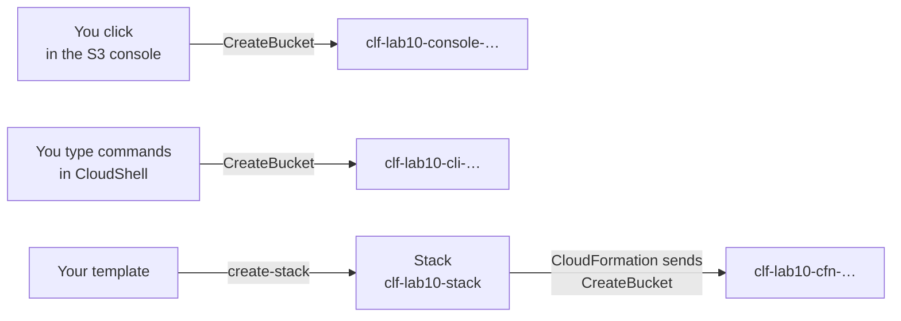
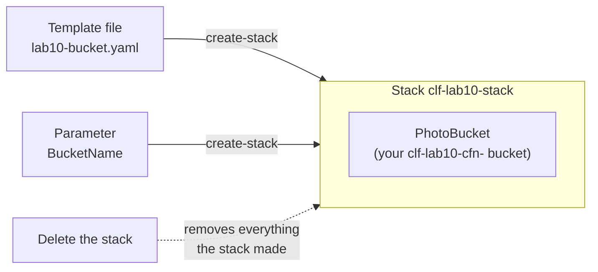
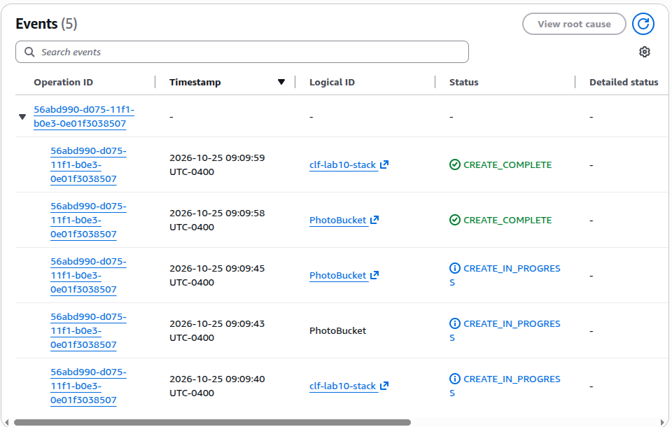
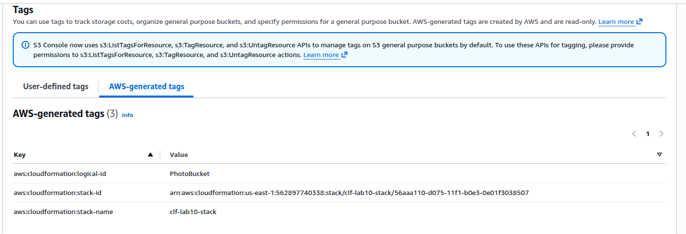

# Lab 10: Create the same bucket three ways: console, command line and template

## Before you start: your account, your responsibility

This guide is provided as is, without warranty. We work hard to keep it correct and current, but AWS changes often, and its services, prices, and free offers may differ from what is written here. The labs run in your own AWS account. You are responsible for that account, for its security, and for any charges it incurs, including charges from resources you forget to delete. Automate the Cloud Inc. is not liable for any costs, losses, or security incidents that result from following, or failing to follow, this material. Technical guidance here is general information, not advice about your specific systems.

**Who this is for:** you have done [Lab 01](../02-why-the-cloud/06-lab-01-first-resource.md) and opened CloudShell on [primer page 04](https://github.com/AutomateTheCloud/atc-study-aws_account_guardrails/blob/main/primer/04-command-line-without-access-keys.md). The lessons [Four ways in](01-four-ways-in.md) and [IaC and automation](02-iac-and-automation.md) explain the ideas; this lab works without them. You don't need to program. **Time:** about 50 minutes, plus 5 minutes the next day.

**Goal:** the bakery's owner wants the photo bucket rebuilt, identically, wherever she asks. You make the same private, tagged bucket three times: by clicking in the console, by typing commands in CloudShell, and from a template you finish yourself. CloudShell is only the place you run the CLI here: the exam guide lists it as out of scope, as lesson 08.01 explains. Then you compare what each way leaves you with. **End state:** your lab log says which way you would trust for the second Region, and your account holds nothing from this lab.



*Notice that every path ends in the same request to S3. What differs is what you must remember, and what is written down afterwards.*

**Long description.** Three paths, left to right. Clicking in the S3 console sends a CreateBucket request and makes the bucket `clf-lab10-console-…`. Typing commands in CloudShell sends CreateBucket and makes `clf-lab10-cli-…`. Your template goes to CloudFormation with `create-stack`, which makes the stack `clf-lab10-stack`; CloudFormation then sends CreateBucket and makes `clf-lab10-cfn-…`.

**What it creates**, in US East (N. Virginia), `us-east-1`, tagged `guide` = `clf` and `lab` = `10`: three empty S3 buckets, and one CloudFormation stack that owns the third. You delete all four at the end.

**What it costs:** $0. S3 doesn't charge for an empty bucket, and CloudFormation has no extra charge for AWS resource types such as `AWS::S3::Bucket` ([AWS CloudFormation pricing](https://aws.amazon.com/cloudformation/pricing/), checked 2026-10-24). Even if all 30 or so of the lab's actions were billed as S3 requests at $0.005 per 1,000, they would cost $0.00015 ([Amazon S3 pricing](https://aws.amazon.com/s3/pricing/), as of 2026-10-24). **Worst case on a Paid plan** if you forget to clean up: still $0, while the buckets stay empty. **Free plan:** nothing here upgrades your plan. Never choose **Upgrade plan** during a lab.

**Before you start, you need these guardrails in place:** [root MFA](https://github.com/AutomateTheCloud/atc-study-aws_account_guardrails/blob/main/primer/02-secure-the-root-user.md) (primer page 02), [an IAM admin user with MFA](https://github.com/AutomateTheCloud/atc-study-aws_account_guardrails/blob/main/primer/03-your-everyday-admin-identity.md), which you use for this lab (page 03), [CloudShell instead of access keys](https://github.com/AutomateTheCloud/atc-study-aws_account_guardrails/blob/main/primer/04-command-line-without-access-keys.md) (page 04), [budgets and billing alerts](https://github.com/AutomateTheCloud/atc-study-aws_account_guardrails/blob/main/primer/05-money-alarms.md) (page 05), and [the habits for every lab](https://github.com/AutomateTheCloud/atc-study-aws_account_guardrails/blob/main/primer/07-habits-for-every-lab.md), including your lab log (page 07).

**Why this matters:** a setup written as a file can be reviewed, kept with its history, and rebuilt the same way every time: the design principle [Safely automate where possible](https://docs.aws.amazon.com/wellarchitected/latest/framework/oe-design-principles.html), and [OPS05-BP03 Use configuration management systems](https://docs.aws.amazon.com/wellarchitected/latest/operational-excellence-pillar/ops_dev_integ_conf_mgmt_sys.html) and [REL08-BP05 Deploy changes with automation](https://docs.aws.amazon.com/wellarchitected/latest/reliability-pillar/rel_tracking_change_management_automated_changemgmt.html) in practice. Running the CLI from CloudShell, with no access key, is [SEC02-BP02 Use temporary credentials](https://docs.aws.amazon.com/wellarchitected/latest/security-pillar/sec_identities_unique.html).

> **New sign-up path:** S3 is supported there, but IAM users can't sign in to the console and your Region is fixed (as of 2026-10-23). We haven't confirmed how CloudShell or CloudFormation behave on that path. Use your assigned Region wherever this lab says `us-east-1`, and sign in the way that path gives you.

**About the screens:** labels in **bold** and the command outputs are what we saw when we ran this lab end to end in our test account on 2026-10-25. AWS changes its console often. If a label or an output differs, look for the option or line with the same meaning.

## Steps

### Get ready

1. In your lab log, write today's date, `us-east-1`, the tags `guide` = `clf` and `lab` = `10`, and these names, each ending with your initials, the date and four random digits:

   | Way | Bucket name (example) |
   |---|---|
   | Console | `clf-lab10-console-ab-20261024-4817` |
   | Command line | `clf-lab10-cli-ab-20261024-4817` |
   | Template | `clf-lab10-cfn-ab-20261024-4817` |

   The stack's name is `clf-lab10-stack`.
2. Sign in to the console as your **IAM admin user** and check that the Region selector shows N. Virginia.

### Part A: the console (follow-along)

3. Create the console bucket exactly as in [Lab 01, steps 5 to 11](../02-why-the-cloud/06-lab-01-first-resource.md#create-the-bucket-and-time-it), with your `clf-lab10-console-` name and the tags `guide` = `clf` and `lab` = `10`. Keep **Global namespace** and every security default.
   **You should see:** the new bucket's page and a message that it was created.
4. In your lab log, list every choice you checked or typed on the **Create bucket** page: what a colleague would need to make an identical bucket.

### Part B: the AWS CLI in CloudShell (follow-along)

5. Open CloudShell in `us-east-1` and check who you are, as in [primer page 04, steps 1 to 3](https://github.com/AutomateTheCloud/atc-study-aws_account_guardrails/blob/main/primer/04-command-line-without-access-keys.md#steps-open-cloudshell-and-check-who-you-are).
   **You should see:** an `Arn` line ending in `:user/` and your IAM user's name. You still have no access keys.
6. Store your CLI bucket name in a **shell variable**, a short name that holds a value for this CloudShell session, so you type the bucket name only once. Replace the example with your name, then press Enter after each line:

   ```bash
   BUCKET=clf-lab10-cli-ab-20261024-4817
   echo "$BUCKET"
   ```

   **You should see:** your bucket name printed back.
   > **If something went wrong:** CloudShell closes idle sessions after 20 to 30 minutes, and a new session forgets the variable. If a later command complains that `--bucket` is empty, run the `BUCKET=` line again.
7. Create the bucket. In `us-east-1` the command needs no location setting; any other Region does ([Creating a general purpose bucket](https://docs.aws.amazon.com/AmazonS3/latest/userguide/create-bucket-overview.html)).

   ```bash
   aws s3api create-bucket --bucket "$BUCKET" --region us-east-1
   ```

   **You should see:** a few lines of JSON: `"Location": "/clf-lab10-cli-…"` and a `"BucketArn"` line holding the new bucket's ARN.
   > **If something went wrong:** `BucketAlreadyExists` means another account owns that name; change the digits, set `BUCKET=` again, and rerun. `InvalidBucketName` means a capital letter, space or underscore crept in.
8. Add the two tags. This command replaces all of a bucket's tags with the set you give it:

   ```bash
   aws s3api put-bucket-tagging --bucket "$BUCKET" --tagging 'TagSet=[{Key=guide,Value=clf},{Key=lab,Value=10}]'
   ```

   **You should see:** no output and a new `$` prompt. Silence means success.
9. Read back what S3 did, one command at a time:

   ```bash
   aws s3api get-bucket-tagging --bucket "$BUCKET"
   aws s3api get-public-access-block --bucket "$BUCKET"
   aws s3api get-bucket-encryption --bucket "$BUCKET"
   ```

   **You should see:** your two tags; four Block Public Access settings, each `true`; and `"SSEAlgorithm": "AES256"`, which is SSE-S3. You never asked for those protections. S3 applies them to every new bucket, whichever tool creates it ([Creating a general purpose bucket](https://docs.aws.amazon.com/AmazonS3/latest/userguide/create-bucket-overview.html)).

   Look closer and one setting differs: the encryption output says `"BucketKeyEnabled": false`, while the console's **Create bucket** page had **Bucket Key** set to **Enabled** for your Part A bucket (as we saw on 2026-10-25). Bucket Key only lowers the cost of KMS encryption, so it changes nothing for SSE-S3, but it makes this lab's point for you: two tools with different defaults don't build identical buckets unless every setting is written down. Note it in your lab log.

### Part C: a template you finish (completion)

As lesson 08.02, [IaC and automation](02-iac-and-automation.md), explains, a template describes the resources you want, and CloudFormation builds them as a stack that you create, change and delete as a unit. Here the template's one parameter, the bucket name, lets the same file make many stacks.



*Notice that the bucket sits inside the stack. You never delete it directly: deleting the stack deletes it.*

**Long description.** The template `lab10-bucket.yaml` and the parameter `BucketName` go to CloudFormation with `create-stack`, which makes the stack `clf-lab10-stack`, a box containing one resource, `PhotoBucket` (your `clf-lab10-cfn-` bucket). A dotted arrow from "Delete the stack" to the stack reads "removes everything the stack made".

10. In CloudShell, open the built-in editor on a new file:

    ```bash
    edit lab10-bucket.yaml
    ```

    **You should see:** an editor tab named `lab10-bucket.yaml`, with an empty file, where the terminal tab was ([Getting started with AWS CloudShell](https://docs.aws.amazon.com/cloudshell/latest/userguide/getting-started.html), step 9). Closing the editor tab brings the terminal back.
    > **If something went wrong:** if `edit` isn't found, type `nano lab10-bucket.yaml` instead; after pasting, save with Ctrl+O and Enter, and leave with Ctrl+X.
11. Paste this template. If CloudShell warns about pasting several lines, check the text and allow it. Keep the indentation exactly: in YAML, the spaces show what belongs to what.

    ```yaml
    AWSTemplateFormatVersion: "2010-09-09"
    Description: Lab 10 - the bakery's photo bucket, written as code

    Parameters:
      BucketName:
        Type: String
        Description: A unique name that starts with clf-lab10-cfn-

    Resources:
      PhotoBucket:
        Type: BLANK-1
        Properties:
          BucketName: BLANK-2
          PublicAccessBlockConfiguration:
            BlockPublicAcls: true
            BlockPublicPolicy: true
            IgnorePublicAcls: true
            RestrictPublicBuckets: true
          Tags:
            - Key: guide
              Value: clf
            - Key: lab
              Value: BLANK-3

    Outputs:
      BucketArn:
        Description: The new bucket's ARN
        Value: !GetAtt PhotoBucket.Arn
    ```

12. Replace the three blanks, using these clues:
    - **BLANK-1:** the resource type for an S3 bucket. It has three parts separated by `::`, starting with `AWS`.
    - **BLANK-2:** the bucket's name must come from the parameter, not be typed into the template. The function `!Ref`, followed by a parameter's name, inserts that parameter's value.
    - **BLANK-3:** this lab's number, as text.

    Save the file (Ctrl+S, or Cmd+S on a Mac) and close the editor tab.

<details><summary>Model answer</summary>

- **BLANK-1:** `AWS::S3::Bucket`
- **BLANK-2:** `!Ref BucketName`
- **BLANK-3:** `"10"`, in quotes, because a tag value must be text.

`!Ref BucketName` is what makes the template reusable: the same file can build a bucket with any name, in any Region or account, without editing. The four Block Public Access lines repeat S3's defaults on purpose: a reviewer reading the file sees that the bucket is meant to be private, without needing to know the defaults.

</details>

13. Ask CloudFormation to check the file:

    ```bash
    aws cloudformation validate-template --template-body file://lab10-bucket.yaml
    ```

    **You should see:** JSON that lists the parameter `BucketName` and your description.
    > **If something went wrong:** a "Template format error" usually means the indentation moved when you pasted. Run `edit lab10-bucket.yaml`, compare it with the template above line by line, save, and validate again. A blank left in place gives a `ValidationError` instead: for `BLANK-1`, it names `typeNameList` and the pattern a type must follow, three names joined by `::`. This check confirms that the file is well formed; some mistakes, such as a misspelled resource type, may show only in step 14.
14. Create the stack. Type your own `clf-lab10-cfn-` name after `ParameterValue=`. The `--tags` option tags the stack itself:

    ```bash
    aws cloudformation create-stack --stack-name clf-lab10-stack \
      --template-body file://lab10-bucket.yaml \
      --parameters ParameterKey=BucketName,ParameterValue=clf-lab10-cfn-ab-20261024-4817 \
      --tags Key=guide,Value=clf Key=lab,Value=10 \
      --region us-east-1
    ```

    **You should see:** a `StackId` line holding an ARN that contains `stack/clf-lab10-stack/`, and an `OperationId` line. Sending the template from CloudShell keeps it out of S3; the console's upload option would store it in a bucket that CloudFormation creates in your account ([Create a stack from the CloudFormation console](https://docs.aws.amazon.com/AWSCloudFormation/latest/UserGuide/cfn-console-create-stack.html)).
15. Wait for it to finish:

    ```bash
    aws cloudformation wait stack-create-complete --stack-name clf-lab10-stack --region us-east-1
    ```

    **You should see:** the prompt return with no message, after about a minute in our run.
    > **If something went wrong:** a message that the waiter failed means the stack didn't finish. Open it in the console (step 16) and read the **Events** tab for a `CREATE_FAILED` line and its reason. By default, CloudFormation then rolls back: it deletes what it made. Delete the failed stack as in step 19, fix the template, and repeat steps 13 to 15.
16. In the console search bar, type `CloudFormation` and open it. Choose **Stacks**, then `clf-lab10-stack`.
    **You should see:** the status `CREATE_COMPLETE`.
17. Choose the **Events** tab and read it from the bottom up. Each line is a **stack event**: one step CloudFormation took, with its time and status. Then open the **Resources** tab and the **Outputs** tab ([Creating your first stack](https://docs.aws.amazon.com/AWSCloudFormation/latest/UserGuide/gettingstarted.walkthrough.html)).
    **You should see:** `CREATE_IN_PROGRESS` and `CREATE_COMPLETE` events for `PhotoBucket` and for the stack, grouped under one **Operation ID**, newest first. `PhotoBucket` has two `CREATE_IN_PROGRESS` lines; the **Status reason** column, further right, says what each one marks. **Resources** lists `PhotoBucket` with your bucket's name as its physical ID; **Outputs** shows `BucketArn`.

    

    *Screenshot: the stack's **Events** tab, newest event first, captured 2026-10-25 in our test account. AWS console screenshots are AWS material used as limited fair use and are not covered by this guide's license.*

18. Open **S3**, then your `clf-lab10-cfn-` bucket, and its **Properties** tab. Scroll to **Tags**.
    **You should see:** `guide` and `lab` under **User-defined tags**. Choose **AWS-generated tags** beside it: three tags starting with `aws:cloudformation:` (`logical-id`, `stack-id` and `stack-name`), which CloudFormation adds to name the stack that owns the bucket ([Resource tags](https://docs.aws.amazon.com/AWSCloudFormation/latest/TemplateReference/aws-properties-resource-tags.html)).

    

    *Screenshot: the three tags CloudFormation added, on the bucket's **AWS-generated tags** tab, captured 2026-10-25 in our test account. AWS console screenshots are AWS material used as limited fair use and are not covered by this guide's license.*

## Check your work

- [ ] In Tag Editor, searching all Regions for resource type `AWS::S3::Bucket` and the tag `lab` = `10` finds three buckets ([Lab 01, steps 13 to 16](../02-why-the-cloud/06-lab-01-first-resource.md#find-it-by-its-tags)).
- [ ] Step 9 showed the CLI bucket private and encrypted, like the console one.
- [ ] `clf-lab10-stack` showed `CREATE_COMPLETE`, with one resource and one output.
- [ ] Your lab log fills in this table, in your own words:

| Question | Console | CLI | Template |
|---|---|---|---|
| What did you have to remember? | | | |
| Could someone repeat it exactly from what's left behind? | | | |
| How do you delete everything it made? | | | |

<details><summary>Model answer</summary>

| Question | Console | CLI | Template |
|---|---|---|---|
| What did you have to remember? | Every choice on the page, in order | The commands and their order; the defaults came free | Almost nothing: the file holds the choices |
| Could someone repeat it exactly? | Only from your notes | Yes, if you saved the commands as a script | Yes: run the same file with a new name |
| How do you delete everything? | Find each item and delete it | Write the delete commands yourself | Delete the stack; CloudFormation removes what it made |

The console suits a one-time look or a quick experiment. The CLI suits a repeated task you script. A template suits anything that must exist more than once, or be rebuilt the same way later.

</details>

## Clean up

Delete the stack first, so you watch CloudFormation remove its own bucket.

19. In **CloudFormation**, select `clf-lab10-stack` and choose **Delete stack**. In the dialog, leave **Express mode** cleared, type the stack name to confirm, and choose **Delete stack**.
    **You should see:** a banner that the delete was initiated. The list doesn't update by itself: choose the refresh button to watch the status go to `DELETE_IN_PROGRESS`, then the stack leave the list (within a minute for us). In S3, the `clf-lab10-cfn-` bucket is gone too.
    > **If something went wrong:** `DELETE_FAILED` on `PhotoBucket` means something was uploaded to the bucket; CloudFormation deletes only empty buckets ([AWS::S3::Bucket](https://docs.aws.amazon.com/AWSCloudFormation/latest/TemplateReference/aws-resource-s3-bucket.html)). Empty it in S3, then delete the stack again.
20. In CloudShell, delete the CLI bucket with the CLI. Set `BUCKET=` again first if CloudShell restarted.

    ```bash
    aws s3api delete-bucket --bucket "$BUCKET" --region us-east-1
    ```

    **You should see:** no output and a new prompt.
21. Delete the console bucket in the console, as in [Lab 01, steps 20 and 21](../02-why-the-cloud/06-lab-01-first-resource.md#clean-up). (If a failed stack from step 15 remains, delete it now as in step 19.)
22. Remove the template file from CloudShell: `rm lab10-bucket.yaml`.
23. **Confirm** from CloudShell:

    ```bash
    aws s3api list-buckets --query "Buckets[?starts_with(Name, 'clf-lab10')].Name"
    aws cloudformation describe-stacks --stack-name clf-lab10-stack --region us-east-1
    ```

    **You should see:** `[]` for the buckets, and an error saying the stack does not exist. Then repeat the Tag Editor search for `lab` = `10`, with all supported resource types; expect no results (a deleted item can linger a few minutes). Tick everything off in your lab log.
24. **The next day:** check that your **Credits** balance hasn't fallen because of S3 ([primer page 07](https://github.com/AutomateTheCloud/atc-study-aws_account_guardrails/blob/main/primer/07-habits-for-every-lab.md), habit 4). (task card: [Read this month's bill by service and Region](../98-how-to/08-read-this-months-bill.md))

## Recap

All three ways made the same private, encrypted bucket, because all three sent S3 the same request. The difference is what remains afterwards: the console leaves only your memory, the CLI leaves commands you could save, and the template leaves a file that rebuilds the bucket, plus a stack that deletes it in one step.

> **Misconception:** "Clicking in the console is fine for production." Your Part A left nothing to review, rerun or compare, so a second copy built that way would drift from the first. Lesson 08.01, [Four ways in](01-four-ways-in.md#console-clicks-are-fine-for-production-is-wrong), explains why teams keep the console for looking and learning, and code for what must last.

> **Reflect:** the owner asks for the photo bucket in US West (Oregon), `us-west-2`, as well. Which of today's three ways would you use, and what exactly would you change? Write two or three sentences.
>
> <details><summary>Model answer</summary>
>
> The template. I would run the same `create-stack` command with `--region us-west-2` and a new bucket name as the parameter; the file itself doesn't change, so both buckets get the same settings and tags. Deleting that copy later is one stack deletion, not a hunt through the console.
>
> </details>

**Next:** [Lab 11](06-lab-11-alarm-on-errors.md), where you get an email when the bakery's order function fails.

## Where to check the current details

- [Creating a general purpose bucket](https://docs.aws.amazon.com/AmazonS3/latest/userguide/create-bucket-overview.html), Amazon S3 User Guide (checked 2026-10-24)
- [Getting started with AWS CloudShell](https://docs.aws.amazon.com/cloudshell/latest/userguide/getting-started.html), AWS CloudShell User Guide (checked 2026-10-24)
- [Creating your first stack](https://docs.aws.amazon.com/AWSCloudFormation/latest/UserGuide/gettingstarted.walkthrough.html) and [Create a stack from the CloudFormation console](https://docs.aws.amazon.com/AWSCloudFormation/latest/UserGuide/cfn-console-create-stack.html), AWS CloudFormation User Guide (checked 2026-10-24)
- [AWS::S3::Bucket](https://docs.aws.amazon.com/AWSCloudFormation/latest/TemplateReference/aws-resource-s3-bucket.html), CloudFormation Template Reference (checked 2026-10-24)
- [AWS CloudFormation pricing](https://aws.amazon.com/cloudformation/pricing/) and [Amazon S3 pricing](https://aws.amazon.com/s3/pricing/) (checked 2026-10-24)

---

"Lab 10: Create the same bucket three ways: console, command line and template" by Automate the Cloud Inc., licensed under CC BY-NC 4.0 with the Additional Permission for Internal Training from Automate the Cloud Inc.
License: https://creativecommons.org/licenses/by-nc/4.0/
Permission: https://automatethe.cloud/licenses/atc-internal-training-permission.txt
