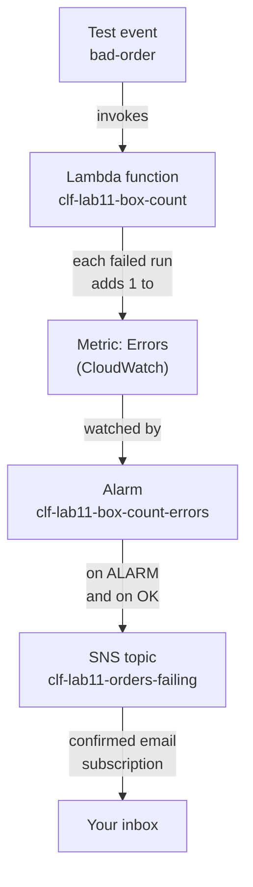
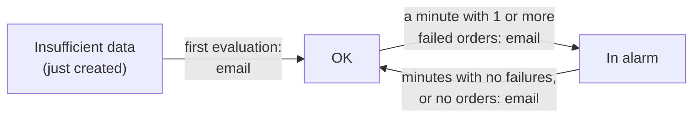

# Optional lab 11: Email the owner when the order function fails

## Before you start: your account, your responsibility

This guide is provided as is, without warranty. We work hard to keep it correct and current, but AWS changes often, and its services, prices, and free offers may differ from what is written here. The labs run in your own AWS account. You are responsible for that account, for its security, and for any charges it incurs, including charges from resources you forget to delete. Automate the Cloud Inc. is not liable for any costs, losses, or security incidents that result from following, or failing to follow, this material. Technical guidance here is general information, not advice about your specific systems.

**This lab is optional.** The exam asks which service watches or alerts, not how to set up an alarm; do it if you want to see CloudWatch and SNS work together.

**Who this is for:** you have done [Lab 07](../06-running-applications/05-lab-07-a-lambda-function.md) and built the billing alarm on [primer page 05](https://github.com/AutomateTheCloud/atc-study-aws_account_guardrails/blob/main/primer/05-money-alarms.md#create-a-billing-alarm-in-us-east-1). The lessons [Watching workloads](03-watching-workloads.md) and [Connecting parts, shipping software](04-connecting-parts-shipping-software.md) explain the services; this lab works without them. **Time:** about 45 minutes, plus 5 minutes the next day. This is a challenge lab: Part B gives you the requirements, not the clicks.

**Goal:** the owner wants an email when customers' orders start failing, and another when they work again. You rebuild Lab 07's order function, wire an alarm on its errors to an email topic, break the function on purpose, and watch both emails arrive. **End state:** your lab log records how long the alarm took, and your account holds nothing from this lab.



*Notice that the function never sends email itself. Lambda reports the failures, CloudWatch decides it is a problem, and SNS delivers the message.*

**Long description.** Top to bottom. The test event `bad-order` invokes the Lambda function `clf-lab11-box-count`. Each failed run adds 1 to the function's Errors metric in CloudWatch. The alarm `clf-lab11-box-count-errors` watches that metric and, when it changes to ALARM or back to OK, publishes to the SNS topic `clf-lab11-orders-failing`. Through a confirmed email subscription, the message reaches your inbox.

**Why rebuild the function?** Lab 07's cleanup deleted it. A fresh copy under this lab's name and tags keeps everything Lab 11 makes findable and deletable together, so build it even if you kept Lab 07's.

**What it creates**, in US East (N. Virginia), `us-east-1`, tagged `guide` = `clf` and `lab` = `11`:

- the Lambda function `clf-lab11-box-count`, with its execution role and log group;
- an Amazon SNS (Simple Notification Service) standard topic, `clf-lab11-orders-failing`, and an email subscription to it;
- an Amazon CloudWatch alarm, `clf-lab11-box-count-errors`.

You delete all of it at the end.

**What it costs:** $0. Lambda's metrics cost nothing extra ([Using CloudWatch metrics with Lambda](https://docs.aws.amazon.com/lambda/latest/dg/monitoring-metrics.html)), and the rest fits in these free allowances:

> **Dated (checked 2026-10-24):** always-free allowances, per month.
>
> | Service | Free each month | Beyond it | This lab |
> |---|---|---|---|
> | CloudWatch alarms | 10 standard-resolution alarm metrics | $0.10 per alarm metric a month, charged by the hour the alarm exists | 1 alarm; your billing alarm from primer page 05 is another |
> | SNS email | 1,000 email deliveries; 1 million requests | $2.00 per 100,000 emails | About 4 emails |
> | Lambda | 1 million requests; 400,000 GB-seconds | $0.20 per million requests (US East (N. Virginia)) | About 5 runs |
>
> Sources: [Amazon CloudWatch pricing](https://aws.amazon.com/cloudwatch/pricing/), [Amazon SNS FAQs](https://aws.amazon.com/sns/faqs/), [AWS Lambda pricing](https://aws.amazon.com/lambda/pricing/).

**Worst case on a Paid plan** if you forget to clean up: $0 a month while this alarm and your others number 10 standard alarms or fewer; past that, $0.10 a month for this alarm. **Free plan:** nothing here upgrades your plan. Never choose **Upgrade plan** during a lab.

**Before you start, you need these guardrails in place:** [root MFA](https://github.com/AutomateTheCloud/atc-study-aws_account_guardrails/blob/main/primer/02-secure-the-root-user.md) (primer page 02), [an IAM admin user with MFA](https://github.com/AutomateTheCloud/atc-study-aws_account_guardrails/blob/main/primer/03-your-everyday-admin-identity.md), which you use for this lab (page 03), [CloudShell instead of access keys](https://github.com/AutomateTheCloud/atc-study-aws_account_guardrails/blob/main/primer/04-command-line-without-access-keys.md), in case you tag the alarm from the command line (page 04), [budgets and billing alerts](https://github.com/AutomateTheCloud/atc-study-aws_account_guardrails/blob/main/primer/05-money-alarms.md) (page 05), and [the habits for every lab](https://github.com/AutomateTheCloud/atc-study-aws_account_guardrails/blob/main/primer/07-habits-for-every-lab.md), including your lab log (page 07). Have the inbox of an address you read open; AWS's emails can land in spam.

**Why this matters:** an alert should reach a person, say what is wrong, and stay quiet otherwise: [OPS08-BP04 Create actionable alerts](https://docs.aws.amazon.com/wellarchitected/latest/operational-excellence-pillar/ops_workload_observability_create_alerts.html) and [REL06-BP03 Send notifications (Real-time processing and alarming)](https://docs.aws.amazon.com/wellarchitected/latest/reliability-pillar/rel_monitor_aws_resources_notification_monitor.html). Watching your code's errors is on your side of the shared responsibility line.

> **New sign-up path:** Lambda is supported there, but IAM users can't sign in to the console and your Region is fixed (as of 2026-10-23). We haven't confirmed SNS email or CloudWatch alarms on that path. Use your assigned Region wherever this lab says `us-east-1`, and sign in the way that path gives you.

**About the screens:** labels in **bold** and the times quoted are what we saw when we ran this lab end to end in our test account on 2026-10-25. AWS changes its console often, and times vary. If a label differs, look for the option with the same meaning.

## Steps

### Get ready

1. In your lab log, write today's date, `us-east-1`, the tags `guide` = `clf` and `lab` = `11`, and three names: the function `clf-lab11-box-count`, the topic `clf-lab11-orders-failing` and the alarm `clf-lab11-box-count-errors`.
2. Sign in to the console as your **IAM admin user** and check that the Region selector shows N. Virginia.

### Part A: rebuild the order function (follow-along)

3. Build the function as in [Lab 07, steps 3 to 9](../06-running-applications/05-lab-07-a-lambda-function.md#create-the-function), with the name `clf-lab11-box-count` and the tags `guide` = `clf` and `lab` = `11`. Paste the same code and choose **Deploy**.
4. Create Lab 07's two test events, `order-1042` and `bad-order`, as in [Lab 07, steps 10 and 11](../06-running-applications/05-lab-07-a-lambda-function.md#run-it-with-two-test-events). **Run only `order-1042` for now.**
   **You should see:** `"boxes": 3`. This first run makes Lambda start sending the function's metrics, so the one you need appears in CloudWatch. It can take a few minutes to show.

### Part B: build the alert from the owner's request (challenge)

Lesson 08.03, [Watching workloads](03-watching-workloads.md), explains metrics, alarms and thresholds. The metric here is Lambda's `Errors`, which counts the runs that ended in an error, including exceptions your code raises ([Types of metrics for Lambda functions](https://docs.aws.amazon.com/lambda/latest/dg/monitoring-metrics-types.html)).

**The owner's request:** "If customers' orders start failing, email me straight away. Email me again when it's fixed. Don't email me just because nobody ordered anything."

**Constraints:**

- One SNS **standard** topic, `clf-lab11-orders-failing`, with one email subscription to an address you read. As lesson 08.04 explains, an email address receives nothing until it confirms its subscription.
- One CloudWatch alarm, `clf-lab11-box-count-errors`, on the `Errors` metric of `clf-lab11-box-count` only.
- Tags `guide` = `clf` and `lab` = `11` on the topic and the alarm.
- Free allowances only: a standard-resolution alarm, email only.

You built the same kind of thing for billing on primer page 05; this time the decisions are yours.

5. Build the topic, the subscription and the alarm. Before you go on, check two things: the subscription's status is **Confirmed**, and a few minutes after you create the alarm, its state is **OK**, not **Insufficient data**. If your alarm notifies on **OK**, that first move to **OK** already sends an email: in our run it came about a minute after we created the alarm.

<details><summary>Hints, if you need them</summary>

- **Topic:** in **Simple Notification Service**, choose **Topics**, then **Create topic**. The page starts with **FIFO** selected (as of 2026-10-25): choose **Standard**. **Type** is chosen once and can't be changed later; email subscriptions work only on standard topics ([Creating an Amazon SNS topic](https://docs.aws.amazon.com/sns/latest/dg/sns-create-topic.html)). Tags are in a section near the bottom.
- **Subscription:** **Subscriptions**, then **Create subscription**; pick your topic's ARN, the protocol **Email**, and your address as the **Endpoint**. Choose **Confirm subscription** in the email AWS sends. The link is valid for two days, and SNS deletes unconfirmed email subscriptions after 48 hours ([Amazon SNS FAQs](https://aws.amazon.com/sns/faqs/); [Email subscription setup](https://docs.aws.amazon.com/sns/latest/dg/sns-email-notifications.html)).
- **Metric:** in **CloudWatch**, **Alarms**, **Create alarm**, **Select metric**. Choose **Lambda**, then the view by function name, and tick the `Errors` row for your function.
- **Statistic and period:** each failed run records a 1, so the `Sum` over one minute is the number of failed runs in that minute.
- **Missing data:** Lambda sends `Errors` data only when the function runs. Look under **Additional configuration** for **Missing data treatment** ([Configuring how CloudWatch alarms treat missing data](https://docs.aws.amazon.com/AmazonCloudWatch/latest/monitoring/alarms-and-missing-data.html)).
- **Two emails:** on the notification page, choose the topic for the **In alarm** state, then **Add notification** for a second state.
- **Tagging the alarm:** the step that names the alarm has a **Tags** section (as of 2026-10-25). If your pages offer no tags, copy the alarm's ARN from its details and run this in CloudShell, with your ARN:

  ```bash
  aws cloudwatch tag-resource --resource-arn YOUR-ALARM-ARN --tags Key=guide,Value=clf Key=lab,Value=11
  ```

</details>

<details><summary>Model answer</summary>

| Requirement | Setting | Why |
|---|---|---|
| Email straight away | Metric `Errors` for `clf-lab11-box-count`; statistic `Sum`; period 1 minute; **Greater/Equal**, threshold `1`; 1 out of 1 data points | One failed order in a minute is enough; Lambda sends metrics every minute |
| Email when fixed | A second notification for the **OK** state, to the same topic | The return to OK is an event too |
| Silence when nobody orders | Missing data treated as good (not breaching) | With the default, "treat as missing", a quiet hour leaves the alarm in **Insufficient data** |
| Reaches the owner | A standard topic with a **Confirmed** email subscription | SNS sends nothing to an unconfirmed address |
| Free | One standard-resolution alarm, email only | Inside the 10 free alarm metrics and 1,000 free emails |

A tempting alternative, a threshold of `5`, would stay quiet through four failed orders a minute.

Lesson 08.03's design used 5-minute periods and a threshold of 3, for a busy shop where an odd failed order is normal. This owner asked to hear "straight away", and your test function runs only when you run it, so one failure in one minute is the right trigger here. The Reflect at the end of the lab asks when you would loosen it.

</details>

### Part C: break it on purpose and watch (follow-along)

The alarm is always in one of the three alarm states from lesson 08.03: **OK**, **In alarm** (`ALARM`) or **Insufficient data**. An email goes out when the state changes to one you chose, and your missing data treatment decides which way a minute with no data counts.



*Notice the label "or no orders" on the way back. That is your missing-data choice at work; with the default, the alarm would drift to Insufficient data instead.*

**Long description.** Three states. A new alarm starts in Insufficient data and moves to OK at its first evaluation, which already sends an email, because you asked for one on OK. From OK, a minute with one or more failed orders moves it to In alarm, which sends an email. From In alarm, minutes with no failures, or with no orders at all, move it back to OK, which sends a second email.

6. Prove the email path on its own first. In **SNS**, open your topic, choose the option to publish a message, give it the subject `Lab 11 test` and a short message, and publish it.
   **You should see:** the email in your inbox within a minute or two.
   > **If something went wrong:** no email means the subscription isn't **Confirmed**, or the email is in spam. Fix that before you go on: a broken delivery path would hide every later result.

> **Misconception:** "The alarm email is sent by Amazon SES." It isn't: SNS delivered it, as a plain alert to an address that subscribed. Lesson 08.04, [Connecting parts, shipping software](04-connecting-parts-shipping-software.md#an-email-from-sns-is-an-alert-an-email-from-ses-is-your-mail), compares it with SES, which sends the bakery's own designed mail to customers.

7. In **Lambda**, open `clf-lab11-box-count` and run the `bad-order` test event three times, a few seconds apart. Write the time in your lab log.
   **You should see:** an error naming `cupcakes` each time, as in Lab 07.
8. In **CloudWatch**, choose **Alarms** and watch `clf-lab11-box-count-errors`. Refresh every minute.
   **You should see:** the state change to **In alarm**, and an email whose subject names the alarm and the ALARM state. Write the time it arrived. In our run the state changed about a minute and a half after the first failed run, and each email arrived about a minute after its state change.
   > **If something went wrong:**
   > - *Still OK after 10 minutes:* open the alarm and check its metric is `Errors` for `clf-lab11-box-count`, the statistic `Sum`, and the threshold "greater than or equal to 1". Fix it with **Edit**, then run `bad-order` again.
   > - *Insufficient data:* the missing data treatment is still the default. Edit it to treat missing data as good.
   > - *In alarm, but no email:* the alarm has no notification for **In alarm**, or the email is in spam.

   

   *Screenshot: the alarm **In alarm** after three failed runs, captured 2026-10-25 in our test account. AWS console screenshots are AWS material used as limited fair use and are not covered by this guide's license.*

9. Run nothing. Keep watching the alarm.
   **You should see:** the state return to **OK**, and another email: about eight minutes after the last failure in our run. The alarm can stay in alarm for a few minutes after the last failure, because CloudWatch looks back over several recent data points before it decides ([Configuring how CloudWatch alarms treat missing data](https://docs.aws.amazon.com/AmazonCloudWatch/latest/monitoring/alarms-and-missing-data.html)).
10. Open the alarm and choose its **History** tab.
    **You should see:** the state changes, and the notifications sent at each one. Write the minutes from step 7 to each email in your lab log.

    

    *Screenshot: the alarm's **History**, with an email action at each change of state, including the first move to OK, captured 2026-10-25 in our test account. AWS console screenshots are AWS material used as limited fair use and are not covered by this guide's license.*

## Check your work

- [ ] Four emails arrived: the OK from step 5, your test message, the ALARM email and the OK email, and your lab log has their times.
- [ ] The alarm's settings match the model answer, or you can say why yours differ.
- [ ] Tag Editor, searching all Regions and all supported resource types for `lab` = `11`, finds your topic, alarm and function ([Lab 01, steps 13 to 16](../02-why-the-cloud/06-lab-01-first-resource.md#find-it-by-its-tags)). If the role or log group lacks tags, its `clf-lab11` name marks it.

> **Check:** three questions come in about the bakery. Which tool answers each: CloudWatch, CloudTrail or AWS X-Ray? (a) How many orders failed in the last hour? (b) Who changed the alarm's threshold yesterday? (c) Which step of a slow order request took the longest?
>
> <details><summary>Model answer</summary>
>
> (a) **CloudWatch**: the `Errors` metric you just alarmed on. (b) **CloudTrail**: it records who called which AWS API, and editing an alarm is an API call. (c) **AWS X-Ray**, tracing that AWS now places within CloudWatch's application observability: it follows one request through the parts it passes and times each part. CloudWatch tells you *that* something is wrong, CloudTrail *who changed* something, X-Ray *where* inside a request the time went.
>
> </details>

## Clean up

Delete the alarm first, so it can't send another email while you remove what it watches.

11. In **CloudWatch**, **Alarms**, select `clf-lab11-box-count-errors`, choose **Actions**, then **Delete**, and confirm with **Delete**.
    **You should see:** the alarm gone from the list.
12. In **SNS**, **Topics**, select `clf-lab11-orders-failing`, choose **Delete**, type `delete me` as the page asks, and confirm. Deleting a topic also deletes its subscriptions, though not at once.
    **You should see:** the topic gone. Its email subscription can stay listed under **Subscriptions** for a while (over two hours in our run); it can't send anything, because its topic is gone.
13. Delete the function, its log group, its role and any policy the console made for the role, as in [Lab 07, steps 20 to 23](../06-running-applications/05-lab-07-a-lambda-function.md#clean-up), looking for `clf-lab11` names.
14. **Confirm:** CloudWatch's alarm list, SNS's topics and subscriptions, Lambda's functions, CloudWatch's log groups and IAM's roles show nothing named `clf-lab11`. Repeat the Tag Editor search for `lab` = `11`; expect no results (a deleted item can linger a few minutes). Leave your billing alarm from primer page 05 in place. Tick everything off in your lab log.
15. **The next day:** check that your **Credits** balance hasn't fallen because of Lambda, CloudWatch or SNS ([primer page 07](https://github.com/AutomateTheCloud/atc-study-aws_account_guardrails/blob/main/primer/07-habits-for-every-lab.md), habit 4). (task card: [Read this month's bill by service and Region](../98-how-to/08-read-this-months-bill.md))

## Recap

You turned "tell me when orders fail" into three parts that each do one job: a metric that Lambda reports for free, an alarm that decides when the number matters, and a topic that delivers the news. The settings that made it useful were judgment calls: one failure is enough, a quiet shop is good news, and recovery deserves an email too.

> **Reflect:** the bakery's real order function runs thousands of times a day, and a few orders always fail because customers type nonsense. Would you keep "1 or more errors in a minute"? Write two sentences on what you would change, and why.
>
> <details><summary>Model answer</summary>
>
> No: at that volume it would email the owner many times a day for ordinary bad input, and she would soon ignore it. I would alarm on the error rate (errors divided by invocations) staying above a level for several minutes, and fix the code so bad input is answered politely instead of counted as a failure.
>
> </details>

**Next:** [the mastery check for this module](07-check.md) follows. [Module 09, "Protecting, governing and proving compliance"](../09-protecting-and-governing/00-brief.md), picks up CloudTrail where the Check above left it.

## Where to check the current details

- [Using CloudWatch metrics with Lambda](https://docs.aws.amazon.com/lambda/latest/dg/monitoring-metrics.html) and [Types of metrics for Lambda functions](https://docs.aws.amazon.com/lambda/latest/dg/monitoring-metrics-types.html), AWS Lambda Developer Guide (checked 2026-10-24)
- [Create a CloudWatch alarm based on a static threshold](https://docs.aws.amazon.com/AmazonCloudWatch/latest/monitoring/ConsoleAlarms.html) and [Configuring how CloudWatch alarms treat missing data](https://docs.aws.amazon.com/AmazonCloudWatch/latest/monitoring/alarms-and-missing-data.html), Amazon CloudWatch User Guide (checked 2026-10-24)
- [Creating an Amazon SNS topic](https://docs.aws.amazon.com/sns/latest/dg/sns-create-topic.html) and [Amazon SNS email subscription setup and management](https://docs.aws.amazon.com/sns/latest/dg/sns-email-notifications.html), Amazon SNS Developer Guide (checked 2026-10-24)
- [Amazon CloudWatch pricing](https://aws.amazon.com/cloudwatch/pricing/), [Amazon SNS FAQs](https://aws.amazon.com/sns/faqs/) and [AWS Lambda pricing](https://aws.amazon.com/lambda/pricing/) (checked 2026-10-24)

---

"Optional lab 11: Email the owner when the order function fails" by Automate the Cloud Inc., licensed under CC BY-NC 4.0 with the Additional Permission for Internal Training from Automate the Cloud Inc.
License: https://creativecommons.org/licenses/by-nc/4.0/
Permission: https://automatethe.cloud/licenses/atc-internal-training-permission.txt
