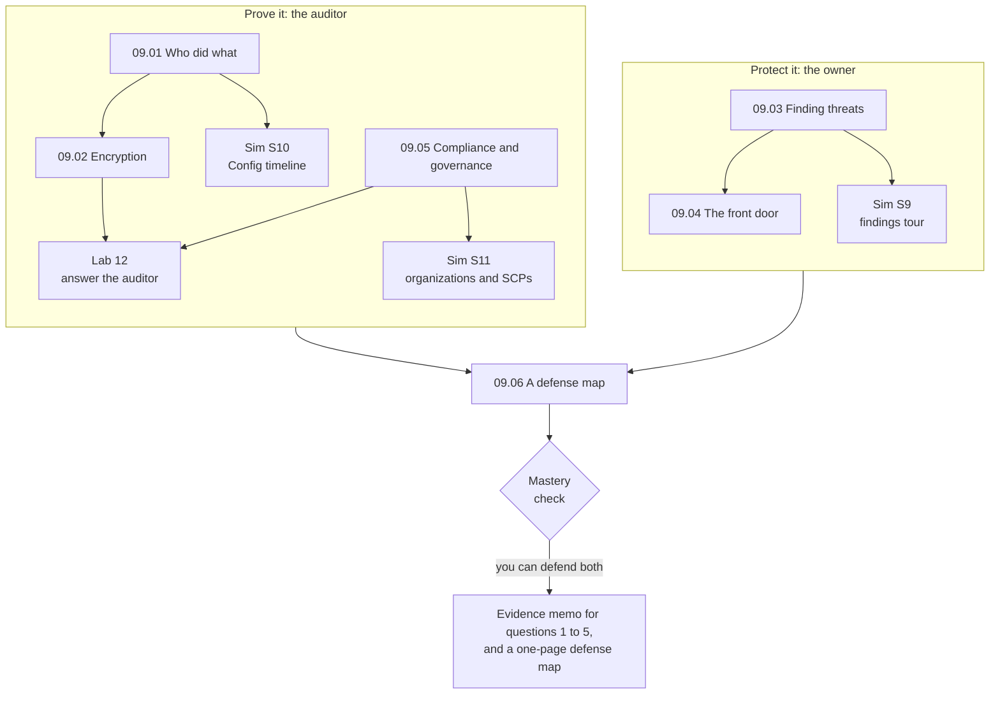

# Module 09: Answer an auditor's five questions with evidence, and put layered protection in front of the bakery's site

This module teaches how to protect an AWS account, watch it, and prove what happened in it. By the end, you answer an auditor with records instead of reassurances, and hand the bakery's owner a map of the site's protections.

**For:** an adult studying alone, possibly new to IT, who wants to understand AWS and use it safely. You have finished [Module 08, "Building and operating"](../08-building-and-operating/00-brief.md) and the [guardrails primer](https://github.com/AutomateTheCloud/atc-study-aws_account_guardrails/blob/main/primer/00-read-this-first.md). **Time:** about 5.5 hours, over several sessions.

## The scenario: an auditor arrives the week a competitor goes down

The bakery's site runs in US East (N. Virginia): web servers on EC2 behind a load balancer, the order database on Amazon RDS, functions in AWS Lambda and cake photos in S3, in your Module 07 network. A large customer asks for an audit before signing a contract. The auditor sends five questions:

| # | The auditor asks | Where the answer comes from |
|---|---|---|
| 1 | Who changed your systems recently? Show me one change from start to finish. | Lesson 09.01 |
| 2 | Does anyone use the account's root user? | Lesson 09.01 |
| 3 | Does anyone have permissions they don't use? | Lesson 09.01 |
| 4 | Is the stored data encrypted, and who holds the keys? | Lesson 09.02 |
| 5 | How do you know AWS protects its data centers? | Lesson 09.05 |

The same week, a competitor's site is knocked offline by a distributed denial-of-service (DDoS) attack: a flood of traffic from many machines at once. The owner asks: **"Could that happen to us? What stands in the way?"**

The bakery is made up for teaching. At the end you hand over an evidence memo answering the five questions, and a one-page defense map, from the edge of AWS's network to the account, with what each layer costs.

## You'll be able to

Tags: the kind of knowledge (C concept, J judgment) and what you do with it (Ap apply, An analyze, Ev evaluate).

| Objective | Lesson |
|---|---|
| **09.01a** Choose the service that answers an audit question [C·An] | 09.01 |
| **09.02a** Choose an encryption and key approach [J·Ap] | 09.02 |
| **09.03a** Match a security finding to the service that raised it [C·Ap] | 09.03 |
| **09.04a** Choose protections for an attack type [J·Ap] | 09.04 |
| **09.05a** State the compliance work that stays yours, and explain a service control policy as a ceiling [C·Ap] | 09.05 |
| **09.06a** Assemble and justify layered controls [J·Ev] | 09.06 |

## What this covers on the exam

This module covers three tasks in Domain 2, Security and Compliance, of the AWS Certified Cloud Practitioner (CLF-C02) exam. We checked the exam guide on 2026-10-24.

- task [2.2](https://docs.aws.amazon.com/aws-certification/latest/cloud-practitioner-02/cloud-practitioner-02-domain2.html#cloud-practitioner-02-task2.2), security, governance and compliance concepts (lessons 09.01, 09.02, 09.03 and 09.05);
- task [2.4](https://docs.aws.amazon.com/aws-certification/latest/cloud-practitioner-02/cloud-practitioner-02-domain2.html#cloud-practitioner-02-task2.4), security services and resources (lessons 09.03 to 09.05);
- task [2.3](https://docs.aws.amazon.com/aws-certification/latest/cloud-practitioner-02/cloud-practitioner-02-domain2.html#cloud-practitioner-02-task2.3), access management, for many accounts at once (lesson 09.05).

Lesson 09.06 returns to task [2.1](https://docs.aws.amazon.com/aws-certification/latest/cloud-practitioner-02/cloud-practitioner-02-domain2.html#cloud-practitioner-02-task2.1), shared responsibility. Domain 2 is 30% of the exam (as of 2026-10-24).

## How the module is laid out

**Lessons:**

1. [Who did what, how it runs, how it was set](01-who-did-what.md)
2. [Encryption](02-encryption.md)
3. [Finding threats and weaknesses](03-finding-threats-and-weaknesses.md)
4. [The front door](04-the-front-door.md)
5. [Compliance and governance](05-compliance-and-governance.md)
6. [A defense map](06-a-defense-map.md)

**Hands-on:**

- [Lab 12: answer the auditor](07-lab-12-answer-the-auditor.md): answer the five questions from your own lab account. It costs $0 on the Free plan (as of 2026-10-24).
- [Simulation S9: a security findings tour](08-sim-security-findings-tour.md), [Simulation S10: the Config timeline](09-sim-config-timeline.md) and [Simulation S11: organizations and SCPs](10-sim-organizations-and-scps.md) run on this site, not in AWS: GuardDuty and Security Hub CSPM were blocked on the Free plan (checked 2026-10-23), Config charges per item recorded, and creating an organization would upgrade a Free plan account.

**Before the lab:** check that you still have [root MFA](https://github.com/AutomateTheCloud/atc-study-aws_account_guardrails/blob/main/primer/02-secure-the-root-user.md), [your IAM admin user with MFA](https://github.com/AutomateTheCloud/atc-study-aws_account_guardrails/blob/main/primer/03-your-everyday-admin-identity.md) and [money alarms](https://github.com/AutomateTheCloud/atc-study-aws_account_guardrails/blob/main/primer/05-money-alarms.md). The lessons need no AWS account.

**Mastery check:** the module ends with a check; you pass at 80%. Each miss points you to the section to reread, then to a parallel retest.

**Things that change:** prices, the Shield Response Team's requirements, Security Hub's split and services closed to new customers carry the date we checked them.

*Notice the two halves: proving what happened, for the auditor, and protecting the site, for the owner. Lesson 09.06 joins them.*

**Long description.** Two boxes. "Prove it: the auditor" holds lessons 09.01, 09.02 and 09.05; 09.01 leads to Simulation S10; 09.02 and 09.05 lead to Lab 12; 09.05 also leads to Simulation S11. "Protect it: the owner" holds lessons 09.03 and 09.04; 09.03 leads to Simulation S9. Both boxes lead to lesson 09.06, a defense map, then the mastery check, then the outputs: the evidence memo and the defense map.

## Coming back

Warm-ups bring back Module 08 (CloudWatch alarms, infrastructure as code, EventBridge), Module 07 (security groups, network ACLs, VPC Flow Logs, encrypted versus private links, CloudFront), Module 03 (edge locations) and Module 04 (the shared responsibility line, root user, least privilege).

---

"Module 09: Protecting, governing and proving compliance" by Automate the Cloud Inc., licensed under CC BY-NC 4.0 with the Additional Permission for Internal Training from Automate the Cloud Inc.
License: https://creativecommons.org/licenses/by-nc/4.0/
Permission: https://automatethe.cloud/licenses/atc-internal-training-permission.txt
