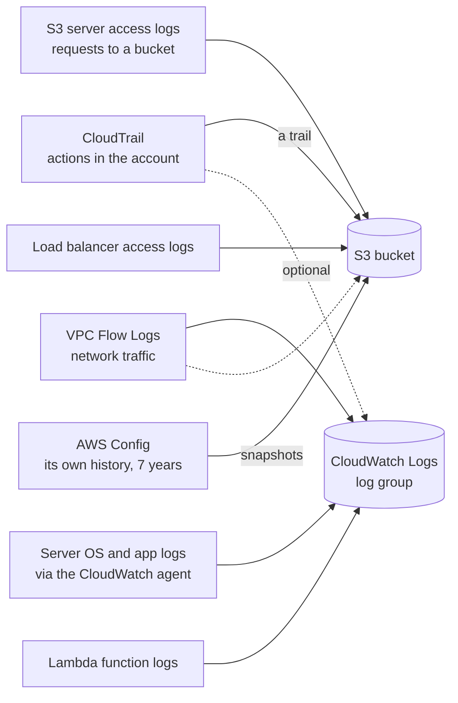

# CloudTrail says who did what, CloudWatch how it runs, Config how it was set: answer each audit question from the record that holds the answer

An auditor doesn't want to hear that your account is secure; she wants evidence. AWS keeps several records of your account, and each one answers a different kind of question. By the end of this lesson you can hear an audit question and name the record that answers it: AWS CloudTrail, Amazon CloudWatch, AWS Config or IAM's access reports.

**For:** an adult studying alone, possibly new to IT, who wants to understand AWS and use it safely. **Time:** about 35 minutes. Reading works on a phone.

**Before you start:** this lesson builds on [Lab 01](../02-why-the-cloud/06-lab-01-first-resource.md), where you found your bucket in CloudTrail Event history, and on [Policies and least privilege](../04-shared-responsibility-and-access/04-policies-and-least-privilege.md), which listed IAM's tools for trimming permissions. Module 08's lesson [Watching workloads](../08-building-and-operating/03-watching-workloads.md) introduced CloudWatch metrics, logs and alarms, and CloudTrail's management events, data events and trails. If you skipped any of them, the key terms below give you enough to follow. The auditor's visit is in the [module brief](00-brief.md).

## Warm-up: what you remember

Answer from memory before you look anything up.

1. From lesson [08.03](../08-building-and-operating/03-watching-workloads.md) and Lab 11: the bakery's owner was emailed when order functions started failing. Which service watched the error count and raised the alarm?
2. From lesson 07.02: VPC Flow Logs or Amazon Inspector: which one records information about the traffic going to and from your network interfaces?
3. From lesson 04.03: how did you check whether anyone had used your root user recently, and how far back could you look?

Feedback

1. **Amazon CloudWatch.** A CloudWatch alarm watched the functions' error metric and, through an Amazon SNS topic, sent the email. CloudWatch watches how things run; keep that in mind for this lesson.
2. **VPC Flow Logs.** They record traffic information for troubleshooting and security analysis. Inspector scans for vulnerabilities and network exposure; neither one blocks traffic.
3. **CloudTrail Event history, filtered by user name `root`.** It shows the last 90 days of activity, one Region at a time. This lesson explains what lies beyond those 90 days.

## What you'll learn

By the end of this lesson, you can:

- say what CloudTrail, CloudWatch, AWS Config and IAM's access reports each record;
- say where AWS's security logs are kept, and for how long by default;
- choose the record that answers an audit question (objective 09.01a).

Try these before you read on. Guess if you're unsure; the answers are in the lesson.

1. The auditor asks: "Was SSH open to the internet on your web server on 1 March?" CloudTrail, CloudWatch or Config?
2. Does CloudTrail record every time someone downloads a photo from the bakery's bucket?

## The big picture: four records, four questions

Most wrong answers on this topic come from asking the right question of the wrong record. Start every audit question by deciding what kind of question it is.

*Notice the highlighted questions. They don't overlap: "who did it", "how is it running", "how was it set" and "who can do it" are four different questions.*

**Long description.** Four cards in a two-by-two grid. AWS CloudTrail asks "Who did what, when, and from where?" It records each action taken in the account: who, which action, on what, when and from which address. Bakery example: who opened SSH on `web-sg` on Tuesday? From day one, Event history is on, free, and keeps 90 days per Region. Amazon CloudWatch asks "How is it running, and what happened inside it?" It records metrics, logs and alarms from resources and your own code. Example: why were orders slow at 6 p.m.? From day one, AWS services send basic metrics; logs you send are kept until you set a limit. AWS Config asks "How was it set up, then and now, and is that allowed?" It records each resource's settings over time and whether they pass your rules. Example: was SSH open to the internet on 1 March? It is off until you turn recording on, and you pay per item recorded. IAM access reports ask "Who can do what, and do they still use it?" They show when each user, role or policy last used each service, and who holds which credentials. Example: which permissions has nobody used in 90 days? They are on and free in the IAM console.

## Key terms (skip if you know them)

- **Audit** (lesson 04.02): an independent check that you do what you say you do. Auditors ask for **evidence**: records made at the time, not memories.
- **CloudTrail event:** CloudTrail's record of one action in your account, such as creating a bucket or changing a security group; an **event**, for short.
- **Management event** (lesson 08.03): an action that creates, changes or deletes a resource or its settings. **Data event:** an action on the data inside a resource, such as reading an object in S3. CloudTrail records management events by default and data events only if you ask, for a charge.
- **Trail** (lesson 08.03): a CloudTrail setting that delivers your events, continuously, as files to an S3 bucket you choose.
- **AWS Config:** a service that records how each resource is configured, keeps the history, and checks it against rules you choose.
- **Configuration item:** Config's point-in-time record of one resource's settings.
- **Access reports:** IAM's reports on who can use what, and whether they have: last accessed information, the credential report, and the AWS Organizations access report.

"Log" is an everyday word for a diary someone writes. In AWS, a log is a stream of records written by machines, one line per event, that people rarely read until something goes wrong.

## CloudTrail records who did what, when and from where

**AWS CloudTrail** records the actions taken in your account, by people, by roles and by AWS services acting for you, whether they came from the console, the CLI, an SDK or an API call. Each event says who acted, which action, on which resource, when, and from which IP address ([How CloudTrail works](https://docs.aws.amazon.com/awscloudtrail/latest/userguide/how-cloudtrail-works.html), checked 2026-10-24).

There are two ways to keep events:

- **Event history** is on in every account from the day it's created. It holds the last **90 days** of management events, **per Region**, can't be edited, and costs nothing to view. You used it in Lab 01.
- **A trail** delivers events as log files to an S3 bucket, about every 5 minutes on average. The files stay as long as you keep them, so a trail is how you keep more than 90 days. AWS recommends a **multi-Region trail**, which covers every Region enabled in your account; trails created in the console are multi-Region. Your first copy of management events costs nothing from CloudTrail; you pay for the S3 storage.

Two features matter for audits. **Log file integrity validation** lets you prove that log files weren't changed or deleted after delivery. **An organization trail**, created from an AWS Organizations management account (lesson 09.05), logs every account in the organization, and member accounts can't change or delete it.

> **Dated (checked 2026-10-24):** CloudTrail Lake, CloudTrail's feature for storing and querying events with SQL, has been closed to new customers since 2026-05-31. AWS points new customers to Amazon CloudWatch instead. CloudTrail itself, its trails and Insights are unaffected ([CloudTrail Lake availability change](https://docs.aws.amazon.com/awscloudtrail/latest/userguide/cloudtrail-lake-service-availability-change.html)). Older material may teach Lake as the place to query events.

### "CloudTrail records everything, forever" is wrong

You may have read that CloudTrail is a complete, permanent record of your account. That's not right on two counts. **Time:** Event history keeps 90 days; anything older exists only if you created a trail before it happened. **Scope:** by default CloudTrail records management events, not data events, so it shows who *changed* the photo bucket's settings but not who *downloaded* each photo, unless you turn on data events for that bucket and pay for them.

It's tempting because Event history really is on from day one, with nothing to set up, so it feels complete. The gap shows up only when an auditor asks about last year, or about reads.

> **Your turn:** The bakery's owner asks: "Our account is six months old and we never set anything up in CloudTrail. If the auditor asks who deleted a backup bucket four months ago, can we answer?" Answer in two sentences.

Model answer

No: Event history keeps only the last 90 days, and with no trail, nothing older was saved. Creating a multi-Region trail now protects future answers, but it can't recover the past, which is why teams create one on day one.

## CloudWatch shows how things are running, not who changed them

**Amazon CloudWatch** collects **metrics** (numbers over time, such as CPU use or order errors), **logs** (lines written by services and by your code) and **alarms** that act when a metric crosses a threshold. Module 08 introduced it; here is what matters for evidence:

- **Logs land in log groups** and, by default, are kept indefinitely until you set a retention period ([Working with log groups](https://docs.aws.amazon.com/AmazonCloudWatch/latest/logs/Working-with-log-groups-and-streams.html), checked 2026-10-24). In Lab 07 you set one week for your Lambda function's logs, so they wouldn't pile up.
- **Lambda functions log to CloudWatch on their own.** An EC2 server's operating system and application logs reach CloudWatch only if you install the CloudWatch agent to send them.
- **CloudTrail can feed CloudWatch.** A trail can also send its events to a CloudWatch Logs log group, where an alarm can, for example, email you whenever someone signs in as root.

CloudWatch can show *that* the web server was overloaded at 6 p.m.; it can't show *who* changed a setting.

> **Check:** The bakery's orders failed for twenty minutes on Saturday. The owner wants to know whether the database was overloaded at the time. Which record?
>
> A. CloudTrail Event history\
> B. CloudWatch metrics for the database\
> C. AWS Config's configuration history\
> D. The IAM credential report

Feedback

**B is right.** Load over time is a metric, and RDS sends its metrics to CloudWatch.

- **A is wrong.** CloudTrail shows actions, such as someone resizing the database, not how busy it was.
- **C is wrong.** Config shows how the database was set up, not its load.
- **D is wrong.** The credential report lists users' passwords, keys and MFA; it knows nothing about load.

## AWS Config records how each resource was set, and judges it against your rules

**AWS Config** keeps an inventory of your resources and a history of their settings. Each time a resource changes, Config records a new **configuration item**: a snapshot of its settings at that moment, linked to the CloudTrail event that caused the change ([What is AWS Config?](https://docs.aws.amazon.com/config/latest/developerguide/WhatIsConfig.html), checked 2026-10-24). That lets Config answer questions CloudTrail can't: "What did this security group allow on 1 March?" and "Which disks are unencrypted today?"

- **Recording is off until you turn it on.** You set up a **configuration recorder** and choose which resource types it records.
- **Config rules** check each resource against a setting you want. AWS provides managed rules, such as `restricted-ssh` (fails any security group that lets SSH in from anywhere) and `encrypted-volumes` (fails any attached EBS disk that isn't encrypted) ([restricted-ssh](https://docs.aws.amazon.com/config/latest/developerguide/restricted-ssh.html)). A resource that fails a rule is marked **noncompliant**, and you can attach an automatic or manual fix.
- **Conformance packs** bundle many rules into one unit you deploy and report on together, also across an organization.
- **History is kept for 7 years by default** (2,557 days); you can set anything from 30 days up ([Deleting AWS Config data](https://docs.aws.amazon.com/config/latest/developerguide/delete-config-data-with-retention-period.html)).

Here is one change, as the three services see it:

*Notice that no single row tells the whole story. CloudTrail names the person, Config shows the before and after and flags the breach, and CloudWatch shows the consequence.*

**Long description.** A time line for Tuesday from 12:00 to 17:00, with a dashed marker at 14:02, when someone adds a rule to the security group `web-sg` allowing SSH, port 22, from anywhere. Three rows. CloudTrail, which answers who, what, when and where: one event, `AuthorizeSecurityGroupIngress`, by user `sam-dev` at 14:02:11 UTC, from address 198.51.100.23, on `web-sg`, port 22, from `0.0.0.0/0`. Config, which answers what it looked like and whether it's allowed: before 14:02, `web-sg` allowed 443 from anywhere and the rule `restricted-ssh` was compliant; from 14:02, it allows 443 and 22 from anywhere, and the rule is noncompliant. CloudWatch, which answers how it's behaving: a bar chart of failed SSH sign-ins on the web server per 15 minutes, from the server's own log sent to CloudWatch Logs by the agent; zero before the change, then rising to about 40 per 15 minutes within an hour. A note says the failed sign-ins appear only if the bakery sends the server's log to CloudWatch.

| | AWS CloudTrail | Amazon CloudWatch | AWS Config |
|---|---|---|---|
| **Records** | Actions: who did what, when, from where | Metrics, logs, alarms | Resource settings over time, and rule results |
| **On by default?** | Event history, 90 days | Basic metrics from AWS services | No: you turn on recording |
| **Best question** | "Who changed it?" | "How is it running?" | "How was it set, and is that allowed?" |
| **Bakery example** | Who deleted the backup bucket? | Why were orders slow on Saturday? | Are all disks encrypted? Was SSH open on 1 March? |

**What's the same:** all three are records you read after the fact, and all three are yours to configure. **What differs:** what they record. **The principle:** classify the question first. "Who" is CloudTrail; "how is it running" is CloudWatch; "how was it set" or "does it follow our rules" is Config.

> **Note:** Older material names **AWS Audit Manager**, a service that gathers evidence about your resources against frameworks such as PCI DSS, as the answer for audits. Since 2026-04-30 it can't be set up in new accounts, and AWS points to Config conformance packs instead ([Audit Manager availability change](https://docs.aws.amazon.com/audit-manager/latest/userguide/audit-manager-availability-change.html), checked 2026-10-24). Treat it as a wrong answer. Lesson 09.05 covers where compliance reports come from.

> **Your turn:** The auditor asks two questions. "Show me that every EBS disk attached to your servers is encrypted, now and every day since January." And: "Who turned off encryption by default for new disks, if anyone did?" Which record answers each, and why not the other?

Model answer

**Config** answers the first: the `encrypted-volumes` rule marks each attached disk compliant or noncompliant, and the configuration history shows each disk's settings since recording began. **CloudTrail** answers the second: changing an account setting is an action, so an event names who did it and when. Config describes states, not people; CloudTrail describes actions, not whether today's state is compliant.

## Access reports show who can do what, and whether they still use it

The exam's task [2.2](https://docs.aws.amazon.com/aws-certification/latest/cloud-practitioner-02/cloud-practitioner-02-domain2.html#cloud-practitioner-02-task2.2) names access reports, for reporting, next to CloudWatch, CloudTrail and Config. The name matches a heading in the IAM console: in our test account on 2026-10-23, the left menu grouped Access Analyzer, the credential report and related tools under **Access reports**. Three reports matter here:

- **Last accessed information.** On the **Last Accessed** tab of any IAM user, group, role or policy, IAM shows which services it is allowed to use and when it last tried each one. For many services it also lists individual management actions, such as S3's `CreateBucket`. Service information covers at least the last 400 days, and new activity appears within about four hours ([Refine permissions using last accessed information](https://docs.aws.amazon.com/IAM/latest/UserGuide/access_policies_last-accessed.html), checked 2026-10-24).
- **The credential report** is a spreadsheet file (CSV) listing every IAM user in the account and the state of their credentials: whether they have a password and when they last used it, whether MFA is on, and when each access key was last rotated and used. You can generate a new one every four hours ([Generate credential reports](https://docs.aws.amazon.com/IAM/latest/UserGuide/id_credentials_getting-report.html)).
- **The AWS Organizations access report**, from an organization's management account, shows when services allowed by its service control policies (lesson 09.05) were last used in each account.

Lesson 04.04 put last accessed information in your least-privilege toolkit. Two cautions from AWS's guide:

- **It reports attempts, not successes.** A recent entry may have been denied; CloudTrail is the authoritative record of each call and its outcome.
- **It covers identity-based policies only.** Access through a bucket policy doesn't appear, so a missing service isn't proof that nobody can reach it.

> **Your turn:** The auditor asks: "Which of your staff accounts have a password but no MFA, and which have access keys that haven't been used for months?" Which report, and what would you do with the answer?

Model answer

**The credential report.** It lists every IAM user with `mfa_active`, password use and each access key's last-used date in one file. Turn on MFA for the users without it, and deactivate, then delete, keys nobody uses: an unused key can only be stolen ([primer page 10](https://github.com/AutomateTheCloud/atc-study-aws_account_guardrails/blob/main/primer/10-bad-practices-and-checklist.md) lists long-lived access keys as a bad practice).

## Security logs live in a few known places, for set lengths of time

The exam asks where security logs are captured and kept. On AWS, nearly all of them end up in two places: an **S3 bucket** or a **CloudWatch Logs log group**.

*Notice that every arrow ends in one of two stores. Protecting those two stores, and deciding how long they keep data, is most of the work of keeping evidence.*

**Long description.** A left-to-right flowchart with two stores on the right: an S3 bucket and a CloudWatch Logs log group. CloudTrail, which records actions in the account, sends events to the S3 bucket through a trail and, optionally, to CloudWatch Logs. VPC Flow Logs, which record network traffic, go to CloudWatch Logs or to an S3 bucket. Server operating system and application logs reach CloudWatch Logs through the CloudWatch agent. Lambda function logs go to CloudWatch Logs automatically. S3 server access logs, which record requests made to a bucket, and load balancer access logs both go to an S3 bucket. AWS Config keeps its own history for 7 years by default and delivers snapshots to an S3 bucket.

Several of these are off until you turn them on: trails, Flow Logs, S3 server access logs, load balancer access logs and Config. How long each record lasts also differs:

*Notice the two bars that run off the edge. "Kept forever by default" sounds safe for evidence, but it also means storage you pay for every month until you choose a limit.*

| Record | Kept by default | You can change it? |
|---|---|---|
| CloudTrail Event history | 90 days | No |
| IAM last accessed (services) | At least 400 days | No |
| AWS Config history | 7 years (2,557 days) | Yes, 30 days to 7 years |
| CloudTrail trail files in S3 | Until you delete them | Yes, with S3 lifecycle rules (lesson 05.03) |
| CloudWatch Logs log group | Never expires | Yes, per log group |

From the CloudTrail, CloudWatch Logs, AWS Config and IAM user guides, checked 2026-10-24.

> **Check:** Answer the second prequestion. Does CloudTrail record every time a customer's browser downloads a cake photo from the bakery's bucket?
>
> A. Yes, in Event history, for 90 days\
> B. Only if the bakery has turned on data events for the bucket\
> C. No: downloads can never be logged\
> D. Yes, but only in CloudWatch metrics

Feedback

**B is right.** Reading an object is a data event, which CloudTrail records only when you ask and pay for it, from then on. Outside CloudTrail, S3 server access logs are another way to record requests to a bucket.

- **A is wrong.** Event history holds management events only.
- **C is wrong.** Both data events and server access logs can record downloads.
- **D is wrong.** CloudWatch can count requests, but a count doesn't say who downloaded what.

## Worked example: three of the auditor's questions

Here are three of the auditor's questions in the bakery's terms: the first and third come from the brief, and the second is the follow-up she asks after seeing the first answer. An expert sorts each one before touching the console.

| Question | Kind of question | Record | What you show |
|---|---|---|---|
| "Who changed the web server's firewall rule last Tuesday, and from where?" | Who did it | **CloudTrail** Event history (inside 90 days) | The `AuthorizeSecurityGroupIngress` event: user, time, source address |
| "Was SSH ever open to the internet in the last six months?" | How it was set, over time | **Config**: `web-sg`'s history and the `restricted-ssh` rule | The configuration timeline, and when the rule was noncompliant |
| "Which permissions has nobody used this year?" | Who can do what, and do they use it | **IAM last accessed information** | Each role's Last Accessed tab; the services not used |

The expert's thinking:

1. **Find the key words.** "Who" points to an action: CloudTrail. "Was it open" points to a state: Config. "Nobody used" points to permissions: access reports.
2. **Check the time window.** Tuesday is inside Event history's 90 days. Six months is beyond it, but Config keeps 7 years, if recording was on back then.
3. **Say what you can't prove.** If Config wasn't recording in the spring, say so. An honest gap with a dated fix is better evidence than a guess.

You'll answer the auditor's questions in your own account in [Lab 12: answer the auditor](07-lab-12-answer-the-auditor.md), and step through a Config history in [Simulation S10: the Config timeline](09-sim-config-timeline.md).

> **Your turn:** Answer the first prequestion, then a harder one. The auditor says: "On 1 March, SSH was open on `web-sg`. Who opened it?" Which two records do you need, and in which order?

Model answer

**Config first, then CloudTrail.** Config's history for `web-sg` shows when the SSH rule appeared, and Config links that configuration change to the CloudTrail event behind it. CloudTrail then names who made the change. If the change happened more than 90 days ago, you need a trail that was already running at the time.

## Your side of the line

AWS runs CloudTrail, CloudWatch, Config and IAM's reports, and keeps Event history for you. The rest is yours: creating a trail, turning on data events and Config where you need them, sending server logs, setting how long logs are kept, protecting the buckets that hold them, and reading the reports. A record you never turned on can't be produced for an auditor, by you or by AWS.

## What you pay for

> **What you pay for (as of 2026-10-24):**
>
> - **CloudTrail:** Event history and the first copy of management events in a trail are free; you pay for the S3 storage. Extra copies of management events cost $2.00 per 100,000 events, and data events $0.10 per 100,000 ([CloudTrail pricing](https://aws.amazon.com/cloudtrail/pricing/)).
> - **AWS Config:** $0.003 per configuration item recorded continuously, and $0.001 per rule evaluation for the first 100,000, in US East (N. Virginia), from the examples on the [Config pricing page](https://aws.amazon.com/config/pricing/). This guide doesn't have you turn Config on.
> - **CloudWatch:** basic metrics are free; logs are charged for ingestion and storage beyond a free allowance ([CloudWatch pricing](https://aws.amazon.com/cloudwatch/pricing/)).
> - **IAM access reports:** no charge. IAM Access Analyzer's external access analyzer is free, but its unused access findings are charged, as the console labeled them on 2026-10-23.

## In real work: turn the records on before you need them

Security teams turn on a multi-Region trail and Config recording when an account is created, send both to a central log account that day-to-day users can't change, and review access reports on a schedule. The Well-Architected Framework names these habits:

- The security design principle "[Maintain traceability](https://docs.aws.amazon.com/wellarchitected/latest/framework/sec-design.html)": record and watch actions and changes in real time, and link logs to alerts.
- [SEC04-BP01 Configure service and application logging](https://docs.aws.amazon.com/wellarchitected/latest/security-pillar/sec_detect_investigate_events_app_service_logging.html): trails, Flow Logs, server logs, each with a retention you chose.
- [SEC04-BP02 Capture logs, findings, and metrics in standardized locations](https://docs.aws.amazon.com/wellarchitected/latest/security-pillar/sec_detect_investigate_events_logs.html): one protected place to look, not one per team.
- [SEC03-BP04 Reduce permissions continuously](https://docs.aws.amazon.com/wellarchitected/latest/security-pillar/sec_permissions_continuous_reduction.html): last accessed information shows what to remove.

## Summary

- **Four records, four questions.** CloudTrail: who did what, when, from where. CloudWatch: how it's running. Config: how it was set, and is that allowed. IAM access reports: who can do what, and do they use it.
- **CloudTrail** keeps 90 days of management events per Region for free; a trail keeps more, in S3. Data events, such as reading an object, are off by default. CloudTrail Lake is closed to new customers (since 2026-05-31).
- **CloudWatch** measures and logs behavior; it doesn't say who changed a setting. Its log groups never expire until you set retention.
- **AWS Config** records each resource's settings over time (7 years by default) and marks resources noncompliant against rules such as `restricted-ssh`. It's off until you turn it on, and it charges per item recorded.
- **Access reports** are last accessed information, the credential report and the Organizations access report. They report attempts, from identity-based policies only.
- **Security logs end up in S3 buckets or CloudWatch Logs.** Many sources are off by default; turn them on before you need them.

**For the auditor:** CloudTrail names who changed `web-sg`, Config shows when SSH was open, and the credential report lists users without MFA.

## Practice

1. **An auditor asks which IAM user deleted a security group three weeks ago. Which service answers this?**

   A. Amazon CloudWatch\
   B. AWS CloudTrail\
   C. AWS Config\
   D. IAM last accessed information

   

Feedback

   **B is right.** Deleting a security group is an action, and three weeks is inside Event history's 90 days.

   - **A is wrong.** CloudWatch measures how resources run; it doesn't name who acted.
   - **C is wrong.** Config records that the group existed and when it disappeared, and links to the CloudTrail event, but the name of the person comes from CloudTrail.
   - **D is wrong.** Last accessed information shows when an identity last used a service, not which action it took on which resource.

   

2. **A company must show, at any moment, which of its resources break its internal rules, such as "no unencrypted disks". Which service fits best?**

   A. AWS Config, with rules\
   B. AWS CloudTrail, with a trail\
   C. Amazon CloudWatch dashboards\
   D. AWS Audit Manager

   

Feedback

   **A is right.** Config rules mark each resource compliant or noncompliant as its settings change.

   - **B is wrong.** CloudTrail records actions, not whether today's settings follow a rule.
   - **C is wrong.** Dashboards show metrics and logs, not configuration compliance.
   - **D is wrong.** Audit Manager has been closed to new customers since 2026-04-30; AWS points to Config conformance packs.

   

3. **A security lead wants to remove permissions that nobody uses. In one or two sentences, name the IAM feature that helps, and one limit of it.**

   

Feedback

   **Model answer:** Last accessed information, on each user's, group's, role's or policy's Last Accessed tab, shows which allowed services were last used and when. It reports attempts, including denied ones, and covers only identity-based policies, so check the policies, and CloudTrail, before removing access.

   

4. **(From lesson 07.02.) Where do VPC Flow Logs go, and do they block traffic?**

   

Feedback

   **To CloudWatch Logs or an S3 bucket, and no.** They record information about traffic for troubleshooting and security analysis; security groups and network ACLs do the filtering.

   

5. **(From lesson 04.03.) Which is a better habit: checking CloudTrail for root activity, or using the root user for daily work and keeping a note of what you did?**

   

Feedback

   **Checking CloudTrail for root activity, and not using root for daily work.** A note is not evidence; an event recorded by AWS is. Root should almost never appear in CloudTrail, so any root event is worth a look.

   

**Next:** [Encryption](02-encryption.md). To answer the auditor in your own account, do [Lab 12: answer the auditor](07-lab-12-answer-the-auditor.md); to step through a resource's history, try [Simulation S10: the Config timeline](09-sim-config-timeline.md).

## Where to check the current details

- [How CloudTrail works](https://docs.aws.amazon.com/awscloudtrail/latest/userguide/how-cloudtrail-works.html), [CloudTrail Lake availability change](https://docs.aws.amazon.com/awscloudtrail/latest/userguide/cloudtrail-lake-service-availability-change.html) and [CloudTrail pricing](https://aws.amazon.com/cloudtrail/pricing/) (checked 2026-10-24)
- [Working with log groups and log streams](https://docs.aws.amazon.com/AmazonCloudWatch/latest/logs/Working-with-log-groups-and-streams.html) and [CloudWatch pricing](https://aws.amazon.com/cloudwatch/pricing/) (checked 2026-10-24)
- [What is AWS Config?](https://docs.aws.amazon.com/config/latest/developerguide/WhatIsConfig.html), [Deleting AWS Config data](https://docs.aws.amazon.com/config/latest/developerguide/delete-config-data-with-retention-period.html) and [Config pricing](https://aws.amazon.com/config/pricing/) (checked 2026-10-24)
- [Refine permissions using last accessed information](https://docs.aws.amazon.com/IAM/latest/UserGuide/access_policies_last-accessed.html) and [Generate credential reports](https://docs.aws.amazon.com/IAM/latest/UserGuide/id_credentials_getting-report.html), IAM User Guide (checked 2026-10-24)
- [Audit Manager availability change](https://docs.aws.amazon.com/audit-manager/latest/userguide/audit-manager-availability-change.html) (checked 2026-10-24)
- [AWS Certified Cloud Practitioner (CLF-C02) exam guide](https://docs.aws.amazon.com/aws-certification/latest/cloud-practitioner-02/cloud-practitioner-02.html), task [2.2](https://docs.aws.amazon.com/aws-certification/latest/cloud-practitioner-02/cloud-practitioner-02-domain2.html#cloud-practitioner-02-task2.2) (checked 2026-10-24)

---

"Who did what, how it runs, how it was set" by Automate the Cloud Inc., licensed under CC BY-NC 4.0 with the Additional Permission for Internal Training from Automate the Cloud Inc.
License: https://creativecommons.org/licenses/by-nc/4.0/
Permission: https://automatethe.cloud/licenses/atc-internal-training-permission.txt
