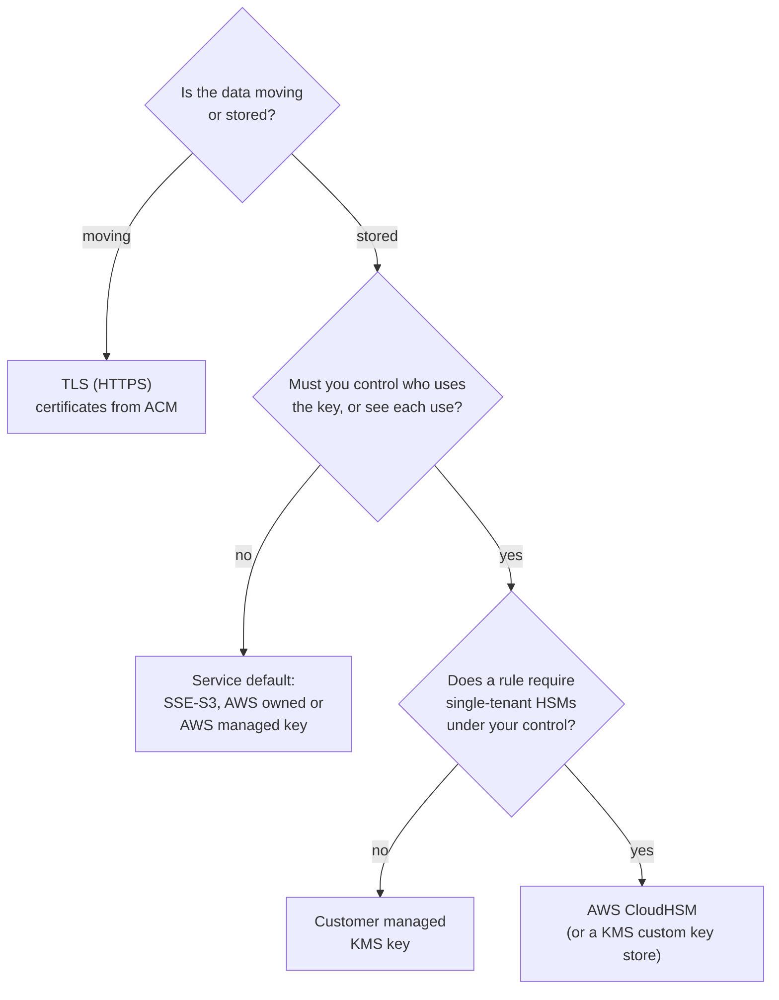

# Encryption protects data at rest and in transit; the decision that matters is who holds the key

On AWS, turning encryption on is usually one setting, and many services now do it for you. The harder choices are which data needs which protection, and who controls the key: AWS, you through AWS Key Management Service (AWS KMS), or you on hardware nobody else uses, with AWS CloudHSM. By the end of this lesson you can choose an encryption and key approach for a piece of data, and explain the choice to an auditor.

**For:** an adult studying alone, possibly new to IT, who wants to understand AWS and use it safely. **Time:** about 35 minutes. Reading works on a phone.

**Before you start:** this lesson builds on [S3 in practice](../05-storing-data/02-s3-in-practice.md) (SSE-S3, SSE-KMS, and why encryption isn't access control), [Connecting networks and offices](../07-connecting-it/04-connecting-networks-and-offices.md) (encrypted is not the same as private) and [Who did what, how it runs, how it was set](01-who-did-what.md) (CloudTrail). On [primer page 06](https://github.com/AutomateTheCloud/atc-study-aws_account_guardrails/blob/main/primer/06-safe-defaults.md) you turned on EBS encryption by default with the key `aws/ebs`; this lesson explains what that key is. If you skipped any of them, the key terms below give you enough to follow.

## Warm-up: what you remember

Answer from memory before you look anything up.

1. From lesson [08.02](../08-building-and-operating/02-iac-and-automation.md): the bakery wants every new bucket, in two Regions, created with exactly the same encryption settings. Console clicks or an AWS CloudFormation template? Why?
2. From lesson 07.04: a Site-to-Site VPN carries the head office's traffic to AWS. Is that traffic encrypted, private, or both?
3. From lesson 04.01: who decides whether the bakery's order database is encrypted at rest, AWS or the bakery?

Feedback

1. **A CloudFormation template.** The same template builds the same settings every time, in any Region, and can be reviewed before it runs. Clicks are easy to get slightly wrong. Encryption settings are a good example of something you want identical everywhere.
2. **Encrypted, not private.** The tunnel scrambles the traffic, but it still crosses the public internet. Keep the two words apart in this lesson too.
3. **The bakery.** Encryption is a setting on its resource, and settings are on the customer's side of the line. AWS provides the encryption and runs the key service.

## What you'll learn

By the end of this lesson, you can:

- tell encryption at rest from encryption in transit;
- tell ACM, AWS KMS, its kinds of key, and AWS CloudHSM apart, and say what Amazon Macie finds;
- choose an encryption and key approach for a piece of data (objective 09.02a).

Try these before you read on. Guess if you're unsure; the answers are in the lesson.

1. S3 already encrypts the bakery's cake photos. Who holds the key that does it?
2. The bakery's accountant must be able to show who is allowed to decrypt the tax records, and see every time someone does. AWS KMS or AWS CloudHSM?

## The big picture: data moving and data stored

Data is in one of two states most of the time: moving across a network, or stored somewhere. Each state has its own protection, and on AWS each store has a key behind it.

*Notice that every shaded store is encrypted. What differs from store to store is the second line: who holds the key, and so who can control and see its use.*

**Long description.** Left: the customer's browser. An arrow labeled HTTPS runs to a load balancer that holds a TLS certificate from AWS Certificate Manager. An arrow labeled HTTP or HTTPS runs from the load balancer to the web servers on EC2. From the web servers, arrows run to four shaded stores of data at rest: the server disks on EBS, protected by the AWS managed key `aws/ebs`; the order database on RDS, reached over TLS if the bakery requires it, protected by a key chosen when the database was created; the photo bucket in S3, reached over HTTPS, protected by SSE-S3, S3's own keys; and the tax archive bucket in S3, protected by SSE-KMS with the bakery's own key. A note says AWS also encrypts all traffic between Availability Zones and between Regions on its own network.

## Key terms (skip if you know them)

- **Encryption:** scrambling data with an **encryption key** (in this lesson, just "key") so that only someone with the right key can turn it back. Readable data is **plaintext**; scrambled data is **ciphertext**.
- **Encryption at rest:** protects stored data, on disks, in databases, in backups. **Encryption in transit:** protects data moving across a network. A third state, **data in use** (data in memory while a program works on it), is beyond this exam.
- **TLS** (Transport Layer Security): the protocol that encrypts web traffic; the "S" in HTTPS. A **certificate** proves to the browser that the site is who it claims to be, and makes TLS possible.
- **AWS KMS:** the AWS service that creates and controls keys for encrypting your data, and logs their use. Its keys are called **KMS keys**.
- **Hardware security module (HSM):** a tamper-resistant device that stores keys and does cryptography. **AWS CloudHSM** rents you HSMs that only you use.
- **Amazon Macie:** a service that finds **sensitive data**, such as personal or financial details, in S3.

"Key" is an everyday word for a metal object, and in S3 it also names an object (lesson 05.01). An encryption key is a long secret number that can be copied without anyone noticing, which is why the services in this lesson keep keys from ever being handed out.

## At rest and in transit are two protections against two different threats

Encryption at rest and encryption in transit sound like one feature. They protect against different things, and one doesn't give you the other.

| | Encryption at rest | Encryption in transit |
|---|---|---|
| **Protects** | Stored bytes: disks, database storage, backups, snapshots | Data crossing a network |
| **Against** | Someone getting the stored bytes, or a copy, without the key | Someone reading or changing traffic on the way |
| **On AWS** | S3, EBS and RDS encrypt with keys from S3 or AWS KMS | TLS (HTTPS) to load balancers, CloudFront, S3 and databases; IPsec VPNs; AWS encrypts traffic between Availability Zones and between Regions on its network |
| **Bakery example** | Order database, tax archive | Customers' browsers to the load balancer |
| **Who turns it on** | Often on by default (S3); a setting you choose (EBS by default per Region, RDS at creation) | You require it: HTTPS listeners, bucket policies, database settings |

AWS states that all traffic between its Availability Zones is encrypted, and that all traffic between Regions over its global network is encrypted at the physical layer ([Encrypting Amazon RDS resources](https://docs.aws.amazon.com/AmazonRDS/latest/UserGuide/Overview.Encryption.html), checked 2026-10-24). That protects AWS's links. It doesn't encrypt the connection from a customer's browser to your load balancer: that's your setting.

Two traps from earlier modules still apply. **Encrypted isn't access-controlled** (lesson 05.02): anyone your policies let read an object gets it decrypted automatically. **Encrypted isn't private** (lesson 07.04): a VPN encrypts traffic that still crosses the internet.

> **Your turn:** The bakery's owner says: "Our order database is encrypted at rest, so we don't need HTTPS on the website." In two sentences, explain what's wrong.

Model answer

Encryption at rest protects orders once they're stored, not while they travel from a customer's browser across the internet, where anyone on the path could read names, addresses and orders. The site needs encryption in transit (HTTPS) as well; each one covers a state the other doesn't.

## TLS certificates from ACM protect data in transit

To serve HTTPS, a site needs a TLS certificate, and certificates expire. **AWS Certificate Manager (ACM)** creates, stores and renews public and private TLS certificates for your AWS sites, so a certificate doesn't quietly expire and take the site down ([What is AWS Certificate Manager?](https://docs.aws.amazon.com/acm/latest/userguide/acm-overview.html), checked 2026-10-24).

- **Where it plugs in:** services integrated with ACM, such as Elastic Load Balancing, Amazon CloudFront and Amazon API Gateway. In lesson 06.02 the bakery's load balancer decrypts HTTPS with an ACM certificate, so the web servers don't have to.
- **Certificates are Regional.** To use one with CloudFront, you request or import it in US East (N. Virginia).
- **Cost (as of 2026-10-24):** public certificates used with integrated services cost nothing. Exportable public certificates, to install on your own servers, cost $7 per domain name and $79 per wildcard name, at issue and at each renewal ([ACM pricing](https://aws.amazon.com/certificate-manager/pricing/)).

Turning HTTPS on isn't the same as requiring it. S3, for example, accepts plain HTTP unless you say otherwise; AWS recommends a bucket policy that denies any request not made over HTTPS, using the `aws:SecureTransport` condition, and offers a Config rule, `s3-bucket-ssl-requests-only`, to check it ([Security best practices for Amazon S3](https://docs.aws.amazon.com/AmazonS3/latest/userguide/security-best-practices.html), checked 2026-10-24).

> **Check:** The bakery wants HTTPS on its load balancer, without anyone having to remember to renew the certificate. Which service?
>
> A. AWS KMS\
> B. AWS Certificate Manager\
> C. AWS CloudHSM\
> D. Amazon Macie

Feedback

**B is right.** ACM issues TLS certificates for integrated services such as load balancers, and renews them.

- **A is wrong.** KMS manages encryption keys for data at rest and signing, not TLS certificates for a website.
- **C is wrong.** CloudHSM is hardware for keys you control yourself; it doesn't issue or renew website certificates.
- **D is wrong.** Macie finds sensitive data in S3.

## KMS holds the keys for data at rest, and records every use

**AWS KMS** creates and controls the keys that encrypt your data. Its keys are protected by hardware security modules validated to FIPS 140-3 Security Level 3, a US government standard for cryptographic hardware, and never leave KMS unencrypted ([AWS KMS overview](https://docs.aws.amazon.com/kms/latest/developerguide/overview.html), checked 2026-10-24). Most AWS services that store data, including S3, EBS and RDS, integrate with KMS, so encrypting them with a KMS key is usually one setting. Behind that setting, the service asks KMS for a **data key**, encrypts your data with it, and stores the data key only in encrypted form, protected by your KMS key.

What you choose is the kind of KMS key ([AWS KMS keys](https://docs.aws.amazon.com/kms/latest/developerguide/concepts.html)):

- **AWS owned keys** live in AWS's accounts. A service uses them to encrypt your data by default; you can't see them, change who uses them, or audit their use, and they're free. S3's default, SSE-S3, works the same way from your side: S3 manages its own keys.
- **AWS managed keys** live in your account, with names like `aws/ebs` and `aws/rds`. You can see them, read their policies and see each use in CloudTrail, but you can't change them; AWS rotates them every year. There's no monthly fee. AWS no longer creates this kind for new services, which use AWS owned keys instead.
- **Customer managed keys** are KMS keys you create. You write the **key policy**, the resource policy that says who may use and manage the key, decide on rotation, and can disable or delete the key. You pay a monthly fee per key.

*Notice that all four encrypt equally well. Moving right buys you control and visibility, and costs money and work.*

**Long description.** An arrow runs from "AWS does more of the work" on the left to "You control, and do, more" on the right, with four cards along it. Card 1, the service's own key (AWS owned keys; S3's keys in SSE-S3): who controls use, the AWS service; seen in CloudTrail, no; fee to keep it, none; bakery, the photo bucket. Card 2, AWS managed key (`aws/ebs`, `aws/rds` and so on): who controls use, AWS, and you can read the policy; seen in CloudTrail, yes; fee, none, though requests may be billed; bakery, the server disks. Card 3, highlighted, customer managed key (a KMS key you create): who controls use, you, in its key policy; seen in CloudTrail, yes; fee, $1 a month plus requests; bakery, the tax archive. Card 4, AWS CloudHSM (HSMs only you use): who controls use, you, with HSM users outside IAM; seen in CloudTrail, no, its audit logs go to CloudWatch Logs; fee, hourly per HSM, used or not; bakery, not needed. A note says client-side encryption, where you encrypt before sending, sits beyond the right edge.

A customer managed key gives you three things an auditor values:

- **A second gate.** To read the tax archive, a person needs permission to read the bucket *and* permission to use the key. An administrator with broad S3 access still can't decrypt the files without permission to use the key, which the key policy controls.
- **A record of every use.** Each call to KMS with the key appears in CloudTrail: who, when, and for which resource. One catch for S3: with an **S3 Bucket Key** turned on, S3 calls KMS far less often and the record names the bucket, not each file; to see who read each file, you also need S3 data events in CloudTrail ([Reducing the cost of SSE-KMS with Amazon S3 Bucket Keys](https://docs.aws.amazon.com/AmazonS3/latest/userguide/bucket-key.html), checked 2026-10-24).
- **Control of the key's life.** You can turn on automatic rotation, which makes new key material every 365 days by default while keeping the old material to decrypt older data, so nothing has to be re-encrypted ([Rotate AWS KMS keys](https://docs.aws.amazon.com/kms/latest/developerguide/rotate-keys.html)).

That control carries a duty. **Deleting a KMS key makes everything encrypted under it unreadable, forever.** KMS forces a waiting period of 7 to 30 days (30 by default) before it deletes a key, and AWS suggests disabling a key instead if you aren't sure ([Delete an AWS KMS key](https://docs.aws.amazon.com/kms/latest/developerguide/deleting-keys.html)). Some choices are also hard to undo: an RDS database is encrypted, or not, when you create it, and you can't change its key afterward; to add encryption later you copy a snapshot with encryption on and restore from the copy ([Encrypting Amazon RDS resources](https://docs.aws.amazon.com/AmazonRDS/latest/UserGuide/Overview.Encryption.html)).

*Notice how small the numbers are. For most workloads, the cost of a customer managed key is not the reason to avoid one; the work of managing its policy is.*

| Kind of key | Monthly fee to keep it (as of 2026-10-24) |
|---|---|
| AWS owned key | $0 |
| AWS managed key | $0; requests beyond the free allowance may be billed |
| Customer managed key | $1, prorated hourly; the first and second rotations each add $1; later rotations add nothing |
| Requests, all keys you're billed for | 20,000 a month free across all Regions; then $0.03 per 10,000 symmetric requests |

From the [AWS KMS pricing page](https://aws.amazon.com/kms/pricing/), checked 2026-10-24.

> **Your turn:** Answer the first prequestion, then this one. The bakery's tax archive must be readable only by the accountant's role, even if someone else gets broad S3 permissions by mistake. Which kind of key, and what would you put in its key policy?

Model answer

**First prequestion:** S3 holds the key. The photos use SSE-S3, so S3 manages the keys and the bakery neither controls nor sees them. **Tax archive:** a **customer managed key**, with SSE-KMS on the bucket. Its key policy lets only the accountant's role use the key to decrypt (and an administrator role manage it, without decrypt rights). Someone with broad S3 permissions but no right to use the key would be refused the files, because S3 must use the key to return them, and each use of the key shows in CloudTrail.

## CloudHSM gives you hardware no one else uses, and more of the work

**AWS CloudHSM** gives you single-tenant hardware security modules in a cluster in your own VPC. AWS provisions them, backs them up and maintains them; you create the users and keys inside them, outside IAM. The encrypted traffic to them isn't visible to AWS, and in exchange for that control you carry more responsibility than with KMS ([What is AWS CloudHSM?](https://docs.aws.amazon.com/cloudhsm/latest/userguide/introduction.html), checked 2026-10-24).

- **When it's the answer:** a law, regulator or contract requires dedicated HSMs under your exclusive control; you need algorithms or key types KMS doesn't offer; or you're moving an application that already talks to an HSM through standard interfaces such as PKCS #11, JCE or CNG.
- **Availability is yours to design.** A cluster can hold several HSMs, and you place them in different Availability Zones for redundancy ([AWS CloudHSM clusters](https://docs.aws.amazon.com/cloudhsm/latest/userguide/clusters.html)).
- **Cost:** an hourly fee for each HSM until you delete it, whether you use it or not. The pricing page gave no rate on 2026-10-24; use the AWS Pricing Calculator.
- **The bridge:** a KMS **custom key store** keeps KMS keys in your CloudHSM cluster, so services that use KMS, such as S3 and RDS, can use keys held in HSMs only you control.

### "Compliance needs CloudHSM" is wrong

You may have read that any regulated workload needs CloudHSM. That's wrong. KMS keys are already protected by FIPS 140-3 Level 3 validated hardware, and AWS's own CloudHSM guide says to consider KMS if you want managed keys and don't need to operate your own HSMs. CloudHSM is the answer when a rule specifically requires single-tenant HSMs, or full control that KMS's shared, managed service can't give. It's tempting because "hardware security module" sounds stronger than "key service", when in fact KMS runs on HSMs too.

| | AWS KMS | AWS CloudHSM | AWS Certificate Manager |
|---|---|---|---|
| **Manages** | Encryption keys, mostly for data at rest | Keys inside HSMs that only you use | TLS certificates, for data in transit |
| **Who runs the hardware** | AWS, shared by many customers | AWS runs it; only you use it | AWS |
| **Who controls access** | Key policies and IAM | HSM users you create, outside IAM | IAM |
| **Works with** | Most AWS storage services | Your applications; KMS through a custom key store | Load balancers, CloudFront, API Gateway |
| **Cost (as of 2026-10-24)** | $1 per customer managed key a month, plus requests | Hourly per HSM | Free for integrated public certificates |

**What's the same:** all three protect data with cryptography, and AWS runs the infrastructure for all three. **What differs:** KMS and CloudHSM hold keys for data at rest (and signing); ACM holds certificates for data in transit; CloudHSM trades convenience for exclusive control. **The principle:** default to KMS; reach for CloudHSM only when a requirement names dedicated HSMs; use ACM whenever a website or API needs HTTPS.

*Notice that most data stops at the first or second box. Each step to the right adds control and work; take it only when a requirement asks for it.*

**Long description.** A decision flowchart. First question: is the data moving or stored? Moving: use TLS (HTTPS), with certificates from ACM. Stored: must you control who uses the key, or see each use? No: use the service's default, such as SSE-S3 or an AWS owned or AWS managed key. Yes: does a rule require single-tenant HSMs under your control? No: use a customer managed KMS key. Yes: use AWS CloudHSM, directly or through a KMS custom key store.

> **Check:** Answer the second prequestion. The accountant must show who may decrypt the tax records and see every time someone does. Nothing requires dedicated hardware. Which fits best?
>
> A. SSE-S3, the default\
> B. A customer managed key in AWS KMS\
> C. AWS CloudHSM\
> D. A certificate from ACM

Feedback

**B is right.** Its key policy shows exactly who may decrypt, and CloudTrail records each use.

- **A is wrong.** S3 manages SSE-S3's keys; the bakery can't set or show who may use them, and their use doesn't appear in its CloudTrail.
- **C is wrong.** CloudHSM would work, but adds cost and work that nothing requires.
- **D is wrong.** ACM certificates protect data in transit, not stored records.

## Macie finds sensitive data in S3, so you know what to protect

You can't choose protection for data you don't know you have. **Amazon Macie** inventories your S3 general purpose buckets and uses machine learning and pattern matching to find **sensitive data** inside objects: **personally identifiable information (PII)** such as names, addresses and ID numbers, financial details and credentials ([What is Amazon Macie?](https://docs.aws.amazon.com/macie/latest/user/what-is-macie.html), checked 2026-10-24). It also watches bucket settings and raises a finding if, for example, a bucket becomes publicly accessible. Findings go to Amazon EventBridge and AWS Security Hub CSPM, which lesson 09.03 covers.

Sorting data by how sensitive it is, called **data classification**, comes before choosing protection. If Macie found customers' addresses in the photo bucket, that bucket would move from "default encryption is enough" toward the tax archive's treatment.

Keep Macie apart from its neighbors: **Macie** asks *what is in* your S3 data; **Amazon GuardDuty** asks whether *activity* on your buckets looks malicious; **Amazon Inspector** asks whether your *software* has known vulnerabilities.

Macie starts with a 30-day free trial, then charges per bucket, per object monitored and per GB inspected. We haven't checked whether Macie opens on the Free plan; GuardDuty and Security Hub CSPM didn't, on 2026-10-23. This guide doesn't have you turn it on.

> **Your turn:** The bakery's new marketing intern uploaded a spreadsheet of customers' names, emails and birthdays somewhere in S3, and nobody knows which bucket. Which service finds it, and what would you change once you know where it is?

Model answer

**Amazon Macie**: a sensitive data discovery job, or its automated discovery, flags the object as containing PII. Then move the file to a bucket that holds customer data, check that bucket's access policies and Block Public Access, consider a customer managed key so access and use are controlled and logged, and delete copies that shouldn't exist.

## Worked example: the bakery chooses protection for each kind of data

The auditor asks how each kind of data is protected, and who holds the keys. An expert decides one item at a time.

| Data | Moving or stored | Requirement | Choice | Why |
|---|---|---|---|---|
| Customers' browsers to the site | Moving | Names, addresses and orders cross the internet | HTTPS on the load balancer, certificate from ACM | Free, renews itself |
| Cake photos | Stored | Public anyway, once on the site | SSE-S3, the default | Nothing to control or audit |
| Server disks | Stored | Encrypted, nothing more | EBS encryption by default, `aws/ebs` | Already on from primer page 06 |
| Order database | Stored | Customers' addresses; must be encrypted | RDS encryption at creation, with the AWS managed key | Can't be added in place later; no rule asks the bakery to control the key |
| Tax archive | Stored | Accountant must show who can decrypt, and each use | SSE-KMS with a customer managed key | Key policy and CloudTrail give the evidence |

The expert's thinking:

1. **Moving or stored first.** That decides between ACM and KMS.
2. **Then ask who must control or see the key.** "Must be encrypted" is met by the default; "must show who can decrypt" needs a key whose policy you write.
3. **Check what can't change later.** RDS encryption is decided at creation.
4. **Stop at the least work that meets the requirement.** No requirement names dedicated hardware, so CloudHSM appears nowhere.

You'll look at encryption settings in your own account in [Lab 12: answer the auditor](07-lab-12-answer-the-auditor.md).

## Your side of the line

AWS runs KMS and its hardware, CloudHSM's hardware, ACM, and the encryption on its own network links. You decide what is encrypted and with which kind of key, write key policies, turn on rotation, require HTTPS, classify sensitive data, and keep the keys you still need. Lesson 04.01 put your data's encryption options on your side for every service; this is what that means in practice.

## What you pay for

> **What you pay for (as of 2026-10-24):**
>
> - **AWS KMS:** the fees in the table above ([KMS pricing](https://aws.amazon.com/kms/pricing/)). SSE-KMS on a bucket adds KMS request charges; SSE-S3 adds nothing.
> - **AWS CloudHSM:** an hourly fee per HSM until you delete it; the rate is in the AWS Pricing Calculator ([CloudHSM pricing](https://aws.amazon.com/cloudhsm/pricing/)).
> - **ACM:** public certificates used with integrated services, no charge; exportable certificates charged per name ([ACM pricing](https://aws.amazon.com/certificate-manager/pricing/)).
> - **Amazon Macie:** 30-day free trial, then per bucket, per object monitored and per GB inspected ([Macie pricing](https://aws.amazon.com/macie/pricing/)).

## In real work: classify first, encrypt everywhere, control keys where it matters

Teams classify their data, turn on encryption everywhere by default, use customer managed keys where they must prove who has access, and require TLS on every connection. The Well-Architected Framework names these habits:

- The security design principle "[Protect data in transit and at rest](https://docs.aws.amazon.com/wellarchitected/latest/framework/sec-design.html)".
- [SEC07-BP01 Understand your data classification scheme](https://docs.aws.amazon.com/wellarchitected/latest/security-pillar/sec_data_classification_identify_data.html): know which data is sensitive; Macie helps find it.
- [SEC08-BP01 Implement secure key management](https://docs.aws.amazon.com/wellarchitected/latest/security-pillar/sec_protect_data_rest_key_mgmt.html) and [SEC08-BP02 Enforce encryption at rest](https://docs.aws.amazon.com/wellarchitected/latest/security-pillar/sec_protect_data_rest_encrypt.html): KMS keys with tight key policies; encryption on by default.
- [SEC09-BP01 Implement secure key and certificate management](https://docs.aws.amazon.com/wellarchitected/latest/security-pillar/sec_protect_data_transit_key_cert_mgmt.html) and [SEC09-BP02 Enforce encryption in transit](https://docs.aws.amazon.com/wellarchitected/latest/security-pillar/sec_protect_data_transit_encrypt.html): ACM certificates that renew themselves; HTTPS required, not just offered.

## Summary

- **At rest and in transit are different protections.** At rest protects stored bytes; in transit protects data on the network. AWS encrypts traffic between its Availability Zones and Regions; the connection to your customers is your setting.
- **ACM** issues and renews TLS certificates for load balancers, CloudFront and API Gateway, free for integrated public certificates. Turning HTTPS on isn't requiring it.
- **AWS KMS** holds keys for data at rest. AWS owned and AWS managed keys are free and need no work; a customer managed key costs $1 a month (as of 2026-10-24) and gives you a key policy, CloudTrail records of every use, and rotation. Deleting a key destroys access to its data.
- **AWS CloudHSM** gives single-tenant HSMs you control, billed hourly. Choose it only when a requirement names dedicated HSMs; KMS already runs on validated HSMs.
- **Amazon Macie** finds sensitive data and exposed buckets in S3. Classify first, then choose protection.
- **Choose by:** moving or stored, then who must control or see the key, then whether dedicated hardware is required.

**For the auditor:** every store is encrypted; the tax archive uses a customer managed key whose policy and CloudTrail records show who can decrypt and who did.

## Practice

1. **A company must encrypt data sent between users' browsers and its Application Load Balancer. Which AWS service provides the certificate?**

   A. AWS KMS\
   B. AWS Certificate Manager\
   C. AWS CloudHSM\
   D. AWS Secrets Manager

   

Feedback

   **B is right.** ACM provides TLS certificates for integrated services such as load balancers, and renews them.

   - **A is wrong.** KMS manages encryption keys, mostly for data at rest; it doesn't issue website certificates.
   - **C is wrong.** CloudHSM holds keys in dedicated hardware; it doesn't issue certificates for a load balancer.
   - **D is wrong.** Secrets Manager stores and rotates secrets such as database passwords (lesson 04.05).

   

2. **Which requirement points to AWS CloudHSM rather than AWS KMS?**

   A. Data in S3 must be encrypted at rest\
   B. The company must see each use of its keys in CloudTrail\
   C. A contract requires single-tenant hardware security modules under the company's exclusive control\
   D. The company wants AWS to rotate keys every year

   

Feedback

   **C is right.** Dedicated, single-tenant HSMs under your control are what CloudHSM provides and KMS doesn't.

   - **A is wrong.** Any KMS key, or the service default, meets this.
   - **B is wrong.** KMS records each use of customer managed and AWS managed keys in CloudTrail.
   - **D is wrong.** AWS managed keys rotate yearly, and customer managed keys can rotate automatically.

   

3. **What is the difference between an AWS managed key and a customer managed key in AWS KMS? Answer in two sentences.**

   

Feedback

   **Model answer:** Both live in your account and both show their use in CloudTrail, but AWS creates, controls and yearly rotates an AWS managed key, and you can't change its policy. You create a customer managed key, write its key policy, choose its rotation and can disable or delete it, for a monthly fee.

   

4. **Which service finds personally identifiable information stored in Amazon S3 buckets?**

   A. Amazon GuardDuty\
   B. Amazon Inspector\
   C. Amazon Macie\
   D. AWS Config

   

Feedback

   **C is right.** Macie discovers sensitive data, such as PII, in S3 objects.

   - **A is wrong.** GuardDuty looks for suspicious activity, not the content of objects.
   - **B is wrong.** Inspector scans software for vulnerabilities.
   - **D is wrong.** Config records resource settings, such as whether a bucket is encrypted, not what's inside it.

   

5. **(From lesson 09.01.) The auditor asks who decrypted the tax archive last month. Which record answers, and what must be true for it to?**

   

Feedback

   **CloudTrail.** Each call to KMS with a customer managed key is recorded there, so it shows who used the key. Last month is inside Event history's 90 days; for older uses, you need a trail that was already running. If the bucket uses an S3 Bucket Key, the KMS records name the bucket rather than each file, so per-file reads also need S3 data events, which a trail records only if you turned them on.

   

6. **(From lesson 04.05.) AWS Secrets Manager always encrypts the secrets it stores. Which service holds the keys it uses?**

   

Feedback

   **AWS KMS.** Secrets Manager encrypts each secret with a KMS key, so the key choices in this lesson apply to secrets too.

   

**Next:** lesson 09.03, [Finding threats and weaknesses](03-finding-threats-and-weaknesses.md). To check encryption in your own account, do [Lab 12: answer the auditor](07-lab-12-answer-the-auditor.md).

## Where to check the current details

- [AWS KMS overview](https://docs.aws.amazon.com/kms/latest/developerguide/overview.html), [AWS KMS keys](https://docs.aws.amazon.com/kms/latest/developerguide/concepts.html), [Rotate AWS KMS keys](https://docs.aws.amazon.com/kms/latest/developerguide/rotate-keys.html), [Delete an AWS KMS key](https://docs.aws.amazon.com/kms/latest/developerguide/deleting-keys.html) and [KMS pricing](https://aws.amazon.com/kms/pricing/) (checked 2026-10-24)
- [What is AWS CloudHSM?](https://docs.aws.amazon.com/cloudhsm/latest/userguide/introduction.html) and [CloudHSM pricing](https://aws.amazon.com/cloudhsm/pricing/) (checked 2026-10-24)
- [What is AWS Certificate Manager?](https://docs.aws.amazon.com/acm/latest/userguide/acm-overview.html) and [ACM pricing](https://aws.amazon.com/certificate-manager/pricing/) (checked 2026-10-24)
- [Encrypting Amazon RDS resources](https://docs.aws.amazon.com/AmazonRDS/latest/UserGuide/Overview.Encryption.html) and [Security best practices for Amazon S3](https://docs.aws.amazon.com/AmazonS3/latest/userguide/security-best-practices.html) (checked 2026-10-24)
- [What is Amazon Macie?](https://docs.aws.amazon.com/macie/latest/user/what-is-macie.html) and [Macie pricing](https://aws.amazon.com/macie/pricing/) (checked 2026-10-24)
- [AWS Certified Cloud Practitioner (CLF-C02) exam guide](https://docs.aws.amazon.com/aws-certification/latest/cloud-practitioner-02/cloud-practitioner-02.html), task [2.2](https://docs.aws.amazon.com/aws-certification/latest/cloud-practitioner-02/cloud-practitioner-02-domain2.html#cloud-practitioner-02-task2.2) (checked 2026-10-24)

---

"Encryption" by Automate the Cloud Inc., licensed under CC BY-NC 4.0 with the Additional Permission for Internal Training from Automate the Cloud Inc.
License: https://creativecommons.org/licenses/by-nc/4.0/
Permission: https://automatethe.cloud/licenses/atc-internal-training-permission.txt
