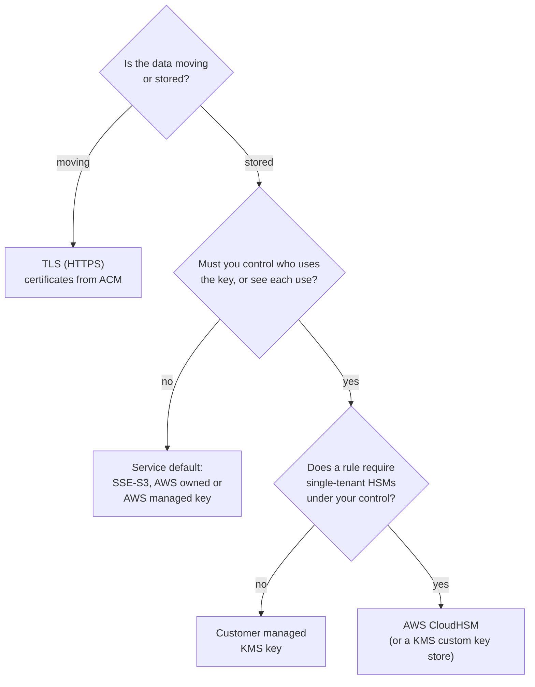

# Encryption protects data at rest and in transit; the decision that matters is who holds the key

On AWS, turning encryption on is usually one setting, and many services do it for you. The exam asks which tool fits: a certificate from ACM for data moving, a key in AWS KMS for data stored, AWS CloudHSM only when a rule demands hardware nobody else uses.

**For:** an adult studying alone, possibly new to IT, who wants to understand AWS and use it safely. **Time:** about 20 minutes. Reading works on a phone.

**Before you start:** this lesson builds on [S3 in practice](../05-storing-data/02-s3-in-practice.md) (SSE-S3, SSE-KMS) and [Connecting networks and offices](../07-connecting-it/04-connecting-networks-and-offices.md) (encrypted is not the same as private).

## Warm-up: what you remember

1. From lesson 07.04: a Site-to-Site VPN carries the head office's traffic to AWS. Is that traffic encrypted, private, or both?
2. From lesson 04.01: who decides whether the bakery's order database is encrypted at rest, AWS or the bakery?

Feedback

1. **Encrypted, not private.** The tunnel scrambles the traffic, but it still crosses the public internet.
2. **The bakery.** Encryption is a setting on its resource, on the customer's side of the line. AWS provides the encryption and runs the key service.

## What you'll learn

By the end of this lesson, you can tell encryption at rest from encryption in transit, tell ACM, AWS KMS and AWS CloudHSM apart, say what Amazon Macie finds, and choose an encryption and key approach for a piece of data (objective 09.02a).

Try this before you read on, and guess if you're unsure: the bakery's accountant must show who is allowed to decrypt the tax records, and see every time someone does. AWS KMS or AWS CloudHSM?

## The big picture: data moving and data stored

**Encryption** scrambles data with an **encryption key** so that only someone with the right key can read it. Data is usually either moving across a network or stored somewhere, and each state has its own protection.

*Notice that every shaded store is encrypted. What differs from store to store is the second line: who holds the key, and so who can control and see its use.*

**Long description.** Left: the customer's browser. An arrow labeled HTTPS runs to a load balancer that holds a TLS certificate from AWS Certificate Manager. An arrow labeled HTTP or HTTPS runs from the load balancer to the web servers on EC2. From the web servers, arrows run to four shaded stores of data at rest: the server disks on EBS, protected by the AWS managed key `aws/ebs`; the order database on RDS, reached over TLS if the bakery requires it, protected by a key chosen when the database was created; the photo bucket in S3, reached over HTTPS, protected by SSE-S3, S3's own keys; and the tax archive bucket in S3, protected by SSE-KMS with the bakery's own key. A note says AWS also encrypts all traffic between Availability Zones and between Regions on its own network.

## At rest and in transit are two protections against two different threats

| | Encryption at rest | Encryption in transit |
|---|---|---|
| **Protects** | Stored bytes: disks, databases, backups, snapshots | Data crossing a network |
| **Against** | Someone getting the stored bytes without the key | Someone reading or changing traffic on the way |
| **On AWS** | S3, EBS and RDS encrypt with keys from S3 or AWS KMS | TLS (HTTPS) to load balancers, CloudFront, S3 and databases; IPsec VPNs |
| **Who turns it on** | Often on by default (S3); a setting you choose (EBS, RDS) | You require it: HTTPS listeners, bucket policies, database settings |

AWS states that all traffic between its Availability Zones is encrypted, and so is traffic between Regions over its global network ([Encrypting Amazon RDS resources](https://docs.aws.amazon.com/AmazonRDS/latest/UserGuide/Overview.Encryption.html), checked 2026-10-24). That protects AWS's links, not the connection from a customer's browser to your load balancer: that's your setting. And encrypted isn't access-controlled: anyone your policies let read an object gets it decrypted automatically (lesson 05.02).

## TLS certificates from ACM protect data in transit

**TLS** (Transport Layer Security) is the protocol behind HTTPS, and a **certificate** proves to the browser that the site is who it claims to be. **AWS Certificate Manager (ACM)** creates, stores and renews public and private TLS certificates for your AWS sites, so a certificate doesn't quietly expire and take the site down ([What is AWS Certificate Manager?](https://docs.aws.amazon.com/acm/latest/userguide/acm-overview.html), checked 2026-10-24). It plugs into integrated services such as Elastic Load Balancing, Amazon CloudFront and Amazon API Gateway. Public certificates used with those services cost nothing (as of 2026-10-24, [ACM pricing](https://aws.amazon.com/certificate-manager/pricing/)).

Turning HTTPS on isn't the same as requiring it: S3, for example, accepts plain HTTP unless a bucket policy denies it.

## KMS holds the keys for data at rest, and records every use

**AWS Key Management Service (AWS KMS)** creates and controls the keys that encrypt your data; its keys are called **KMS keys**. They're protected by hardware security modules validated to FIPS 140-3 Security Level 3, a US government standard, and never leave KMS unencrypted ([AWS KMS overview](https://docs.aws.amazon.com/kms/latest/developerguide/overview.html), checked 2026-10-24). Most AWS services that store data, including S3, EBS and RDS, integrate with KMS, so encrypting them with a KMS key is usually one setting. You choose the kind of key ([AWS KMS keys](https://docs.aws.amazon.com/kms/latest/developerguide/concepts.html)):

- **AWS owned keys** live in AWS's accounts. A service uses them by default; you can't see them, manage them or audit their use, and they're free.
- **AWS managed keys** live in your account, with names like `aws/ebs`. You can see each use in CloudTrail, but you can't change them. There's no monthly fee.
- **Customer managed keys** are keys you create. You write the **key policy**, the resource policy that says who may use and manage the key, choose rotation, and can disable or delete the key. Each costs $1 a month to keep, before rotation and request charges (as of 2026-10-24, [KMS pricing](https://aws.amazon.com/kms/pricing/)).

A customer managed key gives an auditor three things: a second gate (reading the tax archive needs permission on the bucket *and* on the key), a CloudTrail record of every use, and control of the key's life. That control carries a duty: deleting a key makes everything encrypted under it unreadable, forever.

**AWS Secrets Manager** (lesson 04.05) is a different tool: it stores and rotates secrets such as database passwords, and encrypts them with KMS keys.

### CloudHSM gives you hardware no one else uses, and more of the work

A **hardware security module (HSM)** is a tamper-resistant device that stores keys and does cryptography. **AWS CloudHSM** gives you single-tenant HSMs in a cluster in your own VPC. AWS provisions and maintains them; you create the users and keys inside them, outside IAM, and carry more responsibility than with KMS ([What is AWS CloudHSM?](https://docs.aws.amazon.com/cloudhsm/latest/userguide/introduction.html), checked 2026-10-24). It's billed per HSM per hour, used or not.

Choose it when a law, regulator or contract requires dedicated HSMs under your exclusive control, or you need algorithms or interfaces KMS doesn't offer. "Regulated" alone doesn't mean CloudHSM: KMS already runs on validated HSMs, and AWS's own CloudHSM guide says to consider KMS if you don't need to operate your own HSMs.

*Notice that most data stops at the first or second box. Each step down adds control and work; take it only when a requirement asks for it.*

**Long description.** A decision flowchart. First question: is the data moving or stored? Moving: use TLS (HTTPS), with certificates from ACM. Stored: must you control who uses the key, or see each use? No: use the service's default, such as SSE-S3 or an AWS owned or AWS managed key. Yes: does a rule require single-tenant HSMs under your control? No: use a customer managed KMS key. Yes: use AWS CloudHSM, directly or through a KMS custom key store.

> **Your turn:** Answer the prequestion. The accountant must show who may decrypt the tax records and see every time someone does; nothing requires dedicated hardware. Which kind of key, and why not the other choices?

Model answer

**A customer managed key in AWS KMS**, with SSE-KMS on the bucket. Its key policy shows exactly who may decrypt, and CloudTrail records each use. SSE-S3's keys are managed by S3, so the bakery can't show or limit who uses them. CloudHSM would work, but it adds hourly cost and work that nothing requires.

## Macie finds sensitive data in S3, so you know what to protect

You can't choose protection for data you don't know you have. **Amazon Macie** uses machine learning and pattern matching to find **sensitive data** in your S3 buckets: **personally identifiable information (PII)** such as names, addresses and ID numbers, financial details and credentials. It also flags bucket settings, such as a bucket becoming publicly accessible ([What is Amazon Macie?](https://docs.aws.amazon.com/macie/latest/user/what-is-macie.html), checked 2026-10-24). If Macie found customers' addresses in the photo bucket, that bucket would need the tax archive's treatment.

Keep Macie apart from its neighbors: **Macie** asks *what is in* your S3 data; **Amazon GuardDuty** asks whether *activity* looks malicious; **Amazon Inspector** asks whether your *software* has known vulnerabilities (lesson 09.03).

## Summary

- **At rest and in transit are different protections.** AWS encrypts traffic between its Availability Zones and Regions; the connection to your customers is your setting.
- **ACM** issues and renews TLS certificates for load balancers, CloudFront and API Gateway; integrated public certificates are free.
- **AWS KMS** holds keys for data at rest. A customer managed key gives you a key policy, a CloudTrail record of every use, and rotation, from $1 a month (as of 2026-10-24).
- **AWS CloudHSM** gives single-tenant HSMs you control, billed hourly; choose it only when a requirement names dedicated HSMs. **Macie** finds sensitive data in S3.

## Practice

1. **A company must encrypt data sent between users' browsers and its Application Load Balancer. Which AWS service provides the certificate?**

   A. AWS KMS\
   B. AWS Certificate Manager\
   C. AWS CloudHSM\
   D. AWS Secrets Manager

   

Feedback

   **B is right.** ACM provides TLS certificates for integrated services such as load balancers, and renews them.

   - **A is wrong.** KMS manages encryption keys, mostly for data at rest; it doesn't issue website certificates.
   - **C is wrong.** CloudHSM holds keys in dedicated hardware; it doesn't issue certificates for a load balancer.
   - **D is wrong.** Secrets Manager stores and rotates secrets such as database passwords.

   

2. **Which requirement points to AWS CloudHSM rather than AWS KMS?**

   A. Data in S3 must be encrypted at rest\
   B. The company must see each use of its keys in CloudTrail\
   C. A contract requires single-tenant hardware security modules under the company's exclusive control\
   D. The company wants its keys rotated every year

   

Feedback

   **C is right.** Dedicated, single-tenant HSMs under your control are what CloudHSM provides and KMS doesn't.

   - **A is wrong.** Any KMS key, or the service default, meets this.
   - **B is wrong.** KMS records each use of customer managed and AWS managed keys in CloudTrail.
   - **D is wrong.** KMS keys can be rotated automatically.

   

3. **Which service finds personally identifiable information stored in Amazon S3 buckets?**

   A. Amazon GuardDuty\
   B. Amazon Inspector\
   C. Amazon Macie\
   D. AWS Config

   

Feedback

   **C is right.** Macie discovers sensitive data, such as PII, in S3 objects.

   - **A is wrong.** GuardDuty looks for suspicious activity, not the content of objects.
   - **B is wrong.** Inspector scans software for vulnerabilities.
   - **D is wrong.** Config records resource settings, such as whether a bucket is encrypted, not what's inside it.

   

**Next:** [Finding threats and weaknesses](03-finding-threats-and-weaknesses.md).

## Where to check the current details

- [AWS KMS keys](https://docs.aws.amazon.com/kms/latest/developerguide/concepts.html) and [KMS pricing](https://aws.amazon.com/kms/pricing/) (checked 2026-10-24)
- [What is AWS CloudHSM?](https://docs.aws.amazon.com/cloudhsm/latest/userguide/introduction.html) (checked 2026-10-24)
- [What is AWS Certificate Manager?](https://docs.aws.amazon.com/acm/latest/userguide/acm-overview.html) (checked 2026-10-24)

---

"Encryption" by Automate the Cloud Inc., licensed under CC BY-NC 4.0 with the Additional Permission for Internal Training from Automate the Cloud Inc.
License: https://creativecommons.org/licenses/by-nc/4.0/
Permission: https://automatethe.cloud/licenses/atc-internal-training-permission.txt
