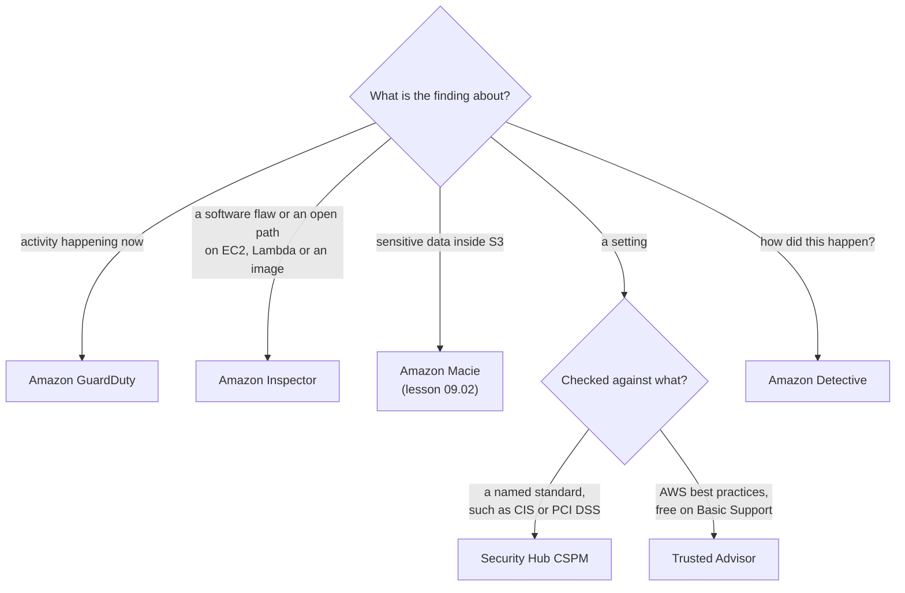

# Each detection service watches something different, and none of them blocks anything: match the finding to the service

Lesson 07.02 met one detection service: Amazon Inspector reports open paths and changes nothing. This lesson adds the rest of the family: Amazon GuardDuty spots attacks in progress, Inspector finds weaknesses, AWS Security Hub gathers every finding and checks your settings against standards, and Amazon Detective explains what happened. By the end you can read a finding and name the service that raised it.

**For:** an adult studying alone, possibly new to IT, who wants to understand AWS and use it safely. **Time:** about 35 minutes. Reading works on a phone.

**Before you start:** this lesson builds on [Filtering traffic](../07-connecting-it/02-filtering-traffic.md) (Inspector, VPC Flow Logs) and [Security of vs in the cloud](../04-shared-responsibility-and-access/01-security-of-vs-in-the-cloud.md). Lesson 09.01, [Who did what](01-who-did-what.md), covers CloudTrail, which feeds GuardDuty; lesson 09.02, [Encryption](02-encryption.md), covers Amazon Macie. If you haven't read them, the key terms below are enough. The scenario is in the [module brief](00-brief.md).

## Warm-up: what you remember

Answer from memory before you look anything up.

1. From [Lab 11](../08-building-and-operating/06-lab-11-alarm-on-errors.md): the bakery wants an email when its order function starts failing. Which two services build that alert, and is AWS CloudTrail one of them?
2. From lesson 07.02: Amazon Inspector reports that the web server is reachable from the internet on port 22. Does Inspector close the port?
3. From lesson 04.01: the bakery's web server runs on EC2. Who patches its operating system and the software installed on it, AWS or the bakery?

Feedback

1. **Amazon CloudWatch and Amazon SNS.** A CloudWatch alarm watches the function's error metric and sends a message to an SNS topic, which emails the owner. CloudTrail records who called which API; it isn't built for alerts on errors.
2. **No.** Inspector finds and reports. The bakery fixes the security group or network ACL rule. Every service in this lesson works the same way.
3. **The bakery.** On EC2, the guest operating system and everything installed on it are the customer's. That's why a scanner that finds missing patches is useful: the patching is your job.

## What you'll learn

By the end of this lesson, you can:

- say what Amazon GuardDuty, Amazon Inspector, AWS Security Hub, Amazon Detective and AWS Trusted Advisor each look at and report;
- explain why "AWS Security Hub" now names two products, and which one the exam means;
- match a finding to the service that raised it (objective 09.03a);
- say what AWS Marketplace adds for security.

Try these before you read on. Guess if you're unsure; the answers are in the lesson.

1. A report says the web server's credentials were just used from an address outside AWS. Which service raised it?
2. Is AWS Security Hub one product?

## The big picture: weaknesses before, threats during, investigation after

Ask two questions about any finding: *when* in an attack does it matter, and *what* did the service look at? Those two questions sort the family.

*Notice the subtitle: all of these services report and none of them blocks. Blocking belongs to the filters in lesson 07.02 and the front door in lesson 09.04.*

**Long description.** A time line runs left to right in three columns. Before an attack, the question is "is there a hole?": AWS Trusted Advisor runs best-practice checks on the account, a few security checks free on Basic Support, and its results stay in its own console; Amazon Inspector finds known software flaws and unintended network exposure in EC2 instances, Lambda functions and container images. During, the question is "is someone at it now?": Amazon GuardDuty finds suspicious activity in CloudTrail events, VPC Flow Logs and DNS logs, such as stolen credentials, crypto mining and calls from known bad addresses. After, the question is "how did it happen?": Amazon Detective starts from a finding, shown by an arrow from GuardDuty, and investigates it with up to a year of history. Arrows labeled "findings" run from Inspector and GuardDuty down to a highlighted band, AWS Security Hub. In it, Security Hub CSPM, the original Security Hub, runs its own checks of your settings against standards such as CIS and PCI DSS, collects the other services' findings and scores you, and the newer, unified Security Hub correlates them into exposures. A note adds that Amazon Macie's findings about sensitive data in S3 also arrive there.

## Key terms (skip if you know them)

- **Threat:** someone or something actively trying to cause harm, such as an attacker using stolen credentials. In everyday speech a threat is a warning of harm; here it means harmful activity that may already be happening.
- **Vulnerability:** a weakness that an attacker could use, such as an unpatched software flaw or a port left open. It does nothing until someone uses it.
- **Finding:** a service's report of one possible security problem, naming the resource, what was seen and how severe the service thinks it is.
- **CVE** (Common Vulnerabilities and Exposures): a public, numbered entry for one known software flaw, such as a bug in a widely used encryption library. Scanners match installed software against these entries.
- **Security standard:** a published list of recommended settings, such as the [CIS AWS Foundations Benchmark](https://www.cisecurity.org/benchmark/amazon_web_services) or the Payment Card Industry Data Security Standard (PCI DSS). A service can check your settings against one and report each setting that fails.

## GuardDuty watches activity and reports threats happening now

**Amazon GuardDuty** is a threat detection service. It reads activity in your account continuously and compares it with threat intelligence (lists of known malicious addresses and domains) and with machine-learning models of normal behavior. When something looks malicious or suspicious, it raises a finding ([What is Amazon GuardDuty?](https://docs.aws.amazon.com/guardduty/latest/ug/what-is-guardduty.html), checked 2026-10-24).

Three sources are its foundation, and it reads them as soon as you turn it on, with nothing else to set up:

- **CloudTrail management events:** who called which AWS API, from where (lesson 09.01).
- **VPC Flow Logs** from EC2 instances: which addresses talked to which, on which ports (lesson 07.02).
- **DNS logs:** which domain names your resources looked up.

You don't need to create a trail or turn on flow logs yourself for GuardDuty to use them. Optional **protection plans** widen its view, for example to S3 data access, RDS sign-ins or malware. It works per Region, so you turn it on in each Region you use.

Real finding types show what it catches; each name gives the kind of threat and the resource ([GuardDuty finding types](https://docs.aws.amazon.com/guardduty/latest/ug/guardduty_finding-types-active.html), checked 2026-10-24):

| Finding type | What it means | Seen in |
|---|---|---|
| `UnauthorizedAccess:IAMUser/InstanceCredentialExfiltration.OutsideAWS` | Credentials that belong to an EC2 instance were used from an address outside AWS | CloudTrail events |
| `CryptoCurrency:EC2/BitcoinTool.B!DNS` | An instance is looking up domains linked to cryptocurrency mining | DNS logs |
| `UnauthorizedAccess:EC2/SSHBruteForce` | An instance is involved in repeated attempts to guess SSH passwords | VPC Flow Logs |
| `Policy:IAMUser/RootCredentialUsage` | Someone used the root user's credentials | CloudTrail events |

GuardDuty reports; it doesn't stop anything. A finding can trigger an automatic response through Amazon EventBridge, which you build, and GuardDuty sends its findings to Security Hub and Detective.

> **Your turn:** The bakery has GuardDuty turned on. Someone signs in as the root user on a Saturday night. Will GuardDuty prevent the sign-in, report it, or ignore it? What would the bakery need to add for a phone alert?

Model answer

**It reports it,** with a finding such as `Policy:IAMUser/RootCredentialUsage`, seen in CloudTrail events. It doesn't prevent the sign-in; root MFA (primer page 02) does that job. For a phone alert, the bakery adds an EventBridge rule that matches GuardDuty findings and sends them to an SNS topic, the same pattern Module 08 used for CloudWatch alarms.

## Inspector scans workloads and reports weaknesses before an attacker finds them

**Amazon Inspector** is a vulnerability management service. It finds the bakery's EC2 instances, Lambda functions and container images in Amazon ECR on its own, and scans them for two kinds of weakness ([What is Amazon Inspector?](https://docs.aws.amazon.com/inspector/latest/user/what-is-inspector.html), checked 2026-10-24):

- **Software vulnerabilities:** known flaws (CVEs) in the software packages installed on them.
- **Unintended network exposure:** a real network path from the internet to a port, worked out from routes, network ACLs and security groups (lesson 07.02).

It scans continuously. When a package is installed, a patch is applied or a new CVE is published, it scans again; you never schedule a scan. Each finding includes a fix, and when you fix the problem, Inspector closes the finding by itself. Its risk score adjusts the public severity to your setup: a flaw that can be attacked over the network scores lower on a server with no open path from the internet.

**GuardDuty and Inspector, side by side.** Both raise findings about EC2 instances, so they are easy to mix up. Inspector reads what is *installed and reachable* and says "this could be attacked". GuardDuty reads what is *happening* and says "this looks like an attack". A server can carry an Inspector finding for months with no GuardDuty finding, until someone uses the hole.

### "Create an assessment template and install the Inspector agent" is out of date

You may read that you use Inspector by defining an assessment target, choosing an **assessment template**, installing the Inspector agent and scheduling runs. That describes **Amazon Inspector Classic**, which AWS shut down on 2026-05-20 ([Services in full shutdown](https://docs.aws.amazon.com/general/latest/gr/full_shutdown_services.html), checked 2026-10-24). Today's Inspector discovers resources and scans them without templates or schedules. For EC2 it uses the AWS Systems Manager agent or scans without an agent; there is no separate Inspector agent. The old wording is tempting because a lot of study material and many practice questions were written before the rebuild, and the service kept its name.

> **Check:** Answer the first prequestion. A finding says the web server's instance credentials were used from an address outside AWS. Which service raised it?
>
> A. Amazon Inspector
> B. Amazon GuardDuty
> C. AWS Trusted Advisor
> D. AWS Config

Feedback

**B is right.** It's activity, seen in CloudTrail events: a threat happening now.

- **A is wrong.** Inspector reports flaws in installed software and open network paths, not how credentials are used.
- **C is wrong.** Trusted Advisor checks settings against best practices; it doesn't watch activity.
- **D is wrong.** Config records how resources are configured (lesson 09.01), not who used which credentials from where.

## Security Hub gathers every finding and checks your settings, and the name now covers two products

The exam guide names **AWS Security Hub** as a way customers secure resources. Its job, in exam terms, is "one place for all security findings, plus automatic checks of your settings against standards". In 2026 that name covers two products, and you need to recognize both ([Security Hub FAQs](https://aws.amazon.com/security-hub/faqs/), checked 2026-10-24).

**AWS Security Hub CSPM** (cloud security posture management) is the original product, which AWS renamed. It does the job the exam describes ([Introduction to AWS Security Hub CSPM](https://docs.aws.amazon.com/securityhub/latest/userguide/what-is-securityhub.html)):

- **It checks your settings** against standards: AWS Foundational Security Best Practices, the [CIS AWS Foundations Benchmark](https://www.cisecurity.org/benchmark/amazon_web_services), PCI DSS and NIST. Each standard is a set of **controls**, and each control that fails becomes a finding. It turns the results into a security score.
- **It collects findings** from GuardDuty, Inspector, Macie and supported partner products into one format, in one console, across accounts.
- **It needs AWS Config** turned on and recording, because most of its controls run as Config rules (lesson 09.01).

**AWS Security Hub**, the name today, is a newer, unified product built on top of Security Hub CSPM. It correlates signals from Security Hub CSPM, Inspector, GuardDuty, Macie and IAM Access Analyzer. When several problems combine into a real risk, it raises an **exposure finding** and draws the path an attacker could take. It adds response workflows and ticketing ([Introduction to AWS Security Hub](https://docs.aws.amazon.com/securityhub/latest/userguide/what-is-securityhub-v2.html)).

*Notice that the left panel is what the exam's "AWS Security Hub" means. The right panel answers a different question: which of these problems, together, put us at risk?*

**Long description.** Two panels. Left, highlighted: AWS Security Hub CSPM. It was called simply Security Hub until AWS renamed it. It checks your settings against standards: AWS Foundational Security Best Practices, CIS, PCI DSS and NIST; gives each standard a security score; collects findings from GuardDuty, Inspector, Macie and partner products in one format; needs AWS Config recording for most of its checks; and has a 30-day free trial, then bills per check and per finding. Under it, the exam's wording: "one place for findings" or "check against CIS or PCI DSS". Right: AWS Security Hub, unified. It is a newer product that builds on Security Hub CSPM; correlates signals from Security Hub CSPM, Inspector, GuardDuty, Macie and IAM Access Analyzer; turns related problems into exposure findings, with a graph of how an attacker could get in; adds response workflows and ticketing; turns on Security Hub CSPM when you enable it; and is priced as an essentials plan plus an optional threat analytics add-on. Under it, the real-work question: "which of these problems together put us at risk?" An arrow points from the left panel to the right one.

### "Security Hub is one product" is no longer right

You may read that Security Hub is a single service. That's out of date: what used to be "Security Hub" is now Security Hub CSPM, and "Security Hub" is the newer correlation product. It's tempting because the exam guide still says only "AWS Security Hub", most material predates the change, and turning on one turns on the other. For the exam, when a question asks for one place to see findings from many services, or for checks against CIS or PCI DSS, answer Security Hub. In real work, say which product you mean.

> **Dated (checked 2026-10-24):** AWS's pages don't give a date for the split. If your material describes only "Security Hub", read it as Security Hub CSPM. Audit Manager, which some older questions offer for "check us against a framework", is closed to new customers; lesson 09.05 explains.

> **Check:** Answer the second prequestion. The bakery wants one console showing GuardDuty's and Inspector's findings together, plus a score against the CIS benchmark. What should it turn on, and what must already be on for most of the checks to work?

Model answer

**Security Hub CSPM**, the product the exam calls Security Hub, with **AWS Config** recording. GuardDuty and Inspector send their findings to it, and its CIS standard runs mostly as Config rules. Turning on the unified Security Hub would also turn on Security Hub CSPM and add correlation on top.

## Detective explains what happened after a finding

**Amazon Detective** is for the investigation that follows a finding. It collects CloudTrail events and VPC Flow Logs, takes in GuardDuty findings, and builds a **behavior graph**: a linked picture of which identities, addresses and resources did what, and when. It keeps up to a year of history, so you can ask "is this normal for this role?" and "what else did this address touch?" without writing queries ([What is Amazon Detective?](https://docs.aws.amazon.com/detective/latest/userguide/what-is-detective.html), checked 2026-10-24).

**GuardDuty or Detective?** GuardDuty *detects*: it raises the alarm. Detective *investigates*: it starts from the alarm and finds the root cause and the scope. If a question says "find out how it happened" or "the root cause of this finding", the answer is Detective.

> **Your turn:** On Monday GuardDuty reports that the web server's credentials were used outside AWS. The owner asks three questions: "Is it happening?", "How did they get the credentials, and what else did they do?", "Was there a known hole in the server?" Name the service that answers each.

Model answer

"Is it happening?" is **GuardDuty**: its finding is the alarm. "How, and what else?" is **Detective**, which links the finding to a year of CloudTrail and flow-log activity. "Was there a known hole?" is **Inspector**, whose findings would show an unpatched package or an open path on the web server.

## Trusted Advisor is a first look at your settings, with a few security checks free

**AWS Trusted Advisor** inspects your account and recommends changes against AWS's best practices. It groups its checks into six categories: cost optimization, performance, security, fault tolerance, service limits and operational excellence ([AWS Trusted Advisor check reference](https://docs.aws.amazon.com/awssupport/latest/user/trusted-advisor-check-reference.html), checked 2026-10-24). You may read that it has five categories; AWS's current check reference lists six, so expect operational excellence among them. The exam guide names Trusted Advisor for identifying security issues (task [2.4](https://docs.aws.amazon.com/aws-certification/latest/cloud-practitioner-02/cloud-practitioner-02-domain2.html#cloud-practitioner-02-task2.4)).

What you see depends on your Support plan ([AWS Trusted Advisor](https://docs.aws.amazon.com/awssupport/latest/user/trusted-advisor.html), checked 2026-10-24):

- **Basic Support**, which every account has: all service limit checks, plus selected security and fault tolerance checks. When we checked, the security ones included MFA on the root user, S3 bucket permissions, security groups with specific ports open to everyone, and public EBS and RDS snapshots. You refresh them by hand.
- **Business Support+, Enterprise and Unified Operations:** all checks, refreshed automatically, with an API.

> **Dated (checked 2026-10-24):** AWS's pages give different totals for Trusted Advisor's checks, so this guide doesn't state a number; it's our worked example of AWS as a moving target. Module 12, "Getting help", covers Trusted Advisor and the Support plans in full.

**Three services that all "check".** Trusted Advisor, Security Hub CSPM and Inspector all report problems in your setup, which makes them easy to confuse. What separates them is what they compare against:

*Notice the highlighted row: AWS's own best practices, named standards, and published CVEs plus open paths.*

**Long description.** A grid with three columns and four rows. Looks at: Trusted Advisor, your account and its resources; Security Hub CSPM, your resources' settings; Amazon Inspector, the software inside EC2 instances, Lambda functions and container images, and network paths to them. Compares with, highlighted: Trusted Advisor, AWS's own best practices in six categories; Security Hub CSPM, named standards such as AWS Foundational Security Best Practices, CIS, PCI DSS and NIST; Inspector, published vulnerabilities (CVEs) and open network paths. Example finding: Trusted Advisor, the root user has no MFA; Security Hub CSPM, EBS volumes aren't encrypted by default, so a control fails; Inspector, a package on the web server has a critical CVE. Who gets it: Trusted Advisor, all plans get a few security checks and paid Support plans get all checks; Security Hub CSPM, anyone who turns it on, though its console was blocked on a new Free plan account when we checked on 2026-10-23; Inspector, anyone who turns it on, and its free trial needs the Paid plan.

> **Your turn:** In one sentence each, say which of the three you would use for: (a) a free, quick look at whether the root user has MFA; (b) proof for a card-payment auditor that settings meet PCI DSS; (c) a list of servers running a package with a newly published flaw.

Model answer

(a) **Trusted Advisor**: its root MFA check is free on Basic Support. (b) **Security Hub CSPM**: its PCI DSS standard checks settings against that named standard and keeps the results. (c) **Inspector**: it rescans when a new CVE is published and lists the affected instances.

## AWS Marketplace sells third-party security products, billed through AWS

**AWS Marketplace** is a curated catalog where you find, buy and deploy software, data and services from other companies. Security is one of its categories, with products such as firewalls and intrusion prevention systems, and ready-made rule groups for AWS WAF, the web firewall in lesson 09.04. Charges appear on your AWS bill, and AWS pays the seller ([What is AWS Marketplace?](https://docs.aws.amazon.com/marketplace/latest/buyerguide/what-is-marketplace.html), checked 2026-10-24). The exam guide expects you to know that third-party security products are available there (task [2.4](https://docs.aws.amazon.com/aws-certification/latest/cloud-practitioner-02/cloud-practitioner-02-domain2.html#cloud-practitioner-02-task2.4)).

A product from Marketplace is still yours to configure and run; buying it moves no responsibility for its setup to AWS. Module 12 returns to Marketplace's other jobs.

## Match a finding to its service by asking what it looked at

Here is the whole family side by side, with Amazon Macie from lesson 09.02:

| Service | Looks at | Reports | Exam clue |
|---|---|---|---|
| **GuardDuty** | Activity: CloudTrail events, VPC Flow Logs, DNS logs | Threats happening now | "malicious activity", "compromised credentials", "crypto mining" |
| **Inspector** | Installed software, code and network paths of EC2, Lambda and container images | Vulnerabilities and unintended exposure | "CVE", "software vulnerabilities", "unpatched" |
| **Macie** | Contents and settings of S3 buckets | Sensitive data; risky bucket settings | "personal data in S3" |
| **Security Hub (CSPM)** | Your settings, plus everyone's findings | Failed controls against standards; all findings in one place | "single place", "CIS", "PCI DSS", "security score" |
| **Detective** | A year of activity linked to a finding | The root cause and scope | "investigate", "root cause" |
| **Trusted Advisor** | Your account against AWS best practices | Recommendations in six categories | "best-practice checks", "Support plan" |

**What's the same:** they all report and none of them blocks; all except Trusted Advisor feed Security Hub. **What differs:** what each one reads. **The principle:** find the evidence in the finding (activity, software, data, a setting, or an investigation) and the service follows.

*Notice that "a setting" splits in two: a named standard points to Security Hub, AWS's own best-practice checks to Trusted Advisor.*

**Long description.** A decision flowchart that starts with "What is the finding about?" Five branches: activity happening now leads to Amazon GuardDuty; a software flaw or an open path on EC2, Lambda or a container image leads to Amazon Inspector; sensitive data inside S3 leads to Amazon Macie (lesson 09.02); "how did this happen?" leads to Amazon Detective; a setting leads to a second question, "checked against what?" From there, a named standard such as CIS or PCI DSS leads to Security Hub CSPM, and AWS best practices, free on Basic Support, lead to Trusted Advisor.

## Worked example: "If someone were in our systems right now, how would we know?"

The competitor's DDoS attack is in the news, and the owner asks what auditors ask in some form: how would the bakery know about an attack, and how does it find weaknesses before attackers do? Today the honest answer is "we wouldn't". Here is how an expert builds a better one.

1. **Split the question.** "Someone is in our systems" is a threat, so it needs activity monitoring. "Weaknesses" are vulnerabilities and bad settings, so they need scanning and checks. Two needs, so at least two services.
2. **Threats: GuardDuty.** It reads CloudTrail, flow logs and DNS logs with nothing else to set up, so it covers the web servers, the role they use and the account itself from day one. Turn it on in US East (N. Virginia), where the bakery runs, and in any other Region the bakery uses.
3. **Software weaknesses: Inspector.** The bakery patches its own EC2 instances (warm-up question 3), so it needs to know when a patch is missing. Inspector covers the web servers and the Lambda functions, and rescans when a new CVE appears.
4. **Settings: Security Hub CSPM, with AWS Config.** The auditor will want evidence that settings meet a standard, and a score over time is that evidence. Config also answers "what did this look like last Tuesday?" (lesson 09.01).
5. **One place to look: Security Hub.** GuardDuty and Inspector send their findings there, so the owner checks one console, not three, and an EventBridge rule can email anything of high severity.
6. **Investigation: later.** Detective helps when a serious finding arrives; it isn't needed to answer the auditor.
7. **Cost and plan.** Each service bills after a free trial (box below): a decision for a real business, not for your learning account.

The answer for the auditor: "GuardDuty watches for threats, Inspector for software weaknesses, and Security Hub CSPM checks our settings against the CIS benchmark; their findings meet in Security Hub, and high-severity ones email the owner." To practice matching real finding types, try [Simulation S9](08-sim-security-findings-tour.md).

## Your side of the line

AWS runs these services: the threat intelligence, the scanning engines, the standards' checks. Everything else is yours: turning them on in every Region you use, reading the findings and fixing what they find. A finding nobody reads protects no one. Lesson [04.02](../04-shared-responsibility-and-access/02-shared-inherited-customer-specific.md) called this pattern shared: AWS provides the tool, and using it well is the customer's part.

> **What you pay for (as of 2026-10-24):** GuardDuty, Inspector, Security Hub CSPM and Detective each start with a free trial when you first turn them on (30, 15, 30 and 30 days), then bill by what they process. Security Hub CSPM also needs AWS Config, which bills per item recorded. On a new Free plan account on 2026-10-23, GuardDuty and Security Hub CSPM asked us to upgrade the plan, and AWS lists the GuardDuty, Inspector and Detective trials as Paid plan offers ([free security trials](https://aws.amazon.com/free/security/), checked 2026-10-24), so this guide doesn't have you turn them on; Simulation S9 shows their findings instead. Trusted Advisor's checks come with your Support plan. Marketplace products have their own prices, shown on each listing. Check each service's pricing page before you turn it on, and turn off what you don't use.

## In real work: findings are only useful if someone acts on them

Security teams turn these services on in every account and Region from day one, send all findings to one place, and decide in advance who reads which severity, and how fast. The Well-Architected Framework's **security** pillar names the habits:

- [SEC04-BP02 Capture logs, findings, and metrics in standardized locations](https://docs.aws.amazon.com/wellarchitected/latest/security-pillar/sec_detect_investigate_events_logs.html): one place for findings, which is Security Hub's job.
- [SEC04-BP03 Correlate and enrich security alerts](https://docs.aws.amazon.com/wellarchitected/latest/security-pillar/sec_detect_investigate_events_security_alerts.html): join related alerts to judge how serious they are, as Detective and the unified Security Hub do.
- [SEC06-BP01 Perform vulnerability management](https://docs.aws.amazon.com/wellarchitected/latest/security-pillar/sec_protect_compute_vulnerability_management.html): scan continuously and fix what you find, as with Inspector.

## Summary

- **GuardDuty reports threats happening now,** from CloudTrail events, VPC Flow Logs and DNS logs, with nothing else to turn on. It doesn't block.
- **Inspector reports weaknesses:** CVEs in installed software and unintended network paths, on EC2, Lambda and container images, scanned continuously. Assessment templates belong to Inspector Classic, shut down on 2026-05-20.
- **"Security Hub" is two products.** Security Hub CSPM, the original, checks settings against standards, scores them and collects every service's findings; it needs AWS Config. The unified Security Hub correlates them into exposure findings. For the exam, "one place for findings" or "check against CIS" means Security Hub.
- **Detective investigates** a finding's root cause, using up to a year of linked activity.
- **Trusted Advisor checks your account against AWS best practices** in six categories; Basic Support gets a few security checks free.
- **AWS Marketplace sells third-party security products,** billed on your AWS bill and still yours to configure.
- **Match a finding by what the service looked at:** activity, software, data, a setting, or an investigation.

## Practice

1. **Which service continuously scans EC2 instances and container images for software vulnerabilities?**

   A. Amazon GuardDuty
   B. Amazon Inspector
   C. Amazon Detective
   D. AWS Shield

   

Feedback

   **B is right.** Inspector discovers workloads and rescans them as software and published CVEs change.

   - **A is wrong.** GuardDuty watches activity for threats; it doesn't inventory installed software.
   - **C is wrong.** Detective investigates findings after the fact.
   - **D is wrong.** Shield protects against DDoS attacks (lesson 09.04).

   

2. **A company wants to check all of its accounts' settings against the [CIS AWS Foundations Benchmark](https://www.cisecurity.org/benchmark/amazon_web_services) and see a score. Which service fits?**

   A. AWS Security Hub
   B. Amazon GuardDuty
   C. AWS Audit Manager
   D. Amazon Macie

   

Feedback

   **A is right.** Security Hub, specifically Security Hub CSPM today, runs a CIS standard and scores the results.

   - **B is wrong.** GuardDuty finds threats in activity, not settings that fail a standard.
   - **C is wrong.** Audit Manager is closed to new customers (lesson 09.05); treat it as a distractor.
   - **D is wrong.** Macie finds sensitive data in S3.

   

3. **GuardDuty raised a high-severity finding about an IAM role. The security lead wants to see everything that role did over the past month and what it touched. Which service is built for this?**

   

Feedback

   **Amazon Detective.** It links the finding to CloudTrail and flow-log activity in a behavior graph with up to a year of history. GuardDuty raised the alarm; Detective investigates it.

   

4. **A colleague says: "We bought a firewall product from AWS Marketplace, so configuring it is now AWS's job." In two sentences, say what's wrong.**

   

Feedback

   **Model answer:** Marketplace is a catalog that sells and bills for other companies' products; buying through it moves no configuration work to AWS. The firewall runs in the company's account, so setting its rules and keeping it updated stays on the customer's side of the line.

   

5. **Which statement about AWS Security Hub is correct as of 2026-10-24?**

   A. It is one product that only collects findings
   B. The original product is now called Security Hub CSPM, and "Security Hub" also names a newer product that correlates findings
   C. It replaced GuardDuty and Inspector
   D. It needs Amazon Inspector Classic assessment templates

   

Feedback

   **B is right.**

   - **A is wrong.** There are two products, and the original also checks settings against standards.
   - **C is wrong.** Security Hub collects their findings; GuardDuty and Inspector still produce them.
   - **D is wrong.** Inspector Classic shut down on 2026-05-20, and Security Hub never needed it.

   

6. **(From lesson 07.02.) Inspector reports that port 22 on the web server is reachable from `203.0.113.0/24`. The bakery wants to block that whole range from the subnet now. What does it change?**

   

Feedback

   **The public subnets' network ACL:** a deny rule for `203.0.113.0/24`, numbered below the rule that allows traffic in. Security groups have no deny rules, and Inspector changes nothing itself. Better still, remove the rule that opened port 22 at all.

   

**Next:** [The front door](04-the-front-door.md), where you choose the protections that do block. To match real finding types, try [Simulation S9](08-sim-security-findings-tour.md); to gather evidence in your own account, [Lab 12](07-lab-12-answer-the-auditor.md).

## Where to check the current details

- [What is Amazon GuardDuty?](https://docs.aws.amazon.com/guardduty/latest/ug/what-is-guardduty.html) and [GuardDuty finding types](https://docs.aws.amazon.com/guardduty/latest/ug/guardduty_finding-types-active.html) (checked 2026-10-24)
- [What is Amazon Inspector?](https://docs.aws.amazon.com/inspector/latest/user/what-is-inspector.html) and AWS's list of [services in full shutdown](https://docs.aws.amazon.com/general/latest/gr/full_shutdown_services.html), which includes Inspector Classic (checked 2026-10-24)
- [Introduction to AWS Security Hub CSPM](https://docs.aws.amazon.com/securityhub/latest/userguide/what-is-securityhub.html), [Introduction to AWS Security Hub](https://docs.aws.amazon.com/securityhub/latest/userguide/what-is-securityhub-v2.html) and the [Security Hub FAQs](https://aws.amazon.com/security-hub/faqs/) (checked 2026-10-24)
- [What is Amazon Detective?](https://docs.aws.amazon.com/detective/latest/userguide/what-is-detective.html) (checked 2026-10-24)
- [AWS Trusted Advisor](https://docs.aws.amazon.com/awssupport/latest/user/trusted-advisor.html) and its [check reference](https://docs.aws.amazon.com/awssupport/latest/user/trusted-advisor-check-reference.html) (checked 2026-10-24)
- [What is AWS Marketplace?](https://docs.aws.amazon.com/marketplace/latest/buyerguide/what-is-marketplace.html) (checked 2026-10-24)
- Pricing: [GuardDuty](https://aws.amazon.com/guardduty/pricing/), [Inspector](https://aws.amazon.com/inspector/pricing/), [Security Hub](https://aws.amazon.com/security-hub/pricing/), [Security Hub CSPM](https://aws.amazon.com/security-hub/cspm/pricing/), [Detective](https://aws.amazon.com/detective/pricing/), [AWS Config](https://aws.amazon.com/config/pricing/)
- [AWS Certified Cloud Practitioner (CLF-C02) exam guide](https://docs.aws.amazon.com/aws-certification/latest/cloud-practitioner-02/cloud-practitioner-02.html), tasks [2.2](https://docs.aws.amazon.com/aws-certification/latest/cloud-practitioner-02/cloud-practitioner-02-domain2.html#cloud-practitioner-02-task2.2) and [2.4](https://docs.aws.amazon.com/aws-certification/latest/cloud-practitioner-02/cloud-practitioner-02-domain2.html#cloud-practitioner-02-task2.4) (checked 2026-10-24)

---

"Finding threats and weaknesses" by Automate the Cloud Inc., licensed under CC BY-NC 4.0 with the Additional Permission for Internal Training from Automate the Cloud Inc.
License: https://creativecommons.org/licenses/by-nc/4.0/
Permission: https://automatethe.cloud/licenses/atc-internal-training-permission.txt
