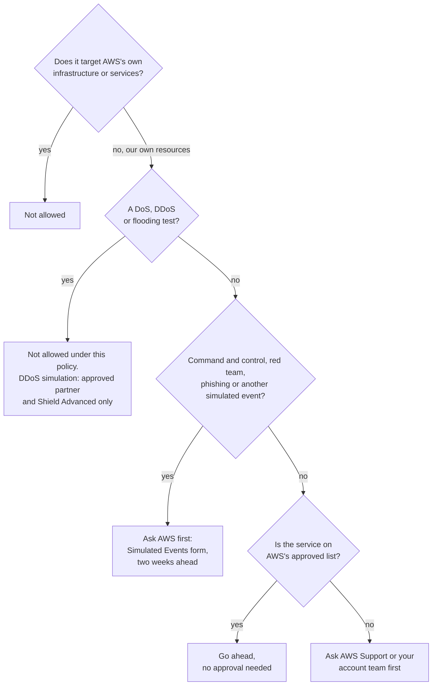

# Shield absorbs floods, WAF reads each web request, and Firewall Manager repeats both in every account: choose the layer that fits the attack

Lesson 09.03's services report problems; this lesson's services stop them, at the site's front door. A competitor's site went down this week under a distributed denial-of-service (DDoS) attack, and the owner wants to know what protects the bakery. By the end you can name the attack, pick the protection that stops it, say what it costs, and say what AWS lets you test yourself.

**For:** an adult studying alone, possibly new to IT, who wants to understand AWS and use it safely. **Time:** about 35 minutes. Reading works on a phone.

**Before you start:** this lesson builds on [Filtering traffic](../07-connecting-it/02-filtering-traffic.md) (security groups and network ACLs), [Names and the edge](../07-connecting-it/03-names-and-the-edge.md) (Route 53 and CloudFront) and [The edge](../03-aws-around-the-world/04-the-edge.md). If you skipped them, the key terms below are enough. The scenario is in the [module brief](00-brief.md).

## Warm-up: what you remember

Answer from memory before you look anything up.

1. From lesson [08.03](../08-building-and-operating/03-watching-workloads.md): during an attack the bakery's site starts returning errors. Which service would notice the rising error count and raise an alarm?
2. From lesson 07.03: name one protection every CloudFront distribution gets at no extra cost.
3. From lesson 03.04: what is an edge location, and why does AWS have so many more of them than Regions?

Feedback

1. **Amazon CloudWatch.** An alarm on the load balancer's or the function's error metric fires when the count passes a threshold, and can notify the owner through Amazon SNS.
2. **AWS Shield Standard.** CloudFront also offers AWS WAF rules, geo restriction and signed URLs as options. This lesson explains Shield and WAF.
3. **A site in AWS's network, in many cities, that serves content and answers requests near users,** for CloudFront and Route 53. There are many so that they sit close to people; this lesson uses them to meet floods far from your servers.

## What you'll learn

By the end of this lesson, you can:

- tell a network flood from an application layer attack;
- say what AWS Shield Standard and AWS Shield Advanced each give you, and what the Shield Response Team needs;
- say what AWS WAF inspects and what AWS Firewall Manager adds;
- choose protections for an attack type and justify the cost (objective 09.04a);
- say which security tests AWS lets you run without asking first.

Try these before you read on. Guess if you're unsure; the answers are in the lesson.

1. Does the bakery's AWS account already have any DDoS protection, without buying anything?
2. Can a security group stop an attacker typing database commands into the order form?

## The big picture: four layers at the front door

Bad traffic comes in different shapes, and each layer stops a different shape. A flood of junk packets, a flood of fake page requests, a malicious form entry and a known bad address range each need a different tool.

*Notice the highlighted WAF boxes: it's the only layer that reads what a web request says. The others look at volume, addresses and ports.*

**Long description.** Left: the internet, with customers, bots and attackers. Middle: a zone labeled AWS edge locations, holding Route 53, which answers DNS lookups, and CloudFront, which serves pages and photos, with an AWS WAF web ACL attached that checks each web request (layer 2, highlighted). Right: a zone labeled US East (N. Virginia), the bakery's VPC, holding an Application Load Balancer, with a second WAF web ACL marked for use if traffic doesn't come through CloudFront (layer 2, highlighted), and a dashed ring for the network ACL and security group (layer 3) around the web servers, EC2 instances in an Auto Scaling group across two Availability Zones. Arrows run from the internet to Route 53 for the address and to CloudFront, from CloudFront to the load balancer, and from the load balancer to the web servers. A band under the edge and Region zones is layer 1: AWS Shield Standard, on for everyone at no charge, absorbing common network floods at the edge and in the Region. A band across the top is layer 4: AWS Firewall Manager, applying the same WAF, Shield Advanced and security group policies to all accounts in an organization. A key below repeats each layer's job: Shield, network and transport floods such as SYN floods and UDP reflection; WAF, bad web requests such as SQL injection, cross-site scripting, request floods and blocked addresses or countries; network ACL and security group, only the ports and addresses you allow; Firewall Manager, the same protections in every account, including new ones.

## Key terms (skip if you know them)

- **Denial-of-service (DoS) attack:** an attempt to make a site or service unavailable to its real users, usually by overwhelming it. A **distributed denial-of-service (DDoS) attack** does it from many machines at once, often thousands of hijacked devices, so blocking one address doesn't stop it.
- **Network layer attack:** a flood of traffic aimed at the network itself, such as a **SYN flood** (half-opened connections that tie up the server) or **UDP reflection** (an attacker tricks other servers into sending large replies to the victim). AWS's documents call these network and transport layer attacks, or layer 3 and 4.
- **Application layer attack:** an attack using normal-looking web requests, such as thousands of requests a second for the order page (an HTTP flood). AWS's documents call this layer 7.
- **SQL injection:** typing database commands into a form field so the site's database runs them. **Cross-site scripting:** planting a script in a page so it runs in other visitors' browsers.

"Layer" here comes from a standard model that numbers the levels of network communication; you only need to know that low numbers mean raw traffic and 7 means the content of web requests.

## AWS Shield Standard is already protecting every AWS account

**AWS Shield** is AWS's DDoS protection. Its first tier, **AWS Shield Standard**, is on for every AWS customer automatically, at no additional charge ([AWS Shield Standard overview](https://docs.aws.amazon.com/waf/latest/developerguide/ddos-standard-summary.html), checked 2026-10-24). It defends against the most common network and transport layer attacks, such as SYN floods and UDP reflection, before they reach your resources. You turn nothing on.

It protects best where your site's front door is at AWS's edge. AWS says resources that customers reach first through Route 53 hosted zones, CloudFront distributions or Global Accelerator get the fullest protection against network and transport layer attacks. The edge locations in lesson 03.04 are spread across many cities, so a flood is absorbed far from your servers. That makes architecture part of DDoS protection: putting CloudFront in front of the whole site, not only the photos, moves the bakery's front door to the edge.

Shield Standard has limits. It doesn't read web requests, so an HTTP flood or an SQL injection gets through. There is no one to call, and nothing protects your bill if Auto Scaling launches servers to absorb a flood.

> **Analogy: a flood barrier and a door attendant.** Shield is like a flood barrier around a building: it holds back a mass of water without looking at it. AWS WAF, below, is like an attendant at the door who reads each visitor's request and turns some away. **Where this breaks down:** a barrier is fixed in place, but Shield Standard works across AWS's whole network, and WAF can check thousands of requests a second against rules no attendant could remember. **Literally:** Shield absorbs volume at the network level; WAF applies your rules to the content of each web request.

> **Your turn:** Answer the first prequestion. Then say why moving the bakery's site behind CloudFront strengthens its DDoS protection, in one sentence.

Model answer

**Yes: Shield Standard,** automatically and at no charge. CloudFront meets attack traffic at many edge locations, where Shield Standard gives its fullest protection, so floods are absorbed far from the bakery's servers in N. Virginia.

## Shield Advanced adds detection, people and bill protection, for a price

**AWS Shield Advanced** is the paid tier. You subscribe and then choose which resources to protect: CloudFront distributions, Route 53 hosted zones, load balancers, Elastic IP addresses on EC2 instances and Global Accelerator accelerators ([AWS Shield Advanced overview](https://docs.aws.amazon.com/waf/latest/developerguide/ddos-advanced-summary.html); [AWS Shield FAQs](https://aws.amazon.com/shield/faqs/), checked 2026-10-24). For those resources it adds:

- **Automatic application layer mitigation:** during an HTTP flood it creates and applies AWS WAF rules for you. It works on web traffic, so it applies to CloudFront distributions and Application Load Balancers, not to the other protected resources ([Editing AWS Shield Advanced protections](https://docs.aws.amazon.com/waf/latest/developerguide/manage-protection.html), checked 2026-10-24). Its subscription also covers the standard WAF fees on protected resources.
- **The Shield Response Team (SRT):** AWS engineers who specialize in DDoS response, available around the clock. With your permission they can analyze your WAF logs and change your rules during an attack.
- **DDoS cost protection:** credits for the extra charges an attack causes, such as servers Auto Scaling launched to absorb it, requested through AWS Support.
- **Visibility:** detailed metrics and reports on attacks against your protected resources.

![Two panels. Left: AWS Shield Standard, no additional charge and nothing to turn on, defends against common network and transport layer attacks, strongest for CloudFront, Route 53 and Global Accelerator, with no people, no bill protection and no layer 7 mitigation. Right, highlighted: AWS Shield Advanced, $3,000 a month with a 1-year subscription plus data transfer fees, protects resources you choose, adds automatic layer 7 mitigation through AWS WAF, the Shield Response Team, and DDoS cost protection.](../../images/09-04-shield-tiers.svg)

*Notice the first line of each panel: one tier comes with every account, and the other is a yearly commitment.*

**Long description.** Two panels. Left: AWS Shield Standard. No additional charge and nothing to turn on: every AWS customer has it. It defends against the most common network and transport layer attacks, such as SYN floods and UDP reflection. It is strongest for CloudFront, Route 53 hosted zones and Global Accelerator. It has no people to call, no bill protection and no web-request (layer 7) mitigation. Right, highlighted: AWS Shield Advanced. $3,000 a month with a 1-year subscription, billed once per organization's payer account, plus data transfer fees. You choose the resources: CloudFront, Route 53 hosted zones, load balancers, Elastic IP addresses and Global Accelerator. It adds automatic web-request (layer 7) mitigation through AWS WAF, and covers standard WAF fees on those resources. It brings the Shield Response Team, DDoS experts around the clock, and AWS's page also requires a Business or Enterprise Support plan for them. It adds DDoS cost protection: credits for scaling charges an attack causes. A note says Support plans change on 2027-01-01, when Business Support ends, and AWS's SRT page still named it on 2026-10-24.

> **Dated (checked 2026-10-24):** Shield Advanced costs **$3,000 a month with a 1-year subscription**, plus data transfer fees, billed once for all the accounts under one payer account ([AWS Shield pricing](https://aws.amazon.com/shield/pricing/)). To use the **Shield Response Team**, AWS's page says you need Shield Advanced **and** the Business Support or Enterprise Support plan ([Managed DDoS event response with SRT support](https://docs.aws.amazon.com/waf/latest/developerguide/ddos-srt-support.html)); the [Shield FAQs](https://aws.amazon.com/shield/faqs/) name the same two plans. That page still names **Business Support**, which takes no new subscribers and ends on 2027-01-01, replaced by Business Support+ ([AWS Trusted Advisor](https://docs.aws.amazon.com/awssupport/latest/user/trusted-advisor.html) carries the notice). AWS's pages don't yet say whether Business Support+ qualifies, so check the SRT page before you rely on it.

### "Any Business Support plan brings the Shield Response Team" is wrong

You may read that a Business Support plan gives you the SRT. That's not right on two counts. First, the SRT is a Shield Advanced feature: a Support plan alone, of any level, doesn't bring it. Second, the plan AWS's page names is the retiring Business Support plan, and whether its replacement, Business Support+, qualifies isn't stated yet. It's tempting because AWS words the requirement in terms of Support plans, so the SRT looks like a Support plan benefit.

> **Check:** Which statement about AWS Shield is correct?
>
> A. Shield Standard must be turned on for each resource\
> B. Shield Advanced is included with the Enterprise Support plan\
> C. Shield Standard is automatic and free; Shield Advanced is a paid subscription that adds the SRT and DDoS cost protection\
> D. Shield Standard includes the Shield Response Team

Feedback

**C is right.**

- **A is wrong.** Shield Standard is automatic for every customer. You do choose resources for Shield *Advanced*.
- **B is wrong.** Shield Advanced is its own subscription. A Support plan is a separate requirement for using the SRT, not a way to get Shield Advanced.
- **D is wrong.** The SRT comes only with Shield Advanced.

## AWS WAF reads each web request and allows, blocks or challenges it

**AWS WAF** is a web application firewall: it inspects the HTTP and HTTPS requests sent to your site or API and decides what happens to each, by rules you set ([AWS WAF](https://docs.aws.amazon.com/waf/latest/developerguide/waf-chapter.html), checked 2026-10-24). You attach it to the resource that receives the requests: a CloudFront distribution, an Application Load Balancer, an API Gateway REST API, or one of several other AWS services. You can't attach it to an EC2 instance directly.

Its rules live in a **web ACL** (web access control list). Each rule matches something about a request and takes an action: allow, block, count it without acting, or ask the visitor to solve a CAPTCHA puzzle or pass a silent challenge. Blocked requests get an error page. Rules can match:

- **Addresses and countries:** an IP set of bad addresses, or requests from countries you don't serve.
- **Request content:** SQL injection and cross-site scripting patterns, unusual headers, very long requests.
- **Rate:** a **rate-based rule** limits how many requests one client address may send in a time window, the usual answer to a small HTTP flood.
- **Managed rule groups:** ready-made sets of rules from AWS (AWS Managed Rules) or from sellers in AWS Marketplace (lesson 09.03), kept up to date by their authors.

> **Dated (checked 2026-10-24):** AWS's newer WAF console calls a web ACL a **protection pack (web ACL)**; it's the same thing. **AWS WAF Classic**, the older version, reached the end of its sunset period on 2026-10-07. If your material describes "WAF Classic" rules, read them as history.

**WAF or a security group?** Both are firewalls, and both are yours to configure. A security group or network ACL (lesson 07.02) sees only addresses, ports and protocols: it can say "HTTPS from anywhere" but not what the request asks for. WAF reads the web request itself: the page, the form fields, the headers. So an SQL injection arrives on port 443 like any honest order, passes the security group, and only WAF can see it.

| | AWS WAF | Security group or network ACL |
|---|---|---|
| **Reads** | The content of web requests (layer 7) | Addresses, ports and protocols |
| **Attached to** | CloudFront, a load balancer, API Gateway and others | Resources (security group) or subnets (network ACL) |
| **Stops** | SQL injection, cross-site scripting, request floods, bad bots, countries | Traffic to ports and from addresses you didn't allow |
| **Costs** | Per web ACL, rule and million requests | No charge |

> **Check:** Answer the second prequestion. An attacker types database commands into the bakery's order form. What stops the request?
>
> A. The web servers' security group\
> B. An AWS WAF rule that matches SQL injection, on the web ACL in front of the site\
> C. Shield Standard\
> D. Amazon GuardDuty

Feedback

**B is right.** Only WAF reads the content of a web request.

- **A is wrong.** The request arrives on port 443 from an allowed address, so the security group lets it through.
- **C is wrong.** Shield absorbs floods; one malicious request is not a flood.
- **D is wrong.** GuardDuty reports threats it sees in logs (lesson 09.03); it blocks nothing.

## Firewall Manager applies the same protections in every account

**AWS Firewall Manager** is the central manager, not another firewall. You write a policy once, such as "every CloudFront distribution and load balancer gets this web ACL", or "subscribe these resources to Shield Advanced", or "no security group may allow SSH from anywhere". Firewall Manager applies it across every account in your organization, including accounts and resources created later, and reports what doesn't comply. It manages AWS WAF, Shield Advanced, security groups, network ACLs and a few other firewalls ([AWS Firewall Manager prerequisites](https://docs.aws.amazon.com/waf/latest/developerguide/fms-prereq.html), checked 2026-10-24).

It has prerequisites: your accounts must be in **AWS Organizations** (lesson [09.05](05-compliance-and-governance.md)), one account becomes the Firewall Manager administrator, and **AWS Config** must be on. So it suits a company with many accounts. The bakery has one account; it doesn't need Firewall Manager yet.

**Shield, WAF and Firewall Manager, side by side.** **What's the same:** all three protect the front door, and AWS documents them together. **What differs:** Shield absorbs floods without reading requests; WAF reads each request and applies your rules; Firewall Manager writes no rules of its own and copies Shield Advanced, WAF and security group policies to every account. **The principle:** Shield for volume, WAF for content, Firewall Manager for scale.

> **Your turn:** A company has 40 accounts, and each team set up its own WAF rules. An audit finds that half the load balancers have no web ACL at all. Which service fixes this, and what does it need first?

Model answer

**AWS Firewall Manager.** A WAF policy attaches the approved web ACL to every load balancer in every account, including ones created later, and reports any that don't comply. It needs the 40 accounts in AWS Organizations, a Firewall Manager administrator account and AWS Config turned on.

## Choose the protection by the attack, then check the cost

Most front-door questions describe an attack and ask for the protection. Read across a row:

![A grid of six needs against five protections. Network flood: Shield Standard is the main protection, Shield Advanced adds detection, experts and bill protection. Flood of web requests: WAF rate-based rule is main, Shield Advanced adds automatic mitigation. SQL injection or cross-site scripting: WAF managed rule groups. One bad address range: a WAF IP set rule for web traffic or a network ACL deny rule for a subnet. Same rules in every account: Firewall Manager. Expert help and bill protection: Shield Advanced.](../../images/09-04-attack-matrix.svg)

*Notice that WAF appears as the main choice in three rows: most attacks a small website meets are web requests.*

**Long description.** A grid of six needs against five protections: Shield Standard, Shield Advanced, AWS WAF, network ACL or security group, and Firewall Manager. Each cell says Main, Adds or No in words. Flood of network traffic, such as a SYN flood or UDP reflection: Shield Standard, main, automatic; Shield Advanced adds detection, experts and bill protection; WAF, no, not web requests; network ACL or security group, no, not built for floods; Firewall Manager, no. Flood of web requests from many addresses: Shield Standard, no; Shield Advanced adds automatic mitigation through WAF; WAF, main, a rate-based rule; network ACL or security group, no, can't read requests; Firewall Manager, no. SQL injection or cross-site scripting in a form: WAF, main, managed rule groups; the others no. Requests from one bad address range: WAF, main, an IP set rule, for web traffic; network ACL, main, a deny rule, for a subnet; others no. The same rules in all of a company's accounts: Firewall Manager, main, one policy for all; WAF and network ACLs work one account or VPC at a time. Expert help and bill protection during a big attack: Shield Advanced, main, the SRT and cost protection.

| Attack or need | First choice | Also helps |
|---|---|---|
| Network flood (SYN flood, UDP reflection) | Shield Standard, automatic | Shield Advanced; CloudFront in front |
| Flood of web requests | WAF rate-based rule | Shield Advanced's automatic mitigation |
| SQL injection, cross-site scripting | WAF managed rule groups | — |
| One bad address range | WAF IP set (web traffic) or network ACL deny (subnet) | — |
| The same rules in many accounts | Firewall Manager | — |
| Experts and bill protection during an attack | Shield Advanced (SRT needs a Support plan too) | — |

### Worked example: the bakery's front door, the week of the competitor's attack

The owner asks: "Could what happened to them happen to us, and what should we buy?" An expert thinks it through in order.

1. **What protects us today?** Shield Standard, automatically. The site's front door is the load balancer in N. Virginia, though, so floods reach the Region before they're absorbed.
2. **Move the front door to the edge.** Put CloudFront in front of the whole site, with the load balancer as its origin. Shield Standard then meets floods at the edge. Lock the load balancer's security group to CloudFront's address list (lesson 07.03), so attackers can't go around.
3. **Read the requests.** Attach a WAF web ACL to the CloudFront distribution with AWS managed rule groups for common attacks and SQL injection, a rate-based rule for the order page, and an IP set for addresses the bakery has already seen attacking.
4. **Let the servers absorb what's left.** The Auto Scaling group (lesson 06.02) can grow to eight servers, and its maximum also caps the bill if a flood gets through.
5. **Shield Advanced?** Weigh the cost against the loss. The chart below shows the gap.

*Notice how thin the WAF bar is next to Shield Advanced: a year of Shield Advanced is at least $36,000, about 290 times the bakery's WAF bill.*

**Long description.** A horizontal bar chart in US dollars a month. Shield Standard: $0, included for every customer. AWS WAF for the bakery's example setup of one web ACL, four rules or rule groups and 2 million requests: $10.20, a bar too thin to see. Firewall Manager, one policy: $100 per policy per Region, and it needs an organization. Shield Advanced: $3,000 plus data transfer fees, with a 1-year subscription, the full width of the chart. Notes: a year of Shield Advanced is at least $36,000; Shield Advanced covers the standard WAF fees for the resources it protects, and the Firewall Manager fees for its WAF and Shield Advanced policies. Sources: the Shield, WAF and Firewall Manager pricing pages, checked 2026-10-24; the bakery's numbers are made up.

| Item | Price used (as of 2026-10-24) | Bakery's month |
|---|---|---|
| Shield Standard | No charge | $0 |
| WAF web ACL | $5.00 a month | $5.00 |
| WAF rules or rule groups | $1.00 each a month | 4 × $1.00 = $4.00 |
| WAF requests | $0.60 per million | 2 million: $1.20 |
| **WAF total** | | **$10.20** |
| Shield Advanced | $3,000 a month, 1-year subscription, plus data transfer fees | Not chosen |

Prices from the [AWS WAF pricing](https://aws.amazon.com/waf/pricing/), [AWS Shield pricing](https://aws.amazon.com/shield/pricing/) and [AWS Firewall Manager pricing](https://aws.amazon.com/firewall-manager/pricing/) pages; CloudFront is billed separately (lesson 07.03). The bakery's traffic is made up.

**The decision:** CloudFront plus WAF now, for about $10 a month in WAF charges, and no Shield Advanced: a day without online orders costs the bakery far less than $36,000 a year. A large retailer, for whom an hour offline costs more than that, would decide the other way.

> **Your turn:** For each situation, choose the first protection and say why in one sentence. (a) A news site expects floods of page requests during elections and wants experts on call. (b) A shop sees requests with `' OR 1=1 --` in its search box. (c) A bank with 300 accounts must prove every public load balancer has the same web rules.

Model answer

(a) **Shield Advanced**, with WAF: it adds automatic layer 7 mitigation, the SRT (with a qualifying Support plan) and cost protection for the scaling a flood causes. (b) **AWS WAF** with a managed rule group for SQL injection: that text is an SQL injection attempt, and only WAF reads request content. (c) **Firewall Manager**: one WAF policy applied to every account and checked for compliance, which needs AWS Organizations.

## Testing your own front door: AWS's penetration-testing policy

A **penetration test** is a planned, authorized attack on your own systems to find weaknesses before a real attacker does. The exam guide doesn't list AWS's policy, but you need it before you hire a tester, and testers will ask about it ([AWS penetration testing policy](https://aws.amazon.com/security/penetration-testing/), checked 2026-10-24):

- **No approval needed** for testing your own resources in the listed services, which include EC2 instances, load balancers, RDS, Aurora, CloudFront, API Gateway, Lambda, Lightsail, Elastic Beanstalk, ECS and Fargate.
- **Never allowed under this policy:** denial-of-service and DDoS attacks, including simulated ones; flooding ports, protocols or requests; DNS zone walking through Route 53 hosted zones; and taking over buckets or subdomains.
- **Needs AWS's approval first,** through a Simulated Events form at least two weeks ahead: command-and-control testing, covert red-team exercises, simulated phishing or malware, and other simulated events.
- **Off limits entirely:** AWS's own infrastructure and services. You test what you run on AWS, not AWS.

A real DDoS test is possible only under a separate **DDoS simulation testing policy**: run by an AWS-approved DDoS test partner, against resources protected by Shield Advanced, within set limits ([DDoS simulation testing policy](https://aws.amazon.com/security/ddos-simulation-testing/), checked 2026-10-24).

*Notice the second question: the test the owner is most likely to want after a competitor's DDoS is the one the general policy forbids.*

**Long description.** A decision flowchart with four questions. One: does the test target AWS's own infrastructure or services? Yes: not allowed. No, it targets our own resources: go to question two. Two: is it a DoS, DDoS or flooding test? Yes: not allowed under this policy; a DDoS simulation needs an approved partner and Shield Advanced. No: question three. Three: is it command and control, a red team exercise, phishing or another simulated event? Yes: ask AWS first with the Simulated Events form, two weeks ahead. No: question four. Four: is the service on AWS's approved list? Yes: go ahead, no approval needed. No: ask AWS Support or your account team first.

You may read that every penetration test on AWS needs AWS's approval first. Under the current policy that's not right: testing your own resources in the listed services needs none. What still needs approval, or is forbidden, is anything that could harm AWS or other customers.

> **Your turn:** After the competitor's attack, the owner wants to hire a tester to (a) try SQL injection on the order form, (b) send a million requests a minute to see if the site stays up, and (c) check whether AWS's own servers in N. Virginia can be broken into. Which may go ahead without approval?

Model answer

**Only (a).** It targets the bakery's own resources (CloudFront, the load balancer, EC2), which are on the listed services. (b) is request flooding, which the policy forbids; a real DDoS test would need an approved partner and Shield Advanced. (c) targets AWS's infrastructure, which customers may never test.

## Your side of the line

AWS protects its own network and runs Shield Standard for everyone; that's security *of* the cloud. Everything you choose at your front door is security *in* the cloud: putting CloudFront in front, writing WAF rules, setting security groups and network ACLs, subscribing to Shield Advanced, and keeping tests within the policy. Shield Standard absorbing a flood doesn't make an open SQL injection AWS's problem.

> **What you pay for (as of 2026-10-24):** Shield Standard is free. AWS WAF bills per web ACL, per rule and per million requests (the worked example's table); Bot Control, CAPTCHA and some managed rule groups cost more. Shield Advanced is $3,000 a month for a year, plus data transfer fees. Firewall Manager is $100 per policy per Region a month (more in some Regions), plus services it uses, such as AWS Config; Shield Advanced subscribers get its Shield Advanced and WAF policies at no extra Firewall Manager charge. Don't subscribe to Shield Advanced to learn about it: it commits you to a year. Check the [AWS WAF](https://aws.amazon.com/waf/pricing/), [AWS Shield](https://aws.amazon.com/shield/pricing/) and [Firewall Manager](https://aws.amazon.com/firewall-manager/pricing/) pricing pages.

## In real work: design the front door before the attack

Teams design the front door before they need it: edge services in front, WAF with managed rules from day one, scaling limits that cap cost, and a plan for who calls whom during an attack. AWS's [Best Practices for DDoS Resiliency](https://docs.aws.amazon.com/whitepapers/latest/aws-best-practices-ddos-resiliency/aws-best-practices-ddos-resiliency.html) whitepaper (August 2026) covers these choices in depth. In the Well-Architected Framework's **security** pillar:

- The design principle "[Apply security at all layers](https://docs.aws.amazon.com/wellarchitected/latest/framework/sec-design.html)": edge, web firewall, network filters and the account, each catching what the others miss.
- [SEC05-BP03 Implement inspection-based protection](https://docs.aws.amazon.com/wellarchitected/latest/security-pillar/sec_network_protection_inspection.html): inspect web traffic with a WAF using managed rules, and manage it centrally with Firewall Manager.
- [SEC11-BP03 Perform regular penetration testing](https://docs.aws.amazon.com/wellarchitected/latest/security-pillar/sec_appsec_perform_regular_penetration_testing.html): test regularly, within AWS's policy.

DDoS protection is also a **reliability** question: a site that's down for customers is down, whatever the cause.

## Summary

- **DDoS attacks come in two shapes:** network floods (layers 3 and 4) and floods of web requests (layer 7). Single malicious requests, such as SQL injection, are a third kind of problem.
- **Shield Standard is automatic and free** for every customer, against common network floods, and strongest with CloudFront, Route 53 and Global Accelerator in front.
- **Shield Advanced is a paid, yearly subscription** that adds automatic layer 7 mitigation, the Shield Response Team and DDoS cost protection. The SRT also needs a qualifying Support plan; AWS's page still names the retiring Business Support (checked 2026-10-24).
- **AWS WAF reads each web request** on CloudFront, load balancers and API Gateway, and blocks SQL injection, cross-site scripting, request floods and bad addresses. Security groups can't read requests.
- **Firewall Manager applies WAF, Shield Advanced and security group policies** across every account in an organization, including new ones.
- **Choose by attack:** Shield for volume, WAF for content, Firewall Manager for scale; check the cost.
- **Penetration testing your own resources** in the listed services needs no approval; DoS and flooding tests are forbidden, and AWS's own infrastructure is off limits.

## Practice

1. **A company wants protection against SQL injection on its Application Load Balancer. What should it use?**

   A. AWS Shield Standard\
   B. AWS WAF\
   C. A network ACL\
   D. Amazon Inspector

   

Feedback

   **B is right.** WAF reads request content and has managed rules for SQL injection.

   - **A is wrong.** Shield absorbs floods; it doesn't read requests.
   - **C is wrong.** A network ACL sees addresses and ports, not what a request says.
   - **D is wrong.** Inspector reports software vulnerabilities and exposure; it blocks nothing.

   

2. **Which of these does every AWS customer get automatically, at no additional charge?**

   A. AWS Shield Advanced\
   B. The Shield Response Team\
   C. AWS Shield Standard\
   D. DDoS cost protection

   

Feedback

   **C is right.**

   - **A, B and D are wrong.** All three are parts of the paid Shield Advanced subscription; the SRT also needs a qualifying Support plan.

   

3. **A security officer must make sure every account in the company's organization uses the same WAF rules, including accounts created next year. Which service does this?**

   

Feedback

   **AWS Firewall Manager.** A WAF policy applies the rules to matching resources in every account of the organization, including new ones. It needs AWS Organizations and AWS Config.

   

4. **A tester proposes to "flood the login page with requests to check our rate limits". Is this allowed under AWS's penetration-testing policy without approval? Explain in one sentence.**

   

Feedback

   **No.** Request flooding, including login and API request flooding, is prohibited under the policy; the rate limit can be checked with a WAF rule in count mode or, for a real DDoS test, through an AWS-approved DDoS test partner against Shield Advanced resources.

   

5. **In two sentences, explain why a security group can't stop an HTTP flood from thousands of addresses, and what can.**

   

Feedback

   **Model answer:** The flood is ordinary HTTPS requests on port 443 from addresses the security group must allow for real customers, so every request matches its allow rule. A WAF rate-based rule, which limits requests per address, with Shield Advanced's automatic mitigation for larger attacks, can stop it.

   

6. **(From lesson 09.03.) GuardDuty reports thousands of SSH guessing attempts on the web server. Which protection actually stops them?**

   

Feedback

   **The web server's security group,** by not allowing SSH (port 22) from the internet at all; a network ACL deny rule can block a specific range. GuardDuty only reports, and WAF doesn't handle SSH, which isn't a web request.

   

**Next:** [Compliance and governance](05-compliance-and-governance.md), then [A defense map](06-a-defense-map.md), which assembles every layer from the edge to the organization.

## Where to check the current details

- [AWS Shield Standard overview](https://docs.aws.amazon.com/waf/latest/developerguide/ddos-standard-summary.html), [AWS Shield Advanced overview](https://docs.aws.amazon.com/waf/latest/developerguide/ddos-advanced-summary.html) and the [AWS Shield FAQs](https://aws.amazon.com/shield/faqs/) (checked 2026-10-24)
- [Managed DDoS event response with SRT support](https://docs.aws.amazon.com/waf/latest/developerguide/ddos-srt-support.html): the Support plan requirement (checked 2026-10-24)
- [AWS WAF](https://docs.aws.amazon.com/waf/latest/developerguide/waf-chapter.html) and [AWS Firewall Manager prerequisites](https://docs.aws.amazon.com/waf/latest/developerguide/fms-prereq.html) (checked 2026-10-24)
- Pricing: [AWS Shield](https://aws.amazon.com/shield/pricing/), [AWS WAF](https://aws.amazon.com/waf/pricing/), [AWS Firewall Manager](https://aws.amazon.com/firewall-manager/pricing/) (checked 2026-10-24)
- [AWS penetration testing policy](https://aws.amazon.com/security/penetration-testing/) and [DDoS simulation testing policy](https://aws.amazon.com/security/ddos-simulation-testing/) (checked 2026-10-24)
- [AWS Best Practices for DDoS Resiliency](https://docs.aws.amazon.com/whitepapers/latest/aws-best-practices-ddos-resiliency/aws-best-practices-ddos-resiliency.html) (August 2026)
- [AWS Certified Cloud Practitioner (CLF-C02) exam guide](https://docs.aws.amazon.com/aws-certification/latest/cloud-practitioner-02/cloud-practitioner-02.html), tasks [2.2](https://docs.aws.amazon.com/aws-certification/latest/cloud-practitioner-02/cloud-practitioner-02-domain2.html#cloud-practitioner-02-task2.2) and [2.4](https://docs.aws.amazon.com/aws-certification/latest/cloud-practitioner-02/cloud-practitioner-02-domain2.html#cloud-practitioner-02-task2.4) (checked 2026-10-24)

---

"The front door" by Automate the Cloud Inc., licensed under CC BY-NC 4.0 with the Additional Permission for Internal Training from Automate the Cloud Inc.
License: https://creativecommons.org/licenses/by-nc/4.0/
Permission: https://automatethe.cloud/licenses/atc-internal-training-permission.txt
