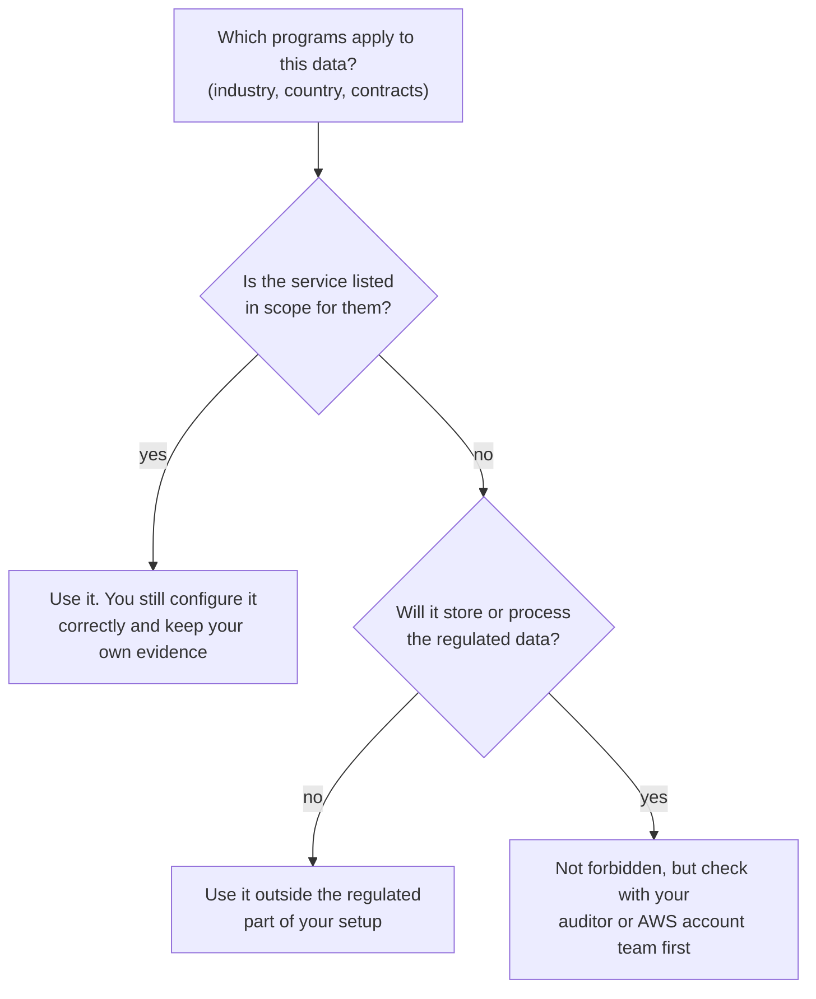
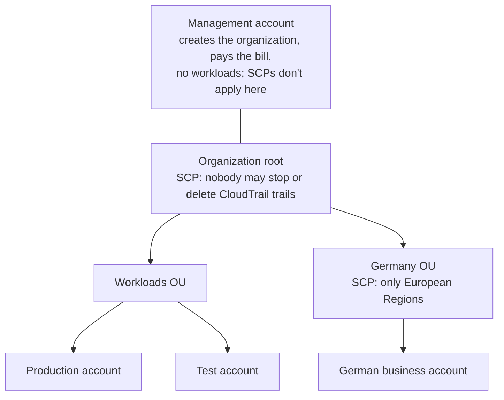

# AWS proves its half of compliance and you prove yours; across many accounts, an SCP sets a ceiling nobody can rise above

When an auditor asks how the bakery's systems are protected, some answers are AWS's to prove and some are the bakery's. **AWS Artifact** hands you AWS's half: its auditors' reports. Everything about your data, your settings and your people stays your job. As a business grows into several AWS accounts, **AWS Organizations** and its **service control policies** set limits that nobody in those accounts can go past, and **AWS Control Tower** builds that structure for you.

**For:** an adult studying alone, possibly new to IT, who wants to understand AWS and use it safely. **Time:** about 35 minutes. Reading works on a phone.

**Before you start:** this lesson builds on [Shared, inherited and customer-specific controls](../04-shared-responsibility-and-access/02-shared-inherited-customer-specific.md) (audits, compliance, and the evidence for each kind of control), [Policies and least privilege](../04-shared-responsibility-and-access/04-policies-and-least-privilege.md) (default deny, explicit deny) and [Simulation S4](../04-shared-responsibility-and-access/09-sim-policy-playground.md), where you first met SCPs. Lesson [09.01](01-who-did-what.md) covers the services that produce your own evidence. The scenario is in the [module brief](00-brief.md).

## Warm-up: what you remember

Answer from memory before you look anything up.

1. From lesson [08.02](../08-building-and-operating/02-iac-and-automation.md): the bakery builds its production setup from a CloudFormation template instead of console clicks. Why does that help when an auditor asks, "How do you know production is set up the way you say?"
2. From lesson 05.02: at which levels can S3 Block Public Access be turned on, and which setting wins when two levels disagree?
3. From lesson 04.04: a user has `AdministratorAccess`. A limit-setting policy that applies to them doesn't allow `s3:DeleteBucket`. Can they delete a bucket?

Feedback

1. **The template is a written record of the setup.** You can show it, review changes to it, and build the same thing again. Console clicks leave no plan, only a result to inspect.
2. **The account, each bucket (and access point), and a whole AWS Organizations organization.** S3 applies the most restrictive combination. That organization level is the first hint of this lesson: some settings can be set once for many accounts.
3. **No.** Limit-setting policies grant nothing, but if one applies it must allow the request too. An allow in `AdministratorAccess` can't lift a request above the limit.

## What you'll learn

By the end of this lesson, you can:

- say what AWS Artifact gives you, and state the compliance work that stays yours after you have it (objective 09.05a);
- read AWS's compliance program and Services in Scope pages without the usual mistakes;
- explain a service control policy as a ceiling, and tell it apart from an IAM policy (objective 09.05a);
- tell AWS Organizations from AWS Control Tower;
- name where AWS publishes security information.

Try these before you read on. Guess if you're unsure; the answers are in the lesson.

1. The auditor wants proof that AWS's data centers have been audited against SOC 2. Where does the bakery get it, and does that report show the bakery is compliant?
2. A service control policy allows only S3 actions in an account. A user in that account has `AdministratorAccess`. Can they launch an EC2 instance?

## The big picture: every audit question has an owner

![Two columns under the auditor's questions. Left, AWS's controls (security of the cloud): physical security, hardware, the global network and the services' own infrastructure, proved by AWS's audit reports, downloaded from AWS Artifact. Right, highlighted, the bakery's controls (security in the cloud): its data, who has access, its settings, its staff, proved by the bakery's own records: CloudTrail, AWS Config, IAM access reports, policies and training records. A band underneath says that both halves are needed before the bakery can say it is compliant.](../../images/09-05-two-halves.svg)

*Notice that Artifact feeds only the left column. The right column is where the bakery does its own work, and an auditor checks both.*

**Long description.** At the top, a box labeled "The auditor's question". Below it, two columns. Left column, "AWS's controls: security of the cloud": examples are physical security of data centers, hardware, the global network and the infrastructure of each service; the evidence is AWS's audit reports and certificates, such as SOC 2, ISO 27001 and PCI DSS; where it comes from: AWS Artifact, free. Right column, highlighted, "The bakery's controls: security in the cloud": examples are its data and where it lives, who has access, how its services are configured, and its staff; the evidence is the bakery's own records: CloudTrail activity, AWS Config history and rules, IAM access reports, written policies and training records; where it comes from: the bakery. A band across the bottom: "Compliant only when both halves are covered."

## Key terms (skip if you know them)

- **Compliance program:** a standard, law or framework that AWS is audited against or aligns with, such as SOC 2, ISO 27001, PCI DSS (card payments) or HIPAA (United States health data). Lesson 04.02 defined **compliance** and an **audit**.
- **Attestation:** an independent auditor's written finding that controls exist and work, such as a SOC 2 report.
- **Service control policy (SCP):** an AWS Organizations policy that caps what users and roles in a member account can do (Simulation S4).

## AWS Artifact hands you AWS's audit reports, not a verdict on you

**AWS Artifact** is a self-service portal in the console with two parts ([What is AWS Artifact?](https://docs.aws.amazon.com/artifact/latest/ug/what-is-aws-artifact.html), checked 2026-10-24):

- **Artifact reports:** AWS's security and compliance documents, on demand. Examples are SOC reports, ISO certificates, PCI reports, and certificates from accreditation bodies. Artifact also offers documents from software vendors who sell on AWS Marketplace.
- **Artifact agreements:** contracts with AWS that you review, accept, track and end, for one account or for every account in an organization. The usual example is the **Business Associate Addendum (BAA)**, which United States healthcare businesses typically need before they handle protected health information ([Managing agreements](https://docs.aws.amazon.com/artifact/latest/ug/managing-agreements.html)).

Both are free. Some reports are confidential, so you accept Artifact's terms before downloading them ([AWS Artifact FAQ](https://aws.amazon.com/artifact/faq/)). You hand a report to an auditor as evidence for the controls AWS carries out, and you read it to see which controls you inherit and which you must still put in place, as lesson 04.02 suggested.

### "Artifact checks your compliance" is wrong

You may read that Artifact tells you whether *you* are compliant. It doesn't. Every report in Artifact is about AWS: its data centers, its staff, its services. AWS says plainly that customers are responsible for producing the documents that show their own company's security and compliance ([What is AWS Artifact?](https://docs.aws.amazon.com/artifact/latest/ug/what-is-aws-artifact.html)). A SOC 2 report on AWS says nothing about whether the bakery's bucket is public. The mistake is tempting because the reports carry the names of the standards your auditor cares about, and they come from your own console.

> **Warning:** On the Free plan, don't accept any agreement in AWS Artifact. An agreement such as the BAA is how you designate an account to process regulated data, and designating an account as HIPAA or SEC compliant moves a Free plan account to the Paid plan automatically ([Choosing a plan](https://docs.aws.amazon.com/awsaccountbilling/latest/aboutv2/free-tier-plans.html)). AWS says a Paid plan can't be downgraded to the Free plan ([Free Tier FAQs](https://aws.amazon.com/free/free-tier-faqs/), both checked 2026-10-24). Lab 12 downloads one report and doesn't open the **Agreements** page.

> **Your turn:** The bakery's insurer asks, "Is your hosting provider audited against ISO 27001, and are you?" Answer each half in one sentence, naming where the evidence comes from.

Model answer

AWS is: the bakery downloads AWS's ISO 27001 certificate from AWS Artifact and sends it. Whether the bakery itself meets the standard is a separate question that Artifact can't answer: the bakery would need its own controls, its own records and, for a certificate, its own audit.

## AWS lists its compliance programs, and which services each one covers

AWS publishes two pages that answer "which rules?" and "which services?".

**[AWS Compliance Programs](https://aws.amazon.com/compliance/programs/)** groups the programs three ways (checked 2026-10-24):

| Group | What it means | Examples |
|---|---|---|
| Certifications and attestations | An independent auditor has assessed AWS | SOC 1, 2 and 3; ISO 27001; PCI DSS; FedRAMP (US government); C5 (Germany); IRAP (Australia) |
| Laws, regulations and privacy | No cloud provider can be certified; AWS offers features and legal agreements that help you comply | HIPAA; GDPR |
| Alignments and frameworks | AWS maps its controls to a published framework | NIST frameworks |

Notice the examples: compliance needs differ by **industry** (PCI DSS for card payments, HIPAA for health data) and by **geography** (C5 in Germany, IRAP in Australia), as exam task [2.2](https://docs.aws.amazon.com/aws-certification/latest/cloud-practitioner-02/cloud-practitioner-02-domain2.html#cloud-practitioner-02-task2.2) expects you to know. The page also says customers remain responsible for complying with the laws and regulations that apply to them.

**[AWS Services in Scope by Compliance Program](https://aws.amazon.com/compliance/services-in-scope/)** lists, for each program, which services were included in the assessment. So compliance requirements vary among AWS services: one service may be covered by a program and another not yet.

### "Not in Services in Scope means you can't use it" is wrong

AWS says that a service missing from the list doesn't mean you can't use it. What it means is that you must decide, as part of your shared responsibility, what kind of data the service will handle and whether that brings it into your regulated environment. AWS also treats features of a service that are generally available as in scope unless they are specifically excluded ([Services in Scope](https://aws.amazon.com/compliance/services-in-scope/), checked 2026-10-24). The mistake is tempting because "in scope" sounds like "allowed".

*Notice that no path says "forbidden", and every path that uses the service still leaves work for you.*

**Long description.** A decision flowchart. Start: which compliance programs apply to this data, given your industry, country and contracts? Then: is the service listed in scope for them? Yes: use it, and you still configure it correctly and keep your own evidence. No: will it store or process the regulated data? No: use it outside the regulated part of your setup. Yes: it isn't forbidden, but check with your auditor or your AWS account team before relying on it.

## Your remaining duty: what no AWS document does for you

This list is the objective's first half. After the bakery has downloaded AWS's reports, these jobs are still the bakery's:

1. **Know which rules apply,** from its industry, countries and contracts.
2. **Classify its data and choose where it lives:** lesson 03.02's German orders stay in the EU.
3. **Configure services correctly:** encryption, access, logging. A service in scope and set up wrongly is still a failure.
4. **Accept the agreements it needs, then keep to them,** such as a BAA before handling health data.
5. **Produce its own evidence:** CloudTrail activity, AWS Config history, IAM access reports (lesson [09.01](01-who-did-what.md)), security standard checks (lesson [09.03](03-finding-threats-and-weaknesses.md)), written policies and training records.
6. **Keep doing it:** every audit checks again.

### "Audit Manager is the compliance answer" is wrong

Older practice material often names **AWS Audit Manager** (lesson 09.01). Two corrections. First, it's in maintenance mode: since 2026-04-30 it can't be set up in new accounts, AWS points customers to AWS Config conformance packs ([Audit Manager availability change](https://docs.aws.amazon.com/audit-manager/latest/userguide/audit-manager-availability-change.html), checked 2026-10-24), and it isn't in the CLF-C02 exam's service list. Second, no service makes you compliant: AWS notes that a conformance pack holds only the technical checks a rule can evaluate, and no rule checks that you wrote your security policies. A service with "audit" in its name sounds like the whole job, so the mistake is easy.

**Worked example: sorting the auditor's questions.** An expert first asks *whose control is this?*, then *what proves it?* The first row is the auditor's question 5 from the module brief.

| Auditor asks | Whose control | Evidence | Where from |
|---|---|---|---|
| "How do you know AWS protects its data centers?" | AWS (inherited) | SOC 2 report | AWS Artifact |
| "Who changed the database's security group last Tuesday?" | The bakery | The API call, who made it, when | CloudTrail (09.01) |
| "Were all your disks encrypted last month?" | The bakery | Configuration history and rule results | AWS Config (09.01) |
| "Who can delete order data, and who actually used that right?" | The bakery | IAM policies; last-accessed information | IAM (04.04, 09.01) |
| "Are staff trained on security?" | The bakery | Training records | No AWS service |

> **Check:** A wholesale customer's auditor asks the bakery to prove that its own S3 buckets block public access. What should the bakery send?
>
> A. AWS's SOC 2 report from Artifact\
> B. Its own evidence, such as AWS Config results or the Block Public Access settings, because bucket settings are the customer's control\
> C. Nothing: S3 is in scope for SOC 2, so the buckets are compliant\
> D. An Audit Manager assessment report

Feedback

**B is right.** Bucket settings are security *in* the cloud, so the evidence is the bakery's.

- **A is wrong.** AWS's report covers AWS's controls, not the bakery's bucket settings.
- **C is wrong.** "In scope" means AWS's side of the service was assessed; it says nothing about how the bakery configured it.
- **D is wrong.** Audit Manager is closed to new customers, and no single service proves compliance on its own.

## AWS Organizations groups accounts so you can govern them together

Suppose the bakery grows: a production account for the site, a test account where the owner's nephew experiments, and an account for the German business, whose data must stay in the EU. AWS recommends several accounts like this, because an account is a natural boundary for permissions, security, costs and workloads ([What is AWS Organizations?](https://docs.aws.amazon.com/organizations/latest/userguide/orgs_introduction.html), checked 2026-10-24). A mistake in the test account can't touch production.

**AWS Organizations** joins the accounts into one **organization**:

- The **management account** creates the organization and pays every member's bill. The other accounts are **member accounts**.
- **Organizational units (OUs)** group accounts, and can be nested. Policies attached to the organization's **root** or to an OU apply to every account below it.
- **Policies** set rules across accounts: service control policies; **resource control policies (RCPs)**, which cap what anyone, even someone outside the organization, can do to resources in member accounts; and others, such as backup policies.
- **Consolidated billing**: the management account receives one bill for every account in the organization and pays it (Simulation S11; Module 11, "Paying for AWS"). An organization-wide CloudTrail trail can't be turned off by member accounts, and IAM Identity Center gives people one sign-in (lesson 04.05).

*Notice that a policy on the root reaches every member account, and a policy on the Germany OU adds a second limit only there.*

**Long description.** A tree. The management account sits beside the organization root; it creates the organization, pays the bill, holds no workloads, and SCPs don't apply to it. The root carries an SCP saying nobody may stop or delete CloudTrail trails. Under the root are two OUs. The Workloads OU holds the production account and the test account. The Germany OU carries an SCP allowing only European Regions and holds the German business account.

> **Warning:** On the Free plan, don't create or join an organization. Joining AWS Organizations, or setting up a Control Tower landing zone, moves a Free plan account to the Paid plan ([Choosing a plan](https://docs.aws.amazon.com/awsaccountbilling/latest/aboutv2/free-tier-plans.html)), and AWS's [Free Tier terms](https://aws.amazon.com/free/terms/) say an account in an organization can no longer use or earn Free Tier credits (both checked 2026-10-24). You practice with [Simulation S11](10-sim-organizations-and-scps.md) instead.

> **Your turn:** Why should the management account hold no workloads? Use one fact from this section and one from the next.

Model answer

The management account pays for and controls the whole organization, so whoever breaks into it can reach everything. And SCPs don't apply to it, so the ceilings that protect every member account don't protect anything running there. Keeping it empty keeps the most powerful account the least used.

### Sharing one resource with many accounts: AWS Resource Access Manager

Separate accounts raise a practical question: what if several of them need the same thing, such as one network? **AWS Resource Access Manager (AWS RAM)** shares a resource you create once with other accounts: specific accounts by ID, every account in your organization, or the accounts in chosen OUs ([What is AWS RAM?](https://docs.aws.amazon.com/ram/latest/userguide/what-is.html), checked 2026-10-24). The account that made the resource keeps owning it; the others see it in their own consoles and use it within the permissions the share allows, and their own IAM policies and SCPs still apply. Commonly shared resources include VPC subnets and transit gateways (Module 07). RAM itself costs nothing extra; you pay for the shared resource as usual.

For the chain, that means one network team can build the shops' network in one account and share its subnets, instead of every shop building and paying for its own.

## An SCP is a ceiling: it limits everyone in a member account, and grants nothing

This is the objective's second half. A **service control policy (SCP)** sets the maximum permissions that IAM users and roles in a member account can have ([Service control policies](https://docs.aws.amazon.com/organizations/latest/userguide/orgs_manage_policies_scps.html), checked 2026-10-24):

- **It never grants.** People still need identity-based or resource-based policies. What they can actually do is the overlap of what the SCPs allow and what their IAM policies allow.
- **It limits the member account's root user too.** That is something no IAM policy inside the account can do.
- **Every level must allow.** An account gets only what every SCP above it allows, from the root down through each OU. A block at any level, by a deny or by leaving the action out of an allow, holds even against `AdministratorAccess`.
- **It doesn't apply to the management account,** nor to service-linked roles, which AWS services use to work on your behalf.
- **There's always one in place.** AWS attaches an SCP called **FullAWSAccess**, which allows every action, to the root, every OU and every account by default. Remove it without a replacement and every action in the member accounts fails, so AWS recommends testing a new SCP on an OU with a few accounts before attaching it to the root.

> **Analogy: a ceiling in a room.** People are lifted up by their IAM policies; the SCP is the ceiling. Nobody rises above it, however high their policies would lift them, and the ceiling itself lifts nobody. **Where this breaks down:** a real SCP is less like a flat ceiling than a set of holes and blocks: it can allow a list of services, or deny a few chosen actions. And the management account has no ceiling at all.

![A grid for the German business account. Rows are five requests. Columns: the root SCP (denies stopping or deleting CloudTrail trails), the Germany OU SCP (denies Regions outside Europe, except global services), the person's IAM policy, and the result. An admin launching a server in Frankfurt: allowed by all three, result allowed. An admin launching a server in N. Virginia: blocked by the Germany OU SCP, result denied. An admin stopping the CloudTrail trail: blocked by the root SCP, result denied. The root user stopping the trail: blocked by the root SCP, result denied. A new user with no policies reading a bucket in Frankfurt: no IAM allow, result denied.](../../images/09-05-scp-ceiling.svg)

*Notice the last row. Both SCPs allow the request and it is still denied, because an SCP grants nothing.*

**Long description.** A grid for the German business account. Columns: root SCP, which denies stopping or deleting CloudTrail trails; Germany OU SCP, which denies requests outside European Regions, with global services such as IAM exempted; the person's IAM policy; and the result. Row 1, an admin with `AdministratorAccess` launches a server in Europe (Frankfurt): root SCP allows, OU SCP allows, IAM allows; allowed. Row 2, the same admin launches a server in US East (N. Virginia): root SCP allows, OU SCP blocks, IAM allows; denied by the OU SCP. Row 3, the same admin stops the CloudTrail trail: root SCP blocks; denied by the root SCP. Row 4, the account's root user stops the trail: root SCP blocks, and root needs no IAM policy; denied, because SCPs limit a member account's root user. Row 5, a new user with no policies reads a bucket in Frankfurt: both SCPs allow, IAM gives no allow; denied by default.

AWS publishes an example SCP that denies requests outside a list of Regions while exempting global services such as IAM, and Control Tower offers a Region deny control built on the same idea ([SCP examples](https://docs.aws.amazon.com/organizations/latest/userguide/orgs_manage_policies_scps_examples_general.html)). For the bakery, that turns lesson 03.02's "German data stays in the EU" from a promise into a rule nobody in the account can break.

### SCP or IAM policy: a ceiling or a key

![Two columns compared on six rows. SCP: set in AWS Organizations by the management account; applies to every user and role in the member accounts below it; never grants, only limits; limits the member account's root user; doesn't apply in the management account; used for organization-wide rules such as allowed Regions. IAM policy: set inside one account; attached to one identity or resource; grants (or denies) permissions; can't limit that account's root user; works in any account; used to give a person or program the access their job needs. The row "grants permissions?" is highlighted.](../../images/09-05-scp-vs-iam.svg)

*Notice the highlighted row. An SCP can only take away; an IAM policy is the only one of the two that can give.*

**Long description.** Two columns, SCP and IAM policy, compared on six rows. Where it's set: in AWS Organizations, from the management account (or an account it delegates to); inside one account. What it applies to: every IAM user and role in the member accounts below where it's attached; the one identity or resource it's attached to. Grants permissions, highlighted: never, it only limits; yes, it grants or denies. The member account's root user: limited; not limited by IAM policies. The management account: not affected; IAM policies work there as anywhere. Typical use: organization-wide rules, such as allowed Regions or protecting logs; giving one person or program the access its job needs.

| | SCP | IAM policy |
|---|---|---|
| **Set in** | AWS Organizations, from the management account | One account's IAM |
| **Applies to** | Every user and role in the accounts below it | One identity or resource |
| **Grants?** | Never; it sets the maximum | Yes |
| **Root user of a member account** | Limited | Not limited |
| **Management account** | Not affected | Works as usual |

**What's the same:** both use almost the same policy language, and an explicit deny in either one wins. **What differs:** who they reach and whether they can grant. **The principle:** IAM policies give each person what their job needs; SCPs set the outer limit for whole accounts, so that even a mistake in an IAM policy can't go past it.

> **Check:** Answer the second prequestion. An SCP on the account allows only S3 actions. A user there has `AdministratorAccess`. Can they launch an EC2 instance?
>
> A. Yes: `AdministratorAccess` allows everything\
> B. No: the SCP is a ceiling, and EC2 isn't under it\
> C. Yes, if they sign in as the account's root user instead\
> D. No: SCPs deny everything by default

Feedback

**B is right.** The user's effective permissions are the overlap of the SCP and their IAM policies: S3 only.

- **A is wrong.** An IAM allow can't lift a request above the SCP.
- **C is wrong.** In a member account, SCPs limit the root user too.
- **D is wrong.** The default `FullAWSAccess` SCP allows everything; this account's SCP was narrowed on purpose.

## AWS Control Tower sets up and watches a multi-account environment, on top of Organizations

Designing OUs, writing SCPs and switching on logging in every new account is a lot of work. **AWS Control Tower** does it for you. It brings together AWS Organizations, AWS Service Catalog and IAM Identity Center to build a **landing zone**, a multi-account environment based on security and compliance best practices, in less than an hour, AWS says ([What is AWS Control Tower?](https://docs.aws.amazon.com/controltower/latest/userguide/what-is-control-tower.html), checked 2026-10-24). It then keeps accounts from drifting away from those practices with **controls**, plain-language rules that each apply to a whole OU ([How controls work](https://docs.aws.amazon.com/controltower/latest/userguide/how-controls-work.html)):

| Control kind | What it does | Built from |
|---|---|---|
| Preventive | Stops an action from happening | SCPs and RCPs |
| Detective | Finds resources that break a rule | AWS Config rules |
| Proactive | Checks resources deployed with CloudFormation before they're created, and stops ones that break a rule | CloudFormation hooks |

AWS used to call controls **guardrails**, the same idea as the guardrail in Lab 04: a limit that holds whatever else is granted. Some controls are mandatory, others strongly recommended or elective. **Account Factory** creates new accounts from an approved template, already governed, and a dashboard shows resources that break the controls. The setup also creates shared accounts for logs and for the security team, though from landing zone version 4.0 you can design that structure yourself ([How AWS Control Tower works](https://docs.aws.amazon.com/controltower/latest/userguide/how-control-tower-works.html), checked 2026-10-24).

![Two columns compared on five rows. AWS Organizations: the foundation for grouping and governing accounts; you design OUs and write policies yourself; provides accounts, OUs, SCPs and RCPs, one consolidated bill; enforces its policies but doesn't report on resource settings; choose it for one bill and your own policies. AWS Control Tower: a layer built on Organizations, Service Catalog and IAM Identity Center; sets up a best-practice landing zone for you; adds controls of three kinds, Account Factory and a dashboard; detects and reports resources that break the rules; choose it for a governed multi-account setup, quickly. The first row, what each one is, is highlighted.](../../images/09-05-orgs-vs-control-tower.svg)

*Notice that every Control Tower row leans on Organizations: you can use Organizations without Control Tower, but not Control Tower without Organizations.*

**Long description.** Two columns, AWS Organizations and AWS Control Tower, compared on five rows. What it is, highlighted: the foundation for grouping accounts; an automated setup and governance layer built on top of Organizations, Service Catalog and IAM Identity Center. Who designs the structure: you design OUs and write policies; it sets up a best-practice landing zone for you. What it provides: accounts, OUs, SCPs, RCPs and other policies, consolidated billing; controls of three kinds, Account Factory and a dashboard. Watching for drift: Organizations enforces its policies but doesn't report on resource settings; Control Tower's detective controls find and report resources that break rules. Choose it when: you want central billing and your own policies; you want a governed multi-account setup quickly, following AWS's practices.

**The principle:** Control Tower is built on Organizations and does the design and the checking for you. If a question says "SCP", "OU" or "one bill", think Organizations. If it says "quickly set up a well-architected multi-account environment with guardrails", think Control Tower.

> **Your turn:** The bakery's accountant asks, "Do we need Control Tower to get one bill for our three accounts?" Answer in two sentences.

Model answer

No: consolidated billing is part of AWS Organizations, which Control Tower is built on. Control Tower becomes worth it when the bakery wants a ready-made, governed setup with controls and an account template, rather than designing the OUs and policies itself.

## Where AWS publishes security information

Exam task [2.4](https://docs.aws.amazon.com/aws-certification/latest/cloud-practitioner-02/cloud-practitioner-02-domain2.html#cloud-practitioner-02-task2.4) asks where to find AWS's security information. Each source answers a different question (checked 2026-10-24):

| Your question | Where to look |
|---|---|
| What security services does AWS offer, and how does it approach security? | [AWS Security Center](https://aws.amazon.com/security/), AWS's security home page |
| How do I set up a security feature, and what's new? | [AWS Security Blog](https://aws.amazon.com/blogs/security/) |
| How do I fix a common problem, step by step? | [AWS Knowledge Center](https://repost.aws/knowledge-center), on AWS re:Post (Module 12) |
| Is a newly found vulnerability affecting an AWS service? | [AWS Security Bulletins](https://aws.amazon.com/security/security-bulletins/), marked Important (act) or Informational |
| Where are AWS's security, compliance and privacy commitments in one place? | [AWS Trust Center](https://aws.amazon.com/trust-center/) |
| An AWS resource is attacking you or sending spam | AWS Trust & Safety, through its abuse report form, not AWS Support (Module 12) |

Lesson [09.03](03-finding-threats-and-weaknesses.md) adds AWS Marketplace, where third-party security products are sold.

> **Check:** The owner reads that a flaw was found in widely used software, and wants to know whether AWS's own services are affected and whether she must act. Where should she look first?
>
> A. AWS Artifact\
> B. AWS Security Bulletins\
> C. AWS Services in Scope\
> D. AWS Organizations

Feedback

**B is right.** Bulletins announce vulnerabilities that affect AWS services and say whether customers need to act.

- **A is wrong.** Artifact holds audit reports and agreements, not vulnerability notices.
- **C is wrong.** Services in Scope lists services per compliance program.
- **D is wrong.** Organizations governs accounts; it publishes nothing.

## In real work: compliance is a list of controls with owners and evidence

Security teams keep a list of the controls each program requires, mark who carries out each one, and collect evidence before the auditor asks. Several Well-Architected security best practices describe the habits in this lesson:

- [SEC01-BP03 Identify and validate control objectives](https://docs.aws.amazon.com/wellarchitected/latest/security-pillar/sec_securely_operate_control_objectives.html): know your requirements and check your controls meet them, using AWS's reports for AWS's part.
- [SEC01-BP01 Separate workloads using accounts](https://docs.aws.amazon.com/wellarchitected/latest/security-pillar/sec_securely_operate_multi_accounts.html): the bakery's production, test and German accounts.
- [SEC03-BP05 Define permission guardrails for your organization](https://docs.aws.amazon.com/wellarchitected/latest/security-pillar/sec_permissions_define_guardrails.html): SCPs as ceilings.
- [SEC01-BP04 Stay up to date with security threats and recommendations](https://docs.aws.amazon.com/wellarchitected/latest/security-pillar/sec_securely_operate_updated_threats.html): the bulletins and blog.

> **What you pay for (as of 2026-10-24):** AWS Artifact: free. AWS Organizations and SCPs: no additional charge. AWS Control Tower: no additional charge, but you pay for the services it turns on, such as AWS Config and CloudTrail. On the Free plan, joining Organizations, setting up a Control Tower landing zone, or designating the account as HIPAA or SEC compliant upgrades the account to the Paid plan. Check [Organizations billing and pricing](https://docs.aws.amazon.com/organizations/latest/userguide/pricing.html), [AWS Control Tower pricing](https://aws.amazon.com/controltower/pricing/) and [Choosing a plan](https://docs.aws.amazon.com/awsaccountbilling/latest/aboutv2/free-tier-plans.html).

## Summary

- **Every audit question has an owner.** AWS proves its controls with its auditors' reports; you prove yours with your own records.
- **AWS Artifact** gives you AWS's reports and agreements, free. It doesn't check your compliance.
- **Compliance programs** vary by industry and country; **Services in Scope** shows which services each covers. Not listed doesn't mean forbidden; it means you decide.
- **Your remaining duty:** know your rules, classify data, configure services correctly, accept and keep agreements, produce your own evidence, and keep doing it. Audit Manager is closed to new customers, and no service makes you compliant.
- **AWS Organizations** groups accounts under a management account, with OUs, policies and one bill.
- **An SCP is a ceiling** for every user and role in a member account, root included. It grants nothing and doesn't apply to the management account; an IAM policy grants.
- **AWS Control Tower** builds and watches a best-practice landing zone on top of Organizations, with preventive, detective and proactive controls.
- **Security information:** Security Center, Security Blog, Knowledge Center, Security Bulletins and Trust Center.

## Practice

1. **Which statement about AWS Artifact is correct?**

   A. It scans your account and reports whether you meet PCI DSS\
   B. It provides AWS's compliance reports and lets you manage agreements with AWS\
   C. It costs a fee per report downloaded\
   D. It lists which AWS services are in scope for each program

   

Feedback

   **B is right.**

   - **A is wrong.** Artifact's reports are about AWS, not your account. Checking your own resources is a job for AWS Config rules or Security Hub CSPM standards.
   - **C is wrong.** Artifact documents and agreements are free.
   - **D is wrong.** That's the Services in Scope web page.

   

2. **A hospital group will store patient records in an S3 bucket. AWS's Services in Scope page lists S3 under HIPAA. In two or three sentences, state what the hospital must still do.**

   

Feedback

   **Model answer:** Accept the BAA with AWS and keep to its terms; classify the data and keep it only in services and Regions it has chosen; configure the bucket correctly (encryption, no public access, least-privilege access, logging); and produce its own evidence of all that, plus its own policies and staff training. AWS's coverage of S3 is only AWS's half.

   

3. **The bakery's German account has an SCP that denies all Regions outside Europe, apart from global services. The account's root user tries to create a database in US East (N. Virginia). What happens, and why?**

   

Feedback

   **Denied.** SCPs limit every user and role in a member account, including its root user. Only the management account is outside SCPs.

   

4. **A company wants new accounts created from an approved template, a ready-made set of preventive and detective rules, and a dashboard of rule-breaking resources, set up quickly. Which service fits best?**

   A. AWS Organizations alone\
   B. AWS Control Tower\
   C. AWS Artifact\
   D. AWS Audit Manager

   

Feedback

   **B is right.** Account Factory, controls and the dashboard are Control Tower features.

   - **A is wrong.** Organizations provides the parts, but you would design and build all of this yourself.
   - **C is wrong.** Artifact holds AWS's reports and agreements.
   - **D is wrong.** Audit Manager is closed to new customers, and it never provisioned accounts.

   

5. **(From lesson 07.01.) A subnet's servers all have public IP addresses. Does that make it a public subnet? What decides it?**

   

Feedback

   **No.** A subnet is public when its route table has a route to an internet gateway. A public IP address alone doesn't make it public; without that route, traffic from the internet has no way in.

   

6. **(From lesson 04.03.) Does an IAM user with `AdministratorAccess` equal the root user? Give one difference.**

   

Feedback

   **No.** The admin can't do root-only tasks such as closing the account, and an admin's power comes from a policy that can be narrowed or blocked; in a member account, an SCP limits both.

   

**Next:** [A defense map](06-a-defense-map.md) puts this module's controls into layers. To practice SCPs and OUs, try [Simulation S11](10-sim-organizations-and-scps.md); to download a real Artifact report, do [Lab 12](07-lab-12-answer-the-auditor.md).

## Where to check the current details

- [What is AWS Artifact?](https://docs.aws.amazon.com/artifact/latest/ug/what-is-aws-artifact.html), [Managing agreements](https://docs.aws.amazon.com/artifact/latest/ug/managing-agreements.html) and the [AWS Artifact FAQ](https://aws.amazon.com/artifact/faq/) (checked 2026-10-24)
- [AWS Compliance Programs](https://aws.amazon.com/compliance/programs/) and [AWS Services in Scope by Compliance Program](https://aws.amazon.com/compliance/services-in-scope/) (checked 2026-10-24)
- [AWS Audit Manager availability change](https://docs.aws.amazon.com/audit-manager/latest/userguide/audit-manager-availability-change.html) (checked 2026-10-24)
- [What is AWS Organizations?](https://docs.aws.amazon.com/organizations/latest/userguide/orgs_introduction.html), [Service control policies](https://docs.aws.amazon.com/organizations/latest/userguide/orgs_manage_policies_scps.html) and [Resource control policies](https://docs.aws.amazon.com/organizations/latest/userguide/orgs_manage_policies_rcps.html) (checked 2026-10-24)
- [What is AWS Control Tower?](https://docs.aws.amazon.com/controltower/latest/userguide/what-is-control-tower.html), [How controls work](https://docs.aws.amazon.com/controltower/latest/userguide/how-controls-work.html) and [AWS Control Tower pricing](https://aws.amazon.com/controltower/pricing/) (checked 2026-10-24)
- [Choosing a plan](https://docs.aws.amazon.com/awsaccountbilling/latest/aboutv2/free-tier-plans.html): what upgrades a Free plan account (checked 2026-10-24)
- [AWS Certified Cloud Practitioner (CLF-C02) exam guide](https://docs.aws.amazon.com/aws-certification/latest/cloud-practitioner-02/cloud-practitioner-02.html), tasks [2.2](https://docs.aws.amazon.com/aws-certification/latest/cloud-practitioner-02/cloud-practitioner-02-domain2.html#cloud-practitioner-02-task2.2), [2.3](https://docs.aws.amazon.com/aws-certification/latest/cloud-practitioner-02/cloud-practitioner-02-domain2.html#cloud-practitioner-02-task2.3) and [2.4](https://docs.aws.amazon.com/aws-certification/latest/cloud-practitioner-02/cloud-practitioner-02-domain2.html#cloud-practitioner-02-task2.4) (checked 2026-10-24)

---

"Compliance and governance" by Automate the Cloud Inc., licensed under CC BY-NC 4.0 with the Additional Permission for Internal Training from Automate the Cloud Inc.
License: https://creativecommons.org/licenses/by-nc/4.0/
Permission: https://automatethe.cloud/licenses/atc-internal-training-permission.txt
