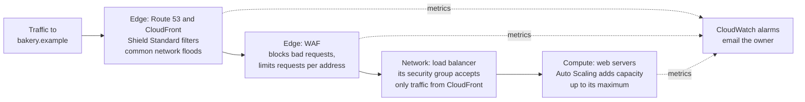

# Build a defense map: stack controls from the edge to the organization, so one mistake never exposes everything

No single control keeps a workload safe. A rule can be wrong, a password can leak, a patch can be late. **Defense in depth** puts several independent layers between an attacker and your data, from the edge of AWS's network to the rules over your whole organization, and watches every layer, so that when one fails, another stops or reveals the attack. In this lesson you assemble this module's services into one map for the bakery, justify each choice, and say who does what at each layer.

**For:** an adult studying alone, possibly new to IT, who wants to understand AWS and use it safely. **Time:** about 35 minutes. Reading works on a phone.

**Before you start:** this lesson pulls together the module: [who did what](01-who-did-what.md), [encryption](02-encryption.md), [finding threats and weaknesses](03-finding-threats-and-weaknesses.md), [the front door](04-the-front-door.md) and [compliance and governance](05-compliance-and-governance.md). It also leans on [Filtering traffic](../07-connecting-it/02-filtering-traffic.md) and [Security of vs in the cloud](../04-shared-responsibility-and-access/01-security-of-vs-in-the-cloud.md). If you skipped a lesson, the table in the first section names what each service does, enough to follow. The scenario is in the [module brief](00-brief.md).

## Warm-up: what you remember

Answer from memory before you look anything up.

1. From lesson [08.04](../08-building-and-operating/04-connecting-parts-shipping-software.md): a security service reports a finding as an event. Which service can match that event with a rule and send it to a target, such as an SNS topic: Amazon SQS, Amazon EventBridge or AWS Step Functions?
2. From lesson 07.02: a security group is stateful and a network ACL is stateless. What does that mean for the reply to a request they let in?
3. From lesson 04.01: on EC2, who protects the data center building, and who writes the security group rules?

Feedback

1. **Amazon EventBridge.** A rule matches the event and sends it to a target. That's how a finding turns into an alert or an automatic fix; watching and responding run across every layer in this lesson.
2. **The security group lets the reply out on its own, because it remembers the request; the network ACL judges the reply by its outbound rules, so it can block it.** They are two layers in one network: the network ACL at the subnet's edge and the security group at each resource.
3. **AWS protects the building** (security of the cloud); **the bakery writes the rules** (security in the cloud). Every layer in this lesson splits the same way.

## What you'll learn

By the end of this lesson, you can:

- assemble a layered set of controls for a workload, from the edge to the organization, and justify each one by the threat it answers and what it costs (objective 09.06a);
- tell a control that prevents from a control that detects, and explain why you need both;
- judge whether a proposed plan leaves a layer or a threat uncovered;
- say, for each layer, what AWS does and what you do.

Try these before you read on. Guess if you're unsure; the answers are in the lesson.

1. AWS Shield Standard already protects the bakery's site at no extra charge. Why might the bakery still add AWS WAF?
2. If every layer has a control that blocks attacks, why also keep logs?

## The big picture: six layers, and a watch across all of them

![Six nested layers from the outside in. Edge: Route 53, CloudFront, Shield, WAF. Network: VPC, subnets and routes, network ACLs, security groups. Compute: patched images, Inspector. Data: encryption with KMS and ACM, S3 Block Public Access, Macie, backups. Identity and account: IAM least privilege, MFA, roles, root protection. Organization: separate accounts, SCPs, Control Tower controls, Firewall Manager. A highlighted vertical band crosses every layer: watch and prove, with CloudTrail, AWS Config, CloudWatch, GuardDuty and Security Hub.](../../images/09-06-defense-map.svg)

*Notice the highlighted band. Each layer stops some things; the watch across all of them is how you learn that something got through, and how you prove to an auditor what happened.*

**Long description.** Six layers, drawn as bands from the internet at the top to the organization at the bottom. 1, Edge, where traffic first reaches AWS: Amazon Route 53, Amazon CloudFront, AWS Shield and AWS WAF. 2, Network, the bakery's VPC: public and private subnets, route tables, network ACLs and security groups. 3, Compute, the servers and functions: patched images and guest operating systems, Amazon Inspector scans. 4, Data, what is stored: encryption with AWS KMS keys and ACM certificates, S3 Block Public Access and versioning, Amazon Macie, backups. 5, Identity and account: IAM least privilege, MFA, roles instead of access keys, root user protection. 6, Organization: separate accounts, service control policies, AWS Control Tower controls, AWS Firewall Manager. A highlighted vertical band labeled "watch and prove" crosses all six layers: AWS CloudTrail, AWS Config, Amazon CloudWatch, Amazon GuardDuty and AWS Security Hub.

## Key terms (skip if you know them)

- **Defense in depth:** several independent layers of controls, so an attacker must beat all of them and a mistake in one is caught by another. The Well-Architected security design principle "[Apply security at all layers](https://docs.aws.amazon.com/wellarchitected/latest/framework/sec-design.html)" says the same.
- **Security layer:** one place in the path from the internet to your data where you can put controls, such as the edge, the network or the account.
- **Preventive control:** a control that stops something from happening, such as a security group rule, a WAF rule or an SCP.
- **Detective control:** a control that notices and records something after it happens, such as a CloudTrail record, a GuardDuty finding or an AWS Config rule. Control Tower uses the same two words for its controls (lesson 09.05).

## Each layer stops different attacks

Here is the map as a table: what each layer protects, what you put there, and where this guide teaches it.

| Layer | Protects against | Prevent with | Detect with | Lesson |
|---|---|---|---|---|
| Edge | Floods of traffic; bad web requests | Shield Standard (automatic), CloudFront in front of the site, WAF rules | CloudWatch metrics and alarms; WAF logs | 09.04, 07.03 |
| Network | Reaching things that should be private | Private subnets, routes, network ACLs, security groups | VPC Flow Logs; Inspector's network exposure findings | 07.01, 07.02 |
| Compute | Known flaws in software | Patched images and guest OS (on EC2); Lambda leaves the OS to AWS | Inspector vulnerability findings | 06, 09.03 |
| Data | Reading or losing stored data | Encryption at rest and in transit; Block Public Access; versioning; backups | Macie (sensitive data in S3, public buckets) | 09.02, 05.02 |
| Identity and account | Stolen or misused credentials | Least privilege, MFA, roles instead of long-term keys, root protection | CloudTrail, GuardDuty, IAM access reports | 04, 09.01, 09.03 |
| Organization | One account's mistake spreading; rules being switched off | Separate accounts, SCPs, Control Tower controls, Firewall Manager policies | Control Tower dashboard, organization-wide trail | 09.05, 09.04 |

Three points stand out:

- **The edge is where a flood should end.** Shield Standard protects every AWS customer automatically, at no additional charge, against the most common network and transport layer DDoS attacks, and Route 53, CloudFront and Global Accelerator get particular benefit from it ([Shield Standard overview](https://docs.aws.amazon.com/waf/latest/developerguide/ddos-standard-summary.html), checked 2026-10-24). WAF adds rules for web requests, such as blocking SQL injection or limiting how many requests one address may send ([AWS WAF](https://docs.aws.amazon.com/waf/latest/developerguide/waf-chapter.html)).
- **The organization layer protects the other layers.** An SCP can forbid stopping CloudTrail in every member account; Firewall Manager applies WAF rules and security group policies across an organization, which it needs in order to work ([Firewall Manager prerequisites](https://docs.aws.amazon.com/waf/latest/developerguide/fms-prereq.html)).
- **Watching is separate from blocking.** CloudTrail records API activity, Config records settings, CloudWatch watches metrics, GuardDuty looks for threats in logs such as CloudTrail and VPC Flow Logs, and Security Hub gathers findings in one place ([What is Amazon GuardDuty?](https://docs.aws.amazon.com/guardduty/latest/ug/what-is-guardduty.html)).

> **Your turn:** Place each control on a layer and say whether it prevents or detects: (a) an S3 bucket's Block Public Access; (b) a GuardDuty finding about an access key used from an unusual location; (c) a WAF rate-based rule; (d) an SCP that denies leaving the organization.

Model answer

(a) Data, prevents. (b) Identity and account, detects: it reports, it doesn't block. (c) Edge, prevents: it limits how many requests one address may send. (d) Organization, prevents: no one in a member account, root included, can take the account out of the organization's rules.

## Cover every threat with at least two layers: one that stops it and one that finds it

A layered plan works threat by threat. For each threat, ask: which layer stops it, and which layer tells me if that one failed? The grid shows seven threats the bakery faces.

![A grid of seven threats against the six layers and a last column, finds it. Network flood: stopped at the edge by Shield Standard, limited by opening only needed ports, found in CloudWatch metrics. HTTP request flood: stopped by a WAF rate-based rule, limited by Auto Scaling, found by a CloudWatch alarm. SQL injection on the order form: stopped by WAF managed rules and by the bakery's own code, found in WAF logs. Stolen access key: stopped by MFA and no long-term keys, limited by an SCP, found by GuardDuty and CloudTrail. Unpatched web server: stopped by regular patching, limited by few reachable ports, found by Inspector. Bucket made public by mistake: stopped by Block Public Access in the account and across the organization, found by Macie and a Config rule. Trail switched off: stopped by an SCP and an organization trail, the attempt recorded by CloudTrail.](../../images/09-06-threat-grid.svg)

*Notice that every row has at least one STOPS cell and a FINDS cell, and that most threats are met in two different layers.*

**Long description.** A grid. Rows are seven threats; columns are the six layers (edge, network, compute, data, identity and account, organization) and a last column, finds it. Each filled cell starts with STOPS (a preventive control blocks it), LIMITS (a control shrinks the damage or the exposure) or FINDS (a detective control reports it). Row 1, network flood: edge stops it with Shield Standard; network limits it, because only the needed ports are open; CloudWatch metrics find it. Row 2, HTTP request flood: edge stops it with a WAF rate-based rule; compute limits it, as Auto Scaling absorbs load; a CloudWatch alarm finds it. Row 3, SQL injection on the order form: edge stops it with WAF managed rules; compute stops it in the bakery's own code, which checks input; WAF logs find it. Row 4, stolen access key: identity and account stops it with MFA and no long-term keys; organization limits it, as an SCP caps what it can do; GuardDuty and CloudTrail find it. Row 5, unpatched web server: network limits it, with few ports reachable; compute stops it with regular patching; Inspector finds it. Row 6, bucket made public by mistake: data stops it with Block Public Access; organization stops it with Block Public Access set for the whole organization; Macie and a Config rule find it. Row 7, CloudTrail switched off to hide activity: organization stops it with an SCP and an organization trail; CloudTrail records the attempt.

Why both? Because preventive controls fail quietly. A security group rule opened "for a minute" during testing, an access key pasted into a public code repository: nothing blocks these, because the mistake *is* in the blocking layer. Detection is how you learn about them, and records are how you prove what happened afterwards, the job of lesson [09.01](01-who-did-what.md). After detection comes your response: [primer page 08](https://github.com/AutomateTheCloud/atc-study-aws_account_guardrails/blob/main/primer/08-when-something-goes-wrong.md) is a small incident plan for a lab account, in the spirit of the design principle "[Prepare for security events](https://docs.aws.amazon.com/wellarchitected/latest/framework/sec-design.html)".

> **Check:** Answer the second prequestion. A colleague says, "Our security groups are tight and we have WAF, so turning on GuardDuty and keeping CloudTrail trails is a waste." What's the best reply?
>
> A. They're right: blocking makes detection unnecessary\
> B. Detection catches what gets past or around the blocking layers, such as a leaked key used through normal API calls, and the records prove what happened\
> C. GuardDuty blocks attacks that WAF misses\
> D. CloudTrail is needed only for billing

Feedback

**B is right.** A stolen key used through ordinary API calls passes every network filter; only activity records and threat detection reveal it.

- **A is wrong.** Every preventive layer can be misconfigured, and attackers use the doors you leave open on purpose.
- **C is wrong.** GuardDuty detects and reports; it doesn't block.
- **D is wrong.** CloudTrail records who did what in your account; that's security and audit evidence.

## The shared responsibility model holds at every layer

Module 04 drew the line between security *of* the cloud and security *in* the cloud. The map shows it holds at every layer: AWS provides the tools and runs what lies under them; you choose the tools and configure them ([Shared Responsibility Model](https://aws.amazon.com/compliance/shared-responsibility-model/)).

![Six rows, one per layer, with two columns. Edge: AWS runs the edge network and Shield Standard automatically; you choose to put CloudFront and Route 53 in front, write WAF rules, and decide on Shield Advanced. Network: AWS runs and isolates the network; you design subnets and routes and write security group and network ACL rules. Compute: AWS runs hardware and virtualization, and for Lambda the operating system; you patch EC2 guest operating systems and your code. Data: AWS provides encryption features and key storage; you classify data, turn on and manage encryption and access. Identity and account: AWS provides IAM and MFA; you decide who gets access, protect the root user and turn on detection. Organization: AWS provides Organizations and Control Tower; you design accounts and write SCPs. The "you" column is highlighted in the data and identity rows: always yours, on every service.](../../images/09-06-who-does-what.svg)

*Notice the highlighted cells. Wherever the line moves for other layers, your data and who can reach it stay yours on every service.*

**Long description.** Six rows, one per layer, and two columns, AWS does and you do. Edge: AWS runs the edge network and applies Shield Standard automatically; you choose to put CloudFront and Route 53 in front of the site, write WAF rules, and decide whether to pay for Shield Advanced. Network: AWS runs the physical network and keeps each VPC isolated; you design subnets and routes and write security group and network ACL rules. Compute: AWS runs the hardware and virtualization, and for Lambda also the operating system; you patch EC2 guest operating systems and your own code and its dependencies. Data, highlighted on your side: AWS provides encryption features and key storage; you classify data, choose and manage encryption, and set who can read it. Identity and account, highlighted on your side: AWS provides IAM, MFA and the detection services; you decide who gets access, protect the root user, and turn detection on. Organization: AWS provides Organizations and Control Tower; you design the accounts and write the SCPs. Compliance evidence follows the same split: AWS's reports in Artifact, your own records for your side.

Two things move the line: the service and the layer. On EC2 you patch the guest operating system; on Lambda AWS does. But no service moves the data or identity rows to AWS's side. Most of the controls on the map are switched off, or wide open, until you configure them: the default network ACL allows everything, and GuardDuty does nothing until you enable it.

> **Your turn:** The bakery's nephew says, "AWS has Shield, so DDoS is AWS's problem." In two or three sentences, say what is true and what he is missing.

Model answer

It's true that AWS applies Shield Standard to every customer automatically, against the most common network and transport layer floods. But how resilient the site is depends on the bakery's choices: putting CloudFront in front, writing WAF rules for request floods, letting Auto Scaling add capacity, and deciding whether Shield Advanced is worth paying for. The tools are AWS's; the design is the bakery's.

## Worked example: the bakery's plan after a competitor's attack

A competitor's site was knocked offline this week by a flood of requests. The owner asks for a layered plan she can afford and explain. Here is how an experienced engineer works, threat first, cost always in view.

*Notice that each stage shrinks what reaches the next, and that the watch runs alongside every stage instead of at the end.*

**Long description.** A left-to-right flow. Traffic to bakery.example first reaches Route 53 and CloudFront at the edge, where Shield Standard filters common network floods automatically. Next, at the edge, WAF blocks known bad requests and limits how many requests each address may send. What remains reaches the network layer, the Application Load Balancer, whose security group accepts only traffic from CloudFront. Then the compute layer, the web servers, where Auto Scaling can add capacity up to its maximum. Dotted arrows carry metrics from the edge, WAF and the servers to CloudWatch alarms, which email the owner.

1. **What faces the internet?** `bakery.example` in Route 53, CloudFront for the photos (lesson 07.03), the load balancer for the web servers (lesson 06.02), and API Gateway for the delivery partner.
2. **Edge.** Shield Standard is already on, at no extra charge. Putting CloudFront in front of the whole site, not just the photos, moves the place where floods meet AWS out to the edge network. Add a WAF web ACL on CloudFront: AWS managed rules for common attacks such as SQL injection, a rate-based rule per address, and the blocked address range from lesson 07.02. Lesson 09.04 prices this at about $10 a month in WAF charges for the bakery's example traffic (as of 2026-10-24).
3. **Shield Advanced?** It adds help from the Shield Response Team, application-layer DDoS mitigation and protection against scaling charges caused by an attack (lesson 09.04). It costs $3,000 a month with a one-year commitment (as of 2026-10-24, [AWS Shield pricing](https://aws.amazon.com/shield/pricing/)): far more than a small bakery's whole bill. **Rejected for now,** with a written trigger: revisit if an hour offline starts costing more than the subscription.
4. **Network.** The load balancer accepts traffic only from CloudFront, so attackers can't go around the edge (lesson 09.04). The web servers accept HTTPS only from the load balancer's security group, and the database, in a private subnet, only from the web servers (lesson 07.02).
5. **Compute.** Auto Scaling, minimum 2, maximum 8 (lesson 06.02), absorbs some extra load, and the maximum caps what a flood can add to the bill. Patched images; Inspector to find flaws when the budget allows (lesson 09.03).
6. **Data.** Encryption at rest on RDS and S3; HTTPS everywhere with ACM certificates (lesson 09.02); Block Public Access on; versioning and backups so a deletion can be undone (Module 05).
7. **Identity and account.** MFA for everyone, roles instead of access keys, root locked away (Module 04). CloudTrail records activity; GuardDuty watches for threats; alarms go to the owner's email.
8. **Organization.** One account today. When the bakery adds test and German accounts, add an organization-wide trail and SCPs that protect CloudTrail and keep the German account in Europe (lesson 09.05).

**Answer:** Shield Standard plus CloudFront and WAF at the edge; tight security groups and private subnets; patched, auto-scaled servers; encryption and Block Public Access; MFA and roles; CloudTrail and GuardDuty watching; SCPs when the accounts multiply. Shield Advanced is rejected, with a trigger to revisit.

> **Your turn:** A consultant proposes: "Subscribe to Shield Advanced and you're covered." Evaluate this plan in three or four sentences. What does it protect, and which threats in the grid does it leave open?

Model answer

Shield Advanced strengthens one layer, the edge, against DDoS: expert help, application-layer mitigation and protection from attack-driven scaling charges. It does nothing about a stolen access key, an unpatched server, a public bucket or a trail switched off, which sit in other layers. It also costs about $3,000 a month with a one-year commitment (as of 2026-10-24), more than the controls that would cover those gaps together. A sound plan covers every threat with a preventive and a detective control first, then adds Shield Advanced if the business case for the edge justifies it.

## In real work: map the layers, then review the map

Security teams draw a map like this for each workload, then review it whenever the workload changes, asking "which threat does this layer answer, and what tells us if it fails?" The Well-Architected security pillar names the habits:

- The design principle "[Apply security at all layers](https://docs.aws.amazon.com/wellarchitected/latest/framework/sec-design.html)": defense in depth itself.
- [SEC05-BP01 Create network layers](https://docs.aws.amazon.com/wellarchitected/latest/security-pillar/sec_network_protection_create_layers.html): the edge, public and private layers of the bakery's network.
- [SEC04-BP01 Configure service and application logging](https://docs.aws.amazon.com/wellarchitected/latest/security-pillar/sec_detect_investigate_events_app_service_logging.html): the watch across the layers.
- [SEC01-BP01 Separate workloads using accounts](https://docs.aws.amazon.com/wellarchitected/latest/security-pillar/sec_securely_operate_multi_accounts.html): the organization layer.

Cost is part of the design too: the cost optimization pillar asks you to match spending to need, which is why the bakery writes a trigger for Shield Advanced instead of buying it now.

> **What you pay for (as of 2026-10-24):** No additional charge: Shield Standard, security groups and network ACLs, IAM, AWS Organizations and SCPs, and CloudTrail's 90-day event history ([AWS CloudTrail pricing](https://aws.amazon.com/cloudtrail/pricing/)). AWS WAF charges per web ACL, per rule and per million requests; AWS's examples use $5 per web ACL a month, $1 per rule a month and $0.60 per million requests ([AWS WAF pricing](https://aws.amazon.com/waf/pricing/)). Shield Advanced: $3,000 a month with a one-year commitment. GuardDuty, Inspector, Macie, Security Hub and AWS Config bill by usage after any free trial, and the guardrails primer keeps the paid security services off on the Free plan ([primer page 06](https://github.com/AutomateTheCloud/atc-study-aws_account_guardrails/blob/main/primer/06-safe-defaults.md)). Prices vary by Region; check each service's pricing page.

## Summary

- **Defense in depth** stacks independent layers so that one failure doesn't expose everything: edge, network, compute, data, identity and account, organization.
- **Each layer answers different threats**, and the map names a control for each: Shield and WAF at the edge, filters in the network, patching and Inspector in compute, encryption and Block Public Access for data, IAM and MFA for identity, SCPs and Control Tower for the organization.
- **Cover every threat twice:** a preventive control that stops it and a detective control that finds it, because preventive controls fail quietly. Records then prove what happened.
- **Shared responsibility holds at every layer.** AWS provides and runs the tools; you choose and configure them. Data and access stay yours on every service.
- **Justify each control by its threat and its cost,** and write down triggers for the ones you reject, as the bakery did for Shield Advanced.

## Practice

1. **Which pair gives the bakery a preventive and a detective control for the threat "someone makes a bucket public by mistake"?**

   A. S3 Block Public Access, and Amazon Macie\
   B. AWS Shield, and AWS WAF\
   C. A network ACL, and a security group\
   D. AWS Artifact, and AWS Organizations

   

Feedback

   **A is right.** Block Public Access stops the bucket from becoming public; Macie reports buckets that become public and sensitive data in them.

   - **B is wrong.** Both work at the edge on traffic, not on bucket settings.
   - **C is wrong.** Both filter network traffic in a VPC; S3 bucket access isn't set by them.
   - **D is wrong.** Artifact holds AWS's reports, and Organizations groups accounts; neither stops or finds a public bucket by itself.

   

2. **Name the layer where each belongs: (a) a WAF rule blocking SQL injection; (b) a security group allowing PostgreSQL only from the web servers; (c) an SCP denying all Regions outside Europe; (d) KMS encryption on the order database.**

   

Feedback

   (a) Edge. (b) Network. (c) Organization. (d) Data.

   

3. **An attacker uses a stolen access key through ordinary AWS API calls. Which statement is correct?**

   A. Security groups stop it, because the attacker comes from the internet\
   B. WAF stops it, because it inspects every request to AWS\
   C. Network filters don't see it; MFA and no long-term keys prevent it, GuardDuty and CloudTrail reveal it, and an SCP limits what it can do in a member account\
   D. Shield Standard stops it automatically

   

Feedback

   **C is right.** Calls to AWS's own APIs don't pass through the bakery's VPC filters or its WAF.

   - **A is wrong.** Security groups filter traffic to the bakery's resources, not calls to AWS's API endpoints.
   - **B is wrong.** WAF inspects requests to the resources you attach it to, such as CloudFront or a load balancer.
   - **D is wrong.** Shield protects against DDoS floods, not misuse of valid credentials.

   

4. **A plan for an online shop lists: CloudFront, WAF, Shield Standard, security groups, private subnets, encrypted storage and MFA. In two sentences, evaluate it: what's missing?**

   

Feedback

   **Model answer:** It is all prevention: nothing detects or records, so a leaked key or a rule opened by mistake would go unnoticed and couldn't be proved afterwards. Add CloudTrail and alarms at least, GuardDuty if the budget allows, and patching with a vulnerability scan for the servers.

   

5. **(From lesson 09.05.) An SCP allows every action. A new IAM user in that member account has no policies. What can the user do, and why?**

   

Feedback

   **Nothing.** An SCP never grants; it only sets the ceiling. The user still needs an identity-based or resource-based policy that allows the action.

   

6. **(From lesson 04.05.) Give two reasons the bakery's people sign in with MFA and use temporary credentials instead of long-term access keys.**

   

Feedback

   **Model answer:** A leaked long-term key keeps working until someone notices and deactivates it, while temporary credentials expire on their own. And with MFA, a stolen password alone isn't enough to sign in. Both shrink what the identity layer has to catch later.

   

**Next:** the module's hands-on work. In [Lab 12](07-lab-12-answer-the-auditor.md) you answer the auditor with real evidence from your own account; the simulations tour [security findings](08-sim-security-findings-tour.md), [a Config timeline](09-sim-config-timeline.md), and [Organizations and SCPs](10-sim-organizations-and-scps.md).

## Where to check the current details

- [Security design principles](https://docs.aws.amazon.com/wellarchitected/latest/framework/sec-design.html), AWS Well-Architected Framework (checked 2026-10-24)
- [Shared Responsibility Model](https://aws.amazon.com/compliance/shared-responsibility-model/) (checked 2026-10-24)
- [AWS Shield Standard overview](https://docs.aws.amazon.com/waf/latest/developerguide/ddos-standard-summary.html), [AWS Shield Advanced overview](https://docs.aws.amazon.com/waf/latest/developerguide/ddos-advanced-summary.html) and [AWS Shield pricing](https://aws.amazon.com/shield/pricing/) (checked 2026-10-24)
- [AWS WAF](https://docs.aws.amazon.com/waf/latest/developerguide/waf-chapter.html) and [AWS WAF pricing](https://aws.amazon.com/waf/pricing/) (checked 2026-10-24)
- [AWS Firewall Manager prerequisites](https://docs.aws.amazon.com/waf/latest/developerguide/fms-prereq.html) (checked 2026-10-24)
- [What is Amazon GuardDuty?](https://docs.aws.amazon.com/guardduty/latest/ug/what-is-guardduty.html) and [AWS CloudTrail pricing](https://aws.amazon.com/cloudtrail/pricing/) (checked 2026-10-24)
- [AWS Certified Cloud Practitioner (CLF-C02) exam guide](https://docs.aws.amazon.com/aws-certification/latest/cloud-practitioner-02/cloud-practitioner-02.html), tasks [2.1](https://docs.aws.amazon.com/aws-certification/latest/cloud-practitioner-02/cloud-practitioner-02-domain2.html#cloud-practitioner-02-task2.1), [2.2](https://docs.aws.amazon.com/aws-certification/latest/cloud-practitioner-02/cloud-practitioner-02-domain2.html#cloud-practitioner-02-task2.2) and [2.4](https://docs.aws.amazon.com/aws-certification/latest/cloud-practitioner-02/cloud-practitioner-02-domain2.html#cloud-practitioner-02-task2.4) (checked 2026-10-24)

---

"A defense map" by Automate the Cloud Inc., licensed under CC BY-NC 4.0 with the Additional Permission for Internal Training from Automate the Cloud Inc.
License: https://creativecommons.org/licenses/by-nc/4.0/
Permission: https://automatethe.cloud/licenses/atc-internal-training-permission.txt
