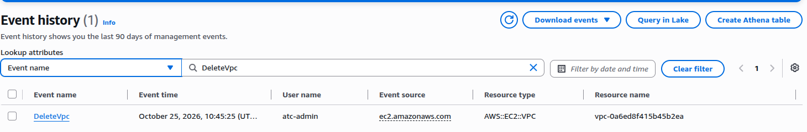

# Lab 12: Answer an auditor's five questions with evidence from your own account

**Exam guide:** [Domain 2, Security and Compliance](https://docs.aws.amazon.com/aws-certification/latest/cloud-practitioner-02/cloud-practitioner-02-domain2.html) (30% of the exam): tasks [2.2](https://docs.aws.amazon.com/aws-certification/latest/cloud-practitioner-02/cloud-practitioner-02-domain2.html#cloud-practitioner-02-task2.2) and [2.4](https://docs.aws.amazon.com/aws-certification/latest/cloud-practitioner-02/cloud-practitioner-02-domain2.html#cloud-practitioner-02-task2.4).

## Before you start: your account, your responsibility

This guide is provided as is, without warranty. We work hard to keep it correct and current, but AWS changes often, and its services, prices, and free offers may differ from what is written here. The labs run in your own AWS account. You are responsible for that account, for its security, and for any charges it incurs, including charges from resources you forget to delete. Automate the Cloud Inc. is not liable for any costs, losses, or security incidents that result from following, or failing to follow, this material. Technical guidance here is general information, not advice about your specific systems.

**Who this is for:** you have done the guardrails primer and Labs 01 to 09, and read lessons [09.01](01-who-did-what.md) and [09.05](05-compliance-and-governance.md). **Time:** about 50 minutes.

**Goal:** answer the bakery's auditor's five questions with evidence from your own lab account, and say what each piece of evidence can't prove. **End state:** a short evidence memo in your lab log, one downloaded AWS report, and nothing left running.

| # | The auditor asks | Where you find the evidence |
|---|---|---|
| 1 | Who changed your systems recently? Show me one change from start to finish. | AWS CloudTrail Event history |
| 2 | Does anyone use the account's root user? | CloudTrail Event history |
| 3 | Does anyone have permissions they don't use? | IAM last accessed information |
| 4 | Is the photo storage encrypted at rest? | The S3 bucket's default encryption |
| 5 | How do you know AWS protects its data centers? | A report from AWS Artifact |

**What it creates:** one empty S3 bucket in US East (N. Virginia), `us-east-1`, tagged `guide` = `clf` and `lab` = `12`. You delete it at the end. Everything else in this lab only reads.

**What it costs:** $0. Event history, IAM's reports and AWS Artifact have no charge, and an empty bucket costs nothing (checked 2026-10-24). **Worst case on a Paid plan** if you forget to clean up: still $0 while the bucket stays empty. **Free plan:** never choose **Upgrade plan**, never accept an agreement in Artifact, and don't open Artifact's **Agreements** page (step 21 explains why).

**Before you start, you need these guardrails in place:** [root MFA](https://github.com/AutomateTheCloud/atc-study-aws_account_guardrails/blob/main/primer/02-secure-the-root-user.md), [an IAM admin user with MFA](https://github.com/AutomateTheCloud/atc-study-aws_account_guardrails/blob/main/primer/03-your-everyday-admin-identity.md), which you use for this lab, [budgets and billing alerts](https://github.com/AutomateTheCloud/atc-study-aws_account_guardrails/blob/main/primer/05-money-alarms.md), [safe defaults](https://github.com/AutomateTheCloud/atc-study-aws_account_guardrails/blob/main/primer/06-safe-defaults.md) and [the habits for every lab](https://github.com/AutomateTheCloud/atc-study-aws_account_guardrails/blob/main/primer/07-habits-for-every-lab.md) (primer pages 02, 03, 05, 06 and 07).

> **New sign-up path:** IAM users can't sign in to the console there, and AWS lists the HIPAA and SEC addenda in Artifact as not supported (as of 2026-10-23). We haven't checked Event history or Artifact on that path, and we haven't run this lab there. Read the steps, and use whatever sign-in that path gives you.

**About the screens:** labels in **bold** are what we saw when we ran this lab in our test account on 2026-10-25. We stopped at Artifact's terms prompt and didn't download a report, so steps 19 and 20 follow AWS's documentation. AWS changes its console often. If a label differs, look for the option with the same meaning.

## Steps

### Get ready

1. In your lab log, write today's date, `us-east-1`, the tags, a bucket name such as `clf-lab12-ab-20261024-4817`, and the five questions above, each with space for an answer.
2. Sign in to the console as your **IAM admin user**, not the root user, and check that the Region selector shows N. Virginia.

### Part A: follow one change from start to finish (follow-along)

Event history shows the last 90 days of **management events**, one Region at a time, and no *data events*, such as downloading a file ([Limitations of Event history](https://docs.aws.amazon.com/awscloudtrail/latest/userguide/view-cloudtrail-events.html)).

3. Open **CloudTrail** and choose **Event history**. The filter starts on **Read-only** (as it did for us on 2026-10-24). Change it to **Event name**, type `DeleteVpc`, and press Enter.
   **You should see:** an event from the day you did Lab 09, with your IAM user name under **User name**. **Resource name** shows the VPC's ID, starting `vpc-`.
   > **If something went wrong:** no event means Lab 09 was more than 90 days ago, or you did it in another Region. Write that down as a real audit finding; the fix is a trail, which keeps events for as long as you keep the files.

   

   *Screenshot: the `DeleteVpc` lookup, captured 2026-10-25 in our test account. AWS console screenshots are AWS material used as limited fair use and are not covered by this guide's license.*

4. Choose the event name to open it, and scroll to **Event record**. This **event record** is the full entry, written in JSON, that CloudTrail keeps for one event.

   

   *Notice that one record answers who, what, when, from where and to which resource. The values here are made up.*

   **Long description.** A simplified event record with seven labeled fields: `userIdentity` with `userName` "lab-admin" (who did it), `eventTime` "2026-10-17T14:32:08Z" (when, in UTC), `eventSource` "ec2.amazonaws.com" (which service), `eventName` "DeleteVpc" (what they did), `awsRegion` "us-east-1" (in which Region), `sourceIPAddress` "198.51.100.7" (from where), and `requestParameters` with `vpcId` "vpc-0abc1234example" (to which resource).

5. In your lab log, under question 1, copy the `eventName`, the `eventTime` (it's in UTC), your user name and the VPC ID. Don't share the IP address: it can identify you.
6. Clear the filter. Choose **User name** and type `root`.
   **You should see:** only the root user's actions, probably from when you set up the primer. Root sign-ins, called `ConsoleLogin` events, may be recorded in US East (Ohio) or US West (Oregon) instead, so switch the Region selector to each of those and look again. In our account, every console sign-in was in US East (Ohio) ([sign-in events](https://docs.aws.amazon.com/awscloudtrail/latest/userguide/cloudtrail-event-reference-aws-console-sign-in-events.html)). Switch back to N. Virginia.
7. Under question 2, write the date of the latest root event you found in the three Regions, and what it was.

### Part B: finish the lookups (completion)

Event history takes one lookup attribute at a time. Fill in the blanks, then run each lookup.

| The auditor wants | Lookup attribute | Value |
|---|---|---|
| When the test server from Lab 08 was terminated | Event name | `____________` |
| Who deleted the carts table from Lab 06 | Event name | `DeleteTable` |
| Everything done to IAM in Lab 03 | `____________` | `iam.amazonaws.com` |
| Everything done to Lambda in Lab 07 | Event source | `____________` |

Model answer

`TerminateInstances`; **Event source**; `lambda.amazonaws.com`. Event names are API action names; **Event source** names the service that received the request. IAM events appear in N. Virginia because AWS records this global service in `us-east-1` ([Global service events](https://docs.aws.amazon.com/awscloudtrail/latest/userguide/cloudtrail-concepts.html#cloudtrail-concepts-global-service-events)).

8. Run the four lookups. For each, note the date, the user name and the resource name.
9. With the `TerminateInstances` lookup still applied, choose **Download events**, then **Download as CSV**. Open the file in a plain text editor, not a spreadsheet: AWS warns that event text can be read as commands by spreadsheet programs ([Downloading events](https://docs.aws.amazon.com/awscloudtrail/latest/userguide/view-cloudtrail-events-console.html#downloading-events)).
   **You should see:** a file named `event_history.csv` in your downloads folder, with one line of column names and one line per event. The columns include **AWS access key** and **Source IP address**: keep the file private.
   Lambda's event names carry a version, such as `DeleteFunction20150331`.

### Part C: find permissions nobody uses (follow-along)

**Last accessed information**, one of IAM's access reports, shows when an identity last tried each service its policies allow ([Refine permissions using last accessed information](https://docs.aws.amazon.com/IAM/latest/UserGuide/access_policies_last-accessed.html)).

10. Open **IAM**, choose **Users**, then your admin user. Choose the **Last Accessed** tab.
    **You should see:** **Allowed services**, a table with a **Last accessed** column: "Today" or a number of days for the services you touched, such as S3, EC2, Lambda and DynamoDB from your labs, and **Not accessed in the tracking period** for most. The **Filter by services access history** list can show only **Services accessed** or **Services not accessed**. Expect some services you never opened on purpose: the console calls services such as Route 53 Resolver or Resource Access Manager in the background, and those count as accessed.
11. Count, roughly, the services you used and the services you didn't. Then choose **Amazon S3** in the **Service** column.
    **You should see:** S3 management actions, such as `CreateBucket`, each with a Region and when it was last attempted.
12. Under question 3, write the two counts. Your user can use every service, through `AdministratorAccess`, and has touched only a handful.

Limits, per AWS: activity can take four hours to appear, attempts count as well as successes, and only identity-based policies are covered.

### Part D: check encryption at rest (follow-along)

13. Create the bucket exactly as in [Lab 01, steps 5 to 11](../02-why-the-cloud/06-lab-01-first-resource.md#create-the-bucket-and-time-it), with your new name and the tags `guide` = `clf` and `lab` = `12`. Change no security settings.
14. Open the bucket, choose its **Properties** tab, and find **Default encryption**.
    **You should see:** server-side encryption with Amazon S3 managed keys (SSE-S3), with Bucket Key enabled (as in our Lab 01 run, 2026-10-24).
15. Under question 4, write what you saw. Since 2023-01-05, S3 encrypts every new object with SSE-S3 at no extra cost ([Default encryption FAQ](https://docs.aws.amazon.com/AmazonS3/latest/userguide/default-encryption-faq.html)).

### Part E: download AWS's own evidence (follow-along)

16. In the console search bar, type `Artifact` and open **AWS Artifact**. Choose **View reports**.
    **You should see:** a **Reports** page with an **AWS reports** tab.
17. Search for `SOC`. Choose a suggestion such as **Title = System and Organization Controls (SOC) 2 Report**. Each report's row shows its **Reporting period** and a description; read them, and pick one, for example the SOC 2 report.
18. Select it and choose **Download report**.
    **You should see:** possibly a prompt, **Accept terms to download report**. These are confidentiality terms for that one report: you may share it only inside your company, with your regulators and with your auditors ([Downloading reports](https://docs.aws.amazon.com/artifact/latest/ug/downloading-documents.html)). Read them. If you agree, select **I have read and agree to the terms** and choose **Accept terms and download report**. If you don't, cancel and answer question 5 from the report's details page instead.
19. Open the PDF. Some reports carry the audit itself as an attachment inside the PDF; AWS suggests Adobe Acrobat Reader or Firefox to see attachments.
20. Under question 5, write the report's name, the auditor's name and the period it covers.
21. Don't open **Agreements** in Artifact's menu. On the Free plan, designating the account as HIPAA or SEC compliant moves it to the Paid plan automatically, and a Paid plan can't be downgraded (as of 2026-10-24, [Choosing a plan](https://docs.aws.amazon.com/awsaccountbilling/latest/aboutv2/free-tier-plans.html), [Free Tier FAQs](https://aws.amazon.com/free/free-tier-faqs/)).

### Part F: write the memo (challenge)

22. In your lab log, write one or two sentences per question: the answer, the evidence, and one thing the evidence can't prove. No hints this time.

Model answer

1. **Changes:** on (date), `lab-admin` deleted the Lab 09 VPC (event record attached). *Limit:* 90 days, one Region at a time, management events only; longer needs a trail.
2. **Root:** the last root activity was on (date), setting up MFA. *Limit:* 90 days; all three sign-in Regions were checked.
3. **Unused permissions:** the admin user tried (n) of the services `AdministratorAccess` allows; at work, a finding to fix with narrower policies. *Limit:* up to four hours late; counts attempts.
4. **Encryption:** new objects are encrypted with SSE-S3 by default. *Limit:* says nothing about who can read the data.
5. **AWS's side:** (report name), by an independent auditor, for (period). *Limit:* AWS's controls only; it proves nothing about your configuration.

## Check your work

- [ ] Your lab log answers all five questions, each with a source and a limit.
- [ ] You have one CSV of `TerminateInstances` events and one Artifact report, both stored where only you can read them.

## Clean up

23. Delete the `clf-lab12-` bucket as in [Lab 01, steps 20 and 21](../02-why-the-cloud/06-lab-01-first-resource.md#clean-up).
24. Move the Artifact PDF and the CSV into a private folder, or delete them. The report carries a watermark that traces to your download, and its terms forbid sharing it.
25. **Confirm:** in Tag Editor, search all Regions for the tag `lab` = `12` ([Lab 01, steps 13 to 16](../02-why-the-cloud/06-lab-01-first-resource.md#find-it-by-its-tags)); expect no results after a few minutes. Your Artifact terms acceptance, if any, stays on record; it costs nothing and changes no setting. (task card: [Find everything a lab left behind, in every Region](../98-how-to/03-find-what-a-lab-left-behind.md))

## Recap

Four answers came from your own records and one from AWS's: the shared responsibility model in audit form. Every source had a limit, and saying the limit is part of a good answer.

> **Reflect:** the auditor asks, "Was port 22 open on the web server's security group on March 1?" Which source in this lab could answer that, and which couldn't? Write two sentences.
>
> 

Model answer

>
> Event history shows who changed a rule within 90 days, but not the state on a date. What a resource *looked like* on a date is AWS Config's job, if it was recording then ([lesson 09.01](01-who-did-what.md#aws-config-records-how-each-resource-was-set-and-judges-it-against-your-rules)).
>
> 

**Next:** the module's [mastery check](11-check.md). For more practice first, the optional [Simulation S9](08-sim-security-findings-tour.md) is a tour of the findings the security services produce.

## Where to check the current details

- [Working with CloudTrail event history](https://docs.aws.amazon.com/awscloudtrail/latest/userguide/view-cloudtrail-events.html), AWS CloudTrail User Guide (checked 2026-10-24)
- [Refine permissions in AWS using last accessed information](https://docs.aws.amazon.com/IAM/latest/UserGuide/access_policies_last-accessed.html), IAM User Guide (checked 2026-10-24)
- [Downloading reports in AWS Artifact](https://docs.aws.amazon.com/artifact/latest/ug/downloading-documents.html), AWS Artifact User Guide (checked 2026-10-24)

---

"Lab 12: Answer an auditor with evidence from your own account" by Automate the Cloud Inc., licensed under CC BY-NC 4.0 with the Additional Permission for Internal Training from Automate the Cloud Inc.
License: https://creativecommons.org/licenses/by-nc/4.0/
Permission: https://automatethe.cloud/licenses/atc-internal-training-permission.txt
