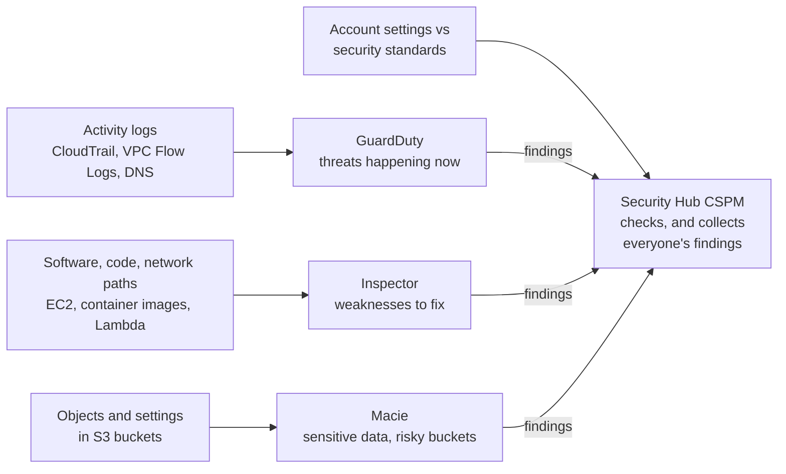

# Simulation S9: A morning of security findings: match each one to the service that raised it

## Before you start: your account, your responsibility

This guide is provided as is, without warranty. We work hard to keep it correct and current, but AWS changes often, and its services, prices, and free offers may differ from what is written here. The labs run in your own AWS account. You are responsible for that account, for its security, and for any charges it incurs, including charges from resources you forget to delete. Automate the Cloud Inc. is not liable for any costs, losses, or security incidents that result from following, or failing to follow, this material. Technical guidance here is general information, not advice about your specific systems.

**Who this is for:** you have read [09.03 Finding threats and weaknesses](03-finding-threats-and-weaknesses.md). **Time:** about 30 minutes. **Cost:** $0; no AWS account is used.

**Why a simulation:** in our Free plan test account on 2026-10-23, Amazon GuardDuty and AWS Security Hub CSPM each opened a page headed "Free account plan access limitations" with an **Upgrade plan** button, and no trial. Amazon Inspector and Amazon Macie have free trials (15 and 30 days), but AWS lists them as Paid plan offers, the Free plan includes always-free offers and not short-term trials, and after a trial each service bills (as of 2026-10-24, [free security trials](https://aws.amazon.com/free/security/), [Choosing a plan](https://docs.aws.amazon.com/awsaccountbilling/latest/aboutv2/free-tier-plans.html)). On a Paid plan, GuardDuty and Macie can generate *sample findings* for practice, which is what this page imitates.

**Goal:** it's the week the auditor visits. Overnight, the bakery's security services raised eight findings. You name the service behind each, decide which two to handle first, and answer three questions from the owner. **End state:** eight matches, a priority order and three short answers in your notes.

**Why this matters:** collecting findings in one place is [SEC04-BP02 Capture logs, findings, and metrics in standardized locations](https://docs.aws.amazon.com/wellarchitected/latest/security-pillar/sec_detect_investigate_events_logs.html); finding known weaknesses before attackers do is [SEC06-BP01 Perform vulnerability management](https://docs.aws.amazon.com/wellarchitected/latest/security-pillar/sec_protect_compute_vulnerability_management.html); finding sensitive data automatically is [SEC07-BP03 Automate identification and classification](https://docs.aws.amazon.com/wellarchitected/latest/security-pillar/sec_data_classification_auto_classification.html).

## The rules of this simulation

A **finding** is a service's report of one possible problem. Each has a **finding type**, a name for the kind of problem, and a **severity**, the service's estimate of how urgent it is, such as Low, Medium, High or Critical. The four services look at different things:

*Notice that the question "what does it read?" separates the first three, and that Security Hub CSPM is the only one that both checks something itself and gathers the others' findings.*

**Long description.** Four sources on the left, each feeding one service. Activity logs (CloudTrail, VPC Flow Logs, DNS logs) feed GuardDuty, which reports threats happening now. Software, code and network paths on EC2, container images and Lambda feed Inspector, which reports weaknesses to fix. Objects and settings in S3 buckets feed Macie, which reports sensitive data and risky buckets. Account settings compared with security standards feed Security Hub CSPM. Arrows labeled "findings" run from GuardDuty, Inspector and Macie to Security Hub CSPM.

| Service | Reads | Reports | On our Free plan account (2026-10-23) |
|---|---|---|---|
| Amazon GuardDuty | CloudTrail management events, VPC Flow Logs, DNS logs | Threats: malicious or suspicious activity | Blocked |
| Amazon Inspector | Software packages and network paths of EC2 instances, container images in Amazon ECR, Lambda functions | Vulnerabilities and network exposure | Trial not included |
| Amazon Macie | Objects and settings in S3 buckets | Sensitive data; bucket settings that weaken security | Trial not included |
| AWS Security Hub CSPM | Your account's settings, using AWS Config rules | Failed checks against standards such as CIS and AWS Foundational Security Best Practices | Blocked |

A **CVE** (Common Vulnerabilities and Exposures) is a public, numbered entry for a known software flaw; Inspector's package findings name them.

> **Dated (checked 2026-10-24):** the product the exam calls "AWS Security Hub" is now **AWS Security Hub CSPM** (cloud security posture management), and the name **AWS Security Hub** now belongs to a newer, unified product that correlates findings from Security Hub CSPM, GuardDuty, Inspector and Macie ([Security Hub FAQs](https://aws.amazon.com/security-hub/faqs/)). **Amazon Inspector Classic**, which used assessment templates you scheduled, shut down on 2026-05-20; today's Inspector finds workloads and scans them continuously on its own ([What is Amazon Inspector?](https://docs.aws.amazon.com/inspector/latest/user/what-is-inspector.html)).

## Part 1: match the findings

### Decision 1: name the service that raised each finding

The resources are the bakery's: the web server, its role, the photo bucket `bakery-cake-photos` and the account. Finding types are real AWS names; the details are made up.

| # | Finding | Resource | Severity | Detail |
|---|---|---|---|---|
| A | `CryptoCurrency:EC2/BitcoinTool.B!DNS` | Web server | High | The server is looking up a domain linked to cryptocurrency mining |
| B | Package vulnerability, CVE in `openssl` | Web server | High | An installed package has a published flaw; a fixed version exists |
| C | `SensitiveData:S3Object/Personal` | `bakery-cake-photos/exports/orders-2026-10.csv` | High | The file holds names and phone numbers |
| D | `[EC2.13] Security groups should not allow ingress from 0.0.0.0/0 or ::/0 to port 22`: FAILED | `web-sg` | High | A rule allows SSH from anywhere |
| E | `UnauthorizedAccess:IAMUser/InstanceCredentialExfiltration.OutsideAWS` | The web server's role | High | The server's temporary credentials were used from an address outside AWS |
| F | Network reachability, port 22 | Web server | Medium | An open path runs from the internet gateway to port 22 |
| G | `Policy:IAMUser/S3BlockPublicAccessDisabled` | `bakery-cake-photos` | High | Someone turned off the bucket's Block Public Access settings |
| H | `[IAM.9] MFA should be enabled for the root user`: FAILED | The account | Critical | The root user has no MFA device |

Model answer

*Notice the two pairs that look alike: D and F are both about port 22, and C and G are both about the photo bucket, yet each pair comes from two different services.*

**Long description.** A grid with eight rows, A to H, and four columns: GuardDuty, Inspector, Macie, Security Hub CSPM. One cell per row is marked, with a word saying what the service read. A: GuardDuty, from DNS logs. B: Inspector, from software packages. C: Macie, from object contents. D: Security Hub CSPM, from a standards check. E: GuardDuty, from CloudTrail. F: Inspector, from network paths. G: Macie, from bucket settings. H: Security Hub CSPM, from a standards check.

- **A, GuardDuty.** Behavior seen in DNS logs: something is happening now. Inspector looks for weaknesses, not activity.
- **B, Inspector.** A known flaw in installed software. GuardDuty would only notice if someone exploited it and the behavior showed in its logs.
- **C, Macie.** Only Macie reads what's *inside* S3 objects. The real problem: order exports with personal data sit in a bucket meant for cake photos.
- **D, Security Hub CSPM.** `EC2.13` is a control: a check of a setting against a standard, here using the AWS Config rule `restricted-ssh`.
- **E, GuardDuty.** Credentials used where they shouldn't be, seen in CloudTrail events.
- **F, Inspector.** A network reachability finding: Inspector worked out an actual path from the internet to the port. D says "the rule breaks a standard"; F says "the server is reachable". Both point to the same fix.
- **G, Macie.** A policy finding about the bucket's settings. GuardDuty has a similar S3 finding type, so on a real account you might see both; Macie's name format, `Policy:IAMUser/S3…`, gives it away here.
- **H, Security Hub CSPM.** A control against standards such as CIS. Trusted Advisor's free checks also flag root MFA, which is why you met it in the primer.

## Part 2: decide what to do

### Decision 2: which two do you handle first, and why?

Model answer

**E, then A.** Both describe an attack under way: someone outside AWS holds the server's credentials (E), and the server is probably running a miner (A). They are likely the same incident. Contain it first: cut the server off from the network and revoke the role's sessions, then investigate. Next come C and G together, because personal data in a bucket that may now be public is a data breach in waiting. B, D and F are weaknesses that may explain *how* the attacker got in; fix them as part of the cleanup. H is critical but not an attack: fix it today. Severity is the service's estimate; your knowledge of the business decides the order.

### Decision 3: the owner asks, "Do I really have to open four consoles every morning?"

Model answer

No. GuardDuty, Inspector and Macie send their findings to Security Hub CSPM, which shows them in one place, scores the account against standards and can pass findings to Amazon EventBridge to start automatic responses. Security Hub CSPM needs AWS Config turned on and recording, because most of its checks are Config rules ([What is Security Hub CSPM?](https://docs.aws.amazon.com/securityhub/latest/userguide/what-is-securityhub.html)). The newer unified Security Hub goes further: it correlates signals into *exposure findings*, so a flawed package on a server that is reachable from the internet, like B and F together, can be raised as one combined risk ([What is AWS Security Hub?](https://docs.aws.amazon.com/securityhub/latest/userguide/what-is-securityhub-v2.html)).

### Decision 4: the owner asks, "Will GuardDuty stop the attacker?"

Model answer

No. All four services report; none of them blocks traffic or deletes anything on its own. You act on the finding, by hand or with automation you build. To work out what the attacker did and how far it spread, Amazon Detective builds a picture from logs and GuardDuty findings ([What is Amazon Detective?](https://docs.aws.amazon.com/detective/latest/userguide/what-is-detective.html)). Blocking belongs to other tools: a security group, a network ACL or AWS WAF, from lesson [09.04](04-the-front-door.md).

### Decision 5: an older study guide says, "Create an Inspector assessment template and install the Inspector agent." What do you tell a friend who is studying from it?

Model answer

That describes Amazon Inspector Classic, which shut down on 2026-05-20. Today's Inspector finds EC2 instances, container images and Lambda functions automatically and rescans them when software changes or a new CVE is published. EC2 scanning uses the Systems Manager agent or works without an agent; there's no separate Inspector agent and no template to schedule.

## Recap

Ask what the service reads. Activity logs mean GuardDuty, a threat happening now. Software and network paths mean Inspector, a weakness to fix. What's inside S3 means Macie. A setting checked against a standard means Security Hub CSPM, which also collects everyone's findings. None of them blocks anything.

**Next:** [Simulation S10](09-sim-config-timeline.md), where the question changes from "is something wrong now?" to "what did this resource look like last Tuesday?"

---

"Simulation S9: Match security findings to the service that raised them" by Automate the Cloud Inc., licensed under CC BY-NC 4.0 with the Additional Permission for Internal Training from Automate the Cloud Inc.
License: https://creativecommons.org/licenses/by-nc/4.0/
Permission: https://automatethe.cloud/licenses/atc-internal-training-permission.txt
