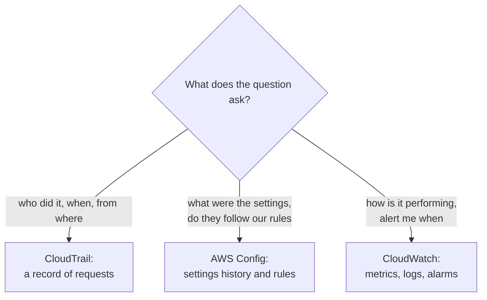

# Simulation S10: Read a security group's AWS Config timeline, and tell Config from CloudTrail and CloudWatch

## Before you start: your account, your responsibility

This guide is provided as is, without warranty. We work hard to keep it correct and current, but AWS changes often, and its services, prices, and free offers may differ from what is written here. The labs run in your own AWS account. You are responsible for that account, for its security, and for any charges it incurs, including charges from resources you forget to delete. Automate the Cloud Inc. is not liable for any costs, losses, or security incidents that result from following, or failing to follow, this material. Technical guidance here is general information, not advice about your specific systems.

**Who this is for:** you have read [09.01 Who did what, how it runs, how it was set](01-who-did-what.md) and done [Lab 12](07-lab-12-answer-the-auditor.md). **Time:** about 30 minutes. **Cost:** $0; no AWS account is used.

**Why a simulation:** AWS Config charges for every change it records and every rule check it runs: $0.003 per configuration item recorded continuously and $0.001 per rule evaluation for the first 100,000 (US East (N. Virginia), as of 2026-10-24, [AWS Config pricing](https://aws.amazon.com/config/pricing/)). Its recorder keeps running until you stop it, so a forgotten recorder is a slow leak. And the point of Config is history: a week of it can't be made in an afternoon.

**Goal:** in Lab 12 the auditor asked, "Was port 22 open on the web server's security group on a given day?" Here you answer it from a week of Config history, and sort five more questions between AWS Config, AWS CloudTrail and Amazon CloudWatch. **End state:** five answers and a sorted list in your notes.

**Why this matters:** checking resources against your rules and recording when they drift is [SEC04-BP04 Initiate remediation for non-compliant resources](https://docs.aws.amazon.com/wellarchitected/latest/security-pillar/sec_detect_investigate_events_noncompliant_resources.html); keeping the records where you can find them is [SEC04-BP02 Capture logs, findings, and metrics in standardized locations](https://docs.aws.amazon.com/wellarchitected/latest/security-pillar/sec_detect_investigate_events_logs.html).

## The rules of this simulation

**AWS Config** keeps an inventory of your resources and a history of how each one's settings changed. Each time a recorded resource changes, Config saves a **configuration item**: a snapshot of the resource's settings at that moment. A **Config rule** compares resources with a setting you want and marks each one compliant or noncompliant. The console shows both on a resource's **resource timeline**, which can also show the CloudTrail events behind each change ([Viewing compliance history](https://docs.aws.amazon.com/config/latest/developerguide/view-manage-resource-console.html)).

In this simulation the bakery turned on Config in `us-east-1` months ago, recording security groups, with one AWS managed rule: **restricted-ssh**, which is noncompliant when a security group allows SSH (port 22) from `0.0.0.0/0` or `::/0` ([restricted-ssh](https://docs.aws.amazon.com/config/latest/developerguide/restricted-ssh.html)). The resource is `web-sg`, the web server's security group from [Simulation S8](../07-connecting-it/06-sim-packet-journey.md). The week, the people and the times (UTC) are made up.

**Configuration items for `web-sg`:**

| Item | Recorded | Inbound rules |
|---|---|---|
| 1 | Before this week | TCP 443 from `0.0.0.0/0` |
| 2 | Wed, October 14, 14:06 | TCP 443 from `0.0.0.0/0`; **TCP 22 from `0.0.0.0/0`** |
| 3 | Fri, October 16, 10:41 | TCP 443 from `0.0.0.0/0` |

**restricted-ssh results for `web-sg`:**

| Time | Result | Why the rule ran |
|---|---|---|
| Wed, October 14, 14:07 | NONCOMPLIANT | Configuration change |
| Fri, October 16, 10:42 | COMPLIANT | Configuration change |
| Sat, October 17, 03:00 | COMPLIANT | Periodic check |

**CloudTrail events for `web-sg`:**

| Time | Event name | User name |
|---|---|---|
| Wed, October 14, 14:05 | `AuthorizeSecurityGroupIngress` | `sam-dev` |
| Fri, October 16, 10:40 | `RevokeSecurityGroupIngress` | `lee-ops` |

**CloudWatch, web server CPU:** under 20% all week, except Thursday, October 15, 19:00 to 21:00, when it reached 85% during a flood of requests.

*Notice that each CloudTrail event sits one minute before a configuration item: CloudTrail recorded the request, Config recorded the result.*

**Long description.** A week from Monday, October 12, to Sunday, October 18, in three lanes. CloudTrail lane: Wednesday 14:05 `AuthorizeSecurityGroupIngress` by `sam-dev`; Friday 10:40 `RevokeSecurityGroupIngress` by `lee-ops`. Config lane: item 1 from before the week (443 only), item 2 on Wednesday 14:06 (443 and 22), item 3 on Friday 10:41 (443 only). Compliance lane: compliant until Wednesday 14:07, then a highlighted noncompliant stretch to Friday 10:42, then compliant, with a periodic check on Saturday 03:00.

## Part 1: read the timeline

### Decision 1: answer the auditor's four questions

1. What were `web-sg`'s inbound rules on Thursday, October 15, at noon?
2. For how long was `web-sg` noncompliant with restricted-ssh?
3. Who opened port 22, and who closed it?
4. Was the high CPU on Thursday evening caused by the open port?

Model answer

1. **TCP 443 and TCP 22, both from anywhere.** Item 2 was the current state from Wednesday 14:06 until item 3 on Friday 10:41. A configuration item stays true until the next one replaces it. This is Config's job: CloudTrail lists changes, but it doesn't store what the resource looked like.
2. **About 44 and a half hours** (44 hours 35 minutes), from Wednesday 14:07 to Friday 10:42. Config detected the problem one minute after the change, but nobody acted on it for almost two days. The rule reported; it didn't fix anything.
3. **`sam-dev` opened it and `lee-ops` closed it.** That answer comes from CloudTrail, which records who made each request. The resource timeline shows those events beside the items, which is why the two services are used together.
4. **None of these records can say.** CloudWatch shows *that* CPU was high; it doesn't show why. The surge came during the competitor's DDoS week, but a port open for SSH doesn't explain a flood of web requests. You'd look at load balancer and web server logs, and at lesson [09.04](04-the-front-door.md)'s protections.

### Decision 2: the owner says, "Config caught it, so Config would have stopped it next time."

Model answer

No. Config records and evaluates; on its own it changes nothing. You can attach a remediation action to a rule to fix a noncompliant resource automatically or after approval ([What is AWS Config?](https://docs.aws.amazon.com/config/latest/developerguide/WhatIsConfig.html)), which would have closed the port within minutes. To *prevent* the change, `sam-dev`'s IAM permissions shouldn't allow editing production security groups at all; across many accounts, a service control policy can cap that, as in [Simulation S11](10-sim-organizations-and-scps.md). Detecting, fixing and preventing take three different tools.

## Part 2: sort the questions

The three services answer three different questions: **CloudTrail**, "who did what, and when?"; **AWS Config**, "what did this resource look like, and did it follow our rules?"; **CloudWatch**, "how is it running right now, and should someone be alerted?" Module 08's lesson [Watching workloads](../08-building-and-operating/03-watching-workloads.md) taught CloudWatch.

*Notice that the verbs differ: CloudTrail answers about people's requests, Config about a resource's state, CloudWatch about behavior over time.*

**Long description.** A decision tree from one question, "What does the question ask?". "Who did it, when, from where" leads to CloudTrail, a record of requests. "What were the settings, do they follow our rules" leads to AWS Config, settings history and rules. "How is it performing, alert me when" leads to CloudWatch, metrics, logs and alarms.

### Decision 3: name the service for each question

| # | Question |
|---|---|
| a | Which user deleted the old photo bucket last month? |
| b | Are any of our EBS volumes unencrypted right now, and which? |
| c | Email the owner when the order database's storage is nearly full. |
| d | What did the database's security group allow on September 1? |
| e | Who downloaded `lemon-tart.jpg` from the photo bucket yesterday? |

Model answer

- **a, CloudTrail.** `DeleteBucket` is a management event, in Event history if it's within 90 days.
- **b, AWS Config**, with a rule that checks volume encryption.
- **c, CloudWatch**: a metric and an alarm that notifies the owner.
- **d, AWS Config**, if it was recording on that date. CloudTrail could show changes but not the state.
- **e, none by default.** Downloading a file is a *data event*. Event history never shows data events; you need a trail set up to log them, or S3 server access logging, turned on *before* the download. Evidence you didn't collect doesn't exist.

## Part 3: how far back the evidence goes

*Notice how short Event history's window is next to the others, and that Config's bar only counts from the day you turned recording on.*

| Source | How far back | Note |
|---|---|---|
| CloudTrail Event history | 90 days | Always on, free, one Region at a time |
| IAM last accessed information | At least 400 days | For services; action detail for fewer |
| AWS Config | 7 years (2,557 days) by default; 30 days to 7 years if you set it | Only from when recording started |
| A CloudTrail trail | As long as you keep the files in S3 | Storage costs apply |

Sources: [Event history](https://docs.aws.amazon.com/awscloudtrail/latest/userguide/view-cloudtrail-events.html), [last accessed information](https://docs.aws.amazon.com/IAM/latest/UserGuide/access_policies_last-accessed.html), [Config retention](https://docs.aws.amazon.com/config/latest/developerguide/delete-config-data-with-retention-period.html), all checked 2026-10-24.

### Decision 4: the auditor suggests AWS Audit Manager for "continuous compliance". What do you say?

Model answer

AWS Audit Manager closed to new accounts on 2026-04-30 and is in maintenance mode, so the bakery can't start using it. AWS points new customers to **conformance packs** in AWS Config: sets of Config rules, with optional fixes, deployed and reported on as one unit, with templates for frameworks such as PCI DSS and HIPAA ([Audit Manager availability change](https://docs.aws.amazon.com/audit-manager/latest/userguide/audit-manager-availability-change.html)). AWS adds that a pack checks only the technical settings a rule can test, not the whole audit; nothing in Config can confirm that the bakery wrote a security policy. Security Hub CSPM's standards, from Simulation S9, are another option. If an older study guide names Audit Manager as the compliance answer, it's out of date.

## Recap

CloudTrail answers *who* and *when*; Config answers *what it looked like* and *whether it followed the rules*; CloudWatch answers *how it's running*. Config records and judges but fixes nothing unless you attach remediation. Every source only reaches back as far as it was collecting, so decide what evidence you need before the auditor asks.

**Next:** [Simulation S11](10-sim-organizations-and-scps.md), where many accounts are governed together.

---

"Simulation S10: Read a resource's AWS Config timeline, and tell Config from CloudTrail" by Automate the Cloud Inc., licensed under CC BY-NC 4.0 with the Additional Permission for Internal Training from Automate the Cloud Inc.
License: https://creativecommons.org/licenses/by-nc/4.0/
Permission: https://automatethe.cloud/licenses/atc-internal-training-permission.txt
