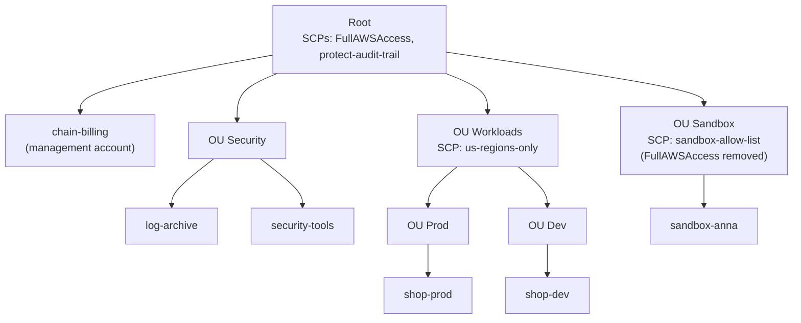

# Optional simulation S11: Govern the bakery chain's accounts with OUs and SCPs, and pay one bill

**Exam guide:** [Domain 2, Security and Compliance](https://docs.aws.amazon.com/aws-certification/latest/cloud-practitioner-02/cloud-practitioner-02-domain2.html) (30% of the exam): tasks [2.2](https://docs.aws.amazon.com/aws-certification/latest/cloud-practitioner-02/cloud-practitioner-02-domain2.html#cloud-practitioner-02-task2.2) and [2.3](https://docs.aws.amazon.com/aws-certification/latest/cloud-practitioner-02/cloud-practitioner-02-domain2.html#cloud-practitioner-02-task2.3); [Domain 4, Billing, Pricing, and Support](https://docs.aws.amazon.com/aws-certification/latest/cloud-practitioner-02/cloud-practitioner-02-domain4.html) (12% of the exam): task [4.2](https://docs.aws.amazon.com/aws-certification/latest/cloud-practitioner-02/cloud-practitioner-02-domain4.html#cloud-practitioner-02-task4.2).

> **Note:** This simulation is optional practice for learners who want more decisions to make; the main path and the module's hours leave it out.

## Before you start: your account, your responsibility

This guide is provided as is, without warranty. We work hard to keep it correct and current, but AWS changes often, and its services, prices, and free offers may differ from what is written here. The labs run in your own AWS account. You are responsible for that account, for its security, and for any charges it incurs, including charges from resources you forget to delete. Automate the Cloud Inc. is not liable for any costs, losses, or security incidents that result from following, or failing to follow, this material. Technical guidance here is general information, not advice about your specific systems.

**Who this is for:** you have read [09.05 Compliance and governance](05-compliance-and-governance.md). **Time:** about 20 minutes. **Cost:** $0; no AWS account is used.

**Why a simulation:** joining AWS Organizations, or setting up an AWS Control Tower landing zone, moves a Free plan account to the Paid plan automatically (as of 2026-10-24, [Choosing a plan](https://docs.aws.amazon.com/awsaccountbilling/latest/aboutv2/free-tier-plans.html)). Never create an organization in your lab account.

**Goal:** the bakery has grown into a small chain with separate AWS accounts for production, development, security and experiments. You predict what the organization's SCPs allow, choose between Organizations and Control Tower, and explain the bill. **End state:** six predictions and two short answers in your notes.

## The rules of this simulation

**AWS Organizations** manages many AWS accounts as one group, at no extra charge. The **management account** pays for everyone; the others are **member accounts**; an **OU** is a folder of accounts, and a policy attached to it applies to every account below. A service control policy (SCP) caps what users and roles in member accounts can do, root user included, and grants nothing ([Service control policies](https://docs.aws.amazon.com/organizations/latest/userguide/orgs_manage_policies_scps.html)). Three more facts:

- **Every level must allow.** A block at the root, at any OU above or on the account itself holds for everything below.
- **FullAWSAccess**, attached to every level by default, allows everything, so other SCPs can list what to deny.
- **Exceptions:** SCPs never affect the management account or service-linked roles, the roles AWS services use in your account.

The chain's organization (names and SCPs made up):

*Notice that the management account sits directly under the root, in no OU, and that the Sandbox OU swapped FullAWSAccess for a short list of what's allowed.*

**Long description.** A tree. The root has two SCPs, FullAWSAccess and protect-audit-trail. Directly under the root: the management account `chain-billing`, and three OUs. OU Security holds `log-archive` and `security-tools`. OU Workloads, with SCP us-regions-only, holds OU Prod (account `shop-prod`) and OU Dev (account `shop-dev`). OU Sandbox, with SCP sandbox-allow-list in place of FullAWSAccess, holds `sandbox-anna`. Every account and every other OU also has FullAWSAccess.

| SCP | Attached to | What it says |
|---|---|---|
| FullAWSAccess | Root, every OU except Sandbox, every account | Allow every action |
| protect-audit-trail | Root | Deny stopping or deleting CloudTrail trails |
| us-regions-only | OU Workloads | Deny every action outside `us-east-1` and `us-west-2`, except global services such as IAM |
| sandbox-allow-list | OU Sandbox | Allow only S3, Lambda, DynamoDB and CloudWatch actions |

Every person below has the IAM policy `AdministratorAccess` in their account, unless the case says otherwise.

## Part 1: predict

### Decision 1: allowed or denied, and which level decides?

| # | Who | Tries to |
|---|---|---|
| a | An admin in `shop-dev` | Launch an EC2 instance in Europe (Ireland), `eu-west-1` |
| b | The **root user** of `shop-prod` | Stop a CloudTrail trail that `shop-prod` created itself |
| c | An admin in `chain-billing` | Stop a trail that `chain-billing` created itself |
| d | An admin in `sandbox-anna` | Create a DynamoDB table in `us-east-1` |
| e | An admin in `sandbox-anna` | Launch an EC2 instance in `us-east-1` |
| f | A GuardDuty service-linked role in `shop-dev` | Read logs in `eu-west-1` |

Model answer

*Notice that the IAM policy allows everything in every row: what differs is which SCP level, if any, says no.*

**Long description.** Six rows, a to f, and five columns: root SCPs, OU SCPs, account SCP, IAM policy, result. a: root allows, Workloads OU denies (outside the Regions), outlined; denied. b: root denies by protect-audit-trail, outlined; denied. c: SCPs don't apply to the management account, outlined; allowed. d: root, Sandbox OU allow-list, account and IAM policy all allow; allowed. e: Sandbox OU's allow list doesn't include EC2, outlined; denied. f: SCPs don't apply to service-linked roles, outlined; allowed.

- **a, denied by us-regions-only**, inherited from OU Workloads through OU Dev. `AdministratorAccess` can't lift an SCP.
- **b, denied by protect-audit-trail.** SCPs cap a member account's root user too, so nobody in a shop account can switch off the evidence.
- **c, allowed.** SCPs don't touch the management account, so keep workloads out of it.
- **d, allowed.** DynamoDB is on the Sandbox allow list, and every other level has FullAWSAccess.
- **e, denied.** The account itself still has FullAWSAccess, but the Sandbox OU above it doesn't allow EC2, and every level must allow.
- **f, allowed.** Service-linked roles are outside SCPs.

## Part 2: Organizations or Control Tower

### Decision 2: the owner opens a new region of shops and wants "a ready-made, best-practice setup for new accounts, with guardrails, and a way for each shop to get an account on its own." Organizations or Control Tower?

Model answer

**AWS Control Tower.** It builds on Organizations: a *landing zone* with best-practice OUs, logging and IAM Identity Center sign-in, ready-made controls, and Account Factory for new accounts ([What is AWS Control Tower?](https://docs.aws.amazon.com/controltower/latest/userguide/what-is-control-tower.html)). Organizations alone gives you the accounts, OUs, SCPs and one bill, and you design the rest yourself.

## Part 3: the bill

**Consolidated billing** is how Organizations handles money: the management account receives **one bill** for every account and pays it, sees each account's charges, and pays no extra fee ([Consolidated billing](https://docs.aws.amazon.com/awsaccountbilling/latest/aboutv2/consolidated-billing.html)). For pricing, AWS treats the accounts as one: services with cheaper rates at higher usage, such as S3 storage, reach those rates sooner, and a Reserved Instance or Savings Plan bought in one account can cover matching usage in another. Module 11, *Paying for AWS*, comes back to this.

### Decision 3: the owner asks, "Will one organization pay less than separate accounts, and is that the main reason to have one?"

Model answer

**A little less, at scale, but that isn't the main reason.** Combined usage reaches cheaper volume tiers sooner, but the saving is small: about 2% for three accounts storing 30 TB each in S3 Standard (as of 2026-10-24). The main reasons are one bill with each account's costs visible, shared commitment discounts, and central guardrails like the SCPs in Part 1.

## Recap

SCPs set the ceiling at each level, and an action must be allowed at every level. The management account is outside every ceiling, so keep it nearly empty. Control Tower sets up a governed organization for you. Consolidated billing gives one bill, combined volume tiers and shared commitment discounts, at no extra charge.

**Next:** [the module's mastery check](11-check.md).

---

"Optional simulation S11: Govern many accounts with OUs and SCPs, and pay one bill" by Automate the Cloud Inc., licensed under CC BY-NC 4.0 with the Additional Permission for Internal Training from Automate the Cloud Inc.
License: https://creativecommons.org/licenses/by-nc/4.0/
Permission: https://automatethe.cloud/licenses/atc-internal-training-permission.txt
