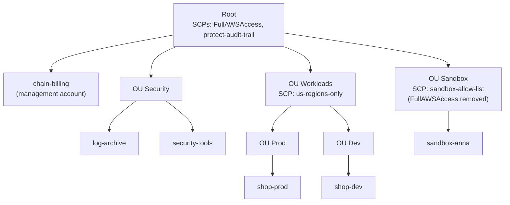

# Simulation S11: Govern the bakery chain's accounts with OUs and SCPs, and pay one bill

## Before you start: your account, your responsibility

This guide is provided as is, without warranty. We work hard to keep it correct and current, but AWS changes often, and its services, prices, and free offers may differ from what is written here. The labs run in your own AWS account. You are responsible for that account, for its security, and for any charges it incurs, including charges from resources you forget to delete. Automate the Cloud Inc. is not liable for any costs, losses, or security incidents that result from following, or failing to follow, this material. Technical guidance here is general information, not advice about your specific systems.

**Who this is for:** you have read [09.05 Compliance and governance](05-compliance-and-governance.md) and done [Simulation S4](../04-shared-responsibility-and-access/09-sim-policy-playground.md). **Time:** about 35 minutes. **Cost:** $0; no AWS account is used.

**Why a simulation:** joining AWS Organizations, or setting up an AWS Control Tower landing zone, moves a Free plan account to the Paid plan automatically, and its Free Tier credits can no longer be used (as of 2026-10-24, [Choosing a plan](https://docs.aws.amazon.com/awsaccountbilling/latest/aboutv2/free-tier-plans.html), [Free Tier terms](https://aws.amazon.com/free/terms/)). Never create an organization in your lab account.

**Goal:** the bakery has grown into a small chain, as in Simulation S4, with separate AWS accounts for production, development, security and experiments. (The German account from lesson 09.05 sits in an OU of its own, with its Europe-only SCP; this simulation leaves it out.) You predict what the organization's policies allow, diagnose a policy mistake, and explain the bill. **End state:** six predictions, one diagnosis and one billing answer in your notes.

**Why this matters:** separate accounts for separate jobs is [SEC01-BP01 Separate workloads using accounts](https://docs.aws.amazon.com/wellarchitected/latest/security-pillar/sec_securely_operate_multi_accounts.html); limits that every account inherits are [SEC03-BP05 Define permission guardrails for your organization](https://docs.aws.amazon.com/wellarchitected/latest/security-pillar/sec_permissions_define_guardrails.html); an account structure that matches how you pay is [COST02-BP03 Implement an account structure](https://docs.aws.amazon.com/wellarchitected/latest/cost-optimization-pillar/cost_govern_usage_account_structure.html).

## The rules of this simulation

**AWS Organizations** manages many AWS accounts as one group, at no extra charge. The account that creates the organization is the **management account**: it pays for everyone and can't be swapped for another. The others are **member accounts**. An **organizational unit (OU)** is a folder of accounts, and OUs can sit inside OUs; a policy attached to an OU applies to every account below it ([What is AWS Organizations?](https://docs.aws.amazon.com/organizations/latest/userguide/orgs_introduction.html)).

From Simulation S4 you know that a service control policy (SCP) caps what users and roles in member accounts can do, root user included, and grants nothing. Three more facts matter here ([Service control policies](https://docs.aws.amazon.com/organizations/latest/userguide/orgs_manage_policies_scps.html)):

- **Every level must allow.** An account gets only what is allowed at the root, at each OU above it and on the account itself. A block at any level, by a Deny or by simply not allowing, holds for everything below.
- **FullAWSAccess** is the SCP AWS attaches to every level by default; it allows everything, so the other SCPs can be lists of what to deny. Remove it from a level without a replacement, and every action below that level fails.
- **Exceptions:** SCPs never affect the management account, and never affect service-linked roles, the roles AWS services use to work in your account.

The chain's organization (names and SCPs made up):

*Notice that the management account sits directly under the root, in no OU, and that the Sandbox OU swapped FullAWSAccess for a short list of what's allowed.*

**Long description.** A tree. The root has two SCPs, FullAWSAccess and protect-audit-trail. Directly under the root: the management account `chain-billing`, and three OUs. OU Security holds `log-archive` and `security-tools`. OU Workloads, with SCP us-regions-only, holds OU Prod (account `shop-prod`) and OU Dev (account `shop-dev`). OU Sandbox, with SCP sandbox-allow-list in place of FullAWSAccess, holds `sandbox-anna`. Every account and every other OU also has FullAWSAccess.

| SCP | Attached to | What it says |
|---|---|---|
| FullAWSAccess | Root, every OU except Sandbox, every account | Allow every action |
| protect-audit-trail | Root | Deny stopping or deleting CloudTrail trails |
| us-regions-only | OU Workloads | Deny every action outside `us-east-1` and `us-west-2`, except global services such as IAM |
| sandbox-allow-list | OU Sandbox | Allow only S3, Lambda, DynamoDB and CloudWatch actions |

Every person below has the IAM policy `AdministratorAccess` in their account, unless the case says otherwise.

## Part 1: predict

### Decision 1: allowed or denied, and which level decides?

| # | Who | Tries to |
|---|---|---|
| a | An admin in `shop-dev` | Launch an EC2 instance in Europe (Ireland), `eu-west-1` |
| b | The **root user** of `shop-prod` | Stop a CloudTrail trail that `shop-prod` created itself |
| c | An admin in `chain-billing` | Stop a trail that `chain-billing` created itself |
| d | An admin in `sandbox-anna` | Create a DynamoDB table in `us-east-1` |
| e | An admin in `sandbox-anna` | Launch an EC2 instance in `us-east-1` |
| f | A GuardDuty service-linked role in `shop-dev` | Read logs in `eu-west-1` |

Model answer

*Notice that the IAM policy allows everything in every row: what differs is which SCP level, if any, says no.*

**Long description.** Six rows, a to f, and five columns: root SCPs, OU SCPs, account SCP, IAM policy, result. a: root allows, Workloads OU denies (outside the Regions), outlined; denied. b: root denies by protect-audit-trail, outlined; denied. c: SCPs don't apply to the management account, outlined; allowed. d: root, Sandbox OU allow-list, account and IAM policy all allow; allowed. e: Sandbox OU's allow list doesn't include EC2, outlined; denied. f: SCPs don't apply to service-linked roles, outlined; allowed.

- **a, denied by us-regions-only**, inherited from OU Workloads through OU Dev. `AdministratorAccess` can't lift an SCP.
- **b, denied by protect-audit-trail.** SCPs cap a member account's root user too. That's the point: nobody in a shop account can switch off the evidence you used in Lab 12.
- **c, allowed.** SCPs don't touch the management account. Keep workloads and everyday users out of it, and give very few people access.
- **d, allowed.** DynamoDB is on the Sandbox allow list, and every other level has FullAWSAccess.
- **e, denied.** The account itself still has FullAWSAccess, but the Sandbox OU above it doesn't allow EC2, and every level must allow.
- **f, allowed.** Service-linked roles are outside SCPs, so AWS services keep working whatever the SCPs say.

## Part 2: diagnose

### Decision 2: "Since this morning, everyone in `shop-prod` and `shop-dev` gets 'access denied' for everything. The sandbox and security accounts are fine."

Model answer

**Someone detached FullAWSAccess from OU Workloads**, probably while "tidying up" its policies. That left only us-regions-only, which lists denials and allows nothing, so at that level nothing is allowed, and both accounts below inherit the block. The other OUs still have their allows. Fix it by reattaching FullAWSAccess to OU Workloads. AWS advises testing SCP changes on a small test OU before applying them to accounts that matter; last accessed information for the OU, which you met as an IAM report in Lab 12, shows which services the accounts really use.

### Decision 3: the owner opens a new region of shops and wants "a ready-made, best-practice setup for new accounts, with guardrails, and a way for each shop to get an account on its own." Organizations or Control Tower?

Model answer

**AWS Control Tower.** It builds on Organizations: it sets up a *landing zone*, a multi-account environment with best-practice OUs, logging and IAM Identity Center sign-in, applies ready-made controls, and offers an account factory for new accounts ([What is AWS Control Tower?](https://docs.aws.amazon.com/controltower/latest/userguide/what-is-control-tower.html)). Organizations alone gives you the accounts, OUs, SCPs and one bill, and you design the rest yourself. Control Tower itself has no extra charge; you pay for the services it turns on. Both would move a Free plan account to the Paid plan.

## Part 3: the bill

This part stands on its own; Module 11, *Paying for AWS*, comes back to it.

**Consolidated billing** is how Organizations handles money: the management account receives **one bill** for every account in the organization and pays it, can see each member account's charges, and pays no extra fee for this ([Consolidated billing](https://docs.aws.amazon.com/awsaccountbilling/latest/aboutv2/consolidated-billing.html)). For pricing, AWS treats all the accounts as if they were one account. Two consequences:

- **Volume tiers count combined usage.** Services with cheaper rates at higher usage, such as S3 storage and data transfer, reach the cheaper rates sooner ([Volume discounts](https://docs.aws.amazon.com/awsaccountbilling/latest/aboutv2/useconsolidatedbilling-effective.html)).
- **Commitment discounts are shared.** A Reserved Instance or Savings Plan bought in one account can cover matching usage in another, unless the management account turns sharing off for that account ([discount sharing](https://docs.aws.amazon.com/awsaccountbilling/latest/aboutv2/ri-turn-off.html)).

The bill doesn't follow the OU tree. To see costs by shop or team, you use accounts and cost allocation tags, which Module 11 teaches.

### Decision 4: the owner asks, "If three of our accounts each stored 30 TB in S3 Standard, would one organization pay less than three separate accounts? Is that the main reason to do this?"

The chain stores far less; 30 TB each just makes the effect visible. S3 Standard in US East (N. Virginia) costs $0.023 per GB-month for the first 50 TB a month and $0.022 per GB-month for the next 450 TB (as of 2026-10-24, from AWS's price list published 2026-10-15; [Amazon S3 pricing](https://aws.amazon.com/s3/pricing/)). 1 TB is 1,024 GB here.

Model answer

*Notice how small the gap is: about 2%.*

| Setup | GB at $0.023 | GB at $0.022 | Monthly cost |
|---|---|---|---|
| Three separate accounts, 30,720 GB each | 92,160 | 0 | $2,119.68 |
| One organization, 92,160 GB combined | 51,200 | 40,960 | $2,078.72 |

**Yes, slightly less: $40.96 a month, about 2%.** Separately, no account passes 50 TB, so every GB pays the first-tier rate. Combined, the 40 TB above the first 50 TB pays the lower rate. That isn't the main reason to use an organization. The main reasons are one bill with each account's costs visible, shared commitment discounts, and central guardrails like the SCPs in Part 1. For the chain, the honest answer is: "a little, and only at scale; the control is worth more than the discount."

## Recap

An organization groups accounts into OUs. SCPs set the ceiling at each level, and an action must be allowed at every level, so removing FullAWSAccess without a replacement blocks everything below. The management account is outside every ceiling, so keep it nearly empty. Control Tower sets up a governed organization for you. Consolidated billing gives one bill, combined volume tiers and shared commitment discounts, at no extra charge.

**Next:** the module's mastery check. First, retry the practice questions at the end of [09.05](05-compliance-and-governance.md) and [09.06](06-a-defense-map.md) without looking back.

---

"Simulation S11: Govern many accounts with OUs and SCPs, and pay one bill" by Automate the Cloud Inc., licensed under CC BY-NC 4.0 with the Additional Permission for Internal Training from Automate the Cloud Inc.
License: https://creativecommons.org/licenses/by-nc/4.0/
Permission: https://automatethe.cloud/licenses/atc-internal-training-permission.txt
