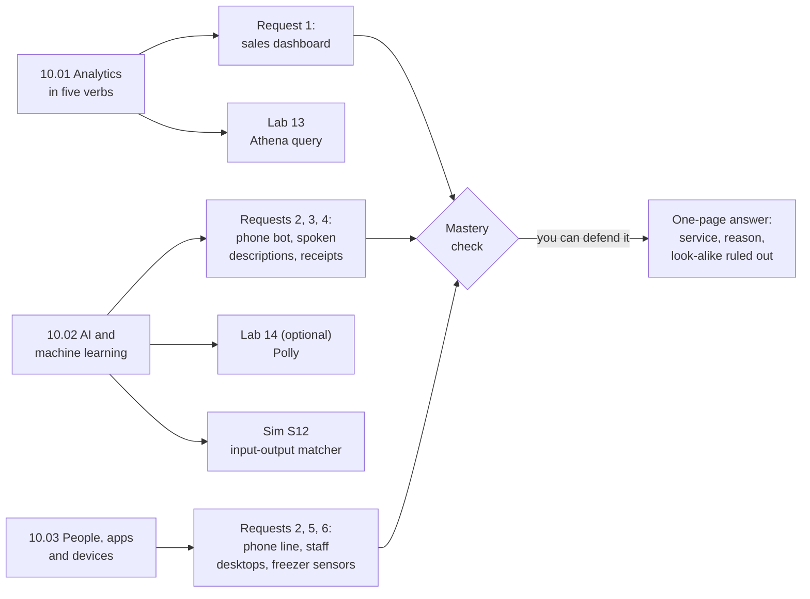

# Module 10: Match six of the bakery owner's requests to the AWS service built for each

The rest of the exam's catalog: analytics, AI and machine learning, desktops and apps for people, and connected devices. Learn the job each service does, so that given a need, you can name the service and rule out its look-alikes.

**For:** an adult studying alone, possibly new to IT, who wants to understand AWS and use it safely. You have finished Modules 02 to 09 and the [guardrails primer](https://github.com/AutomateTheCloud/atc-study-aws_account_guardrails/blob/main/primer/00-read-this-first.md). **Time:** about 2.5 hours, over several sessions.

## The scenario: six requests from the owner

The bakery's site runs on AWS (EC2, RDS, Lambda, S3, in the Module 07 network). The growing business brings six requests:

| # | The owner's request | Lesson |
|---|---|---|
| 1 | "One screen each morning with sales by day, by cake and by shop, and which cake pages people look at before they order." | 10.01 |
| 2 | "When the shop is busy, a bot should answer the phone and take simple orders." | 10.02, 10.03 |
| 3 | "Read each cake's description aloud on the website, for customers who would rather listen." | 10.02 |
| 4 | "Turn the suppliers' paper receipts into text the accountant can search." | 10.02 |
| 5 | "Give December's temporary staff a work desktop they can reach from their own laptops, and take it away in January." | 10.03 |
| 6 | "The freezers have temperature sensors. Collect their readings and warn us before the dough thaws." | 10.03 |

The bakery is made up for teaching. You finish with a one-page answer: for each request, the service, the reason and the look-alike ruled out.

## You'll be able to

Tags: the kind of knowledge (C concept) and what you do with it (Ap apply).

| Objective | Lesson |
|---|---|
| **10.01a** Name the five jobs of an analytics pipeline (ingest, catalog, query, search, visualize) and place each AWS analytics service in one of them [C·Ap] | 10.01 |
| **10.02a** Choose an AI or machine learning service by what goes in and what must come out [C·Ap] | 10.02 |
| **10.03a** Match a need for desktops, apps, customer contact, email, a web or mobile front end, or connected devices to the AWS service for it [C·Ap] | 10.03 |

## What this covers on the exam

Task [3.7](https://docs.aws.amazon.com/aws-certification/latest/cloud-practitioner-02/cloud-practitioner-02-domain3.html#cloud-practitioner-02-task3.7), AI/ML and analytics, and the end-user computing, business application, front-end and IoT parts of task [3.8](https://docs.aws.amazon.com/aws-certification/latest/cloud-practitioner-02/cloud-practitioner-02-domain3.html#cloud-practitioner-02-task3.8), in Domain 3 of the AWS Certified Cloud Practitioner (CLF-C02) exam (checked 2026-10-24). Module 08, "Building and operating", and Module 12, "Getting help", cover the rest of 3.8. Few questions spread over many services, so the lessons are short and built on comparisons.

## How the module is laid out

**Lessons** (about 25 minutes each):

1. [Analytics in five verbs](01-analytics-in-five-verbs.md)
2. [AI and machine learning](02-ai-and-ml.md)
3. [People, apps and devices](03-people-apps-and-devices.md)

**Hands-on:**

- [Lab 13: query a small sales file in S3 with Athena](04-lab-13-athena-query.md), then delete everything.
- [Lab 14 (optional): have Amazon Polly read a product description aloud](05-lab-14-polly-text-to-speech.md).
- [Simulation S12: the input and output matcher](06-sim-input-output-matcher.md), on this site, not in AWS.

**Before the labs:** check that you still have [root MFA](https://github.com/AutomateTheCloud/atc-study-aws_account_guardrails/blob/main/primer/02-secure-the-root-user.md), [your IAM admin user with MFA](https://github.com/AutomateTheCloud/atc-study-aws_account_guardrails/blob/main/primer/03-your-everyday-admin-identity.md) and [money alarms](https://github.com/AutomateTheCloud/atc-study-aws_account_guardrails/blob/main/primer/05-money-alarms.md). The lessons need no AWS account.

**Mastery check:** the [Module 10 mastery check](07-check.md); pass at 80%. Each miss points to the section to reread, then to a parallel retest.

> **Dated (checked 2026-10-24):** names move fast here, and questions may use old or new ones. Amazon QuickSight is now Amazon Quick Sight; Kinesis Data Firehose is now Amazon Data Firehose; AppStream 2.0 is now WorkSpaces Applications; Amazon Connect is now Connect Customer. Amazon Q Business and Amazon Kendra are closed to new customers, and WorkSpaces Secure Browser closes to them on 2026-10-29.

*Notice that request 2 appears twice: one service understands the caller, another runs the phone line.*

**Long description.** Left to right: lesson 10.01 answers request 1 and leads to Lab 13; lesson 10.02 answers requests 2, 3 and 4 and leads to the optional Lab 14 and Simulation S12; lesson 10.03 answers requests 2, 5 and 6. All requests lead to the mastery check, then, "you can defend it", to the one-page answer.

## Coming back

Warm-ups bring back Module 09, "Protecting, governing and proving compliance" (activity records, sensitive data, encryption keys); Modules 05 and 07 (the data warehouse, S3 defaults, Client VPN); and Modules 02 and 04 (fixed and variable expenses, what stays yours).

---

"Module 10: Data, AI and the rest of the catalog" by Automate the Cloud Inc., licensed under CC BY-NC 4.0 with the Additional Permission for Internal Training from Automate the Cloud Inc.
License: https://creativecommons.org/licenses/by-nc/4.0/
Permission: https://automatethe.cloud/licenses/atc-internal-training-permission.txt
