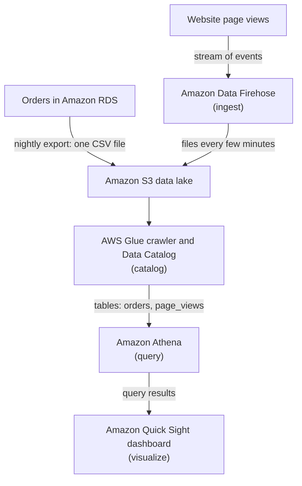

# Every analytics service does one of five jobs: ingest, catalog, query, search or visualize

Getting from raw data to an answer takes five jobs, and AWS has a service for each: bring data in, describe it, ask it questions, search it, and show the answers. Learn the five verbs and you can place any analytics service on the exam in its job, and rule out the ones that only sound similar.

**For:** an adult studying alone, possibly new to IT, who wants to understand AWS and use it safely. **Time:** about 25 minutes. Reading works on a phone.

**Before you start:** this lesson builds on [Choosing a database](../05-storing-data/06-choosing-a-database.md) (Redshift and the difference between running the business and studying it), [Block, file and object storage](../05-storing-data/01-block-file-object.md) (S3) and [Containers and serverless](../06-running-applications/03-containers-and-serverless.md) (what "serverless" means). If you skipped them, the key terms below give you enough to follow. The bakery's six requests are in the [module brief](00-brief.md); this lesson answers the first, the sales dashboard.

## Warm-up: what you remember

Answer from memory before you look anything up.

1. From Lab 01 and Module 09, "Protecting, governing and proving compliance": the owner asks who deleted a bucket last Tuesday. Which service keeps that record?
2. From lesson 05.06: the accountant wants total sales by month and cake for the last three years. Is that transactional work or analytics work, and why does it matter which database runs it?
3. From lesson 02.02: what is the difference between a fixed expense and a variable expense?

Feedback

1. **AWS CloudTrail.** It records the actions taken in your account; its Event history shows the last 90 days. You found your own bucket there in Lab 01.
2. **Analytics work.** It reads a large amount of history in a few big queries. Running it on the order database could slow the website, which does many small reads and writes. That's why analytics gets its own tools, the subject of this lesson.
3. **A fixed expense stays the same however much you use;** a variable expense goes up and down with use. Several services in this lesson charge only for what you use: no queries, no query bill.

## What you'll learn

By the end of this lesson, you can:

- name the five jobs of an analytics pipeline and place each AWS analytics service in one of them (objective 10.01a);
- tell Kinesis Data Streams, Amazon Data Firehose and Amazon SQS apart;
- tell Athena, Redshift, EMR and Glue apart;
- recognize old names for these services, and one service that is gone.

Try these before you read on. Guess if you're unsure; the answers are in the lesson.

1. The bakery keeps a year of website logs as files in S3. Which service lets it run SQL on those files without loading them anywhere or running a server?
2. Is AWS Glue a place to run queries?

## The big picture: five verbs, from raw data to a dashboard

An analytics **data pipeline** is the path data takes from where it's created to the screen where someone reads the answer. Each AWS analytics service does one step.

*Notice the highlighted step, catalog. It's the verb people forget, and the reason Athena can treat a folder of files as a table.*

**Long description.** Top to bottom. Step 1, ingest: Amazon Kinesis Data Streams, which holds a stream of records for your own programs, and Amazon Data Firehose, which delivers a stream to a store with no code. Records flow down, seconds after they happen, and land in Amazon S3, the data lake, as files such as CSV, JSON or Parquet. Files flow down to step 2, catalog, highlighted: AWS Glue, whose Data Catalog holds a table definition for each set of files, with crawlers to find them and ETL jobs to clean them. Tables flow down to step 3, query: Amazon Athena, SQL on files in S3 with no servers; Amazon Redshift, a data warehouse for big reports; Amazon EMR, Spark and Hadoop clusters. Query results flow down to step 5, visualize: Amazon Quick Sight, dashboards for people in the business. A side branch runs from Firehose to step 4, search: Amazon OpenSearch Service, which finds words and patterns in text and logs. Real pipelines skip or repeat steps.

| Verb | The question it answers | AWS services on the exam |
|---|---|---|
| **Ingest** | How does the data get in, as it happens? | Amazon Kinesis Data Streams; Amazon Data Firehose |
| **Catalog** | What's in these files, and is it clean? | AWS Glue |
| **Query** | What does the data say? | Amazon Athena; Amazon Redshift; Amazon EMR |
| **Search** | Where does this word or error appear? | Amazon OpenSearch Service |
| **Visualize** | How do people in the business see it? | Amazon Quick Sight |

The exam's task [3.7](https://docs.aws.amazon.com/aws-certification/latest/cloud-practitioner-02/cloud-practitioner-02-domain3.html#cloud-practitioner-02-task3.7) names Athena, Kinesis, Glue and Quick Sight as examples; the exam's service list adds EMR, OpenSearch Service and Redshift (checked 2026-10-24).

## Key terms (skip if you know them)

- **Ingest:** bring data into a system. **Streaming data** arrives continuously, a little at a time, such as clicks on a website; a **batch** is a large amount handled at once, such as yesterday's orders.
- **Data lake:** one central store that keeps data of many kinds in its original form, for analysis later ([What is a data lake?](https://aws.amazon.com/what-is/data-lake/)). On AWS it's usually an S3 bucket.
- **Data catalog:** a list of what data you have, where it is and what its columns are. It holds metadata, the facts about data you met in lesson 05.01.
- **ETL** (extract, transform, load): take data out of a source, clean or reshape it, and put it where it will be analyzed.
- **Schema on read:** the table layout is applied when you query the files, not when you store them, so the files never change.
- **Search index:** a structure that lists which words appear in which records, so a search finds them fast.
- **Business intelligence (BI):** tools that turn data into reports and charts for people who run the business. A **dashboard** is one screen of those charts, kept up to date.

## Ingest: Data Streams holds records for your programs; Firehose delivers them for you

The exam guide lists "Amazon Kinesis", but **Amazon Kinesis** is a family of services for data that arrives continuously. The two you need are Data Streams and Firehose; the family also includes Kinesis Video Streams, for video from cameras ([What is Amazon Kinesis Data Streams?](https://docs.aws.amazon.com/streams/latest/dev/introduction.html), checked 2026-10-24). When you see "Kinesis", ask which member the question means.

**Amazon Kinesis Data Streams** collects records as they happen and keeps them in a stream. Your own programs, called **consumers**, read from it. A record is usually readable within a second, and several consumers can read the same records independently: one updates live figures while another archives to S3. Records stay in the stream for 24 hours by default, and you can raise that to 365 days at extra cost ([Change the data retention period](https://docs.aws.amazon.com/streams/latest/dev/kinesis-extended-retention.html)). Because records stay after they're read, a consumer can go back and read them again, called **replay**, for example after fixing a bug.

**Amazon Data Firehose** (formerly Amazon Kinesis Data Firehose) delivers streaming data to a destination for you: Amazon S3, Amazon Redshift, Amazon OpenSearch Service, Splunk, Apache Iceberg tables or an HTTP endpoint. You write no programs and manage no servers. It gathers data until a size or time limit is reached, then delivers it, and it can transform data on the way, for example into the compact Parquet format ([What is Amazon Data Firehose?](https://docs.aws.amazon.com/firehose/latest/dev/what-is-this-service.html); [Firehose FAQ](https://aws.amazon.com/firehose/faqs/), checked 2026-10-24).

> **Misconception:** "Kinesis Data Firehose is the current name." It isn't. AWS renamed it **Amazon Data Firehose**; older AWS pages and most practice material still use the old name. It's the same service, so an answer that says "Kinesis Data Firehose" means Firehose. The mistake is easy to make because the service still belongs to the Kinesis family and can read from a Kinesis data stream.

### Data Streams, Firehose or SQS: what happens after the data is read

A third service often appears beside these two as a wrong answer. **Amazon SQS** (Simple Queue Service) is a message queue: one part of an application leaves a message, a worker program takes it, does the job, and deletes it. Module 08, "Building and operating", covers SQS with its messaging neighbors. All three accept data and hold it for a while; what differs is who reads it and what happens next.

*Notice the highlighted row. Records stay in Data Streams, Firehose hands data on, and SQS messages are deleted once handled: that one difference settles most questions.*

**Long description.** Three columns, Kinesis Data Streams, Amazon Data Firehose and Amazon SQS, compared on six rows. What it is: a stream of records kept in the order they arrive; a delivery service for streaming data; a queue of messages between parts of an application. Who reads the data: your own programs, and several can read the same records; Firehose itself, which delivers to S3, Redshift, OpenSearch Service and others; a worker program, one worker at a time for each message. After it's read, highlighted: records stay and another program can read or replay them; delivered, and nothing is kept for other readers; the worker deletes the message when its job is done. How long it holds data: 24 hours by default, up to 365 days; only while it buffers, up to 900 seconds; 4 days by default, from 1 minute to 14 days. Do you write code: yes, the programs that read it; no, you configure it; yes, programs that send and receive. Choose it when: custom real-time processing, several readers, replay; landing streaming data in a store with no code; handing work from one part of an application to another.

| If the need is… | Choose | Not this, because… |
|---|---|---|
| Several programs read the same live data, and you may need to read it again | **Kinesis Data Streams** | SQS deletes each message once handled; Firehose only delivers |
| Land streaming data in S3, Redshift or OpenSearch Service with no code | **Amazon Data Firehose** | Data Streams needs consumer programs that you write |
| Pass jobs from one part of an application to a worker | **Amazon SQS** | A stream is for analyzing a flow of records, not handing out tasks |

From the [Kinesis Data Streams FAQ](https://aws.amazon.com/kinesis/data-streams/faqs/) and the [Amazon SQS FAQ](https://aws.amazon.com/sqs/faqs/), checked 2026-10-24.

The three also hold data for very different lengths of time, which the chart shows on a stretched time scale.

*Notice that only Data Streams keeps data for days to a year after it's read. That's what makes replay possible.*

| Service | Shortest | Default | Longest |
|---|---|---|---|
| Amazon Data Firehose | — | Delivers when its buffer fills or its time limit passes | 900 seconds of buffering (S3 and OpenSearch destinations) |
| Amazon SQS | 1 minute | 4 days | 14 days, unless a worker deletes the message sooner |
| Kinesis Data Streams | 24 hours | 24 hours | 365 days, with extra charges above 24 hours |

> **Dated (checked 2026-10-24):** these limits come from the [Firehose FAQ](https://aws.amazon.com/firehose/faqs/), the [Amazon SQS FAQ](https://aws.amazon.com/sqs/faqs/) and [Change the data retention period](https://docs.aws.amazon.com/streams/latest/dev/kinesis-extended-retention.html). Learn the pattern, not the numbers.

> **Misconception:** "Kinesis Data Analytics runs SQL on the stream." AWS stopped new Kinesis Data Analytics for SQL applications on 2025-10-15 and began deleting existing ones on 2026-01-27 ([Kinesis Data Analytics for SQL](https://docs.aws.amazon.com/kinesisanalytics/latest/dev/what-is.html), checked 2026-10-24). AWS points to Amazon Managed Service for Apache Flink instead, which isn't on the exam's service list. Treat it as a wrong answer; it's tempting because the name fits the job so well.

> **Your turn:** The bakery wants page-view events from its website saved to S3 every few minutes, for reports the next morning. Nobody needs to act on them live. Which ingest service fits, and why not the other two?

Model answer

**Amazon Data Firehose.** It delivers the events to S3 with no programs to write, and a few minutes' delay doesn't matter. Kinesis Data Streams would work only with a consumer program the bakery writes and runs, which buys nothing here. SQS is for handing jobs to workers, which then delete them; it doesn't deliver anything to S3 on its own.

## Catalog: Glue records what your data looks like and gets it ready

**AWS Glue** is a serverless data integration service: it finds data, describes it, cleans it and moves it, with no servers for you to run ([What is AWS Glue?](https://docs.aws.amazon.com/glue/latest/dg/what-is-glue.html), checked 2026-10-24). Its three parts:

- **The AWS Glue Data Catalog:** the central list of your data. For each set of files it holds a table definition: where the files are, and the column names and types. Athena, EMR and Redshift Spectrum all read their table definitions from it.
- **Crawlers:** programs that scan your data, work out its columns and add the tables to the Data Catalog, so you don't type them in.
- **ETL jobs:** Glue runs extract, transform and load jobs on a schedule, on demand or when an event happens, for example to remove duplicate rows or convert CSV files into a format that's cheaper to query.

> **Misconception:** "Glue answers questions about data." It doesn't. Glue prepares and describes data so that a query service can answer questions. If a question asks what *discovers, catalogs or transforms* data, Glue is right; if it asks what *runs the query*, it's wrong. It's tempting because Glue sits in the same diagrams as Athena, and Athena can't find files without Glue's catalog.

> **Check:** Answer the second prequestion. A teammate says: "We don't need Glue; we'll just use Athena." Where would Athena find the table definitions for the bakery's files?
>
> A. In the files themselves, so no catalog is needed\
> B. In a data catalog, such as the AWS Glue Data Catalog\
> C. In Amazon Quick Sight\
> D. In an Amazon SQS queue

Feedback

**B is right.** Athena reads its table definitions from a data catalog, normally the AWS Glue Data Catalog. Someone has to create them, by hand in Athena or with a Glue crawler. So Glue isn't a query service, but queries depend on its catalog.

- **A is wrong.** A CSV file doesn't say which columns are numbers or dates; the catalog does.
- **C is wrong.** Quick Sight shows results; it doesn't define tables for Athena.
- **D is wrong.** A queue passes messages between programs.

## Query: Athena, Redshift and EMR answer questions in three different ways

Three services answer questions about data, in different places and with different amounts for you to manage.

- **Amazon Athena** runs standard SQL directly on data in S3. It's serverless: there's nothing to set up, and you pay only for the queries you run. You point it at files such as CSV, JSON or Parquet, it applies the table layout as it reads (schema on read), and the files stay as they are ([What is Amazon Athena?](https://docs.aws.amazon.com/athena/latest/ug/what-is.html), checked 2026-10-24).
- **Amazon Redshift**, from lesson [05.06](../05-storing-data/06-choosing-a-database.md), is a data warehouse. You load data from many sources into it, and its engine is built for complex queries that join many very large tables, run again and again for reports ([When should I use Athena?](https://docs.aws.amazon.com/athena/latest/ug/when-should-i-use-ate.html)). Its Redshift Spectrum feature can also read files in S3.
- **Amazon EMR** (formerly Amazon Elastic MapReduce) is a managed cluster platform for big-data frameworks such as Apache Spark and Apache Hadoop. You run your own code on very large datasets. With EMR on EC2 you control the cluster's configuration and software; EMR Serverless removes the clusters ([What is Amazon EMR?](https://docs.aws.amazon.com/emr/latest/ManagementGuide/emr-what-is-emr.html)).

*Notice the last column. Glue appears in the same exam questions as the other three, but its main job is preparing data, not answering questions about it.*

**Long description.** Four columns compared on five rows. Main job, highlighted: Amazon Athena runs SQL on files where they sit; Amazon Redshift is a data warehouse that stores data for analysis and runs SQL on it; Amazon EMR runs Spark, Hadoop and similar frameworks; AWS Glue catalogs and prepares data (ETL) and is not for asking questions. Where the data is: in S3, left unchanged; loaded into Redshift, and Spectrum also reads S3; usually S3, read by your code; wherever Glue connects, described by its catalog. What you manage: nothing, Athena is serverless; cluster size, or nothing with Redshift Serverless; clusters and their software, or EMR Serverless; nothing, Glue is serverless. What you pay for: each query, by the data it scans; cluster hours, or Serverless use by the second; per second of use, with a one-minute minimum; job and crawler time, plus catalog storage above a free tier. Choose it when: ad hoc questions about files in S3; regular, complex reports over years of data from many sources; custom big-data code with full control; making data findable and clean before others query it.

**What's the same:** all four work with large amounts of data, and three of them speak SQL. **What differs:** where the data must live, whether you write code, and how much you run yourself. **The principle:** files in S3 and an occasional question point to Athena; a warehouse of combined history for regular reports points to Redshift; your own Spark or Hadoop code points to EMR; "discover, catalog, transform" points to Glue.

> **Check:** Answer the first prequestion. The bakery keeps a year of website logs as files in S3 and wants to run a few SQL queries this week, without loading the data or running a server. Which service fits?
>
> A. Amazon Redshift\
> B. Amazon Athena\
> C. Amazon EMR\
> D. AWS Glue

Feedback

**B is right.** Athena runs SQL on files in S3 where they sit, with no servers and no loading.

- **A is wrong.** Redshift would need the data loaded into a warehouse (or a warehouse to run Spectrum from); that's more than a few queries need.
- **C is wrong.** EMR runs clusters for big-data frameworks and custom code; it's far more than this job needs.
- **D is wrong.** Glue could catalog the logs, but it doesn't answer the questions.

## Search: OpenSearch Service finds words and patterns in text and logs

**Amazon OpenSearch Service** (successor to Amazon Elasticsearch Service) is a managed service that runs OpenSearch, an open-source search and analytics engine, for you. It's used for log analytics, application monitoring and website search, and comes with **OpenSearch Dashboards** for charts. AWS sets up the cluster (a domain) and replaces failed nodes; you choose its size, or go serverless ([What is Amazon OpenSearch Service?](https://docs.aws.amazon.com/opensearch-service/latest/developerguide/what-is.html), checked 2026-10-24).

The difference from Athena is the search index: Athena reads files to answer a SQL question, while OpenSearch Service has already indexed every word, so "every log line containing `payment failed` in the last hour" comes back at once. Firehose can deliver logs straight into it.

> **Your turn:** Match each request to Athena or OpenSearch Service, and say why: (a) "Find every customer review that mentions *gluten*, ranked by how well it matches." (b) "Total last quarter's sales by shop from the files in S3, once."

Model answer

(a) **OpenSearch Service:** finding words in text and ranking matches is what a search index is for. (b) **Athena:** a one-off SQL total over files in S3, with nothing to set up. You could force each job onto the other service, but each would be slower and more work.

## Visualize: Quick Sight turns answers into dashboards

**Amazon Quick Sight** is AWS's business intelligence service: it connects to sources such as Athena, Redshift, RDS or uploaded files, and builds interactive dashboards for people who read them. If a question asks for "dashboards" or "visualizations for business users", the answer is Quick Sight, not the service that ran the query.

Quick Sight is now a feature of a wider product, **Amazon Quick**, which also offers AI agents, automation and research tools. AWS's documentation says Quick grew out of Amazon QuickSight, which continues as Quick Sight inside it, with existing integrations still working ([What is Amazon Quick?](https://docs.aws.amazon.com/quick/latest/userguide/what-is.html), checked 2026-10-24). The exam guide writes "Amazon Quick Sight".

> **Misconception:** "QuickSight is the current name." You'll see "Amazon QuickSight", one word, in older questions and courses. That's the same BI service, now **Amazon Quick Sight**, part of **Amazon Quick**. Some AWS pages still use the old name, which keeps the confusion alive.

> **Dated (checked 2026-10-24):** Amazon Quick is changing fast, and AWS's pages don't give a date for the rename. For the exam, remember the job: dashboards and BI. Check the [Amazon Quick documentation](https://docs.aws.amazon.com/quick/latest/userguide/what-is.html) for today's features.

## Worked example: the owner's sales dashboard

The owner's first request, which an expert answers one verb at a time: "One screen with sales by day, by cake and by shop, and which cake pages people look at before they order. I'd like to see it each morning."

*Notice that only four services do the work. The expert also decided what to leave out, and why.*

**Long description.** A top-to-bottom flowchart. Orders in Amazon RDS go to the Amazon S3 data lake as a nightly export of one CSV file. Website page views stream into Amazon Data Firehose (ingest), which writes files to S3 every few minutes. S3 feeds the AWS Glue crawler and Data Catalog (catalog), which produces two tables, orders and page_views, for Amazon Athena (query). Athena's query results feed the Amazon Quick Sight dashboard (visualize).

The expert's thinking, step by step:

1. **Ingest.** Orders already live in RDS, and a nightly copy is enough for a morning screen, so a small scheduled job exports them to S3 as a batch. Page views arrive all day, so they stream through **Firehose**, which lands them in S3 with no code. *Not Data Streams:* no program needs to react within seconds, and nobody needs replay.
2. **Catalog.** A **Glue** crawler scans both folders and adds two tables to the Data Catalog.
3. **Query.** **Athena** joins page views to orders with SQL, straight from S3. *Not Redshift, yet:* a bakery's data is small and the questions are few. Lesson 05.06 gave the trigger for a warehouse: big, repeated reports over data from many sources. *Not EMR:* nobody is writing Spark code.
4. **Search.** Not needed for this request. If the owner later wants to search the web server's error logs by phrase, **OpenSearch Service** joins as a side branch.
5. **Visualize.** **Quick Sight** reads from Athena and refreshes the owner's dashboard each morning.

The expert placed each need on a verb, picked the simplest service for it, and noted why the larger options weren't needed yet. You'll run the query step yourself in [Lab 13: query a small sales file in S3 with Athena](04-lab-13-athena-query.md).

> **Your turn:** A year later, the bakery has ten shops, a loyalty app and a supplier system, and the finance team runs the same 40 complex reports every morning, joining all of them. Which step of the pipeline changes, and to what?

Model answer

**The query step moves to Amazon Redshift.** The data now comes from many sources, it's combined for regular, complex reports with many joins, and it's queried every day: the warehouse case from lesson 05.06. Ingest and visualize can stay the same; Quick Sight can read from Redshift instead of Athena. Athena can still serve one-off questions on the files in S3.

## Your side of the line

These services are managed or serverless, so AWS runs the servers, patches the software and keeps the service available. Under AWS's [Shared Responsibility Model](https://aws.amazon.com/compliance/shared-responsibility-model/), the data and who can reach it stay with you, as lesson [04.01](../04-shared-responsibility-and-access/01-security-of-vs-in-the-cloud.md) set out:

- **Access:** who may read the bucket, the Glue tables, the Athena results and the dashboards.
- **Encryption** settings, where the service offers a choice.
- **Your code and sizing:** the consumers of a Kinesis data stream, your EMR jobs, and the instance types of an EMR cluster on EC2 or an OpenSearch Service domain.

## What you pay for (as of 2026-10-24)

All bill for use, with no upfront cost; rates vary by Region.

- **Athena:** per query, by the amount of data it scans, in terabytes. The examples on the [Athena pricing page](https://aws.amazon.com/athena/pricing/) use $5 per TB scanned (checked 2026-10-24). Failed queries aren't charged, and compressing, partitioning or converting files to a columnar format such as Parquet means each query scans less and costs less ([Athena FAQ](https://aws.amazon.com/athena/faqs/)).
- **Firehose:** per GB of data ingested ([Firehose FAQ](https://aws.amazon.com/firehose/faqs/)).
- **Kinesis Data Streams:** by the hour for each stream or for the capacity you set, plus the data in some modes ([Kinesis Data Streams FAQ](https://aws.amazon.com/kinesis/data-streams/faqs/)). It bills even when no data flows, so this guide has no lab that creates one.
- **Glue:** crawlers and jobs by the time they run; the Data Catalog is free up to an allowance, then a monthly fee.
- **Redshift:** by the hour for a cluster, or by use for Redshift Serverless (lesson 05.06). **EMR:** per second of use, with a one-minute minimum ([Amazon EMR pricing](https://aws.amazon.com/emr/pricing/)).
- **OpenSearch Service:** instance hours and storage, or compute and storage when serverless. **Quick Sight:** per user, or capacity bought in bulk.

Athena is lesson 02.02's variable expense in plain form: no queries, no query bill. S3 still charges for the stored files and results.

## In real work: pick the simplest service for each verb

Teams start small (files in S3, a catalog, Athena, a dashboard) and move to a warehouse or clusters when the data and questions demand it. The Well-Architected Framework names the habits:

- [PERF03-BP01 Use a purpose-built data store that best supports your data access and storage requirements](https://docs.aws.amazon.com/wellarchitected/latest/performance-efficiency-pillar/perf_data_use_purpose_built_data_store.html): Athena for occasional questions, Redshift for heavy, repeated reports, OpenSearch Service for search.
- [PERF03-BP04 Implement strategies to improve query performance in data store](https://docs.aws.amazon.com/wellarchitected/latest/performance-efficiency-pillar/perf_data_implement_strategies_to_improve_query_performance.html): partitioning and columnar formats make Athena faster, and cheaper too.
- [SEC08-BP04 Enforce access control](https://docs.aws.amazon.com/wellarchitected/latest/security-pillar/sec_protect_data_rest_access_control.html): a data lake gathers a business's data in one place, so control who can read it.

## Summary

- **Five verbs:** ingest, catalog, query, search, visualize. Place each service on its verb first.
- **Ingest:** Kinesis Data Streams keeps records for your own programs to read and replay; Amazon Data Firehose (formerly Kinesis Data Firehose) delivers streaming data to a store with no code. SQS hands out work and deletes each message once handled. Kinesis Data Analytics for SQL is gone.
- **Catalog:** AWS Glue describes data in its Data Catalog, finds it with crawlers and cleans it with ETL jobs. It doesn't answer questions.
- **Query:** Athena runs SQL on files in S3 with no servers; Redshift is the warehouse for complex, repeated reports from many sources; EMR runs your own big-data code on Spark or Hadoop.
- **Search:** OpenSearch Service indexes text and logs so you can find words and patterns fast.
- **Visualize:** Amazon Quick Sight (formerly QuickSight), part of Amazon Quick, turns results into dashboards.

**For the owner's six requests:** the sales dashboard is Firehose and a nightly export into S3, Glue, Athena and Quick Sight. Lessons 10.02 and 10.03 take the other five.

## Practice

1. **A company wants one service to discover its data in S3, record its columns in a central catalog, and convert CSV files to Parquet each night. Which service?**

   A. Amazon Athena\
   B. AWS Glue\
   C. Amazon Quick Sight\
   D. Amazon Data Firehose

   

Feedback

   **B is right.** Discovering data with crawlers, cataloging it and running ETL jobs are Glue's three parts.

   - **A is wrong.** Athena queries data; it reads Glue's catalog but doesn't run nightly conversion jobs for you.
   - **C is wrong.** Quick Sight builds dashboards.
   - **D is wrong.** Firehose can convert *incoming streaming* data as it delivers it, but it doesn't discover or catalog data already in S3.

   

2. **A game's click events must be read live by two separate programs: one updates a leaderboard within seconds, the other archives everything. After a bug, the team wants to reprocess the last six hours. Which service?**

   A. Amazon SQS\
   B. Amazon Data Firehose\
   C. Amazon Kinesis Data Streams\
   D. Amazon Redshift

   

Feedback

   **C is right.** Several consumers can read the same records, and records stay for the retention period (24 hours by default), so the team can replay them.

   - **A is wrong.** An SQS message is deleted once a worker handles it, so it can't be replayed or read by a second program.
   - **B is wrong.** Firehose delivers data to a destination; it doesn't let your programs read the stream, or replay it.
   - **D is wrong.** Redshift is a warehouse for reports, not a stream that programs read within seconds.

   

3. **Match each need to its verb and service: (a) a weekly chart of sales for the managers; (b) search the support team's emails for a product name; (c) a finance team's daily complex reports joining five systems' data.**

   

Feedback

   (a) **Visualize: Amazon Quick Sight.** (b) **Search: Amazon OpenSearch Service**, because finding words in text is a search index's job. (c) **Query: Amazon Redshift**, the warehouse for repeated, complex reports over data combined from many sources.

   

4. **An older practice test offers these answers for "deliver streaming data into S3 with no code": Kinesis Data Analytics, Kinesis Data Firehose, Amazon SQS, Amazon EMR. Which is right, and what is its name today?**

   

Feedback

   **Kinesis Data Firehose, which AWS now calls Amazon Data Firehose.** Kinesis Data Analytics for SQL applications is closed: AWS began deleting them on 2026-01-27. SQS is a queue for passing work between programs. EMR runs big-data clusters.

   

5. **(From lesson 05.06.) Why shouldn't the bakery run its ordering website on Amazon Redshift?**

   

Feedback

   **Redshift is a data warehouse for analytics:** fewer, much larger queries over history. The website makes many small reads and writes all day, which is transactional work for RDS or Aurora.

   

6. **(From lesson 06.03.) Athena, Glue and Firehose are serverless. What does that mean for the bakery, and what stays its job?**

   

Feedback

   **AWS provisions, scales and patches the servers out of sight, and the bakery pays for what it uses.** The bakery's data, its permissions and its settings stay its job, as with Lambda.

   

**Next:** lesson 10.02, [AI and machine learning](02-ai-and-ml.md). To run a query yourself, do [Lab 13](04-lab-13-athena-query.md).

## Where to check the current details

- [What is Amazon Kinesis Data Streams?](https://docs.aws.amazon.com/streams/latest/dev/introduction.html), [Change the data retention period](https://docs.aws.amazon.com/streams/latest/dev/kinesis-extended-retention.html) and the [Kinesis Data Streams FAQ](https://aws.amazon.com/kinesis/data-streams/faqs/) (checked 2026-10-24)
- [What is Amazon Data Firehose?](https://docs.aws.amazon.com/firehose/latest/dev/what-is-this-service.html) and the [Firehose FAQ](https://aws.amazon.com/firehose/faqs/) (checked 2026-10-24)
- [Amazon SQS FAQ](https://aws.amazon.com/sqs/faqs/) (checked 2026-10-24)
- [Kinesis Data Analytics for SQL applications](https://docs.aws.amazon.com/kinesisanalytics/latest/dev/what-is.html): the discontinuation dates (checked 2026-10-24)
- [What is AWS Glue?](https://docs.aws.amazon.com/glue/latest/dg/what-is-glue.html) and [What is Amazon Athena?](https://docs.aws.amazon.com/athena/latest/ug/what-is.html), [When should I use Athena?](https://docs.aws.amazon.com/athena/latest/ug/when-should-i-use-ate.html), the [Athena FAQ](https://aws.amazon.com/athena/faqs/) and [Athena pricing](https://aws.amazon.com/athena/pricing/) (checked 2026-10-24)
- [What is Amazon Redshift?](https://docs.aws.amazon.com/redshift/latest/mgmt/welcome.html) (checked 2026-10-23) and [What is Amazon EMR?](https://docs.aws.amazon.com/emr/latest/ManagementGuide/emr-what-is-emr.html) (checked 2026-10-24)
- [What is Amazon OpenSearch Service?](https://docs.aws.amazon.com/opensearch-service/latest/developerguide/what-is.html) (checked 2026-10-24)
- [What is Amazon Quick?](https://docs.aws.amazon.com/quick/latest/userguide/what-is.html), including Quick Sight (checked 2026-10-24)
- [AWS Certified Cloud Practitioner (CLF-C02) exam guide](https://docs.aws.amazon.com/aws-certification/latest/cloud-practitioner-02/cloud-practitioner-02.html), task [3.7](https://docs.aws.amazon.com/aws-certification/latest/cloud-practitioner-02/cloud-practitioner-02-domain3.html#cloud-practitioner-02-task3.7) (checked 2026-10-24)

---

"Analytics in five verbs" by Automate the Cloud Inc., licensed under CC BY-NC 4.0 with the Additional Permission for Internal Training from Automate the Cloud Inc.
License: https://creativecommons.org/licenses/by-nc/4.0/
Permission: https://automatethe.cloud/licenses/atc-internal-training-permission.txt
