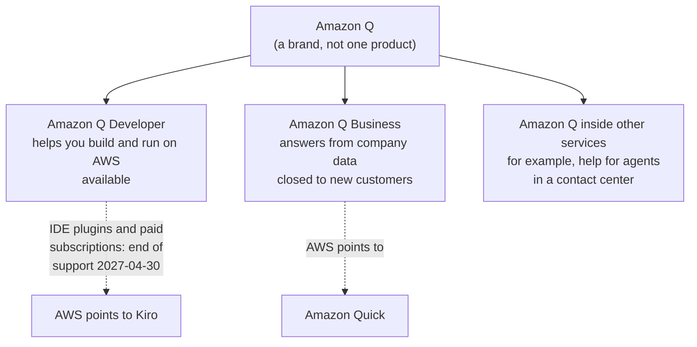
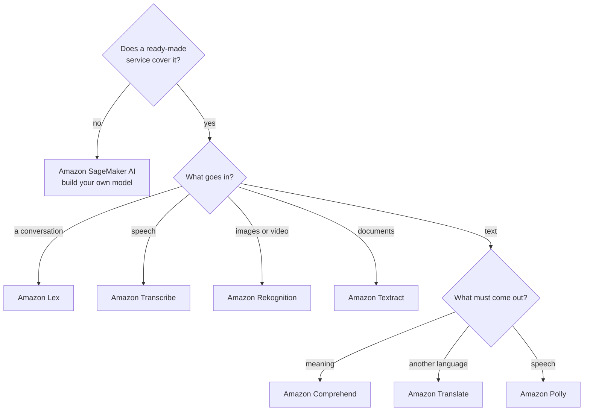

# Say what goes in and what must come out, and the ready-made AI service picks itself; build your own model only when none fits

Most teams that use artificial intelligence on AWS buy it ready-made, and a few build their own. This lesson gives you a grid of the ready-made AI services, each defined by what you give it and what it gives back, then shows when a team builds its own model instead, and what the name "Amazon Q" really covers. By the end you can take three of the owner's requests and name the service for each.

**For:** an adult studying alone, possibly new to IT, who wants to understand AWS and use it safely. **Time:** about 25 minutes. Reading works on a phone.

**Before you start:** this lesson builds on [Security of vs in the cloud](../04-shared-responsibility-and-access/01-security-of-vs-in-the-cloud.md) (what stays yours with a fully managed service), [S3 in practice](../05-storing-data/02-s3-in-practice.md) (private, encrypted buckets) and [Containers and serverless](../06-running-applications/03-containers-and-serverless.md) (paying per use). Lesson 10.01, [Analytics in five verbs](01-analytics-in-five-verbs.md), comes just before it. If you skipped them, the key terms below give you enough to follow. The bakery's six requests are in the [module brief](00-brief.md); this lesson answers the phone bot, the spoken product descriptions and the receipts.

## Warm-up: what you remember

Answer from memory before you look anything up.

1. From Module 09, "Protecting, governing and proving compliance": which AWS service scans S3 buckets for sensitive data, such as credit card numbers?
2. From lesson 05.02: a new S3 bucket is created with default settings. Is it public or private, and is its data encrypted at rest?
3. From lesson 04.01: with a fully managed service such as S3, which two things are always the customer's job, whatever the service?

Feedback

1. **Amazon Macie.** It finds sensitive data in S3. Keep it in mind: one service in this lesson, Comprehend, can also spot personal data, but in text you send it, not in your buckets.
2. **Private, and encrypted at rest.** Block Public Access is on, and S3 encrypts new objects automatically. The receipts in this lesson's worked example go into such a bucket.
3. **Your data, and who can reach it.** That stays true for every AI service in this lesson: AWS runs the model; what you send it and who may call it are yours.

## What you'll learn

By the end of this lesson, you can:

- choose an AI or machine learning service by what goes in and what must come out (objective 10.02a);
- tell Comprehend, Textract and Rekognition apart, and Polly, Transcribe, Translate and Lex;
- say when a team uses SageMaker AI instead of a ready-made service;
- say what Amazon Q Developer does, and which other names are closed to new customers.

Try these before you read on. Guess if you're unsure; the answers are in the lesson.

1. A customer phones the bakery and hears the opening hours read out by a computer voice. Which service makes the voice: Polly, Transcribe or Lex?
2. Does the bakery need a data scientist to turn photos of receipts into text?

## The big picture: one grid, eight services

Each ready-made AI service does one job. You find it by asking two questions: **what goes in?** and **what must come out?**

![A grid of rows, each reading input, AWS service, output. Text in: customer reviews or emails go to Amazon Comprehend for sentiment, names, places, key phrases and personal data; text in one language goes to Amazon Translate for the same text in another language; text to be read aloud goes to Amazon Polly for natural-sounding speech. Sound in: recorded or live speech goes to Amazon Transcribe for a written transcript. A conversation: a customer typing or talking goes to Amazon Lex, a bot that works out what they want and replies. Pictures in: photos or video go to Amazon Rekognition for objects, scenes, faces and unsafe content; scans of receipts, forms and PDFs go to Amazon Textract for text, form fields, tables and receipt totals. Nothing ready-made fits: your own data goes to Amazon SageMaker AI for a model you build, train and deploy.](../../images/10-02-input-output-grid.svg)

*Notice the "Text in" group. Text goes into three different services, and the output you need decides which one.*

**Long description.** A grid with three columns: what goes in, the AWS service, and what comes out. Text in: customer reviews or emails → Amazon Comprehend → sentiment, names, places, key phrases, personal data. Text in one language → Amazon Translate → the same text in another language. Text to be read aloud → Amazon Polly → natural-sounding speech (audio). Sound in: recorded or live speech → Amazon Transcribe → a written transcript. A conversation: a customer typing or talking → Amazon Lex → a bot that works out what they want and replies. Pictures in: photos or video → Amazon Rekognition → objects, scenes, faces, unsafe content. Scans of receipts, forms and PDFs → Amazon Textract → text, form fields, tables, receipt totals. Nothing ready-made fits: your own data → Amazon SageMaker AI → a model you build, train and deploy. A note says the first seven are ready-made: AWS trained the model, and you need no machine learning skills.

## Key terms (skip if you know them)

- **Artificial intelligence (AI):** computer systems doing tasks that once needed a person, such as understanding speech or reading a page.
- **Machine learning (ML):** the most common way to build AI today. Instead of writing every rule, people show a computer many examples and it learns the patterns.
- **Model:** what machine learning produces: a learned set of patterns that takes an input and gives an answer, such as "this review is negative". Not the everyday meaning (a small copy of something, or a person in an advert). **Training** is the step that builds a model from examples.
- **Ready-made AI service:** an AWS service whose model AWS has already trained. You send input through an API and get a result back, with no ML skills.
- **Generative AI:** AI that produces new content, such as text, code or images, rather than labeling what it's given. A **foundation model** is a very large model trained on broad data that many generative AI applications are built on.

## Text in: Comprehend finds meaning, Translate changes the language

**Amazon Comprehend** reads text and tells you what's in it, using natural language processing: the **sentiment** (positive, negative, neutral or mixed), the **entities** it mentions (people, places, organizations, dates and other named things), key phrases, the language, and **personal data**, such as names, addresses and card numbers ([What is Amazon Comprehend?](https://docs.aws.amazon.com/comprehend/latest/dg/what-is.html), checked 2026-10-23). It doesn't change the text; it describes it.

**Amazon Translate** turns text in one language into another, using neural machine translation, in real time or in batches ([What is Amazon Translate?](https://docs.aws.amazon.com/translate/latest/dg/what-is.html)). Comprehend can tell you *which* language a review is in; only Translate rewrites it in another.

For the bakery, the two work together. Reviews on the website arrive in English and Spanish. Translate puts every review into English for the owner; Comprehend marks each one positive or negative, so the owner reads the angry ones first.

> **Your turn:** The owner asks, "Which of last month's 400 reviews mention our delivery partner, and are they happy about it?" Which service answers, and what will it give back?

Model answer

**Amazon Comprehend.** Text goes in. It finds the entity (the delivery partner's name) in each review and the sentiment of each review, so the owner can filter to the reviews that mention the partner and see which are negative. Translate would only help first, if some reviews aren't in English.

## Sound and conversation: Transcribe listens, Polly speaks, Lex holds the conversation

Three services deal with speech, and the arrow points a different way for each:

- **Amazon Transcribe** turns speech into text: a recording in S3, or live audio as it streams in. It can label who is speaking and remove personal data from transcripts ([What is Amazon Transcribe?](https://docs.aws.amazon.com/transcribe/latest/dg/what-is.html), checked 2026-10-23). Speech goes in; text comes out.
- **Amazon Polly** turns text into lifelike speech, in many languages and voices ([What is Amazon Polly?](https://docs.aws.amazon.com/polly/latest/dg/what-is.html)). Text goes in; audio comes out. You can store the audio and replay it at no extra charge, so a description read once can be played many times.
- **Amazon Lex** builds a **bot**: a program that holds a conversation, in text or by voice ([What is Amazon Lex V2?](https://docs.aws.amazon.com/lexv2/latest/dg/what-is.html)). You give it **intents**, the things customers want (check an order, ask the opening hours), each with example phrases, and **slots**, the details it must collect (the order number). Lex understands the request, asks for missing details, and replies. AWS's current version is Lex V2. Support for the older Lex V1 ended on 2025-09-15, so V1 bots had to be migrated to V2 ([Migrating a bot](https://docs.aws.amazon.com/lex/latest/dg/migrate.html)).

This answers the first prequestion: the voice reading out the opening hours is Polly's; a bot built with Lex would decide what to say. The three often chain together. Here the bakery's order line helps a Spanish-speaking customer:

```mermaid
flowchart LR
  accTitle: Speech services chained for a call in another language
  accDescr: The caller's spoken Spanish goes to Amazon Transcribe, which returns Spanish text. Amazon Translate turns it into English text for the staff member. The staff member's typed English reply goes to Translate, which returns Spanish text, and Amazon Polly turns that into spoken Spanish for the caller.
  C1["Caller speaks<br/>Spanish"] -->|"audio"| TR["Amazon Transcribe"]
  TR -->|"Spanish text"| TL1["Amazon Translate"]
  TL1 -->|"English text"| ST["Staff member<br/>reads and types a reply"]
  ST -->|"English text"| TL2["Amazon Translate"]
  TL2 -->|"Spanish text"| PO["Amazon Polly"]
  PO -->|"audio"| C2["Caller hears<br/>Spanish"]
```

*Notice that Transcribe and Polly sit at opposite ends: Transcribe takes sound in, Polly sends sound out. Translate only ever handles text.*

**Long description.** Left to right: the caller speaks Spanish; the audio goes to Amazon Transcribe, which returns Spanish text; Amazon Translate turns it into English text; a staff member reads it and types a reply in English; Translate turns the reply into Spanish text; Amazon Polly turns that into audio; the caller hears Spanish.

### "Polly listens to customers" mixes up two services

You may have seen Polly offered as the answer for "turn our call recordings into text". That's not right. Polly only speaks: text in, audio out. Turning speech into text is Transcribe's job. The mix-up is tempting because both names belong to "voice" services, and a bot like Lex does both directions inside one conversation. Remember the arrow: Polly speaks, Transcribe writes down.

> **Your turn:** For each need, name the service: (a) subtitles for the bakery's cake-decorating videos; (b) the app reads each cake's description aloud; (c) a chat window on the website where customers ask "is order 1234 ready?" and get an answer.

Model answer

(a) **Transcribe**: speech in the videos goes in, text comes out. (b) **Polly**: text goes in, speech comes out. (c) **Lex**: a conversation goes in, and the bot works out the intent (check an order), collects the slot (the order number) and replies. Lex would call the bakery's own code, such as a Lambda function, to look up the order.

## Pictures and documents: Rekognition sees, Textract reads

**Amazon Rekognition** analyzes images and video. It finds objects, scenes and concepts, spots text in pictures, flags unsafe content, and analyzes and compares faces, with no ML expertise needed ([What is Amazon Rekognition?](https://docs.aws.amazon.com/rekognition/latest/dg/what-is.html), checked 2026-10-23). The bakery could use it to check that photos customers upload with their reviews are of cake, and nothing offensive.

**Amazon Textract** reads documents. It detects typed and handwritten text, and pulls out **form fields** (a label and its value, such as "Date: 2026-10-02") and **tables**. Its AnalyzeExpense operation handles invoices and receipts, finding the vendor, the total and each line item; AnalyzeID reads identity documents such as US driver's licenses ([What is Amazon Textract?](https://docs.aws.amazon.com/textract/latest/dg/what-is.html), checked 2026-10-24).

The two are easy to confuse because Rekognition can find words in a picture too. The difference is what you get back. Here is the owner's receipt request, sent to three services:

![A made-up photo of a supplier receipt from Mill and Co., dated 2026-10-02, with flour and butter lines and a total of $84.20, goes to three services. Amazon Rekognition returns labels such as paper and text, with confidence scores, and loose lines of words: no vendor, total or line items. Amazon Textract, highlighted, returns the vendor, the date, the total of $84.20 and the line items with prices: it fits the request. Amazon Comprehend needs text, not a photo; given Textract's text it finds entities such as an organization, a date, a quantity and any personal data: a second step, not the first.](../../images/10-02-one-receipt-three-services.svg)

*Notice that only Textract returns the receipt's structure: who was paid, how much, and for what.*

**Long description.** At the top, a made-up photo of a supplier receipt: Mill and Co., 2026-10-02; flour 25 kg, $41.00; butter 10 kg, $43.20; total $84.20. Three panels below. Amazon Rekognition sees a picture: labels such as "paper" and "text" with a confidence score, and the words it spots as loose lines; verdict: no vendor, total or line items. Amazon Textract, highlighted, reads a document: vendor Mill and Co.; date 2026-10-02; total $84.20; line items flour and butter with prices; verdict: fits the request. Amazon Comprehend needs text, not a photo; given Textract's text, it finds entities such as an organization, a date, a quantity and any personal data; verdict: a second step, not the first. The outputs are illustrations, not real responses.

| | Comprehend | Textract | Rekognition |
|---|---|---|---|
| **What goes in** | Text | Scanned documents, PDFs, photos of forms | Images and video |
| **What comes out** | Meaning: sentiment, entities, key phrases, personal data | Text and structure: lines, form fields, tables, receipt totals | What's in the picture: objects, scenes, faces, unsafe content |
| **Bakery example** | Which reviews are angry? | What did we pay Mill & Co. on 2 October? | Is this uploaded photo really a cake? |

**What's the same:** all three are ready-made, pay-per-use and need no ML skills. **What differs:** the input, and whether you need meaning, structure or a description of a scene. **The principle:** documents go to Textract, pictures of the world go to Rekognition, and text you already have goes to Comprehend.

> **Check:** Answer the second prequestion. To turn 60 receipt photos a week into text the accountant can use, the bakery needs:
>
> A. A data scientist to train a model on Amazon SageMaker AI\
> B. Amazon Textract, called with each photo\
> C. Amazon Comprehend, called with each photo\
> D. Amazon Rekognition's face analysis

Feedback

**B is right.** Textract is ready-made: AWS trained the model, and AnalyzeExpense returns the vendor, total and line items.

- **A is wrong.** Building a model is for needs no ready-made service covers. Reading receipts is covered.
- **C is wrong.** Comprehend takes text, not images; it could analyze Textract's output afterwards.
- **D is wrong.** Faces aren't the point; even Rekognition's text detection wouldn't return the receipt's structure.

## When nothing ready-made fits, SageMaker AI builds your own model

**Amazon SageMaker AI** is a fully managed service for building, training and deploying your own ML models: data scientists and developers bring data, choose or write an algorithm, train a model, and host it so applications can call it ([What is Amazon SageMaker AI?](https://docs.aws.amazon.com/sagemaker/latest/dg/whatis.html), checked 2026-10-24). AWS runs the servers for training and hosting; the data, the model and the ML skill are yours.

A team turns to SageMaker AI when the question is its own. The bakery's flour supplier wants to predict which bakeries will order extra flour next week from its own order history. No ready-made service answers that, so a data scientist builds a model.

![Four cards from left to right, with an arrow below from less to build and less control to more to build and more control. A finished assistant: Amazon Q Developer; you ask, it answers and writes code; nothing to build; no ML skills. A ready-made service, highlighted: Comprehend, Textract, Polly, Lex and more; you call an API; AWS trained the model; nothing to train; no ML skills. Models to build on: Amazon Bedrock; foundation models from several companies; you build a generative AI app around one. Your own model: Amazon SageMaker AI; you bring data and ML skills, and build, train and deploy; most work, most control.](../../images/10-02-how-much-you-build.svg)

*Notice the highlighted card. Start there; move right only when it can't do the job.*

**Long description.** Four cards in a row, with an arrow underneath running from "less to build, less to run, less control" on the left to "more to build and run, more control" on the right. A finished assistant: Amazon Q Developer; you ask and it answers and writes code; nothing to build; no ML skills. A ready-made service, highlighted: Comprehend, Textract, Polly, Lex and more; you call an API; AWS trained the model; nothing to train; no ML skills. Models to build on: Amazon Bedrock; foundation models from several companies; you build a generative AI app around one. Your own model: Amazon SageMaker AI; you bring data and ML skills; you build, train and deploy; most work, most control. A note says Amazon Bedrock isn't on the exam's in-scope list; it's shown because Amazon Q is built on it and because AWS points some closed services to it.

**Amazon Bedrock** sits between the two. It gives you **foundation models** from Amazon and other AI companies through an API, so you can build a generative AI application without training a model ([What is Amazon Bedrock?](https://docs.aws.amazon.com/bedrock/latest/userguide/what-is-bedrock.html), checked 2026-10-24). It's **not on the exam guide's in-scope list** (checked 2026-10-24), so you won't need it to choose an answer; you'll meet the name because Amazon Q is built on it.

### "Amazon SageMaker is the ML service" uses an old name

You may have read "Amazon SageMaker" as the service for building, training and deploying models. On 2024-12-03 AWS renamed that service **Amazon SageMaker AI**. "Amazon SageMaker" now names a wider platform for data, analytics and AI, which *includes* SageMaker AI along with other tools ([What is Amazon SageMaker AI?](https://docs.aws.amazon.com/sagemaker/latest/dg/whatis.html)). The exam guide uses SageMaker AI. The old name is tempting because most practice material and many AWS command names still say "sagemaker"; AWS kept those unchanged so existing code keeps working. If an older question says "Amazon SageMaker" for building a custom model, it means SageMaker AI.

> **Your turn:** A teammate says: "We should use SageMaker for the spoken product descriptions; it's AWS's serious AI service." In two sentences, explain why that's the wrong place to start.

Model answer

Turning text into speech is a solved problem: Polly does it with a model AWS already trained, at a price per character and with no ML skills. SageMaker AI (today's name for Amazon SageMaker) is for questions no ready-made service answers, and it means collecting data, training a model, hosting it and paying for all of that work.

## Amazon Q is a family of assistants, not one product

"Amazon Q" is a brand for AWS's generative AI assistants, and they do different jobs ([Amazon Q Developer](https://docs.aws.amazon.com/amazonq/latest/qdeveloper-ug/what-is.html), checked 2026-10-24):

*Notice that "Amazon Q" alone doesn't say which product. Read the second word.*

**Long description.** A tree. Amazon Q, a brand rather than one product, has three branches. Amazon Q Developer helps you build and run on AWS, and is available; a dashed arrow shows its IDE plugins and paid subscriptions reach end of support on 2027-04-30, and AWS points to Kiro. Amazon Q Business answered questions from a company's own data, and is closed to new customers; a dashed arrow shows AWS points to Amazon Quick. Amazon Q inside other services, for example help for agents in a contact center.

- **Amazon Q Developer** is a generative AI assistant for people who build and run on AWS. In the console and AWS documentation, you ask about AWS services, your resources and best practices; in a code editor it explains code, suggests and writes code, scans for security problems and helps with upgrades; it also works in the command line and in Slack and Microsoft Teams. It's built on Amazon Bedrock. Its code-editor (IDE) plugins and its paid subscriptions reach end of support on **2027-04-30**: since 2026-05-15, new users can't sign up for it in a code editor and new subscriptions can't be bought, and AWS points to a separate tool, Kiro (not on the exam). Q Developer in the AWS console, the AWS documentation and the chat apps carries on ([Amazon Q Developer end of support announcement](https://aws.amazon.com/blogs/devops/amazon-q-developer-end-of-support-announcement/), checked 2026-10-24).
- **Amazon Q Business** answered employees' questions from their company's own documents and systems. It's **closed to new customers**; AWS announced the change on 2026-06-30 and points new customers to Amazon Quick, which lesson 10.01 met as the home of Quick Sight ([Q Business availability change](https://docs.aws.amazon.com/amazonq/latest/qbusiness-ug/qbusiness-availability-change.html); [AWS lifecycle list](https://docs.aws.amazon.com/general/latest/gr/maintenance_services.html), checked 2026-10-24).

### "Amazon Q is one product" leads to wrong answers

You may have read that "Amazon Q" is AWS's AI assistant, as if it were one thing. That's not right. Q Developer helps with code and AWS; Q Business worked over company data, and new customers can no longer sign up for it. The exam guide lists just "Amazon Q", which makes the single-product idea tempting. When a question describes help with code, the AWS console or AWS resources, the answer is Q Developer.

> **Check:** A developer wants an assistant in her code editor that suggests code and explains an error from an AWS service. What fits?
>
> A. Amazon Q Developer\
> B. Amazon Q Business\
> C. Amazon Lex\
> D. Amazon Comprehend

Feedback

**A is right.** Code help and AWS questions are Q Developer's job, and it's the answer the exam expects. In real work, note the dates above: its code-editor plugins stopped taking new users on 2026-05-15, and AWS points new users to Kiro.

- **B is wrong.** Q Business worked over company documents, and it's closed to new customers.
- **C is wrong.** Lex builds bots for your customers; it doesn't help you write code.
- **D is wrong.** Comprehend analyzes text for sentiment and entities; it doesn't write code.

## Some AI names are closed or gone: recognize them, don't choose them

AWS retires services faster than practice questions are rewritten. These names still appear in older material:

![A vertical timeline with a line marking today, 2026-10-24. Already happened: 2024-07-29, closed to new customers, Amazon Forecast's closure announced; 2024-12-03, renamed, Amazon SageMaker renamed Amazon SageMaker AI; 2025-11-07, closed to new customers, Amazon Fraud Detector; 2026-05-15, closed to new customers, no new Amazon Q Developer sign-ups in code editors or new subscriptions; 2026-06-30, closed to new customers, Amazon Q Business's closure announced; 2026-07-30, closed to new customers, Amazon Kendra. Still to come: 2027-04-30, end of support, Amazon Q Developer IDE plugins and paid subscriptions.](../../images/10-02-status-timeline.svg)

*Notice that most of the changes happened in the last two years. Material written before them still names these services as answers.*

**Long description.** A vertical timeline from mid-2024 to mid-2027, with a line marking today, 2026-10-24. Before today: 2024-07-29, Amazon Forecast's closure to new customers announced; 2024-12-03, Amazon SageMaker renamed Amazon SageMaker AI; 2025-11-07, Amazon Fraud Detector closes to new customers; 2026-05-15, Amazon Q Developer stops taking new sign-ups in code editors and new subscriptions; 2026-06-30, Amazon Q Business's closure to new customers announced; 2026-07-30, Amazon Kendra closes to new customers. After today: 2027-04-30, Amazon Q Developer IDE plugins and paid subscriptions reach end of support. Existing customers keep using closed services.

> **Dated (checked 2026-10-24):**
>
> | Name you may meet | Status | On the exam's list? | What AWS points to |
> |---|---|---|---|
> | Amazon Kendra (intelligent search over company documents) | Closed to new customers since 2026-07-30 | No; removed | Amazon Bedrock Knowledge Bases |
> | Amazon Q Business | Closed to new customers (announced 2026-06-30) | Only as part of "Amazon Q" | Amazon Quick |
> | Amazon Q Developer in code editors (IDE plugins) and its paid subscriptions | No new sign-ups or new subscriptions since 2026-05-15; end of support 2027-04-30. Q Developer in the AWS console carries on | Yes, as part of "Amazon Q" | Kiro |
> | Amazon Fraud Detector (fraud predictions) | Closed to new customers since 2025-11-07 | Out of scope | SageMaker AI with an open-source library; AWS WAF Fraud Control for sign-up and login pages |
> | Amazon Forecast (time-series forecasts) | Closed to new customers (announced 2024-07-29) | Not listed | Amazon SageMaker Canvas |
> | Amazon Personalize (product recommendations) | Available | Out of scope | — |
>
> Sources: each service's availability-change page or developer guide, and AWS's [lifecycle list](https://docs.aws.amazon.com/general/latest/gr/maintenance_services.html). Existing customers keep using a closed service; new customers can't sign up.

### "Kendra is the answer for searching company documents" is out of date

You may have seen Amazon Kendra as the answer whenever a question says "intelligent search" or "search our internal documents". It isn't any more. The 2026 exam guide no longer lists Kendra, and AWS closed it to new customers on 2026-07-30, pointing them to Amazon Bedrock Knowledge Bases ([Kendra availability change](https://docs.aws.amazon.com/kendra/latest/dg/kendra-availability-change.html)). It's tempting because many practice banks were written when Kendra was current, and a name that sounds like an exact fit feels safe. If Kendra appears among the options, treat it as a distractor.

## Your side of the line

Lesson [04.01](../04-shared-responsibility-and-access/01-security-of-vs-in-the-cloud.md) said the line moves with the service. Ready-made AI services sit far toward AWS: AWS trains and runs the models and the servers. Yours:

- **Who may call them.** IAM policies decide which people and programs can send data to Textract or Comprehend.
- **What you send, and where results go.** Receipts and transcripts can hold personal data. Keep inputs and outputs in private, encrypted S3 buckets, as in lesson [05.02](../05-storing-data/02-s3-in-practice.md).
- **Whether you allow content to be used for improvement.** AWS AI services may store and use customer content to improve the service, and you can opt out with an AI services opt-out policy in AWS Organizations ([AI services opt-out policies](https://docs.aws.amazon.com/organizations/latest/userguide/orgs_manage_policies_ai-opt-out.html), checked 2026-10-24). Creating an organization moves a Free plan account to the Paid plan, so this guide doesn't have you set one up.
- **Checking the results.** A model can misread a smudged total or mislabel a review. Keep a person in the loop where money or customers are affected.

With SageMaker AI, more moves to your side: the training data, the model, its code, and how it's hosted and accessed.

## What you pay for

> **What you pay for (as of 2026-10-24):** The ready-made services charge per use, with no minimum: Polly and Translate by the character, Transcribe by the second of audio, Textract by the page, Rekognition by the image or by the amount of video, and Lex by the request. For example, Polly's standard voices cost $4.00 per million characters and neural voices $16.00 per million, after a free allowance ([Amazon Polly pricing](https://aws.amazon.com/polly/pricing/)). SageMaker AI charges for the compute, storage and processing you use. Amazon Q Developer's pricing page lists a free tier and a Pro tier at $19 per user per month ([Q Developer pricing](https://aws.amazon.com/q/developer/pricing/)), but new Pro subscriptions have been blocked since 2026-05-15, and paid subscriptions end on 2027-04-30.

Free allowances for these services differ and are often worded "for 12 months"; whether they apply to a Free plan account is unclear, so check each pricing page. In our test account on 2026-10-23, Polly's console opened on the Free plan, but Comprehend showed a page asking to upgrade to the Paid plan. That's why [Lab 14](05-lab-14-polly-text-to-speech.md) uses Polly and [Simulation S12](06-sim-input-output-matcher.md) covers the rest.

## Worked example: three of the owner's requests

The owner's list has six requests. Lesson 10.01 took the sales dashboard. Here are three more, sorted the way someone who knows the services would do it. The flowchart is the method.

*Notice that only text needs a second question. For every other input, the input alone names the service.*

**Long description.** A decision flowchart. First question: does a ready-made service cover the need? No: Amazon SageMaker AI, build your own model. Yes: what goes in? A conversation: Amazon Lex. Speech: Amazon Transcribe. Images or video: Amazon Rekognition. Documents: Amazon Textract. Text: a second question, what must come out? Meaning: Amazon Comprehend. Another language: Amazon Translate. Speech: Amazon Polly.

1. **The phone bot.** "When the shop is busy, a bot should answer the phone and take simple orders." Ready-made: yes. In: a conversation, by voice. *So:* **Amazon Lex**, with an intent for "place an order" whose slots are the cake, the size and the pickup time, and a Lambda function that writes the order to the bakery's database. A bot also needs a phone number and a way to pass hard calls to a person; lesson 10.03 adds Amazon Connect for that.
2. **The spoken product descriptions.** "Read each cake's description aloud on the website, for customers who would rather listen." In: text. Out: speech. *So:* **Amazon Polly**. The bakery generates each audio file once, stores it in S3 and replays it, paying for the characters once.
3. **The receipts.** "Turn the suppliers' paper receipts into text the accountant can search." In: documents. *So:* **Amazon Textract** (AnalyzeExpense), with the photos and results in a private bucket and the accountant checking totals before they're paid.

The expert asked "is it ready-made?", then "what goes in?", and only for text, "what must come out?".

> **Your turn:** A fourth request arrives: "Tell me each morning which of yesterday's customer emails were complaints." Walk the flowchart and name the service, and say which service you'd add if some emails are in French and the owner wants to read them.

Model answer

Ready-made: yes. In: text. Out: meaning (complaint or not is sentiment). *So:* **Amazon Comprehend.** For the French emails, add **Amazon Translate**, so the owner can read the complaints in English.

## In real work: buy the model, build the business

Teams start with a ready-made service and build a model only when nothing fits, and the Well-Architected Framework says why:

- In **performance efficiency**, the design principle "[Democratize advanced technologies](https://docs.aws.amazon.com/wellarchitected/latest/framework/perf-dp.html)": use a technology as a service rather than learning to build and run it yourself. A bakery gets speech and document reading without hiring ML experts.
- In **cost optimization**, "[Stop spending money on undifferentiated heavy lifting](https://docs.aws.amazon.com/wellarchitected/latest/framework/cost-dp.html)": training a receipt reader of your own would cost far more than paying per page.
- In **security**, [SEC07-BP02 Apply data protection controls based on data sensitivity](https://docs.aws.amazon.com/wellarchitected/latest/security-pillar/sec_data_classification_define_protection.html): receipts and call transcripts hold personal data, so they get private, encrypted storage and narrow access.

## Summary

- **Choose a ready-made AI service by what goes in and what must come out.** AWS trained the model; you call an API and need no ML skills.
- **Text in:** Comprehend finds meaning (sentiment, entities, personal data); Translate changes the language; Polly speaks it.
- **Sound and conversation:** Transcribe turns speech into text; Polly turns text into speech; Lex builds bots that hold a conversation.
- **Pictures and documents:** Rekognition describes images and video; Textract reads documents, forms, tables and receipts.
- **SageMaker AI** (formerly Amazon SageMaker) builds, trains and deploys your own model, for needs nothing ready-made covers.
- **Amazon Q is a family:** Q Developer helps you build and run on AWS (its code-editor plugins and paid subscriptions end on 2027-04-30); Q Business is closed to new customers.
- **Kendra, Fraud Detector and Forecast are closed to new customers;** Kendra and Personalize aren't on the exam's list. Treat them as distractors.

**For the owner's requests:** the phone bot is Lex, the spoken descriptions are Polly, and the receipts are Textract. Lesson 10.03 adds the phone line, the seasonal staff's desktops and the freezer sensors.

## Practice

1. **The bakery wants subtitles for its cake-decorating videos. Which service turns the spoken words into text?**

   A. Amazon Polly\
   B. Amazon Transcribe\
   C. Amazon Translate\
   D. Amazon Rekognition

   

Feedback

   **B is right.** Speech in, text out.

   - **A is wrong.** Polly does the opposite: text in, speech out.
   - **C is wrong.** Translate changes the language of text you already have; it doesn't listen.
   - **D is wrong.** Rekognition analyzes what's seen in video, not what's said.

   

2. **Which need calls for Amazon SageMaker AI rather than a ready-made AI service?**

   A. Detecting whether product reviews are positive or negative\
   B. Reading totals from scanned invoices\
   C. Predicting next week's flour orders from a supplier's own order history, with a model the supplier's data scientists build\
   D. Translating the menu into Spanish

   

Feedback

   **C is right.** It's the supplier's own question, answered by a model built and trained on its own data.

   - **A is wrong.** Comprehend's sentiment analysis does that, ready-made.
   - **B is wrong.** Textract reads invoices, ready-made.
   - **D is wrong.** Translate does that, ready-made.

   

3. **A question asks for the AWS service that gives "intelligent search across company documents", and lists Amazon Kendra. In two sentences, explain how to treat that option.**

   

Feedback

   **Model answer:** Treat Kendra as a distractor: it was removed from the 2026 exam guide, and AWS closed it to new customers on 2026-07-30, pointing them to Amazon Bedrock Knowledge Bases. Look for the answer among the services the exam lists.

   

4. **Which pairing of service and output is correct?**

   A. Amazon Comprehend: tables and form fields from a scanned form\
   B. Amazon Textract: the sentiment of a customer email\
   C. Amazon Rekognition: objects and unsafe content in uploaded photos\
   D. Amazon Lex: spoken audio from a product description

   

Feedback

   **C is right.** Images in; objects, scenes and unsafe content out.

   - **A is wrong.** Tables and form fields come from Textract.
   - **B is wrong.** Sentiment comes from Comprehend; Textract reads documents but doesn't judge meaning.
   - **D is wrong.** Speech from text is Polly. Lex holds conversations.

   

5. **A colleague says, "We'll use Amazon Q for our developers' code suggestions and our staff's questions about HR documents." What should you point out?**

   

Feedback

   **Model answer:** "Amazon Q" covers different products. Code suggestions are Amazon Q Developer. Answers from company documents were Amazon Q Business, which is closed to new customers; AWS points new customers to Amazon Quick instead.

   

6. **(From lesson 05.02.) The bakery stores receipt photos and Textract's results in S3. Which setting keeps the bucket from being made public by mistake, even if someone writes a careless bucket policy?**

   

Feedback

   **S3 Block Public Access**, which is on by default for new buckets. It overrides policies and access control lists that would grant public access.

   

7. **(From lesson 02.02.) The bakery pays Textract per page, so a quiet week costs less than a busy one. Is that a fixed or a variable expense?**

   

Feedback

   **Variable.** It rises and falls with use. Buying a server to run a receipt reader of its own would have been a fixed expense, paid whether or not receipts arrived.

   

**Next:** lesson 10.03, [People, apps and devices](03-people-apps-and-devices.md). To hear Polly yourself, do [Lab 14](05-lab-14-polly-text-to-speech.md); to practice the grid, try [Simulation S12: input → output matcher](06-sim-input-output-matcher.md).

## Where to check the current details

- [What is Amazon Comprehend?](https://docs.aws.amazon.com/comprehend/latest/dg/what-is.html), [What is Amazon Translate?](https://docs.aws.amazon.com/translate/latest/dg/what-is.html), [What is Amazon Transcribe?](https://docs.aws.amazon.com/transcribe/latest/dg/what-is.html), [What is Amazon Polly?](https://docs.aws.amazon.com/polly/latest/dg/what-is.html) and [What is Amazon Lex V2?](https://docs.aws.amazon.com/lexv2/latest/dg/what-is.html) (checked 2026-10-23)
- [What is Amazon Rekognition?](https://docs.aws.amazon.com/rekognition/latest/dg/what-is.html) (checked 2026-10-23) and [What is Amazon Textract?](https://docs.aws.amazon.com/textract/latest/dg/what-is.html) (checked 2026-10-24)
- [What is Amazon SageMaker AI?](https://docs.aws.amazon.com/sagemaker/latest/dg/whatis.html) and [What is Amazon Bedrock?](https://docs.aws.amazon.com/bedrock/latest/userguide/what-is-bedrock.html) (checked 2026-10-24)
- [What is Amazon Q Developer?](https://docs.aws.amazon.com/amazonq/latest/qdeveloper-ug/what-is.html), [Amazon Q Developer pricing](https://aws.amazon.com/q/developer/pricing/), the [Q Developer end of support announcement](https://aws.amazon.com/blogs/devops/amazon-q-developer-end-of-support-announcement/) and [Amazon Q Business availability change](https://docs.aws.amazon.com/amazonq/latest/qbusiness-ug/qbusiness-availability-change.html) (checked 2026-10-24)
- Availability changes: [Amazon Kendra](https://docs.aws.amazon.com/kendra/latest/dg/kendra-availability-change.html), [Amazon Fraud Detector](https://docs.aws.amazon.com/frauddetector/latest/ug/frauddetector-availability-change.html), [Amazon Forecast](https://docs.aws.amazon.com/forecast/latest/dg/what-is-forecast.html), and AWS's [list of services in maintenance](https://docs.aws.amazon.com/general/latest/gr/maintenance_services.html) (checked 2026-10-24)
- [Amazon Polly pricing](https://aws.amazon.com/polly/pricing/) (checked 2026-10-24); [AI services opt-out policies](https://docs.aws.amazon.com/organizations/latest/userguide/orgs_manage_policies_ai-opt-out.html) (checked 2026-10-24)
- [AWS Certified Cloud Practitioner (CLF-C02) exam guide](https://docs.aws.amazon.com/aws-certification/latest/cloud-practitioner-02/cloud-practitioner-02.html), task [3.7](https://docs.aws.amazon.com/aws-certification/latest/cloud-practitioner-02/cloud-practitioner-02-domain3.html#cloud-practitioner-02-task3.7) and the in-scope and out-of-scope service lists (checked 2026-10-24)

---

"AI and machine learning" by Automate the Cloud Inc., licensed under CC BY-NC 4.0 with the Additional Permission for Internal Training from Automate the Cloud Inc.
License: https://creativecommons.org/licenses/by-nc/4.0/
Permission: https://automatethe.cloud/licenses/atc-internal-training-permission.txt
