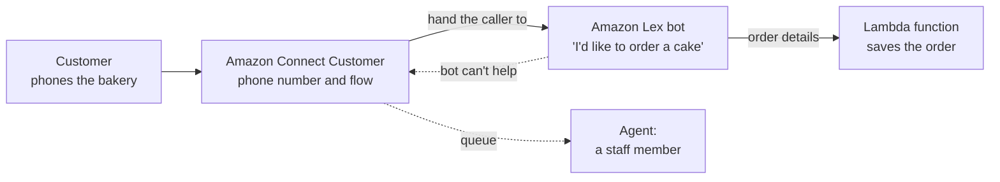
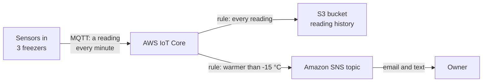
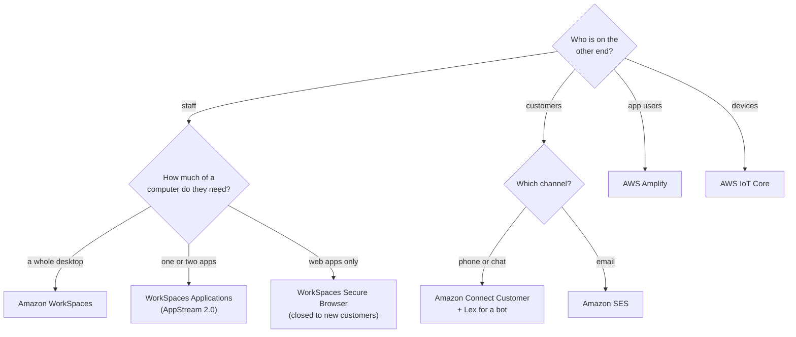

# Match the need to who is on the other end: staff at a screen, customers on the phone or in their inbox, app users, or machines

The last services on the exam's list don't run the bakery's website; they serve the people and things around it. Staff need desktops, customers phone and get emails, customers use an app, and freezers report their temperature. This lesson puts one service against each of those needs, teaches the pairs people mix up, and finishes the owner's six requests.

**For:** an adult studying alone, possibly new to IT, who wants to understand AWS and use it safely. **Time:** about 25 minutes. Reading works on a phone.

**Before you start:** this lesson builds on [Security of vs in the cloud](../04-shared-responsibility-and-access/01-security-of-vs-in-the-cloud.md), [Simpler paths](../06-running-applications/04-simpler-paths.md) (Lightsail and Elastic Beanstalk, which Amplify is often confused with) and [Connecting networks and offices](../07-connecting-it/04-connecting-networks-and-offices.md) (Client VPN). Lesson 10.02, [AI and machine learning](02-ai-and-ml.md), introduced Amazon Lex, which returns here. If you skipped them, the key terms below give you enough to follow. The bakery's six requests are in the [module brief](00-brief.md); this lesson answers the phone line, the temporary staff's desktops and the freezer sensors.

## Warm-up: what you remember

Answer from memory before you look anything up.

1. From Module 09, "Protecting, governing and proving compliance": which AWS service creates and controls the encryption keys that services such as S3 use?
2. From lesson 07.04: AWS Client VPN connects what to a VPC: whole office networks, or individual people's devices? And what does it give them once connected?
3. From lesson 04.01: with a fully managed service, AWS runs the infrastructure. Name two things that stay the customer's job.

Feedback

1. **AWS Key Management Service (AWS KMS).** Many services in this lesson encrypt your data with KMS keys too.
2. **Individual people's devices.** Client VPN gives a laptop an encrypted network path into the VPC; the person still needs their own apps and a computer to run them on. The WorkSpaces family, in this lesson, gives them a computer in AWS instead.
3. **Your data, and who can reach it** (users, permissions, settings). Every service in this lesson keeps that split.

## What you'll learn

By the end of this lesson, you can:

- match a need for desktops, apps, customer contact, email, a web or mobile front end, or connected devices to the AWS service for it (objective 10.03a);
- tell WorkSpaces, WorkSpaces Applications and WorkSpaces Secure Browser apart by what the user sees;
- explain how Amazon Connect and Amazon Lex work together, and why neither replaces the other;
- give each service's current name and status.

Try these before you read on. Guess if you're unsure; the answers are in the lesson.

1. December's temporary staff need the bakery's ordering and stock systems on their own laptops for six weeks. Which service gives them a work desktop?
2. Is Amazon Connect a chatbot?

## The big picture: four kinds of user, seven services

The exam groups these services under end-user computing, business applications, front-end web and mobile, and the Internet of Things. Grouped by who is on the other end, they're easier to keep apart:

![Four groups. Staff at a screen, such as seasonal staff or an accountant: Amazon WorkSpaces gives a whole desktop; WorkSpaces Applications, the exam's AppStream 2.0, gives one application; WorkSpaces Secure Browser gives one web browser. Customers on the phone, in chat or by email: Amazon Connect Customer, the exam's Amazon Connect, is a contact center; Amazon SES is email at scale. App users of the bakery's web and phone app: AWS Amplify builds and hosts the front end. Devices such as freezer sensors: AWS IoT Core connects devices and routes their messages.](../../images/10-03-big-picture.svg)

*Notice that the staff group has three services. They differ only in how much of a computer the user gets.*

**Long description.** Two columns: who is on the other end, and the AWS service with what it gives them. Staff at a screen, such as seasonal staff or an accountant: Amazon WorkSpaces, a whole desktop; WorkSpaces Applications, one application (the exam's AppStream 2.0); WorkSpaces Secure Browser, one web browser. Customers on the phone, in chat or by email: Amazon Connect Customer, a contact center (the exam's Amazon Connect); Amazon SES, email at scale. App users of the bakery's web and phone app: AWS Amplify, which builds and hosts the front end. Devices, such as freezer sensors: AWS IoT Core, which connects devices and routes their messages. A note says Secure Browser closes to new customers on 2026-10-29.

## Key terms (skip if you know them)

- **End-user computing:** the exam's name for services that give people a computer, an app or a browser that runs in AWS.
- **Virtual desktop:** a complete desktop (start menu, apps, files) that runs on a server somewhere else and appears on your screen.
- **Pixel streaming:** sending only a moving picture of a screen to the user's device, while the software runs elsewhere. Your keyboard and mouse go one way; pictures come back.
- **Contact center:** the system a business uses to handle customer calls, chats and messages. The people who answer are **agents**.
- **Front end:** the part of an app people see and touch: web pages, a phone app. The **back end** is what runs behind it: data, sign-in, business logic.
- **Internet of Things (IoT):** physical devices, such as sensors and machines, that connect to the internet to send data or receive commands.

## WorkSpaces gives each person a whole desktop that runs in AWS

**Amazon WorkSpaces** gives each user a virtual desktop running Windows or Linux in AWS ([What is Amazon WorkSpaces?](https://docs.aws.amazon.com/workspaces/latest/adminguide/amazon-workspaces.html), checked 2026-10-23). Users connect with a WorkSpaces client on Windows, macOS, Linux, an iPad, Android or a Chromebook, or from a web browser if the administrator turns that on. The desktop runs in AWS and reaches the device as a pixel stream ([Amazon WorkSpaces FAQs](https://aws.amazon.com/workspaces-family/workspaces/faqs/), checked 2026-10-24). There's no hardware to buy, and you add or remove users as needs change. WorkSpaces can sign users in with your company directory, such as Microsoft Active Directory, and add MFA.

That fits the owner's fifth request: "Give December's temporary staff a work desktop they can reach from their own laptops, and take it away in January." The staff use their own laptops, but the bakery's systems and files stay on desktops in AWS.

How you pay matters for temporary staff. AWS offers two billing modes, and you can switch ([WorkSpaces FAQs](https://aws.amazon.com/workspaces-family/workspaces/faqs/), checked 2026-10-24):

- **Monthly:** one fixed monthly fee, however much the desktop is used.
- **Hourly:** a low monthly fee plus a charge for each hour the desktop runs. With **AutoStop**, a desktop stops after the user disconnects (after 60 minutes by default), and hourly charges pause while it's stopped. The monthly part still applies, and partial hours count as full hours.

*Notice the break-even point. Below it, hourly billing costs less; above it, monthly does. The numbers are made up: the real break-even depends on the bundle and Region.*

**Long description.** A line chart of cost in a month against the hours a WorkSpace runs in a month, from 0 to 200. The cost axis has no scale, because the numbers are made up and only the shape matters. Monthly billing is a flat line: one fixed fee for unlimited use. Hourly billing starts lower, at a low monthly fee, and rises steadily with each hour. The lines cross at a break-even point; beyond it, monthly is cheaper. A shaded band at low hours is labeled "part-time, seasonal staff"; the high-hours end is labeled "full-time staff". To compare real prices, use the AWS Pricing Calculator for your bundle and Region.

When the staff leave in January, the bakery removes their WorkSpaces, and the charges stop. Paying only for the weeks you need is the variable expense from lesson [02.02](../02-why-the-cloud/02-before-and-after-the-demand-curve.md).

> **Your turn:** The bakery's accountant works on her WorkSpace about 160 hours a month; each temporary worker uses theirs about 15 hours a week for six weeks. Which billing mode suits each, and why?

Model answer

**The accountant: monthly.** At full-time hours she's likely past the break-even point, and a fixed fee covers unlimited use. **The temporary staff: hourly, with AutoStop.** They use their desktops for few hours, so paying a low monthly fee plus the hours they actually run costs less. Check the real break-even for your bundle in the AWS Pricing Calculator.

## WorkSpaces Applications streams single apps; Secure Browser streams one web browser

Two relatives give users less than a whole desktop:

- **Amazon AppStream 2.0 (now Amazon WorkSpaces Applications)** streams individual desktop applications from AWS to a user's browser or client. Users always get the version you installed, and AWS says application data is never stored on users' devices ([What is Amazon WorkSpaces Applications?](https://docs.aws.amazon.com/appstream2/latest/developerguide/what-is-appstream.html), checked 2026-10-23). It suits giving many people one or two specific programs, such as design software for a class or the bakery's stock app, without managing a desktop for each.
- **Amazon WorkSpaces Secure Browser (formerly WorkSpaces Web)** gives users a fresh, isolated web browser running in AWS, streamed to the browser they already have, for internal websites and software-as-a-service apps. No company web content or data reaches the local machine, and no VPN or client software is needed ([What is WorkSpaces Secure Browser?](https://docs.aws.amazon.com/workspaces-web/latest/adminguide/what-is-workspaces-secure-browser.html), checked 2026-10-23).

> **Dated (checked 2026-10-24):** Amazon WorkSpaces Secure Browser **closes to new customers on 2026-10-29**. Existing customers can keep using it. For new setups, AWS suggests WorkSpaces Applications with a Chrome browser image you manage, or an enterprise secure browser from an AWS Partner ([WorkSpaces Secure Browser availability change](https://docs.aws.amazon.com/workspaces-web/latest/adminguide/workspaces-secure-browser-maintenance-mode.html)). It's still on the exam guide, so learn the job it does; this guide has no lab for it.

The question that tells the three apart is **what does the user see?**

![Three panels. In each, the service runs in AWS and only pixels stream to the user's device. Amazon WorkSpaces: the screen shows a whole desktop with several windows; their own Windows or Linux desktop, any app they need, files kept. WorkSpaces Applications, exam name AppStream 2.0: the screen shows one application, a stock app, highlighted; chosen apps in a window or browser tab. WorkSpaces Secure Browser: the screen shows one web browser at an internal address; internal websites and web apps only; closed to new customers from 2026-10-29.](../../images/10-03-what-the-user-sees.svg)

*Notice that the three screens get smaller from left to right: a desktop, an app, a browser. All three keep the work in AWS.*

**Long description.** Three panels side by side. In each, the service runs in AWS, and an arrow labeled "pixels only" leads to the user's screen. Amazon WorkSpaces: the screen shows a whole desktop with a taskbar and several windows; the user gets their own Windows or Linux desktop, any app they need, files kept. WorkSpaces Applications, the exam's AppStream 2.0: the screen shows one application, a stock app, in a window; chosen apps in a window or browser tab. WorkSpaces Secure Browser: the screen shows one web browser open at an internal web address; internal websites and web apps only; closed to new customers from 2026-10-29.

| | WorkSpaces | WorkSpaces Applications (AppStream 2.0) | WorkSpaces Secure Browser |
|---|---|---|---|
| **The user gets** | A whole desktop of their own | One or a few applications | One web browser |
| **Fits** | Staff who need a full work computer | Many people who need the same specific program | Access to internal web apps and software as a service |
| **Status (checked 2026-10-24)** | Available | Available; renamed from AppStream 2.0 | Closed to new customers from 2026-10-29 |

**What's the same:** all three run in AWS, stream pixels, and keep the bakery's data off the user's device. **What differs:** how much of a computer the user gets. **The principle:** give people the smallest thing that does their job. And none of them is Client VPN: a VPN gives a device a network path; these give the person a computer, an app or a browser to use.

### "AppStream 2.0" and "WorkSpaces Web" are older names

You may have read AppStream 2.0 and WorkSpaces Web as current product names. They aren't. AWS now calls AppStream 2.0 **Amazon WorkSpaces Applications**, and WorkSpaces Web became **WorkSpaces Secure Browser**, which is itself closing to new customers. The exam guide still prints "Amazon AppStream 2.0", which is why the old name feels current. On the exam, AppStream 2.0 means application streaming; in the AWS console, look for WorkSpaces Applications.

> **Check:** Answer the first prequestion. December's temporary staff need the bakery's ordering and stock systems, plus email and spreadsheets, on their own laptops for six weeks, with nothing left on the laptops. Which fits best?
>
> A. Amazon WorkSpaces, with hourly billing and AutoStop\
> B. AWS Client VPN\
> C. Amazon WorkSpaces Secure Browser\
> D. Amazon Lightsail

Feedback

**A is right.** They need several programs, so a whole desktop fits, and hourly billing suits a few weeks of part-time use.

- **B is wrong.** Client VPN gives a laptop a network path into the VPC; the programs and data would still have to run on the laptop.
- **C is wrong.** A browser covers web apps only, not spreadsheets and other desktop programs, and it closes to new customers on 2026-10-29.
- **D is wrong.** Lightsail rents simple servers for websites; it doesn't give staff a desktop.

## Connect runs the contact center; Lex is the bot inside it

**Amazon Connect (now Amazon Connect Customer)** is a cloud **contact center**. Administrators get phone numbers, set up queues and routing, and build **flows**, which decide what happens to each contact step by step; agents answer customers by voice, chat, SMS and other channels; supervisors watch performance in real time ([What is Connect Customer?](https://docs.aws.amazon.com/connect/latest/adminguide/what-is-amazon-connect.html), checked 2026-10-24). There's no telephone hardware to buy, and you pay for what you use. AWS renamed the product: "Amazon Connect" is now the brand for a set of AI products, and the contact center is Connect Customer. When the exam says Amazon Connect, it means the contact center.

**Amazon Lex**, from lesson 10.02, builds the bot. Connect Customer also has AI self-service features of its own, which AWS now steers new builds toward, but Lex is the exam's bot builder ([Connect Customer AI self-service](https://docs.aws.amazon.com/connect/latest/adminguide/generative-ai-powered-self-service.html), checked 2026-10-24). Lex integrates with Connect Customer, so a flow can hand a caller to a Lex bot to understand what they want, and pass them to an agent when the bot can't help ([What is Amazon Lex V2?](https://docs.aws.amazon.com/lexv2/latest/dg/what-is.html), checked 2026-10-24).

Here is the owner's second request, "When the shop is busy, a bot should answer the phone and take simple orders":

*Notice that the call starts and ends in Connect. Lex handles the conversation; Connect owns the phone line, the queue and the agents.*

**Long description.** Left to right: a customer phones the bakery. Amazon Connect Customer answers, with the phone number and a flow. The flow hands the caller to an Amazon Lex bot, which understands "I'd like to order a cake" and asks for the details. Lex sends the order details to a Lambda function that saves the order. Dashed arrows: if the bot can't help, it hands the caller back to Connect, which puts them in a queue for an agent, a staff member.

| | Amazon Connect (Connect Customer) | Amazon Lex |
|---|---|---|
| **What it is** | A cloud contact center | A service for building chat and voice bots |
| **Owns** | Phone numbers, queues, routing, flows, agents, call recordings and reports | Understanding what a person wants and collecting the details |
| **Works without the other?** | Yes, with human agents only, or with its own AI self-service features | Yes, in a website chat window or a messaging app |
| **Exam category** | Business applications (task [3.8](https://docs.aws.amazon.com/aws-certification/latest/cloud-practitioner-02/cloud-practitioner-02-domain3.html#cloud-practitioner-02-task3.8)) | Machine learning (task [3.7](https://docs.aws.amazon.com/aws-certification/latest/cloud-practitioner-02/cloud-practitioner-02-domain3.html#cloud-practitioner-02-task3.7)) |

**The principle:** a contact center that needs a bot uses both. A website chat bot needs only Lex; a call center with only people needs only Connect.

> **Your turn:** Answer the second prequestion. Is Amazon Connect a chatbot? Explain in two sentences, using the bakery's phone line.

Model answer

No. Connect Customer is the contact center: it owns the bakery's phone number, the flow each call follows, the queue and the staff who answer. Connect Customer has AI self-service features of its own, but the exam-level rule holds: you build the bot that understands "I'd like to order a cake" with Amazon Lex and plug it into a Connect flow.

## SES sends email at scale

You met **Amazon Simple Email Service (Amazon SES)** in Module 08, "Building and operating". It sends and receives email from your own addresses and domains: **transactional email**, such as order confirmations and password resets, as well as marketing email and newsletters ([What is Amazon SES?](https://docs.aws.amazon.com/ses/latest/dg/Welcome.html), checked 2026-10-23). You don't run mail servers. Recall that every new account starts in the **SES sandbox**: you can send only to addresses you've verified, with low limits, until you ask AWS for production access ([Amazon SES FAQs](https://aws.amazon.com/ses/faqs/)). The sandbox protects SES's reputation, and so yours, from spam sent by mistake or on purpose.

The bakery would use SES for "Your order is ready" emails. Keep Module 08's comparison with Amazon SNS in mind: SNS pushes short notifications to subscribers by several channels, and its email is a plain alert; SES is the email platform.

> **Check:** The bakery wants to email each customer a styled confirmation with their order details, and a monthly newsletter. Which service?
>
> A. Amazon SES\
> B. Amazon Connect\
> C. Amazon Lex\
> D. AWS IoT Core

Feedback

**A is right.** Transactional and marketing email from the bakery's own domain is SES's job.

- **B is wrong.** Connect runs a contact center; it isn't for sending order emails.
- **C is wrong.** Lex builds conversational bots.
- **D is wrong.** IoT Core connects devices.

## Amplify builds and hosts web and mobile front ends

**AWS Amplify** is a set of tools and services for building, connecting and hosting web and mobile apps on AWS ([AWS Amplify FAQs](https://aws.amazon.com/amplify/faqs/), checked 2026-10-23). Two parts matter here:

- **Amplify Hosting** connects to a Git repository, where the code is kept, and every change you commit is built and deployed automatically to a fast global network ([Welcome to AWS Amplify Hosting](https://docs.aws.amazon.com/amplify/latest/userguide/welcome.html)). It hosts sites built with common web frameworks, and static sites.
- **Amplify's libraries and backend tools** let web, iOS and Android developers add a back end, such as sign-in, data and file storage, without wiring each AWS service by hand.

The bakery's web developer would use Amplify to host the site where customers listen to the cake descriptions from lesson 10.02.

Amplify is easy to confuse with services from lesson [06.04](../06-running-applications/04-simpler-paths.md):

- **Elastic Beanstalk** runs server-side applications on EC2 instances it builds in your account.
- **Lightsail** rents a simple server at a fixed monthly price.
- **Amplify** is for front-end and mobile developers: hosting with automatic deploys from Git, plus ready-made back-end features.

If older material offers **AWS AppSync** for a front-end question, note that the 2026 exam guide no longer lists it (checked 2026-10-24).

> **Your turn:** The bakery's developer keeps the website's code in a Git repository and wants every change she commits to go live automatically, with no servers to look after. Which service, and why not Lightsail?

Model answer

**AWS Amplify (Amplify Hosting).** It builds and deploys every commit from the Git repository and hosts the result, with no server to run. Lightsail would give her a server that she must set up, update and deploy to herself.

## IoT Core connects devices and routes what they send

**AWS IoT Core** lets connected devices talk securely to AWS services and to each other. It can serve very large fleets, and routes their messages to AWS services ([What is AWS IoT?](https://docs.aws.amazon.com/iot/latest/developerguide/what-is-aws-iot.html), checked 2026-10-23). The parts to know:

- **Protocols:** devices usually speak **MQTT**, a lightweight way for small devices to publish short messages to named topics; HTTPS also works.
- **Identity:** each device proves who it is, typically with a certificate, and policies decide what it may do.
- **Rules:** an **IoT rule** is a SQL-like filter on incoming messages that sends matching data to other AWS services, such as Lambda, S3, DynamoDB, Kinesis, SNS or a CloudWatch alarm ([AWS IoT rule actions](https://docs.aws.amazon.com/iot/latest/developerguide/iot-rule-actions.html), checked 2026-10-24).
- **Device Shadow:** a stored copy of each device's last reported state, so apps can read it, or set a desired state, even while the device is offline ([AWS IoT Core FAQs](https://aws.amazon.com/iot-core/faqs/)).

That answers the owner's sixth request, "Collect their readings and warn us before the dough thaws":

*Notice that IoT Core itself doesn't send the warning. Its rules pick the readings that matter and hand them to another service.*

**Long description.** Left to right: temperature sensors in three freezers publish a reading every minute over MQTT to AWS IoT Core. One rule sends every reading to an S3 bucket that keeps the reading history. A second rule matches readings warmer than minus 15 degrees Celsius and sends them to an Amazon SNS topic, which emails and texts the owner. The threshold and timing are made up for teaching.

IoT Core gets device data into AWS. Analyzing large streams once they're in AWS is a job for the services in lesson [10.01](01-analytics-in-five-verbs.md), such as Kinesis. Two IoT services you may see as answers, AWS IoT Greengrass (software that runs on devices) and AWS IoT Device Defender (device security audits), are out of the exam's scope.

> **Your turn:** The owner asks, "Can the app show each freezer's last temperature, even if a sensor drops off the Wi-Fi for a minute?" Which IoT Core feature helps, and how?

Model answer

**The Device Shadow.** IoT Core keeps each device's last reported state, so the app reads the shadow instead of asking the sensor directly. When a sensor is briefly offline, the app still shows its last reading, and the sensor updates the shadow when it reconnects.

## Your side of the line

AWS runs the streaming servers, the contact center software, the email platform, the hosting and the device gateway. The bakery's side, service by service:

- **WorkSpaces family:** who may sign in (a directory, MFA), what's installed on the desktops or in the app images, and settings such as whether users may copy files or use the clipboard.
- **Connect Customer:** the flows, who is an agent or administrator, how long recordings are kept, and who may hear them.
- **SES:** verifying the bakery's domain, what it sends and to whom, and its sending reputation.
- **Amplify:** the application's code, and who may change the Git repository that deploys it.
- **IoT Core:** each device's certificate and policy, the software on the sensors, and where rules send the data.

## What you pay for

> **What you pay for (as of 2026-10-24):** all seven are pay-as-you-go with no long-term commitment. WorkSpaces bills monthly or hourly per desktop; WorkSpaces Applications bills for streaming instances, plus a monthly fee per user for Windows; Connect Customer by usage of each channel; SES by emails sent and received; Amplify Hosting by build time, storage and data served; IoT Core separately for connectivity, messages, Device Shadow, registry and rules. Prices vary by Region and option; check each service's pricing page or the [AWS Pricing Calculator](https://calculator.aws/). This guide has no lab for these services: none fits a free, safe exercise.

## Worked example: finishing the owner's requests

The owner's six requests are now all answered. Here are the three this lesson adds, plus one more, sorted the way someone who knows the services would sort them.

*Notice that the first question is always "who?". For staff and customers, a second question picks among close relatives.*

**Long description.** A decision flowchart. First question: who is on the other end? Staff: how much of a computer do they need? A whole desktop: Amazon WorkSpaces. One or two apps: WorkSpaces Applications (AppStream 2.0). Web apps only: WorkSpaces Secure Browser, closed to new customers. Customers: which channel? Phone or chat: Amazon Connect Customer, plus Lex for a bot. Email: Amazon SES. App users: AWS Amplify. Devices: AWS IoT Core.

1. **The phone line** (request 2). Customers, by phone, and a bot should answer. *So:* **Amazon Connect** (Connect Customer) for the number, flow and queue, with the **Lex** bot from lesson 10.02 inside it. Ruled out: Lex alone, which has no phone line or agents.
2. **The temporary staff's desktops** (request 5). Staff, needing a whole work desktop for six weeks. *So:* **Amazon WorkSpaces**, hourly billing with AutoStop, removed in January. Ruled out: Client VPN, which gives a network path but no computer; Secure Browser, which covers web apps only and is closing to new customers.
3. **The freezer sensors** (request 6). Devices. *So:* **AWS IoT Core**, with one rule storing readings in S3 and one sending warnings through SNS. Ruled out: Kinesis on its own, which streams data but doesn't connect and authenticate the devices.
4. **One more:** "Email each customer when their order is ready." Customers, by email. *So:* **Amazon SES**. Ruled out: Connect, which is for conversations, not bulk email.

The expert asked "who is on the other end?", then "what do they need?", and checked each answer's status before recommending it.

> **Your turn:** A cake-decorating school wants 40 students to use one design program for a two-week course, from school laptops and home computers, without installing it anywhere. Walk the flowchart and name the service.

Model answer

Who: people using a computer (here, students rather than staff). How much: one application. *So:* **Amazon WorkSpaces Applications** (the exam's AppStream 2.0). It streams the one program to each device's browser or client, and nothing is installed on the laptops.

## In real work: give people the least they need, and pay for it only while they need it

- In **security**, the design principle "[Keep people away from data](https://docs.aws.amazon.com/wellarchitected/latest/framework/sec-design.html)": streaming a desktop, an app or a browser keeps the bakery's data in AWS instead of on personal laptops.
- In **security**, [SEC02-BP04 Rely on a centralized identity provider](https://docs.aws.amazon.com/wellarchitected/latest/security-pillar/sec_identities_identity_provider.html): WorkSpaces users sign in through one directory, so removing a temporary worker removes their access everywhere.
- In **cost optimization**, [COST07-BP01 Perform pricing model analysis](https://docs.aws.amazon.com/wellarchitected/latest/cost-optimization-pillar/cost_pricing_model_analysis.html): choosing hourly or monthly WorkSpaces by expected hours is that kind of analysis.
- In **sustainability**, [SUS05-BP03 Use managed services](https://docs.aws.amazon.com/wellarchitected/latest/sustainability-pillar/sus_sus_hardware_a4.html): a managed contact center, email platform or device gateway shares AWS's infrastructure instead of each business running its own.

## Summary

- **WorkSpaces gives each person a whole desktop** that runs in AWS and streams as pixels, billed monthly or hourly; hourly with AutoStop suits part-time and seasonal staff.
- **AppStream 2.0 (now WorkSpaces Applications) streams single apps; WorkSpaces Secure Browser streams one browser,** and closes to new customers on 2026-10-29. Tell the three apart by what the user sees.
- **Amazon Connect (now Connect Customer) runs the contact center; Lex is the bot inside it.** Neither replaces the other.
- **SES sends email at scale:** transactional and marketing email, starting in a sandbox.
- **Amplify builds and hosts web and mobile front ends,** deploying from Git, with ready-made back-end features.
- **IoT Core connects devices** over MQTT, and its rules route their messages to other AWS services.

**For the owner's six requests:** the dashboard is Firehose, Glue, Athena and Quick Sight (10.01); the phone bot is Connect with Lex; the spoken descriptions are Polly; the receipts are Textract (10.02); the temporary desktops are WorkSpaces; the freezers are IoT Core. The module's mastery check puts them together.

## Practice

1. **Which service lets a company stream one specific desktop application to users' web browsers, without giving each user a full desktop?**

   A. Amazon WorkSpaces\
   B. Amazon AppStream 2.0 (now Amazon WorkSpaces Applications)\
   C. AWS Client VPN\
   D. AWS Amplify

   

Feedback

   **B is right.** Application streaming: users get the app, not a desktop.

   - **A is wrong.** WorkSpaces gives each user a whole desktop.
   - **C is wrong.** Client VPN gives a device a network path; it doesn't run applications.
   - **D is wrong.** Amplify builds and hosts web and mobile front ends; it doesn't stream desktop programs.

   

2. **A company wants a cloud call center where customers first talk to a bot, then reach a person if needed. Which two services does it combine?**

   A. Amazon Connect and Amazon Lex\
   B. Amazon SES and Amazon Polly\
   C. Amazon Lex and Amazon Transcribe only\
   D. AWS IoT Core and Amazon SNS

   

Feedback

   **A is right.** Connect (Connect Customer) provides the phone line, flows, queues and agents; Lex provides the bot.

   - **B is wrong.** SES sends email; Polly turns text into speech. Neither runs a call center.
   - **C is wrong.** Without Connect there's no phone line, queue or agents.
   - **D is wrong.** IoT Core connects devices; SNS sends notifications.

   

3. **Which service connects thousands of sensors to AWS, authenticates each one, and routes their messages to other AWS services?**

   A. Amazon Kinesis Data Streams\
   B. AWS IoT Core\
   C. AWS IoT Greengrass\
   D. Amazon SQS

   

Feedback

   **B is right.** IoT Core is the managed gateway, identity and rules engine for devices.

   - **A is wrong.** Kinesis streams data once it's in AWS; it doesn't connect or authenticate devices.
   - **C is wrong.** Greengrass is software that runs on devices, and it's out of the exam's scope.
   - **D is wrong.** SQS is a message queue between applications, with no device features.

   

4. **A team's question mentions "Amazon WorkSpaces Web" for giving contractors secure access to internal web apps. In two sentences, give today's name and status, and the alternative AWS suggests.**

   

Feedback

   **Model answer:** WorkSpaces Web is now Amazon WorkSpaces Secure Browser, which closes to new customers on 2026-10-29 (existing customers keep it). For new setups AWS suggests WorkSpaces Applications with a Chrome image you manage, or an enterprise browser from an AWS Partner.

   

5. **The bakery's developer wants to host the website from a Git repository so each commit goes live automatically, and to add customer sign-in to its phone app. Which service fits both?**

   

Feedback

   **AWS Amplify.** Amplify Hosting deploys every commit from Git, and Amplify's libraries add back-end features such as sign-in to web and mobile apps.

   

6. **(From lesson 10.02.) The owner writes a greeting for the phone line and wants it read out in a natural voice. Which service turns the text into speech: Transcribe, Polly or Translate?**

   

Feedback

   **Polly:** text in, speech out. Transcribe does the opposite, and Translate changes the language of text.

   

7. **(From lesson 02.03.) The bakery adds ten WorkSpaces for December and removes them in January. Which benefit of the cloud is that: agility, elasticity or high availability?**

   

Feedback

   **Elasticity:** capacity grows with demand and shrinks again, and the bakery pays only for what it uses. Getting the desktops quickly would also show agility, but growing and shrinking with the season is elasticity.

   

**Next:** test the whole module with [Simulation S12: input → output matcher](06-sim-input-output-matcher.md), then [the module's mastery check](07-check.md).

## Where to check the current details

- [What is Amazon WorkSpaces?](https://docs.aws.amazon.com/workspaces/latest/adminguide/amazon-workspaces.html) (checked 2026-10-23) and [Amazon WorkSpaces FAQs](https://aws.amazon.com/workspaces-family/workspaces/faqs/): billing modes, AutoStop, clients (checked 2026-10-24)
- [What is Amazon WorkSpaces Applications?](https://docs.aws.amazon.com/appstream2/latest/developerguide/what-is-appstream.html) and the [WorkSpaces Applications product page](https://aws.amazon.com/workspaces/applications/) (checked 2026-10-23)
- [What is WorkSpaces Secure Browser?](https://docs.aws.amazon.com/workspaces-web/latest/adminguide/what-is-workspaces-secure-browser.html) and its [availability change](https://docs.aws.amazon.com/workspaces-web/latest/adminguide/workspaces-secure-browser-maintenance-mode.html) (checked 2026-10-24)
- [What is Connect Customer?](https://docs.aws.amazon.com/connect/latest/adminguide/what-is-amazon-connect.html), [Connect Customer features](https://aws.amazon.com/products/connect/customer/features/) and [What is Amazon Lex V2?](https://docs.aws.amazon.com/lexv2/latest/dg/what-is.html) (checked 2026-10-24)
- [What is Amazon SES?](https://docs.aws.amazon.com/ses/latest/dg/Welcome.html) and [Amazon SES FAQs](https://aws.amazon.com/ses/faqs/) (checked 2026-10-23)
- [Welcome to AWS Amplify Hosting](https://docs.aws.amazon.com/amplify/latest/userguide/welcome.html) and [AWS Amplify FAQs](https://aws.amazon.com/amplify/faqs/) (checked 2026-10-23)
- [What is AWS IoT?](https://docs.aws.amazon.com/iot/latest/developerguide/what-is-aws-iot.html), [AWS IoT Core FAQs](https://aws.amazon.com/iot-core/faqs/) (checked 2026-10-23) and [AWS IoT rule actions](https://docs.aws.amazon.com/iot/latest/developerguide/iot-rule-actions.html) (checked 2026-10-24)
- [AWS Certified Cloud Practitioner (CLF-C02) exam guide](https://docs.aws.amazon.com/aws-certification/latest/cloud-practitioner-02/cloud-practitioner-02.html), task [3.8](https://docs.aws.amazon.com/aws-certification/latest/cloud-practitioner-02/cloud-practitioner-02-domain3.html#cloud-practitioner-02-task3.8) and the in-scope and out-of-scope service lists (checked 2026-10-24)

---

"People, apps and devices" by Automate the Cloud Inc., licensed under CC BY-NC 4.0 with the Additional Permission for Internal Training from Automate the Cloud Inc.
License: https://creativecommons.org/licenses/by-nc/4.0/
Permission: https://automatethe.cloud/licenses/atc-internal-training-permission.txt
