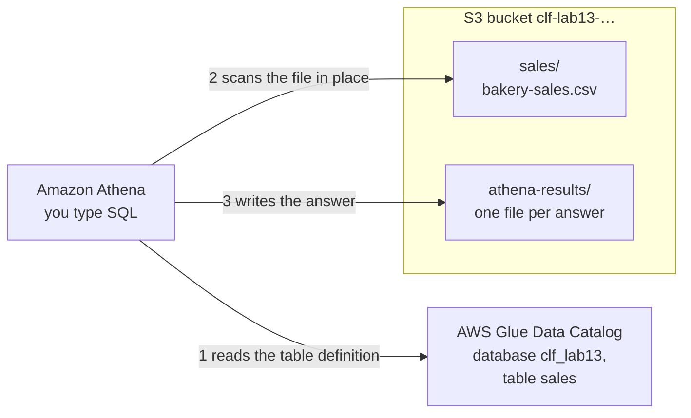
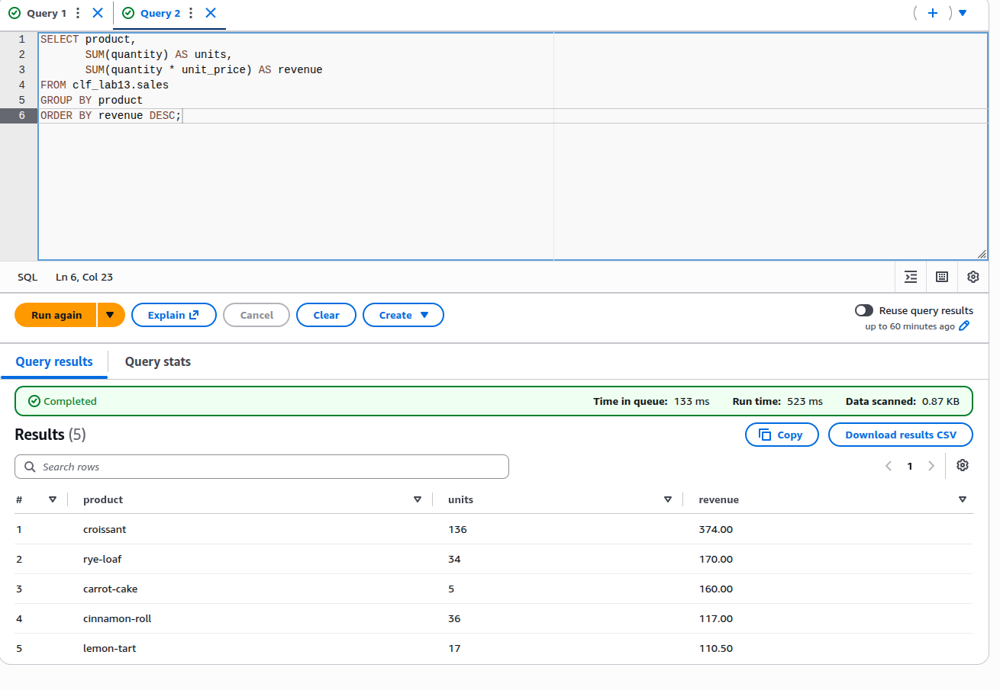

# Optional lab 13: Query a small sales file in S3 with Athena, then delete everything

**Exam guide:** [Domain 3, Cloud Technology and Services](https://docs.aws.amazon.com/aws-certification/latest/cloud-practitioner-02/cloud-practitioner-02-domain3.html) (34% of the exam): task [3.7](https://docs.aws.amazon.com/aws-certification/latest/cloud-practitioner-02/cloud-practitioner-02-domain3.html#cloud-practitioner-02-task3.7).

## Before you start: your account, your responsibility

This guide is provided as is, without warranty. We work hard to keep it correct and current, but AWS changes often, and its services, prices, and free offers may differ from what is written here. The labs run in your own AWS account. You are responsible for that account, for its security, and for any charges it incurs, including charges from resources you forget to delete. Automate the Cloud Inc. is not liable for any costs, losses, or security incidents that result from following, or failing to follow, this material. Technical guidance here is general information, not advice about your specific systems.

**Who this is for:** you have done [Lab 01](../02-why-the-cloud/06-lab-01-first-resource.md) and read [10.01 Analytics in five verbs](01-analytics-in-five-verbs.md). You can type a few lines of SQL by copying them; no database experience needed. **Time:** about 35 minutes, plus 5 minutes the next day.

**Goal:** the owner wants to know which products earn the most, and her sales already sit in a file. You put the file in S3 and ask Amazon Athena, AWS's serverless query service, for the answer in SQL, with no database server to build. Then you delete everything, including the query results and the table definitions. **End state:** your lab log holds the bakery's best seller and the cost of each query, and your account holds nothing from this lab.



*Notice that the data never moves into a database. The table is only a description that points at a folder, and every answer becomes a file in the same bucket.*

**Long description.** One S3 bucket holds the prefixes `sales/`, with `bakery-sales.csv`, and `athena-results/`. The AWS Glue Data Catalog holds the database `clf_lab13` and its table `sales`. Amazon Athena (1) reads the table definition from the catalog, (2) scans the file in `sales/` in place, and (3) writes each answer as files under `athena-results/`.

**What it creates**, in US East (N. Virginia), `us-east-1`:

- one S3 bucket, tagged `guide` = `clf` and `lab` = `13`, holding an 890-byte sales file and the files Athena writes;
- one database and one table in the **AWS Glue Data Catalog**, the store of table definitions that Athena uses. Statements typed in Athena can't tag them, so their `clf_lab13` name marks them instead.

You delete all of it at the end.

**What it costs:** well under one cent.

> **Dated (checked 2026-10-24):** Athena charges for the data a query scans: the pricing page's examples use $5 per terabyte. Each query is billed at least 10 MB, rounded up to the nearest megabyte (today's pricing page states this only for federated queries; AWS's analytics whitepaper, now marked historical, states it for all queries, and adds that statements creating or dropping tables are free). The Athena FAQs say failed queries aren't charged, and a query you cancel is charged for the data it scanned before you stopped it. Counting the minimum, each of this lab's three queries costs about $0.00005. S3 charges about $0.005 per 1,000 uploads in US East (N. Virginia), and Athena writes a few small files per query. The Glue Data Catalog's first million objects and first million requests a month are free ([Athena pricing](https://aws.amazon.com/athena/pricing/), [Athena FAQs](https://aws.amazon.com/athena/faqs/), [Big Data Analytics Options on AWS](https://docs.aws.amazon.com/whitepapers/latest/big-data-analytics-options/amazon-athena.html), [AWS Glue pricing](https://aws.amazon.com/glue/pricing/), [Amazon S3 pricing](https://aws.amazon.com/s3/pricing/)).

**Free plan:** no charge; usage comes out of your credits. **Worst case on a Paid plan** if you forget to clean up: under one cent a month for a few kilobytes in S3. In real work the risk is bigger: a table over a large folder costs money every time anyone queries it.


*Notice the floor: anything under 10 MB costs the same. Above it, a query costs in step with the data it reads, every time it runs.*

**Long description.** At $5 per TB with a 10 MB minimum (checked 2026-10-24): under 1 KB or 10 MB, about $0.00005; 1 GB, about $0.005; 100 GB, about $0.50; 1 TB, about $5.00.

**Before you start, you need these guardrails in place:** [root MFA](https://github.com/AutomateTheCloud/atc-study-aws_account_guardrails/blob/main/primer/02-secure-the-root-user.md) (primer page 02), [an IAM admin user with MFA](https://github.com/AutomateTheCloud/atc-study-aws_account_guardrails/blob/main/primer/03-your-everyday-admin-identity.md), which you use for this lab (page 03), [budgets and billing alerts](https://github.com/AutomateTheCloud/atc-study-aws_account_guardrails/blob/main/primer/05-money-alarms.md) (page 05), and [the habits for every lab](https://github.com/AutomateTheCloud/atc-study-aws_account_guardrails/blob/main/primer/07-habits-for-every-lab.md), including your lab log (page 07). You also need a plain text editor, such as Notepad or TextEdit.

**Why this matters:** Athena is the "query" verb from [10.01](01-analytics-in-five-verbs.md): no server to size, and a bill that follows use, which is the cost design principle "[Adopt a consumption model](https://docs.aws.amazon.com/wellarchitected/latest/framework/cost-dp.html)" and the performance principle "[Use serverless architectures](https://docs.aws.amazon.com/wellarchitected/latest/framework/perf-dp.html)". Because you pay for data scanned, storing data so queries read less of it is [PERF03-BP04 Implement strategies to improve query performance in data store](https://docs.aws.amazon.com/wellarchitected/latest/performance-efficiency-pillar/perf_data_implement_strategies_to_improve_query_performance.html), and deleting the results you no longer need is [COST04-BP03 Decommission resources](https://docs.aws.amazon.com/wellarchitected/latest/cost-optimization-pillar/cost_decomissioning_resources_decommission.html).

> **New sign-up path:** IAM users can't sign in to the console there, and your Region is fixed (as of 2026-10-23). We haven't checked whether Athena is offered on that path. If it is, use your assigned Region wherever this lab says `us-east-1`. If it isn't, read the steps and go on to [Simulation S12](06-sim-input-output-matcher.md).

**About the screens:** labels in **bold** and the figures quoted are what we saw when we ran this lab end to end in our test account, on the Free plan, on 2026-10-25. AWS changes its console often. If a label differs, look for the option with the same meaning.

## Steps

### Get ready

1. In your lab log, write today's date, the Region `us-east-1`, the tags `guide` = `clf` and `lab` = `13`, and three names:
   - a bucket name: `clf-lab13-`, your initials, today's date and four random digits, for example `clf-lab13-ab-20261024-4817`;
   - the database `clf_lab13` and the table `sales`. Athena's names use underscores, not hyphens, and lowercase letters.
2. In a plain text editor, create a file named `bakery-sales.csv` and paste these lines into it, exactly. Save it as plain text.

   ```csv
   sale_date,product,channel,quantity,unit_price
   2026-10-01,lemon-tart,shop,3,6.50
   2026-10-01,rye-loaf,shop,8,5.00
   2026-10-01,croissant,shop,24,2.75
   2026-10-01,croissant,online,12,2.75
   2026-10-01,carrot-cake,online,1,32.00
   2026-10-02,lemon-tart,online,2,6.50
   2026-10-02,rye-loaf,shop,6,5.00
   2026-10-02,croissant,shop,30,2.75
   2026-10-02,cinnamon-roll,shop,10,3.25
   2026-10-02,carrot-cake,shop,1,32.00
   2026-10-03,lemon-tart,shop,5,6.50
   2026-10-03,rye-loaf,online,4,5.00
   2026-10-03,croissant,shop,28,2.75
   2026-10-03,cinnamon-roll,online,6,3.25
   2026-10-03,carrot-cake,online,2,32.00
   2026-10-04,lemon-tart,shop,4,6.50
   2026-10-04,rye-loaf,shop,9,5.00
   2026-10-04,croissant,online,16,2.75
   2026-10-04,cinnamon-roll,shop,12,3.25
   2026-10-04,carrot-cake,shop,1,32.00
   2026-10-05,lemon-tart,online,3,6.50
   2026-10-05,rye-loaf,shop,7,5.00
   2026-10-05,croissant,shop,26,2.75
   2026-10-05,cinnamon-roll,shop,8,3.25
   ```

   **You should see:** a file of about 890 bytes, named `.csv`, not `.csv.txt` or `.rtf`.
3. Sign in to the console as your **IAM admin user** and check that the Region selector shows N. Virginia.

### Put the file in S3

4. Create a bucket as in [Lab 01, steps 5 to 11](../02-why-the-cloud/06-lab-01-first-resource.md#create-the-bucket-and-time-it), with your `clf-lab13-` name and the tags `guide` = `clf` and `lab` = `13`. Leave every security setting at its default.
5. On the bucket's **Objects** tab, choose **Create folder**, name it `sales`, and choose **Create folder**. In S3 a folder is only a **prefix**, the start of the files' names. You don't need to create `athena-results/`: Athena creates it when it writes its first answer.
6. Open `sales/`, choose **Upload**, then **Add files**, pick `bakery-sales.csv`, and choose **Upload**.
   **You should see:** `bakery-sales.csv` inside `sales/`, about 890 B.
   > **If something went wrong:** if the file landed at the top of the bucket, delete it there and upload it again from inside `sales/`. Athena reads every file in the folder you name, so the folder must hold this file and nothing else.

### Tell Athena where to write its answers

7. In the console search bar, type `Athena` and open it. On its start page, under **Get started**, choose **Query your data in Athena console**, then **Launch query editor**. The page starts on the other option, Amazon SageMaker Unified Studio, whose button reads **Open Amazon SageMaker Unified Studio**: this lab doesn't use it.
   > **If something went wrong:** if a page says your account is on the Free plan and offers **Upgrade plan**, stop. Don't upgrade. Delete the bucket as in step 20 and read the rest of this lab instead.
8. Check that the workgroup shown is **primary**, the default. Choose the **Query settings** tab, then **Manage**. (On a first visit, a banner may offer **Edit settings** instead; it opens the same settings.)
9. In **Location of query result - optional**, type `s3://` followed by your bucket name and `/athena-results/`, for example `s3://clf-lab13-ab-20261024-4817/athena-results/`. Leave the other options as they are and choose **Save**.
   The **query result location** is where Athena writes every answer as a file. Those files sit in your bucket, and you pay S3 for them until you delete them.
   > **Note:** AWS also offers *managed query results*, a workgroup setting where Athena keeps answers for 24 hours at no charge, in no bucket of yours (checked 2026-10-24). This lab uses your own bucket so you can see the files and delete them.

### Create the database and the table

10. Choose the **Editor** tab. In the query box, type the following and choose **Run**:

    ```sql
    CREATE DATABASE clf_lab13;
    ```

    **You should see:** a message that the query completed, and `clf_lab13` in the **Database** list on the left. Select it.
11. Open a new query tab with the **+** sign. Paste this statement, replace `YOUR-BUCKET-NAME` with your bucket name, and choose **Run**.

    ```sql
    CREATE EXTERNAL TABLE clf_lab13.sales (
      sale_date DATE,
      product STRING,
      channel STRING,
      quantity INT,
      unit_price DECIMAL(6,2)
    )
    ROW FORMAT DELIMITED
      FIELDS TERMINATED BY ','
    LOCATION 's3://YOUR-BUCKET-NAME/sales/'
    TBLPROPERTIES ('skip.header.line.count'='1');
    ```

    An **external table** is only a description: the columns, the comma between them, and the folder to read. The data stays in S3, untouched. The last line skips the header row.
    **You should see:** `sales` under **Tables**, with five columns.
    > **If something went wrong:** an error naming `LOCATION` usually means a typo in the bucket name, or a missing `/` at the end. Fix it and run again.
12. In the console search bar, open **AWS Glue**, and in its menu find the Data Catalog's **Tables** (or **Databases**) page.
    **You should see:** the table `sales` in the database `clf_lab13`. You made it in Athena; it lives in the Glue Data Catalog, the "catalog" verb from 10.01.

### Ask your questions

13. Back in Athena's editor, in a new tab, run:

    ```sql
    SELECT * FROM clf_lab13.sales LIMIT 5;
    ```

    **You should see:** five rows of sales, with dates, products and numbers, and no header row. Near the results, find the query's statistics and write down the **data scanned**: how much of the data the query read, under 1 KB here. Under the 10 MB minimum in the cost box, it's billed as 10 MB anyway.
    > **If something went wrong:**
    > - *No rows:* the `LOCATION` doesn't point at the folder holding the file. Check step 6 and step 11.
    > - *The first row says `sale_date` and the numbers are empty:* the header wasn't skipped. Run `DROP TABLE clf_lab13.sales;` and repeat step 11 with the last line included.
    > - *An error about an output location:* repeat step 9.
14. Run the owner's question, which products earn the most:

    ```sql
    SELECT product,
           SUM(quantity) AS units,
           SUM(quantity * unit_price) AS revenue
    FROM clf_lab13.sales
    GROUP BY product
    ORDER BY revenue DESC;
    ```

    **You should see:** croissant first (136 units, 374.00), then rye-loaf (34, 170.00), carrot-cake (5, 160.00), cinnamon-roll (36, 117.00) and lemon-tart (17, 110.50). Write the best seller in your lab log.

    

    *Screenshot: the answer, and **Data scanned: 0.87 KB**, billed as 10 MB, captured 2026-10-25 in our test account. AWS console screenshots are AWS material used as limited fair use and are not covered by this guide's license.*

15. Before you run the next query, predict: does the shop or the online store bring in more? Then run:

    ```sql
    SELECT channel, SUM(quantity * unit_price) AS revenue
    FROM clf_lab13.sales
    GROUP BY channel;
    ```

    **You should see:** shop 686.50 and online 245.00. Write both in your lab log, with the data scanned.
16. Open your bucket in S3 and look inside `athena-results/`.
    **You should see:** a folder `Unsaved/` with dated subfolders, holding a `.csv` file for each query's answer, each with a `.csv.metadata` partner, and an empty `.txt` file for each statement that created something ([Find query output files in Amazon S3](https://docs.aws.amazon.com/athena/latest/ug/querying-finding-output-files.html)). Every question left files behind.

## Check your work

- [ ] Your lab log names croissant as the top earner and shows shop 686.50 against online 245.00.
- [ ] You recorded the data scanned for at least one query, and you can say why it was billed as 10 MB, not under 1 KB.
- [ ] You saw the table in the Glue Data Catalog and the answer files in `athena-results/`.

## Clean up

Delete in this order: the table before its database, both before the bucket (Athena needs the result location to run the deletes), and the setting last.

17. In Athena's editor, run `DROP TABLE clf_lab13.sales;`.
    **You should see:** the table gone from **Tables**. Dropping an external table deletes only its definition; the CSV file stays in S3 until step 20 ([DROP TABLE](https://docs.aws.amazon.com/athena/latest/ug/drop-table.html)).
18. Run `DROP DATABASE clf_lab13;`.
    **You should see:** `clf_lab13` gone from the **Database** list (refresh it if needed).
    > **If something went wrong:** an error that the database isn't empty means the table is still there. Repeat step 17, then this step.
19. Choose **Query settings**, then **Manage**. Clear the **Location of query result** box and choose **Save** (it saved empty for us). It's a setting, not a resource, and costs nothing. A later lab that uses Athena will ask you to set it again.
20. In **S3**, select your `clf-lab13-` bucket, choose **Empty**, and confirm. This deletes the sales file and every result file. Then delete the bucket as in [Lab 01, steps 20 and 21](../02-why-the-cloud/06-lab-01-first-resource.md#clean-up).
21. **Confirm:** Athena's **Database** list and the Glue Data Catalog show nothing named `clf_lab13`. A database named `default` may remain: Athena created it in our account; it's empty and costs nothing, so leave it. In the S3 bucket list, a search for `clf-lab13` finds nothing. In Tag Editor, search all Regions for the tag `lab` = `13` ([Lab 01, steps 13 to 16](../02-why-the-cloud/06-lab-01-first-resource.md#find-it-by-its-tags)); expect no results. Tick everything off in your lab log. Athena's **Recent queries** list keeps your query history for 45 days ([View recent queries](https://docs.aws.amazon.com/athena/latest/ug/queries-viewing-history.html)); it isn't a resource and has no charge.
22. **The next day:** check that your **Credits** balance hasn't fallen by more than a cent ([primer page 07](https://github.com/AutomateTheCloud/atc-study-aws_account_guardrails/blob/main/primer/07-habits-for-every-lab.md), habit 4). (task card: [Read this month's bill by service and Region](../98-how-to/08-read-this-months-bill.md))

## Recap

You answered a business question with SQL over a file, with no database to build: Athena read the table definition from the Glue Data Catalog, scanned the file in S3, and wrote each answer back to S3. You paid for data scanned, with a 10 MB floor: a tiny file costs almost nothing, a large one costs in proportion, every time.

> **Reflect:** the owner wants this answer on a screen every Monday, for her and the shop manager, without anyone typing SQL. Which "verb" from 10.01 is missing, and which service fills it? Write two sentences.
>
> <details><summary>Model answer</summary>
>
> The missing verb is "visualize": Amazon Quick Sight (formerly Amazon QuickSight), part of Amazon Quick, can use Athena as a data source and show the result as a dashboard. Athena stays the query engine underneath; Quick Sight draws the charts people read.
>
> </details>

**Next:** [Lab 14](05-lab-14-polly-text-to-speech.md) has Amazon Polly read a product description aloud; then [Simulation S12](06-sim-input-output-matcher.md) matches all six of the owner's requests to services.

## Where to check the current details

- [Get started](https://docs.aws.amazon.com/athena/latest/ug/getting-started.html) and [Specify a query result location using the Athena console](https://docs.aws.amazon.com/athena/latest/ug/query-results-specify-location-console.html), Amazon Athena User Guide (checked 2026-10-24)
- [Managed query results](https://docs.aws.amazon.com/athena/latest/ug/managed-results.html), Amazon Athena User Guide (checked 2026-10-24)
- [Amazon Athena pricing](https://aws.amazon.com/athena/pricing/) and [Amazon Athena FAQs](https://aws.amazon.com/athena/faqs/) (checked 2026-10-24)
- [AWS Glue pricing](https://aws.amazon.com/glue/pricing/) and [Amazon S3 pricing](https://aws.amazon.com/s3/pricing/) (checked 2026-10-24)

---

"Optional lab 13: Query a small sales file in S3 with Athena, then delete everything" by Automate the Cloud Inc., licensed under CC BY-NC 4.0 with the Additional Permission for Internal Training from Automate the Cloud Inc.
License: https://creativecommons.org/licenses/by-nc/4.0/
Permission: https://automatethe.cloud/licenses/atc-internal-training-permission.txt
