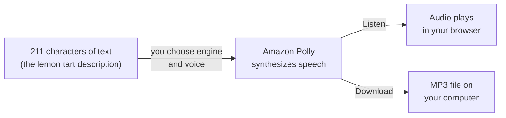

# Optional lab 14: Have Amazon Polly read a product description aloud

**Exam guide:** [Domain 3, Cloud Technology and Services](https://docs.aws.amazon.com/aws-certification/latest/cloud-practitioner-02/cloud-practitioner-02-domain3.html) (34% of the exam): task [3.7](https://docs.aws.amazon.com/aws-certification/latest/cloud-practitioner-02/cloud-practitioner-02-domain3.html#cloud-practitioner-02-task3.7).

## Before you start: your account, your responsibility

This guide is provided as is, without warranty. We work hard to keep it correct and current, but AWS changes often, and its services, prices, and free offers may differ from what is written here. The labs run in your own AWS account. You are responsible for that account, for its security, and for any charges it incurs, including charges from resources you forget to delete. Automate the Cloud Inc. is not liable for any costs, losses, or security incidents that result from following, or failing to follow, this material. Technical guidance here is general information, not advice about your specific systems.

**Who this is for:** you have done [Lab 01](../02-why-the-cloud/06-lab-01-first-resource.md) and read [10.02 AI and machine learning](02-ai-and-ml.md). This lab is optional: it adds a sound to an idea you already know, text in and speech out. **Time:** about 15 minutes, plus 5 minutes the next day.

**Goal:** the owner wants product pages that read their descriptions aloud, for customers who find the screen hard to read. You have **Amazon Polly**, AWS's text-to-speech service, read the lemon tart's description in three voice engines, and download the version you'd use. **End state:** an audio file on your computer, notes on what each engine sounded like and cost, and nothing left in your account.



*Notice that both arrows out of Polly end outside your AWS account. Each one is a separate request, and you pay for the characters each time.*

**Long description.** Left to right: 211 characters of text, the lemon tart description, go into Amazon Polly once you choose an engine and a voice. Polly synthesizes speech. An arrow labeled Listen leads to audio playing in your browser; an arrow labeled Download leads to an MP3 file on your computer. Nothing is stored in your AWS account.

**What it creates:** nothing in your AWS account. **Speech synthesis**, turning text into spoken audio, returns the audio straight to your browser, so there is nothing to tag with `lab` = `14` and nothing to delete. The MP3 file lands on your own computer.

**What it costs:** Polly charges for the characters it turns into speech, each time it does it, and the rate depends on the **voice engine**, the kind of speech model that produces the voice.

> **Dated (checked 2026-10-24):** pay-as-you-go prices per million characters are Standard $4.00, Neural $16.00, Generative $30.00 and Long-Form $100.00. AWS's pricing page lists free allowances of 5 million Standard characters a month, and, "for the first 12 months", 1 million Neural, 500 thousand Long-Form and 100 thousand Generative characters a month ([Amazon Polly pricing](https://aws.amazon.com/polly/pricing/)). The same page says new customers from 2025-07-15 receive Free Tier credits, to be used within 12 months of sign-up, but it doesn't say whether the 12-month allowances also apply to those accounts. AWS's page on choosing a plan says a Free plan account gets the always-free offers, while short-term trials come with the Paid plan ([Choosing a plan](https://docs.aws.amazon.com/awsaccountbilling/latest/aboutv2/free-tier-plans.html)); neither page says which kind Polly's 12-month allowances are. Plan as if your usage comes out of credits. The real-time Listen and Download options accept up to 3,000 characters ([Creating long audio files](https://docs.aws.amazon.com/polly/latest/dg/longer-console.html)).

This lab sends 211 characters four times (we count the download as a request): once with Standard, twice with Neural and once with Generative. At list prices that is about $0.014, or 1.4 cents. **Free plan:** nothing is billed; any cost comes out of your credits. **Worst case on a Paid plan:** nothing keeps billing after you close the page. Extra experiments cost per character: one full 3,000-character box with the Long-Form engine is about $0.30.


*Notice that the most natural-sounding engines cost several times more per character. For one description it's fractions of a cent; for a whole catalog read to every visitor, the choice matters.*

**Long description.** Pay-as-you-go price per million characters, checked 2026-10-24: Standard $4, Neural $16, Generative $30, Long-Form $100 (not used in this lab). The lab's 211-character description costs about $0.0008, $0.0034, $0.0063 and $0.0211 to synthesize once with each.

**Before you start, you need these guardrails in place:** [root MFA](https://github.com/AutomateTheCloud/atc-study-aws_account_guardrails/blob/main/primer/02-secure-the-root-user.md) (primer page 02), [an IAM admin user with MFA](https://github.com/AutomateTheCloud/atc-study-aws_account_guardrails/blob/main/primer/03-your-everyday-admin-identity.md), which you use for this lab (page 03), [budgets and billing alerts](https://github.com/AutomateTheCloud/atc-study-aws_account_guardrails/blob/main/primer/05-money-alarms.md) (page 05), and [the habits for every lab](https://github.com/AutomateTheCloud/atc-study-aws_account_guardrails/blob/main/primer/07-habits-for-every-lab.md), including your lab log (page 07).

**Why this matters:** the bakery gets lifelike speech without hiring anyone to build or run a speech model. That is the performance design principle "[Democratize advanced technologies](https://docs.aws.amazon.com/wellarchitected/latest/framework/perf-dp.html)": consume hard technology as a service. Paying per character, only when speech is made, is the cost principle "[Adopt a consumption model](https://docs.aws.amazon.com/wellarchitected/latest/framework/cost-dp.html)". On your side of the shared responsibility line is the text you send: AWS says Polly may store and use the text it processes to provide and maintain the service ([Amazon Polly FAQs](https://aws.amazon.com/polly/faqs/)), so never paste customers' names or other personal details into it.

> **New sign-up path:** our research found Polly among the services that experience offers, but IAM users can't sign in to the console there and your Region is fixed (as of 2026-10-23). Use your assigned Region wherever this lab says `us-east-1`, and sign in the way that path gives you. We haven't run this lab on that path.

**About the screens:** labels in **bold** are what we saw when we ran this lab end to end in our test account, on the Free plan, on 2026-10-25. AWS changes its console often. If a label differs, look for the option with the same meaning.

## Steps

### Get ready

1. In your lab log, write today's date, the Region `us-east-1`, and "Lab 14: nothing created in AWS". Copy this description into the log; it is 211 characters, spaces and punctuation included:

   ```text
   Our lemon tart has a crisp butter pastry base and a sharp, silky lemon filling, baked fresh every morning. One tart serves six. Order by noon for pickup the same afternoon, or ask in the shop for a single slice.
   ```

2. Sign in to the console as your **IAM admin user** and check that the Region selector shows N. Virginia. Turn your computer's sound on.

### Listen in three engines

3. In the console search bar, type `Polly` and open **Amazon Polly**. Choose **Text-to-Speech** (a tab or a menu entry). The text box opens with AWS's example text, read by the voice **Tiffany**, and the **Generative** engine is selected.
   > **If something went wrong:** if a page says your account is on the Free plan and offers **Upgrade plan**, stop. Don't upgrade; read the rest of the lab instead and go on to the simulation.
4. If **SSML** is turned on, turn it off: you are sending plain text, not speech markup. Delete the example text and paste the description. The counter under the box should read **211 characters used**.
5. Under **Engine**, choose **Standard**. (The list also offers **Long-Form**, a fourth engine for long texts, which this lab doesn't use.) For the language, choose US English (shown as **English, US** or similar), and for the voice, choose **Joanna**. Joanna has Standard, Neural and Generative versions ([Available voices](https://docs.aws.amazon.com/polly/latest/dg/available-voices.html), checked 2026-10-24), so you hear one voice through three engines.
6. Choose **Listen**.
   **You should hear:** the description read aloud, within a second or two.
   > **If something went wrong:** no sound usually means the browser tab or the computer is muted. If the page shows an error instead, check that the text has no SSML switched on and that the Region is N. Virginia.
7. Change **Engine** to **Neural**, keep Joanna, and choose **Listen** again. Then do the same with **Generative**. While the speech plays, **Listen** turns into **Stop**.
   **You should hear:** the same words in three styles. In your lab log, write one line on each: which sounds most natural, and which you'd put on the website.

### Download the version you'd use

8. Set **Engine** back to **Neural** and choose **Download**. Leave the file format at its default; the format choices are under **Additional settings**, behind **Speech file format settings**.
   **You should see:** an MP3 file in your computer's downloads folder. Open it and play it.
   Downloading may ask Polly for the speech again, so we count it as a fourth request, to be safe.
9. In your lab log, work out what your four requests cost at list prices, using the chart: about $0.0008 for Standard, $0.0034 for each Neural request and $0.0063 for Generative.

## Check your work

- [ ] An MP3 of the lemon tart description plays on your computer.
- [ ] Your lab log has a line on each engine and the total cost of your requests, about 1.4 cents.
- [ ] You can say why the bill depends on characters and engine, not on time.

## Clean up

10. Choose the **S3 synthesis tasks** tab in the Polly console.
    **You should see:** no tasks. Listen and Download don't store anything in AWS. A task appears only if you chose **Save to S3**; if you did, delete the file it wrote, and any bucket you created for it, as in [Lab 01, steps 20 and 21](../02-why-the-cloud/06-lab-01-first-resource.md#clean-up).
11. **Confirm:** in Tag Editor, search all Regions for the tag `lab` = `14` ([Lab 01, steps 13 to 16](../02-why-the-cloud/06-lab-01-first-resource.md#find-it-by-its-tags)); expect no results. Tick the lab off in your lab log. (task card: [Find everything a lab left behind, in every Region](../98-how-to/03-find-what-a-lab-left-behind.md))
12. **The next day:** check that your **Credits** balance hasn't fallen by more than a few cents ([primer page 07](https://github.com/AutomateTheCloud/atc-study-aws_account_guardrails/blob/main/primer/07-habits-for-every-lab.md), habit 4). (task card: [Read this month's bill by service and Region](../98-how-to/08-read-this-months-bill.md))

## Recap

You turned text into speech without building or training anything: Polly ran the model, and you paid only for the characters you sent, at a rate set by the engine. Polly works in one direction, text in and speech out. Turning a customer's voicemail into text is the opposite job, and that belongs to Amazon Transcribe.

> **Reflect:** the bakery's site has 40 products, and the owner expects a few thousand visitors a month to press "play". Should the site ask Polly for speech every time a visitor presses it? Write two sentences.
>
> <details><summary>Model answer</summary>
>
> No. Synthesize each description once, again only when its text changes, and keep the audio files, for example in the S3 bucket that holds the cake photos. AWS allows Polly's output to be stored and replayed at no extra charge, so the bakery pays for 40 descriptions' worth of characters instead of paying again for every visitor ([Amazon Polly FAQs](https://aws.amazon.com/polly/faqs/)).
>
> </details>

**Next:** [Simulation S12](06-sim-input-output-matcher.md) matches all six of the owner's requests, including this one, to services.

## Where to check the current details

- [Synthesizing speech with Amazon Polly example](https://docs.aws.amazon.com/polly/latest/dg/synthesize-example.html) and [Available voices](https://docs.aws.amazon.com/polly/latest/dg/available-voices.html), Amazon Polly Developer Guide (checked 2026-10-24)
- [Amazon Polly pricing](https://aws.amazon.com/polly/pricing/) and [Amazon Polly FAQs](https://aws.amazon.com/polly/faqs/) (checked 2026-10-24)

---

"Optional lab 14: Have Amazon Polly read a product description aloud" by Automate the Cloud Inc., licensed under CC BY-NC 4.0 with the Additional Permission for Internal Training from Automate the Cloud Inc.
License: https://creativecommons.org/licenses/by-nc/4.0/
Permission: https://automatethe.cloud/licenses/atc-internal-training-permission.txt
