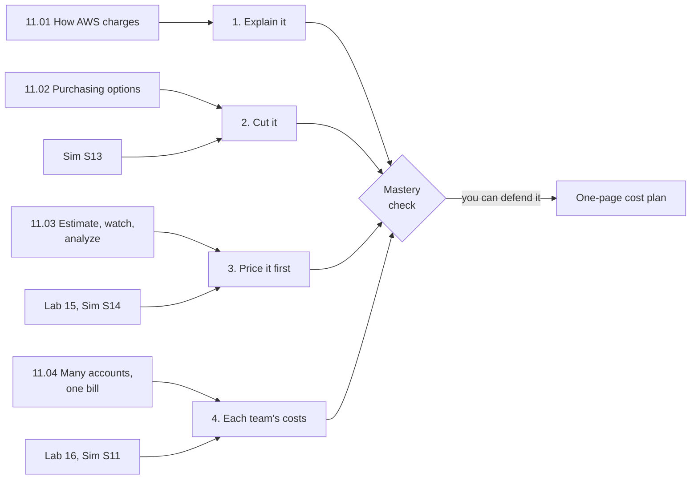

# Module 11: Explain the bakery's growing bill, cut it, price a new feature, and show each team its own costs

This module teaches how AWS charges and how to manage what you pay: what drives a bill, the ways to pay for the same servers, the tools that estimate, watch and analyze costs, and how many accounts share one bill. By the end, you can answer the four money questions every AWS customer eventually asks.

**For:** an adult studying alone, possibly new to IT, who wants to understand AWS and use it safely. You have finished Modules 02 to 10 and the [guardrails primer](https://github.com/AutomateTheCloud/atc-study-aws_account_guardrails/blob/main/primer/00-read-this-first.md). **Time:** about 4 hours, over several sessions.

## The scenario: the bill has grown

The bakery's site runs on AWS: web servers on EC2 behind a load balancer, the order database on RDS, Lambda functions, an S3 photo bucket, all inside the network from Module 07. December's bill is nearly three times November's. The owner has four requests:

1. **"Explain it."** Which charges grew, and is anything wrong?
2. **"Cut it."** Pay less for what runs all year, without risking December.
3. **"Price it first."** The next feature, a cake designer where customers build their own cake, needs a cost estimate before anyone builds it.
4. **"Show each team its own costs."** The shop, kitchen and delivery teams each want to see what they spend.

The bakery is made up for teaching. At the end you hand the owner a one-page cost plan: why the bill grew, how to pay for each part, the estimate, the alerts, and how each team's costs are tracked.

## You'll be able to

Tags: the kind of knowledge (C concept, J judgment) and what you do with it (Ap apply, An analyze).

| Objective | Lesson |
|---|---|
| **11.01a** Identify what drives a bill [C·Ap] | 11.01 |
| **11.02a** Choose a purchasing option for a usage pattern [J·Ap] | 11.02 |
| **11.03a** Pick the tool for each stage: estimate, watch, analyze [C·Ap] | 11.03 |
| **11.04a** Explain who gets a discount in an organization, and how tags reach cost reports [C·An] | 11.04 |

## What this covers on the exam

This module covers task [4.1](https://docs.aws.amazon.com/aws-certification/latest/cloud-practitioner-02/cloud-practitioner-02-domain4.html#cloud-practitioner-02-task4.1), pricing models, and task [4.2](https://docs.aws.amazon.com/aws-certification/latest/cloud-practitioner-02/cloud-practitioner-02-domain4.html#cloud-practitioner-02-task4.2), billing, budget and cost management, in Domain 4 of the AWS Certified Cloud Practitioner (CLF-C02) exam, and returns to cloud economics from task [1.4](https://docs.aws.amazon.com/aws-certification/latest/cloud-practitioner-02/cloud-practitioner-02-domain1.html#cloud-practitioner-02-task1.4). Module 05 covered the storage tiers in 4.1 and Module 07 its data transfer; this module completes the task. We checked the exam guide on 2026-10-24.

## How the module is laid out

**Lessons** (about 35 minutes each for the first two, 25 to 30 for the others):

1. [How AWS charges](01-how-aws-charges.md): the four meters, data transfer by direction, and the Free Tier as it works today
2. [Purchasing options](02-purchasing-options.md): On-Demand, Savings Plans, Reserved Instances, Spot, dedicated hardware and Capacity Reservations
3. [Estimate, watch, analyze](03-estimate-watch-analyze.md): the Pricing Calculator, Budgets, Cost Explorer, anomaly alerts and the Cost and Usage Report
4. [Many accounts, one bill](04-many-accounts-one-bill.md): consolidated billing, shared discounts and cost allocation tags

**Hands-on:**

- [Lab 15: price the bakery's setup in the AWS Pricing Calculator](05-lab-15-pricing-calculator.md), a free website that needs no account.
- [Lab 16: turn on cost allocation tags and find them in Cost Explorer](06-lab-16-cost-allocation-tags.md), in your own account, at $0.
- [Simulation S13: the purchasing-option tree](07-sim-purchasing-option-tree.md) and [Simulation S14: the guardrail timeline](08-sim-guardrail-timeline.md), on this site, not in AWS. Savings Plans and Reserved Instances aren't available on the Free plan, so you practice them here.
- Back in Module 09, [Simulation S11: organizations, SCPs and consolidated billing](../09-protecting-and-governing/10-sim-organizations-and-scps.md) ends with the bill; redo its Part 3 after lesson 11.04.

**Before the labs:** check that you still have [root MFA](https://github.com/AutomateTheCloud/atc-study-aws_account_guardrails/blob/main/primer/02-secure-the-root-user.md), [your IAM admin user with MFA](https://github.com/AutomateTheCloud/atc-study-aws_account_guardrails/blob/main/primer/03-your-everyday-admin-identity.md) and [money alarms](https://github.com/AutomateTheCloud/atc-study-aws_account_guardrails/blob/main/primer/05-money-alarms.md). The lessons need no AWS account.

**Mastery check:** the module ends with a check; you pass at 80%. Each miss points you to the section to reread, then to a parallel retest.

> **Dated (checked 2026-10-24):** this module is full of numbers that move: prices, discount maximums, the number of Savings Plans types (four today), and the Free Tier's terms, which changed in July 2025. Every lesson dates them where they appear and says where to check the current value.

*Notice that each request has its own lesson, and the hands-on work sits beside the last three.*

**Long description.** A left-to-right map. Lesson 11.01 answers request 1, explain it. Lesson 11.02 and Simulation S13 answer request 2, cut it. Lesson 11.03, Lab 15 and Simulation S14 answer request 3, price it first. Lesson 11.04, Lab 16 and Simulation S11 answer request 4, each team's costs. All four requests lead to the mastery check, then to the one-page cost plan, labeled "you can defend it".

## Coming back

Warm-ups bring back Module 10 (how Athena and WorkSpaces bill), Module 06 (stopped instances, Auto Scaling and purchasing options), Module 05 (storage classes and database pricing) and Module 02 (fixed and variable expenses).

---

"Module 11: Paying for AWS" by Automate the Cloud Inc., licensed under CC BY-NC 4.0 with the Additional Permission for Internal Training from Automate the Cloud Inc.
License: https://creativecommons.org/licenses/by-nc/4.0/
Permission: https://automatethe.cloud/licenses/atc-internal-training-permission.txt
