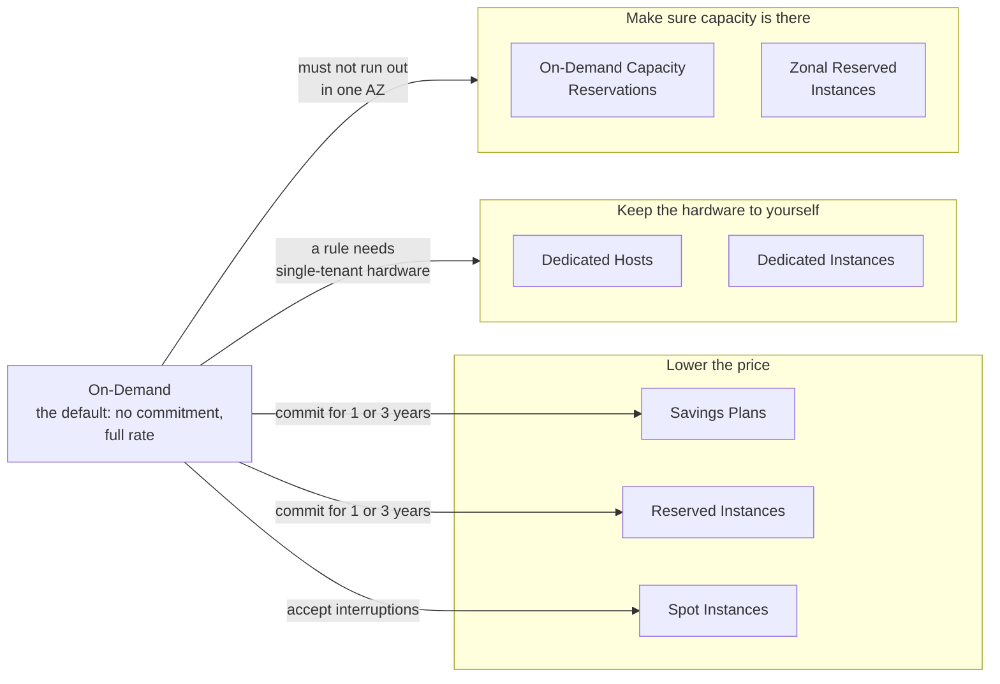
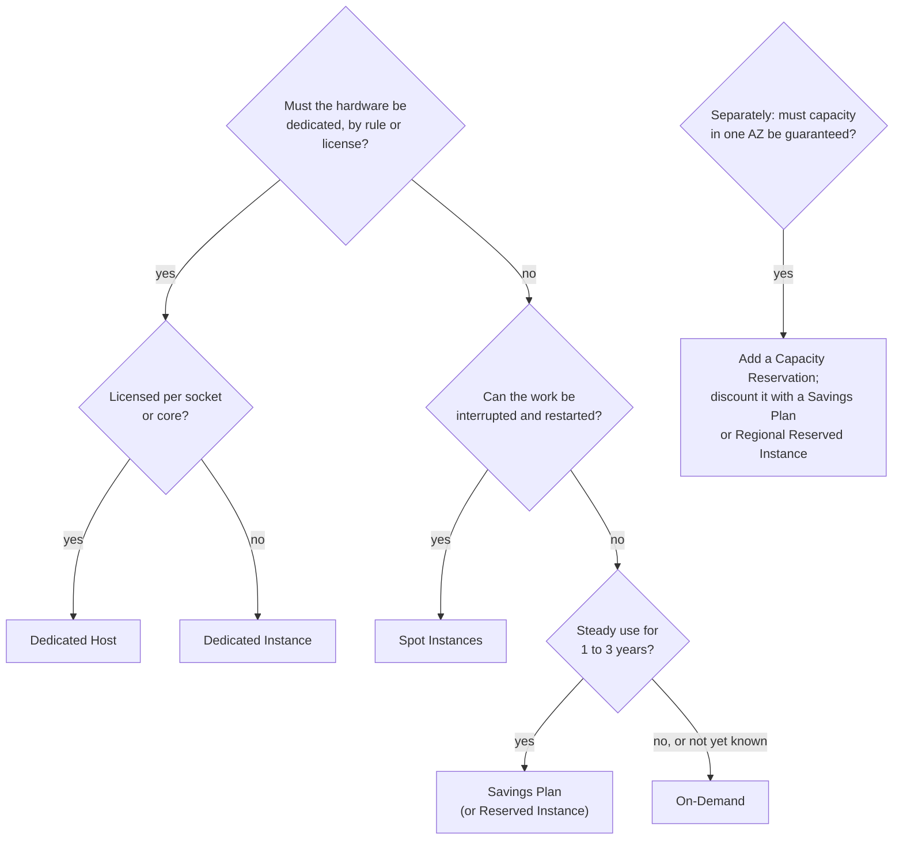

# Pay On-Demand for what changes, commit for what's steady, use Spot for what can wait, and pay for dedicated hardware or reserved capacity only when a rule requires it

Lesson 06.01 showed that the same server can be paid for in different ways. This lesson explains each way, what it costs you in flexibility, and how to match it to a usage pattern. By the end you can look at a workload's shape over a year and choose how to pay for each part of it.

**For:** an adult studying alone, possibly new to IT, who wants to understand AWS and use it safely. **Time:** about 35 minutes. Reading works on a phone.

**Before you start:** this lesson builds on [How AWS charges](01-how-aws-charges.md) (time-based charges and the bakery's bill), [Amazon EC2](../06-running-applications/01-ec2.md) (instance types are not purchasing options) and [Before and after: the demand curve](../02-why-the-cloud/02-before-and-after-the-demand-curve.md) (fixed and variable expenses). If you skipped them, the key terms below give you enough to follow.

## Warm-up: what you remember

1. From Module 10, "Data, AI and the rest of the catalog": Amazon WorkSpaces bills a desktop monthly or hourly. Which suits a seasonal worker who uses a desktop two hours a week?
2. From lesson 06.01: is `m7g.large` an instance type or a purchasing option? Is Spot?
3. From lesson 02.02: why does a one-year commitment behave like a fixed expense?

Feedback

1. **Hourly.** Light, irregular use is cheapest when you pay for the hours used. A monthly fee suits a desktop in use all day. Today's lesson makes the same choice for servers.
2. **`m7g.large` is an instance type**, the hardware. **Spot is a purchasing option**, a way to pay for that hardware.
3. **You pay whether or not you use it.** The cost no longer follows use, which is what makes an expense fixed. You accept that in return for a lower rate.

## What you'll learn

By the end of this lesson, you can:

- say what each purchasing option trades: commitment, discount, interruption risk, dedicated hardware or guaranteed capacity;
- tell apart the confusable pairs: Savings Plans and Reserved Instances, Compute and EC2 Instance Savings Plans, Standard and Convertible, zonal and Regional, Dedicated Host and Dedicated Instance;
- choose an option for each part of a usage pattern, and justify it (objective 11.02a).

Try these before you read on. Guess if you're unsure.

1. Does an On-Demand Capacity Reservation lower the price of the instances that use it?
2. AWS says Savings Plans save "up to 72%". Should the bakery expect to save 72%?

## The big picture: purchasing options do three different jobs

*Notice that only the first box lowers the price. Dedicated hardware and reserved capacity cost the same or more; you buy them for a rule or a guarantee, not a discount.*

**Long description.** On-Demand sits on the left: the default, with no commitment and the full rate. Arrows lead to three groups. "Lower the price": Savings Plans and Reserved Instances, reached by committing for one or three years, and Spot Instances, reached by accepting interruptions. "Keep the hardware to yourself": Dedicated Hosts and Dedicated Instances, when a rule needs single-tenant hardware. "Make sure capacity is there": On-Demand Capacity Reservations and zonal Reserved Instances, when you must not run out of capacity in one Availability Zone.

## Key terms (skip if you know them)

- **Commitment:** a promise to pay for a certain amount of use for a **term** of one or three years, whether or not you use it.
- **Payment option:** how you pay for a commitment: **All Upfront**, **Partial Upfront** or **No Upfront** (monthly). Paying more upfront generally saves more.
- **Tenancy:** whether your instance shares physical hardware with other AWS customers (shared, the default) or not (dedicated).
- **Interruption:** AWS stopping, hibernating or terminating an instance because it needs the capacity back. Only Spot Instances can be interrupted this way.

## On-Demand is the default and the yardstick

**On-Demand** means no commitment: you pay the published rate for the time an instance runs, and stop paying when it stops. Every discount below is measured against it ([Billing and purchasing options](https://docs.aws.amazon.com/AWSEC2/latest/UserGuide/instance-purchasing-options.html)).

Choose On-Demand for work that is short, unpredictable, or new, so you don't yet know its shape, and for work that mustn't be interrupted. The bakery's extra servers in November and December are On-Demand: they exist for a few weeks, and a commitment would sit unused the rest of the year.

> **Your turn:** A team is launching a new product next week and has no idea how much traffic to expect. Why is On-Demand the right first choice, even though it's the most expensive rate?

Model answer

A commitment is a bet on future use, and the team has no data to bet with. On-Demand lets them run, measure for a few weeks or months, and then commit to the steady part they can see. Committing first risks paying for capacity they never use.

## A commitment trades flexibility for a lower rate

Savings Plans and Reserved Instances work in the same basic way ([Reserved Instances overview](https://docs.aws.amazon.com/AWSEC2/latest/UserGuide/ec2-reserved-instances.html); [What are Savings Plans?](https://docs.aws.amazon.com/savingsplans/latest/userguide/what-is-savings-plans.html)):

- You commit for **one or three years**; three years earns the bigger discount.
- You pay **All, Partial or No Upfront.**
- You pay for the commitment **whether you use it or not**. Usage beyond it is charged at On-Demand rates.
- You **can't cancel** a Reserved Instance, and it **doesn't renew**: when it ends, the same instance carries on at On-Demand rates. Savings Plans terms can't be changed after purchase either; only a small plan, $100 an hour or less, bought in the last 7 days and in the same month, can be returned ([Savings Plans FAQ](https://aws.amazon.com/savingsplans/faq/), checked 2026-10-24).
- The Free plan doesn't offer them; you need the Paid plan (lesson 11.01).

The difference is **what you commit to**: a Reserved Instance commits to one instance configuration, a Savings Plan to an amount of spending per hour. AWS now recommends Savings Plans over Reserved Instances, because they give the same kind of discount with more flexibility.

## Savings Plans: commit to dollars per hour, in four types

With a **Savings Plan** you commit to spend a fixed amount per hour, such as $1.00, on eligible usage, and that usage is charged at the plan's lower rates until the hour's commitment is used up. Each hour stands alone: commitment unused in one hour is lost, not carried over ([How Savings Plans apply](https://docs.aws.amazon.com/savingsplans/latest/userguide/sp-applying.html)).

**Example:** with made-up rates, a server costs $0.10 an hour On-Demand and $0.07 under a plan. A $0.14 commitment covers two servers each hour. In an hour with three servers, the third pays $0.10. In an hour with one server, you still pay $0.14, and $0.07 of it buys nothing.

AWS offers **four types** ([Savings Plans types](https://docs.aws.amazon.com/savingsplans/latest/userguide/plan-types.html)):

| Type | Covers | Up to, off On-Demand |
|---|---|---|
| **Compute Savings Plan** | EC2 in any family, size, Region, operating system or tenancy; also Fargate and Lambda | 66% |
| **EC2 Instance Savings Plan** | EC2 in one family in one Region (such as `m5` in N. Virginia), any size, operating system or tenancy | 72% |
| **Database Savings Plan** | Aurora, RDS, DynamoDB, ElastiCache, DocumentDB, Neptune, Keyspaces, Timestream, DMS and OpenSearch Service, across engines, sizes and Regions | 35% |
| **SageMaker AI Savings Plan** | SageMaker AI instances in any family, size, Region or component | 64% |

> **Dated (checked 2026-10-24):** four types and these maximums, from [Savings Plans types](https://docs.aws.amazon.com/savingsplans/latest/userguide/plan-types.html). Database Savings Plans come with a one-year term and no upfront payment only ([Savings Plans FAQ](https://aws.amazon.com/savingsplans/faq/)). Savings Plans don't discount the $2 an hour Region fee for Dedicated Instances, and they don't cover Spot.

### "There are two types of Savings Plans" is out of date

Older notes say AWS offers two Savings Plans types, Compute and EC2 Instance. There are now four, with Database and SageMaker AI Savings Plans. It's tempting because the first two came first, still cover the servers most questions are about, and are the pair the exam most likely compares.

### Compute or EC2 Instance Savings Plan: flexibility or a deeper discount

Both cover EC2 and charge dollars per hour. They differ in what you can change without losing the discount. A **Compute Savings Plan** follows your usage anywhere: another family, another Region, even from EC2 to Fargate or Lambda. An **EC2 Instance Savings Plan** stays with one family in one Region, and pays you for that loyalty with a deeper maximum discount. Choose Compute when you expect to change family, Region or compute service during the term; choose EC2 Instance when you're confident the family and Region won't change.

> **Your turn:** The bakery plans to move its image processing from EC2 to Lambda next year, and may open a site in Europe. Which Savings Plan type fits its web servers, and why?

Model answer

**A Compute Savings Plan.** It keeps applying if usage moves to Lambda or Fargate, or to another Region. An EC2 Instance Savings Plan would stop covering the work that moved, leaving the bakery paying for a commitment it no longer uses.

## Reserved Instances: a billing discount on a matching configuration

A **Reserved Instance** is not a machine. It's a **billing discount** that AWS applies automatically to running On-Demand instances that match its attributes: instance type, Region, tenancy and platform (operating system) ([How Reserved Instance discounts are applied](https://docs.aws.amazon.com/AWSEC2/latest/UserGuide/apply_ri.html)).

### "A Reserved Instance is a server set aside for you" is wrong

It's easy to assume that buying a Reserved Instance gives you a server. It doesn't. Nothing launches when you buy one, and you don't connect to it. If a matching instance is running, its bill drops; if none is, you pay for the reservation and get nothing. The name invites the mistake, and one kind, the zonal Reserved Instance, does hold capacity (more on that below). Even that is a promise of room to launch, not a running machine.

### Standard or Convertible

| | **Standard** | **Convertible** |
|---|---|---|
| Discount, up to | 72% | 66% |
| Average, 1 year and 3 years | 40% and 60% | 31% and 54% |
| Change it later | Modify some attributes, such as the AZ or size | Exchange for another Convertible Reserved Instance of a different family, operating system or tenancy, of equal or higher value |
| Sell it on the Reserved Instance Marketplace | Yes | No |

Sources: [Reserved Instances pricing](https://aws.amazon.com/ec2/pricing/reserved-instances/) and [Types of Reserved Instances](https://docs.aws.amazon.com/AWSEC2/latest/UserGuide/reserved-instances-types.html), checked 2026-10-24. A Convertible exchange keeps the same Region.

**What's the same:** both are one- or three-year commitments to a configuration, applied as a discount. **What differs:** Standard gives more discount and less freedom; Convertible less discount and the right to exchange. **The principle:** buy Convertible when you're sure about the amount of use but not the instance family.

### Zonal or Regional

Every Reserved Instance has a **scope**:

- A **zonal Reserved Instance** is bought for one Availability Zone. It **reserves capacity** there, and its discount applies only to exactly matching instances in that AZ.
- A **Regional Reserved Instance** reserves no capacity, and its discount applies in **any AZ** of the Region and, for Linux on shared tenancy, to **any size** in the same family. That's **instance size flexibility**.

Size flexibility works in units called **normalization factors**: small counts 1, medium 2, large 4, xlarge 8, and so on.

*Notice the third row: a smaller reservation still helps a bigger instance, in proportion.*

**Long description.** One t3.medium Regional Reserved Instance for Linux is worth 2 normalized units an hour, drawn as squares. Case 1: two t3.small instances of 1 unit each, both covered. Case 2: one t3.medium of 2 units, covered. Case 3: one t3.large of 4 units, 2 units covered and 2 paid at On-Demand rates. A zonal Reserved Instance has no size flexibility.

Size flexibility doesn't apply to zonal Reserved Instances, to Windows, RHEL or SUSE, to dedicated tenancy, or to some GPU, machine learning and other specialized families. **The principle:** choose zonal only when you need the capacity guarantee in that AZ; otherwise Regional gives the same discount and follows your instances around the Region.

In an organization, a Reserved Instance's discount applies first to the account that bought it and then to matching usage in the other accounts. Lesson 11.04, "Many accounts, one bill", teaches that sharing.

> **Check:** The bakery buys a one-year Regional Reserved Instance for one `t3.small` (Linux). During the year it replaces that server with a `t3.medium`. What happens to the discount?
>
> A. It's lost: the type no longer matches\
> B. It covers half of the `t3.medium`'s usage\
> C. It covers all of it, because the family is the same\
> D. A new server launches for the reservation

Feedback

**B is right.** A `t3.small` is worth 1 unit and a `t3.medium` 2, so the Regional reservation covers half; the rest is On-Demand.

- **A is wrong.** That would be true of a zonal Reserved Instance, which has no size flexibility.
- **C is wrong.** Same family isn't enough; the units must add up.
- **D is wrong.** A Reserved Instance never launches anything; it's a discount.

## Savings Plans or Reserved Instances: what follows your usage?

![A table of ten rows comparing a Compute Savings Plan, an EC2 Instance Savings Plan, a Regional Reserved Instance and a zonal Reserved Instance. The Compute Savings Plan keeps applying after changes of family, size, AZ, Region, operating system and tenancy, and covers Fargate and Lambda. The EC2 Instance Savings Plan follows size, AZ, operating system and tenancy, in one family and Region. The Regional Reserved Instance follows size (Linux, shared tenancy) and AZ. The zonal Reserved Instance follows nothing but reserves capacity in one AZ. Maximum discounts: 66%, 72%, 72% and 72%.](../../images/11-02-flexibility.svg)

*Notice how the highlighted cells thin out from left to right. More freedom costs a little discount; only the rightmost column holds capacity.*

**Long description.** Ten rows by four columns: Compute Savings Plan, EC2 Instance Savings Plan, Regional Reserved Instance, zonal Reserved Instance. Change instance family: yes, no (one family), no, no. Change size: yes, yes, yes (Linux on default tenancy only), no. Change Availability Zone: yes, yes, yes, no. Change Region: yes, no (one Region), no, no. Change operating system: yes, yes, no, no. Change tenancy: yes, yes, no, no. Covers Fargate and Lambda: yes, no, no, no. Reserves capacity: no, no, no, yes in one AZ. You commit to: dollars per hour, dollars per hour, one configuration, one configuration. Discount up to: 66%, 72%, 72% for Standard, 72% for Standard.

**What's the same:** commitment, terms, payment options, and discounts of similar size. **What differs:** a Savings Plan commits to dollars per hour and follows usage; a Reserved Instance commits to a configuration, and only the zonal kind holds capacity. **The principle:** default to a Savings Plan; buy a Reserved Instance when you need a zonal capacity reservation or want to sell unused Standard reservations later.

## "Up to" is a ceiling, not a promise

*Notice the dots: AWS's own average for a one-year Standard Reserved Instance is 40%, not 72%.*

**Long description.** Horizontal bars of the largest discount off On-Demand that AWS states, as of 2026-10-24: Spot Instances 90%; Standard Reserved Instances 72%, with dots for AWS's stated averages of 40% (1 year) and 60% (3 years); EC2 Instance Savings Plans 72%; Dedicated Host Reservations 70%; Convertible Reserved Instances 66%, averages 31% and 54%; Compute Savings Plans 66%; SageMaker AI Savings Plans 64%; Database Savings Plans 35%; Capacity Reservations and On-Demand, no discount.

You may have read that Reserved Instances save "up to 75%", as if that were the discount. That's wrong twice. The figure is old: AWS's [Reserved Instances pricing](https://aws.amazon.com/ec2/pricing/reserved-instances/) page says up to 72% today, though a few older AWS pages still say 75% (checked 2026-10-24). And any "up to" is a maximum, reached only with the longest term, the most paid upfront and the configurations with the biggest gap. The bakery's one-year, no-upfront reservation on a `t3.small` saves about 38% (lesson 06.01's prices). The figure sticks because a single number is easy to memorize. Learn the order instead (Spot deepest, then commitments, Capacity Reservations none), and check the current figures.

## Spot Instances: deep discounts for work that can stop

A **Spot Instance** runs on EC2 capacity that's spare right now, for up to 90% less than On-Demand ([Amazon EC2 Spot Instances](https://aws.amazon.com/ec2/spot/)). There's no commitment. The **Spot price** is set by EC2 for each instance type in each AZ and moves gradually with long-term supply and demand. The catch is that when EC2 needs the capacity back, it interrupts your instance, after a two-minute **interruption notice** ([Spot Instances](https://docs.aws.amazon.com/AWSEC2/latest/UserGuide/using-spot-instances.html)).

So Spot suits work that can stop and pick up again, or be split across many instances: data analysis, batch jobs, background processing, tests. It doesn't suit the bakery's only web server or its order database. Savings Plans don't cover Spot usage, and Spot spending doesn't count toward a Savings Plan commitment.

> **Your turn:** Each night the bakery's accountant runs a three-hour sales analysis that writes its progress every few minutes and can restart from there. Would you run it On-Demand or on Spot? What happens if an interruption comes?

Model answer

**Spot.** The job runs at night, has no deadline within the hour, and saves its progress. If EC2 interrupts it, it loses at most a few minutes of work and restarts on another Spot Instance or, if none is available, On-Demand. That's the profile Spot is priced for.

## Dedicated Hosts and Dedicated Instances: hardware with no other customers

By default your instances share physical servers with other customers' instances, isolated by AWS. Some rules don't allow that, and some software licenses are priced per physical processor. Two options give you **single-tenant** hardware ([Dedicated Hosts](https://docs.aws.amazon.com/AWSEC2/latest/UserGuide/dedicated-hosts-overview.html); [Dedicated Instances](https://docs.aws.amazon.com/AWSEC2/latest/UserGuide/dedicated-instance.html)):

![Two panels. Dedicated Host, a whole physical server you place instances on: you see sockets, cores and host ID; you choose the host and keep instances there; billed per host; supports per-socket, per-core or per-VM licenses; no Capacity Reservations; Host Reservations up to 70% off. Dedicated Instance, an instance on hardware only your account uses: you see nothing of the hardware; AWS places it and it may move after a stop and start; billed per instance plus a $2 an hour fee per Region; partial license support; Capacity Reservations supported.](../../images/11-02-host-vs-instance.svg)

*Notice the "You see" row. Only a Dedicated Host shows the sockets and cores that per-core licenses are counted on.*

**Long description.** Two panels. What's the same: single-tenant hardware, no other customer on it, and, between the two, no difference in performance or security. Dedicated Host, a whole physical server you place instances on: you see its sockets, cores and host ID; you place instances on the host you choose and keep them there; billed per host; supports per-socket, per-core or per-VM licenses you bring; no Capacity Reservations; Host Reservations give up to 70% off; choose it for software licensed by socket or core. Dedicated Instance, an instance on hardware only your account uses: you see nothing of the hardware; AWS places it and it may move after a stop and start; billed per instance plus a $2 an hour fee per Region while any runs; partial license support; Capacity Reservations supported; Reserved Instances with dedicated tenancy for a discount; choose it for a rule that says no shared hardware.

**What's the same:** dedicated physical servers; AWS says the two don't differ in performance, security or hardware. **What differs:** visibility and control. **The principle:** if you bring licenses counted per socket or core (bring your own license, BYOL, which Module 13, "Moving to AWS", compares with license-included), choose a **Dedicated Host**; if you only need "not shared with other customers", a **Dedicated Instance** is simpler.

## Capacity Reservations: a guarantee, not a discount

An **On-Demand Capacity Reservation** holds EC2 capacity for a chosen instance type in **one AZ**, so your instances can launch when you need them ([Capacity Reservations](https://docs.aws.amazon.com/AWSEC2/latest/UserGuide/ec2-capacity-reservations.html)). One for immediate use needs no commitment: cancel it any time. One booked for a future date (5 to 120 days ahead) commits you to keeping it for a minimum period, at least 14 days for most instance types, and needs at least 32 vCPUs ([Capacity Reservation concepts](https://docs.aws.amazon.com/AWSEC2/latest/UserGuide/cr-concepts.html), checked 2026-10-24).

It's charged at the **On-Demand rate whether you run instances in it or not**. When a matching instance runs in it, you pay for the instance and nothing extra; empty slots are billed as unused reservation ([Capacity Reservation pricing and billing](https://docs.aws.amazon.com/AWSEC2/latest/UserGuide/capacity-reservations-pricing-billing.html)).

### "A Capacity Reservation gets you a discount" is wrong

You might expect reserving capacity to lower the price, as a Reserved Instance does. It doesn't: a Capacity Reservation gives **no billing discount** on its own. To lower the price, combine it with a Savings Plan or a Regional Reserved Instance, whose discounts apply to it; a zonal Reserved Instance's discount doesn't. It's tempting because "reserved" appears in both names, and a zonal Reserved Instance does both jobs, for a one- or three-year commitment.

> **Check:** The bakery runs a big launch on one day next month and must be certain it can start ten extra servers in its AZ that morning. What fits?
>
> A. A three-year Standard Reserved Instance for ten servers\
> B. Spot Instances\
> C. An On-Demand Capacity Reservation for that period\
> D. A Compute Savings Plan

Feedback

**C is right.** It's the only choice that guarantees capacity in that AZ. Booked ahead for next month's date, it commits the bakery to at least 14 days at the On-Demand rate, used or not (ten small servers may also fall short of the 32-vCPU minimum, so check the size). A reservation created on the morning itself needs no commitment and can be canceled after the launch, but nothing is guaranteed until it's created. Either way, it's far less than A's three years.

- **A is wrong.** A zonal one would hold capacity, but three years of payments for one day is a costly mistake.
- **B is wrong.** Spot is the opposite of guaranteed: capacity may not be there, and it can be taken back.
- **D is wrong.** A Savings Plan lowers price; it doesn't hold capacity.

## Choosing an option for a usage pattern

Ask these questions in order:

*Notice that the capacity question sits apart: you can add a guarantee for instances you run On-Demand or under a commitment, or on Dedicated Instances, but not on a Dedicated Host. Spot, by design, guarantees nothing.*

**Long description.** A flowchart. Question 1: must the hardware be dedicated, by rule or license? If yes: licensed per socket or core? Yes, a Dedicated Host; no, a Dedicated Instance. If no: can the work be interrupted and restarted? Yes, Spot Instances. No: steady use for one to three years? Yes, a Savings Plan or a Reserved Instance; no or not yet known, On-Demand. A separate question: must capacity in one AZ be guaranteed? Yes: add a Capacity Reservation, discounted with a Savings Plan or a Regional Reserved Instance.

Real workloads have parts, and each part gets its own answer. [Simulation S13: the purchasing-option tree](07-sim-purchasing-option-tree.md) gives you more cases to practice on.

## Worked example: cutting the steady part of the bakery's bill

Lesson 11.01 explained the bakery's bill. The owner now asks: "Can we pay less for the web servers next year?" An expert starts from the shape of a year:

*Notice that the base never moves. Only the top changes, and only for two months.*

**Long description.** Stacked columns, January to December. Every month has a base of 2 servers. November adds 1 extra server and December adds 4, for totals of 3 and 6. Made-up teaching figures from Modules 02 and 06.

These are lesson 06.02's 29 server-months, counted as if each month's busiest hour lasted all month, so they overstate the peak a little: lesson 11.01's December bill averaged 4 servers, not 6. The base of 2, which is what the bakery commits to, is the same either way.

1. **Split the shape.** Two servers run every hour of the year, so that part is steady and predictable. The extras run for weeks, and they're short-lived and hard to predict.
2. **Commit to the base only.** A one-year commitment covering two `t3.small` servers. A Compute Savings Plan would follow a later move to Lambda; a Regional Reserved Instance is the option with a published rate in our price data, so we use it for the arithmetic.
3. **Leave the peak On-Demand.** A commitment sized for December would sit unused for ten months.
4. **Check by pricing all three.**

*Notice the third bar: committing to the peak costs more than paying full price, because most of the commitment is idle.*

**Long description.** Horizontal bars, US dollars for a year of t3.small Linux web servers in US East (N. Virginia), as of 2026-10-24. All On-Demand: $440.34. Commit to the base of 2 servers with a 1-year Standard Reserved Instance, no upfront, and run the peak On-Demand: $227.76 plus $75.92, total $303.68. Commit to the peak, 6 servers all year: $683.28.

| Strategy | Our arithmetic | Year |
|---|---|---|
| All On-Demand | 29 server-months × 730 hours × $0.0208 | $440.34 |
| Base committed, peak On-Demand | 2 × 8,760 hours × $0.013, plus 5 server-months × 730 × $0.0208 | $303.68 |
| Commit to the peak | 6 × 8,760 hours × $0.013 | $683.28 |

`t3.small`, Linux, US East (N. Virginia): On-Demand $0.0208 an hour, 1-year Standard Reserved Instance with no upfront $0.013 an hour, from AWS's EC2 price list retrieved 2026-10-24.

**The answer to the owner:** commit to the two servers that always run, about 31% less for the web servers, and keep the December peak On-Demand. For the order database, which also runs all year, the same logic points to a Database Savings Plan or an RDS Reserved Instance (lesson 05.05). For the accountant's nightly analysis, Spot.

> **Your turn:** Next year the bakery expects a base of 3 servers, not 2. A colleague says, "Then commit to 3 now, to be safe." What's the risk, and what would you do instead?

Model answer

If the base stays at 2, the third committed server is paid for all year and used by nothing, about $114 at the rate above. Safer: commit to the 2 you're sure of now, watch the usage, and add a second commitment for the third server once it has run steadily for a while. Savings Plans let you add commitments at any time.

## In real work: analyze, then commit in layers

Teams review usage before they commit, commit to what they're sure of, and add more as the steady base grows. The Well-Architected Framework's cost optimization pillar names this [COST07-BP01 Perform pricing model analysis](https://docs.aws.amazon.com/wellarchitected/latest/cost-optimization-pillar/cost_pricing_model_analysis.html): look at each component's usage over time and pick the pricing model that fits it. In an organization, [COST07-BP05 Perform pricing model analysis at the management account level](https://docs.aws.amazon.com/wellarchitected/latest/cost-optimization-pillar/cost_pricing_model_master_analysis.html) does it across all accounts, because commitments are shared (lesson 11.04). Cost Explorer recommends Savings Plans and Reserved Instances from your own history (lesson 11.03). Capacity Reservations serve the reliability pillar instead: they make sure the capacity is there when a launch matters.

## Summary

- **On-Demand** is the default: no commitment, the full rate, the yardstick for every discount.
- **A commitment trades flexibility for a lower rate:** one or three years, All, Partial or No Upfront, paid whether used or not. The Free plan doesn't offer them.
- **Savings Plans** commit to dollars per hour, in **four** types: Compute (most flexible, also Fargate and Lambda), EC2 Instance (one family and Region, deepest), Database and SageMaker AI. AWS recommends them over Reserved Instances.
- **A Reserved Instance is a billing discount, not a machine.** Standard gives more discount, Convertible can be exchanged; zonal reserves capacity in one AZ, Regional follows any AZ and, for Linux, any size in the family.
- **"Up to" figures are ceilings** (72% on today's Reserved Instances pricing page; some older AWS pages still say 75%), reached only with the longest terms and most upfront.
- **Spot** gives up to 90% off for work that can survive a two-minute warning.
- **Dedicated Host vs Dedicated Instance:** both single-tenant; a Host shows sockets and cores for per-core licenses, an Instance is simpler.
- **A Capacity Reservation guarantees capacity in one AZ at the On-Demand rate,** with no discount of its own.

## Practice

1. **A company runs a steady fleet of `m5` instances in one Region and is sure it won't change family or Region for three years. Which option gives the deepest discount that still allows changing instance size?**

   A. Compute Savings Plan\
   B. EC2 Instance Savings Plan\
   C. Spot Instances\
   D. On-Demand Capacity Reservation

   

Feedback

   **B is right.** One family in one Region, any size, up to 72% off.

   - **A is wrong.** It works, but its maximum discount is lower (66%); its extra flexibility isn't needed here.
   - **C is wrong.** A steady fleet that mustn't stop isn't Spot work.
   - **D is wrong.** It guarantees capacity and gives no discount.

   

2. **Which statement about Reserved Instances is correct?**

   A. Buying one launches an instance for you\
   B. They renew automatically at the end of the term\
   C. They're a billing discount applied to matching running instances\
   D. They can be canceled at any time for a refund

   

Feedback

   **C is right.**

   - **A is wrong.** Nothing launches; the discount applies to instances you run.
   - **B is wrong.** They don't renew; matching instances return to On-Demand rates.
   - **D is wrong.** They can't be canceled, though a Standard one can be sold on the Reserved Instance Marketplace and a Convertible one exchanged.

   

3. **A software vendor licenses its database per physical core, and the license must be counted on the server it runs on. Which option, and why not the other dedicated one?**

   

Feedback

   **A Dedicated Host.** It shows the sockets and physical cores and keeps instances on the same host, which per-core licenses need. A Dedicated Instance runs on single-tenant hardware but shows nothing of it and may move hosts, and it has only partial support for bring-your-own licenses.

   

4. **Match each part of a workload to an option: (a) a web tier of 4 servers that has run all day, every day, for two years; (b) 10 extra servers for a three-day sale; (c) overnight video conversion that can restart; (d) a guarantee of 20 servers in one AZ for a migration weekend.**

   

Feedback

   (a) **A Savings Plan or Reserved Instance:** steady and proven. (b) **On-Demand:** short; a commitment would sit idle. (c) **Spot:** interruptible and flexible. (d) **An On-Demand Capacity Reservation** for the weekend (created when needed and canceled afterward, or booked ahead with at least 14 days' commitment): a guarantee with no long commitment, and no discount unless combined with a Savings Plan or Regional Reserved Instance.

   

5. **(From lesson 11.01.) A Free plan account wants to buy a Savings Plan. What happens?**

   

Feedback

   **It can't.** The Free plan doesn't include Savings Plans or Reserved Instances. The account would have to upgrade to the Paid plan first, which can't be undone.

   

6. **(From lesson 06.01.) A manager asks for "a Reserved instance type with more memory". What two things is the manager mixing up?**

   

Feedback

   **An instance type and a purchasing option.** More memory is an instance type choice, such as an R family type. Reserved is how you pay for whichever type you choose.

   

**Next:** lesson 11.03, [Estimate, watch, analyze](03-estimate-watch-analyze.md). To practice choosing, try [Simulation S13: the purchasing-option tree](07-sim-purchasing-option-tree.md); to price these options yourself, [Lab 15: the Pricing Calculator](05-lab-15-pricing-calculator.md).

## Where to check the current details

- [Amazon EC2 billing and purchasing options](https://docs.aws.amazon.com/AWSEC2/latest/UserGuide/instance-purchasing-options.html) (checked 2026-10-24)
- [What are Savings Plans?](https://docs.aws.amazon.com/savingsplans/latest/userguide/what-is-savings-plans.html), [Savings Plans types](https://docs.aws.amazon.com/savingsplans/latest/userguide/plan-types.html), [How Savings Plans apply](https://docs.aws.amazon.com/savingsplans/latest/userguide/sp-applying.html) and the [Savings Plans FAQ](https://aws.amazon.com/savingsplans/faq/) (checked 2026-10-24)
- [Reserved Instances overview](https://docs.aws.amazon.com/AWSEC2/latest/UserGuide/ec2-reserved-instances.html), [How Reserved Instance discounts are applied](https://docs.aws.amazon.com/AWSEC2/latest/UserGuide/apply_ri.html) and [Reserved Instances pricing](https://aws.amazon.com/ec2/pricing/reserved-instances/) (checked 2026-10-24)
- [Spot Instances](https://docs.aws.amazon.com/AWSEC2/latest/UserGuide/using-spot-instances.html) and the [Spot product page](https://aws.amazon.com/ec2/spot/) (checked 2026-10-24)
- [Dedicated Hosts](https://docs.aws.amazon.com/AWSEC2/latest/UserGuide/dedicated-hosts-overview.html), [Dedicated Instances](https://docs.aws.amazon.com/AWSEC2/latest/UserGuide/dedicated-instance.html), [Capacity Reservations](https://docs.aws.amazon.com/AWSEC2/latest/UserGuide/ec2-capacity-reservations.html) and their [pricing and billing](https://docs.aws.amazon.com/AWSEC2/latest/UserGuide/capacity-reservations-pricing-billing.html) (checked 2026-10-24)
- [AWS Certified Cloud Practitioner (CLF-C02) exam guide](https://docs.aws.amazon.com/aws-certification/latest/cloud-practitioner-02/cloud-practitioner-02.html), task [4.1](https://docs.aws.amazon.com/aws-certification/latest/cloud-practitioner-02/cloud-practitioner-02-domain4.html#cloud-practitioner-02-task4.1) (checked 2026-10-24)

---

"Purchasing options" by Automate the Cloud Inc., licensed under CC BY-NC 4.0 with the Additional Permission for Internal Training from Automate the Cloud Inc.
License: https://creativecommons.org/licenses/by-nc/4.0/
Permission: https://automatethe.cloud/licenses/atc-internal-training-permission.txt
