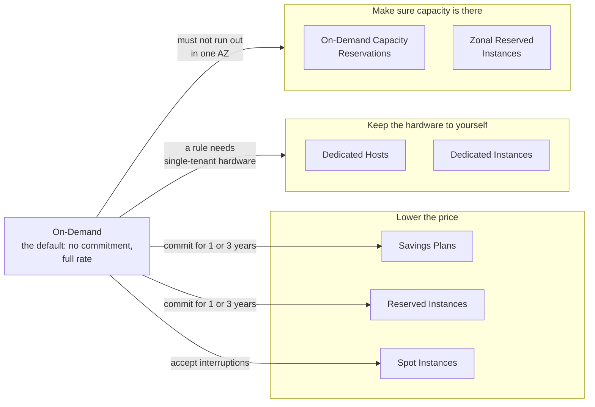

# Pay On-Demand for what changes, commit for what's steady, use Spot for what can wait, and buy dedicated hardware or reserved capacity only when a rule requires it

The same server can be paid for in several ways, and each trades something: flexibility for a lower rate, the risk of interruption for a deep discount, or money for dedicated hardware or guaranteed capacity. The exam asks you to match a usage pattern to the right option.

**Exam guide:** [Domain 1, Cloud Concepts](https://docs.aws.amazon.com/aws-certification/latest/cloud-practitioner-02/cloud-practitioner-02-domain1.html) (24% of the exam): task [1.4](https://docs.aws.amazon.com/aws-certification/latest/cloud-practitioner-02/cloud-practitioner-02-domain1.html#cloud-practitioner-02-task1.4); [Domain 4, Billing, Pricing, and Support](https://docs.aws.amazon.com/aws-certification/latest/cloud-practitioner-02/cloud-practitioner-02-domain4.html) (12% of the exam): task [4.1](https://docs.aws.amazon.com/aws-certification/latest/cloud-practitioner-02/cloud-practitioner-02-domain4.html#cloud-practitioner-02-task4.1).

**For:** an adult studying alone, possibly new to IT, who wants to understand AWS and use it safely. **Time:** about 25 minutes. Reading works on a phone.

**Before you start:** [How AWS charges](01-how-aws-charges.md) and [Amazon EC2](../06-running-applications/01-ec2.md) help; the key ideas are restated here.

## Warm-up: what you remember

1. From lesson 06.01: is `m7g.large` an instance type or a purchasing option? Is Spot?

Feedback

1. **`m7g.large` is an instance type**, the hardware. **Spot is a purchasing option**, a way to pay for that hardware. This lesson is about those ways to pay.

## What you'll learn

By the end of this lesson, you can choose a purchasing option for each part of a usage pattern and justify it (objective 11.02a), and tell apart Savings Plans and Reserved Instances, Standard and Convertible, zonal and Regional, and Dedicated Hosts and Dedicated Instances.

Try this before you read on, and guess if you're unsure: does an On-Demand Capacity Reservation lower the price of the instances that use it?

## The big picture: purchasing options do three different jobs

*Notice that only the first box lowers the price. Dedicated hardware and reserved capacity cost the same or more; you buy them for a rule or a guarantee, not a discount.*

**Long description.** On-Demand, the default, on the left. Arrows lead to three groups. "Lower the price": Savings Plans and Reserved Instances, by committing for one or three years, and Spot Instances, by accepting interruptions. "Keep the hardware to yourself": Dedicated Hosts and Dedicated Instances, when a rule needs single-tenant hardware. "Make sure capacity is there": On-Demand Capacity Reservations and zonal Reserved Instances, when you must not run out of capacity in one AZ.

## On-Demand is the default and the yardstick

**On-Demand** means no commitment: you pay the published rate while an instance runs. Every discount is measured against it ([Billing and purchasing options](https://docs.aws.amazon.com/AWSEC2/latest/UserGuide/instance-purchasing-options.html)). Choose it for work that is short, unpredictable, new or mustn't be interrupted.

## A commitment trades flexibility for a lower rate

Savings Plans and Reserved Instances work in the same basic way ([Reserved Instances overview](https://docs.aws.amazon.com/AWSEC2/latest/UserGuide/ec2-reserved-instances.html)):

- A **commitment** is a promise to pay for a set amount of use for a **term** of **one or three years**, whether you use it or not; three years earns the bigger discount. Usage beyond it is charged On-Demand.
- The **payment option** is **All Upfront**, **Partial Upfront** or **No Upfront**; paying more upfront generally saves more.
- You **can't cancel** a Reserved Instance, and it **doesn't renew**. A Savings Plan can't be changed after purchase either ([Savings Plans FAQ](https://aws.amazon.com/savingsplans/faq/), checked 2026-10-24).
- The Free plan doesn't offer them (lesson 11.01).

The difference is **what you commit to**: a Reserved Instance to one instance configuration, a Savings Plan to an amount of spending per hour. AWS recommends Savings Plans, which are more flexible.

## Savings Plans: commit to dollars per hour, in four types

With **Savings Plans**, you commit to spend a fixed amount per hour, and eligible usage is charged at lower rates up to that amount. AWS offers **four types** ([Savings Plans types](https://docs.aws.amazon.com/savingsplans/latest/userguide/plan-types.html)):

| Type | Covers | Up to, off On-Demand |
|---|---|---|
| **Compute Savings Plan** | EC2 in any family, size, Region, operating system or tenancy; also Fargate and Lambda | 66% |
| **EC2 Instance Savings Plan** | EC2 in one family in one Region, any size, operating system or tenancy | 72% |
| **Database Savings Plan** | Aurora, RDS, DynamoDB and other database services | 35% |
| **SageMaker AI Savings Plan** | SageMaker AI instances | 64% |

> **Dated (checked 2026-10-24):** four types and these maximums, from [Savings Plans types](https://docs.aws.amazon.com/savingsplans/latest/userguide/plan-types.html). Savings Plans don't cover Spot.

**"There are two types of Savings Plans" is out of date.** Older notes name only Compute and EC2 Instance; there are now four. It's tempting because those two came first and are the pair the exam most likely compares.

**Compute or EC2 Instance?** A **Compute Savings Plan** follows your usage to another family, another Region, or from EC2 to Fargate or Lambda. An **EC2 Instance Savings Plan** stays with one family in one Region, for a deeper maximum discount. Choose Compute when any of those may change.

## Reserved Instances: a billing discount on a matching configuration

A **Reserved Instance** is a **billing discount** that AWS applies automatically to running instances that match its attributes: instance type, Region, tenancy and platform ([How Reserved Instance discounts are applied](https://docs.aws.amazon.com/AWSEC2/latest/UserGuide/apply_ri.html)).

### "A Reserved Instance is a server set aside for you" is wrong

It's easy to assume a Reserved Instance is a server. It isn't: nothing launches. If a matching instance runs, its bill drops; if none does, you pay for the reservation and get nothing. The name invites the mistake, and a zonal Reserved Instance does hold capacity, but that's room to launch, not a running machine.

**Standard or Convertible** ([Types of Reserved Instances](https://docs.aws.amazon.com/AWSEC2/latest/UserGuide/reserved-instances-types.html), checked 2026-10-24):

| | **Standard Reserved Instance** | **Convertible Reserved Instance** |
|---|---|---|
| Discount, up to | 72% | 66% |
| Change it later | Modify some attributes, such as the AZ or size | Exchange for another Convertible of a different family, operating system or tenancy, of equal or higher value |
| Sell it on the Reserved Instance Marketplace | Yes | No |

**Zonal or Regional:** a **zonal Reserved Instance** **reserves capacity** in one Availability Zone, and its discount applies only to exactly matching instances there. A **Regional Reserved Instance** reserves no capacity, but its discount applies in **any AZ** of the Region and, for Linux on shared **tenancy** (shared hardware, the default), to **any size** in the same family: that's **instance size flexibility**.

In an organization, an unused Reserved Instance's discount can cover matching usage in other accounts (lesson 11.04).

## Savings Plans or Reserved Instances: what follows your usage?

*Notice how the highlighted cells thin out from left to right. More freedom costs a little discount; only the rightmost column holds capacity.*

**Long description.** Ten rows by four columns: Compute Savings Plan, EC2 Instance Savings Plan, Regional Reserved Instance, zonal Reserved Instance. Change instance family: yes, no (one family), no, no. Change size: yes, yes, yes (Linux on default tenancy only), no. Change Availability Zone: yes, yes, yes, no. Change Region: yes, no (one Region), no, no. Change operating system: yes, yes, no, no. Change tenancy: yes, yes, no, no. Covers Fargate and Lambda: yes, no, no, no. Reserves capacity: no, no, no, yes in one AZ. You commit to: dollars per hour, dollars per hour, one configuration, one configuration. Discount up to: 66%, 72%, 72% for Standard, 72% for Standard.

**"Up to" is a ceiling, not a promise.** You may have read that Reserved Instances save "up to 75%". That's wrong twice: AWS's [Reserved Instances pricing](https://aws.amazon.com/ec2/pricing/reserved-instances/) page says up to 72% today (checked 2026-10-24), and any "up to" needs the longest term and the most paid upfront. It sticks because one number is easy to memorize. Learn the order instead: Spot deepest, then commitments, Capacity Reservations none.

## Spot Instances: deep discounts for work that can stop

A **Spot Instance** runs on spare EC2 capacity for up to 90% less than On-Demand, with no commitment ([Amazon EC2 Spot Instances](https://aws.amazon.com/ec2/spot/)). The **Spot price** is set by EC2 for each instance type in each AZ and moves gradually with supply and demand. The catch: when EC2 needs the capacity back, it interrupts your instance after a two-minute **interruption notice** ([Spot Instances](https://docs.aws.amazon.com/AWSEC2/latest/UserGuide/using-spot-instances.html)).

So Spot suits work that can stop and pick up again: batch jobs, data analysis, background processing, tests. It doesn't suit the bakery's only web server or its order database.

## Dedicated Hosts and Dedicated Instances: hardware with no other customers

By default your instances share physical servers with other customers. When a rule forbids that, or a license is priced per physical processor, two options give you single-tenant hardware ([Dedicated Hosts](https://docs.aws.amazon.com/AWSEC2/latest/UserGuide/dedicated-hosts-overview.html); [Dedicated Instances](https://docs.aws.amazon.com/AWSEC2/latest/UserGuide/dedicated-instance.html)):

*Notice the "You see" row. Only a Dedicated Host shows the sockets and cores that per-core licenses are counted on.*

**Long description.** Two panels. What's the same: single-tenant hardware, with no difference in performance or security. Dedicated Host, a whole physical server: you see its sockets, cores and host ID; you keep instances on the host you choose; billed per host; supports per-socket, per-core or per-VM licenses you bring; no Capacity Reservations; Host Reservations give up to 70% off. Dedicated Instance, an instance on hardware only your account uses: you see nothing of the hardware; AWS places it and it may move after a stop and start; billed per instance plus a $2 an hour fee per Region while any runs; partial license support; Capacity Reservations supported.

If you bring licenses counted per socket or core, choose a **Dedicated Host**. If you only need "not shared with other customers", a **Dedicated Instance** is simpler.

## Capacity Reservations: a guarantee, not a discount

An **On-Demand Capacity Reservation** holds EC2 capacity for a chosen instance type in **one AZ**, so your instances can launch when you need them ([Capacity Reservations](https://docs.aws.amazon.com/AWSEC2/latest/UserGuide/ec2-capacity-reservations.html)). One for immediate use can be canceled any time. It's charged at the **On-Demand rate whether you run instances in it or not** ([Capacity Reservation pricing and billing](https://docs.aws.amazon.com/AWSEC2/latest/UserGuide/capacity-reservations-pricing-billing.html)).

### "A Capacity Reservation gets you a discount" is wrong

You might expect reserving capacity to lower the price. It doesn't: a Capacity Reservation gives **no billing discount** on its own; combine it with a Savings Plan or a Regional Reserved Instance for that. It's tempting because "reserved" appears in both names, and a zonal Reserved Instance does both jobs, for a one- or three-year commitment.

## Choosing an option for a usage pattern

Each part of a workload gets its own answer. Ask in order; the first "yes" decides:

1. **Must the hardware be dedicated, by rule or license?** A Dedicated Host for per-socket or per-core licenses; otherwise a Dedicated Instance.
2. **Can the work be interrupted and restarted?** Spot.
3. **Is the use steady for one to three years?** A Savings Plan (or a Reserved Instance) for that steady part.
4. **Otherwise,** or if you don't know yet: On-Demand.

Separately, if capacity in one AZ must be guaranteed, add a Capacity Reservation. Spot, by design, guarantees nothing.

> **Example:** the bakery runs two web servers all year, and Auto Scaling adds up to four more in November and December. Commit to the base of two with a Compute Savings Plan, which would follow a later move to Lambda, and leave the peak On-Demand: a commitment sized for December would sit unused for ten months.

> **Your turn:** The bakery must be certain it can start ten extra servers in its AZ on the morning of a big launch next month. Which option fits, and why not a three-year Standard Reserved Instance or Spot?

Model answer

**An On-Demand Capacity Reservation** for that period: it guarantees capacity in that AZ without a long commitment, billed at the On-Demand rate whether used or not. A zonal Reserved Instance would hold capacity too, but three years of payments for one day is a costly mistake. Spot guarantees nothing and can be taken back.

## Summary

- **On-Demand** is the default: no commitment, the full rate. **Commitments** trade one or three years of payments for a lower rate; Savings Plans commit to dollars per hour, in four types, with Compute the most flexible and EC2 Instance the deepest.
- **A Reserved Instance is a billing discount, not a machine.** Standard gives more discount and can be sold; Convertible can be exchanged. Zonal reserves capacity in one AZ; Regional applies in any AZ and, for Linux, any size in the family.
- **Spot** gives up to 90% off for work that can survive a two-minute warning. "Up to" figures are ceilings.
- **Dedicated Host vs Dedicated Instance:** both single-tenant; only a Host shows sockets and cores. **A Capacity Reservation** guarantees capacity in one AZ, with no discount of its own.

## Practice

1. **A company runs a steady fleet of `m5` instances in one Region and is sure it won't change family or Region for three years. Which option gives the deepest discount that still allows changing instance size?**

   A. Compute Savings Plan\
   B. EC2 Instance Savings Plan\
   C. Spot Instances\
   D. On-Demand Capacity Reservation

   

Feedback

   **B is right.** One family in one Region, any size, up to 72% off.

   - **A is wrong.** It works, but its maximum discount is lower (66%).
   - **C is wrong.** A steady fleet that mustn't stop isn't Spot work.
   - **D is wrong.** It guarantees capacity and gives no discount.

   

2. **Which statement about Reserved Instances is correct?**

   A. Buying one launches an instance for you\
   B. They renew automatically at the end of the term\
   C. They're a billing discount applied to matching running instances\
   D. They can be canceled at any time for a refund

   

Feedback

   **C is right.**

   - **A is wrong.** Nothing launches; the discount applies to instances you run.
   - **B is wrong.** They don't renew; matching instances return to On-Demand rates.
   - **D is wrong.** They can't be canceled, though a Standard one can be sold and a Convertible one exchanged.

   

3. **A software vendor licenses its database per physical core and must count the cores on the server it runs on. Which option fits?**

   A. Dedicated Instances\
   B. A Dedicated Host\
   C. Spot Instances\
   D. A Compute Savings Plan

   

Feedback

   **B is right.** A Dedicated Host shows its sockets and physical cores and keeps instances on the host you choose.

   - **A is wrong.** Dedicated Instances are single-tenant but show nothing of the hardware and may move hosts.
   - **C is wrong.** Spot runs on shared spare capacity and can be interrupted.
   - **D is wrong.** A Savings Plan lowers the price; it doesn't change the hardware.

   

**Next:** [Estimate, watch, analyze](03-estimate-watch-analyze.md). To practice choosing, try [Simulation S13](07-sim-purchasing-option-tree.md).

## Where to check the current details

- [Amazon EC2 billing and purchasing options](https://docs.aws.amazon.com/AWSEC2/latest/UserGuide/instance-purchasing-options.html) (checked 2026-10-24)
- [Savings Plans types](https://docs.aws.amazon.com/savingsplans/latest/userguide/plan-types.html) and the [Savings Plans FAQ](https://aws.amazon.com/savingsplans/faq/) (checked 2026-10-24)
- [Reserved Instances pricing](https://aws.amazon.com/ec2/pricing/reserved-instances/) (checked 2026-10-24)

---

"Purchasing options" by Automate the Cloud Inc., licensed under CC BY-NC 4.0 with the Additional Permission for Internal Training from Automate the Cloud Inc.
License: https://creativecommons.org/licenses/by-nc/4.0/
Permission: https://automatethe.cloud/licenses/atc-internal-training-permission.txt
