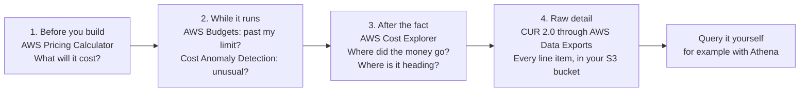
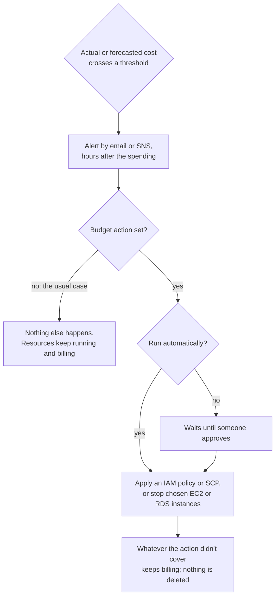

# Estimate before you build, watch while it runs, analyze after the fact: each stage has its own cost tool

The bakery's bill has grown, and the owner wants to know why, wants a warning next time, and wants a price for a new feature before anyone builds it. AWS gives you a different tool for each of those jobs. By the end of this lesson you can name the stage each tool serves, the question it answers, and the one thing most people get wrong about each.

**For:** an adult studying alone, possibly new to IT, who wants to understand AWS and use it safely. **Time:** about 30 minutes. Reading works on a phone.

**Before you start:** this lesson builds on [primer page 05, "Set up money alarms before you build anything"](https://github.com/AutomateTheCloud/atc-study-aws_account_guardrails/blob/main/primer/05-money-alarms.md), where you created two budgets and lowered the anomaly alert; on [Analytics in five verbs](../10-data-ai-and-more/01-analytics-in-five-verbs.md) (Athena); and on [How AWS charges](01-how-aws-charges.md), which explains what drives a bill. If you skipped them, the key terms below give you enough to follow. The scenario is in the [module brief](00-brief.md).

## Warm-up: what you remember

Answer from memory before you look anything up.

1. From lesson 10.01: the bakery keeps a year of website logs as files in S3. Which service runs SQL on those files where they sit, with no server to manage?
2. From lesson 06.01: a developer stops a test instance on Friday. Which charges carry on over the weekend?
3. From lesson 02.02: the cloud turns a fixed expense into a variable one. Why does a variable expense need watching in a way a fixed one doesn't?

Feedback

1. **Amazon Athena.** It reads the files in S3 as tables and charges for the data each query scans. You'll meet it again here: AWS's most detailed billing data arrives as files in S3, ready for Athena.
2. **Its EBS volume, and any Elastic IP address.** The instance-time charge stops; the stored disk and a kept address don't. Small charges like these are what this lesson's tools help you find.
3. **Because it moves with use.** A fixed expense is known in advance. A variable one changes whenever someone launches, forgets or scales something, so you need tools that tell you what it is doing.

## What you'll learn

By the end of this lesson, you can:

- pick the tool for each stage, estimate, watch, analyze or dig into raw detail, and say what question it answers (objective 11.03a);
- explain what a budget does when spending crosses its limit, and what a budget action can and can't do;
- use Cost Explorer's grouping to explain why a bill grew, and say how far back and ahead it looks;
- say where the most detailed billing data lives today, under its exam name and its current name.

Try these before you read on. Guess if you're unsure; the answers are in the lesson.

1. Your monthly budget's 100% alert arrives by email. What happens to the resources that caused it?
2. How many months ahead does Cost Explorer forecast your spending?

## The big picture: four stages, five tools

Every cost question belongs to a stage. Before something exists, you estimate it. While it runs, you want to be told when spending crosses a line or behaves strangely. Afterwards, you analyze where the money went, and when the charts aren't detailed enough, you go to the raw line items.

*Notice that only the second stage watches in real time, and even it reports hours after the money is spent.*

**Long description.** Four boxes from left to right, joined by arrows. Box 1, before you build: AWS Pricing Calculator, which answers "what will it cost?". Box 2, while it runs: AWS Budgets, which answers "am I past my limit?", and AWS Cost Anomaly Detection, which answers "is this unusual?". Box 3, after the fact: AWS Cost Explorer, which answers "where did the money go, and where is it heading?". Box 4, raw detail: CUR 2.0, delivered through AWS Data Exports as files to your S3 bucket, with every line item. An arrow from box 4 leads to "query it yourself, for example with Athena".

The exam's task [4.2](https://docs.aws.amazon.com/aws-certification/latest/cloud-practitioner-02/cloud-practitioner-02-domain4.html#cloud-practitioner-02-task4.2) names all of these except Cost Anomaly Detection, which you set up in the primer (checked 2026-10-24).

## Key terms (skip if you know them)

- **Estimate:** a cost worked out from assumptions about something that doesn't exist yet.
- **Forecast:** a prediction of future cost from your past usage.
- **Budget threshold:** a point, such as 85% of $150, at which a budget sends an alert.
- **Line item:** one row of a bill: one product, one kind of usage, one operation, for one period.
- **Alert vs action:** an alert tells a person; an action changes something in the account. In everyday speech a budget is a limit you can't exceed; an AWS budget is a target you are told about.

## AWS Pricing Calculator estimates a design before it exists

**AWS Pricing Calculator** is a free web tool for estimating what AWS services will cost before you use them ([What is AWS Pricing Calculator?](https://docs.aws.amazon.com/pricing-calculator/latest/userguide/what-is-pricing-calculator.html), checked 2026-10-24). You pick a service, describe how you'll use it (hours, GB, requests), and it shows the monthly, upfront and yearly cost, with the calculation behind each number.

What to know about the public calculator at [calculator.aws](https://calculator.aws/):

- **Groups** price each part of a design separately, or two designs side by side.
- **A saved estimate is a link stored on AWS's public servers,** so leave out names and secrets. You can also export CSV or PDF.
- **It leaves out tax,** and where it differs from a service's pricing page, the pricing page wins.
- **It's only as good as your inputs.** A wrong guess about hours or GB gives a confident, wrong total.

There's also a version inside the Billing and Cost Management console. It can use your own discounts and commitments: a **workload estimate** prices new usage, and a **bill estimate**, for the management account or a standalone account only, models changes across the whole bill, including new Savings Plans or Reserved Instances ([Pricing Calculator concepts](https://docs.aws.amazon.com/cost-management/latest/userguide/pc-concepts.html), checked 2026-10-24).

Older material may send you to the **TCO Calculator** or the **Simple Monthly Calculator**. Both are gone: their addresses now lead to the Pricing Calculator. For a migration business case, Module 13, "Moving to AWS", uses Migration Evaluator instead.

> **Your turn:** The owner's next feature is a cake designer: customers build a cake on the website, and a Lambda function draws a preview picture of it, stored in S3. Expect 3,000 saved designs a month, a preview of about 2 MB each, kept for a year, and 2 seconds of a 1 GB Lambda function per preview. Using these US East (N. Virginia) prices (as of 2026-10-24): S3 Standard $0.023 per GB-month, S3 uploads about $0.005 per 1,000, Lambda $0.20 per million requests and $0.0000166667 per GB-second, estimate the cost in month 1 and in month 12. Which assumption matters most?

Model answer

| Item | Month 1 | Month 12 |
|---|---|---|
| S3 storage: about 6 GB, growing by 6 GB a month | 6 × $0.023 = $0.14 | 72 × $0.023 = $1.66 |
| S3 uploads: 3,000 previews | $0.015 | $0.015 |
| Lambda compute: 3,000 × 2 s × 1 GB = 6,000 GB-seconds | $0.10 | $0.10 |
| Lambda requests: 3,000 | $0.0006 | $0.0006 |
| **Total** | **about $0.26** | **about $1.78** |

This is before any always-free allowance and leaves out the website itself and showing the previews to customers (data transfer out). **Storage matters most,** because it's the only line that grows every month: keeping previews for a year makes month 12 about seven times month 1. A lifecycle rule from lesson 05.03 would cap it. You'll build an estimate like this in the calculator in [Lab 15](05-lab-15-pricing-calculator.md). Prices: [Amazon S3 pricing](https://aws.amazon.com/s3/pricing/), [AWS Lambda pricing](https://aws.amazon.com/lambda/pricing/).

## AWS Budgets tells you when you pass a limit; it stops nothing unless you add an action

**AWS Budgets** tracks your cost or usage against a target you set and alerts you when it crosses a threshold ([Managing your costs with AWS Budgets](https://docs.aws.amazon.com/cost-management/latest/userguide/budgets-managing-costs.html), checked 2026-10-24). You met it in primer page 05, where you created a zero-spend budget and a $5 monthly budget. Here is what else it does:

- **Six budget types:** cost, usage, and the utilization and coverage of Reserved Instances and of Savings Plans, which tell you if a commitment from [Purchasing options](02-purchasing-options.md) is going unused.
- **Actual and forecasted alerts.** An alert can fire when actual cost passes a threshold, or when Budgets' **forecasted cost**, its prediction for the whole period, will pass it. The forecasted alert warns you before the money is spent.
- **Email or Amazon SNS,** and through SNS, chat tools. A newly added email address gets budget alerts only after its owner verifies it, by signing in to the account; addresses on budgets created before AWS added verification keep working (as of 2026-10-24, [Adding email recipients to a budget notification](https://docs.aws.amazon.com/cost-management/latest/userguide/budgets-email-recipients.html); primer page 05 dates the change to 2026-09-30).
- **Periods:** daily, monthly, quarterly, annually, or a custom range such as a three-month project ([Creating a cost budget](https://docs.aws.amazon.com/cost-management/latest/userguide/create-cost-budget.html)).
- **Delay.** Budgets data updates up to three times a day, typically 8 to 12 hours apart. You can spend past a threshold before the alert can be sent.

*Notice that the line doesn't bend at A, B or C. Each point is an email; the spending goes on.*

**Long description.** A line chart of the bakery's month-to-date cost for the 31 days of January, made up for teaching: about $3.61 a day until 10 January, then about $6.18 a day once a forgotten r7g.large instance starts on 11 January, ending at $165.98. A solid horizontal line marks the $150 budget; a dashed line marks the 85% threshold at $127.50. Point A, about 13 January (illustrative): the forecast for the month passes $150, so a forecasted-cost alert is sent. Point B, 25 January: actual cost passes $127.50. Point C, 29 January: actual cost passes $150. A note says Budgets data updates up to three times a day, so each email arrives hours after the line is crossed, and that no alert stops the instance. The worked example below explains the jump.

### "A budget caps your spending" is wrong

You may have read that a budget stops you from spending more than its amount. That's not right. A budget on its own sends alerts and does nothing to your resources. They keep running and billing until someone changes them.

What you *can* add is a **budget action**: something AWS Budgets does for you when a threshold is crossed, either automatically or after someone approves it ([Configuring budget actions](https://docs.aws.amazon.com/cost-management/latest/userguide/budgets-controls.html), checked 2026-10-24). There are three kinds:

- **Apply an IAM policy,** for example one that denies launching new EC2 instances.
- **Attach a service control policy (SCP)**, the ceiling from lesson 09.05, to an account. Only a management account can do this.
- **Stop chosen EC2 or RDS instances** in your own account.

Even with an action, a budget isn't a cap. Actions block new work or stop the instances you named, and they act on data that is hours old. Storage, NAT gateways and anything else you didn't target keep billing. Nothing is deleted.

*Notice the left branch. It's what every budget does unless you build the right branch yourself.*

**Long description.** A flowchart. Actual or forecasted cost crosses a threshold. An alert goes out by email or SNS, hours after the spending. Then: is a budget action set? No, the usual case: nothing else happens, and resources keep running and billing. Yes: does it run automatically? Yes: it applies an IAM policy or SCP, or stops chosen EC2 or RDS instances. No: it waits until someone approves, then does the same. Either way, whatever the action didn't cover keeps billing, and nothing is deleted.

It's tempting because "budget" sounds like a limit, and prepaid services elsewhere stop when the money runs out. AWS doesn't. The habit that saves money is primer page 07's: delete what you create. [Simulation S14](08-sim-guardrail-timeline.md) lets you watch alerts and stops play out over time.

The CloudWatch billing alarm from primer page 05 also only notifies; for "alert me when costs exceed a limit", the exam expects Budgets.

> **Check:** Answer the first prequestion. The bakery's $150 budget sends its 100% alert on 29 January. There is no budget action. What happens to the test instance that caused it?
>
> A. AWS stops it at once\
> B. Nothing: it keeps running and billing until someone stops or terminates it\
> C. AWS stops all new launches in the account\
> D. The extra cost is waived because a budget was set

Feedback

**B is right.** A budget without an action only sends alerts.

- **A is wrong.** Stopping chosen instances is possible only as a budget action you configured.
- **C is wrong.** Blocking launches needs an action that applies an IAM policy or SCP.
- **D is wrong.** A budget changes nothing about what you're charged.

## Cost Anomaly Detection tells you when spending is unusual, not when it is high

**AWS Cost Anomaly Detection** uses machine learning to learn your normal spending pattern, including weekly or monthly rhythms and steady growth, and alerts you when spending departs from it ([Detecting unusual spend](https://docs.aws.amazon.com/cost-management/latest/userguide/manage-ad.html), checked 2026-10-24). It differs from Budgets in one way that matters: a budget compares cost with a number *you* chose; anomaly detection compares cost with what is *normal for you*. A sudden $3 a day in a service you normally use only a little can be an anomaly long before any budget notices.

- A **cost monitor** says what to watch: all AWS services (the default AWS-managed monitor you saw in primer page 05), or chosen accounts, cost allocation tags or cost categories (lesson 11.04).
- An **alert subscription** says who hears and when: individual alerts through SNS, or daily or weekly summaries by email, once an anomaly passes your dollar or percentage threshold.
- It names likely **root causes**, ranked by cost, by service, account, Region and usage type.
- It runs about three times a day on data that can be 24 hours old. A new monitor can take 24 hours to start, and a service you've just started using needs 10 days of history before anomalies in it can be detected.
- It costs nothing, and new Cost Explorer customers get a default monitor and a daily email summary automatically ([Cost Anomaly Detection FAQs](https://aws.amazon.com/aws-cost-management/aws-cost-anomaly-detection/faqs/), checked 2026-10-24).

Like Budgets, it only tells people; it never stops anything.

> **Your turn:** The bakery's bill is usually about $112 a month. Which tool would most likely catch each problem first, a $150 monthly budget or Cost Anomaly Detection set to alert at $5? (a) A forgotten test instance adds $2.57 a day. (b) Over a year, every service grows slowly with sales, until the bill reaches $160.

Model answer

(a) **Cost Anomaly Detection.** A new daily cost in a pattern it knows stands out within a day or two, while the budget's actual-cost alerts wait until the month's total nears $150. (b) **The budget.** Slow, steady growth is normal to anomaly detection, which allows for natural growth; only a fixed limit notices that the total has crossed what the owner wanted to spend. That's why primer page 05 set up both.

## Cost Explorer shows where the money went, and forecasts what comes next

**AWS Cost Explorer** shows your costs and usage as charts and tables that you filter and group: by service, account, Region, usage type, instance type, cost allocation tag and more ([Analyzing your costs with AWS Cost Explorer](https://docs.aws.amazon.com/cost-management/latest/userguide/ce-what-is.html), checked 2026-10-24). It's the tool for "where did the money go?" Its other jobs:

- **Forecasts.** As of 2026-10-24, it looks up to 18 months ahead. It predicts spending from your past usage, with an 80% **prediction interval**: a range the real figure should fall in four times out of five. The steadier your history, the narrower the range. With less than about one full billing cycle of history, it gives no forecast ([Forecasting with Cost Explorer](https://docs.aws.amazon.com/cost-management/latest/userguide/ce-forecast.html)).
- **Recommendations** for Reserved Instances and Savings Plans, based on your usage.
- **Questions in plain language** through Amazon Q Developer.
- **The same data** as the Cost and Usage Report, downloadable as CSV.

It refreshes at least once every 24 hours, and once switched on it can't be switched off.

*Notice how much longer the forecast band is than many study notes say.*

**Long description.** A timeline in months, from 38 months back to 18 months ahead. In blue, the default history: the previous 13 months, at daily or monthly granularity. Then the current month. Then a dashed band, the forecast for the next 18 months. In gray, two options you switch on: multi-year data, reaching back up to 38 months at monthly granularity, and hourly data for the last 14 days, which is charged per usage record. A note says older material gives 12 months of history and a 12-month forecast, and AWS's guide now says 13 and 18.

### Older figures for Cost Explorer's history and forecast are out of date

You may have read that Cost Explorer shows the last 12 months and forecasts the next 12. That's no longer right. As of 2026-10-24, AWS's guide says it shows the current month and up to the previous **13 months**, and forecasts the next **18 months**. You can also switch on multi-year data, up to **38 months** at monthly granularity ([Multi-year data](https://docs.aws.amazon.com/cost-management/latest/userguide/ce-multi-year-data.html)). It's tempting because older AWS wording and many practice questions still say 12 and 12. On the exam, look for "visualize, analyze, forecast", not a number; in real work, check the page.

> **Check:** Answer the second prequestion. Which statement about AWS Cost Explorer is correct as of 2026-10-24?
>
> A. It forecasts up to 18 months ahead from your past usage\
> B. It emails you when your cost passes a limit you set\
> C. It estimates the cost of a design you haven't built yet\
> D. It delivers line-item files to your S3 bucket

Feedback

**A is right.** Cost Explorer analyzes past cost and forecasts the next 18 months.

- **B is wrong.** That's AWS Budgets.
- **C is wrong.** That's AWS Pricing Calculator: Cost Explorer works from usage you already have.
- **D is wrong.** That's the Cost and Usage Report, delivered through AWS Data Exports.

## The Cost and Usage Report holds every line item, delivered through Data Exports

When the charts aren't enough, you need the raw data. The **AWS Cost and Usage Report (CUR)** is the most detailed cost and usage data AWS provides: every **line item**, by hour, day or month, optionally with the ID of each resource and a column for each cost allocation tag ([What are AWS Cost and Usage Reports?](https://docs.aws.amazon.com/cur/latest/userguide/what-is-cur.html), checked 2026-10-24). AWS delivers it as CSV or Parquet files into an S3 bucket you choose, at least once a day. From there you query it with Athena, load it into Amazon Redshift, or chart it in Amazon Quick Sight: the analytics pipeline from lesson 10.01, with your bill as the data.

**The name has moved.** The exam guide says "AWS Cost and Usage Report". Today you create it in **AWS Data Exports**, a page of the Billing and Cost Management console that creates exports of billing, cost and carbon emissions data, with SQL-style column and row choices ([What is AWS Data Exports?](https://docs.aws.amazon.com/cur/latest/userguide/what-is-data-exports.html), checked 2026-10-24). AWS calls **CUR 2.0** "the new and recommended way" to get this data; the original report is listed there as the legacy export. Other exports include a ready-made cost dashboard for Quick Sight.

Large organizations use it to charge each department for its share; the bakery doesn't need it yet. The files in your bucket are billed at standard S3 rates ([Setting up an Amazon S3 bucket for Cost and Usage Reports](https://docs.aws.amazon.com/cur/latest/userguide/cur-s3.html)).

> **Your turn:** In one sentence each, say why a finance team that splits the AWS bill across 40 departments every month would use the CUR, while the bakery owner would use Cost Explorer.

Model answer

The finance team needs every line item, with tags and resource IDs, in files it can query and feed into its own systems the same way every month, which is what the CUR in S3 gives it. The owner needs a quick picture of which services grew and why, which Cost Explorer's charts give in a few clicks and at no charge.

## Pick the tool by the question it answers

![A grid of five tools. AWS Pricing Calculator: before you build; what will this design cost a month; acts on its own: no, an estimate only. AWS Budgets: while it runs; are we heading past our limit; emails only, unless you add a budget action, highlighted. Cost Anomaly Detection: while it runs; is spending unusual for us; no, alerts only. Cost Explorer: after the fact; where did the money go and where is it heading; no. CUR 2.0 in Data Exports: raw detail; every line item; no, files in your S3 bucket.](../../images/11-03-tools-compared.svg)

*Notice the highlighted cell: only one tool can act, and only when you configure it to.*

**Long description.** A grid with five rows and three columns after the tool name: stage, the question it answers, and whether it acts on its own. AWS Pricing Calculator: before you build; what will this design cost a month; no, an estimate only. AWS Budgets: while it runs; are we heading past our limit, tell me; emails only, unless you add a budget action (highlighted). AWS Cost Anomaly Detection: while it runs; is spending unusual for us, tell me; no, alerts only. AWS Cost Explorer: after the fact; where did the money go, and where is it heading; no, charts, forecasts and recommendations. Cost and Usage Report (CUR 2.0) in Data Exports: raw detail; every line item, to query my own way; no, files in your S3 bucket.

| Tool | Stage | Works from | Answers |
|---|---|---|---|
| Pricing Calculator | Before you build | Your assumptions | What will it cost? |
| Budgets | While it runs | Actual and forecasted cost against your limit | Am I past my limit? |
| Cost Anomaly Detection | While it runs | Actual cost against your normal pattern | Is this unusual? |
| Cost Explorer | After the fact, and ahead | Your cost history | Where did it go? Where is it heading? |
| CUR 2.0 (Data Exports) | Raw detail | Every line item | Anything, if you query it |

**What's the same:** none of the five changes your resources on its own. **What differs:** whether they work from assumptions, limits, patterns or history, and whether they show, tell or deliver. **The principle:** name the stage, then the question; the tool follows. "Estimate" points to the calculator; "alert" to Budgets; "unusual" to anomaly detection; "visualize, analyze, forecast" to Cost Explorer; "most detailed" or "line items in S3" to the CUR.

## Worked example: one forgotten instance in January

Lesson 11.01 explained December's bill from its line items and expected January to fall back to about $110 to $115. The owner then set a $150 monthly budget. January ended at $165.98. Here is how an expert finds out why, with the tools in this lesson.

*Notice that the rest of the bill doesn't move. One new block, starting on one day, usually means one new resource.*

**Long description.** A stacked column chart of the 31 days of January. Every day has about $3.61 of "everything else", made up to match the $112 that lesson 11.01 expected for the month. From 11 January each column adds $2.57 for one r7g.large instance, at $0.1071 an hour in US East (N. Virginia) as of 2026-10-24. A marker at about 12 January, illustrative, shows when Cost Anomaly Detection would alert.

1. **Read the earliest warning.** About 12 January, Cost Anomaly Detection's daily summary reports an anomaly and names its likely cause: EC2, in US East (N. Virginia), instance hours.
2. **Confirm it in Cost Explorer.** Show January, daily, grouped by service: the chart above. Cost Explorer splits EC2 into instance costs and "EC2-Other", which holds items such as NAT gateway hours and data processed; that's where December's new NAT gateway appeared ([Filtering the data](https://docs.aws.amazon.com/cost-management/latest/userguide/ce-filtering.html), checked 2026-10-24). This time the new block is instance cost. Filtered to instances and grouped by instance type, it's one r7g.large: 24 × $0.1071 = $2.57 a day.
3. **Find whose it is.** Nobody remembers it. CloudTrail's event history, from Module 09, shows who ran `RunInstances`, and when.
4. **Count what waiting costs.** Nobody acted, because the owner believed the budget would stop the spending; the instance ran to the end of the month, $53.98. Terminated on 12 January, after the anomaly alert, it would have cost about $5. Even the forecasted budget alert, about 13 January, came early enough; the actual-cost alerts on 25 and 29 January did not.
5. **Fix and prevent.** Terminate the instance. Agree who acts on each alert, and what they do. And tag every resource with an owner, so the next stray instance has a name on it: that's [lesson 11.04](04-many-accounts-one-bill.md).

The expert's thinking: **separate the flat from the changed, then drill down one level at a time** (service, then instance type or usage type), and **act on the earliest warning**. Don't open the raw CUR for a question the charts can answer.

## What you pay for

> **What you pay for (as of 2026-10-24):** the Pricing Calculator's public site is free. AWS Budgets is free to watch and alert; the first two action-enabled budgets are free, then each costs $0.10 a day, and each emailed budget report costs $0.01 ([AWS Budgets pricing](https://aws.amazon.com/aws-cost-management/aws-budgets/pricing/)). Cost Anomaly Detection has no charge. Cost Explorer's console is free; each Cost Explorer API request costs $0.01, and optional hourly data costs $0.01 per 1,000 usage records a month ([Cost Explorer pricing](https://aws.amazon.com/aws-cost-management/aws-cost-explorer/pricing/)). CUR files are billed at standard S3 storage rates in your bucket. Budgets, Cost Explorer and Cost Anomaly Detection were available on both the Free and Paid plans when the primer was tested (2026-10-23).

## In real work: forecast, watch and explain on a schedule

Teams that manage cloud cost well cover all four stages on a schedule: every new feature is estimated before approval, alerts go to people who will act, and someone reviews Cost Explorer regularly and can explain each change. The Well-Architected Framework's cost optimization pillar names these habits:

- The design principle "[Implement Cloud Financial Management](https://docs.aws.amazon.com/wellarchitected/latest/framework/cost-dp.html)": cost is a practice with owners, not a bill someone opens.
- [COST01-BP03 Establish cloud budgets and forecasts](https://docs.aws.amazon.com/wellarchitected/latest/cost-optimization-pillar/cost_cloud_financial_management_budget_forecast.html): budgets and forecasts that change with the business, like the bakery's $150.
- [COST01-BP06 Monitor cost proactively](https://docs.aws.amazon.com/wellarchitected/latest/cost-optimization-pillar/cost_cloud_financial_management_proactive_process.html): looking before the bill arrives, with anomaly detection and forecasted alerts.
- [COST03-BP01 Configure detailed information sources](https://docs.aws.amazon.com/wellarchitected/latest/cost-optimization-pillar/cost_monitor_usage_detailed_source.html): the CUR and Cost Explorer as the data behind every cost decision.

## Summary

- **Pricing Calculator estimates before you build,** from your assumptions; the public site is free, leaves out tax, and stores shared estimates on public servers. The TCO and Simple Monthly calculators are gone.
- **Budgets alert while it runs,** on actual or forecasted cost or usage, hours after the spending. **A budget doesn't cap spending.** Only a budget action does anything, and only what you set: apply an IAM policy or SCP, or stop chosen EC2 or RDS instances.
- **Cost Anomaly Detection alerts on the unusual,** compared with your own pattern, at no charge; it complements a budget's fixed limit.
- **Cost Explorer analyzes after the fact,** grouping and filtering 13 months of history (38 with multi-year data) and **forecasting 18 months**, not 12.
- **The CUR holds every line item,** now created as CUR 2.0 in AWS Data Exports and delivered to your S3 bucket for Athena and other tools.
- **Explain a bill by drilling down:** service, then usage type or instance type, one level at a time.

## Practice

1. **A startup wants an email when its forecasted monthly cost will exceed $1,000. Which tool should it use?**

   A. AWS Cost Explorer\
   B. AWS Budgets\
   C. AWS Pricing Calculator\
   D. The Cost and Usage Report

   

Feedback

   **B is right.** Budgets alerts on actual or forecasted cost against a limit you set.

   - **A is wrong.** Cost Explorer shows a forecast, but it doesn't alert you on a limit.
   - **C is wrong.** The calculator estimates designs you haven't built; it doesn't watch real spending.
   - **D is wrong.** The CUR delivers raw data; it sends no alerts.

   

2. **A team must price a three-tier web application for a funding proposal before writing any code. Which tool fits, and what is the main risk in its answer?**

   

Feedback

   **AWS Pricing Calculator.** The main risk is the assumptions: the estimate is only as good as the guessed hours, GB and requests, and it leaves out tax and anything the team forgot to add, such as data transfer out.

   

3. **Which statement about budget actions is correct?**

   A. Every budget stops resources when it reaches 100%\
   B. A budget action can apply an IAM policy or SCP, or stop chosen EC2 or RDS instances, automatically or after approval\
   C. A budget action deletes the resources that caused the overspend\
   D. Budget actions act the moment a charge occurs

   

Feedback

   **B is right.**

   - **A is wrong.** A budget without an action only alerts.
   - **C is wrong.** Actions block or stop; they never delete.
   - **D is wrong.** Budgets data updates up to three times a day, so actions run hours after the spending.

   

4. **A finance analyst needs hourly cost for every resource, with each team's tag, to load into the company's own reporting database. Where does that data come from today?**

   

Feedback

   **The Cost and Usage Report, created as a CUR 2.0 export in AWS Data Exports,** delivered as files to an S3 bucket. Cost Explorer's charts aren't that detailed, and its API charges per request.

   

5. **(From lesson 10.01.) The bakery's CUR files land in S3. Which service turns them into a dashboard for the owner, and which one would run a one-off SQL question on them?**

   

Feedback

   **Amazon Quick Sight** for the dashboard (visualize); **Amazon Athena** for a one-off SQL question on files in S3 (query). Data Exports can also set up a ready-made cost dashboard in Quick Sight.

   

6. **(From lesson 06.01.) Cost Explorer shows the bakery paying for EBS volumes in a month when it ran no instances. How can that be?**

   

Feedback

   **Stopped instances still have their EBS volumes,** which are billed for as long as they exist. Only terminating the instance, with its volumes set to delete, or deleting the volumes ends the charge.

   

**Next:** [Many accounts, one bill](04-many-accounts-one-bill.md). To price a design yourself, do [Lab 15](05-lab-15-pricing-calculator.md); to watch alerts and stops over time, try [Simulation S14](08-sim-guardrail-timeline.md).

## Where to check the current details

- [What is AWS Pricing Calculator?](https://docs.aws.amazon.com/pricing-calculator/latest/userguide/what-is-pricing-calculator.html) and [Pricing Calculator concepts](https://docs.aws.amazon.com/cost-management/latest/userguide/pc-concepts.html) (checked 2026-10-24)
- [Managing your costs with AWS Budgets](https://docs.aws.amazon.com/cost-management/latest/userguide/budgets-managing-costs.html), [Configuring budget actions](https://docs.aws.amazon.com/cost-management/latest/userguide/budgets-controls.html) and [AWS Budgets pricing](https://aws.amazon.com/aws-cost-management/aws-budgets/pricing/) (checked 2026-10-24)
- [Detecting unusual spend with AWS Cost Anomaly Detection](https://docs.aws.amazon.com/cost-management/latest/userguide/manage-ad.html) (checked 2026-10-24)
- [Analyzing your costs with AWS Cost Explorer](https://docs.aws.amazon.com/cost-management/latest/userguide/ce-what-is.html), [Forecasting with Cost Explorer](https://docs.aws.amazon.com/cost-management/latest/userguide/ce-forecast.html) and [Cost Explorer pricing](https://aws.amazon.com/aws-cost-management/aws-cost-explorer/pricing/) (checked 2026-10-24)
- [What is AWS Data Exports?](https://docs.aws.amazon.com/cur/latest/userguide/what-is-data-exports.html) and [What are AWS Cost and Usage Reports?](https://docs.aws.amazon.com/cur/latest/userguide/what-is-cur.html) (checked 2026-10-24)
- [AWS Certified Cloud Practitioner (CLF-C02) exam guide](https://docs.aws.amazon.com/aws-certification/latest/cloud-practitioner-02/cloud-practitioner-02.html), task [4.2](https://docs.aws.amazon.com/aws-certification/latest/cloud-practitioner-02/cloud-practitioner-02-domain4.html#cloud-practitioner-02-task4.2) (checked 2026-10-24)

---

"Estimate, watch, analyze" by Automate the Cloud Inc., licensed under CC BY-NC 4.0 with the Additional Permission for Internal Training from Automate the Cloud Inc.
License: https://creativecommons.org/licenses/by-nc/4.0/
Permission: https://automatethe.cloud/licenses/atc-internal-training-permission.txt
