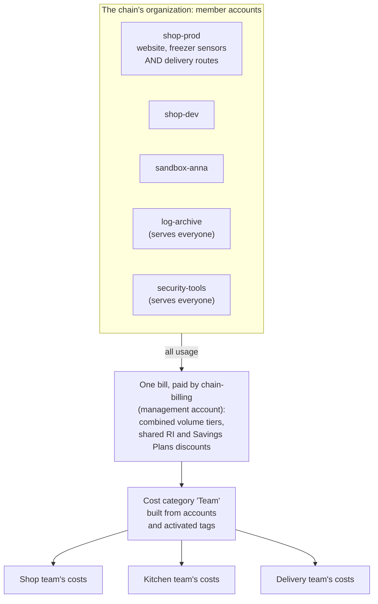
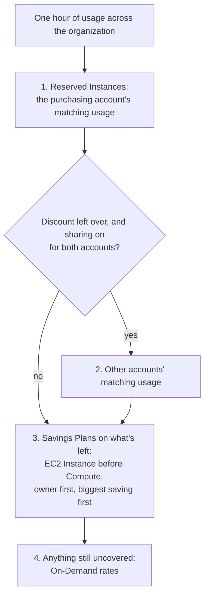
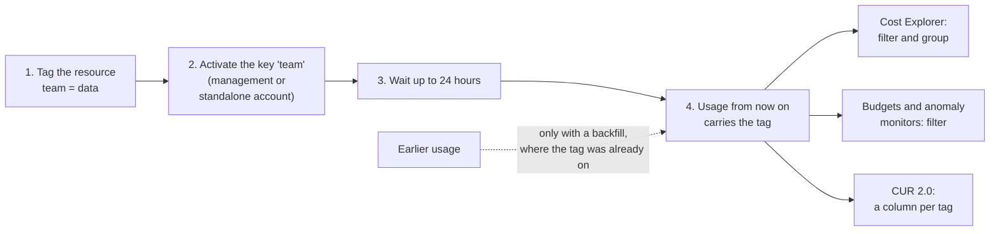

# In one organization, a commitment discount follows matching usage across accounts, and a tag reaches your cost reports only after you activate it

Simulation S11 showed that an organization gets one bill. This lesson answers the two questions that bill raises: when one account buys a discount, who actually gets it, and how do you split one bill so that each team sees its own costs? By the end you can trace a discount to the account that receives it, and explain every step a tag takes before a cost report shows it.

**For:** an adult studying alone, possibly new to IT, who wants to understand AWS and use it safely. **Time:** about 30 minutes. Reading works on a phone.

**Before you start:** this lesson builds on [Simulation S11](../09-protecting-and-governing/10-sim-organizations-and-scps.md) (the chain's organization and consolidated billing), [Estimate, watch, analyze](03-estimate-watch-analyze.md) (Cost Explorer, Budgets, the CUR) and [Purchasing options](02-purchasing-options.md) (Reserved Instances and Savings Plans). If you skipped them, the key terms below give you enough to follow. The scenario is in the [module brief](00-brief.md).

## Warm-up: what you remember

Answer from memory before you look anything up.

1. From lesson 10.01: which service turns query results into dashboards for people in the business?
2. From lesson 06.01: is a Reserved Instance a kind of server you launch?
3. From Lab 01: you tagged your first bucket `guide=clf` and `lab=01`. Which tool found it by those tags across all Regions?

Feedback

1. **Amazon Quick Sight.** By the end of this lesson, each team's costs could feed a dashboard like that.
2. **No.** A Reserved Instance is a billing discount applied to matching instances you run, not a machine. That's why it can move between accounts, as this lesson shows.
3. **Tag Editor.** Tags helped you find resources. This lesson shows the extra step that makes a tag useful for costs too.

## What you'll learn

By the end of this lesson, you can:

- say what consolidated billing combines, and who pays;
- explain which account receives a Reserved Instance or Savings Plans discount, and what changes when sharing is turned off (objective 11.04a);
- explain how a tag reaches Cost Explorer, Budgets and the Cost and Usage Report: the two types, activation and timing (objective 11.04a);
- give three teams a view of their own costs, using accounts, tags and cost categories.

Try these before you read on. Guess if you're unsure; the answers are in the lesson.

1. `shop-prod` owns a Reserved Instance it isn't using this month. `shop-dev`, in the same organization, runs a matching instance. Who gets the discount?
2. You tag a bucket `team=kitchen` today. Will Cost Explorer show last month's cost for that bucket under `team=kitchen`?

## The big picture: one bill in, three team views out

The bakery has become the small chain from Simulation S11, and the module brief's three teams each want to see their own costs: the **shop team**, which runs the website and the order database; the **kitchen team**, with the freezer sensors from Module 10; and the **delivery team**, with its route-planning functions. All usage flows into one bill, and the job is to split it again.

*Notice `shop-prod`: three teams work in one account, so the account alone can't split its costs. That's the job of tags.*

**Long description.** Top: a box of the chain's member accounts: `shop-prod`, which holds the website, the freezer sensors and the delivery routes; `shop-dev`; `sandbox-anna`; and `log-archive` and `security-tools`, which serve everyone. An arrow labeled "all usage" leads to one bill, paid by the management account `chain-billing`, where volume tiers count combined usage and Reserved Instance and Savings Plans discounts are shared. The bill leads to a cost category named Team, built from accounts and activated tags, which splits into three views: the shop team's costs, the kitchen team's costs and the delivery team's costs.

The exam's task [4.2](https://docs.aws.amazon.com/aws-certification/latest/cloud-practitioner-02/cloud-practitioner-02-domain4.html#cloud-practitioner-02-task4.2) asks about consolidated billing, cost allocation and the types of cost allocation tags; task [4.1](https://docs.aws.amazon.com/aws-certification/latest/cloud-practitioner-02/cloud-practitioner-02-domain4.html#cloud-practitioner-02-task4.1) asks how Reserved Instances behave in AWS Organizations (checked 2026-10-24).

## Key terms (skip if you know them)

- **Consolidated billing:** the AWS Organizations feature that sends every member account's charges to one bill, paid by the management account (Simulation S11).
- **Purchasing account:** the account that bought a Reserved Instance or a Savings Plan. Also called the owner account.
- **Discount sharing:** letting one account's unused commitment discount cover matching usage in other accounts of the same organization.
- **Tag:** a label on a resource, made of a key and a value, such as `team=kitchen`. A **cost allocation tag** is a tag that billing tools can group costs by.

## Consolidated billing combines usage and sends one bill

You met consolidated billing in Simulation S11. In short ([Consolidated billing](https://docs.aws.amazon.com/awsaccountbilling/latest/aboutv2/consolidated-billing.html), checked 2026-10-24):

- **The management account pays for every member account,** on one bill, at no extra fee.
- **For pricing, the organization counts as one account.** Volume tiers, such as S3's cheaper rate above 50 TB, apply to combined usage; S11's Decision 4 worked out what that's worth. Reserved Instance and Savings Plans discounts are shared.
- **Each member account's own bill is for information.** The management account can see every account's costs, and may reallocate shared discounts.
- **An account that leaves** can no longer see the Cost Explorer data from its time in the organization; the management account still can.

> **Warning:** Creating or joining an organization moves a Free plan account to the Paid plan ([Choosing a plan](https://docs.aws.amazon.com/awsaccountbilling/latest/aboutv2/free-tier-plans.html)), and AWS's [Free Tier terms](https://aws.amazon.com/free/terms/) say it can then no longer use or earn Free Tier credits (both checked 2026-10-24). Learn this part from S11 and this lesson; [Lab 16](06-lab-16-cost-allocation-tags.md) uses tags in your own standalone account instead.

## A commitment discount goes to its owner first, then to matching usage anywhere in the organization

This is the first half of the objective. A Reserved Instance or Savings Plan is a billing discount, not a machine, so it doesn't belong to one server. Each hour, AWS looks for usage it can apply to ([How Reserved Instance discounts are applied](https://docs.aws.amazon.com/AWSEC2/latest/UserGuide/apply_ri.html); [How Savings Plans apply](https://docs.aws.amazon.com/savingsplans/latest/userguide/sp-applying.html); both checked 2026-10-24):

- **The purchasing account comes first.** A Reserved Instance covers matching usage in the account that bought it before any other account.
- **Then any matching usage in the organization,** because for billing the organization counts as one account. An unused Reserved Instance in `shop-prod` can cover a matching instance in `shop-dev`.
- **Reserved Instances apply before Savings Plans.** Savings Plans then cover the rest: EC2 Instance Savings Plans before Compute Savings Plans, the owner's usage first, and within that the usage with the biggest saving first.
- **The discount travels; the capacity doesn't.** A zonal Reserved Instance reserves capacity only for its own account, even when its discount covers another account's usage.

*Notice the question in the middle. It's the only point where a setting, not usage, decides who saves.*

**Long description.** A flowchart. Start: one hour of usage across the organization. Step 1: Reserved Instances cover the purchasing account's matching usage. Then a question: is there discount left over, and is sharing on for both accounts? Yes: step 2, the discount covers other accounts' matching usage. No: skip to step 3. Step 3: Savings Plans cover what is left, EC2 Instance Savings Plans before Compute Savings Plans, the owner's usage first and the biggest saving first. Step 4: anything still uncovered is billed at On-Demand rates.

### Discounts are shared across the organization unless the management account turns sharing off

AWS describes sharing as how consolidated billing works: every account in the organization can receive the benefit of Reserved Instances bought by any other ([Reserved Instances](https://docs.aws.amazon.com/awsaccountbilling/latest/aboutv2/ri-behavior.html)), and a Savings Plan's benefit applies across all the accounts by default ([Savings Plans FAQ](https://aws.amazon.com/savingsplans/faq/)); both checked 2026-10-24. The **management account** controls it ([Reserved Instances and Savings Plans discount sharing](https://docs.aws.amazon.com/awsaccountbilling/latest/aboutv2/ri-turn-off.html), checked 2026-10-24):

- It can turn sharing off for any account. Both the purchasing account and the receiving account must have sharing on for a discount to pass between them; an account with sharing off still uses its own commitments.
- It can choose **prioritized group sharing**, where a commitment serves its owner, then a group of accounts you define, then the rest of the organization, or **restricted group sharing**, where it never leaves the group, even if it goes unused. Groups are defined with cost categories, later in this lesson.
- The final bill uses the settings in place at 23:59:59 UTC on the last day of the month.
- If the account that owns a Savings Plan leaves the organization, the plan no longer applies to the organization's bill.

Here is what the choice is worth for the chain. `shop-prod` bought two m7g.large Reserved Instances a year ago, but now runs only one m7g.large. `shop-dev` runs one more.

*Notice the light segment in the second bar: a Reserved Instance is paid for every hour of its term, used or not.*

**Long description.** Two horizontal stacked bars for one month of 730 hours. Sharing on, as consolidated billing works unless someone turns it off: two segments of $39.42 each, the Reserved Instance hours that cover `shop-prod`'s instance and `shop-dev`'s instance; total $78.84. Sharing off for `shop-dev`: $39.42 of Reserved Instance hours used by `shop-prod`; $39.42 of Reserved Instance hours paid for and unused; $59.57 of On-Demand hours for `shop-dev`'s instance; total $138.41. The difference is $59.57 a month. m7g.large, Linux, US East (N. Virginia), as of 2026-10-24: On-Demand $0.0816 an hour; 1-year Standard Reserved Instance, No Upfront, $0.054 an hour.

| One month, 730 hours | RI hours, used | RI hours, unused | On-Demand | Total |
|---|---|---|---|---|
| Sharing on | $78.84 | $0 | $0 | **$78.84** |
| Sharing off for `shop-dev` | $39.42 | $39.42 | $59.57 | **$138.41** |

Prices from the AWS Price List, retrieved 2026-10-24; check [EC2 On-Demand pricing](https://aws.amazon.com/ec2/pricing/on-demand/) and [Reserved Instance pricing](https://aws.amazon.com/ec2/pricing/reserved-instances/) for today's rates.

Why would anyone turn sharing off, then? Usually so that a business unit that paid for a commitment keeps its benefit. Group sharing is the gentler way to do that: AWS warns that turning sharing off can raise the monthly bill.

> **Check:** Answer the first prequestion. Sharing is on everywhere. `shop-prod` has an unused Regional m7g.large Reserved Instance this hour, and `shop-dev` runs a matching m7g.large. What happens?
>
> A. Nothing: a Reserved Instance only covers the account that bought it
> B. `shop-dev`'s instance gets the discount, because the organization counts as one account for billing
> C. `shop-dev` gets the discount and also `shop-prod`'s capacity reservation
> D. `shop-dev` must buy its own Reserved Instance to get any discount

Feedback

**B is right.** After the purchasing account's own usage, the discount covers matching usage elsewhere in the organization.

- **A is wrong.** That's true only for standalone accounts, or when sharing is turned off.
- **C is wrong.** A Regional Reserved Instance reserves no capacity, and a zonal one reserves it only for its own account.
- **D is wrong.** Sharing exists so that no account has to.

## A tag reaches your cost reports only after you activate it

This is the objective's second half. To split `shop-prod`'s costs among the three teams, you label each resource with a **tag**, such as `team=shop`, `team=kitchen` or `team=delivery`. A **cost allocation tag** is a tag that billing tools use to organize costs, and there are two types ([Organizing and tracking costs using AWS cost allocation tags](https://docs.aws.amazon.com/awsaccountbilling/latest/aboutv2/cost-alloc-tags.html), checked 2026-10-24):

- **AWS-generated tags** are created and applied by AWS. The main one, `aws:createdBy`, records who created a resource: an IAM user, a role, the root user. Only the management account can activate it, once, for every member account, and AWS applies it only to supported resources created after activation, in a listed set of Regions that includes `us-east-1` ([Using AWS-generated tags](https://docs.aws.amazon.com/awsaccountbilling/latest/aboutv2/aws-tags.html)). Some AWS Marketplace sellers add their own `aws:marketplace:isv:` tags.
- **User-defined tags** are tags you create and apply yourself, with Tag Editor, the console or the API. Reports show them with the prefix `user:`. Keys are case-sensitive: `team` and `Team` are two different keys ([Using user-defined cost allocation tags](https://docs.aws.amazon.com/awsaccountbilling/latest/aboutv2/custom-tags.html)).

*Notice the highlighted row. Whichever kind you use, nothing reaches a report until someone activates the key.*

**Long description.** A grid comparing AWS-generated and user-defined cost allocation tags on six rows. Who puts it on: AWS, on supported resources, and some Marketplace sellers; you, on your resources, with Tag Editor, the console or the API. Example key: `aws:createdBy`, who created the resource; `team`, `project` or `cost-center`, your choice. In reports: the `aws:` prefix; the `user:` prefix. Who activates: the management account, once, for all member accounts; the management account, or a standalone account. Highlighted, the same for both: must you activate it before reports show it? Yes. Which costs carry it: only resources created after activation; usage from activation on, while the resource carries the tag. A note says tags take up to 24 hours to appear after activation.

**Tag activation** is the step people miss. In the Billing and Cost Management console, on the cost allocation tags page, someone in the management account, or in a standalone account, chooses which tag keys billing should use. Only those keys appear in Cost Explorer, Budgets, Cost Anomaly Detection and the CUR, where each becomes a column. Activation can take up to 24 hours. An account that moves to a new organization loses its activations, and the new management account must activate the keys again.

*Notice step 2: a tag that's never activated reaches none of the three tools on the right.*

**Long description.** Left to right. Step 1, tag the resource, for example `team = data`. Step 2, activate the key `team`, in the management account or a standalone account. Step 3, wait up to 24 hours. Step 4, usage from then on carries the tag. From step 4, three arrows: Cost Explorer, where you filter and group by it; Budgets and anomaly monitors, where you filter by it; the CUR 2.0, where it is a column. A dashed arrow from "earlier usage" reaches step 4 only with a backfill, and only where the tag was already on the resource.

### "A tag shows costs" is wrong

You may have read that tagging a resource is enough to see its costs by tag. That's not right. A tag on a resource is invisible to billing until its key is **activated** as a cost allocation tag, and even then it labels usage **from activation onward**: it isn't retroactive by default. A management account can request a **tag backfill**, which re-applies the current activation to up to the previous twelve months, but only where the resource carried the tag at the time ([Backfill cost allocation tags](https://docs.aws.amazon.com/awsaccountbilling/latest/aboutv2/cost-allocation-backfill.html), checked 2026-10-24). Tagging a resource today never labels last month's costs.

It's tempting because Tag Editor finds tagged resources at once, as in Lab 01, so it feels as if billing should too. Finding resources and grouping costs are separate systems, and the billing one waits for activation.

*Notice January and February in the last row: even a backfill can't label costs from before the tag was on the resource.*

**Long description.** A grid of six made-up months and four rows. The kitchen team's sensor-data bucket: no tag in January and February; `team=kitchen` from March. Tag key `team` activated: no from January to April; yes from May 1. Reports by default: no tag value from January to April; `team: kitchen` in May and June. After a backfill to January: no tag value in January and February; `team: kitchen` from March to June. A note says activation counts from then on, and a backfill, by the management account, up to 12 months back, re-applies it to past months, but months before the resource was tagged stay empty.

> **Your turn:** Answer the second prequestion, then say what the kitchen team should have done in January, and who in the organization must do it.

Model answer

**No, not by default.** The tag labels usage only once the key `team` is activated, and only from then on; a backfill could label last month only if the bucket already carried the tag then. In January, the kitchen team should have tagged its resources as it created them, and asked whoever runs the **management account** to activate the key `team` straight away, since only the management account can activate cost allocation tags in an organization.

## Give each team a view: accounts first, tags inside shared accounts, cost categories to name the groups

Accounts split costs with no extra work, because every charge already belongs to an account. Tags split costs *inside* an account. A **cost category** puts the two together under names the business uses ([Creating cost categories](https://docs.aws.amazon.com/awsaccountbilling/latest/aboutv2/create-cost-categories.html), checked 2026-10-24):

- It's a set of **rules**, checked in order, that assign each cost to a value such as `Shop`, `Kitchen` or `Delivery`, by account, cost allocation tag, service, Region, charge type and more. A default value catches whatever no rule matched.
- A **split charge rule** divides one value's costs among others, proportionally, evenly or by fixed percentages. It's how shared costs, such as the logging account everyone depends on, get spread fairly.
- Cost categories appear in Cost Explorer, Budgets and the CUR, beside tags. They take up to 24 hours to apply, and can be set to apply from an earlier month.

Cost categories aren't named on the exam guide. Learn them as the way real organizations finish the job tags start.

> **Dated (checked 2026-10-24):** AWS now also lets the management account tag the **accounts** themselves, in AWS Organizations, and activate those tags for cost allocation. Every cost in the account then carries the tag, including charges that can't be tagged on a resource, such as credits and refunds ([Using account tags for cost allocation](https://docs.aws.amazon.com/awsaccountbilling/latest/aboutv2/account-tags-cost-allocation.html)). Older material won't mention it.

How each team then sees its costs:

- **Through its own account.** A member account can see its own costs in Cost Explorer, unless the management account turns off member access in Cost Explorer's preferences ([Cost Management policy examples](https://docs.aws.amazon.com/cost-management/latest/userguide/billing-example-policies.html)).
- **Through budgets.** Member accounts can create their own budgets. A budget the management account creates for a team, filtered by its cost category value, stays visible only in the management account, so its alerts should email the team ([Managing your costs with AWS Budgets](https://docs.aws.amazon.com/cost-management/latest/userguide/budgets-managing-costs.html)).
- **Through reports someone shares:** a saved Cost Explorer report per team, or a dashboard built on the CUR.

## Worked example: three teams, five accounts

The owner's request: "Each team sees its own costs, monthly, and gets an email before it overspends." The accounts come from Simulation S11. Here is how an expert designs it.

| Team | Where its resources run | How its costs are found |
|---|---|---|
| Shop | `shop-dev` and `sandbox-anna`, plus the website and order database in `shop-prod` | By account, plus `team=shop` in `shop-prod` |
| Kitchen | The freezer sensors and their bucket in `shop-prod` | `team=kitchen` in `shop-prod` |
| Delivery | The route-planning functions in `shop-prod` | `team=delivery` in `shop-prod` |
| Everyone | `log-archive` and `security-tools`, which protect all three | By account, then split |

The expert's thinking, step by step:

1. **Use accounts wherever they already split the costs.** `shop-dev` and `sandbox-anna` belong to the shop team, so they need no tags, and account costs can't be mislabeled.
2. **Tag only where accounts can't split:** every resource in `shop-prod` gets `team=shop`, `team=kitchen` or `team=delivery`. Agree the key's exact spelling first; `Team` and `team` would be two keys.
3. **Activate the key `team`** from `chain-billing`, the management account, on day one. Costs from before activation won't carry it, so starting late loses months.
4. **Activate the `aws:createdBy` tag** too. Lesson 11.03's forgotten instance would then have carried the name of whoever launched it, as long as it was launched after activation.
5. **Build a cost category named `Team`,** with rules in this order: `shop-dev` and `sandbox-anna` → `Shop`; tag `team=shop` → `Shop`; tag `team=kitchen` → `Kitchen`; tag `team=delivery` → `Delivery`; anything else, including the two security accounts → `Shared`. Add a split charge rule that spreads `Shared` across the three teams in proportion to their own costs.
6. **Give each team its view:** a saved Cost Explorer report filtered to its `Team` value, and a monthly budget per team, with a forecasted alert emailed to the team lead.
7. **Check the discounts.** `shop-prod`'s Reserved Instances help whichever team runs matching instances. If the shop team paid for them and wants first claim, prioritized group sharing, with groups from the same cost category, does that without wasting them.

> **Your turn:** A year later, the delivery team moves its functions into its own new account, `delivery-prod`. What changes in the design, and what doesn't need to?

Model answer

Add a rule mapping `delivery-prod` to `Delivery` in the cost category. The delivery team's costs now split by account, so its `team=delivery` tags matter less, though keeping them does no harm. Nothing else needs to change: the bill, the team budgets and the views all follow the cost category. If the new account came from another organization, `chain-billing` would have to activate its tags again.

## What you pay for

> **What you pay for (as of 2026-10-24):** consolidated billing has no extra fee, and AWS Organizations has no additional charge. Reserved Instances bill every hour of their term whether or not any account uses them; sharing decides who benefits, not what you pay for the commitment. For tag and cost category charges, check the [AWS Billing and Cost Management](https://docs.aws.amazon.com/awsaccountbilling/latest/aboutv2/billing-what-is.html) pages. On the Free plan, joining an organization moves you to the Paid plan.

## In real work: decide how costs are split before the bill arrives

Teams that split cost well decide the structure first (which accounts, which tag keys, which categories), write it down, and enforce it, for example with Organizations tag policies, which keep tag keys consistent across accounts. The Well-Architected Framework's cost optimization pillar names these habits:

- The design principle "[Analyze and attribute expenditure](https://docs.aws.amazon.com/wellarchitected/latest/framework/cost-dp.html)": every cost has an owner who can see it.
- [COST02-BP03 Implement an account structure](https://docs.aws.amazon.com/wellarchitected/latest/cost-optimization-pillar/cost_govern_usage_account_structure.html): accounts that match how the business pays, as in S11.
- [COST03-BP02 Add organization information to cost and usage](https://docs.aws.amazon.com/wellarchitected/latest/cost-optimization-pillar/cost_monitor_usage_org_information.html): tags such as `team`, activated for cost allocation.
- [COST03-BP03 Identify cost attribution categories](https://docs.aws.amazon.com/wellarchitected/latest/cost-optimization-pillar/cost_monitor_usage_define_attribution.html): the `Team` cost category and its rules.

## Summary

- **Consolidated billing** sends every account's charges to one bill, paid by the management account at no extra fee, and prices the organization as one account.
- **A commitment discount serves its purchasing account first,** then matching usage in any other account, unless the management account turns sharing off. Reserved Instances come before Savings Plans. The management account can turn sharing off per account, or limit it to groups; turning it off can raise the bill. The discount travels; a zonal reservation's capacity doesn't.
- **A tag reaches cost reports only after activation,** by the management account (or a standalone account), up to 24 hours later, and only for usage from then on. A backfill reaches up to 12 months back, but only where the tag was already on the resource. **A tag alone shows no costs.**
- **Two tag types:** AWS-generated (`aws:createdBy`, applied by AWS to resources created after activation) and user-defined (yours, `user:` in reports). Both must be activated.
- **Give each team a view** with accounts first, tags inside shared accounts, and a cost category that names the groups and splits shared costs.

## Practice

1. **A company has three accounts in one organization. Account A bought Reserved Instances it no longer fully uses; account C runs matching instances. Nobody has changed the billing preferences. Who benefits from A's unused Reserved Instances?**

   A. Nobody: unused Reserved Instances are wasted
   B. Account C, because consolidated billing shares discounts across accounts unless the management account turns sharing off
   C. Only the management account
   D. Account C, but only if C pays A

   

Feedback

   **B is right.** For billing, the organization counts as one account, and sharing is how consolidated billing works unless the management account turns it off.

   - **A is wrong.** That happens only if sharing is off, or if no account has matching usage.
   - **C is wrong.** The management account pays the bill; the discount follows matching usage.
   - **D is wrong.** No payment between accounts is needed.

   

2. **A team tagged its EC2 instances `project=atlas` two weeks ago, but Cost Explorer shows no `project` tag. What is the most likely cause?**

   A. EC2 instances can't carry cost allocation tags
   B. The `project` key was never activated as a cost allocation tag
   C. Cost Explorer only shows AWS-generated tags
   D. Tags appear only in the CUR, never in Cost Explorer

   

Feedback

   **B is right.** A tag reaches billing tools only after its key is activated, by the management account or a standalone account.

   - **A is wrong.** EC2 instances can be tagged, and those tags can be used for cost allocation.
   - **C is wrong.** Cost Explorer shows both types once they're activated.
   - **D is wrong.** Activated tags appear in Cost Explorer, Budgets and the CUR.

   

3. **Name the two types of cost allocation tag, and give one way they differ and one way they're the same.**

   

Feedback

   **AWS-generated tags** (such as `aws:createdBy`), which AWS creates and applies, and **user-defined tags**, which you create and apply. They differ in who applies them, and in their prefixes in reports (`aws:` and `user:`); only the management account can activate the AWS-generated ones. They're the same in that both must be activated before any cost report shows them, and both label usage only from activation onward.

   

4. **The finance team wants last quarter's costs by `team` for a board report, but the key was activated yesterday. The tags were on the resources all quarter. What can they do?**

   

Feedback

   **Ask the management account to request a tag backfill** for the months they need, up to twelve months back. Because the tags were on the resources at the time, last quarter's costs will then carry them, once Cost Explorer and the CUR refresh.

   

5. **(From lesson 11.03.) Which tool would give the finance team every line item, with a column per activated tag, as files it can query?**

   

Feedback

   **The Cost and Usage Report,** created as a CUR 2.0 export in AWS Data Exports and delivered to an S3 bucket.

   

6. **(From lesson 09.05.) Can an SCP in the chain's organization stop the management account from buying Reserved Instances?**

   

Feedback

   **No.** SCPs never apply to the management account. That's one more reason to keep it nearly empty and give very few people access: it pays the bill and controls discount sharing for everyone.

   

**Next:** activate tags yourself in [Lab 16](06-lab-16-cost-allocation-tags.md), then choose purchasing options in [Simulation S13](07-sim-purchasing-option-tree.md).

## Where to check the current details

- [Consolidated billing for AWS Organizations](https://docs.aws.amazon.com/awsaccountbilling/latest/aboutv2/consolidated-billing.html) and [Reserved Instances and Savings Plans discount sharing](https://docs.aws.amazon.com/awsaccountbilling/latest/aboutv2/ri-turn-off.html) (checked 2026-10-24)
- [How Reserved Instance discounts are applied](https://docs.aws.amazon.com/AWSEC2/latest/UserGuide/apply_ri.html) and [Understanding how Savings Plans apply to your usage](https://docs.aws.amazon.com/savingsplans/latest/userguide/sp-applying.html) (checked 2026-10-24)
- [Organizing and tracking costs using AWS cost allocation tags](https://docs.aws.amazon.com/awsaccountbilling/latest/aboutv2/cost-alloc-tags.html), [Using AWS-generated tags](https://docs.aws.amazon.com/awsaccountbilling/latest/aboutv2/aws-tags.html), [Using user-defined cost allocation tags](https://docs.aws.amazon.com/awsaccountbilling/latest/aboutv2/custom-tags.html) and [Backfill cost allocation tags](https://docs.aws.amazon.com/awsaccountbilling/latest/aboutv2/cost-allocation-backfill.html) (checked 2026-10-24)
- [Creating cost categories](https://docs.aws.amazon.com/awsaccountbilling/latest/aboutv2/create-cost-categories.html) and [Using account tags for cost allocation](https://docs.aws.amazon.com/awsaccountbilling/latest/aboutv2/account-tags-cost-allocation.html) (checked 2026-10-24)
- [AWS Certified Cloud Practitioner (CLF-C02) exam guide](https://docs.aws.amazon.com/aws-certification/latest/cloud-practitioner-02/cloud-practitioner-02.html), tasks [4.1](https://docs.aws.amazon.com/aws-certification/latest/cloud-practitioner-02/cloud-practitioner-02-domain4.html#cloud-practitioner-02-task4.1) and [4.2](https://docs.aws.amazon.com/aws-certification/latest/cloud-practitioner-02/cloud-practitioner-02-domain4.html#cloud-practitioner-02-task4.2) (checked 2026-10-24)

---

"Many accounts, one bill" by Automate the Cloud Inc., licensed under CC BY-NC 4.0 with the Additional Permission for Internal Training from Automate the Cloud Inc.
License: https://creativecommons.org/licenses/by-nc/4.0/
Permission: https://automatethe.cloud/licenses/atc-internal-training-permission.txt
