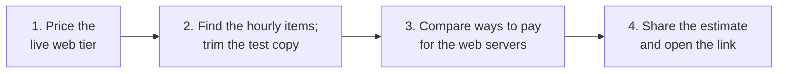

# Lab 15: Price the bakery's setup in the AWS Pricing Calculator, then cut what it doesn't need

## Before you start: your account, your responsibility

This guide is provided as is, without warranty. We work hard to keep it correct and current, but AWS changes often, and its services, prices, and free offers may differ from what is written here. The labs run in your own AWS account. You are responsible for that account, for its security, and for any charges it incurs, including charges from resources you forget to delete. Automate the Cloud Inc. is not liable for any costs, losses, or security incidents that result from following, or failing to follow, this material. Technical guidance here is general information, not advice about your specific systems.

**Who this is for:** you have read [06.01 Amazon EC2](../06-running-applications/01-ec2.md) and [06.02 Auto Scaling and load balancers](../06-running-applications/02-auto-scaling-and-load-balancers.md). Lessons [11.02 Purchasing options](02-purchasing-options.md) and [11.03 Estimate, watch, analyze](03-estimate-watch-analyze.md) help, but you can start without them. **Time:** about 45 minutes.

**Goal:** the bakery's bill has grown, and the owner wants to add a new feature: a cake designer where customers build their own cake. You price the site's web tier, find the lines that charge by the hour, trim a test copy for the new feature, compare ways to pay for the web servers, and share the estimate. **End state:** your lab log holds a priced estimate, a trimmed test copy, a table of purchasing options, and a link that opens the estimate.

*Notice that you price first and decide second: every cut in Part 2 and every choice in Part 3 rests on the numbers from Part 1.*

**Long description.** Four stages from left to right: price the live web tier; find the hourly items and trim the test copy; compare ways to pay for the web servers; share the estimate and open the link.

**What it creates:** nothing in AWS. The **AWS Pricing Calculator** is a free website for estimating AWS costs before you build anything, and it needs no AWS account ([What is AWS Pricing Calculator?](https://docs.aws.amazon.com/pricing-calculator/latest/userguide/what-is-pricing-calculator.html)). AWS also offers a version inside the Billing and Cost Management console that can use your account's discounts; this lab uses the public website.

**What it costs:** $0. **Worst case:** still $0. The one thing to watch is privacy: a shared estimate is stored on AWS's public servers and anyone with the link can open it, so never put names, addresses or account IDs in it.

**Before you start:** no guardrails are needed, because you don't sign in to AWS. You need a web browser and your lab log ([primer page 07](https://github.com/AutomateTheCloud/atc-study-aws_account_guardrails/blob/main/primer/07-habits-for-every-lab.md)).

**Why this matters:** estimating before you build is [COST06-BP01 Perform cost modeling](https://docs.aws.amazon.com/wellarchitected/latest/cost-optimization-pillar/cost_type_size_number_resources_cost_modeling.html), and an estimate is the starting point for [COST01-BP03 Establish cloud budgets and forecasts](https://docs.aws.amazon.com/wellarchitected/latest/cost-optimization-pillar/cost_cloud_financial_management_budget_forecast.html). Comparing ways to pay is [COST07-BP01 Perform pricing model analysis](https://docs.aws.amazon.com/wellarchitected/latest/cost-optimization-pillar/cost_pricing_model_analysis.html).

> **New sign-up path:** AWS lists the Pricing Calculator as not supported in that experience (as of 2026-10-23). We read that as the version inside the console. This lab uses the public website, which needs no account at all, so it should work the same for you.

**About the screens:** names in **bold** come from AWS's Pricing Calculator User Guide (checked 2026-10-24). We haven't yet run this lab, and the calculator's service pages change often, so other labels are hedged where they appear. If a label differs, look for the option with the same meaning.

> **Dated (checked 2026-10-24):** the prices in this lab are On-Demand, Linux, US East (N. Virginia), from AWS's Price List files: `t3.small` $0.0208 an hour; Application Load Balancer $0.0225 an hour plus capacity units; public IPv4 address $0.005 an hour; gp3 disk $0.08 per GB-month; S3 Standard $0.023 per GB-month. The calculator counts 730 hours in a month. Your calculator shows today's prices; trust it over this box.

## Steps

### Get ready

1. In your lab log, write today's date, `Lab 15`, and this table. You'll fill in the last column. The settings are round numbers for practice, not a copy of the bill in [lesson 11.01](01-how-aws-charges.md), which has smaller disks and more photos.

   | Line | Service to search for | Settings | Monthly cost |
   |---|---|---|---|
   | Web servers | Amazon EC2 | 2 × `t3.small`, Linux, shared tenancy, always on, On-Demand, 20 GB gp3 disk each | |
   | Load balancer | Elastic Load Balancing | 1 Application Load Balancer, very little traffic | |
   | Public addresses | Amazon VPC | 2 public IPv4 addresses, in use all month | |
   | Cake photos | Amazon S3 | 50 GB in S3 Standard | |

2. Open `https://calculator.aws/` in your browser. Don't sign in to anything.
   **You should see:** a page with a **Create estimate** button.

### Part 1: price the live web tier

3. Choose **Create estimate**.
   **You should see:** the **Add service** page, with a search box.
4. Search for `Amazon EC2` and choose **Configure** on its card.
5. In **Description**, type `Bakery live - web servers`. Choose the location type for a Region and the Region **US East (N. Virginia)**.
6. In the instance section, keep the tenancy as shared and the operating system as Linux. Choose the workload for constant usage, and set the number of instances to `2`. Search for `t3.small` and select it.
7. In the payment section, choose On-Demand. If the page asks for expected utilization, enter `100` percent.
8. In the storage section, choose General Purpose SSD (gp3) and type `20` GB. Leave snapshots, monitoring and data transfer empty or at zero.
   **You should see:** a monthly cost near $33.57 (two servers at $15.18, two disks at $1.60). **Show calculations** opens the working behind the figure; the calculator counts 730 hours a month.
   > **If something went wrong:** a much larger figure usually means a different Region, Windows, or a larger instance type. Check all three against step 6.
9. Choose **Save and add service**.
10. Search for `Elastic Load Balancing` and choose **Configure**. Choose the Application Load Balancer, the same Region, and `1` load balancer. Where it asks about traffic, enter the smallest values it accepts, such as `1` GB a month, and save the service.
    **You should see:** about $16.43 for the hours, plus a little for **capacity units** (load balancer capacity units, which grow with traffic).
11. Search for `Amazon VPC` and choose **Configure**. Look for the section on public IPv4 addresses, enter `2` in-use addresses for the full month, set any NAT gateway count to `0`, and save.
    **You should see:** $7.30 (2 × $0.005 × 730).
    > **If something went wrong:** if your calculator has no public IPv4 section, cancel this service and write $7.30 in your log by hand. AWS bills public IPv4 addresses by the hour either way ([Amazon VPC pricing](https://aws.amazon.com/vpc/pricing/)).
12. Search for `Amazon S3` and choose **Configure**. In S3 Standard, enter `50` GB of storage, leave requests at zero, and save.
    **You should see:** about $1.15.
13. Open the summary (the **My Estimate** page). Write each line's monthly cost in your log.
    **You should see:** four or five lines and a monthly total near $58.

### Part 2: find the hourly items, and trim the test copy

An **hourly item** is a line made of a time-based charge ([lesson 11.01](01-how-aws-charges.md)): it bills for every hour the resource exists, whether it does any work or not. A busy noon and an empty 3 a.m. cost the same.

14. Next to each line in your log, write **H** if it bills by the hour, **S** if it bills for a size you set, or **U** if it bills only for what you use.

> **Your turn:** which lines are hourly, and what share of the total are they? What would make the photo line grow?

Model answer

*Notice how short the only "pay for what you use" bar is. The three hourly lines are $54.10 of $58.45, about 93%.*

**Long description.** Horizontal bars, dollars per month, On-Demand, US East (N. Virginia), as of 2026-10-24. Charged every hour it exists: two `t3.small` web servers for 730 hours, $30.37; the load balancer's hourly charge, $16.43; two public IPv4 addresses, $7.30. Charged for the size you set: two 20 GB gp3 disks, $3.20. Charged for what you store: 50 GB of photos in S3 Standard, $1.15. Load balancer capacity units and data transfer are left out.

**H:** the servers, the load balancer and the public addresses. **S:** the disks, which bill for 20 GB whether they hold 1 GB or 20. **U:** the photos, which grow only when the bakery stores more (and with requests and downloads, which you left at zero). Your load balancer line is a little higher because of capacity units.

15. The owner's nephew wants a test copy of the site for the cake designer. His draft copies Part 1 without the photos: two servers, a load balancer and two public addresses, all month. Add up his draft's monthly cost from your log, without building it.
16. Testing happens only in working hours, about 40 of the week's 168 hours, and one tester at a time. Decide which of the draft's hourly items the test copy can drop.
17. Add a new **Amazon EC2** service with the description `Test copy - cake designer`, the same Region, `1` × `t3.small`, On-Demand, and a 20 GB gp3 disk. In the utilization or usage field, enter about `24` percent (40 ÷ 168), or 40 hours a week if it asks for hours. Save it.
    **You should see:** about $3.62 for the server and $1.60 for the disk.
    > **If something went wrong:** if you find no utilization or hours field, look for a workload option based on a usage pattern, such as a daily spike, and choose one that runs about 8 hours a day.

> **Your turn:** what did you remove, and why is the disk the one cost the trimmed copy can't shrink by running fewer hours?

Model answer

*Notice that most of the saving comes from removing whole hourly items, not from making them smaller.*

**Long description.** Two stacked horizontal bars, dollars per month, as of 2026-10-24. The nephew's draft totals $57.30: servers $30.37, load balancer $16.43, public IPv4 $7.30, disks $3.20. The trimmed copy totals $5.22: one `t3.small` for about 174 hours, $3.62, and its 20 GB disk, $1.60.

Remove the **load balancer**: with one server there is nothing to balance. Remove the **second server** and its address: one tester needs one. Run the remaining server **only in working hours**, and stop it outside them. The **disk** bills for its size for as long as it exists, even while the server is stopped (lesson 06.01), so only deleting it ends that charge.

### Part 3 (challenge): compare ways to pay for the web servers

18. The two live web servers run all year. On the **My Estimate** page, choose the **Edit** icon next to `Bakery live - web servers`. Try each payment option the calculator offers, choosing a **1-year** term and **no upfront** payment wherever it asks: On-Demand, Compute Savings Plans, EC2 Instance Savings Plans, Standard Reserved Instances, and Spot. For each, write the monthly cost and any upfront cost. Then set the line back to the option you would choose, and save.

> **Your turn:** fill in a table like this, then choose an option for the two always-on servers and give two reasons. Which option would you refuse, and why?

Model answer

| Option, 1 year, no upfront | Monthly, 2 × `t3.small` | Commitment |
|---|---|---|
| On-Demand | $30.37 | None |
| Standard Reserved Instances | $18.98 ($0.013 an hour each) | 1 year of this instance type |
| EC2 Instance Savings Plans | your calculator's figure | 1 year of dollars per hour on one family in one Region |
| Compute Savings Plans | your calculator's figure | 1 year of dollars per hour on any EC2, Lambda or Fargate |
| Spot | your calculator's figure, using its historical average discount | None, but AWS can reclaim the servers with a two-minute warning |

On-Demand and Reserved prices: AWS Price List, US East (N. Virginia), as of 2026-10-24. AWS describes Compute Savings Plans as up to 66% off On-Demand and EC2 Instance Savings Plans as up to 72% off ([Savings Plans types](https://docs.aws.amazon.com/savingsplans/latest/userguide/plan-types.html), checked 2026-10-24). "Up to" is the best case, so read your own figures.

**A good choice:** a 1-year **Savings Plan** sized to the two servers. They run every hour, so a commitment is paid for by real use, and the discount is large. A **Compute** Savings Plan keeps working if the bakery moves the servers to another family, such as Graviton, or onto Lambda; an **EC2 Instance** Savings Plan or a **Reserved Instance** can save more (AWS's maximum is 72% against 66%) but ties you to the `t3` family in one Region. **Refuse Spot** for these two servers: they are the site's only floor, and losing both with two minutes' warning would take orders offline.

> **Note:** on the Free plan you can't buy any of these commitments: AWS leaves Savings Plans and Reserved Instances out of it ([Choosing a plan](https://docs.aws.amazon.com/awsaccountbilling/latest/aboutv2/free-tier-plans.html), checked 2026-10-24). That is why you compare them here, on paper.

### Part 4: share the estimate

19. On the **My Estimate** page, check that no description contains a name, an address or an account ID. Then choose **Share**.
20. Read the **Public server acknowledgment** and choose **Agree and Continue**. Then choose **Copy public link**.
    **You should see:** a link copied to your clipboard. This **estimate link** is the public address that reopens the saved estimate. Paste it into your lab log, with one line saying what the estimate shows.
21. Open the link in a private browser window.
    **You should see:** the same estimate, with all its lines.
    > **If something went wrong:** an older version of the estimate means you changed something after sharing. The calculator never updates a saved link; choose **Share** again for a new one ([Sharing your estimate](https://docs.aws.amazon.com/pricing-calculator/latest/userguide/save-share-estimate.html)).

Estimate links made since 31 May 2023 stay valid for one year (checked 2026-10-24). The page also offers exports, such as CSV and PDF; AWS's guide says a PDF export holds a copy of the link.

## Check your work

- [ ] Your lab log lists four lines of the live web tier, each marked H, S or U, with a total near $58.
- [ ] The test copy line is near $5, and you can say why the load balancer went.
- [ ] Your table compares at least four payment options, with one choice and your reasons.
- [ ] Your estimate link opens in a private window.

## Clean up

22. Nothing was created in AWS, so there is nothing to delete. Close the calculator tab.
23. **Confirm:** you never signed in to AWS during this lab. The shared link stays readable for a year; AWS's guide describes no way to withdraw it, which is why step 19 checked it for personal details.

## Recap

You priced a setup before building it, saw that the hourly items make up almost all of its bill, cut a test copy by removing whole hourly items, and compared paying by the hour with committing for a year. Estimates come before the bill; Budgets, Cost Explorer and anomaly alerts watch the bill afterwards.

> **Reflect:** the owner asks, "Is $58 a month what we'll pay?" Write two sentences on what your estimate leaves out and how you would check it once the site runs.
>
> 

Model answer

>
> No: it leaves out data transfer to customers, load balancer traffic beyond the minimum, requests to S3, the database, tax and any change in prices, and it assumes On-Demand. Once the site runs, compare the estimate with Cost Explorer each month, and set a budget a little above the estimate so an alert says when reality drifts.
>
> 

**Next:** [Simulation S13](07-sim-purchasing-option-tree.md), where you choose a purchasing option for each of the bakery's workloads.

## Where to check the current details

- [What is AWS Pricing Calculator?](https://docs.aws.amazon.com/pricing-calculator/latest/userguide/what-is-pricing-calculator.html), AWS Pricing Calculator User Guide (checked 2026-10-24)
- [Create and configure an estimate](https://docs.aws.amazon.com/pricing-calculator/latest/userguide/create-configure-estimate.html) and [Generating Amazon EC2 estimates](https://docs.aws.amazon.com/pricing-calculator/latest/userguide/ec2-estimates.html) (checked 2026-10-24)
- [Sharing your estimate](https://docs.aws.amazon.com/pricing-calculator/latest/userguide/save-share-estimate.html) (checked 2026-10-24)
- [Amazon EC2 On-Demand pricing](https://aws.amazon.com/ec2/pricing/on-demand/), [Elastic Load Balancing pricing](https://aws.amazon.com/elasticloadbalancing/pricing/), [Amazon VPC pricing](https://aws.amazon.com/vpc/pricing/), [Amazon S3 pricing](https://aws.amazon.com/s3/pricing/) (prices as of 2026-10-24)
- [Savings Plans types](https://docs.aws.amazon.com/savingsplans/latest/userguide/plan-types.html), Savings Plans User Guide (checked 2026-10-24)

---

"Lab 15: Price the bakery's setup in the AWS Pricing Calculator" by Automate the Cloud Inc., licensed under CC BY-NC 4.0 with the Additional Permission for Internal Training from Automate the Cloud Inc.
License: https://creativecommons.org/licenses/by-nc/4.0/
Permission: https://automatethe.cloud/licenses/atc-internal-training-permission.txt
