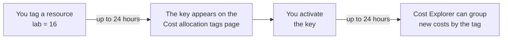

# Lab 16: Turn on cost allocation tags, then find them in Cost Explorer the next day

## Before you start: your account, your responsibility

This guide is provided as is, without warranty. We work hard to keep it correct and current, but AWS changes often, and its services, prices, and free offers may differ from what is written here. The labs run in your own AWS account. You are responsible for that account, for its security, and for any charges it incurs, including charges from resources you forget to delete. Automate the Cloud Inc. is not liable for any costs, losses, or security incidents that result from following, or failing to follow, this material. Technical guidance here is general information, not advice about your specific systems.

**Who this is for:** you have done [Lab 01](../02-why-the-cloud/06-lab-01-first-resource.md), where you first tagged a resource. Lesson [11.04 Many accounts, one bill](04-many-accounts-one-bill.md) explains the ideas; you can start without it. **Time:** about 15 minutes, plus 10 minutes the next day.

**Goal:** every lab so far has tagged its resources `guide` and `lab`, but your bill can't use those tags yet. You switch them on for billing, then check the next day that Cost Explorer can group costs by them. **End state:** `guide` and `lab` are active cost allocation tags, your lab log says what Cost Explorer showed, and the lab's bucket is gone.

*Notice the two waits, and that the arrow only points forward: activation tags costs from then on, not the ones before.*

**Long description.** Left to right: you tag a resource with `lab` = `16`; up to 24 hours later its key appears on the Cost allocation tags page; you activate the key; up to 24 hours later Cost Explorer can group new costs by the tag ([Activating user-defined cost allocation tags](https://docs.aws.amazon.com/awsaccountbilling/latest/aboutv2/activating-tags.html), checked 2026-10-24).

**What it creates:** one empty S3 bucket in US East (N. Virginia), `us-east-1`, tagged `guide` = `clf` and `lab` = `16`, so the tag keys exist on something today. It also changes one billing setting: the keys `guide` and `lab` become active. You delete the bucket at the end and keep the setting.

**What it costs:** $0. An empty bucket costs nothing (Lab 01). AWS's Marketplace guide says cost allocation tags carry no additional charge; we found no other AWS pricing statement about them (checked 2026-10-24). **Worst case on a Paid plan** if you forget the bucket: still $0 while it stays empty. **Free plan:** nothing here upgrades your plan; the Cost allocation tags page opened normally on our Free plan account on 2026-10-25. Never choose **Upgrade plan** during a lab.

**Before you start, you need these guardrails in place:** [root MFA](https://github.com/AutomateTheCloud/atc-study-aws_account_guardrails/blob/main/primer/02-secure-the-root-user.md) and, on the same page, **IAM user and role access to Billing information** activated (primer page 02); [an IAM admin user with MFA](https://github.com/AutomateTheCloud/atc-study-aws_account_guardrails/blob/main/primer/03-your-everyday-admin-identity.md), which you use for this lab (page 03); [budgets and billing alerts](https://github.com/AutomateTheCloud/atc-study-aws_account_guardrails/blob/main/primer/05-money-alarms.md), which also switched on Cost Explorer (page 05); and [the habits for every lab](https://github.com/AutomateTheCloud/atc-study-aws_account_guardrails/blob/main/primer/07-habits-for-every-lab.md), including your lab log (page 07).

**What your IAM user needs.** Two things, and both must be true:

- **The account lets IAM identities see billing at all.** By default it doesn't, even for an administrator, and only the root user can switch it on. You did that on primer page 02.
- **Your user's policies allow the billing actions.** Activating tags calls `ce:UpdateCostAllocationTagsStatus`, and Cost Explorer needs read actions such as `ce:GetCostAndUsage`. Your `AdministratorAccess` policy allows all of them. In a real company, someone in finance would get a narrower policy with just these actions ([AWS Cost Management policy examples](https://docs.aws.amazon.com/cost-management/latest/userguide/billing-example-policies.html)).

**Why this matters:** labeling cost with who or what caused it is [COST03-BP02 Add organization information to cost and usage](https://docs.aws.amazon.com/wellarchitected/latest/cost-optimization-pillar/cost_monitor_usage_org_information.html), and switching on the tools that report it is [COST03-BP05 Configure billing and cost management tools](https://docs.aws.amazon.com/wellarchitected/latest/cost-optimization-pillar/cost_monitor_usage_config_tools.html). The same switch is how the bakery will give each of its three teams a view of its own costs.

> **New sign-up path:** we haven't checked the cost allocation tags page in that experience, and we haven't run this lab there. Your projects belong to an organization that AWS manages, and only a management account or a standalone account can use the tag page, so it may not be open to you.

**About the screens:** labels in **bold** for steps 1 to 8 are what we saw in our test account on 2026-10-25; the next-day Cost Explorer steps follow AWS's guide and what we saw on day one. AWS changes its console often. If a label differs, look for the option with the same meaning.

## Steps

### Get ready

1. In your lab log, write today's date, `us-east-1`, the tags `guide` = `clf` and `lab` = `16`, and a bucket name: `clf-lab16-`, your initials, today's date and four random digits, for example `clf-lab16-ab-20261024-4817`.
2. Sign in to the console as your **IAM admin user**, not the root user. Check that the Region selector shows N. Virginia.
3. In the console search bar, type `Billing` and open **Billing and Cost Management**.
   **You should see:** the Billing and Cost Management home page, with your credits or costs.
   > **If something went wrong:** a message that you don't have access means IAM access to billing isn't activated. Only the root user can fix that: follow [primer page 02, "Let your admin user see billing"](https://github.com/AutomateTheCloud/atc-study-aws_account_guardrails/blob/main/primer/02-secure-the-root-user.md), sign out of root, and start again at step 2.

### Put the tags on something today

4. Create an empty bucket exactly as in [Lab 01, steps 5 to 11](../02-why-the-cloud/06-lab-01-first-resource.md#create-the-bucket-and-time-it), with your new name and the tags `guide` = `clf` and `lab` = `16`. You don't need the stopwatch.
   **You should see:** your bucket's page with a success message.

A tag key appears on the billing page only after it has been on a resource. Earlier labs may already have put `guide` and `lab` there; this bucket makes sure.

### Activate the two tag keys

5. In **Billing and Cost Management**, in the left menu under **Cost Organization**, choose **Cost Allocation Tags**. You may need to scroll the menu.
   **You should see:** **Cost allocation tags**, one list of tag keys with columns for **Status**, **Type**, **Last updated date** and **Last used month**. On 2026-10-25 the keys you made and the keys AWS made shared that one list.

   > **If something went wrong:** if the page says your account is on the Free plan and offers **Upgrade plan**, stop. Don't upgrade. Delete the bucket as in step 12 and read the rest of this lab instead.

   Your `guide` and `lab` keys are user-defined tags; keys that start with `aws:`, such as `aws:createdBy`, are AWS-generated tags. [Lesson 11.04](04-many-accounts-one-bill.md#a-tag-reaches-your-cost-reports-only-after-you-activate-it) compares the two types; both must be activated before they reach reports.
6. In the list, find `guide` and `lab` (the search box helps in a long list).
   **You should see:** both keys, each with the status **Inactive**, beside `aws:createdBy`.
   > **If something went wrong:** if a key isn't listed, AWS says it can take up to 24 hours to appear after you first tag a resource. Write "keys not listed yet" in your lab log, leave the bucket in place, and do steps 6 and 7 tomorrow. Then do the Cost Explorer check the day after that.

   

   *Screenshot: the three keys before activation, on a Free plan account, captured 2026-10-25 in our test account. AWS console screenshots are AWS material used as limited fair use and are not covered by this guide's license.*

7. Select both keys and choose **Activate**. A window asks whether to activate the 2 inactive tags; choose **Activate**.
   **You should see:** "Your tags have been activated successfully", and both keys marked **Active**. AWS says activation can take up to 24 hours to take effect ([Activating user-defined cost allocation tags](https://docs.aws.amazon.com/awsaccountbilling/latest/aboutv2/activating-tags.html), checked 2026-10-24).
8. Look at the top right of the page for **Backfill tags**. Don't choose it. A tag backfill ([lesson 11.04](04-many-accounts-one-bill.md#a-tag-shows-costs-is-wrong)) applies a key's current activation to up to 12 earlier months, and only for months when the tag was already on the resource. AWS documents it for management accounts, at most one request every 24 hours ([Backfill cost allocation tags](https://docs.aws.amazon.com/awsaccountbilling/latest/aboutv2/cost-allocation-backfill.html), checked 2026-10-24). Write in your lab log whether your standalone account shows the button: ours did, on 2026-10-25.

### The next day: find the tags in Cost Explorer

What you should expect to see is the pattern in this chart, drawn for the bakery.

*Notice that days 1 to 5 stay gray, even though the bakery's resources carried the tag all along.*

**Long description.** A stacked column chart of the bakery's daily cost in Cost Explorer, grouped by a `team` tag, made-up figures of about $20 a day. Days 1 to 5: one gray segment each, cost with no tag value. The key is activated on day 5 and active from day 6. Days 6 to 10: about $17 in blue that carries a team value, and about $3.50 in gray from untagged resources. Without a backfill, the early days never change.

9. Open **Billing and Cost Management**, then **Cost Explorer**. Set the date range to this month and the granularity to daily.
10. In the report settings on the right, find the option to group the chart, such as one labeled Group by. Choose **Tag**, then the key `lab`.
    **You should see:** your costs split by the values of `lab`. Most of the month sits in a group for costs with no tag value (labeled "No tag key" or similar), because the key wasn't active when they happened. Lab 16's bucket costs nothing, so the value `16` may not appear at all.
    > **If something went wrong:**
    > - *`lab` isn't offered under Tag:* activation hasn't finished. Check step 7's status and try again tomorrow.
    > - *The chart shows $0 everywhere:* on the Free plan, credits can cancel your costs out. Add a filter on **Charge type** that leaves out **Credit**, and look again.
11. Write in your lab log what you saw, and which values of `lab` appear.

## Check your work

- [ ] The Cost allocation tags page shows `guide` and `lab` as active.
- [ ] Cost Explorer offers `lab` when you group by tag.
- [ ] Your lab log explains why costs from earlier labs show no tag value.

## Clean up

12. Delete the bucket as in [Lab 01, steps 20 and 21](../02-why-the-cloud/06-lab-01-first-resource.md#clean-up).
13. Leave `guide` and `lab` active. Activation is a setting, not a resource, and from now on every lab's costs can be grouped by its number.
14. **Confirm:** in Tag Editor, search all Regions for the tag `lab` = `16` ([Lab 01, steps 13 to 16](../02-why-the-cloud/06-lab-01-first-resource.md#find-it-by-its-tags)); expect no results. Tick the bucket off in your lab log. (task card: [Find everything a lab left behind, in every Region](../98-how-to/03-find-what-a-lab-left-behind.md))

## Recap

A tag on a resource is only a label until you activate its key for billing. Then, after up to two waits of a day each, Cost Explorer can group new costs by it. Costs from before activation stay untagged unless a management account requests a backfill, and costs from resources nobody tagged never get a value.

> **Reflect:** the bakery has three teams: shop, kitchen and delivery. The owner wants each team to see its own costs. Using what you did here, write three steps you would take, and one thing that could still leave costs unassigned.
>
> 

Model answer

>
> First, agree on one tag key, such as `team`, with the values `shop`, `kitchen` and `delivery`, and tag every resource when it is created. Second, activate `team` on the Cost allocation tags page, a day after it first appears. Third, save a Cost Explorer report grouped by `team` for each team, and a budget filtered to each team's tag so it gets its own alerts. Costs from resources someone forgot to tag, shared items, and anything from before activation still show no tag value; separate accounts per team, under one consolidated bill, are the other way to split costs.
>
> 

**Next:** [Simulation S13](07-sim-purchasing-option-tree.md), choosing how to pay for each of the bakery's workloads.

## Where to check the current details

- [Organizing and tracking costs using AWS cost allocation tags](https://docs.aws.amazon.com/awsaccountbilling/latest/aboutv2/cost-alloc-tags.html), AWS Billing User Guide (checked 2026-10-24)
- [Activating user-defined cost allocation tags](https://docs.aws.amazon.com/awsaccountbilling/latest/aboutv2/activating-tags.html) and [Using user-defined cost allocation tags](https://docs.aws.amazon.com/awsaccountbilling/latest/aboutv2/custom-tags.html) (checked 2026-10-24)
- [Backfill cost allocation tags](https://docs.aws.amazon.com/awsaccountbilling/latest/aboutv2/cost-allocation-backfill.html) (checked 2026-10-24)
- [Filtering the data that you want to view](https://docs.aws.amazon.com/cost-management/latest/userguide/ce-filtering.html), AWS Cost Management User Guide (checked 2026-10-24)

---

"Lab 16: Turn on cost allocation tags and find them in Cost Explorer" by Automate the Cloud Inc., licensed under CC BY-NC 4.0 with the Additional Permission for Internal Training from Automate the Cloud Inc.
License: https://creativecommons.org/licenses/by-nc/4.0/
Permission: https://automatethe.cloud/licenses/atc-internal-training-permission.txt
