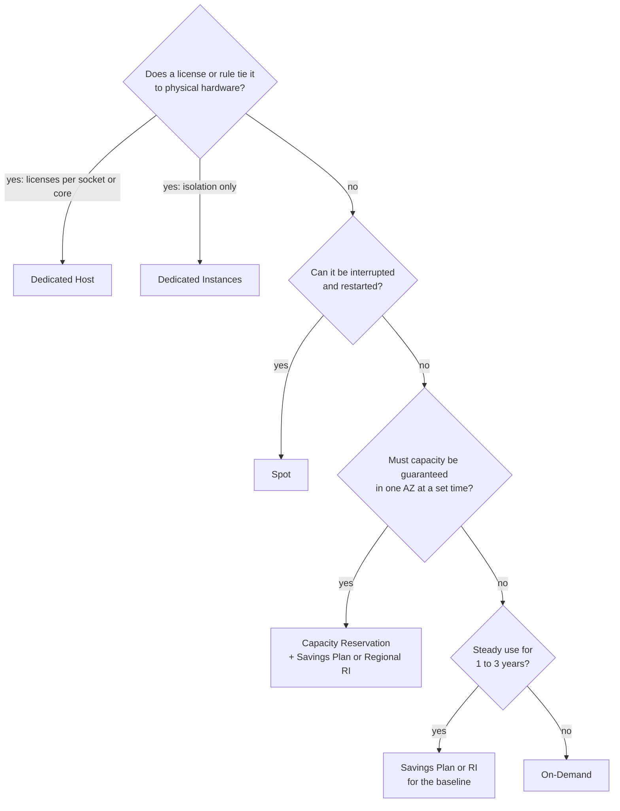

# Simulation S13: Choose how to pay for each of the bakery's workloads, and how much to commit

## Before you start: your account, your responsibility

This guide is provided as is, without warranty. We work hard to keep it correct and current, but AWS changes often, and its services, prices, and free offers may differ from what is written here. The labs run in your own AWS account. You are responsible for that account, for its security, and for any charges it incurs, including charges from resources you forget to delete. Automate the Cloud Inc. is not liable for any costs, losses, or security incidents that result from following, or failing to follow, this material. Technical guidance here is general information, not advice about your specific systems.

**Who this is for:** you have read lesson [11.02 Purchasing options](02-purchasing-options.md). **Time:** about 20 minutes. **Cost:** $0; no AWS account is used.

**Why a simulation:** the Free plan doesn't include Savings Plans or Reserved Instances ([Choosing a plan](https://docs.aws.amazon.com/awsaccountbilling/latest/aboutv2/free-tier-plans.html), checked 2026-10-24), and on a Paid plan a commitment is a 1- or 3-year promise you can't take back. So you practice the choice here.

**Goal:** pick a purchasing option for each of six workloads, size a commitment for the web servers, and correct three common wrong claims. **End state:** a filled-in table and a commitment you can defend to the owner.

## The rules of this simulation

The bakery's workloads are made up; the options' rules are AWS's.

> **Dated (checked 2026-10-24):** a Database Savings Plan comes only with a one-year term and no upfront payment ([Savings Plans FAQ](https://aws.amazon.com/savingsplans/faq/)), and covers RDS, Aurora, DynamoDB and other database services across engines ([Savings Plans types](https://docs.aws.amazon.com/savingsplans/latest/userguide/plan-types.html)). Spot gives up to 90% off ([Amazon EC2 Spot Instances](https://aws.amazon.com/ec2/spot/)).

A **commitment**, as in lesson 11.02, is a promise to pay for a set amount of use for a term, whether you use it or not. **Baseline usage** is the level a workload never drops below.

Ask the tree's questions in order; the first "yes" decides.

*Notice that a commitment is the last "yes" in the tree: you commit only to what is steady.*

**Long description.** Four questions, top to bottom. One: does a license or rule tie it to physical hardware? Per-socket or per-core licenses: Dedicated Host; isolation only: Dedicated Instances. Two: can it be interrupted and restarted? Spot. Three: must capacity be guaranteed in one AZ at a set time? A Capacity Reservation plus a Savings Plan or Regional RI. Four: steady use for one to three years? A Savings Plan or RI for the baseline. Otherwise: On-Demand.

## Part 1: one option for each workload

### Decision 1: choose an option for each workload, and give the reason

| # | Workload | What it is like |
|---|---|---|
| A | Web servers, the floor | 2 `t3.small` running every hour of the year; the bakery may move to Graviton (`t4g`) next year |
| B | Web servers, the peaks | 0 to 4 more servers at lunch and on December Saturdays, added by Auto Scaling |
| C | Nightly photo resize | One hour a night; if stopped, it starts again from the last photo |
| D | Order database on RDS | Runs every hour; the bakery expects it for three years, perhaps on a different engine |
| E | Christmas launch | The owner insists that 4 extra servers in `us-east-1a` must be launchable on the three Saturdays before Christmas |
| F | Supplier's planning app | Its license is priced per physical processor core, and the supplier must see which server it runs on |

Model answer

| # | Option | Why |
|---|---|---|
| A | **Compute Savings Plan** | Steady for years, so commit. Compute keeps the discount when the servers move to `t4g`; an EC2 Instance Savings Plan or RI is tied to the `t3` family |
| B | **On-Demand** | Peaks come and go; a commitment would be paid for idle hours |
| C | **Spot** | It can be interrupted and restarted, so the two-minute warning costs only time |
| D | **Database Savings Plan** | Steady for years (renewed each year), and it still applies if the bakery changes engine |
| E | **Capacity Reservation** for the busy weeks | Only a reservation guarantees capacity in one AZ. It bills whether used or not and gives no discount by itself |
| F | **Dedicated Host** | Per-core licenses need a physical server you can see. Dedicated Instances isolate the hardware but don't give you control of the server |

## Part 2: how much to commit

The web servers never drop below 2 instances; on a busy December Saturday they peak at 6.

*Notice that the blue floor is the same every hour. That is the part a commitment fits.*

**Long description.** A stacked column chart of a December Saturday, made-up orders. Every hour has 2 baseline servers in blue. From 09:00 to 19:00 extra On-Demand servers in orange sit on top: 1, 2, 3, then 4 at noon and 13:00, then 3, 2, 3, 3, 2 and 1. Of the day's 76 server-hours, 48 are baseline and 28 are peak.

### Decision 2: commit to 0, 2 or 6 servers?

The commitment is paid for every hour of the year, used or not; servers above it pay On-Demand. Which size do you choose, and why not the other two?

Model answer

**Commit to 2, the baseline.** Those two servers run every hour, so the whole commitment is used. Committing to 0 pays the full rate for servers that run all year. Committing to 6 pays every night for four servers that run a few hours a day, and with our made-up figures costs more than no commitment at all. Commit to what you always use; pay On-Demand for the rest.

## Part 3: three claims to correct

### Decision 3: say what is wrong with each claim

1. "There are two kinds of Savings Plans: Compute and EC2 Instance."
2. "We bought a Capacity Reservation, so those servers are now cheaper."
3. "A Reserved Instance is a server AWS keeps switched on for us."

Model answer

1. **There are four:** Compute, EC2 Instance, Database and SageMaker AI (as of 2026-10-24). Older material shows two because the other two came later.
2. **A Capacity Reservation gives no discount.** It holds capacity and bills at the On-Demand rate whether used or not; a Savings Plan or Regional RI is what lowers the price.
3. **An RI is a billing discount,** not a machine. It applies to any running instance that matches its configuration. Only a zonal RI also holds capacity, and even then nothing runs until you launch an instance.

## Recap

Ask the tree's questions in order. Commit only to the baseline, choose the flexible plan when the workload may change, and leave everything else On-Demand.

**Next:** [Estimate, watch, analyze](03-estimate-watch-analyze.md).

## Where to check the current details

- [Amazon EC2 billing and purchasing options](https://docs.aws.amazon.com/AWSEC2/latest/UserGuide/instance-purchasing-options.html) (checked 2026-10-24)
- [Savings Plans types](https://docs.aws.amazon.com/savingsplans/latest/userguide/plan-types.html) (checked 2026-10-24)
- [On-Demand Capacity Reservations](https://docs.aws.amazon.com/AWSEC2/latest/UserGuide/ec2-capacity-reservations.html) (checked 2026-10-24)

---

"Simulation S13: Choose how to pay for each of the bakery's workloads" by Automate the Cloud Inc., licensed under CC BY-NC 4.0 with the Additional Permission for Internal Training from Automate the Cloud Inc.
License: https://creativecommons.org/licenses/by-nc/4.0/
Permission: https://automatethe.cloud/licenses/atc-internal-training-permission.txt
