# Simulation S13: Choose how to pay for each of the bakery's workloads, and how much to commit

## Before you start: your account, your responsibility

This guide is provided as is, without warranty. We work hard to keep it correct and current, but AWS changes often, and its services, prices, and free offers may differ from what is written here. The labs run in your own AWS account. You are responsible for that account, for its security, and for any charges it incurs, including charges from resources you forget to delete. Automate the Cloud Inc. is not liable for any costs, losses, or security incidents that result from following, or failing to follow, this material. Technical guidance here is general information, not advice about your specific systems.

**Who this is for:** you have read [06.01 Amazon EC2](../06-running-applications/01-ec2.md) and done [Simulation S7](../06-running-applications/07-sim-elasticity-with-auto-scaling.md). Lesson [11.02 Purchasing options](02-purchasing-options.md) teaches each option in depth. **Time:** about 30 minutes. **Cost:** $0; no AWS account is used.

**Why a simulation:** the Free plan doesn't include Savings Plans or Reserved Instances ([Choosing a plan](https://docs.aws.amazon.com/awsaccountbilling/latest/aboutv2/free-tier-plans.html), checked 2026-10-24). On a Paid plan, a commitment is a 1- or 3-year promise you can't take back: AWS says a Savings Plan's terms can't be changed after purchase, and only small plans can be returned, within 7 days ([Savings Plans FAQ](https://aws.amazon.com/savingsplans/faq/)). So you practice the choice here.

**Goal:** pick a purchasing option for each of six workloads, size a commitment for the web servers, and spot three common wrong claims. **End state:** a filled-in table and a commitment you can defend to the owner.

**Why this matters:** choosing how to pay for each part of a workload is [COST07-BP01 Perform pricing model analysis](https://docs.aws.amazon.com/wellarchitected/latest/cost-optimization-pillar/cost_pricing_model_analysis.html) and [COST07-BP04 Implement pricing models for all components of this workload](https://docs.aws.amazon.com/wellarchitected/latest/cost-optimization-pillar/cost_pricing_model_implement_models.html).

## The rules of this simulation

The bakery and its workloads are made up; the options and their rules are AWS's.

> **Dated (checked 2026-10-24):** AWS's maximum discounts off On-Demand: Compute Savings Plans up to 66%, EC2 Instance Savings Plans up to 72%, Database Savings Plans up to 35%, SageMaker AI Savings Plans up to 64% ([Savings Plans types](https://docs.aws.amazon.com/savingsplans/latest/userguide/plan-types.html)); Spot up to 90% ([Amazon EC2 Spot Instances](https://aws.amazon.com/ec2/spot/)). "Up to" is the best case, not what every workload gets.

| Option | What you promise | What you get |
|---|---|---|
| **On-Demand** | Nothing | Pay by the second or hour for what runs |
| **Compute Savings Plan** | A dollar amount per hour for 1 or 3 years | A discount on any EC2 family, size, Region, operating system or tenancy, and on Fargate and Lambda |
| **EC2 Instance Savings Plan** | A dollar amount per hour for 1 or 3 years, on one family in one Region | A deeper discount; size, operating system and tenancy can change |
| **Database Savings Plan** | A dollar amount per hour for 1 year, with no upfront payment (the only term AWS offers for it) | A discount across RDS, Aurora, DynamoDB and other database services |
| **Reserved Instance (RI)** | One instance configuration for 1 or 3 years | A billing discount on matching usage. **Standard** can't be exchanged but can be sold on the RI Marketplace; **Convertible** can be exchanged for different attributes. **Zonal** reserves capacity in one AZ; **Regional** doesn't, but applies in any AZ and, for Linux with default tenancy, to any size in the family |
| **Spot Instance** | Nothing | Spare capacity at a steep discount; AWS can interrupt it with a two-minute warning |
| **Capacity Reservation** | Nothing for immediate use (you can cancel any time) | Capacity held in one AZ, billed whether used or not; no discount by itself, but Savings Plans or Regional RIs can apply to it |
| **Dedicated Host** | Pay for a whole physical server | A server for your use only, so you can bring licenses priced per socket, core or VM |
| **Dedicated Instance** | Pay per instance, plus a per-Region dedicated fee | Instances on hardware no other customer uses, without control of the server itself |

A **commitment**, as in lesson 11.02, is a promise to pay for a set amount of use for a term, whether you use it or not. **Baseline usage** is the level a workload never drops below.

The decision tree asks the questions in order; the first "yes" decides.

```mermaid
flowchart TD
  accTitle: A decision tree for EC2 purchasing options
  accDescr: First question, does a license or rule tie it to physical hardware? Yes leads to Dedicated Host if licenses count sockets or cores, or Dedicated Instances if you only need hardware no one else uses. No leads to, can the work be interrupted and restarted? Yes leads to Spot. No leads to, must capacity be guaranteed in one AZ at a set time? Yes leads to a Capacity Reservation, plus a Savings Plan or Regional RI for the discount. No leads to, is the use steady for one to three years? Yes leads to a Savings Plan or RI for the baseline. No leads to On-Demand.
  Q1{"Does a license or rule tie it<br/>to physical hardware?"} -->|"yes: licenses per socket or core"| DH["Dedicated Host"]
  Q1 -->|"yes: isolation only"| DI["Dedicated Instances"]
  Q1 -->|no| Q2{"Can it be interrupted<br/>and restarted?"}
  Q2 -->|yes| S["Spot"]
  Q2 -->|no| Q3{"Must capacity be guaranteed<br/>in one AZ at a set time?"}
  Q3 -->|yes| CR["Capacity Reservation<br/>+ Savings Plan or Regional RI"]
  Q3 -->|no| Q4{"Steady use for<br/>1 to 3 years?"}
  Q4 -->|yes| SP["Savings Plan or RI<br/>for the baseline"]
  Q4 -->|no| OD["On-Demand"]
```

*Notice that a commitment is the last "yes" in the tree: you commit only to what is steady, after ruling out cheaper or stricter answers.*

**Long description.** A top-down flowchart of four questions, in the same order as lesson 11.02's. One: does a license or rule tie it to physical hardware? Yes, licenses per socket or core: Dedicated Host; yes, isolation only: Dedicated Instances. Two: can it be interrupted and restarted? Yes: Spot. Three: must capacity be guaranteed in one AZ at a set time? Yes: a Capacity Reservation plus a Savings Plan or Regional RI. Four: steady use for one to three years? Yes: a Savings Plan or RI for the baseline. Otherwise: On-Demand.

## Part 1: one option for each workload

### Decision 1: choose an option for each workload, and give the reason

| # | Workload | What it is like |
|---|---|---|
| A | Web servers, the floor | 2 `t3.small` running every hour of the year; the bakery may move to Graviton (`t4g`) next year |
| B | Web servers, the peaks | 0 to 4 more servers at lunch and on December Saturdays, added by Auto Scaling |
| C | Nightly photo resize | One hour a night; if stopped, it starts again from the last photo |
| D | Order database on RDS | Runs every hour; the bakery expects it for three years, perhaps on a different engine |
| E | Christmas launch | The owner insists that 4 extra servers in `us-east-1a` must be launchable on the three Saturdays before Christmas |
| F | Supplier's planning app | Its license is priced per physical processor core, and the supplier must see which server it runs on |

Model answer

| # | Option | Why |
|---|---|---|
| A | **Compute Savings Plan** | Steady for years, so commit. Compute keeps the discount when the servers move to `t4g`; an EC2 Instance Savings Plan or RI is tied to the `t3` family |
| B | **On-Demand** | Peaks come and go; a commitment would be paid for idle hours. (Spot can work for extra web servers if the site keeps no state on them, but it is not the safe first answer) |
| C | **Spot** | It can be interrupted and restarted, so the two-minute warning costs only time |
| D | **Database Savings Plan** | Steady for years (its term is one year, so the bakery renews it each year), and it still applies if the bakery changes engine or moves to another database service |
| E | **Capacity Reservation**, cancelled after Christmas | Only a reservation guarantees capacity in one AZ. It bills whether used or not and gives no discount by itself |
| F | **Dedicated Host** | Per-core licenses need a physical server you can see. Dedicated Instances isolate the hardware but don't give you control of the server |

## Part 2: how much to commit

The web servers from Simulation S7 never drop below 2 instances; on the December Saturday they peak at 6.

*Notice that the blue floor is the same every hour. That is the part a commitment fits.*

**Long description.** A stacked column chart of the December Saturday from Simulation S7, made-up orders. Every hour has 2 baseline servers in blue. From 09:00 to 19:00 extra On-Demand servers in orange sit on top: 1, 2, 3, then 4 at noon and 13:00, then 3, 2, 3, 3, 2 and 1. Of the day's 76 server-hours, 48 are baseline and 28 are peak.

Prices, `t3.small`, Linux, US East (N. Virginia), as of 2026-10-24: On-Demand $0.0208 an hour; a 1-year Standard Reserved Instance with no upfront payment, $0.013 an hour, paid for every hour of the year ([Reserved Instances pricing](https://aws.amazon.com/ec2/pricing/reserved-instances/)). We use RI prices because the price list gives them per instance; a Savings Plan sized the same way behaves the same.

### Decision 2: commit to 0, 2 or 6 servers?

Assume, generously for the larger commitments, that every day of the year is as busy as this Saturday. Work out the year's cost for each choice, then pick one.

Model answer

*Notice that committing to the peak costs more than no commitment at all.*

**Long description.** Three horizontal bars, dollars per year, as of 2026-10-24. No commitment: 76 server-hours a day at $0.0208, $576.99. Commit to 2: 2 RIs for 8,760 hours at $0.013, $227.76, plus 28 peak server-hours a day On-Demand, $212.58, $440.34 in all. Commit to 6: 6 RIs, $683.28, and nothing On-Demand.

**Commit to 2, the baseline.** It is the cheapest even under this busy assumption, and on ordinary days its On-Demand part shrinks further. Six servers' worth of commitment pays every night for four servers that only run a few hours a day. The rule: commit to what you always use, and pay On-Demand for the rest.

## Part 3: three claims to correct

### Decision 3: say what is wrong with each claim

1. "There are two kinds of Savings Plans: Compute and EC2 Instance."
2. "We bought a Capacity Reservation, so those servers are now cheaper."
3. "A Reserved Instance is a server AWS keeps switched on for us."

Model answer

1. **There are four:** Compute, EC2 Instance, Database and SageMaker AI (as of 2026-10-24). Older material shows two because the other two came later.
2. **A Capacity Reservation gives no discount.** It holds capacity and bills at the On-Demand rate whether used or not; a Savings Plan or Regional RI is what lowers the price.
3. **An RI is a billing discount,** not a machine. It applies to any running instance that matches its configuration. Only a zonal RI also holds capacity, and even then nothing runs until you launch an instance.

You may also meet "RIs save up to 75%": a few older AWS pages still say it, but the EC2 [Reserved Instances pricing](https://aws.amazon.com/ec2/pricing/reserved-instances/) page says up to 72% (checked 2026-10-24). Either way, it's a ceiling, not what every workload gets.

## Recap

Ask the tree's questions in order: hardware-bound licenses go to a Dedicated Host, interruptible work to Spot, guaranteed capacity to a Capacity Reservation, and steady use to a Savings Plan or RI. Commit only to the baseline, and choose the flexible plan when the workload may change. Everything else stays On-Demand.

**Next:** [Simulation S14](08-sim-guardrail-timeline.md), where a forgotten weekend tests which guardrails alert and which stop spending.

## Where to check the current details

- [Amazon EC2 billing and purchasing options](https://docs.aws.amazon.com/AWSEC2/latest/UserGuide/instance-purchasing-options.html), Amazon EC2 User Guide (checked 2026-10-24)
- [Savings Plans types](https://docs.aws.amazon.com/savingsplans/latest/userguide/plan-types.html), Savings Plans User Guide (checked 2026-10-24)
- [Types of Reserved Instances](https://docs.aws.amazon.com/AWSEC2/latest/UserGuide/reserved-instances-types.html) and [Regional and zonal Reserved Instances](https://docs.aws.amazon.com/AWSEC2/latest/UserGuide/reserved-instances-scope.html) (checked 2026-10-24)
- [Spot Instances](https://docs.aws.amazon.com/AWSEC2/latest/UserGuide/using-spot-instances.html) and [On-Demand Capacity Reservations](https://docs.aws.amazon.com/AWSEC2/latest/UserGuide/ec2-capacity-reservations.html) (checked 2026-10-24)

---

"Simulation S13: Choose how to pay for each of the bakery's workloads" by Automate the Cloud Inc., licensed under CC BY-NC 4.0 with the Additional Permission for Internal Training from Automate the Cloud Inc.
License: https://creativecommons.org/licenses/by-nc/4.0/
Permission: https://automatethe.cloud/licenses/atc-internal-training-permission.txt
